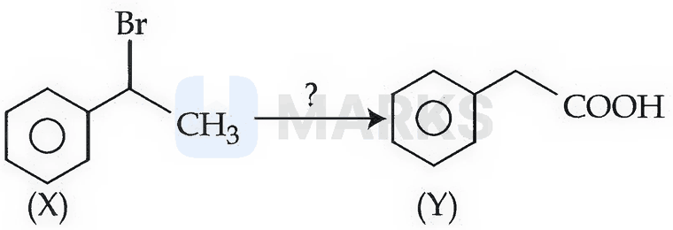
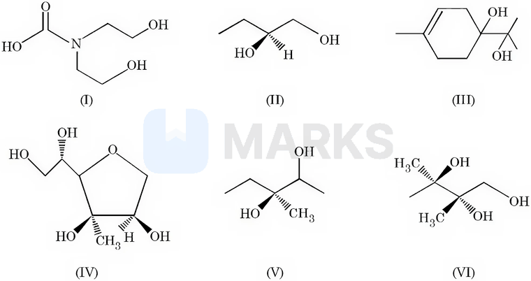
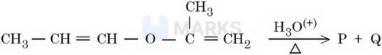
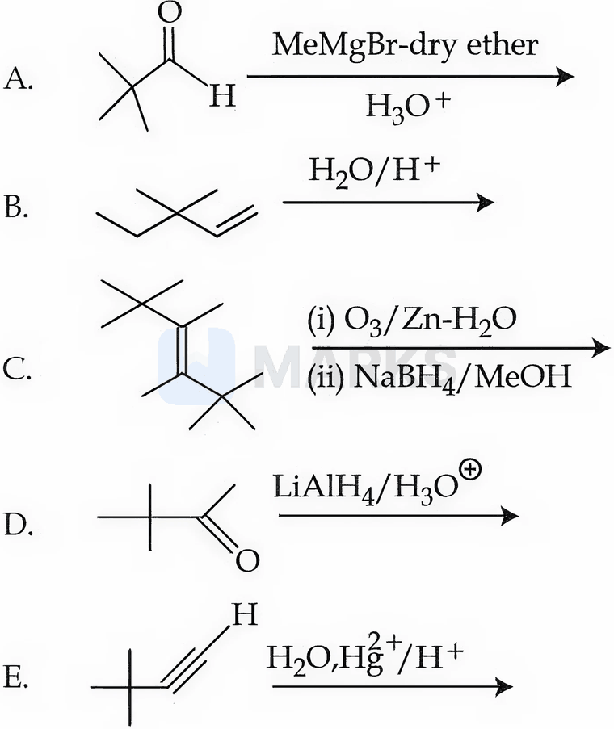
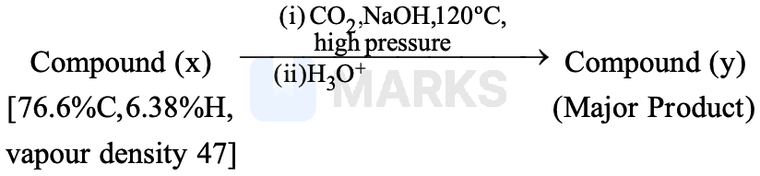
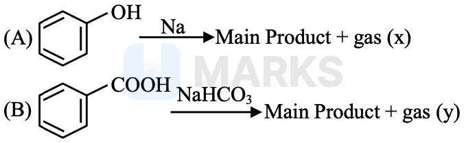

# Alcohols, Phenols & Ethers

> Theory: [../../theory/chemistry/alcohols-phenols-ethers.md](../../theory/chemistry/alcohols-phenols-ethers.md)

### C-ALC-01 · B — JEE Main 2026 · 23 Jan Shift 1 · set Q1 · MCQ

The correct sequence of reagents for the above conversion of X to Y is:

(1) (i) NaOH(aq); (ii) Jones reagent; (iii) $\mathrm{H_3O^+}$  (2) (i) $\mathrm{B_2H_6/H_2O_2}$; (ii) NaOEt; (iii) Jones reagent  (3) (i) Jones reagent; (ii) NaOEt; (iii) hot $\mathrm{KMnO_4/KOH}$  (4) (i) NaOEt; (ii) $\mathrm{B_2H_6/H_2O_2}$; (iii) Jones reagent

**Answer: (4)** · key (compiled)

**Solution.** X is $\mathrm{PhCH(Br)CH_3}$ and Y is $\mathrm{PhCH_2COOH}$ – the carboxyl carbon must come from the *terminal* carbon. (i) NaOEt (bulky base, E2) gives styrene $\mathrm{PhCH{=}CH_2}$; (ii) hydroboration–oxidation (anti-Markovnikov) gives $\mathrm{PhCH_2CH_2OH}$; (iii) Jones reagent oxidises the primary alcohol to $\mathrm{PhCH_2COOH}$. Answer (4).

### C-ALC-02 · B — JEE Main 2026 · 23 Jan Shift 1 · set Q2 · MCQ

Match List-I with List-II.

| List-I: functional group (detection) | List-II: change observed during detection |
|---|---|
| A. Unsaturation (Baeyer's test) | I. Red colour appears |
| B. Alcoholic group (ceric ammonium nitrate test) | II. Silver mirror appears |
| C. Aldehyde group (Tollens' reagent) | III. Violet colour appears |
| D. Phenolic group ($\mathrm{FeCl_3}$ test) | IV. Discharge of pink colour |

(1) A-III, B-IV, C-II, D-I  (2) A-IV, B-I, C-II, D-III  (3) A-IV, B-III, C-II, D-I  (4) A-III, B-IV, C-I, D-II

**Answer: (2)** · key (compiled)

**Solution.** Baeyer's reagent (cold alkaline $\mathrm{KMnO_4}$, pink/purple) is decolourised by a $\mathrm{C{=}C}$ (A–IV). Ceric ammonium nitrate (yellow) turns red with alcohols (B–I). Tollens' reagent gives a silver mirror with aldehydes (C–II). Phenols give a violet colour with neutral $\mathrm{FeCl_3}$ (D–III).

### C-ALC-03 · B — JEE Main 2026 · 28 Jan Shift 2 · set Q3 · MCQ

The reactions which produce an alcohol as the product are:

A. $\mathrm{CH_4+O_2\xrightarrow[\Delta]{Mo_2O_3}}$  
B. $\mathrm{2CH_3CH_3+3O_2\xrightarrow[\Delta]{(CH_3COO)_2Mn}}$  
C. $(\mathrm{CH_3})_3\mathrm{CH}\xrightarrow{\mathrm{KMnO_4}}$  
D. $\mathrm{2CH_4+O_2\xrightarrow{Cu/523\ K/100\ atm}}$  
E. $\mathrm{CH_3{-}CH{=}CH{-}CH_3\xrightarrow{KMnO_4/H^+}}$

(1) A, C and E only  (2) A and D only  (3) C and D only  (4) B, D and E only

**Answer: (3)** · key (compiled)

**Solution.** A gives HCHO (methanal), B gives $\mathrm{CH_3COOH}$, E gives $2\,\mathrm{CH_3COOH}$ (oxidative cleavage). C: $\mathrm{KMnO_4}$ oxidises the tertiary C–H of isobutane to give $(\mathrm{CH_3})_3\mathrm{COH}$ (alcohol). D: $\mathrm{Cu/523\ K/100\ atm}$ oxidises methane to $\mathrm{CH_3OH}$. So C and D.

### C-ALC-04 · B — JEE Main 2026 · 24 Jan Shift 2 · set Q4 · MCQ

From the following, how many compounds contain at least one secondary alcohol?

(1) Three  (2) Five  (3) Four  (4) Two

**Answer: (1)** · key (compiled)

**Solution.** A secondary alcohol has the OH on a carbon bonded to two other carbons (and one H). (I) has only primary –CH₂OH groups (its other OH is part of the carbamic acid). (II) butane-1,2-diol has a secondary OH. (III) has two tertiary OH. (IV) the furanose has secondary OH groups (ring and side chain). (V) has a secondary OH (C2) and a tertiary one (C3). (VI) has two tertiary OH and one primary. So II, IV and V: three.

### C-ALC-05 · B — JEE Main 2026 · 24 Jan Shift 2 · set Q5 · MCQ

The unsaturated ether on acidic hydrolysis produces carbonyl compounds as shown: $\mathrm{CH_3{-}CH{=}CH{-}O{-}CH{=}CH_2\xrightarrow{H_3O^+}CH_3CH_2CH{=}O+O{=}CH{-}CH_3}$. Based on this, predict the solution/reagent that will help to distinguish P and Q obtained in the following reaction:

(1) Fehling solution  (2) Lucas reagent  (3) 2,4-DNP reagent  (4) Saturated $\mathrm{NaHSO_3}$ solution

**Answer: (1)** · key (compiled)

**Solution.** Hydrolysis of the enol ether splits it into two enols, each of which tautomerises to a carbonyl compound: $\mathrm{CH_3CH{=}CH{-}OH\to CH_3CH_2CHO}$ (propanal) and $\mathrm{CH_2{=}C(CH_3){-}OH\to CH_3COCH_3}$ (acetone). Aldehyde vs ketone: Fehling's solution is reduced (red $\mathrm{Cu_2O}$) by propanal but not by acetone. 2,4-DNP and $\mathrm{NaHSO_3}$ react with both; Lucas reagent is for alcohols.

### C-ALC-06 · B — JEE Main 2026 · 22 Jan Shift 2 · set Q6 · MCQ

3,3-Dimethyl-2-butanol cannot be prepared by:

(1) B and C only  (2) B and E only  (3) B only  (4) B, C and E only

**Answer: (2)** · key (compiled)

**Solution.** The target is $(\mathrm{CH_3})_3\mathrm{C{-}CH(OH)CH_3}$. A: $t$-BuCHO + MeMgBr gives it. C: ozonolysis of the alkene gives two molecules of $t$-BuCOCH$_3$, and $\mathrm{NaBH_4}$ reduces it to the target. D: $\mathrm{LiAlH_4}$ reduction of $t$-BuCOCH$_3$ gives it. B cannot: it has an extra carbon (ethyl) and acid-catalysed hydration would in any case rearrange. E cannot: Markovnikov hydration of the alkyne gives the *ketone* $t$-BuCOCH$_3$, not the alcohol. So B and E.

### C-ALC-07 · B — JEE Main 2026 · 22 Jan Shift 1 · set Q7 · MCQ

Given below are two statements:

Statement I: Phenol on treatment with $\mathrm{CHCl_3}$/aq. KOH under refluxing conditions, followed by acidification, produces $p$-hydroxybenzaldehyde as the major product and $o$-hydroxybenzaldehyde as the minor product.  
Statement II: The mixture of $p$-hydroxybenzaldehyde and $o$-hydroxybenzaldehyde can be easily separated by steam distillation.

(1) Statement I is true but Statement II is false  (2) Statement I is false but Statement II is true  (3) Both Statement I and Statement II are true  (4) Both Statement I and Statement II are false

**Answer: (2)** · key (compiled)

**Solution.** This is the Reimer–Tiemann reaction, in which the *ortho* product (salicylaldehyde) is the major product and *para* the minor, so I is false. $o$-Hydroxybenzaldehyde has intramolecular H-bonding and is steam-volatile, while the $p$-isomer has intermolecular H-bonding and is not, so they are separated by steam distillation – II true.

### C-ALC-08 · B — JEE Main 2026 · 28 Jan Shift 1 · set Q9 · MCQ

Consider the following reaction sequence. Compound (y) develops a characteristic colour with neutral $\mathrm{FeCl_3}$ solution. Identify the INCORRECT statement for the above sequence.

(1) Compound y will dissolve in $\mathrm{NaHCO_3}$ and evolve a gas.  (2) Both compounds x and y will dissolve in NaOH.  (3) Both compounds x and y will burn with a sooty flame.  (4) Compound x is more acidic than compound y.

**Answer: (4)** · key (compiled)

**Solution.** x: $\mathrm{C}=0.766\times94/12=6$, $\mathrm H=0.0638\times94=6$, $\mathrm O=(94-72-6)/16=1$ ($M=2\times47=94$): $\mathrm{C_6H_6O}$, phenol. Kolbe–Schmitt reaction gives y = salicylic acid ($o$-hydroxybenzoic acid; violet with $\mathrm{FeCl_3}$). (1) true (–COOH liberates $\mathrm{CO_2}$ from bicarbonate); (2) true; (3) true (aromatic compounds burn with a sooty flame); (4) false – salicylic acid ($\mathrm{p}K_a\approx3$) is much more acidic than phenol ($\mathrm{p}K_a\approx10$).

### C-ALC-09 · B — JEE Main 2026 · 24 Jan Shift 1 · set Q10 · MCQ

A hydroxy compound (X) with molar mass 122 g mol$^{-1}$ is acetylated with acetic anhydride, using a large excess of the reagent, ensuring complete acetylation of all hydroxyl groups. The product obtained has a molar mass of 290 g mol$^{-1}$. The number of hydroxyl groups present in compound (X) is:

(1) 5  (2) 2  (3) 4  (4) 3

**Answer: (3)** · key (compiled)

**Solution.** Each $\mathrm{R{-}OH\to R{-}OCOCH_3}$ adds $\mathrm{C_2H_2O}$, i.e. $42$ g mol$^{-1}$. Number of OH $=\dfrac{290-122}{42}=4$.

### C-ALC-10 · B — JEE Main 2026 · 24 Jan Shift 1 · set Q11 · MCQ

Consider the following two reactions A and B. The numerical value of [molar mass of x + molar mass of y] is:

(1) 160  (2) 4  (3) 88  (4) 46

**Answer: (4)** · key (compiled)

**Solution.** A: $\mathrm{C_6H_5OH+Na\to C_6H_5ONa+\tfrac12H_2}$, so gas x is $\mathrm{H_2}$ ($M=2$). B: $\mathrm{C_6H_5COOH+NaHCO_3\to C_6H_5COONa+H_2O+CO_2}$, so gas y is $\mathrm{CO_2}$ ($M=44$). Sum $=2+44=46$.

### C-ALC-11 · C — JEE Main 2024 · 27 Jan Shift 1 · Q49 · MCQ

Statement I: $p$-nitrophenol is more acidic than $m$-nitrophenol and $o$-nitrophenol.  
Statement II: Ethanol will give immediate turbidity with Lucas reagent.

(1) I true, II false  (2) Both true  (3) Both false  (4) I false, II true

**Answer: (1)** · key ✔

**Solution.** $\text{p}K_a$: $p$-nitrophenol $7.15$, $o$- $7.23$, $m$- $8.36$; the $p$-isomer is the most acidic (full $-R$ and $-I$ effect, no intramolecular H-bond). Ethanol is primary, so Lucas reagent gives no turbidity at room temperature. I is true, II is false.

### C-ALC-12 · C — JEE Main 2024 · 29 Jan Shift 1 · Q48 · MCQ

Assertion A: Aryl halides cannot be prepared by replacement of the hydroxyl group of phenol by a halogen atom.  
Reason R: Phenols react with halogen acids violently.

(1) Both true but R does not explain A  (2) A false, R true  (3) A true, R false  (4) Both true and R explains A

**Answer: (3)** · key ✔

**Solution.** The C–O bond in phenol has partial double-bond character (the oxygen lone pair is delocalised into the ring), so it is hard to cleave and $\text{OH}$ cannot be replaced by $\text{X}$ using $\text{HX}$: A is true. Phenols do not react violently with halogen acids, so R is false.

### C-ALC-13 · C — JEE Main 2024 · 29 Jan Shift 2 · Q36 · MCQ

Match List I with List II.

| List I (Compound) | List II ($\text{p}K_a$) |
|---|---|
| A. Ethanol | I. 10.0 |
| B. Phenol | II. 15.9 |
| C. $m$-Nitrophenol | III. 7.1 |
| D. $p$-Nitrophenol | IV. 8.3 |

(1) A-I, B-II, C-III, D-IV  (2) A-IV, B-I, C-II, D-III  (3) A-III, B-IV, C-I, D-II  (4) A-II, B-I, C-IV, D-III

**Answer: (4)** · key ✔

**Solution.** Alcohols are far less acidic than phenols: ethanol $15.9$. Phenol $10.0$. Nitro groups increase acidity, most strongly at the para position ($-M$ and $-I$): $p$-nitrophenol $7.1$, and less at the meta position (only $-I$): $m$-nitrophenol $8.3$. So A-II, B-I, C-IV, D-III.

### C-ALC-14 · C — JEE Main 2024 · 31 Jan Shift 1 · Q47 · MCQ

Assertion A: The $\text{p}K_a$ value of phenol is $10.0$ while that of ethanol is $15.9$.  
Reason R: Ethanol is a stronger acid than phenol.

(1) A true, R false  (2) A false, R true  (3) Both true and R explains A  (4) Both true but R does not explain A

**Answer: (1)** · key ✔

**Solution.** The quoted $\text{p}K_a$ values are correct. A lower $\text{p}K_a$ means a stronger acid, so phenol (resonance-stabilised phenoxide) is the stronger acid and R is false.

### C-ALC-15 · C — JEE Main 2024 · 1 Feb Shift 2 · Q38 · MCQ

Which has the highest boiling point?

(1) $\text{CH}_3\text{CH}_2\text{CH}_2\text{CH}_3$  (2) $\text{CH}_3\text{CH}_2\text{CH}_2\text{CH}_2\text{OH}$  (3) $\text{CH}_3\text{CH}_2\text{CH}_2\text{CHO}$  (4) $\text{C}_2\text{H}_5\text{OC}_2\text{H}_5$

**Answer: (2)** · key ✔

**Solution.** Butan-1-ol is hydrogen-bonded; the aldehyde is only dipole–dipole; the ether and alkane have weaker forces. Boiling points: alcohol ($118^\circ$C) > aldehyde ($75^\circ$C) > ether ($35^\circ$C) > butane ($0^\circ$C).

### C-ALC-16 · C — JEE Main 2024 · 4 Apr Shift 2 · Q38 · MCQ

The common name of benzene-1,2-diol is:

(1) catechol  (2) o-cresol  (3) quinol  (4) resorcinol

**Answer: (1)** · key ✔

**Solution.** $1,2$-Dihydroxybenzene is catechol (pyrocatechol). Resorcinol is the $1,3$-isomer and quinol (hydroquinone) is the $1,4$-isomer; $o$-cresol is $2$-methylphenol.

### C-ALC-17 · C — JEE Main 2024 · 5 Apr Shift 1 · Q47 · MCQ

Statement I: Bromination of phenol in a solvent of low polarity such as $\text{CHCl}_3$ or $\text{CS}_2$ requires a Lewis acid catalyst.  
Statement II: The Lewis acid catalyst polarises bromine to generate $\text{Br}^+$.

(1) Both true  (2) I true, II false  (3) I false, II true  (4) Both false

**Answer: (3)** · key ✔

**Solution.** Phenol is so activated that no Lewis acid is needed: in low-polarity solvents it gives mono-bromophenols (o/p) on treatment with $\text{Br}_2$ alone (in water it gives 2,4,6-tribromophenol). So I is false. II describes the general role of a Lewis acid and is true.

### C-ALC-18 · C — JEE Main 2024 · 6 Apr Shift 1 · Q46 · MCQ

Statement I: Picric acid is $2,4,6$-trinitrotoluene.  
Statement II: Phenol-$2,4$-disulphonic acid, when treated with conc. $\text{HNO}_3$, gives picric acid.

(1) I incorrect, II correct  (2) Both incorrect  (3) I correct, II incorrect  (4) Both correct

**Answer: (1)** · key ✔

**Solution.** Picric acid is $2,4,6$-trinitro**phenol** (TNT is the toluene compound), so I is false. Direct nitration of phenol gives tar and oxidation products, so picric acid is made by sulphonating phenol to the $2,4$-disulphonic acid and then treating with conc. $\text{HNO}_3$, which replaces the $-\text{SO}_3\text{H}$ groups: II is true.

### C-ALC-19 · C — JEE Main 2024 · 8 Apr Shift 2 · Q47 · MCQ

Which compound reacts readily with dilute NaOH?

(1) $\text{C}_2\text{H}_5\text{OH}$  (2) $\text{C}_6\text{H}_5\text{OH}$  (3) $\text{C}_6\text{H}_5\text{CH}_2\text{OH}$  (4) $(\text{CH}_3)_3\text{COH}$

**Answer: (2)** · key ✔

**Solution.** Phenol ($pK_a\approx10$) is acidic enough to be deprotonated by NaOH because the phenoxide ion is resonance-stabilised. Alcohols ($pK_a\approx16$–$18$) do not react with dilute NaOH.

