# Aldehydes & Ketones

> Theory: [../../theory/chemistry/aldehydes-ketones.md](../../theory/chemistry/aldehydes-ketones.md)

### C-ALD-01 · A — JEE Main 2026 · 21 Jan Shift 2 · set Q1 · MCQ

Match List-I with List-II.

| List-I: reagents | List-II: reaction name (involving aldehydes) |
|---|---|
| A. $\mathrm{H_2,\ Pd{-}BaSO_4}$ | I. Etard reaction |
| B. $\mathrm{SnCl_2,\ HCl}$ | II. Rosenmund reduction |
| C. $\mathrm{CrO_2Cl_2,\ CS_2}$ | III. Gattermann–Koch reaction |
| D. $\mathrm{CO,\ HCl,\ anhyd.\ AlCl_3}$ | IV. Stephen reaction |

(1) A-IV, B-III, C-I, D-II  (2) A-II, B-IV, C-I, D-III  (3) A-IV, B-I, C-II, D-III  (4) A-II, B-III, C-IV, D-I

**Answer: (2)** · key (compiled)

**Solution.** $\mathrm{RCOCl+H_2\xrightarrow{Pd-BaSO_4}RCHO}$ is the Rosenmund reduction (A–II). $\mathrm{RCN+SnCl_2/HCl\to RCH{=}NH\xrightarrow{H_2O}RCHO}$ is the Stephen reaction (B–IV). Toluene with $\mathrm{CrO_2Cl_2}$ in $\mathrm{CS_2}$ gives benzaldehyde: Etard reaction (C–I). Benzene with $\mathrm{CO/HCl/AlCl_3}$ gives benzaldehyde: Gattermann–Koch (D–III).

### C-ALD-02 · A — JEE Main 2026 · 23 Jan Shift 1 · set Q2 · MCQ

'x' is the product obtained from propanenitrile and stannous chloride in the presence of hydrochloric acid followed by hydrolysis. 'y' is the product obtained from but-2-ene by ozonolysis followed by hydrolysis. From the following, which product is NOT obtained when one mole of 'x' and one mole of 'y' react with each other in the presence of alkali followed by heating?

(1) 2-Methylpent-2-enal  (2) Pent-2-enal  (3) 2-Methylbut-2-enal  (4) 3-Methylbut-2-enal

**Answer: (4)** · key (compiled)

**Solution.** x is propanal (Stephen reduction) and y is ethanal (ozonolysis of but-2-ene). Both have $\alpha$-H, so the aldol condensation of the mixture gives four products: self-condensation of propanal gives 2-methylpent-2-enal; ethanal with propanal as the carbonyl partner gives pent-2-enal; propanal's enolate adding to ethanal gives 2-methylbut-2-enal; self-condensation of ethanal gives but-2-enal. 3-Methylbut-2-enal (a branched $\mathrm{(CH_3)_2C{=}CH{-}CHO}$ skeleton) cannot form from these. Answer (4).

### C-ALD-03 · A — JEE Main 2026 · 24 Jan Shift 2 · set Q3 · MCQ

Given below are two statements:

Statement I: Cross-aldol condensation between two different aldehydes will always produce four different products.  
Statement II: When semicarbazide reacts with a mixture of benzaldehyde and acetophenone under optimum pH, it forms a condensation product with acetophenone only.

(1) Statement I is false but Statement II is true  (2) Both Statement I and Statement II are false  (3) Both Statement I and Statement II are true  (4) Statement I is true but Statement II is false

**Answer: (2)** · key (compiled)

**Solution.** I false: four products arise only if *both* aldehydes have $\alpha$-hydrogens; if one lacks $\alpha$-H (e.g. benzaldehyde) the cross product is essentially single. II false: aldehydes are more reactive than ketones towards nucleophilic addition (less hindered, more electrophilic), so benzaldehyde, not acetophenone, forms the semicarbazone.

### C-ALD-04 · A — JEE Main 2026 · 22 Jan Shift 2 · set Q4 · MCQ

The compound A, $\mathrm{C_8H_8O_2}$, reacts with acetophenone to form a single product via cross-aldol condensation. The compound A on reaction with conc. NaOH forms a substituted benzyl alcohol as one of the two products. The compound A is:

(1) 2-hydroxyacetophenone  (2) 4-methylbenzoic acid  (3) 4-methoxybenzaldehyde  (4) 4-hydroxybenzaldehyde

**Answer: (3)** · key (compiled)

**Solution.** Conc. NaOH giving an alcohol plus a carboxylate is the Cannizzaro reaction, so A is an aromatic aldehyde with no $\alpha$-H; it also gives a single cross-aldol (Claisen–Schmidt) product with acetophenone. With formula $\mathrm{C_8H_8O_2}$ this is 4-methoxybenzaldehyde, $p\text{-}\mathrm{CH_3OC_6H_4CHO}$ (4-hydroxybenzaldehyde is $\mathrm{C_7H_6O_2}$; 2-hydroxyacetophenone and 4-methylbenzoic acid are not aldehydes).

### C-ALD-05 · A — JEE Main 2026 · 22 Jan Shift 1 · set Q5 · MCQ

Match List-I with List-II.

| List-I: reagents | List-II: name of reaction involving carbonyl compounds |
|---|---|
| A. $\mathrm{NH_2{-}NH_2,\ KOH}$ | I. Tollens' test |
| B. $\mathrm{Ag(NH_3)_2OH}$ | II. Clemmensen reduction |
| C. aq. $\mathrm{CuSO_4}$, sodium potassium tartrate, KOH | III. Wolff–Kishner reduction |
| D. $\mathrm{Zn{-}Hg,\ HCl}$ | IV. Fehling's test |

(1) A-II, B-I, C-IV, D-III  (2) A-III, B-IV, C-I, D-II  (3) A-III, B-I, C-IV, D-II  (4) A-IV, B-III, C-II, D-I

**Answer: (3)** · key (compiled)

**Solution.** Hydrazine/KOH: Wolff–Kishner (III). Ammoniacal silver nitrate: Tollens' (I). Alkaline cupric tartrate: Fehling's (IV). Zn–Hg/HCl: Clemmensen (II). So A-III, B-I, C-IV, D-II.

### C-ALD-06 · A — JEE Main 2026 · 23 Jan Shift 2 · set Q6 · MCQ

Which of the following statements are TRUE about the haloform reaction?

A. Sodium hypochlorite reacts with KI to give KOI.  
B. KOI is a reducing agent.  
C. The $\alpha,\beta$-unsaturated methyl ketone $\mathrm{CH_3{-}CH{=}CH{-}CO{-}CH_3}$ will give the iodoform reaction.  
D. Isopropyl alcohol will not give the iodoform test.  
E. Methanoic acid will give a positive iodoform test.

(1) A, C and E only  (2) B, D and E only  (3) A and C only  (4) A, B and C only

**Answer: (3)** · key (compiled)

**Solution.** A true ($\mathrm{OCl^-+I^-\to OI^-+Cl^-}$). B false: $\mathrm{OI^-}$ is the *oxidising/halogenating* agent. C true (it contains the $\mathrm{CH_3CO{-}}$ group). D false: $\mathrm{(CH_3)_2CHOH}$ is oxidised to acetone and gives the test. E false (no $\mathrm{CH_3CO}$ or $\mathrm{CH_3CH(OH)}$ unit). So A and C.

### C-ALD-07 · A — JEE Main 2024 · 29 Jan Shift 1 · Q60 · Numerical

From the compounds given below, the number of compounds which give a positive Fehling's test is ______: benzaldehyde, acetaldehyde, acetone, acetophenone, methanal, 4-nitrobenzaldehyde, cyclohexanecarbaldehyde.

**Answer: 3** · key ✔

**Solution.** Fehling's solution oxidises aliphatic aldehydes only. Positive: acetaldehyde, methanal and cyclohexanecarbaldehyde. Aromatic aldehydes (benzaldehyde, 4-nitrobenzaldehyde) and ketones (acetone, acetophenone) give a negative test. Count $=3$.

### C-ALD-08 · B — JEE Main 2024 · 30 Jan Shift 1 · Q45 · MCQ

The reduction of an acyl chloride to an aldehyde with $\text{H}_2$ over $\text{Pd–BaSO}_4$ (e.g. $\text{ArCOCl}\to\text{ArCHO}$) is known as

(1) Rosenmund reduction  (2) Wolff–Kishner reduction  (3) Stephen reduction  (4) Etard reduction

**Answer: (1)** · key ✔

**Solution.** In the Rosenmund reduction $\text{RCOCl}+\text{H}_2\xrightarrow{\text{Pd–BaSO}_4}\text{RCHO}+\text{HCl}$, $\text{BaSO}_4$ poisons the catalyst so the aldehyde is not reduced further. Stephen reduces nitriles with $\text{SnCl}_2/\text{HCl}$, Etard oxidises toluene with $\text{CrO}_2\text{Cl}_2$, and Wolff–Kishner reduces C=O to $\text{CH}_2$.

### C-ALD-09 · B — JEE Main 2024 · 1 Feb Shift 1 · Q48 · MCQ

Match List I with List II.  
(A) $\text{CH}_3(\text{CH}_2)_5\text{COOC}_2\text{H}_5\to \text{CH}_3(\text{CH}_2)_5\text{CHO}$  (B) $\text{C}_6\text{H}_5\text{COC}_6\text{H}_5\to \text{C}_6\text{H}_5\text{CH}_2\text{C}_6\text{H}_5$  (C) $\text{C}_6\text{H}_5\text{CHO}\to \text{C}_6\text{H}_5\text{CH(OH)CH}_3$  (D) $\text{CH}_3\text{COCH}_2\text{COOC}_2\text{H}_5\to \text{CH}_3\text{CH(OH)CH}_2\text{COOC}_2\text{H}_5$  
(I) $\text{CH}_3\text{MgBr},\ \text{H}_2\text{O}$  (II) $\text{Zn(Hg)}$, conc. HCl  (III) $\text{NaBH}_4$, $\text{H}^+$  (IV) DIBAL-H, $\text{H}_2\text{O}$

(1) A-III, B-IV, C-I, D-II  (2) A-IV, B-II, C-I, D-III  (3) A-IV, B-II, C-III, D-I  (4) A-III, B-IV, C-II, D-I

**Answer: (2)** · key ✔

**Solution.** A: DIBAL-H partially reduces an ester to an aldehyde (IV). B: Clemmensen reduction, $\text{Zn(Hg)/conc. HCl}$, takes $\text{C=O}$ to $\text{CH}_2$ (II). C: a Grignard reagent adds to an aldehyde to give a secondary alcohol (I). D: $\text{NaBH}_4$ reduces the ketone group selectively and leaves the ester (III).

### C-ALD-10 · B — JEE Main 2024 · 4 Apr Shift 1 · Q47 · MCQ

Statement I: The acidity of $\alpha$-hydrogens of aldehydes and ketones is responsible for the aldol reaction.  
Statement II: The reaction between benzaldehyde and ethanal will NOT give a cross-aldol product.

(1) I correct, II incorrect  (2) Both correct  (3) Both incorrect  (4) I incorrect, II correct

**Answer: (1)** · key ✔

**Solution.** I is true: the $\alpha$-H is removed to give the enolate nucleophile. II is false: benzaldehyde has no $\alpha$-H and cannot self-condense, but ethanal's enolate attacks it to give a cross-aldol (Claisen–Schmidt) product, cinnamaldehyde after dehydration.

### C-ALD-11 · B — JEE Main 2024 · 01 Feb Shift 1 · Fig set Q1 · MCQ

Match List-I (reactions, given in the figure) with List-II (reagents): (A) the ester CH$_3$(CH$_2$)$_3$–CO–OC$_2$H$_5$ → CH$_3$(CH$_2$)$_3$CHO; (B) C$_6$H$_5$COC$_6$H$_5$ → C$_6$H$_5$CH$_2$C$_6$H$_5$; (C) C$_6$H$_5$CHO → C$_6$H$_5$CH(OH)CH$_3$; (D) CH$_3$COCH$_2$COOC$_2$H$_5$ → CH$_3$CH(OH)CH$_2$COOC$_2$H$_5$. List-II: (I) CH$_3$MgBr, H$_2$O; (II) Zn(Hg) and conc. HCl; (III) NaBH$_4$, H$^+$; (IV) DIBAL-H, H$_2$O.

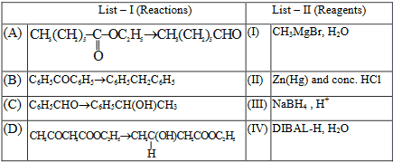

(1) A-(III), B-(IV), C-(I), D-(II)  (2) A-(IV), B-(II), C-(I), D-(III)  (3) A-(IV), B-(II), C-(III), D-(I)  (4) A-(III), B-(IV), C-(II), D-(I)

**Answer: (2)** · key (compiled)

**Solution.** DIBAL-H reduces an ester only as far as the aldehyde (A–IV). Zn(Hg)/conc. HCl (Clemmensen) reduces the C=O of benzophenone to CH$_2$ (B–II). CH$_3$MgBr adds to benzaldehyde to give the secondary alcohol 1-phenylethanol (C–I). NaBH$_4$ reduces the ketone in the keto-ester selectively to the alcohol, leaving the ester (D–III).

### C-ALD-12 · B — JEE Main 2024 · 30 Jan Shift 2 · Fig set Q6 · MCQ

*m*-Chlorobenzaldehyde on treatment with 50% KOH solution yields:

**(1)** 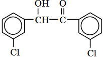

**(2)** 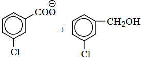

**(3)** 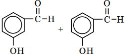

**(4)** 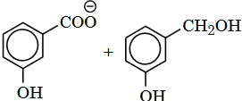

**Answer: (2)** · key (compiled)

**Solution.** An aldehyde with no $\alpha$-hydrogen undergoes the Cannizzaro reaction in concentrated alkali: one molecule is oxidised to the carboxylate (3-chlorobenzoate) and another is reduced to the alcohol (3-chlorobenzyl alcohol). The ring chlorine is untouched. This is option (2).

### C-ALD-13 · B — JEE Main 2024 · 31 Jan Shift 2 · Fig set Q8 · MCQ

Identify the name reaction shown in the figure: benzene + CO, HCl (anhydrous AlCl$_3$/CuCl) → benzaldehyde.

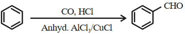

(1) Stephen reaction  (2) Etard reaction  (3) Gatterman–Koch reaction  (4) Rosenmund reduction

**Answer: (3)** · key (compiled)

**Solution.** Formylation of an aromatic ring with CO and HCl in the presence of anhydrous AlCl$_3$ and CuCl is the Gattermann–Koch reaction (the electrophile is HCO$^+$).

### C-ALD-14 · C — JEE Main 2024 · 05 Apr Shift 1 · Fig set Q4 · MCQ

Identify 'A' in the following reaction: butan-2-one →(i) N$_2$H$_4$, (ii) ethylene glycol/KOH → 'A'.

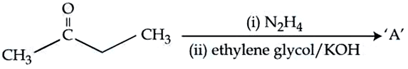

**(1)** 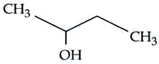

**(2)** 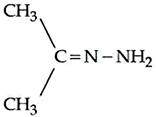

**(3)** 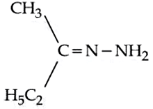

**(4)** 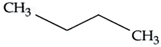

**Answer: (4)** · key (compiled)

**Solution.** These are the conditions of the Wolff–Kishner reduction: the ketone first forms the hydrazone, which on heating with KOH in ethylene glycol loses N$_2$ and converts C=O into CH$_2$. Butan-2-one gives butane (option 4), not the hydrazone itself (options 2 and 3) or an alcohol.

### C-ALD-15 · C — JEE Main 2024 · 06 Apr Shift 1 · Fig set Q6 · MCQ

Which among the following aldehydes is most reactive towards nucleophilic addition reactions?

**(1)** 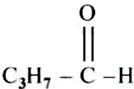

**(2)** 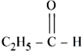

**(3)** 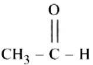

**(4)** 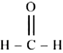

**Answer: (4)** · key (compiled)

**Solution.** Reactivity towards nucleophilic addition falls with increasing +I effect and steric hindrance of the alkyl groups. Methanal (HCHO), with two hydrogens on the carbonyl carbon, is the least hindered and most electrophilic: option (4).

### C-ALD-16 · C — JEE Main 2024 · 09 Apr Shift 1 · Fig set Q9 · MCQ

Identify the major product 'X' formed in the following reaction: benzene →(CO, HCl, anhydrous AlCl$_3$/CuCl) X.

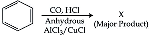

**(1)** 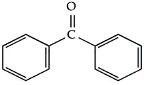

**(2)** 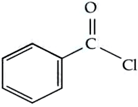

**(3)** 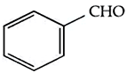

**(4)** 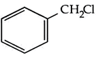

**Answer: (3)** · key (compiled)

**Solution.** This is the Gattermann–Koch formylation: CO and HCl generate the electrophile HCO$^+$, which formylates benzene to benzaldehyde (option 3).

### C-ALD-17 · C — JEE Main 2024 · 09 Apr Shift 2 · Fig set Q11 · MCQ

Which of the following compounds can give a positive iodoform test when treated with aqueous KOH solution followed by potassium hypoiodite? (1) CH$_3$CH$_2$–CCl$_2$–CH$_3$ (2,2-dichlorobutane); (2) 1,2-epoxybutane; (3) CH$_3$CH$_2$–CO–CH$_2$CH$_3$ (pentan-3-one); (4) CH$_3$CH$_2$CH$_2$CHO.

(1) 2,2-dichlorobutane  (2) 1,2-epoxybutane  (3) pentan-3-one  (4) butanal

**Answer: (1)** · key (compiled)

**Solution.** The iodoform test needs a CH$_3$–CO– or CH$_3$–CH(OH)– unit. Aqueous KOH hydrolyses the gem-dichloride 2,2-dichlorobutane to butan-2-one, CH$_3$COCH$_2$CH$_3$, which has a methyl ketone group and gives iodoform. Pentan-3-one and butanal lack the CH$_3$CO– group, and the epoxide gives a diol/hydroxy compound without it.

