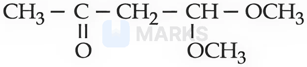
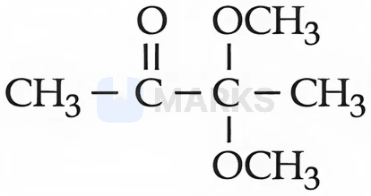
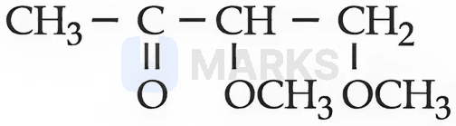
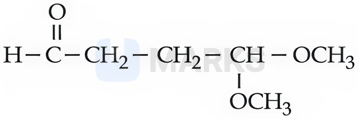
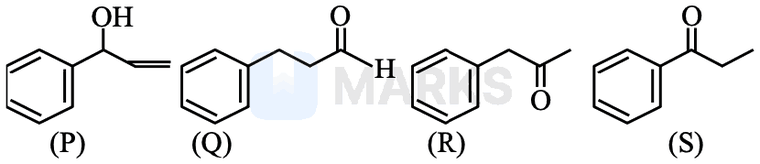

# Aldehydes & Ketones

> Theory: [../../theory/chemistry/aldehydes-ketones.md](../../theory/chemistry/aldehydes-ketones.md)

### C-ALD-01 · B — JEE Main 2026 · 21 Jan Shift 2 · set Q1 · MCQ

Match List-I with List-II.

| List-I: reagents | List-II: reaction name (involving aldehydes) |
|---|---|
| A. $\mathrm{H_2,\ Pd{-}BaSO_4}$ | I. Etard reaction |
| B. $\mathrm{SnCl_2,\ HCl}$ | II. Rosenmund reduction |
| C. $\mathrm{CrO_2Cl_2,\ CS_2}$ | III. Gattermann–Koch reaction |
| D. $\mathrm{CO,\ HCl,\ anhyd.\ AlCl_3}$ | IV. Stephen reaction |

(1) A-IV, B-III, C-I, D-II  (2) A-II, B-IV, C-I, D-III  (3) A-IV, B-I, C-II, D-III  (4) A-II, B-III, C-IV, D-I

**Answer: (2)** · key (compiled)

**Solution.** $\mathrm{RCOCl+H_2\xrightarrow{Pd-BaSO_4}RCHO}$ is the Rosenmund reduction (A–II). $\mathrm{RCN+SnCl_2/HCl\to RCH{=}NH\xrightarrow{H_2O}RCHO}$ is the Stephen reaction (B–IV). Toluene with $\mathrm{CrO_2Cl_2}$ in $\mathrm{CS_2}$ gives benzaldehyde: Etard reaction (C–I). Benzene with $\mathrm{CO/HCl/AlCl_3}$ gives benzaldehyde: Gattermann–Koch (D–III).

### C-ALD-02 · B — JEE Main 2026 · 23 Jan Shift 1 · set Q2 · MCQ

'x' is the product obtained from propanenitrile and stannous chloride in the presence of hydrochloric acid followed by hydrolysis. 'y' is the product obtained from but-2-ene by ozonolysis followed by hydrolysis. From the following, which product is NOT obtained when one mole of 'x' and one mole of 'y' react with each other in the presence of alkali followed by heating?

(1) 2-Methylpent-2-enal  (2) Pent-2-enal  (3) 2-Methylbut-2-enal  (4) 3-Methylbut-2-enal

**Answer: (4)** · key (compiled)

**Solution.** x is propanal (Stephen reduction) and y is ethanal (ozonolysis of but-2-ene). Both have $\alpha$-H, so the aldol condensation of the mixture gives four products: self-condensation of propanal gives 2-methylpent-2-enal; ethanal with propanal as the carbonyl partner gives pent-2-enal; propanal's enolate adding to ethanal gives 2-methylbut-2-enal; self-condensation of ethanal gives but-2-enal. 3-Methylbut-2-enal (a branched $\mathrm{(CH_3)_2C{=}CH{-}CHO}$ skeleton) cannot form from these. Answer (4).

### C-ALD-03 · B — JEE Main 2026 · 24 Jan Shift 2 · set Q3 · MCQ

Given below are two statements:

Statement I: Cross-aldol condensation between two different aldehydes will always produce four different products.  
Statement II: When semicarbazide reacts with a mixture of benzaldehyde and acetophenone under optimum pH, it forms a condensation product with acetophenone only.

(1) Statement I is false but Statement II is true  (2) Both Statement I and Statement II are false  (3) Both Statement I and Statement II are true  (4) Statement I is true but Statement II is false

**Answer: (2)** · key (compiled)

**Solution.** I false: four products arise only if *both* aldehydes have $\alpha$-hydrogens; if one lacks $\alpha$-H (e.g. benzaldehyde) the cross product is essentially single. II false: aldehydes are more reactive than ketones towards nucleophilic addition (less hindered, more electrophilic), so benzaldehyde, not acetophenone, forms the semicarbazone.

### C-ALD-04 · B — JEE Main 2026 · 22 Jan Shift 2 · set Q4 · MCQ

The compound A, $\mathrm{C_8H_8O_2}$, reacts with acetophenone to form a single product via cross-aldol condensation. The compound A on reaction with conc. NaOH forms a substituted benzyl alcohol as one of the two products. The compound A is:

(1) 2-hydroxyacetophenone  (2) 4-methylbenzoic acid  (3) 4-methoxybenzaldehyde  (4) 4-hydroxybenzaldehyde

**Answer: (3)** · key (compiled)

**Solution.** Conc. NaOH giving an alcohol plus a carboxylate is the Cannizzaro reaction, so A is an aromatic aldehyde with no $\alpha$-H; it also gives a single cross-aldol (Claisen–Schmidt) product with acetophenone. With formula $\mathrm{C_8H_8O_2}$ this is 4-methoxybenzaldehyde, $p\text{-}\mathrm{CH_3OC_6H_4CHO}$ (4-hydroxybenzaldehyde is $\mathrm{C_7H_6O_2}$; 2-hydroxyacetophenone and 4-methylbenzoic acid are not aldehydes).

### C-ALD-05 · B — JEE Main 2026 · 22 Jan Shift 1 · set Q5 · MCQ

Match List-I with List-II.

| List-I: reagents | List-II: name of reaction involving carbonyl compounds |
|---|---|
| A. $\mathrm{NH_2{-}NH_2,\ KOH}$ | I. Tollens' test |
| B. $\mathrm{Ag(NH_3)_2OH}$ | II. Clemmensen reduction |
| C. aq. $\mathrm{CuSO_4}$, sodium potassium tartrate, KOH | III. Wolff–Kishner reduction |
| D. $\mathrm{Zn{-}Hg,\ HCl}$ | IV. Fehling's test |

(1) A-II, B-I, C-IV, D-III  (2) A-III, B-IV, C-I, D-II  (3) A-III, B-I, C-IV, D-II  (4) A-IV, B-III, C-II, D-I

**Answer: (3)** · key (compiled)

**Solution.** Hydrazine/KOH: Wolff–Kishner (III). Ammoniacal silver nitrate: Tollens' (I). Alkaline cupric tartrate: Fehling's (IV). Zn–Hg/HCl: Clemmensen (II). So A-III, B-I, C-IV, D-II.

### C-ALD-06 · B — JEE Main 2026 · 23 Jan Shift 2 · set Q6 · MCQ

Which of the following statements are TRUE about the haloform reaction?

A. Sodium hypochlorite reacts with KI to give KOI.  
B. KOI is a reducing agent.  
C. The $\alpha,\beta$-unsaturated methyl ketone $\mathrm{CH_3{-}CH{=}CH{-}CO{-}CH_3}$ will give the iodoform reaction.  
D. Isopropyl alcohol will not give the iodoform test.  
E. Methanoic acid will give a positive iodoform test.

(1) A, C and E only  (2) B, D and E only  (3) A and C only  (4) A, B and C only

**Answer: (3)** · key (compiled)

**Solution.** A true ($\mathrm{OCl^-+I^-\to OI^-+Cl^-}$). B false: $\mathrm{OI^-}$ is the *oxidising/halogenating* agent. C true (it contains the $\mathrm{CH_3CO{-}}$ group). D false: $\mathrm{(CH_3)_2CHOH}$ is oxidised to acetone and gives the test. E false (no $\mathrm{CH_3CO}$ or $\mathrm{CH_3CH(OH)}$ unit). So A and C.

### C-ALD-07 · B — JEE Main 2026 · 23 Jan Shift 2 · set Q7 · MCQ

The iodoform test can differentiate between:

A. Methanol and ethanol  
B. $\mathrm{CH_3COOH}$ and $\mathrm{CH_3CH_2COOH}$  
C. Cyclohexene and cyclohexanone  
D. Diethyl ether and pentan-3-one  
E. Anisole and acetone

(1) B, C and E only  (2) A and D only  (3) A and E only  (4) A, B and E only

**Answer: (3)** · key (compiled)

**Solution.** The test is positive for $\mathrm{CH_3CO{-}}$ and $\mathrm{CH_3CH(OH){-}}$ groups (and ethanol). A: ethanol positive, methanol negative – differentiates. E: acetone positive, anisole negative – differentiates. In B, C and D neither member gives the test. So A and E.

### C-ALD-08 · B — JEE Main 2026 · 21 Jan Shift 1 · set Q8 · MCQ

An organic compound "P" of molecular formula $\mathrm{C_6H_{12}O_3}$ gives a positive iodoform test but a negative Tollens' test. When "P" is treated with dilute acid, it produces "Q". "Q" gives a positive Tollens' test and also the iodoform test. The structure of "P" is:

**(1)** 

**(2)** 

**(3)** 

**(4)** 

**Answer: (1)** · key (compiled)

**Solution.** P must contain a $\mathrm{CH_3CO{-}}$ group but no free $-\mathrm{CHO}$; acid hydrolysis must unmask a CHO. An acetal does exactly this. (1) $\mathrm{CH_3COCH_2CH(OCH_3)_2}$ is the dimethyl acetal of 3-oxobutanal ($\mathrm{C_6H_{12}O_3}$); hydrolysis gives $\mathrm{CH_3COCH_2CHO}$, which has both $\mathrm{CH_3CO}$ (iodoform) and $\mathrm{CHO}$ (Tollens'). (2) is a ketal that hydrolyses to butane-2,3-dione (no CHO). (3) is not an acetal. (4) already has a free $\mathrm{CHO}$ and would give a positive Tollens' test.

### C-ALD-09 · B — JEE Main 2026 · 28 Jan Shift 1 · set Q9 · MCQ

Given below are the four isomeric compounds (P, Q, R, S). Identify the correct statements from below.

A. Q, R and S will give a precipitate with 2,4-DNP.  
B. P and Q will give a positive Baeyer's test.  
C. Q and R will give a sooty flame.  
D. R and S will give a yellow precipitate with $\mathrm{I_2/NaOH}$.  
E. Q alone will deposit silver with Tollens' reagent.

(1) A, B, D and E only  (2) A and E only  (3) C and E only  (4) A, C and E only

**Answer: (4)** · key (compiled)

**Solution.** P = 1-phenylprop-2-en-1-ol, Q = 3-phenylpropanal, R = phenylacetone, S = propiophenone. A true (Q, R, S are carbonyl compounds). B false: Baeyer's test is the test for $\mathrm{C{=}C}$ unsaturation, and Q has none (only P does). C true (aromatic compounds burn with a sooty flame). D false: only R has the $\mathrm{CH_3CO}$ group; S ($\mathrm{PhCOCH_2CH_3}$) does not. E true (only Q is an aldehyde). So A, C and E.

### C-ALD-10 · C — JEE Main 2024 · 29 Jan Shift 1 · Q60 · Numerical

From the compounds given below, the number of compounds which give a positive Fehling's test is ______: benzaldehyde, acetaldehyde, acetone, acetophenone, methanal, 4-nitrobenzaldehyde, cyclohexanecarbaldehyde.

**Answer: 3** · key ✔

**Solution.** Fehling's solution oxidises aliphatic aldehydes only. Positive: acetaldehyde, methanal and cyclohexanecarbaldehyde. Aromatic aldehydes (benzaldehyde, 4-nitrobenzaldehyde) and ketones (acetone, acetophenone) give a negative test. Count $=3$.

### C-ALD-11 · C — JEE Main 2024 · 30 Jan Shift 1 · Q45 · MCQ

The reduction of an acyl chloride to an aldehyde with $\text{H}_2$ over $\text{Pd–BaSO}_4$ (e.g. $\text{ArCOCl}\to\text{ArCHO}$) is known as

(1) Rosenmund reduction  (2) Wolff–Kishner reduction  (3) Stephen reduction  (4) Etard reduction

**Answer: (1)** · key ✔

**Solution.** In the Rosenmund reduction $\text{RCOCl}+\text{H}_2\xrightarrow{\text{Pd–BaSO}_4}\text{RCHO}+\text{HCl}$, $\text{BaSO}_4$ poisons the catalyst so the aldehyde is not reduced further. Stephen reduces nitriles with $\text{SnCl}_2/\text{HCl}$, Etard oxidises toluene with $\text{CrO}_2\text{Cl}_2$, and Wolff–Kishner reduces C=O to $\text{CH}_2$.

### C-ALD-12 · C — JEE Main 2024 · 30 Jan Shift 1 · Q60 · Numerical

The compound formed by the reaction of ethanal with semicarbazide contains ______ nitrogen atoms.

**Answer: 3** · key ✔

**Solution.** $\text{CH}_3\text{CHO}+\text{H}_2\text{N-NH-CO-NH}_2\to\text{CH}_3\text{CH=N-NH-CO-NH}_2$ (ethanal semicarbazone) $+\text{H}_2\text{O}$. Semicarbazide has $3$ nitrogen atoms and all are retained in the product.

### C-ALD-13 · C — JEE Main 2024 · 1 Feb Shift 1 · Q48 · MCQ

Match List I with List II.  
(A) $\text{CH}_3(\text{CH}_2)_5\text{COOC}_2\text{H}_5\to \text{CH}_3(\text{CH}_2)_5\text{CHO}$  (B) $\text{C}_6\text{H}_5\text{COC}_6\text{H}_5\to \text{C}_6\text{H}_5\text{CH}_2\text{C}_6\text{H}_5$  (C) $\text{C}_6\text{H}_5\text{CHO}\to \text{C}_6\text{H}_5\text{CH(OH)CH}_3$  (D) $\text{CH}_3\text{COCH}_2\text{COOC}_2\text{H}_5\to \text{CH}_3\text{CH(OH)CH}_2\text{COOC}_2\text{H}_5$  
(I) $\text{CH}_3\text{MgBr},\ \text{H}_2\text{O}$  (II) $\text{Zn(Hg)}$, conc. HCl  (III) $\text{NaBH}_4$, $\text{H}^+$  (IV) DIBAL-H, $\text{H}_2\text{O}$

(1) A-III, B-IV, C-I, D-II  (2) A-IV, B-II, C-I, D-III  (3) A-IV, B-II, C-III, D-I  (4) A-III, B-IV, C-II, D-I

**Answer: (2)** · key ✔

**Solution.** A: DIBAL-H partially reduces an ester to an aldehyde (IV). B: Clemmensen reduction, $\text{Zn(Hg)/conc. HCl}$, takes $\text{C=O}$ to $\text{CH}_2$ (II). C: a Grignard reagent adds to an aldehyde to give a secondary alcohol (I). D: $\text{NaBH}_4$ reduces the ketone group selectively and leaves the ester (III).

### C-ALD-14 · C — JEE Main 2024 · 4 Apr Shift 1 · Q47 · MCQ

Statement I: The acidity of $\alpha$-hydrogens of aldehydes and ketones is responsible for the aldol reaction.  
Statement II: The reaction between benzaldehyde and ethanal will NOT give a cross-aldol product.

(1) I correct, II incorrect  (2) Both correct  (3) Both incorrect  (4) I incorrect, II correct

**Answer: (1)** · key ✔

**Solution.** I is true: the $\alpha$-H is removed to give the enolate nucleophile. II is false: benzaldehyde has no $\alpha$-H and cannot self-condense, but ethanal's enolate attacks it to give a cross-aldol (Claisen–Schmidt) product, cinnamaldehyde after dehydration.

### C-ALD-15 · C — JEE Main 2024 · 4 Apr Shift 2 · Q60 · Numerical

Vanillin (obtained from vanilla beans) has a total of oxygen atoms and $\pi$ electrons equal to ______.

**Answer: 11** · key ✔

**Solution.** Vanillin is $4$-hydroxy-$3$-methoxybenzaldehyde, $\text{C}_8\text{H}_8\text{O}_3$. Oxygen atoms: $3$. $\pi$ electrons: benzene ring $6$ + $\text{C=O}$ of $\text{CHO}$ $2$ $=8$. Total $=11$.

### C-ALD-16 · C — JEE Main 2024 · 5 Apr Shift 2 · Q58 · Numerical

In the Claisen–Schmidt reaction to prepare $351$ g of dibenzalacetone using $87$ g of acetone, the amount of benzaldehyde required is ______ g (nearest integer).

**Answer: 318** · key ✔

**Solution.** $\text{CH}_3\text{COCH}_3+2\,\text{C}_6\text{H}_5\text{CHO}\to(\text{C}_6\text{H}_5\text{CH=CH})_2\text{CO}+2\text{H}_2\text{O}$. Dibenzalacetone ($234$ g/mol): $351$ g $=1.5$ mol, which needs $1.5$ mol acetone ($87$ g ✓) and $3$ mol benzaldehyde $=3\times106=318$ g.

### C-ALD-17 · C — JEE Main 2024 · 8 Apr Shift 2 · Q59 · Numerical

Two moles of benzaldehyde and one mole of acetone under alkaline conditions (aqueous NaOH, heat) give product X as the major product. The number of $\pi$ bonds in X is ______.

**Answer: 9** · key ✔

**Solution.** X is dibenzalacetone, $(\text{C}_6\text{H}_5\text{CH=CH})_2\text{C=O}$ (Claisen–Schmidt). $\pi$ bonds: two rings $2\times3=6$, two $\text{C=C}$ $=2$ and one $\text{C=O}$ $=1$. Total $=9$.

