# Amines & Diazonium Salts

> Theory: [../../theory/chemistry/amines.md](../../theory/chemistry/amines.md)

### C-AMN-01 · A — JEE Main 2026 · 21 Jan Shift 2 · set Q1 · MCQ

Consider the above sequence of reactions. The number of bromine atom(s) in the final product (P) will be:

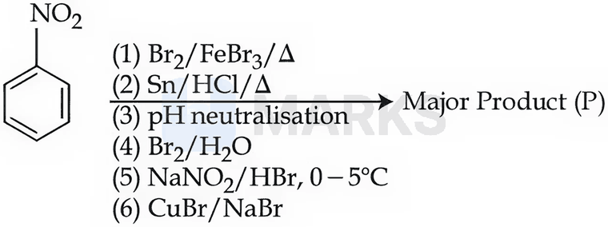

(1) 3  (2) 5  (3) 6  (4) 1

**Answer: (2)** · key (compiled)

**Solution.** (1) $\mathrm{Br_2/FeBr_3}$: the $-\mathrm{NO_2}$ group is meta-directing, giving $m$-bromonitrobenzene. (2) Sn/HCl, then neutralisation: $m$-bromoaniline. (4) $\mathrm{Br_2/H_2O}$: the strongly activating $-\mathrm{NH_2}$ directs to *all* its free ortho/para positions (2, 4, 6), adding 3 Br. (5) $\mathrm{NaNO_2/HBr}$ gives the diazonium salt, and (6) CuBr (Sandmeyer) replaces $\mathrm{N_2^+}$ by Br. Total Br $=1+3+1=5$ (pentabromobenzene, $\mathrm{C_6HBr_5}$).

### C-AMN-02 · A — JEE Main 2026 · 23 Jan Shift 1 · set Q2 · MCQ

Consider the following sequence of reactions. Assuming that the reaction proceeds to completion, 137 mg of 4-nitrotoluene will produce ______ mg of B. (Given molar mass in g mol$^{-1}$: H 1, C 12, N 14, O 16, Br 80)

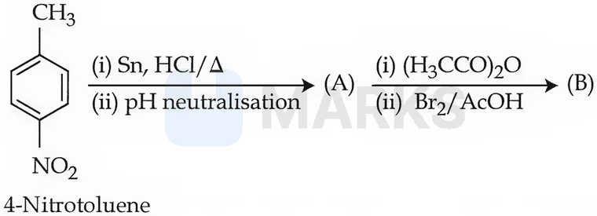

(1) 208  (2) 301  (3) 228  (4) 146

**Answer: (3)** · key (compiled)

**Solution.** A = 4-methylaniline ($p$-toluidine). Acetylation protects the amine as $\mathrm{NHCOCH_3}$ (a moderate activator that gives mono-substitution), and $\mathrm{Br_2/AcOH}$ brominates ortho to it: B = $N$-(2-bromo-4-methylphenyl)acetamide, $\mathrm{C_9H_{10}BrNO}$, $M=9(12)+10+80+14+16=228$. 4-Nitrotoluene ($M=137$): 137 mg $=1$ mmol, so B $=1$ mmol $=228$ mg.

### C-AMN-03 · A — JEE Main 2026 · 23 Jan Shift 1 · set Q3 · MCQ

Compound 'P' undergoes the following sequence of reactions. 'P' is:

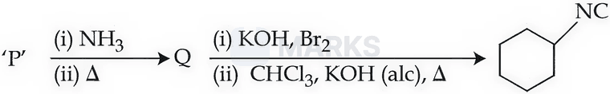

**(1)** 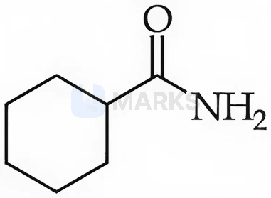

**(2)** 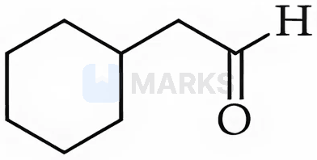

**(3)** 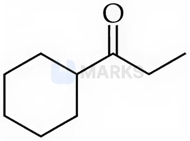

**(4)** 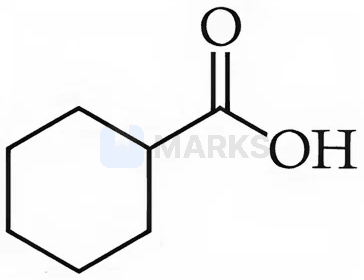

**Answer: (4)** · key (compiled)

**Solution.** Work backwards. Cyclohexyl isocyanide comes from cyclohexylamine by the carbylamine reaction ($\mathrm{CHCl_3/alc.\ KOH}$). Cyclohexylamine comes from the amide by Hofmann bromamide degradation ($\mathrm{KOH/Br_2}$), which loses one carbon. So Q is cyclohexanecarboxamide, and Q is made by $\mathrm{NH_3}$ then heat from the carboxylic acid (ammonium salt $\to$ amide). P = cyclohexanecarboxylic acid – option (4).

### C-AMN-04 · A — JEE Main 2026 · 28 Jan Shift 2 · set Q4 · MCQ

A student analysed an aliphatic organic compound 'X', which gave C = 61.01%, H = 15.25%, N = 23.74%. This compound, on treatment with $\mathrm{HNO_2/H_2O}$, produced another compound 'Y' which did not contain any nitrogen atom. However, the compound 'Y' upon controlled oxidation produced another compound 'Z' that responded to the iodoform test. The structure of 'X' is:

**(1)** 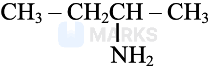

**(2)** 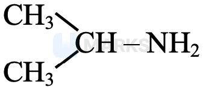

**(3)** 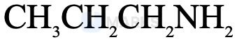

**(4)** 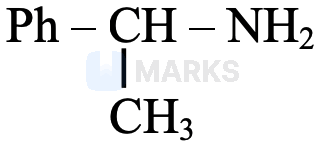

**Answer: (2)** · key (compiled)

**Solution.** Mole ratio C : H : N $=\dfrac{61.01}{12}:\dfrac{15.25}{1}:\dfrac{23.74}{14}=5.08:15.25:1.70=3:9:1$, so $\mathrm{C_3H_9N}$. $\mathrm{HNO_2}$ replaces $-\mathrm{NH_2}$ of a *primary* aliphatic amine by OH (Y, N-free alcohol). Z must contain $\mathrm{CH_3CO{-}}$, so Y is propan-2-ol, $\mathrm{CH_3CH(OH)CH_3}$ (oxidised to acetone, which gives iodoform). Hence X is isopropylamine, $(\mathrm{CH_3})_2\mathrm{CHNH_2}$ – option (2).

### C-AMN-05 · A — JEE Main 2026 · 28 Jan Shift 2 · set Q5 · MCQ

The total number of alkali-insoluble solid sulphonamides obtained by reaction of the given amines with Hinsberg's reagent is ______.

Aniline, N-methylaniline, methanamine, N,N-dimethylmethanamine, N-methylmethanamine, phenylmethanamine, N-propylaniline, N-phenylaniline, N,N-dimethylaniline, allylamine, isopropylamine

(1) 2  (2) 5  (3) 4  (4) 8

**Answer: (3)** · key (compiled)

**Solution.** Hinsberg's reagent is benzenesulphonyl chloride. Primary amines give a sulphonamide with an acidic N–H, which dissolves in alkali. Tertiary amines do not react. *Secondary* amines give sulphonamides with no N–H, which are insoluble in alkali: N-methylaniline, N-methylmethanamine (dimethylamine), N-propylaniline and N-phenylaniline: 4.

### C-AMN-06 · A — JEE Main 2026 · 24 Jan Shift 2 · set Q6 · MCQ

Given below are two statements:

Statement I: The dipole moment of R–CN is greater than that of R–NC, and R–NC can undergo hydrolysis under acidic medium to produce R–COOH.  
Statement II: R–CN hydrolyses under acidic medium to produce a compound which, on treatment with $\mathrm{SOCl_2}$ followed by the addition of $\mathrm{NH_3}$, gives another compound (x). This compound (x), on treatment with NaOCl/NaOH, gives a product that, on treatment with $\mathrm{CHCl_3/KOH/\Delta}$, produces R–NC.

(1) Both Statement I and Statement II are false  (2) Statement I is false but Statement II is true  (3) Both Statement I and Statement II are true  (4) Statement I is true but Statement II is false

**Answer: (2)** · key (compiled)

**Solution.** I false: acid hydrolysis of an isocyanide gives a primary amine and formic acid, $\mathrm{R{-}NC+2H_2O\xrightarrow{H^+}RNH_2+HCOOH}$, not $\mathrm{RCOOH}$ (it is the nitrile that gives the acid). II true: $\mathrm{RCN\to RCOOH\xrightarrow{SOCl_2}RCOCl\xrightarrow{NH_3}RCONH_2}$ (x) $\xrightarrow{NaOCl/NaOH}\mathrm{RNH_2}$ (Hofmann bromamide) $\xrightarrow{CHCl_3/KOH}\mathrm{RNC}$ (carbylamine).

### C-AMN-07 · A — JEE Main 2026 · 24 Jan Shift 2 · set Q7 · MCQ

A student planned to prepare acetanilide from aniline using acetic anhydride. The student started from 9.3 g of aniline and managed to obtain 11 g of dry acetanilide. The % yield of this reaction is:

(1) 59.5%  (2) 72.5%  (3) 97.5%  (4) 81.5%

**Answer: (4)** · key (compiled)

**Solution.** Aniline $M=93$: $\dfrac{9.3}{93}=0.1$ mol gives $0.1$ mol acetanilide ($\mathrm{C_8H_9NO}$, $M=135$), i.e. $13.5$ g theoretical. Yield $=\dfrac{11}{13.5}\times100=81.5\%$.

### C-AMN-08 · A — JEE Main 2026 · 22 Jan Shift 2 · set Q8 · MCQ

The final product [B] is:

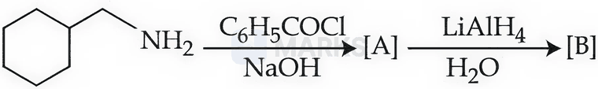

**(1)** 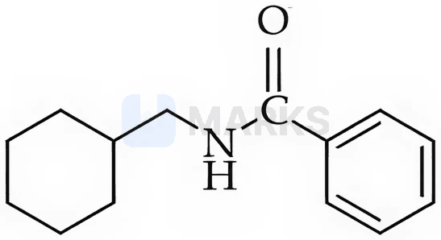

**(2)** 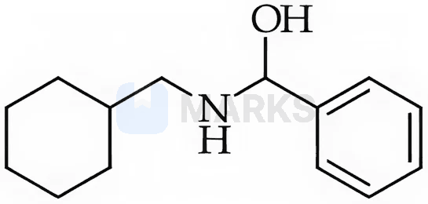

**(3)** 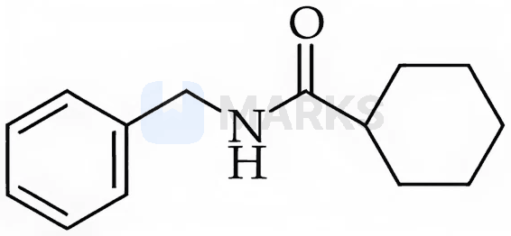

**(4)** 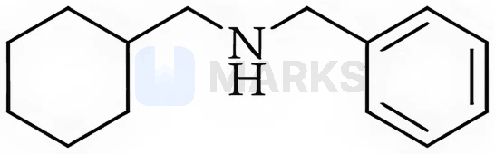

**Answer: (4)** · key (compiled)

**Solution.** Benzoyl chloride/NaOH acylates the primary amine (Schotten–Baumann): [A] = $N$-(cyclohexylmethyl)benzamide. $\mathrm{LiAlH_4}$ reduces the amide $\mathrm{C{=}O}$ all the way to $\mathrm{CH_2}$, giving the secondary amine $\mathrm{C_6H_{11}CH_2{-}NH{-}CH_2C_6H_5}$ – option (4).

### C-AMN-09 · A — JEE Main 2026 · 22 Jan Shift 2 · set Q9 · Numerical

The mass of benzanilide obtained from the benzoylation reaction of 5.8 g of aniline, if the yield of the product is 82%, is ______ g (nearest integer). (Given molar mass in g mol$^{-1}$: H 1, C 12, N 14, O 16)

**Answer: 10** · key (compiled)

**Solution.** Aniline $M=93$: $\dfrac{5.8}{93}=0.0624$ mol. Benzanilide $\mathrm{C_6H_5NHCOC_6H_5}$ ($\mathrm{C_{13}H_{11}NO}$) $M=197$: theoretical mass $=0.0624\times197=12.3$ g; at 82% yield: $12.3\times0.82\approx10.1\to10$ g.

### C-AMN-10 · A — JEE Main 2026 · 22 Jan Shift 1 · set Q10 · MCQ

'A' is a neutral organic compound (molecular formula $\mathrm{C_8H_9ON}$). On treatment with aqueous $\mathrm{Br_2/HO^-}$, 'A' forms a compound 'B' which is soluble in dilute acid. 'B' on treatment with aqueous $\mathrm{NaNO_2/HCl}$ (0–5 °C) produces a compound 'C', which on treatment with CuCN/NaCN produces 'D'. Hydrolysis of 'D' produces 'E', which is also obtainable from the hydrolysis of 'A'. 'E' on treatment with acidified $\mathrm{KMnO_4}$ produces 'F'. 'F' contains two different types of hydrogen atoms. The structure of 'A' is:

**(1)** 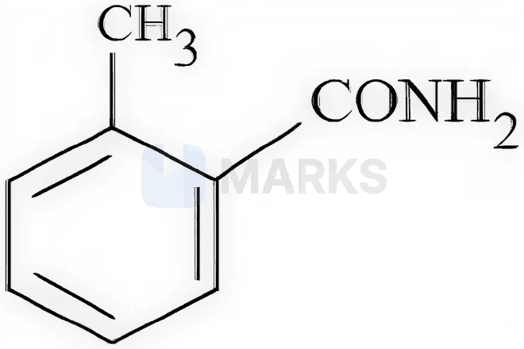

**(2)** 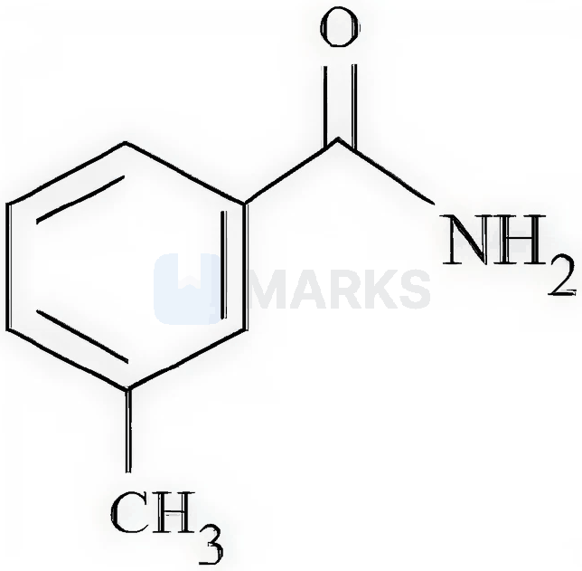

**(3)** 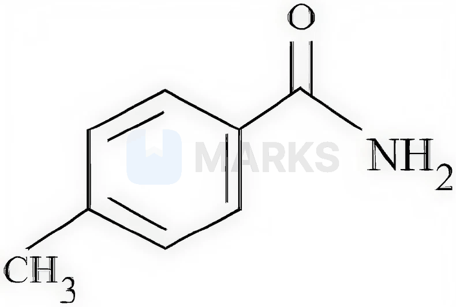

**(4)** 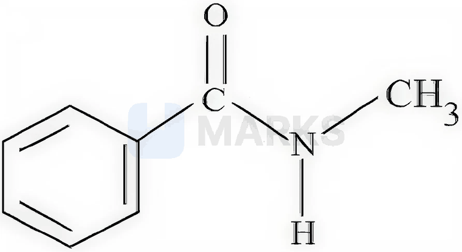

**Answer: (3)** · key (compiled)

**Solution.** $\mathrm{Br_2/HO^-}$ on an amide is the Hofmann bromamide reaction: B is an amine (soluble in dilute acid), C its diazonium salt, D the nitrile (Sandmeyer) and E the acid. Because E is also the hydrolysis product of A, A and E have the same carbon skeleton: A = $\mathrm{ArCONH_2}$, B = $\mathrm{ArNH_2}$, D = $\mathrm{ArCN}$, E = $\mathrm{ArCOOH}$ with Ar = tolyl. Acidified $\mathrm{KMnO_4}$ oxidises the $\mathrm{CH_3}$ to $\mathrm{COOH}$, giving a benzenedicarboxylic acid F. Only the *para* isomer, terephthalic acid, has just two kinds of H (4 equivalent ring H and 2 acidic H); ortho and meta isomers have more. So A = 4-methylbenzamide – option (3).

### C-AMN-11 · A — JEE Main 2026 · 23 Jan Shift 2 · set Q11 · MCQ

A student has been given a compound "x" of molecular formula $\mathrm{C_6H_7N}$. "x" is sparingly soluble in water, but on addition of dilute mineral acid "x" becomes soluble. "x" when treated with $\mathrm{CHCl_3}$ and alc. KOH, "y" is produced. "y" has a specific unpleasant smell. On treatment with benzenesulphonyl chloride, "x" gives a compound "z" which is soluble in alkali. The number of different "H" atoms present in "z" is:

(1) 8  (2) 4  (3) 5  (4) 7

**Answer: (4)** · key (compiled)

**Solution.** Soluble in dilute acid, carbylamine test positive ("y" is the foul-smelling isocyanide) and $\mathrm{C_6H_7N}$: x = aniline (a primary amine). The alkali-soluble sulphonamide is z = $\mathrm{C_6H_5SO_2{-}NH{-}C_6H_5}$. Distinct H: each phenyl ring has ortho, meta and para H (3 + 3 = 6), plus the N–H: **7**.

### C-AMN-12 · A — JEE Main 2026 · 21 Jan Shift 1 · set Q13 · MCQ

A hydrocarbon 'P' ($\mathrm{C_4H_8}$) on reaction with HCl gives an optically active compound 'Q' ($\mathrm{C_4H_9Cl}$), which on reaction with one mole of ammonia gives compound 'R' ($\mathrm{C_4H_{11}N}$). 'R' on diazotisation followed by hydrolysis gives 'S'. Identify P, Q, R and S.

**(1)** 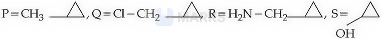

**(2)** 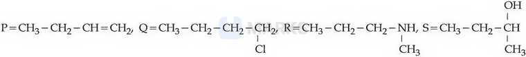

**(3)** 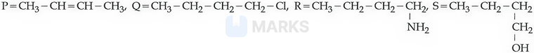

**(4)** 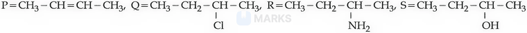

**Answer: (4)** · key (compiled)

**Solution.** Q must contain a stereocentre: of the chlorobutanes only 2-chlorobutane is chiral, and it arises from but-1-ene or but-2-ene with HCl (Markovnikov). Then R = butan-2-amine (substitution by $\mathrm{NH_3}$), S = butan-2-ol (a primary aliphatic amine on diazotisation and hydrolysis gives the alcohol). Option (4): P = but-2-ene, Q = $\mathrm{CH_3CH_2CHClCH_3}$, R = $\mathrm{CH_3CH_2CH(NH_2)CH_3}$, S = $\mathrm{CH_3CH_2CH(OH)CH_3}$. The other options have an achiral Q, a wrong formula, or amine/alcohol that do not match.

### C-AMN-13 · B — JEE Main 2026 · 21 Jan Shift 1 · set Q14 · MCQ

An organic compound (P), on treatment with aqueous ammonia under hot conditions, forms compound (Q), which on heating with $\mathrm{Br_2}$ and KOH forms compound (R) having molecular formula $\mathrm{C_6H_7N}$. The names of P, Q and R, respectively, are:

(1) Phenylethanoic acid, phenylethanamide, benzenamine  (2) Benzoic acid, 4-methylbenzamide, 4-methylaniline  (3) Toluic acid, methylbenzamide, 2-methylaniline  (4) Benzoic acid, benzamide, aniline

**Answer: (4)** · key (compiled)

**Solution.** Q is an amide (acid + $\mathrm{NH_3}$, heat), and $\mathrm{Br_2/KOH}$ is the Hofmann bromamide degradation that gives an amine with one carbon less. R = $\mathrm{C_6H_7N}$ = aniline, so Q = benzamide and P = benzoic acid.

### C-AMN-14 · B — JEE Main 2026 · 28 Jan Shift 1 · set Q16 · MCQ

Consider the following reactions giving the major product. Identify the correct reaction.

**(1)** 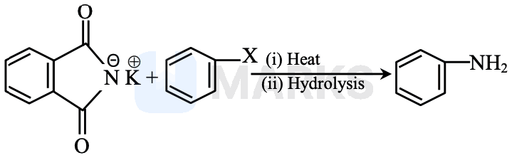

**(2)** 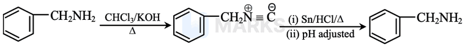

**(3)** 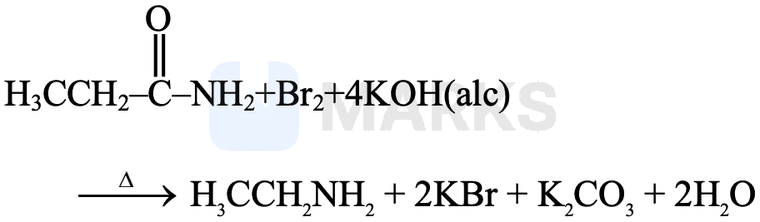

**(4)** 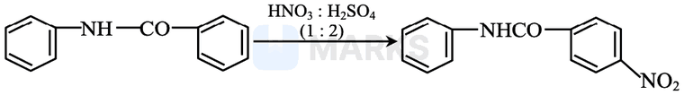

**Answer: (3)** · key (compiled)

**Solution.** (1) is wrong: Gabriel phthalimide synthesis fails with aryl halides (no $S_N2$ at an $sp^2$ carbon), so aniline cannot be made this way. (2) is wrong: $\mathrm{Sn/HCl}$ reduces the isocyanide to the *secondary* amine $\mathrm{PhCH_2NHCH_3}$, not back to $\mathrm{PhCH_2NH_2}$. (4) is wrong: in $\mathrm{PhNHCOPh}$ the nitrogen lone pair is shared with the carbonyl, but the ring on N is still more activated than the benzoyl ring, so nitration goes into the N-phenyl ring (para), not the benzoyl ring. (3) is the Hofmann bromamide reaction, $\mathrm{RCONH_2+Br_2+4KOH\to RNH_2+2KBr+K_2CO_3+2H_2O}$ – correct.

### C-AMN-15 · B — JEE Main 2026 · 24 Jan Shift 1 · set Q18 · MCQ

The correct stability order of the following diazonium salts is:

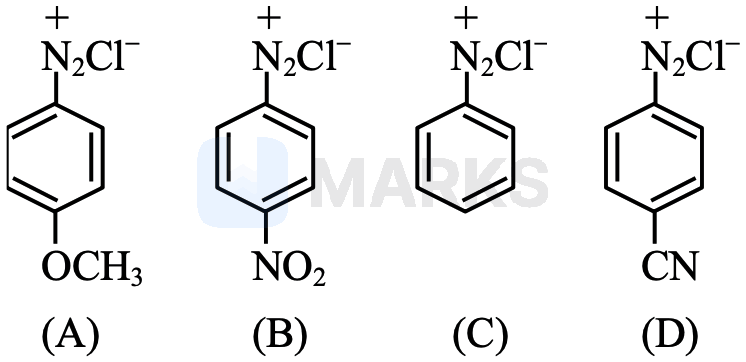

(1) C > A > D > B  (2) A > C > D > B  (3) A > B > C > D  (4) C > D > B > A

**Answer: (2)** · key (compiled)

**Solution.** Electron-donating substituents disperse the positive charge of the diazonium ion and stabilise it, while electron-withdrawing ones destabilise it. A ($p$-$\mathrm{OCH_3}$, $+M$) is the most stable, then the unsubstituted C, then D ($p$-CN, $-M,-I$), and B ($p$-$\mathrm{NO_2}$, the strongest $-M,-I$ group) is the least stable: A > C > D > B.

### C-AMN-16 · B — JEE Advanced 2025 · Paper 1 · Q12 · Numerical

The monomer X used in the synthesis of nylon-6,6 gives a positive carbylamine test. If $10$ moles of X are analysed by the Dumas method, the amount of nitrogen gas evolved (in g) is ______. (N $=14$)

**Answer: 280** · official key ✔ (re-derived)

**Solution.** Nylon-6,6 is made from adipic acid and hexamethylenediamine, $\text{H}_2\text{N(CH}_2)_6\text{NH}_2$; only the diamine (a primary amine) gives the carbylamine test. Each molecule has $2$ N atoms, so $10$ mol of X has $20$ mol of N, which gives $10$ mol of $\text{N}_2=280$ g.

### C-AMN-17 · B — JEE Main 2024 · 27 Jan Shift 2 · Q52 · Numerical

$9.3$ g of aniline is reacted with excess acetic anhydride to prepare acetanilide. The mass of acetanilide produced if the reaction is $100\%$ complete is ______ $\times10^{-1}$ g. (Molar masses: N = 14, O = 16, C = 12, H = 1)

**Answer: 135** · key ✔

**Solution.** $\text{C}_6\text{H}_5\text{NH}_2$ ($93$ g/mol): $9.3$ g $=0.1$ mol. Acetanilide $\text{C}_6\text{H}_5\text{NHCOCH}_3$ has molar mass $135$ g/mol, so $0.1$ mol $=13.5$ g $=135\times10^{-1}$ g.

### C-AMN-18 · B — JEE Main 2024 · 31 Jan Shift 2 · Q50 · MCQ

Statement I: Aniline reacts with conc. $\text{H}_2\text{SO}_4$ followed by heating at $453$–$473$ K to give $p$-aminobenzenesulphonic acid, which gives a blood-red colour in Lassaigne's test.  
Statement II: In Friedel–Crafts alkylation and acylation reactions, aniline forms a salt with the $\text{AlCl}_3$ catalyst. Due to this, the nitrogen of aniline acquires a positive charge and acts as a deactivating group.

(1) I false, II true  (2) Both false  (3) I true, II false  (4) Both true

**Answer: (4)** · key ✔

**Solution.** Sulphonation gives sulphanilic acid (a zwitterion). Since it contains both N and S, the sodium-fusion extract gives $\text{SCN}^-$ and hence a blood-red colour with $\text{Fe}^{3+}$: I is true. In Friedel–Crafts reactions the basic $-\text{NH}_2$ coordinates to $\text{AlCl}_3$, forming $-\overset{+}{\text{N}}\text{H}_2\text{-}\overset{-}{\text{Al}}\text{Cl}_3$, a strongly deactivating group: II is true.

### C-AMN-19 · B — JEE Main 2024 · 1 Feb Shift 1 · Q49 · MCQ

Statement I: The $-\text{NH}_2$ group in aniline is ortho- and para-directing and a powerful activating group.  
Statement II: Aniline does not undergo Friedel–Crafts reactions (alkylation and acylation).

(1) Both true  (2) Both false  (3) I false, II true  (4) I true, II false

**Answer: (1)** · key ✔

**Solution.** The lone pair on N is donated into the ring (+M), activating the ortho/para positions. In Friedel–Crafts conditions the basic $-\text{NH}_2$ reacts with anhydrous $\text{AlCl}_3$ to form a salt-like adduct; the resulting $-\text{N}^+\text{H}_2\text{–Al}^-\text{Cl}_3$ group is strongly deactivating and the reaction fails.

### C-AMN-20 · B — JEE Main 2024 · 4 Apr Shift 1 · Q60 · Numerical

$X$ g of ethylamine is treated with $\text{NaNO}_2/\text{HCl}$ followed by water. The evolved $\text{N}_2$ occupies $2.24$ L at STP. $X$ is ______ $\times10^{-1}$ g.

**Answer: 45** · key ✔

**Solution.** $\text{C}_2\text{H}_5\text{NH}_2+\text{HNO}_2\to\text{C}_2\text{H}_5\text{OH}+\text{N}_2+\text{H}_2\text{O}$. $2.24$ L $=0.1$ mol $\text{N}_2$ requires $0.1$ mol amine: $0.1\times45=4.5$ g $=45\times10^{-1}$ g.

### C-AMN-21 · B — JEE Main 2024 · 4 Apr Shift 2 · Q59 · Numerical

From $6.55$ g of aniline the maximum amount of acetanilide that can be prepared is ______ $\times10^{-1}$ g.

**Answer: 95** · key ✔

**Solution.** $\text{C}_6\text{H}_5\text{NH}_2$ ($93$ g/mol): $n=\dfrac{6.55}{93}=0.0704$ mol. Acetanilide $\text{C}_6\text{H}_5\text{NHCOCH}_3$ ($135$ g/mol): $0.0704\times135=9.5$ g $=95\times10^{-1}$ g.

### C-AMN-22 · B — JEE Main 2024 · 5 Apr Shift 1 · Q51 · Numerical

$9.3$ g of pure aniline is treated with bromine water at room temperature to give a white precipitate of product P. The mass of P obtained is $26.4$ g. The percentage yield is ______ %.

**Answer: 80** · key ✔

**Solution.** $\text{C}_6\text{H}_5\text{NH}_2$ ($93$) $\to$ 2,4,6-tribromoaniline $\text{C}_6\text{H}_4\text{Br}_3\text{N}$ ($330$ g/mol). $9.3$ g $=0.1$ mol, so the theoretical yield is $33$ g. Yield $=\dfrac{26.4}{33}\times100=80\%$.

### C-AMN-23 · C — JEE Main 2024 · 6 Apr Shift 1 · Q60 · Numerical

$9.3$ g of pure aniline upon diazotisation followed by coupling with phenol gives an orange dye. The mass of the dye produced (assume $100\%$ yield) is ______ g (nearest integer).

**Answer: 20** · key ✔

**Solution.** Aniline ($93$ g/mol): $0.1$ mol. Diazotisation gives benzenediazonium chloride; coupling with phenol at the para position gives $p$-hydroxyazobenzene, $\text{C}_6\text{H}_5\text{N=N-C}_6\text{H}_4\text{OH}$ (molar mass $198$). Mass $=0.1\times198=19.8\approx20$ g.

### C-AMN-24 · C — JEE Main 2024 · 6 Apr Shift 2 · Q53 · Numerical

An amine X is prepared by ammonolysis of benzyl chloride. On adding $p$-toluenesulphonyl chloride to it, the solution remains clear. The molar mass of the amine X is ______ g mol$^{-1}$. (C $12$, H $1$, N $14$)

**Answer: 287** · key ✔

**Solution.** Hinsberg's test: a clear solution with no reaction means X has no N–H bond, so it is a tertiary amine: tribenzylamine $(\text{C}_6\text{H}_5\text{CH}_2)_3\text{N}=\text{C}_{21}\text{H}_{21}\text{N}$, $M=252+21+14=287$ g mol$^{-1}$.

### C-AMN-25 · C — JEE Main 2024 · 8 Apr Shift 1 · Q59 · Numerical

If $279$ g of aniline is reacted with one equivalent of benzenediazonium chloride, the maximum amount of aniline yellow formed (complete conversion) is ______ g.

**Answer: 591** · key ✔

**Solution.** $279$ g $=3$ mol aniline. Coupling at the para position gives $p$-aminoazobenzene (aniline yellow), $\text{C}_6\text{H}_5\text{N=N-C}_6\text{H}_4\text{NH}_2$, $M=197$ g mol$^{-1}$. Mass $=3\times197=591$ g.

### C-AMN-26 · C — JEE Main 2024 · 29 Jan Shift 2 · Fig set Q2 · MCQ

Which of the following reactions is correct?

(1) CH$_3$CH$_2$CH$_2$NH$_2$ $\xrightarrow[\text{H}_2\text{O}]{\text{HNO}_2,\ 0^\circ\text{C}}$ CH$_3$CH$_2$OH + N$_2$ + HCl

(2) 1-methylcyclohexene + HI → 1-iodo-1-methylcyclohexane (first figure)

(3) cyclohexene + Br$_2$ (Δ, UV light) → 1,2-dibromocyclohexane (second figure)

(4) C$_2$H$_5$CONH$_2$ + Br$_2$ + NaOH → C$_2$H$_5$CH$_2$NH$_2$ + Na$_2$CO$_3$ + NaBr + H$_2$O

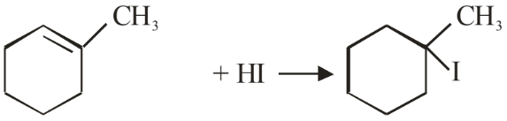

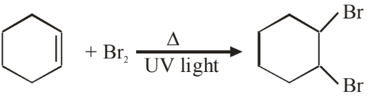

**Answer: (2)** · key (compiled)

**Solution.** (1) is wrong: an aliphatic primary amine gives a mixture (propan-1-ol, propan-2-ol, alkenes), not just ethanol. (3) is wrong: under heat and UV light, Br$_2$ would substitute at the allylic position rather than add across the double bond. (4) is wrong: the Hofmann bromamide reaction removes one carbon, so propanamide gives ethylamine, C$_2$H$_5$NH$_2$, not propylamine. (2) is right: HI adds by Markovnikov's rule, placing I on the more substituted carbon.

### C-AMN-27 · C — JEE Main 2024 · 29 Jan Shift 2 · Fig set Q3 · MCQ

The product A formed in the following reaction is: aniline $\xrightarrow{\text{NaNO}_2,\ \text{HCl},\ 0^\circ\text{C}}\ \xrightarrow{\text{Cu}_2\text{Cl}_2}$ A.

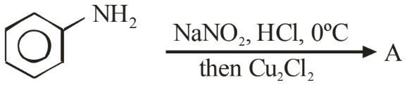

**(1)** 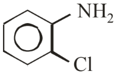

**(2)** 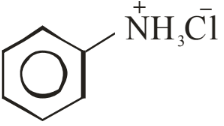

**(3)** 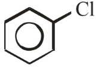

**(4)** 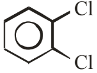

**Answer: (3)** · key (compiled)

**Solution.** Aniline is converted into benzenediazonium chloride at 0 °C. Cu$_2$Cl$_2$ then replaces the diazonium group with Cl (Sandmeyer reaction), giving chlorobenzene — option (3).

### C-AMN-28 · C — JEE Main 2024 · 30 Jan Shift 1 · Fig set Q4 · MCQ

The following is a confirmatory test for aromatic primary amines (aniline → diazonium chloride with reagent A, then coupling with B in NaOH gives a scarlet red dye). Identify reagents A and B. Options (1)–(4) give A as follows: (1) A = HNO$_3$/H$_2$SO$_4$; (2), (3) and (4) A = NaNO$_2$ + HCl, 0–5 °C; the structures shown under each option number are B.

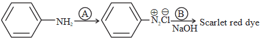

**(1)** 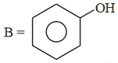

**(2)** 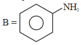

**(3)** 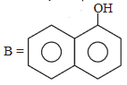

**(4)** 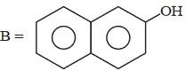

**Answer: (4)** · key (compiled)

**Solution.** A primary aromatic amine is diazotised with NaNO$_2$ + HCl at 0–5 °C (A). The diazonium salt couples with 2-naphthol (β-naphthol) in NaOH to give the scarlet-red azo dye (the Griess-type confirmatory test). So A = NaNO$_2$/HCl (0–5 °C) and B = 2-naphthol: option (4).

### C-AMN-29 · C — JEE Main 2024 · 30 Jan Shift 2 · Fig set Q5 · MCQ

The products A and B formed in the following reaction scheme are respectively: benzene → (i) conc. HNO$_3$/conc. H$_2$SO$_4$, 323–333 K, (ii) Sn/HCl → A; A → (i) NaNO$_2$, HCl, 273–278 K, (ii) phenol → B.

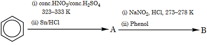

**(1)** 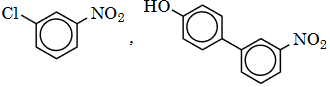

**(2)** 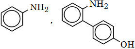

**(3)** 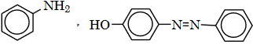

**(4)** 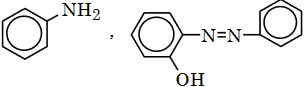

**Answer: (3)** · key (compiled)

**Solution.** Nitration followed by Sn/HCl reduction gives aniline (A). Diazotisation (273–278 K) gives benzenediazonium chloride, which couples with phenol at the *para* position (in mildly alkaline medium) to give the azo dye 4-hydroxyazobenzene, HO–C$_6$H$_4$–N=N–C$_6$H$_5$ (B). Option (3).

