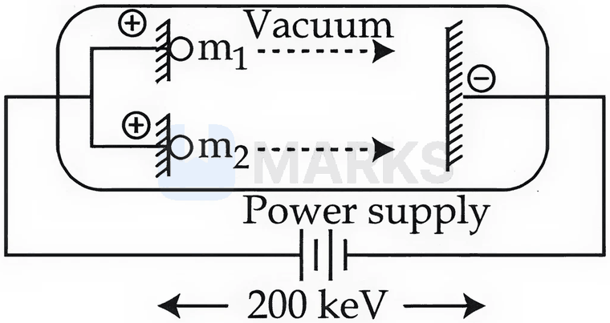

# Atomic Structure

> Theory: [../../theory/chemistry/atomic-structure.md](../../theory/chemistry/atomic-structure.md)

### C-ATS-01 · A — JEE Main 2026 · 21 Jan Shift 2 · set Q1 · MCQ

Consider the following spectral lines for atomic hydrogen: A. First line of the Paschen series; B. Second line of the Balmer series; C. Third line of the Paschen series; D. Fourth line of the Brackett series. The correct arrangement of the above lines in ascending order of energy is:

(1) D < C < A < B  (2) D < A < C < B  (3) C < D < B < A  (4) A < B < C < D

**Answer: (2)** · key (compiled)

**Solution.** $E=13.6\left(\dfrac1{n_1^2}-\dfrac1{n_2^2}\right)$ eV. A: $3\to4$: $13.6\times\dfrac7{144}=0.66$. B: $2\to4$: $13.6\times\dfrac3{16}=2.55$. C: $3\to6$: $13.6\times\dfrac1{12}=1.13$. D: $4\to8$: $13.6\times\dfrac3{64}=0.64$. Ascending: D (0.64) < A (0.66) < C (1.13) < B (2.55).

### C-ATS-02 · A — JEE Main 2026 · 23 Jan Shift 1 · set Q2 · MCQ

Given (A) $n=5$, $m_l=-1$; (B) $n=3$, $l=2$, $m_l=-1$, $m_s=+\tfrac12$. The maximum number of electron(s) in an atom that can have the quantum numbers as given in (A) and (B) respectively are:

(1) 8 and 1  (2) 2 and 4  (3) 26 and 1  (4) 4 and 1

**Answer: (1)** · key (compiled)

**Solution.** (A) $m_l=-1$ requires $l\ge1$, so $l=1,2,3,4$ are possible for $n=5$: 4 orbitals, each holding 2 electrons: 8. (B) All four quantum numbers are specified, so at most 1 electron.

### C-ATS-03 · A — JEE Main 2026 · 23 Jan Shift 1 · set Q3 · MCQ

Which of the following statements regarding the energy of the stationary state is true in the following one-electron systems?

(1) $+2.18\times10^{-18}$ J for the second orbit of $\mathrm{He^+}$ ion  (2) $-2.18\times10^{-18}$ J for the third orbit of $\mathrm{Li^{2+}}$ ion  (3) $-1.09\times10^{-18}$ J for the second orbit of H atom  (4) $+8.72\times10^{-18}$ J for the first orbit of $\mathrm{He^+}$ ion

**Answer: (2)** · key (compiled)

**Solution.** $E_n=-2.18\times10^{-18}\dfrac{Z^2}{n^2}$ J (always negative). (1) and (4) have the wrong sign. (3): H, $n=2$ gives $-5.45\times10^{-19}$ J. (2): $\mathrm{Li^{2+}}$, $n=3$: $-2.18\times10^{-18}\times\dfrac99=-2.18\times10^{-18}$ J – true.

### C-ATS-04 · A — JEE Main 2026 · 28 Jan Shift 2 · set Q4 · MCQ

The wavelength of photon 'A' is 400 nm. The frequency of photon 'B' is $10^{16}\ \mathrm{s^{-1}}$. The wave number of photon 'C' is $10^4\ \mathrm{cm^{-1}}$. The correct order of energy of these photons is:

(1) C > B > A  (2) B > A > C  (3) A > B > C  (4) A > C > B

**Answer: (2)** · key (compiled)

**Solution.** $E_A=\dfrac{hc}{\lambda}=\dfrac{6.626\times10^{-34}\times3\times10^8}{400\times10^{-9}}=4.97\times10^{-19}$ J. $E_B=h\nu=6.626\times10^{-34}\times10^{16}=6.6\times10^{-18}$ J. $E_C=hc\bar\nu=6.626\times10^{-34}\times3\times10^8\times10^6\ \mathrm{m^{-1}}=1.99\times10^{-19}$ J. So B > A > C.

### C-ATS-05 · A — JEE Main 2026 · 28 Jan Shift 2 · set Q5 · Numerical

Two positively charged particles $m_1$ and $m_2$ have been accelerated across the same potential difference of 200 keV as shown below. [Given: mass of $m_1=1$ amu and $m_2=4$ amu] The de Broglie wavelength of $m_1$ will be $x$ times that of $m_2$. The value of $x$ is ______ (nearest integer).

**Answer: 2** · key (compiled)

**Solution.** For a particle of charge $q$ accelerated through $V$: $\lambda=\dfrac{h}{\sqrt{2mqV}}\propto\dfrac1{\sqrt m}$ (same $q$ and $V$). So $\dfrac{\lambda_1}{\lambda_2}=\sqrt{\dfrac{m_2}{m_1}}=\sqrt4=2$.

### C-ATS-06 · A — JEE Main 2026 · 24 Jan Shift 2 · set Q6 · MCQ

The wavelength of the spectral line obtained in the spectrum of the $\mathrm{Li^{2+}}$ ion, when the transition takes place between two levels whose sum is 4 and difference is 2, is:

(1) $1.14\times10^{-7}$ cm  (2) $1.14\times10^{-6}$ cm  (3) $2.28\times10^{-7}$ cm  (4) $2.28\times10^{-6}$ cm

**Answer: (2)** · key (compiled)

**Solution.** $n_1+n_2=4$ and $n_2-n_1=2$ give $n_1=1$, $n_2=3$. For $\mathrm{Li^{2+}}$ ($Z=3$): $\dfrac1\lambda=RZ^2\left(1-\dfrac19\right)=1.097\times10^7\times9\times\dfrac89=8.78\times10^7\ \mathrm{m^{-1}}$, so $\lambda=1.14\times10^{-8}\ \mathrm m=1.14\times10^{-6}$ cm.

### C-ATS-07 · A — JEE Main 2026 · 22 Jan Shift 2 · set Q7 · MCQ

The energy of the first (lowest) Balmer line of the H atom is $x$ J. The energy (in J) of the second Balmer line of the H atom is:

(1) $1.35x$  (2) $\dfrac{x}{2}$  (3) $2x$  (4) $\dfrac{x}{1.35}$

**Answer: (1)** · key (compiled)

**Solution.** First Balmer line $3\to2$: $E_1\propto\dfrac14-\dfrac19=\dfrac5{36}$. Second Balmer line $4\to2$: $E_2\propto\dfrac14-\dfrac1{16}=\dfrac3{16}$. $\dfrac{E_2}{E_1}=\dfrac{3}{16}\times\dfrac{36}{5}=1.35$, so $E_2=1.35x$.

### C-ATS-08 · A — JEE Main 2026 · 22 Jan Shift 1 · set Q8 · MCQ

The energy required by electrons present in the first Bohr orbit of the hydrogen atom to be excited to the second Bohr orbit is ______ J mol$^{-1}$. Given: $R_H=2.18\times10^{-11}$ ergs.

(1) $9.835\times10^{12}$  (2) $1.635\times10^{-18}$  (3) $1.635\times10^{-11}$  (4) $9.835\times10^{5}$

**Answer: (4)** · key (compiled)

**Solution.** $\Delta E=R_H\left(1-\dfrac14\right)=\dfrac34\times2.18\times10^{-11}\ \text{erg}=1.635\times10^{-11}$ erg per atom $=1.635\times10^{-18}$ J per atom. Per mole: $1.635\times10^{-18}\times6.02\times10^{23}\approx9.8\times10^{5}$ J mol$^{-1}$, i.e. $9.835\times10^5$.

### C-ATS-09 · A — JEE Main 2026 · 23 Jan Shift 2 · set Q9 · MCQ

The work functions of two metals ($\mathrm M_A$ and $\mathrm M_B$) are in the $1:2$ ratio. When these metals are exposed to photons of energy 6 eV, the kinetic energy of the liberated electrons of $\mathrm M_A:\mathrm M_B$ is in the ratio $2.642:1$. The work functions (in eV) of $\mathrm M_A$ and $\mathrm M_B$ are respectively:

(1) 1.4, 2.8  (2) 2.3, 4.6  (3) 1.5, 3.0  (4) 3.1, 6.2

**Answer: (2)** · key (compiled)

**Solution.** Let $W_A=W$, $W_B=2W$. $\dfrac{6-W}{6-2W}=2.642\Rightarrow6-W=15.85-5.284W\Rightarrow4.284W=9.85\Rightarrow W=2.3$ eV. So $W_A=2.3$ eV and $W_B=4.6$ eV.

### C-ATS-10 · A — JEE Main 2026 · 21 Jan Shift 1 · set Q11 · MCQ

Given below are two statements:

Statement I: When an electric discharge is passed through gaseous hydrogen, the hydrogen molecules dissociate and the energetically excited hydrogen atoms produce electromagnetic radiation of discrete frequencies.  
Statement II: The frequency of the second line of the Balmer series obtained from $\mathrm{He^+}$ is equal to that of the first line of the Lyman series obtained from the hydrogen atom.

(1) Statement I is false but Statement II is true  (2) Both Statement I and Statement II are true  (3) Statement I is true but Statement II is false  (4) Both Statement I and Statement II are false

**Answer: (2)** · key (compiled)

**Solution.** I is the standard description of the hydrogen line spectrum – true. II: for $\mathrm{He^+}$ ($Z=2$), second Balmer line $4\to2$: $\nu=Rc\cdot4\left(\dfrac14-\dfrac1{16}\right)=\dfrac{3}{4}Rc$. For H, first Lyman line $2\to1$: $\nu=Rc\left(1-\dfrac14\right)=\dfrac34Rc$. Equal – true.

### C-ATS-11 · A — JEE Main 2026 · 28 Jan Shift 1 · set Q12 · MCQ

The wave numbers of three spectral lines of the H atom are considered. Identify the set of spectral lines belonging to the Balmer series. ($R=$ Rydberg constant)

(1) $\dfrac{7R}{144},\dfrac{3R}{16},\dfrac{16R}{255}$  (2) $\dfrac{5R}{36},\dfrac{8R}{9},\dfrac{15R}{16}$  (3) $\dfrac{3R}{4},\dfrac{3R}{16},\dfrac{7R}{144}$  (4) $\dfrac{5R}{36},\dfrac{3R}{16},\dfrac{21R}{100}$

**Answer: (4)** · key (compiled)

**Solution.** Balmer lines: $\bar\nu=R\left(\dfrac14-\dfrac1{n^2}\right)$: $n=3$: $\dfrac{5R}{36}$; $n=4$: $\dfrac{3R}{16}$; $n=5$: $\dfrac{21R}{100}$; $n=6$: $\dfrac{2R}{9}$. Set (4) is all Balmer. The others contain $\dfrac{7R}{144}$ (Paschen $4\to3$), $\dfrac{16R}{255}$ (Brackett-type), $\dfrac{3R}{4}$ and $\dfrac{8R}{9}$ (Lyman).

### C-ATS-12 · A — JEE Main 2026 · 24 Jan Shift 1 · set Q14 · Numerical

The hydrogen spectrum consists of several spectral lines in the Lyman series ($L_1,L_2,L_3,\dots$; $L_1$ has the lowest energy among the Lyman series). Similarly it consists of several spectral lines in the Balmer series ($B_1,B_2,B_3,\dots$; $B_1$ has the lowest energy among the Balmer lines). The energy of $L_1$ is $x$ times the energy of $B_1$. The value of $x$ is ______ $\times10^{-1}$ (nearest integer).

**Answer: 54** · key (compiled)

**Solution.** $L_1$ ($2\to1$): $E\propto1-\dfrac14=\dfrac34$. $B_1$ ($3\to2$): $E\propto\dfrac14-\dfrac19=\dfrac5{36}$. $x=\dfrac{3/4}{5/36}=\dfrac{27}5=5.4=54\times10^{-1}$.

### C-ATS-13 · B — JEE Main 2025 · Jan session · Atom set Q1 · MCQ

The radius of the first excited state of the helium ion is given in terms of $a_0$, the radius of the first stationary state of the hydrogen atom, as:

(1) $r=4a_0$  (2) $r=2a_0$  (3) $r=\tfrac{a_0}2$  (4) $r=\tfrac{a_0}4$

**Answer: (2)** · key (compiled)

**Solution.** $r_n=a_0\dfrac{n^2}Z$. For He$^+$ ($Z=2$) in the first excited state ($n=2$): $r=a_0\cdot\dfrac42=2a_0$.

### C-ATS-14 · B — JEE Main 2025 · Jan session · Atom set Q2 · MCQ

In a multielectron atom, which of the following orbitals described by three quantum numbers will have the same energy in the absence of electric and magnetic fields?

A. $n=1,l=0,m_l=0$  B. $n=2,l=0,m_l=0$  C. $n=2,l=1,m_l=1$  D. $n=3,l=2,m_l=1$  E. $n=3,l=2,m_l=0$

(1) B and C only  (2) A and B only  (3) C and D only  (4) D and E only

**Answer: (4)** · key (compiled)

**Solution.** In a multielectron atom the energy depends on $n$ and $l$ (not on $m_l$). Orbitals with the same $n$ and $l$ are degenerate: D ($3d$, $m_l=1$) and E ($3d$, $m_l=0$).

### C-ATS-15 · B — JEE Main 2025 · Jan session · Atom set Q3 · MCQ

Given below are two statements about X-ray spectra of elements: Statement I: A plot of $\sqrt\nu$ ($\nu$ = frequency of X-rays emitted) vs atomic mass is a straight line. Statement II: A plot of $\nu$ ($\nu$ = frequency of X-rays emitted) vs atomic number is a straight line.

(1) Both Statement I and Statement II are true  (2) Statement I is false but Statement II is true  (3) Both Statement I and Statement II are false  (4) Statement I is true but Statement II is false

**Answer: (3)** · key (compiled)

**Solution.** Moseley's law: $\sqrt\nu=a(Z-b)$, so the straight line is $\sqrt\nu$ against atomic number, not atomic mass (Statement I false), and $\nu$ against $Z$ is a parabola, not a line (Statement II false).

### C-ATS-16 · B — JEE Main 2025 · Jan session · Atom set Q4 · MCQ

Given below are two statements: Statement I: The radii of isoelectronic species increase in the order Mg$^{2+}$ < Na$^+$ < F$^-$ < O$^{2-}$. Statement II: The magnitude of electron gain enthalpy of halogens decreases in the order Cl > F > Br > I.

(1) Statement I is incorrect but Statement II is correct  (2) Statement I is correct but Statement II is incorrect  (3) Both Statement I and Statement II are incorrect  (4) Both Statement I and Statement II are correct

**Answer: (4)** · key (compiled)

**Solution.** Isoelectronic ions: the greater the nuclear charge the smaller the radius, so Mg$^{2+}$ < Na$^+$ < F$^-$ < O$^{2-}$ (true). Electron gain enthalpy magnitude: Cl (349) > F (328) > Br (325) > I (295) kJ mol$^{-1}$ (true; fluorine is lower than chlorine because of its small size and strong inter-electronic repulsion).

### C-ATS-17 · B — JEE Main 2025 · Jan session · Atom set Q6 · MCQ

Heat treatment of muscular pain involves radiation of wavelength of about 900 nm. Which spectral line of the H atom is suitable for this? Given: Rydberg constant $R_H=10^5$ cm$^{-1}$, $h=6.6\times10^{-34}$ J s, $c=3\times10^8$ m/s.

(1) Balmer series, $\infty\to2$  (2) Lyman series, $\infty\to1$  (3) Paschen series, $\infty\to3$  (4) Paschen series, $5\to3$

**Answer: (3)** · key (compiled)

**Solution.** $\dfrac1\lambda=\dfrac1{900\times10^{-7}\ \text{cm}}=1.11\times10^4$ cm$^{-1}=R_H\left(\dfrac1{n_1^2}-\dfrac1{n_2^2}\right)$, i.e. $\dfrac19$ in units of $R_H$ ($1.11\times10^4/10^5=0.111$). That is the Paschen series limit, $\infty\to3$ ($\tfrac1{3^2}-0$).

### C-ATS-18 · B — JEE Main 2025 · Apr session · Atom set Q1 · MCQ

According to Bohr's model of the hydrogen atom, which of the following statements is incorrect?

(1) Radius of the 3rd orbit is nine times larger than that of the 1st orbit.  (2) Radius of the 8th orbit is four times larger than that of the 4th orbit.  (3) Radius of the 6th orbit is three times larger than that of the 4th orbit.  (4) Radius of the 4th orbit is four times larger than that of the 2nd orbit.

**Answer: (3)** · key (compiled)

**Solution.** $r\propto n^2$. $\dfrac{r_3}{r_1}=9$ ✓; $\dfrac{r_8}{r_4}=\dfrac{64}{16}=4$ ✓; $\dfrac{r_6}{r_4}=\dfrac{36}{16}=2.25$ ✗; $\dfrac{r_4}{r_2}=\dfrac{16}4=4$ ✓. Statement (3) is incorrect.

### C-ATS-19 · B — JEE Main 2025 · Apr session · Atom set Q2 · MCQ

For an electron in '2s' and '2p' orbitals, the orbital angular momentum values, respectively, are:

(1) $\sqrt2\dfrac h{2\pi}$ and 0  (2) $\dfrac h{2\pi}$ and $\sqrt2\dfrac h{2\pi}$  (3) 0 and $\sqrt6\dfrac h{2\pi}$  (4) 0 and $\sqrt2\dfrac h{2\pi}$

**Answer: (4)** · key (compiled)

**Solution.** $L=\sqrt{l(l+1)}\dfrac h{2\pi}$. For 2s, $l=0$: $L=0$. For 2p, $l=1$: $L=\sqrt2\dfrac h{2\pi}$.

### C-ATS-20 · B — JEE Main 2025 · Apr session · Atom set Q3 · Numerical

The energy of an electron in the first Bohr orbit of the H atom is $-13.6$ eV. The magnitude of the energy of the electron in the first excited state of Be$^{3+}$ is ______ eV. (nearest integer value)

**Answer: 54** · key (compiled)

**Solution.** $E_n=-13.6\dfrac{Z^2}{n^2}$. For Be$^{3+}$ ($Z=4$) in the first excited state ($n=2$): $13.6\times\dfrac{16}4=54.4\approx54$ eV.

### C-ATS-21 · B — JEE Main 2025 · Apr session · Atom set Q5 · MCQ

Which of the following postulates of Bohr's model of the hydrogen atom is not in agreement with the quantum mechanical model of an atom?

(1) An atom in a stationary state does not emit electromagnetic radiation as long as it stays in the same state.  (2) An atom can take only certain distinct energies E$_1$, E$_2$, E$_3$, etc. These allowed states of constant energy are called the stationary states of the atom.  (3) When an electron makes a transition from a higher energy stationary state to a lower energy stationary state, it emits a photon of light.  (4) The electron in a H atom's stationary state moves in a circle around the nucleus.

**Answer: (4)** · key (compiled)

**Solution.** Quantisation of energy, stationary states and photon emission on transitions survive in quantum mechanics. The definite circular path of the electron conflicts with the uncertainty principle: an orbital only gives a probability distribution. So (4).

### C-ATS-22 · B — JEE Main 2024 · 27 Jan Shift 1 · Q32 · MCQ

Which of the following configurations would have the highest magnetic moment?

(1) $[\text{Ar}]3d^7$  (2) $[\text{Ar}]3d^8$  (3) $[\text{Ar}]3d^3$  (4) $[\text{Ar}]3d^6$

**Answer: (4)** · key ✔

**Solution.** Unpaired electrons in the free-ion (Hund) configuration: $d^7\to3$, $d^8\to2$, $d^3\to3$, $d^6\to4$. $\mu=\sqrt{n(n+2)}$ is largest for $n=4$, i.e. $d^6$ ($\approx4.90$ BM).

### C-ATS-23 · C — JEE Main 2024 · 29 Jan Shift 1 · Q31 · MCQ

The correct set of four quantum numbers $(n,l,m_l,m_s)$ for the valence electron of rubidium ($Z=37$) is

(1) $5,0,0,+\tfrac12$  (2) $5,0,1,+\tfrac12$  (3) $5,1,0,+\tfrac12$  (4) $5,1,1,+\tfrac12$

**Answer: (1)** · key ✔

**Solution.** Rb is $[\text{Kr}]5s^1$, so the valence electron has $n=5$, $l=0$ (s), and therefore $m_l=0$ only. Spin is $\pm\tfrac12$.

### C-ATS-24 · C — JEE Main 2024 · 30 Jan Shift 1 · Q31 · MCQ

Statement I: Orbitals having the same energy are called degenerate orbitals.  
Statement II: In a hydrogen atom, $3p$ and $3d$ orbitals are not degenerate orbitals.

(1) I true, II false  (2) Both true  (3) Both false  (4) I false, II true

**Answer: (1)** · key ✔

**Solution.** I is the definition of degeneracy. In a hydrogen atom (a one-electron system) energy depends only on $n$, so $3s,3p,3d$ are all degenerate; II is false. (In multi-electron atoms $l$ also matters and the degeneracy is lifted.)

### C-ATS-25 · C — JEE Main 2024 · 30 Jan Shift 2 · Q51 · Numerical

The number of spectral lines obtained in the $\text{He}^+$ spectrum when an electron makes transitions from the fifth excited state to the first excited state is ______.

**Answer: 10** · key ✔

**Solution.** The fifth excited state is $n=6$ and the first excited state is $n=2$. Lines arise from transitions among the levels $n=2,3,4,5,6$ ($5$ levels): number $=\dfrac{5\times4}{2}=10$.

### C-ATS-26 · C — JEE Main 2024 · 31 Jan Shift 1 · Q52 · Numerical

The ionisation energy of sodium in kJ mol$^{-1}$, if electromagnetic radiation of wavelength $242$ nm is just sufficient to ionise a sodium atom, is ______ (nearest integer).

**Answer: 494** · key ✔

**Solution.** Energy per atom $E=\dfrac{hc}\lambda=\dfrac{6.626\times10^{-34}\times3\times10^8}{242\times10^{-9}}=8.21\times10^{-19}$ J. Per mole: $8.21\times10^{-19}\times6.022\times10^{23}=4.95\times10^5$ J $\approx494$ kJ mol$^{-1}$.

### C-ATS-27 · C — JEE Main 2024 · 31 Jan Shift 2 · Q32 · MCQ

The four quantum numbers for the electron in the outermost orbital of potassium (atomic number $19$) are

(1) $n=4,l=2,m=-1,s=+\tfrac12$  (2) $n=4,l=0,m=0,s=\pm\tfrac12$  (3) $n=3,l=0,m=-1,s=+\tfrac12$  (4) $n=2,l=0,m=0,s=+\tfrac12$

**Answer: (2)** · key ✔

**Solution.** K is $[\text{Ar}]4s^1$. The valence electron is in the $4s$ orbital: $n=4$, $l=0$, $m_l=0$, $s=\pm\tfrac12$.

### C-ATS-28 · C — JEE Main 2024 · 1 Feb Shift 2 · Q31 · MCQ

The number of radial nodes for the $3p$ orbital is:

(1) 1  (2) 4  (3) 2  (4) 3

**Answer: (1)** · key ✔

**Solution.** Radial nodes $=n-l-1=3-1-1=1$.

### C-ATS-29 · C — JEE Main 2024 · 4 Apr Shift 1 · Q51 · Numerical

The de Broglie wavelength of an electron in the $4$th orbit is $x\pi a_0$ ($a_0$ = Bohr radius). Then $x=$ ______.

**Answer: 8** · key ✔

**Solution.** $2\pi r_n=n\lambda\Rightarrow\lambda=\dfrac{2\pi n^2a_0}{n}=2\pi na_0=2\pi(4)a_0=8\pi a_0$.

