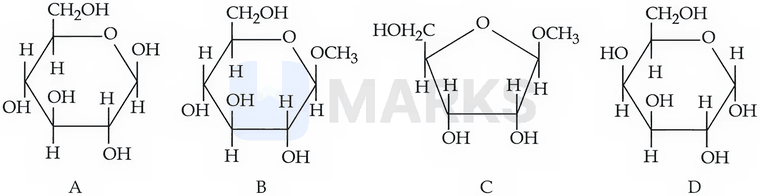
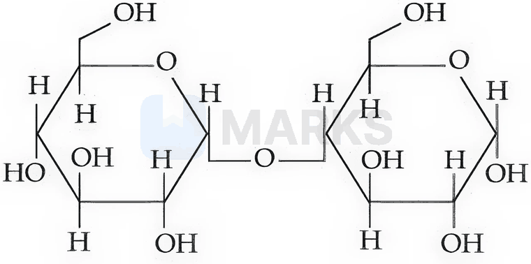
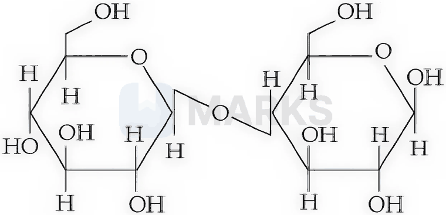
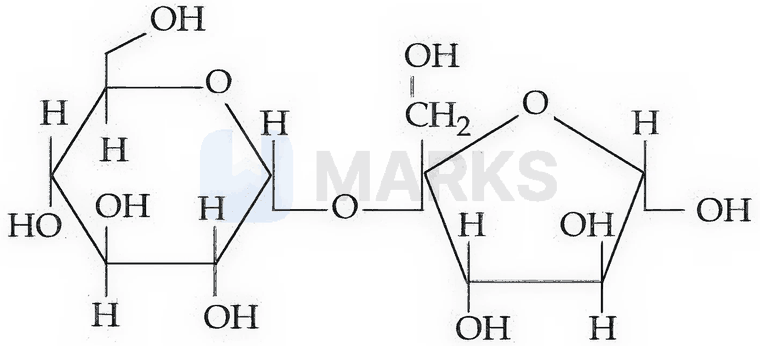
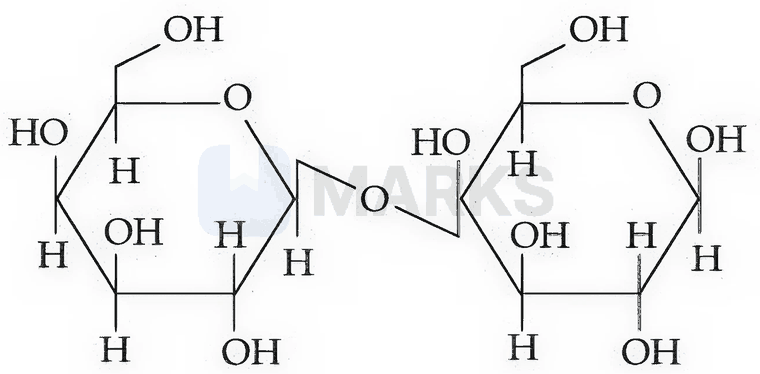
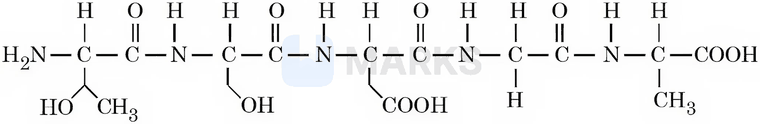
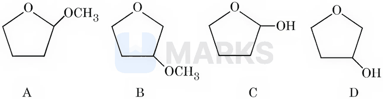

# Biomolecules

> Theory: [../../theory/chemistry/biomolecules.md](../../theory/chemistry/biomolecules.md)

### C-BIO-01 · A — JEE Main 2026 · 21 Jan Shift 2 · set Q1 · MCQ

The correct statements are:

A. The activation energy for enzyme-catalysed hydrolysis of sucrose is lower than that of acid-catalysed hydrolysis.  
B. During denaturation, the secondary and tertiary structures of a protein are destroyed but the primary structure remains intact.  
C. Nucleotides are joined together by glycosidic linkage between $\mathrm{C_1}$ and $\mathrm{C_4}$ carbons of the pentose sugar.  
D. The quaternary structure of proteins represents the overall folding of the polypeptide chain.

(1) A and B only  (2) A, B and D only  (3) B and C only  (4) A, C and D only

**Answer: (1)** · key (compiled)

**Solution.** A true (an enzyme lowers $E_a$ more than an acid does: about 2 vs 6 kcal mol$^{-1}$ for sucrose). B true (denaturation breaks H-bonds etc., so 2° and 3° structures are lost, while the peptide-bond sequence, i.e. the primary structure, is intact). C false: nucleotides are linked through *phosphodiester* bonds between the 3′ and 5′ carbons of the sugars. D false: overall folding of a chain is the *tertiary* structure; quaternary structure is the assembly of several polypeptide subunits.

### C-BIO-02 · A — JEE Main 2026 · 23 Jan Shift 1 · set Q2 · MCQ

From the given cyclic structures (A to D), those which will NOT react with Tollens' reagent are:

(1) A and B  (2) A and D  (3) B and D  (4) B and C

**Answer: (4)** · key (compiled)

**Solution.** Tollens' reagent oxidises the free aldehyde group, which a cyclic hemiacetal can regenerate by ring opening in solution. A and D have a free anomeric –OH (hemiacetal), so they are reducing and react. B and C have an $\mathrm{OCH_3}$ on the anomeric carbon (acetals/glycosides) which cannot open to a free CHO, so they do not react: B and C.

### C-BIO-03 · A — JEE Main 2026 · 28 Jan Shift 2 · set Q3 · MCQ

The structures of four disaccharides are given below. Among them, the non-reducing sugar is:

**(1)** 

**(2)** 

**(3)** 

**(4)** 

**Answer: (3)** · key (compiled)

**Solution.** A disaccharide is non-reducing when *both* anomeric carbons are tied up in the glycosidic link (no free hemiacetal –OH). In (1), (2) and (4) one ring still has a free anomeric OH (maltose-/lactose-type), so they are reducing. Structure (3) is sucrose: $\alpha$-D-glucose C1 is joined to $\beta$-D-fructose C2, so both anomeric carbons are used in the link and there is no free hemiacetal – non-reducing.

### C-BIO-04 · A — JEE Main 2026 · 24 Jan Shift 2 · set Q4 · MCQ

The number of possible tripeptides formed involving alanine (ala), glycine (gly) and valine (val), where no amino acid is used more than once, is:

(1) 3  (2) 8  (3) 6  (4) 4

**Answer: (3)** · key (compiled)

**Solution.** Each tripeptide contains all three different amino acids, and the sequence matters (N-terminal to C-terminal), so there are $3!=6$.

### C-BIO-05 · A — JEE Main 2026 · 22 Jan Shift 2 · set Q5 · MCQ

Match List-I with List-II.

| List-I: reaction of glucose with | List-II: product formed |
|---|---|
| A. Hydroxylamine | I. Gluconic acid |
| B. $\mathrm{Br_2}$ water | II. Glucose pentaacetate |
| C. Excess acetic anhydride | III. Saccharic acid |
| D. Concentrated $\mathrm{HNO_3}$ | IV. Glucoxime |

(1) A-III, B-I, C-IV, D-II  (2) A-I, B-III, C-IV, D-II  (3) A-IV, B-III, C-II, D-I  (4) A-IV, B-I, C-II, D-III

**Answer: (4)** · key (compiled)

**Solution.** The CHO of glucose forms an oxime with $\mathrm{NH_2OH}$ (IV). Mild oxidation by bromine water converts only CHO to COOH: gluconic acid (I). Excess $\mathrm{(CH_3CO)_2O}$ acetylates all five OH: pentaacetate (II). Strong oxidation by conc. $\mathrm{HNO_3}$ oxidises both CHO and the terminal $\mathrm{CH_2OH}$ to COOH: saccharic acid (III).

### C-BIO-06 · A — JEE Main 2026 · 22 Jan Shift 1 · set Q6 · MCQ

Given below are two statements:

Statement I: Sucrose is dextrorotatory. However, sucrose upon hydrolysis gives a solution having a mixture of products. This solution shows laevorotation.  
Statement II: Hydrolysis of sucrose gives glucose and fructose. Since the laevorotation of glucose is more than the dextrorotation of fructose, the resulting solution becomes laevorotatory.

(1) Statement I is true but Statement II is false  (2) Statement I is false but Statement II is true  (3) Both Statement I and Statement II are false  (4) Both Statement I and Statement II are true

**Answer: (1)** · key (compiled)

**Solution.** I true: sucrose $[\alpha]=+66.5^\circ$, and the equimolar glucose/fructose mixture (invert sugar) is laevorotatory. II false: it is *glucose* that is dextrorotatory ($+52.5^\circ$) and *fructose* that is laevorotatory ($-92.4^\circ$); the laevorotation of fructose exceeds the dextrorotation of glucose, so the mixture is laevorotatory.

### C-BIO-07 · A — JEE Main 2026 · 23 Jan Shift 2 · set Q7 · MCQ

Both human DNA and RNA are chiral molecules. The chirality in DNA and RNA arises due to the presence of:

(1) L-sugar component  (2) chiral phosphate unit  (3) base unit  (4) D-sugar component

**Answer: (4)** · key (compiled)

**Solution.** The sugar units are D-2-deoxyribose in DNA and D-ribose in RNA; these carry several stereocentres. The phosphate groups and the (planar) bases are achiral.

### C-BIO-08 · A — JEE Main 2026 · 21 Jan Shift 1 · set Q8 · MCQ

Identify the correct statements.

A. Arginine and tryptophan are essential amino acids.  
B. Histidine does not contain a heterocyclic ring in its structure.  
C. Proline is a six-membered cyclic amino acid.  
D. Glycine does not have a chiral centre.  
E. Cysteine has the characteristic side chain $\mathrm{MeS{-}CH_2{-}CH_2{-}}$.

(1) A and D only  (2) B and E only  (3) C and E only  (4) C and D only

**Answer: (1)** · key (compiled)

**Solution.** A true (both are in the NCERT list of essential amino acids). B false (histidine has an imidazole ring). C false (proline's pyrrolidine ring is five-membered). D true ($\mathrm{R=H}$, so the $\alpha$-carbon carries two H). E false ($\mathrm{MeS{-}CH_2CH_2{-}}$ is the side chain of methionine; cysteine has $\mathrm{{-}CH_2SH}$). So A and D.

### C-BIO-09 · A — JEE Main 2026 · 28 Jan Shift 1 · set Q9 · MCQ

In the given pentapeptide, find out an essential amino acid (Y) and the sequence present in the pentapeptide:

(1) (Y) Serine; sequence Ser-Asp-Thr-Ala-Gly  (2) (Y) Serine; sequence Thr-Ser-Asp-Ala-Gly  (3) (Y) Threonine; sequence Ser-Thr-Asp-Gly-Ala  (4) (Y) Threonine; sequence Thr-Ser-Asp-Gly-Ala

**Answer: (4)** · key (compiled)

**Solution.** Read from the free $\mathrm{NH_2}$ end: side chains $\mathrm{CH(OH)CH_3}$ (threonine), $\mathrm{CH_2OH}$ (serine), $\mathrm{CH_2COOH}$ (aspartic acid), H (glycine), $\mathrm{CH_3}$ (alanine): Thr-Ser-Asp-Gly-Ala. Of these only threonine is an essential amino acid (the body cannot synthesise it).

### C-BIO-10 · A — JEE Main 2026 · 24 Jan Shift 1 · set Q10 · MCQ

A student is given one compound among the following compounds that gives a positive test with Tollens' reagent. The compound is:

(1) D  (2) A  (3) B  (4) C

**Answer: (4)** · key (compiled)

**Solution.** Tollens' reagent needs a free CHO (or one that can be freed). A is a cyclic acetal (2-methoxytetrahydrofuran); B is an ether; D is a secondary alcohol; none can give CHO. C (2-hydroxytetrahydrofuran) is a cyclic *hemiacetal*, which is in equilibrium with its open form $\mathrm{HOCH_2CH_2CH_2CHO}$ and so gives the silver mirror.

### C-BIO-11 · B — JEE Main 2024 · 27 Jan Shift 1 · Q50 · MCQ

Two nucleotides are joined together by a linkage known as

(1) Phosphodiester linkage  (2) Glycosidic linkage  (3) Disulphide linkage  (4) Peptide linkage

**Answer: (1)** · key ✔

**Solution.** The 3′-OH of one nucleotide and the 5′-phosphate of the next are joined through a phosphate group esterified on both sides (phosphodiester bond). A glycosidic bond joins a sugar and a base (or two sugars).

### C-BIO-12 · B — JEE Main 2024 · 27 Jan Shift 2 · Q50 · MCQ

Which structure of a protein remains intact after coagulation of egg white on boiling?

(1) Primary  (2) Tertiary  (3) Secondary  (4) Quaternary

**Answer: (1)** · key ✔

**Solution.** Heat denatures a protein by breaking weak hydrogen bonds and other interactions that hold the secondary, tertiary and quaternary structures. The amino-acid sequence (primary structure, held by peptide bonds) is unchanged.

### C-BIO-13 · B — JEE Main 2024 · 29 Jan Shift 1 · Q49 · MCQ

The type of amino acids obtained by hydrolysis of proteins is

(1) $\beta$  (2) $\alpha$  (3) $\delta$  (4) $\gamma$

**Answer: (2)** · key ✔

**Solution.** Proteins are polymers of $\alpha$-amino acids, in which the $-\text{NH}_2$ group is on the carbon adjacent to $-\text{COOH}$, joined by peptide bonds. Hydrolysis regenerates $\alpha$-amino acids.

### C-BIO-14 · B — JEE Main 2024 · 29 Jan Shift 2 · Q50 · MCQ

Match List I (biopolymer) with List II (monomer): A. Starch  B. Cellulose  C. Nucleic acid  D. Protein; I. nucleotide  II. $\alpha$-glucose  III. $\beta$-glucose  IV. $\alpha$-amino acid.

(1) A-II, B-I, C-III, D-IV  (2) A-IV, B-II, C-I, D-III  (3) A-I, B-III, C-IV, D-II  (4) A-II, B-III, C-I, D-IV

**Answer: (4)** · key ✔

**Solution.** Starch is a polymer of $\alpha$-D-glucose (amylose/amylopectin), cellulose of $\beta$-D-glucose, nucleic acids of nucleotides, and proteins of $\alpha$-amino acids.

### C-BIO-15 · B — JEE Main 2024 · 30 Jan Shift 1 · Q50 · MCQ

The sugar which does not give a reddish-brown precipitate with Fehling's reagent is

(1) Sucrose  (2) Lactose  (3) Glucose  (4) Maltose

**Answer: (1)** · key ✔

**Solution.** Fehling's reagent detects reducing sugars (free hemiacetal/aldehyde group). Glucose, lactose and maltose all have a free anomeric carbon. In sucrose the two anomeric carbons are joined through the glycosidic bond, so it is non-reducing.

### C-BIO-16 · B — JEE Main 2024 · 30 Jan Shift 2 · Q60 · Numerical

The total number of correct statements regarding the nucleic acids is ______.  
A. RNA is regarded as the reserve of genetic information.  
B. The DNA molecule self-duplicates during cell division.  
C. DNA synthesises proteins in the cell.  
D. The message for the synthesis of particular proteins is present in DNA.  
E. Identical DNA strands are transferred to daughter cells.

**Answer: 3** · key ✔

**Solution.** DNA (not RNA) is the reserve of genetic information, so A is false. B, D and E are correct (replication, genetic message, faithful transfer). Proteins are synthesised by ribosomes using mRNA (the message is copied from DNA), so DNA does not itself synthesise proteins; C is false. Count $=3$.

### C-BIO-17 · B — JEE Main 2024 · 31 Jan Shift 1 · Q50 · MCQ

Match List I with List II: A. Glucose/$\text{NaHCO}_3$/$\Delta$  B. Glucose/$\text{HNO}_3$  C. Glucose/HI/$\Delta$  D. Glucose/bromine water; I. Gluconic acid  II. No reaction  III. $n$-Hexane  IV. Saccharic acid.

(1) A-IV, B-I, C-III, D-II  (2) A-II, B-IV, C-III, D-I  (3) A-III, B-II, C-I, D-IV  (4) A-I, B-IV, C-III, D-II

**Answer: (2)** · key ✔

**Solution.** Glucose has no $-\text{COOH}$, so $\text{NaHCO}_3$ does not react. Conc. $\text{HNO}_3$ oxidises both the CHO and the terminal $\text{CH}_2\text{OH}$: saccharic acid. Prolonged HI/$\Delta$ reduces it fully to $n$-hexane. Bromine water oxidises only the CHO: gluconic acid.

### C-BIO-18 · B — JEE Main 2024 · 31 Jan Shift 2 · Q60 · Numerical

From the vitamins A, $\text{B}_1$, $\text{B}_6$, $\text{B}_{12}$, C, D, E and K, the number of vitamins that can be stored in our body is ______.

**Answer: 5** · key ✔

**Solution.** Fat-soluble vitamins (A, D, E, K) are stored in adipose tissue and the liver. Vitamin $\text{B}_{12}$, although water-soluble, is also stored in the liver. $\text{B}_1$, $\text{B}_6$ and C are water-soluble and excreted, so they are not stored. Count $=5$.

### C-BIO-19 · B — JEE Main 2024 · 1 Feb Shift 1 · Q50 · MCQ

If one strand of a DNA has the sequence ATGCTTCA, the sequence of bases in the complementary strand is:

(1) CATTAGCT  (2) TACGAAGT  (3) GTACTTAC  (4) ATGCGACT

**Answer: (2)** · key ✔

**Solution.** Base pairing is A–T and G–C, so ATGCTTCA pairs to TACGAAGT.

### C-BIO-20 · C — JEE Main 2024 · 1 Feb Shift 2 · Q60 · Numerical

The number of tripeptides formed by three different amino acids, each used once, is ______.

**Answer: 6** · key ✔

**Solution.** Different sequences of three distinct residues are different tripeptides: $3!=6$.

### C-BIO-21 · C — JEE Main 2024 · 4 Apr Shift 2 · Q50 · MCQ

Match List I with List II: (A) $\alpha$-glucose and $\alpha$-galactose; (B) $\alpha$-glucose and $\beta$-glucose; (C) $\alpha$-glucose and $\alpha$-fructose; (D) $\alpha$-glucose and $\alpha$-ribose; (I) functional isomers; (II) homologous; (III) anomers; (IV) epimers.

(1) A-IV, B-III, C-I, D-II  (2) A-III, B-IV, C-I, D-II  (3) A-IV, B-III, C-II, D-I  (4) A-III, B-IV, C-II, D-I

**Answer: (1)** · key ✔

**Solution.** Glucose and galactose differ only at C-4: epimers (IV). $\alpha$ and $\beta$ glucose differ at the anomeric C-1: anomers (III). Glucose (aldose) and fructose (ketose), both $\text{C}_6\text{H}_{12}\text{O}_6$, are functional isomers (I). Glucose ($\text{C}_6$) and ribose ($\text{C}_5$) differ by a $\text{CHOH}$ unit: homologous-type relationship (II) as per the key.

### C-BIO-22 · C — JEE Main 2024 · 5 Apr Shift 1 · Q50 · MCQ

Which of the following gives a positive test with ninhydrin?

(1) Starch  (2) Egg albumin  (3) Polyvinyl chloride  (4) Cellulose

**Answer: (2)** · key ✔

**Solution.** Ninhydrin gives a purple (Ruhemann's purple) colour with free $\alpha$-amino acids, peptides and proteins. Egg albumin is a protein; starch and cellulose are polysaccharides and PVC is a synthetic polymer.

### C-BIO-23 · C — JEE Main 2024 · 5 Apr Shift 2 · Q50 · MCQ

Coagulation of egg on heating is because of:

(1) the secondary structure of the protein remains unchanged  (2) denaturation of the protein occurs  (3) the biological property of the protein remains unchanged  (4) breaking of the peptide linkage in the primary structure occurs

**Answer: (2)** · key ✔

**Solution.** Heat breaks the hydrogen bonds and other weak interactions that hold the secondary and tertiary structure, so the globular albumin unfolds and aggregates (denaturation). The primary structure (peptide bonds) is not broken.

### C-BIO-24 · C — JEE Main 2024 · 6 Apr Shift 2 · Q50 · MCQ

The incorrect statements regarding enzymes are: (A) Enzymes are biocatalysts. (B) Enzymes are non-specific and can catalyse different kinds of reactions. (C) Most enzymes are globular proteins. (D) The enzyme oxidase catalyses the hydrolysis of maltose into glucose.

(1) (B), (C) and (D)  (2) (B) and (D)  (3) (A), (B) and (C)  (4) (B) and (C)

**Answer: (2)** · key ✔

**Solution.** A and C are true. B is false because enzymes are highly specific. D is false: oxidases catalyse oxidation, whereas maltase hydrolyses maltose to glucose.

### C-BIO-25 · C — JEE Main 2024 · 8 Apr Shift 2 · Q60 · Numerical

The total number of carbon atoms present in tyrosine, an amino acid, is ______.

**Answer: 9** · key ✔

**Solution.** Tyrosine is $p$-hydroxyphenylalanine, $\text{HO-C}_6\text{H}_4\text{-CH}_2\text{-CH(NH}_2)\text{-COOH}$, $\text{C}_9\text{H}_{11}\text{NO}_3$: $6$ (ring) $+1$ ($\text{CH}_2$) $+1$ ($\alpha$-C) $+1$ (COOH) $=9$.

