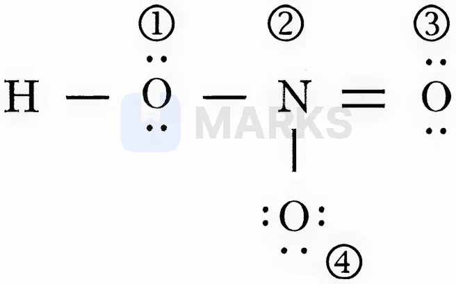

# Chemical Bonding & Molecular Structure

> Theory: [../../theory/chemistry/chemical-bonding.md](../../theory/chemistry/chemical-bonding.md)

### C-BND-01 — JEE Main 2024 · 27 Jan Shift 1 · Q33 · MCQ

Choose the polar molecule from the following:

(1) $\text{CCl}_4$  (2) $\text{CO}_2$  (3) $\text{CH}_2{=}\text{CH}_2$  (4) $\text{CHCl}_3$

**Answer: (4)** · key ✔

**Solution.** $\text{CCl}_4$ (tetrahedral), $\text{CO}_2$ (linear) and ethene (planar, symmetric) have zero net dipole. $\text{CHCl}_3$ has three C–Cl dipoles and one C–H bond, so the vectors do not cancel.

### C-BND-02 — JEE Main 2024 · 27 Jan Shift 1 · Q53 · Numerical

The sum of the bond orders of $\text{CO}$ and $\text{NO}^+$ is ______.

**Answer: 6** · key ✔

**Solution.** Both are 10-valence-electron species isoelectronic with $\text{N}_2$: $\text{B.O.}=\tfrac{10-4}{2}=3$ each (MO configuration $\sigma2s^2\sigma^*2s^2\pi2p^4\sigma2p^2$). Sum $=6$.

### C-BND-03 — JEE Main 2024 · 27 Jan Shift 2 · Q55 · Numerical

The number of non-polar molecules among $\text{HF, H}_2\text{O, SO}_2,\text{H}_2,\text{CO}_2,\text{CH}_4,\text{NH}_3,\text{HCl},\text{CHCl}_3,\text{BF}_3$ is ______.

**Answer: 4** · key ✔

**Solution.** Symmetric molecules with zero dipole: $\text{H}_2$ (homonuclear), $\text{CO}_2$ (linear), $\text{CH}_4$ (tetrahedral) and $\text{BF}_3$ (trigonal planar). HF, HCl, $\text{H}_2\text{O}$, $\text{SO}_2$, $\text{NH}_3$ and $\text{CHCl}_3$ are polar.

### C-BND-04 — JEE Main 2024 · 29 Jan Shift 1 · Q51 · Numerical

The number of compounds having exactly one lone pair of electrons on the central atom among $\text{O}_3,\ \text{H}_2\text{O},\ \text{SF}_4,\ \text{ClF}_3,\ \text{NH}_3,\ \text{BrF}_5,\ \text{XeF}_4$ is ______.

**Answer: 4** · key ✔

**Solution.** Lone pairs on the central atom: $\text{O}_3$ (1), $\text{H}_2\text{O}$ (2), $\text{SF}_4$ (1), $\text{ClF}_3$ (2), $\text{NH}_3$ (1), $\text{BrF}_5$ (1), $\text{XeF}_4$ (2). Exactly one: $\text{O}_3,\text{SF}_4,\text{NH}_3,\text{BrF}_5$, so $4$.

### C-BND-05 — JEE Main 2024 · 29 Jan Shift 1 · Q52 · Numerical

The number of species from the following that are paramagnetic and have bond order equal to one is ______: $\text{H}_2,\ \text{He}_2^+,\ \text{O}_2^+,\ \text{N}_2^{2-},\ \text{O}_2^{2-},\ \text{F}_2,\ \text{Ne}_2^+,\ \text{B}_2$

**Answer: 1** · key ✔

**Solution.** Bond orders: $\text{H}_2$ 1 (diamagnetic), $\text{He}_2^+$ 0.5, $\text{O}_2^+$ 2.5, $\text{N}_2^{2-}$ 2, $\text{O}_2^{2-}$ 1 (diamagnetic), $\text{F}_2$ 1 (diamagnetic), $\text{Ne}_2^+$ 0.5, $\text{B}_2$ 1 (two unpaired electrons in degenerate $\pi_{2p}$ orbitals: paramagnetic). Only $\text{B}_2$ qualifies.

### C-BND-06 — JEE Main 2024 · 29 Jan Shift 2 · Q51 · Numerical

The total number of molecules with zero dipole moment among $\text{CH}_4,\ \text{BF}_3,\ \text{H}_2\text{O},\ \text{HF},\ \text{NH}_3,\ \text{CO}_2$ and $\text{SO}_2$ is ______.

**Answer: 3** · key ✔

**Solution.** Symmetric molecules cancel their bond dipoles: $\text{CH}_4$ (tetrahedral), $\text{BF}_3$ (trigonal planar) and $\text{CO}_2$ (linear). $\text{H}_2\text{O}$, HF, $\text{NH}_3$ and $\text{SO}_2$ are polar (bent, diatomic heteronuclear, pyramidal, bent).

### C-BND-07 — JEE Main 2024 · 29 Jan Shift 2 · Q53 · Numerical

The total number of antibonding molecular orbitals formed from $2s$ and $2p$ atomic orbitals in a diatomic molecule is ______.

**Answer: 4** · key ✔

**Solution.** Combining $2s$ and $2p$ orbitals of two atoms gives $8$ MOs: bonding $\sigma_{2s},\sigma_{2p_z},\pi_{2p_x},\pi_{2p_y}$ and antibonding $\sigma^*_{2s},\sigma^*_{2p_z},\pi^*_{2p_x},\pi^*_{2p_y}$. So $4$ antibonding MOs.

### C-BND-08 — JEE Main 2024 · 30 Jan Shift 1 · Q33 · MCQ

Match List I (molecule) with List II (shape): A. $\text{BrF}_5$  B. $\text{H}_2\text{O}$  C. $\text{ClF}_3$  D. $\text{SF}_4$; i. T-shape  ii. See-saw  iii. Bent  iv. Square pyramidal.

(1) A-I, B-II, C-IV, D-III  (2) A-II, B-I, C-III, D-IV  (3) A-III, B-IV, C-I, D-II  (4) A-IV, B-III, C-I, D-II

**Answer: (4)** · key ✔

**Solution.** $\text{BrF}_5$: $sp^3d^2$ with one lone pair, square pyramidal. $\text{H}_2\text{O}$: $sp^3$ with two lone pairs, bent. $\text{ClF}_3$: $sp^3d$ with two lone pairs, T-shaped. $\text{SF}_4$: $sp^3d$ with one lone pair, see-saw.

### C-BND-09 — JEE Main 2024 · 30 Jan Shift 1 · Q53 · Numerical

The total number of molecular orbitals formed from $2s$ and $2p$ atomic orbitals of a diatomic molecule is ______.

**Answer: 8** · key ✔

**Solution.** Each atom contributes $1$ ($2s$) $+3$ ($2p$) $=4$ atomic orbitals, so two atoms give $8$ atomic orbitals, hence $8$ molecular orbitals ($4$ bonding and $4$ antibonding).

### C-BND-10 — JEE Main 2024 · 30 Jan Shift 2 · Q32 · MCQ

Statement I: Since fluorine is more electronegative than nitrogen, the net dipole moment of $\text{NF}_3$ is greater than that of $\text{NH}_3$.
Statement II: In $\text{NH}_3$ the orbital dipole due to the lone pair and the dipole moment of the N–H bonds are in opposite directions, but in $\text{NF}_3$ the orbital dipole due to the lone pair and the dipole moments of the N–F bonds are in the same direction.

(1) I true, II false  (2) Both false  (3) Both true  (4) I false, II true

**Answer: (2)** · key ✔

**Solution.** The experimental dipole moments are $\text{NH}_3\ 1.47$ D and $\text{NF}_3\ 0.24$ D, so I is false. In $\text{NH}_3$ the bond dipoles (towards N) and the lone-pair dipole point the same way, adding up; in $\text{NF}_3$ the bond dipoles (towards F) oppose the lone-pair dipole and largely cancel it. II states the reverse, so it is false.

### C-BND-11 — JEE Main 2024 · 30 Jan Shift 2 · Q45 · MCQ

The molecule/ion with square pyramidal shape is

(1) $\text{Ni(CN)}_4^{2-}$  (2) $\text{PCl}_5$  (3) $\text{BrF}_5$  (4) $\text{PF}_5$

**Answer: (3)** · key ✔

**Solution.** $\text{BrF}_5$ has $5$ bond pairs and $1$ lone pair on Br ($sp^3d^2$): square pyramidal. $\text{Ni(CN)}_4^{2-}$ is square planar, and $\text{PCl}_5$ and $\text{PF}_5$ are trigonal bipyramidal.

### C-BND-12 — JEE Main 2024 · 31 Jan Shift 1 · Q32 · MCQ

The linear combination of atomic orbitals to form molecular orbitals takes place only when the combining atomic orbitals
A. have the same energy  B. have the minimum overlap  C. have the same symmetry about the molecular axis  D. have different symmetry about the molecular axis

(1) A, B, C only  (2) A and C only  (3) B, C, D only  (4) B and D only

**Answer: (2)** · key ✔

**Solution.** LCAO requires (i) comparable energies, (ii) the same symmetry about the molecular axis, and (iii) maximum (not minimum) overlap. So A and C.

### C-BND-13 — JEE Main 2024 · 31 Jan Shift 1 · Q53 · Numerical

The number of species from the following in which the central atom uses $sp^3$ hybrid orbitals in its bonding is ______: $\text{NH}_3,\ \text{SO}_2,\ \text{SiO}_2,\ \text{BeCl}_2,\ \text{CO}_2,\ \text{H}_2\text{O},\ \text{CH}_4,\ \text{BF}_3$

**Answer: 4** · key ✔

**Solution.** $sp^3$: $\text{NH}_3$, $\text{H}_2\text{O}$, $\text{CH}_4$ and $\text{SiO}_2$ (each Si is tetrahedral in the network). $\text{SO}_2$ and $\text{BF}_3$ are $sp^2$; $\text{BeCl}_2$ and $\text{CO}_2$ are $sp$. Count $=4$.

### C-BND-14 — JEE Main 2024 · 1 Feb Shift 1 · Q53 · Numerical

The number of molecules/ions having trigonal bipyramidal shape is ______: $\text{PF}_5,\ \text{BrF}_5,\ \text{PCl}_5,\ \text{PtCl}_4^{2-},\ \text{BF}_3,\ \text{Fe(CO)}_5$

**Answer: 3** · key ✔

**Solution.** Trigonal bipyramidal: $\text{PF}_5$, $\text{PCl}_5$, $\text{Fe(CO)}_5$ ($dsp^3$). $\text{BrF}_5$ is square pyramidal, $\text{PtCl}_4^{2-}$ square planar and $\text{BF}_3$ trigonal planar. Count $=3$.

### C-BND-15 — JEE Main 2024 · 1 Feb Shift 2 · Q33 · MCQ

Statement I: A $\pi$ bonding MO has lower electron density above and below the internuclear axis.
Statement II: The $\pi^*$ antibonding MO has a node between the nuclei.

(1) Both false  (2) Both true  (3) I false, II true  (4) I true, II false

**Answer: (3)** · key ✔

**Solution.** A $\pi$ bonding MO (sideways overlap of $p$ orbitals) has its electron density *above and below* the axis, with a nodal plane containing the axis; so I is false. The $\pi^*$ orbital additionally has a nodal plane perpendicular to the axis between the nuclei: II is true.

### C-BND-16 — JEE Main 2024 · 4 Apr Shift 1 · Q33 · MCQ

Which one of the following molecules has the maximum dipole moment?

(1) $\text{NF}_3$  (2) $\text{CH}_4$  (3) $\text{PF}_5$  (4) $\text{NH}_3$

**Answer: (4)** · key ✔

**Solution.** $\text{CH}_4$ and $\text{PF}_5$ are symmetric ($\mu=0$). In $\text{NF}_3$ the bond dipoles oppose the lone-pair dipole, giving $0.24$ D; in $\text{NH}_3$ they add, giving $1.47$ D.

### C-BND-17 — JEE Main 2024 · 4 Apr Shift 1 · Q34 · MCQ

The number of species in which the central atom is $sp^3$ hybridised among $\text{NO}_3^-$, $\text{BCl}_3$, $\text{ClO}_2^-$, $\text{ClO}_3^-$ is:

(1) 4  (2) 3  (3) 2  (4) 1

**Answer: (3)** · key ✔

**Solution.** $\text{NO}_3^-$ ($sp^2$, 3 bond pairs) and $\text{BCl}_3$ ($sp^2$) are trigonal planar. $\text{ClO}_2^-$ ($2$ bond pairs + $2$ lone pairs) and $\text{ClO}_3^-$ ($3+1$) have $4$ electron domains: $sp^3$. Count $=2$.

### C-BND-18 — JEE Main 2024 · 4 Apr Shift 1 · Q52 · Numerical

The number of species with one unpaired electron among $\text{O}_2$, $\text{O}_2^-$, NO, $\text{CN}^-$, $\text{O}_2^{2-}$ is ______.

**Answer: 2** · key ✔

**Solution.** $\text{O}_2$: $2$ unpaired. $\text{O}_2^-$ (superoxide): $1$. NO: $1$ (odd electron in $\pi^*$). $\text{CN}^-$: $0$. $\text{O}_2^{2-}$ (peroxide): $0$. Count $=2$.

### C-BND-19 — JEE Main 2024 · 4 Apr Shift 2 · Q34 · MCQ

Correct statements about hydrogen bonding: A. It exists when H is covalently bonded to a highly electronegative atom. B. Intermolecular H-bonding is present in o-nitrophenol. C. Intramolecular H-bonding is present in HF. D. The magnitude of H-bonding depends on the physical state of the compound. E. H-bonding has a powerful effect on the structure and properties of compounds.

(1) A, B, D only  (2) A, D, E only  (3) A only  (4) A, B, C only

**Answer: (2)** · key ✔

**Solution.** A, D, E are true. B is false ($o$-nitrophenol has *intra*molecular H-bonding). C is false (HF is *inter*molecular, zig-zag chains).

### C-BND-20 — JEE Main 2024 · 4 Apr Shift 2 · Q35 · MCQ

The number of species with pyramidal geometry around the central atom among $\text{S}_2\text{O}_3^{2-}$, $\text{SO}_4^{2-}$, $\text{SO}_3^{2-}$, $\text{S}_2\text{O}_7^{2-}$ is:

(1) 4  (2) 3  (3) 2  (4) 1

**Answer: (4)** · key ✔

**Solution.** $\text{SO}_3^{2-}$ ($3$ bond pairs + $1$ lone pair) is pyramidal. $\text{S}_2\text{O}_3^{2-}$, $\text{SO}_4^{2-}$ and $\text{S}_2\text{O}_7^{2-}$ have tetrahedral S atoms. Count $=1$.

### C-BND-21 — JEE Main 2024 · 4 Apr Shift 2 · Q52 · Numerical

The number of species with a non-zero dipole moment among $\text{BeCl}_2$, $\text{BCl}_3$, $\text{NF}_3$, $\text{XeF}_4$, $\text{CCl}_4$, $\text{H}_2\text{O}$, $\text{H}_2\text{S}$, HBr, $\text{CO}_2$, $\text{H}_2$, HCl is ______.

**Answer: 5** · key ✔

**Solution.** Symmetric ($\mu=0$): $\text{BeCl}_2$ (linear), $\text{BCl}_3$, $\text{XeF}_4$ (square planar), $\text{CCl}_4$, $\text{CO}_2$, $\text{H}_2$. Polar: $\text{NF}_3$, $\text{H}_2\text{O}$, $\text{H}_2\text{S}$, HBr, HCl. Count $=5$.

### C-BND-22 — JEE Main 2024 · 5 Apr Shift 1 · Q38 · MCQ

The number of $\sigma$ and $\pi$ bonds in an ethylene molecule is respectively:

(1) 4 and 1  (2) 5 and 2  (3) 3 and 1  (4) 5 and 1

**Answer: (4)** · key ✔

**Solution.** $\text{H}_2\text{C=CH}_2$: $4$ C–H $\sigma$ bonds, $1$ C–C $\sigma$ bond and $1$ C–C $\pi$ bond: $5\ \sigma$, $1\ \pi$.

### C-BND-23 — JEE Main 2024 · 5 Apr Shift 1 · Q53 · Numerical

In the Lewis dot structure of $\text{NO}_2^-$, the total number of valence electrons around nitrogen is ______.

**Answer: 8** · key ✔

**Solution.** $[\text{O=N-O}]^-$: nitrogen has one lone pair ($2$ e$^-$), one N=O double bond ($4$ e$^-$) and one N–O single bond ($2$ e$^-$). Total $=8$ (octet complete).

### C-BND-24 — JEE Main 2024 · 5 Apr Shift 2 · Q33 · MCQ

Match List I with List II: (A) ICl, (B) $\text{ICl}_3$, (C) $\text{ClF}_5$, (D) $\text{IF}_7$; (I) T-shape, (II) pyramidal, (III) pentagonal bipyramidal, (IV) linear.

(1) A-IV, B-I, C-II, D-III  (2) A-I, B-IV, C-III, D-II  (3) A-IV, B-III, C-II, D-I  (4) A-I, B-III, C-II, D-IV

**Answer: (1)** · key ✔

**Solution.** ICl is diatomic: linear. $\text{ICl}_3$ ($3$ bond + $2$ lone pairs, $sp^3d$): T-shaped. $\text{ClF}_5$ ($5+1$): square pyramidal. $\text{IF}_7$ ($sp^3d^3$): pentagonal bipyramidal.

### C-BND-25 — JEE Main 2024 · 5 Apr Shift 2 · Q52 · Numerical

The number of compounds with zero dipole moment among HF, $\text{H}_2$, $\text{H}_2\text{S}$, $\text{CO}_2$, $\text{NH}_3$, $\text{BF}_3$, $\text{CH}_4$, $\text{CHCl}_3$, $\text{SiF}_4$, $\text{H}_2\text{O}$, $\text{BeF}_2$ is ______.

**Answer: 6** · key ✔

**Solution.** Zero: $\text{H}_2$, $\text{CO}_2$ (linear), $\text{BF}_3$ (trigonal planar), $\text{CH}_4$, $\text{SiF}_4$ (tetrahedral) and $\text{BeF}_2$ (linear). Polar: HF, $\text{H}_2\text{S}$, $\text{NH}_3$, $\text{CHCl}_3$, $\text{H}_2\text{O}$. Count $=6$.

### C-BND-26 — JEE Main 2024 · 6 Apr Shift 1 · Q34 · MCQ

Match hybridisation with orientation in space: A. $sp^3$; B. $dsp^2$; C. $sp^3d$; D. $sp^3d^2$; (I) trigonal bipyramidal; (II) octahedral; (III) tetrahedral; (IV) square planar.

(1) A-IV, B-III, C-I, D-II  (2) A-III, B-IV, C-I, D-II  (3) A-III, B-I, C-IV, D-II  (4) A-II, B-I, C-IV, D-III

**Answer: (2)** · key ✔

**Solution.** $sp^3$: tetrahedral. $dsp^2$: square planar. $sp^3d$: trigonal bipyramidal. $sp^3d^2$: octahedral.

### C-BND-27 — JEE Main 2024 · 6 Apr Shift 1 · Q35 · MCQ

Match: A. $\text{SF}_4$; B. $\text{BrF}_3$; C. $\text{BrO}_3^-$; D. $\text{NH}_4^+$ with (I) tetrahedral, (II) pyramidal, (III) see-saw, (IV) bent T-shape.

(1) A-II, B-III, C-I, D-IV  (2) A-II, B-IV, C-III, D-I  (3) A-III, B-IV, C-II, D-I  (4) A-III, B-II, C-IV, D-I

**Answer: (3)** · key ✔

**Solution.** $\text{SF}_4$ ($4$ bond + $1$ lone pair): see-saw. $\text{BrF}_3$ ($3+2$): T-shaped. $\text{BrO}_3^-$ ($3+1$): pyramidal. $\text{NH}_4^+$: tetrahedral.

### C-BND-28 — JEE Main 2024 · 6 Apr Shift 1 · Q36 · MCQ

Match: A. $\text{SO}_2\text{Cl}_2$; B. NO; C. $\text{NO}_2^-$; D. $\text{I}_3^-$ with (I) paramagnetic, (II) diamagnetic, (III) tetrahedral, (IV) linear.

(1) A-II, B-III, C-I, D-IV  (2) A-III, B-I, C-II, D-IV  (3) A-IV, B-I, C-III, D-II  (4) A-III, B-IV, C-II, D-I

**Answer: (2)** · key ✔

**Solution.** $\text{SO}_2\text{Cl}_2$ is tetrahedral. NO has an unpaired electron: paramagnetic. $\text{NO}_2^-$ has all electrons paired: diamagnetic. $\text{I}_3^-$ is linear ($sp^3d$ with three lone pairs on the central I).

### C-BND-29 — JEE Main 2024 · 6 Apr Shift 2 · Q41 · MCQ

Statement I: $\text{PF}_5$ and $\text{BrF}_5$ both exhibit $sp^3d$ hybridisation.
Statement II: Both $\text{SF}_6$ and $[\text{Co(NH}_3)_6]^{3+}$ exhibit $sp^3d^2$ hybridisation.

(1) I true, II false  (2) I false, II true  (3) Both true  (4) Both false

**Answer: (4)** · key ✔

**Solution.** $\text{PF}_5$ is $sp^3d$, but $\text{BrF}_5$ ($5$ bond + $1$ lone pair) is $sp^3d^2$, so I is false. $\text{SF}_6$ is $sp^3d^2$, but $[\text{Co(NH}_3)_6]^{3+}$ is an inner-orbital complex ($d^2sp^3$), so II is false.

### C-BND-30 — JEE Main 2024 · 6 Apr Shift 2 · Q59 · Numerical

The number of species with the central atom using $sp^2$ hybrid orbitals among $\text{NH}_3$, $\text{SO}_2$, $\text{SiO}_2$, $\text{BeCl}_2$, $\text{C}_2\text{H}_2$, $\text{C}_2\text{H}_4$, $\text{BCl}_3$, HCHO, $\text{C}_6\text{H}_6$, $\text{BF}_3$, $\text{C}_2\text{H}_4\text{Cl}_2$ is ______.

**Answer: 6** · key ✔

**Solution.** $sp^2$: $\text{SO}_2$, $\text{C}_2\text{H}_4$, $\text{BCl}_3$, HCHO, $\text{C}_6\text{H}_6$, $\text{BF}_3$. Not: $\text{NH}_3$, $\text{SiO}_2$ and $\text{C}_2\text{H}_4\text{Cl}_2$ ($sp^3$); $\text{BeCl}_2$ and $\text{C}_2\text{H}_2$ ($sp$). Count $=6$.

### C-BND-31 — JEE Main 2024 · 8 Apr Shift 1 · Q52 · Numerical

The number of molecules that are exceptions to the octet rule among $\text{CO}_2$, $\text{NO}_2$, $\text{H}_2\text{SO}_4$, $\text{BF}_3$, $\text{CH}_4$, $\text{SiF}_4$, $\text{ClO}_2$, $\text{PCl}_5$, $\text{BeF}_2$, $\text{C}_2\text{H}_6$, $\text{CHCl}_3$, $\text{CBr}_4$ is ______.

**Answer: 6** · key ✔

**Solution.** Exceptions: $\text{NO}_2$ and $\text{ClO}_2$ (odd-electron), $\text{H}_2\text{SO}_4$ (expanded octet on S), $\text{BF}_3$ and $\text{BeF}_2$ (electron-deficient), $\text{PCl}_5$ (expanded). Count $=6$. The rest ($\text{CO}_2$, $\text{CH}_4$, $\text{SiF}_4$, $\text{C}_2\text{H}_6$, $\text{CHCl}_3$, $\text{CBr}_4$) obey the octet rule (H has a duet).

### C-BND-32 — JEE Main 2024 · 8 Apr Shift 2 · Q33 · MCQ

When $\psi_A$ and $\psi_B$ are the wave functions of atomic orbitals, $\psi_A-\psi_B$ represents:

(1) $\psi_A+2\psi_B$  (2) $\sigma^*$  (3) $\psi_A+\psi_B$  (4) $\psi_A-2\psi_B$

**Answer: (2)** · key ✔

**Solution.** In the LCAO method the sum $\psi_A+\psi_B$ gives the bonding MO ($\sigma$) and the difference $\psi_A-\psi_B$ gives the antibonding MO ($\sigma^*$).

### C-BND-33 — JEE Main 2024 · 8 Apr Shift 2 · Q52 · Numerical

The number of molecules with bond order $2$ among $\text{C}_2$, $\text{O}_2$, $\text{Be}_2$, $\text{Li}_2$, $\text{Ne}_2$, $\text{N}_2$, $\text{He}_2$ is ______.

**Answer: 2** · key ✔

**Solution.** $\text{C}_2$: $2$ (two $\pi$ bonds). $\text{O}_2$: $2$. $\text{Be}_2$: $0$; $\text{Li}_2$: $1$; $\text{Ne}_2$: $0$; $\text{N}_2$: $3$; $\text{He}_2$: $0$. Count $=2$.

### C-BND-34 — JEE Main 2024 · 9 Apr Shift 1 · Q33 · MCQ

In which pair do the central atoms exhibit $sp^2$ hybridisation?

(1) $\text{H}_2\text{O}$ and $\text{NO}_2$  (2) $\text{BF}_3$ and $\text{NO}_2^-$  (3) $\text{NH}_2^-$ and $\text{H}_2\text{O}$  (4) $\text{NH}_2^-$ and $\text{BF}_3$

**Answer: (2)** · key ✔

**Solution.** $\text{BF}_3$ ($3$ bond pairs) and $\text{NO}_2^-$ ($2$ bond pairs + $1$ lone pair) both have three electron domains: $sp^2$. $\text{H}_2\text{O}$ and $\text{NH}_2^-$ have four domains ($sp^3$).

### C-BND-35 — JEE Main 2024 · 9 Apr Shift 1 · Q52 · Numerical

The total number of species with one unpaired electron among $\text{N}_2$, $\text{O}_2$, $\text{C}_2^-$, $\text{O}_2^-$, $\text{O}_2^{2-}$, $\text{H}_2^+$, $\text{CN}^-$, $\text{He}_2^+$ is ______.

**Answer: 4** · key ✔

**Solution.** One unpaired electron: $\text{C}_2^-$ (odd, $\sigma 2p$ half-filled in the ground state of the anion), $\text{O}_2^-$ (superoxide, $1$ electron in $\pi^*$), $\text{H}_2^+$ ($1$ electron) and $\text{He}_2^+$ ($1$ electron in $\sigma^*$). $\text{N}_2$, $\text{O}_2^{2-}$ and $\text{CN}^-$ have all electrons paired, and $\text{O}_2$ has two unpaired. Count $=4$.

### C-BND-36 — JEE Advanced 2025 · Paper 1 · Q5 · Multiple correct

Regarding the MO energy levels of homonuclear diatomic molecules, the INCORRECT statement(s) is(are):

(A) The bond order of $\text{Ne}_2$ is zero.  (B) The HOMO of $\text{F}_2$ is $\sigma$-type.  (C) The bond energy of $\text{O}_2^+$ is smaller than that of $\text{O}_2$.  (D) The bond length of $\text{Li}_2$ is larger than that of $\text{B}_2$.

**Answer: (B), (C)** · official key ✔ (re-derived)

**Solution.** (A) is true ($\text{Ne}_2$: $8$ bonding, $8$ antibonding). (B) is false: the HOMO of $\text{F}_2$ is the degenerate antibonding $\pi^*_{2p}$ pair, not a $\sigma$ orbital. (C) is false: removing an antibonding electron from $\text{O}_2$ (B.O. $2$) gives $\text{O}_2^+$ (B.O. $2.5$), which has a *larger* bond energy. (D) is true: $\text{Li}_2$ has a weak single bond between large $2s$ orbitals ($267$ pm), while $\text{B}_2$ is $159$ pm.

### § — JEE Main 2026 · 21 Jan Shift 2 · set Q1 · MCQ

Given below are two statements:
**Statement I:** The correct order in terms of bond dissociation enthalpy is $\text{Cl}_2>\text{Br}_2>\text{F}_2>\text{I}_2$.
**Statement II:** The correct trend in the covalent character of the metal halides is $\text{SnCl}_4>\text{SnCl}_2$, $\text{PbCl}_4>\text{PbCl}_2$ and $\text{UF}_4>\text{UF}_6$.

(1) Statement I is false but Statement II is true  (2) Both Statement I and Statement II are false  (3) Statement I is true but Statement II is false  (4) Both Statement I and Statement II are true

**Answer: (3)** · key (compiled)

**Solution.** I is true: $\text{F}_2$ has an unusually weak bond (lone-pair repulsion between the small F atoms), so $\text{Cl}_2>\text{Br}_2>\text{F}_2>\text{I}_2$. In II, the first two pairs are right (higher oxidation state, more polarising cation, more covalent) but $\text{UF}_6$ (U in $+6$) is more covalent than $\text{UF}_4$, so the third pair is wrong. II is false.

### § — JEE Main 2026 · 21 Jan Shift 2 · set Q2 · MCQ

The correct increasing order of $\text{C–H}$ (A), $\text{C–O}$ (B), $\text{C=O}$ (C) and $\text{C}\equiv\text{N}$ (D) bonds in terms of covalent bond length is:

(1) $D<C<A<B$  (2) $A<D<C<B$  (3) $D<C<B<A$  (4) $A<B<C<D$

**Answer: (2)** · key (compiled)

**Solution.** Typical lengths: $\text{C–H}\approx1.09$ Å, $\text{C}\equiv\text{N}\approx1.16$ Å, $\text{C=O}\approx1.23$ Å, $\text{C–O}\approx1.43$ Å. So $A<D<C<B$.

### § — JEE Main 2026 · 23 Jan Shift 1 · set Q3 · MCQ

Identify the molecule (X) with the maximum number of lone pairs of electrons (obtained using the Lewis dot structure) among $\text{HNO}_3$, $\text{H}_2\text{SO}_4$, $\text{NF}_3$ and $\text{O}_3$. Choose the correct bond angle made by the central atom of the molecule (X).

(1) $116^\circ$  (2) $102^\circ$  (3) $107^\circ$  (4) $120^\circ$

**Answer: (2)** · key (compiled)

**Solution.** Lone pairs in the Lewis structures: $\text{HNO}_3$ 7, $\text{H}_2\text{SO}_4$ 8, $\text{O}_3$ 6, $\text{NF}_3$ 10 (three on each F and one on N). X is $\text{NF}_3$; its $\text{F–N–F}$ angle ($\approx102^\circ$) is smaller than that of $\text{NH}_3$ ($107^\circ$).

### § — JEE Main 2026 · 28 Jan Shift 2 · set Q4 · MCQ

Match List-I with List-II according to shape.
| List-I | List-II |
|---|---|
| A. $\text{XeO}_3$ | I. $\text{BrF}_5$ |
| B. $\text{XeF}_2$ | II. $\text{NH}_3$ |
| C. $\text{XeO}_2\text{F}_2$ | III. $[\text{I}_3]^-$ |
| D. $\text{XeOF}_4$ | IV. $\text{SF}_4$ |

(1) A-II, B-III, C-I, D-IV  (2) A-II, B-I, C-III, D-IV  (3) A-II, B-III, C-IV, D-I  (4) A-III, B-II, C-IV, D-I

**Answer: (3)** · key (compiled)

**Solution.** $\text{XeO}_3$ is pyramidal (like $\text{NH}_3$); $\text{XeF}_2$ is linear (like $\text{I}_3^-$); $\text{XeO}_2\text{F}_2$ is see-saw (like $\text{SF}_4$); $\text{XeOF}_4$ is square pyramidal (like $\text{BrF}_5$). So A-II, B-III, C-IV, D-I.

### § — JEE Main 2026 · 24 Jan Shift 2 · set Q5 · MCQ

The pair of species among the following having the same bond order as well as paramagnetic character will be:

(1) $\text{O}_2^-,\ \text{N}_2^+$  (2) $\text{O}_2^+,\ \text{N}_2^{2-}$  (3) $\text{O}_2^-,\ \text{N}_2^-$  (4) $\text{O}_2^+,\ \text{N}_2^-$

**Answer: (4)** · key (compiled)

**Solution.** Bond orders (all from MO theory): $\text{O}_2^-$ 1.5 (para), $\text{O}_2^+$ 2.5 (para), $\text{N}_2^+$ 2.5 (para), $\text{N}_2^-$ 2.5 (para), $\text{N}_2^{2-}$ 2 (para). Only $\text{O}_2^+$ and $\text{N}_2^-$ share both bond order (2.5) and paramagnetism.

### § — JEE Main 2026 · 22 Jan Shift 2 · set Q6 · MCQ

Among $\text{H}_2\text{S}$, $\text{H}_2\text{O}$, $\text{NF}_3$, $\text{NH}_3$ and $\text{CHCl}_3$, identify the molecule (X) with the lowest dipole moment value. The number of lone pairs of electrons present on the central atom of the molecule (X) is:

(1) 0  (2) 3  (3) 2  (4) 1

**Answer: (4)** · key (compiled)

**Solution.** Approximate dipole moments: $\text{NF}_3$ 0.24 D (the lone-pair moment opposes the $\text{N–F}$ bond moments), $\text{H}_2\text{S}$ 0.97 D, $\text{CHCl}_3$ 1.04 D, $\text{NH}_3$ 1.47 D, $\text{H}_2\text{O}$ 1.85 D. X is $\text{NF}_3$, whose central N has $1$ lone pair.

### § — JEE Main 2026 · 22 Jan Shift 1 · set Q7 · MCQ

Two p-block elements X and Y form fluorides of the type $\text{EF}_3$. The fluoride $\text{XF}_3$ is a Lewis acid and $\text{YF}_3$ is a Lewis base. The hybridizations of the central atoms of $\text{XF}_3$ and $\text{YF}_3$ respectively are:

(1) $sp^2$ and $sp^3$  (2) Both $sp^2$  (3) $sp^3$ and $sp^2$  (4) Both $sp^3$

**Answer: (1)** · key (compiled)

**Solution.** $\text{XF}_3=\text{BF}_3$ (electron-deficient Lewis acid): three bond pairs, no lone pair, $sp^2$. $\text{YF}_3=\text{NF}_3$ (a lone pair on N makes it a Lewis base): three bond pairs plus one lone pair, $sp^3$.

### § — JEE Main 2026 · 22 Jan Shift 1 · set Q8 · MCQ

The formal charges on the atoms marked as (1) to (4) in the Lewis representation of the $\text{HNO}_3$ molecule respectively are:

(1) $0,0,-1,+1$  (2) $0,-1,0,+1$  (3) $+1,0,0,-1$  (4) $0,+1,0,-1$

**Answer: (4)** · key (compiled)

**Solution.** Formal charge $=V-L-\tfrac12B$. O(1) (–OH, 2 lone pairs, 2 bonds): $6-4-2=0$. N(2) (4 bonds): $5-0-4=+1$. O(3) (N=O, 2 lone pairs): $6-4-2=0$. O(4) (single bond, 3 lone pairs): $6-6-1=-1$. So $0,+1,0,-1$.

### § — JEE Main 2026 · 21 Jan Shift 1 · set Q10 · MCQ

Given below are two statements:
**Statement I:** The number of species among $\text{SF}_4$, $\text{NH}_4^+$, $[\text{NiCl}_4]^{2-}$, $\text{XeF}_4$, $[\text{PtCl}_4]^{2-}$, $\text{SeF}_4$ and $[\text{Ni(CN)}_4]^{2-}$ that have tetrahedral geometry is 3.
**Statement II:** In the set $[\text{NO}_2,\ \text{BeH}_2,\ \text{BF}_3,\ \text{AlCl}_3]$, all the molecules have an incomplete octet around the central atom.

(1) Statement I is true but Statement II is false  (2) Statement I is false but Statement II is true  (3) Both Statement I and Statement II are true  (4) Both Statement I and Statement II are false

**Answer: (2)** · key (compiled)

**Solution.** I is false: $\text{SF}_4$ and $\text{SeF}_4$ are see-saw, $\text{XeF}_4$, $[\text{PtCl}_4]^{2-}$ and $[\text{Ni(CN)}_4]^{2-}$ are square planar; only $\text{NH}_4^+$ and $[\text{NiCl}_4]^{2-}$ are tetrahedral (2). II is true: $\text{NO}_2$ (7 electrons on N), $\text{BeH}_2$ (4), $\text{BF}_3$ (6) and $\text{AlCl}_3$ (6) all have fewer than 8 electrons around the central atom.

### § — JEE Main 2026 · 28 Jan Shift 1 · set Q11 · MCQ

Given below are two statements:
**Statement I:** The number of species among $\text{BF}_4^-$, $\text{SiF}_4$, $\text{XeF}_4$ and $\text{SF}_4$ that have unequal $\text{E–F}$ bond lengths is two (E is the central atom).
**Statement II:** Among $\text{O}_2^-$, $\text{O}_2^{2-}$, $\text{F}_2$, $\text{O}_2^+$, $\text{O}_2^-$ has the highest bond order.

(1) Both Statement I and Statement II are false  (2) Statement I is true but Statement II is false  (3) Statement I is false but Statement II is true  (4) Both Statement I and Statement II are true

**Answer: (1)** · key (compiled)

**Solution.** I is false: $\text{BF}_4^-$, $\text{SiF}_4$ (tetrahedral) and $\text{XeF}_4$ (square planar) have equal bonds; only $\text{SF}_4$ (see-saw: axial vs equatorial) has unequal bonds, so the number is one. II is false: bond orders are $\text{O}_2^+$ 2.5, $\text{O}_2^-$ 1.5, $\text{O}_2^{2-}$ 1, $\text{F}_2$ 1; $\text{O}_2^+$ is highest.

### § — JEE Main 2026 · 24 Jan Shift 1 · set Q12 · MCQ

Among the following, the CORRECT combinations are:
A. $\text{IF}_3\to$ T-shaped ($sp^3d$)
B. $\text{IF}_5\to$ square pyramidal ($sp^3d^2$)
C. $\text{IF}_7\to$ pentagonal bipyramidal ($sp^3d^3$)
D. $\text{ClO}_4^-\to$ square planar ($sp^2d$)

(1) B, C and D only  (2) A and B only  (3) A, B and C only  (4) A, B, C and D

**Answer: (3)** · key (compiled)

**Solution.** $\text{IF}_3$ (3 bp + 2 lp) is T-shaped, $sp^3d$ ✓; $\text{IF}_5$ (5 bp + 1 lp) is square pyramidal, $sp^3d^2$ ✓; $\text{IF}_7$ (7 bp) is pentagonal bipyramidal, $sp^3d^3$ ✓; $\text{ClO}_4^-$ is tetrahedral ($sp^3$), so D is wrong.

### § — JEE Main 2026 · 24 Jan Shift 1 · set Q13 · MCQ

Given below are statements about some molecules/ions. Identify the CORRECT statements.
A. The dipole moment of $\text{NF}_3$ is higher than that of $\text{NH}_3$.
B. The dipole moment of $\text{BeH}_2$ is zero.
C. The bond orders of $\text{O}_2^{2-}$ and $\text{F}_2$ are the same.
D. The formal charge on the central oxygen atom of ozone is $-1$.
E. In $\text{NO}_2$, all three atoms satisfy the octet rule, hence it is very stable.

(1) A, C and D only  (2) B, C and D only  (3) B and C only  (4) A, B, C, D and E

**Answer: (3)** · key (compiled)

**Solution.** A is wrong ($\text{NH}_3$ 1.47 D, $\text{NF}_3$ 0.23 D). B is right (linear, bond dipoles cancel). C is right (both have bond order 1). D is wrong: the central O of ozone carries $+1$. E is wrong: $\text{NO}_2$ has an odd electron on N (7 electrons), so it is not an octet species. Hence B and C.

