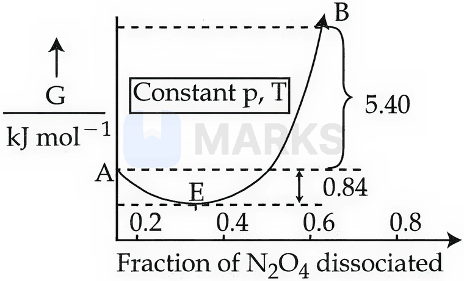

# Chemical Equilibrium

> Theory: [../../theory/chemistry/chemical-equilibrium.md](../../theory/chemistry/chemical-equilibrium.md)

### C-CEQ-01 — JEE Main 2024 · 29 Jan Shift 1 · Q53 · Numerical

For the reaction $\text{N}_2\text{O}_4(g)\rightleftharpoons2\text{NO}_2(g)$, $K_p=0.492$ atm at $300$ K. $K_c$ for the reaction at the same temperature is ______ $\times10^{-2}$. ($R=0.082\ \text{L atm mol}^{-1}\text{K}^{-1}$)

**Answer: 2** · key ✔

**Solution.** $K_p=K_c(RT)^{\Delta n}$ with $\Delta n=2-1=1$. $K_c=\dfrac{0.492}{0.082\times300}=\dfrac{0.492}{24.6}=0.02=2\times10^{-2}$.

### C-CEQ-02 — JEE Main 2024 · 29 Jan Shift 2 · Q55 · Numerical

At $500$ K equilibrium, the following concentrations were observed for the formation of $\text{NH}_3$ from $\text{N}_2$ and $\text{H}_2$: $[\text{N}_2]=2\times10^{-2}$ M, $[\text{H}_2]=3\times10^{-2}$ M, $[\text{NH}_3]=1.5\times10^{-2}$ M. The equilibrium constant for the reaction $\text{N}_2+3\text{H}_2\rightleftharpoons2\text{NH}_3$ is ______.

**Answer: 417** · key ✔

**Solution.** $K_c=\dfrac{[\text{NH}_3]^2}{[\text{N}_2][\text{H}_2]^3}=\dfrac{(1.5\times10^{-2})^2}{(2\times10^{-2})(3\times10^{-2})^3}=\dfrac{2.25\times10^{-4}}{5.4\times10^{-7}}=416.7\approx417$.

### C-CEQ-03 — JEE Main 2024 · 31 Jan Shift 1 · Q33 · MCQ

For the reaction $\text{Fe}^{3+}(aq)+\text{SCN}^-(aq)\rightleftharpoons[\text{FeSCN}]^{2+}(aq)$, the correct expression for $K_c$ is

(1) $K_c=\dfrac{[\text{FeSCN}^{2+}]}{[\text{Fe}^{3+}][\text{SCN}^-]}$  (2) $K_c=\dfrac{[\text{Fe}^{3+}][\text{SCN}^-]}{[\text{FeSCN}^{2+}]}$  (3) $K_c=\dfrac{[\text{FeSCN}^{2+}]}{[\text{Fe}^{3+}]^2[\text{SCN}^-]^2}$  (4) another form (not legible in the source)

**Answer: (1)** · key ✔

**Solution.** $K_c$ is products over reactants, each raised to its stoichiometric coefficient (here all $1$): $K_c=\dfrac{[\text{FeSCN}^{2+}]}{[\text{Fe}^{3+}][\text{SCN}^-]}$ (the blood-red complex equilibrium).

### C-CEQ-04 — JEE Main 2024 · 31 Jan Shift 1 · Q54 · Numerical

For the reaction $\tfrac32\text{O}_2(g)\rightleftharpoons\text{O}_3(g)$ at $298$ K, $K_p=2.47\times10^{-29}$. $\Delta_rG^\circ$ for the reaction is ______ kJ. ($R=8.314\ \text{J K}^{-1}\text{mol}^{-1}$; nearest integer)

**Answer: 163** · key ✔

**Solution.** $\Delta_rG^\circ=-RT\ln K_p=-8.314\times298\times\left[\ln2.47-29\ln10\right]=-2477.6\times(0.904-66.77)=+1.63\times10^5$ J $\approx163$ kJ.

### C-CEQ-05 — JEE Main 2024 · 31 Jan Shift 2 · Q35 · MCQ

For the equilibrium $\text{A}(g)\rightleftharpoons\text{B}(g)+\tfrac12\text{C}(g)$, the correct relationship between $K_P$, the degree of dissociation $\alpha$ and the equilibrium pressure $P$ is

(the correct expression is $K_P=\dfrac{\alpha^{3/2}P^{1/2}}{(2+\alpha)^{1/2}(1-\alpha)}$, option (2))

**Answer: $K_P=\dfrac{\alpha^{3/2}P^{1/2}}{(2+\alpha)^{1/2}(1-\alpha)}$** · key ✔

**Solution.** Starting from $1$ mol A: A $=1-\alpha$, B $=\alpha$, C $=\tfrac\alpha2$, total $=1+\tfrac\alpha2=\tfrac{2+\alpha}2$. Mole fractions: $x_A=\dfrac{2(1-\alpha)}{2+\alpha}$, $x_B=\dfrac{2\alpha}{2+\alpha}$, $x_C=\dfrac\alpha{2+\alpha}$. $K_P=\dfrac{x_Bx_C^{1/2}P^{3/2}}{x_AP}=\dfrac{2\alpha}{2+\alpha}\left(\dfrac\alpha{2+\alpha}\right)^{1/2}\dfrac{(2+\alpha)}{2(1-\alpha)}P^{1/2}=\dfrac{\alpha^{3/2}P^{1/2}}{(2+\alpha)^{1/2}(1-\alpha)}$.

### C-CEQ-06 — JEE Main 2024 · 1 Feb Shift 2 · Q52 · Numerical

For a certain reaction at $300$ K, $K=10$. Then $\Delta G^\circ=-$ ______ $\times10^{-1}$ kJ mol$^{-1}$. ($R=8.314$ J K$^{-1}$ mol$^{-1}$)

**Answer: 57** · key ✔

**Solution.** $\Delta G^\circ=-2.303RT\log K=-2.303\times8.314\times300\times1=-5744$ J $=-5.74$ kJ $=-57\times10^{-1}$ kJ mol$^{-1}$.

### C-CEQ-07 — JEE Main 2024 · 4 Apr Shift 2 · Q36 · MCQ

For $\text{SO}_3(g)\rightleftharpoons\text{SO}_2(g)+\tfrac12\text{O}_2(g)$, $K_c=4.9\times10^{-2}$. The value of $K_c$ for $2\text{SO}_2(g)+\text{O}_2(g)\rightleftharpoons2\text{SO}_3(g)$ is:

(1) 4.9  (2) 49  (3) 41.6  (4) 416

**Answer: (4)** · key ✔

**Solution.** Reversing inverts $K$; doubling the equation squares it: $K'=\dfrac{1}{K^2}=\dfrac{1}{(4.9\times10^{-2})^2}=\dfrac{1}{2.401\times10^{-3}}\approx416$.

### C-CEQ-08 — JEE Main 2024 · 5 Apr Shift 1 · Q36 · MCQ

For $\text{Fe}_2\text{O}_3(s)+3\text{CO}(g)\rightleftharpoons\text{Fe}(l)+3\text{CO}_2(g)$, which change will not disturb the equilibrium?

(1) Addition of $\text{CO}_2$  (2) Removal of $\text{CO}_2$  (3) Addition of $\text{Fe}_2\text{O}_3$  (4) Removal of CO

**Answer: (3)** · key ✔

**Solution.** The activity of a pure solid is constant and does not appear in $K_c=\dfrac{[\text{CO}_2]^3}{[\text{CO}]^3}$. Adding more $\text{Fe}_2\text{O}_3(s)$ therefore leaves the equilibrium unchanged, whereas changing $[\text{CO}]$ or $[\text{CO}_2]$ shifts it.

### C-CEQ-09 — JEE Main 2024 · 6 Apr Shift 1 · Q37 · MCQ

At $-20^\circ$C and $1$ atm pressure, a cylinder is filled with equal numbers of $\text{H}_2$, $\text{I}_2$ and HI molecules for $\text{H}_2(g)+\text{I}_2(g)\rightleftharpoons2\text{HI}(g)$. The $K_p$ for the process is $x\times10^{-1}$. $x=$ ______.

(1) 0.01  (2) 10  (3) 2  (4) 1

**Answer: (2)** · key ✔

**Solution.** Equal numbers of molecules means equal mole fractions, so equal partial pressures of $\tfrac13$ atm each. $K_p=\dfrac{p_{HI}^2}{p_{H_2}p_{I_2}}=1=10\times10^{-1}$, so $x=10$. ($\Delta n_g=0$, so $K_p$ has no units and does not depend on $R$.)

### C-CEQ-10 — JEE Main 2024 · 6 Apr Shift 2 · Q32 · MCQ

The ratio $\dfrac{K_P}{K_C}$ for the reaction $\text{CO}(g)+\tfrac12\text{O}_2(g)\rightleftharpoons\text{CO}_2(g)$ is:

(1) $\dfrac1{\sqrt{RT}}$  (2) $(RT)^{1/2}$  (3) $RT$  (4) $1$

**Answer: (1)** · key ✔

**Solution.** $K_P=K_C(RT)^{\Delta n_g}$ with $\Delta n_g=1-\tfrac32=-\tfrac12$. So $\dfrac{K_P}{K_C}=(RT)^{-1/2}=\dfrac1{\sqrt{RT}}$.

### C-CEQ-11 — JEE Main 2024 · 8 Apr Shift 1 · Q36 · MCQ

For the hypothetical reactions $\text{X}\rightleftharpoons\text{Y}$ ($K_1=1.0$), $\text{Y}\rightleftharpoons\text{Z}$ ($K_2=2.0$), $\text{Z}\rightleftharpoons\text{W}$ ($K_3=4.0$), the equilibrium constant for $\text{X}\rightleftharpoons\text{W}$ is:

(1) 6.0  (2) 12.0  (3) 7.0  (4) 8.0

**Answer: (4)** · key ✔

**Solution.** Adding reactions multiplies the constants: $K=K_1K_2K_3=1.0\times2.0\times4.0=8.0$.

### § — JEE Main 2026 · 23 Jan Shift 1 · set Q1 · MCQ

Consider the general reaction $x\,\mathrm{A(g)}\rightleftharpoons y\,\mathrm{B(g)}$ at 400 K. The values of $K_p$ and $K_c$ are studied under the same condition of temperature but with variation in $x$ and $y$. (i) $K_p=85.87$ and $K_c=2.586$ (appropriate units); (ii) $K_p=0.862$ and $K_c=28.62$ (appropriate units). The values of $x$ and $y$ in (i) and (ii) respectively are:

(1) (i) 1, 3; (ii) 2, 1  (2) (i) 4, 1; (ii) 4, 1  (3) (i) 3, 1; (ii) 3, 1  (4) (i) 1, 2; (ii) 2, 1

**Answer: (4)** · key (compiled)

**Solution.** $K_p=K_c(RT)^{\Delta n_g}$ with $\Delta n_g=y-x$ and $RT=0.0821\times400=32.84$. (i) $K_p/K_c=85.87/2.586=33.2\approx32.84^{1}$, so $\Delta n_g=+1$: $y-x=1$. (ii) $K_p/K_c=0.862/28.62=0.0301\approx32.84^{-1}$, so $\Delta n_g=-1$: $y-x=-1$. Only option (4) [(i) $x=1,y=2$; (ii) $x=2,y=1$] satisfies both.

### § — JEE Main 2026 · 23 Jan Shift 1 · set Q2 · Numerical

For the gas-phase equilibrium $\mathrm{NH_3(g)\rightleftharpoons\tfrac12N_2(g)+\tfrac32H_2(g)}$ at constant temperature, if the total pressure is $\sqrt3$ atm and the pressure equilibrium constant $K_p$ is 9 atm, then the degree of dissociation is $(x\times10^{-2})^{-1/2}$. The value of $x$ is ______ (nearest integer).

**Answer: 125** · key (compiled)

**Solution.** Start with 1 mol $\mathrm{NH_3}$: at equilibrium $\mathrm{NH_3}=1-\alpha$, $\mathrm{N_2}=\alpha/2$, $\mathrm{H_2}=3\alpha/2$, total $=1+\alpha$. $K_p=\dfrac{p_{N_2}^{1/2}p_{H_2}^{3/2}}{p_{NH_3}}=\dfrac{(\alpha/2)^{1/2}(3\alpha/2)^{3/2}}{(1-\alpha)(1+\alpha)}\,P=\dfrac{3\sqrt3}{4}\dfrac{\alpha^2}{1-\alpha^2}P$. With $P=\sqrt3$: $9=\dfrac94\dfrac{\alpha^2}{1-\alpha^2}\Rightarrow\alpha^2=\dfrac45$, $\alpha=\dfrac{2}{\sqrt5}=(1.25)^{-1/2}$. So $x\times10^{-2}=1.25$ and $x=125$.

### § — JEE Main 2026 · 28 Jan Shift 2 · set Q3 · MCQ

Observe the equilibrium $\mathrm{A(g)\rightleftharpoons B(g)}$ in a 1 L flask. At $T$ (K) the equilibrium concentrations of A and B are 0.5 M and 0.375 M respectively. 0.1 mol of A is added into the flask and heated to $T$ (K) to establish equilibrium again. The new equilibrium concentrations (in M) of A and B are, respectively:

(1) 0.53, 0.4  (2) 0.742, 0.557  (3) 0.557, 0.418  (4) 0.367, 0.275

**Answer: (3)** · key (compiled)

**Solution.** $K_c=\dfrac{0.375}{0.5}=0.75$. After adding A: $[\mathrm A]=0.6$, $[\mathrm B]=0.375$, $Q=0.625<K_c$, so the reaction goes forward by $x$: $\dfrac{0.375+x}{0.6-x}=0.75\Rightarrow1.75x=0.075\Rightarrow x=0.0429$. $[\mathrm A]=0.557$ M, $[\mathrm B]=0.418$ M.

### § — JEE Main 2026 · 24 Jan Shift 2 · set Q4 · MCQ

Consider the gaseous equilibrium $\mathrm{P_2(g)+Q_2(g)\rightleftharpoons2PQ(g)}$ in a closed container of volume $V$ at $T$ (K). 2 moles each of $\mathrm{P_2}$, $\mathrm{Q_2}$ and $\mathrm{PQ}$ are present at equilibrium. Now one mole each of $\mathrm{P_2}$ and $\mathrm{Q_2}$ are added to the equilibrium keeping the temperature at $T$ (K). The number of moles of $\mathrm{P_2,Q_2}$ and $\mathrm{PQ}$ at the new equilibrium are, respectively:

(1) 1.66, 1.66, 1.66  (2) 2.56, 1.62, 2.24  (3) 2.67, 2.67, 2.67  (4) 1.21, 2.24, 1.56

**Answer: (3)** · key (compiled)

**Solution.** $K=\dfrac{[\mathrm{PQ}]^2}{[\mathrm{P_2}][\mathrm{Q_2}]}=\dfrac{2^2}{2\times2}=1$ ($\Delta n_g=0$, so volume cancels). After the addition the composition is (3, 3, 2): $Q=4/9<1$, so the reaction goes forward by $x$: $\dfrac{(2+2x)^2}{(3-x)^2}=1\Rightarrow2+2x=3-x\Rightarrow x=\tfrac13$. $\mathrm{P_2}=\mathrm{Q_2}=3-\tfrac13=2.67$ and $\mathrm{PQ}=2+\tfrac23=2.67$ mol.

### § — JEE Main 2026 · 22 Jan Shift 1 · set Q5 · Numerical

Dissociation of a gas $\mathrm{A_2}$ takes place according to $\mathrm{A_2(g)\rightleftharpoons2A(g)}$. At equilibrium, the total pressure is 1 bar at 300 K. The standard Gibbs energies of formation are: $\mathrm{A_2}$: $-100.00$ kJ mol$^{-1}$; A: $-50.832$ kJ mol$^{-1}$. The degree of dissociation of $\mathrm{A_2(g)}$ is given by $(x\times10^{-2})^{1/2}$ where $x=$ ______ (nearest integer). [Given: $R=8$ J mol$^{-1}$ K$^{-1}$, $\log2=0.3010$, $\log3=0.48$. Assume the degree of dissociation is not negligible.]

**Answer: 33** · key (compiled)

**Solution.** $\Delta G^\circ=2(-50.832)-(-100.00)=-1.664$ kJ mol$^{-1}$. $\Delta G^\circ=-RT\ln K_p$: $-1664=-8\times300\ln K_p\Rightarrow\ln K_p=0.693$, $K_p=2$. For 1 mol $\mathrm{A_2}$: $K_p=\dfrac{(2\alpha)^2}{(1-\alpha)(1+\alpha)}P=\dfrac{4\alpha^2}{1-\alpha^2}=2\Rightarrow\alpha^2=\dfrac13$. So $x\times10^{-2}=\dfrac13$, $x\approx33$.

### § — JEE Main 2026 · 23 Jan Shift 2 · set Q6 · Numerical

$\mathrm{X_2(g)}$ and $\mathrm{Y_2(g)}$ are added to a 1 L flask and the system attains the equilibrium $\mathrm{X_2(g)+Y_2(g)\rightleftharpoons2Z(g)}$ at $T$ (K), with the numbers of moles of $\mathrm{X_2}$, $\mathrm{Y_2}$ and $\mathrm Z$ being 3, 3 and 9 mol respectively (equilibrium moles). Under this condition of equilibrium, 10 mol of $\mathrm{Z(g)}$ is added to the flask and the temperature is maintained at $T$ (K). The number of moles of $\mathrm{Z(g)}$ in the flask when the new equilibrium is established is ______ (nearest integer).

**Answer: 15** · key (compiled)

**Solution.** $K_c=\dfrac{9^2}{3\times3}=9$. After adding 10 mol Z: $[\mathrm{X_2}]=[\mathrm{Y_2}]=3$, $[\mathrm Z]=19$; $Q=361/9>K_c$, so the reaction goes backward by $y$ (mol of $\mathrm{X_2}$ formed): $\dfrac{(19-2y)^2}{(3+y)^2}=9\Rightarrow19-2y=3(3+y)\Rightarrow y=2$. $n(\mathrm Z)=19-4=15$.

### § — JEE Main 2026 · 21 Jan Shift 1 · set Q7 · MCQ

For the reaction $\mathrm{N_2O_4\rightleftharpoons2NO_2}$, the graph is plotted as shown below. Identify the correct statements.

A. The standard free energy change for the reaction is $-5.40$ kJ mol$^{-1}$.
B. As $\Delta G^\ominus$ in the graph is positive, $\mathrm{N_2O_4}$ will not dissociate into $\mathrm{NO_2}$ at all.
C. The reverse reaction will go to completion.
D. When 1 mole of $\mathrm{N_2O_4}$ changes into the equilibrium mixture, the value of $\Delta G^\ominus=-0.84$ kJ mol$^{-1}$.
E. When 2 moles of $\mathrm{NO_2}$ change into the equilibrium mixture, $\Delta G^\ominus$ for the equilibrium mixture is $-6.24$ kJ mol$^{-1}$.

(1) D and E only  (2) A and D only  (3) B and C only  (4) C and E only

**Answer: (1)** · key (compiled)

**Solution.** From the graph, pure $\mathrm{N_2O_4}$ (A) is the reference, the minimum of $G$ (the equilibrium mixture, E) lies $0.84$ kJ mol$^{-1}$ below it, and pure $\mathrm{NO_2}$ (B) lies $5.40$ kJ mol$^{-1}$ above it. So $\Delta G^\ominus=G_{\mathrm{B}}-G_{\mathrm A}=+5.40$ kJ mol$^{-1}$ (A false). A positive $\Delta G^\ominus$ only means $K<1$ – a mixture still forms (B false) – and no reaction goes to completion (C false). $\mathrm{N_2O_4}\to$ equilibrium mixture: $\Delta G=-0.84$ (D true). $2\,\mathrm{NO_2}\to$ equilibrium mixture: $\Delta G=-(5.40+0.84)=-6.24$ kJ mol$^{-1}$ (E true).

