# Chemical Kinetics

> Theory: [../../theory/chemistry/chemical-kinetics.md](../../theory/chemistry/chemical-kinetics.md)

### C-KIN-01 — JEE Main 2024 · 27 Jan Shift 1 · Q59 · Numerical

For $2\text{HI}(g)\to\text{H}_2(g)+\text{I}_2(g)$:

| $[\text{HI}]$ (mol L$^{-1}$) | 0.005 | 0.01 | 0.02 |
|---|---|---|---|
| Rate (mol L$^{-1}$ s$^{-1}$) | $7.5\times10^{-4}$ | $3.0\times10^{-3}$ | $1.2\times10^{-2}$ |

The order of the reaction is ______.

**Answer: 2** · key ✔

**Solution.** Doubling $[\text{HI}]$ multiplies the rate by $3.0\times10^{-3}/7.5\times10^{-4}=4$ and then $1.2\times10^{-2}/3.0\times10^{-3}=4$. So $2^n=4$, $n=2$.

### C-KIN-02 — JEE Main 2024 · 27 Jan Shift 2 · Q59 · Numerical

The time required for $99.9\%$ completion of a first-order reaction is ______ times its half-life $t_{1/2}$.

**Answer: 10** · key ✔

**Solution.** $t=\dfrac{2.303}k\log\dfrac{100}{0.1}=\dfrac{2.303\times3}k$ and $t_{1/2}=\dfrac{0.693}k$. Ratio $=\dfrac{6.909}{0.693}\approx9.97\approx10$.

### C-KIN-03 — JEE Main 2024 · 29 Jan Shift 1 · Q59 · Numerical

For a reaction taking place in three steps at the same temperature, the overall rate constant is $K=\dfrac{K_1K_2}{K_3}$. If $E_{a1},E_{a2}$ and $E_{a3}$ are $40,50$ and $60$ kJ/mol respectively, the overall $E_a$ is ______ kJ/mol.

**Answer: 30** · key ✔

**Solution.** From the Arrhenius equation $K=Ae^{-E_a/RT}$, the exponents add for products and subtract for quotients: $E_a=E_{a1}+E_{a2}-E_{a3}=40+50-60=30$ kJ/mol.

### C-KIN-04 — JEE Main 2024 · 29 Jan Shift 2 · Q59 · Numerical

The half-life of radioisotopic bromine-82 is $36$ hours. The fraction which remains after one day is ______ $\times10^{-2}$. (Given antilog $0.2006=1.587$; round off to the nearest integer.)

**Answer: 63** · key ✔

**Solution.** $\dfrac N{N_0}=\left(\tfrac12\right)^{24/36}=2^{-2/3}$. $\log2^{-2/3}=-\tfrac23(0.3010)=-0.2006$, so $\dfrac N{N_0}=\dfrac1{1.587}=0.63=63\times10^{-2}$.

### C-KIN-05 — JEE Main 2024 · 30 Jan Shift 1 · Q59 · Numerical

The rate of a first-order reaction is $0.04\ \text{mol L}^{-1}\text{s}^{-1}$ at $10$ minutes and $0.03\ \text{mol L}^{-1}\text{s}^{-1}$ at $20$ minutes after initiation. The half-life of the reaction is ______ minutes. (Given $\log2=0.3010$, $\log3=0.4771$; round off to the nearest integer.)

**Answer: 24** · key ✔

**Solution.** For first order the rate is proportional to concentration, so $\dfrac{r_1}{r_2}=e^{k(t_2-t_1)}$: $k=\dfrac{2.303}{10}\log\dfrac{0.04}{0.03}=\dfrac{2.303}{10}\left(2\log2-\log3\right)=\dfrac{2.303}{10}(0.1249)=0.02877\ \text{min}^{-1}$. $t_{1/2}=\dfrac{0.693}{0.02877}=24.1\approx24$ min.

### C-KIN-06 — JEE Main 2024 · 30 Jan Shift 2 · Q56 · Numerical

$\text{NO}_2$ is produced by the decomposition of $\text{N}_2\text{O}_5$ in $\text{CCl}_4$: $2\text{N}_2\text{O}_5(g)\to4\text{NO}_2(g)+\text{O}_2(g)$. The initial concentration of $\text{N}_2\text{O}_5$ is $3$ mol L$^{-1}$ and it is $2.75$ mol L$^{-1}$ after $30$ minutes. The rate of formation of $\text{NO}_2$ is $x\times10^{-3}$ mol L$^{-1}$ min$^{-1}$. The value of $x$ is ______.

**Answer: 17** · key ✔

**Solution.** Rate of disappearance of $\text{N}_2\text{O}_5=\dfrac{3-2.75}{30}=8.33\times10^{-3}$ mol L$^{-1}$ min$^{-1}$. From the stoichiometry, $\dfrac{d[\text{NO}_2]}{dt}=\dfrac42\times8.33\times10^{-3}=16.7\times10^{-3}\approx17\times10^{-3}$.

### C-KIN-07 — JEE Main 2024 · 31 Jan Shift 1 · Q43 · MCQ

For a first-order gas-phase reaction $\text{A}(g)\to\text{B}(g)+\text{C}(g)$, where $P_i$ is the initial pressure and $P_t$ is the total pressure at time $t$, the integrated rate law is

(1) $k=\dfrac{2.303}t\log\dfrac{P_i}{2P_i-P_t}$  (2) $k=\dfrac{2.303}t\log\dfrac{2P_i}{2P_i-P_t}$  (3) $k=\dfrac{2.303}t\log\dfrac{2P_i-P_t}{P_i}$  (4) $k=\dfrac{2.303}t\cdot\dfrac{P_i-P_t}{2P_i-P_t}$

**Answer: (1)** · key ✔

**Solution.** If $x$ atm of A reacts, $P_A=P_i-x$ and $P_t=(P_i-x)+x+x=P_i+x$, so $x=P_t-P_i$ and $P_A=2P_i-P_t$. First order: $k=\dfrac{2.303}t\log\dfrac{P_i}{P_A}=\dfrac{2.303}t\log\dfrac{P_i}{2P_i-P_t}$.

### C-KIN-08 — JEE Main 2024 · 31 Jan Shift 2 · Q56 · Numerical

For a reaction with rate $r=k[\text{A}]$, $50\%$ of A is decomposed in $120$ minutes. The time taken for $90\%$ decomposition of A is ______ minutes.

**Answer: 399** · key ✔

**Solution.** First order: $k=\dfrac{0.693}{120}$. $t_{90\%}=\dfrac{2.303}k\log\dfrac{100}{10}=\dfrac{2.303\times120}{0.693}=399$ min (equivalently $120\times\log_210=120\times3.32$).

### C-KIN-09 — JEE Main 2024 · 1 Feb Shift 1 · Q58 · Numerical

The ratio of $^{14}\text{C}/^{12}\text{C}$ in a piece of wood is $\tfrac18$ that of the atmosphere. If the half-life of $^{14}\text{C}$ is $5730$ years, the age of the wood sample is ______ years.

**Answer: 17190** · key ✔

**Solution.** $\tfrac18=(\tfrac12)^3$, so three half-lives have elapsed: $3\times5730=17190$ years.

### C-KIN-10 — JEE Main 2024 · 1 Feb Shift 2 · Q58 · Numerical

First-order thermal decomposition of gas A at constant volume: $\text{A(g)}\to2\text{B(g)}+\text{C(g)}$. Total pressure is $0.1$ atm at $t=0$ and $0.28$ atm at $t=115$ s. The rate constant is ______ $\times10^{-2}\ \text{s}^{-1}$ (nearest integer).

**Answer: 2** · key ✔

**Solution.** Let $p$ of A decompose: total $=0.1-p+2p+p=0.1+2p=0.28\Rightarrow p=0.09$. $p_A=0.01$. $k=\dfrac1t\ln\dfrac{0.1}{0.01}=\dfrac{2.303}{115}=0.02\ \text{s}^{-1}=2\times10^{-2}$.

### C-KIN-11 — JEE Main 2024 · 4 Apr Shift 1 · Q57 · Numerical

In a first-order sequence $A+B\underset{3}{\overset{1}{\rightleftharpoons}}C\xrightarrow{2}P$ the overall rate constant is $k=\dfrac{k_1k_2}{k_3}$. Given $E_{a1}=300$, $E_{a2}=200$ kJ mol$^{-1}$ and overall $E_a=400$ kJ mol$^{-1}$, the value of $E_{a3}$ is ______ kJ mol$^{-1}$.

**Answer: 100** · key ✔

**Solution.** Taking $\ln$ of $k=Ae^{-E_a/RT}$ for each step, $E_a=E_{a1}+E_{a2}-E_{a3}$. So $400=300+200-E_{a3}\Rightarrow E_{a3}=100$ kJ mol$^{-1}$.

### C-KIN-12 — JEE Main 2024 · 4 Apr Shift 2 · Q56 · Numerical

For $\text{A}+\text{B}\to\text{C}$, rate $=k[\text{A}]^{1/2}[\text{B}]^{1/2}$ with $1$ M of each initially and $k=4.6\times10^{-2}\ \text{s}^{-1}$. The time taken for A to become $0.1$ M is ______ s (nearest integer).

**Answer: 50** · key ✔

**Solution.** A and B are consumed in equal amounts and start equal, so $[\text{A}]=[\text{B}]$ throughout: rate $=k[\text{A}]$, first order overall. $t=\dfrac{2.303}{k}\log\dfrac{1}{0.1}=\dfrac{2.303}{4.6\times10^{-2}}\approx50$ s.

### C-KIN-13 — JEE Main 2024 · 5 Apr Shift 1 · Q56 · Numerical

For $2\text{A}+\text{B}\to\text{C}+\text{D}$ the data are: (I) $[\text{A}]=0.1$, $[\text{B}]=0.1$, rate $6.0\times10^{-3}$; (II) $0.3$, $0.2$, $7.20\times10^{-2}$; (III) $0.3$, $0.4$, $2.88\times10^{-1}$; (IV) $0.4$, $0.1$, $2.40\times10^{-2}$. The overall order of the reaction is ______.

**Answer: 3** · key ✔

**Solution.** Compare I and IV ($[\text{B}]$ fixed): $[\text{A}]$ ×4 gives rate ×4, so order in A is $1$. Compare II and III ($[\text{A}]$ fixed): $[\text{B}]$ ×2 gives rate ×4, so order in B is $2$. Overall order $=1+2=3$ (check: $k=\dfrac{6\times10^{-3}}{0.1\times0.01}=6$; experiment II: $6\times0.3\times0.04=0.072$ ✓).

### C-KIN-14 — JEE Main 2024 · 5 Apr Shift 2 · Q56 · Numerical

For the single-step gas-phase reaction $2\text{A}(g)+\text{B}(g)\to\text{C}(g)$, the initial rate is $r_1$ with $p_A=1.5$ atm and $p_B=0.7$ atm. After some time, the rate is $r_2$ when $p_C=0.5$ atm. $r_1:r_2=$ ______ $\times10^{-1}$.

**Answer: 315** · key ✔

**Solution.** Rate $=kp_A^2p_B$ (elementary). Initially $r_1=k(1.5)^2(0.7)=1.575k$. When $0.5$ atm of C forms, A used $=1.0$ atm and B used $=0.5$ atm: $p_A=0.5$, $p_B=0.2$, so $r_2=k(0.25)(0.2)=0.05k$. $r_1/r_2=31.5=315\times10^{-1}$.

### C-KIN-15 — JEE Main 2024 · 6 Apr Shift 1 · Q56 · Numerical

The time required for $99.9\%$ completion of a first-order reaction is ______ times the time required for $90\%$ completion (nearest integer).

**Answer: 3** · key ✔

**Solution.** $t=\dfrac{2.303}{k}\log\dfrac{100}{100-x}$. $t_{99.9}\propto\log1000=3$ and $t_{90}\propto\log10=1$. Ratio $=3$.

### C-KIN-16 — JEE Main 2024 · 8 Apr Shift 1 · Q43 · MCQ

$\text{Fe}^{3+}$ catalyses the reaction between iodide and persulphate ions. A. $\text{Fe}^{3+}$ oxidises the iodide ion; B. $\text{Fe}^{3+}$ oxidises the persulphate ion; C. $\text{Fe}^{2+}$ reduces the iodide ion; D. $\text{Fe}^{2+}$ reduces the persulphate ion.

(1) B only  (2) A only  (3) B and C only  (4) A and D only

**Answer: (4)** · key ✔

**Solution.** $2\text{Fe}^{3+}+2\text{I}^-\to2\text{Fe}^{2+}+\text{I}_2$ ($\text{Fe}^{3+}$ oxidises iodide: A). $2\text{Fe}^{2+}+\text{S}_2\text{O}_8^{2-}\to2\text{Fe}^{3+}+2\text{SO}_4^{2-}$ ($\text{Fe}^{2+}$ reduces persulphate: D). The catalyst is regenerated.

### C-KIN-17 — JEE Main 2024 · 8 Apr Shift 1 · Q56 · Numerical

For $\text{A}+\text{B}\to\text{C}$: the time for A to become $\tfrac14$ of its initial concentration is twice the time to become $\tfrac12$; and a plot of the change in concentration of B against time is a straight line with a negative slope and positive intercept on the concentration axis. The overall order is ______.

**Answer: 1** · key ✔

**Solution.** $t_{1/4}=2t_{1/2}$ is the signature of first order in A (a constant half-life). A linear $[\text{B}]$ against $t$ plot means zero order in B. Overall order $=1+0=1$.

### C-KIN-18 — JEE Main 2024 · 8 Apr Shift 2 · Q42 · MCQ

For a reaction $\text{A}\xrightarrow{K_1}\text{B}\xrightarrow{K_2}\text{C}$, if the rate of formation of B is set to zero (steady state), the concentration of B is given by:

(1) $(K_1+K_2)[\text{A}]$  (2) $\dfrac{K_1}{K_2}[\text{A}]$  (3) $(K_1-K_2)[\text{A}]$  (4) $K_1K_2[\text{A}]$

**Answer: (2)** · key ✔

**Solution.** $\dfrac{d[\text{B}]}{dt}=K_1[\text{A}]-K_2[\text{B}]=0\Rightarrow[\text{B}]=\dfrac{K_1}{K_2}[\text{A}]$.

### § — JEE Main 2026 · 21 Jan Shift 2 · set Q1 · MCQ

Decomposition of A is a first-order reaction at $T$ (K): $\mathrm{A(g)\to B(g)+C(g)}$. In a closed 1 L vessel, 1 bar of $\mathrm{A(g)}$ is allowed to decompose at $T$ (K). After 100 minutes the total pressure was 1.5 bar. What is the rate constant $k$ of the reaction (in $\mathrm{min^{-1}}$)? ($\log2=0.3$)

(1) $6.9\times10^{-3}$  (2) $6.9\times10^{-4}$  (3) $6.9\times10^{-1}$  (4) $6.9\times10^{-2}$

**Answer: (1)** · key (compiled)

**Solution.** If $x$ bar of A decomposes, total pressure $=(1-x)+x+x=1+x=1.5$, so $x=0.5$ and $p_{\mathrm A}=0.5$ bar. $k=\dfrac{2.303}{t}\log\dfrac{p_0}{p_{\mathrm A}}=\dfrac{2.303}{100}\log2=\dfrac{2.303\times0.3}{100}=6.9\times10^{-3}\ \mathrm{min^{-1}}$.

### § — JEE Main 2026 · 23 Jan Shift 1 · set Q2 · Numerical

For the thermal decomposition of the reactant $\mathrm{AB(g)}$, the following plot is constructed. The half-life of the reaction is $x$ min. $x=$ ______ (nearest integer)

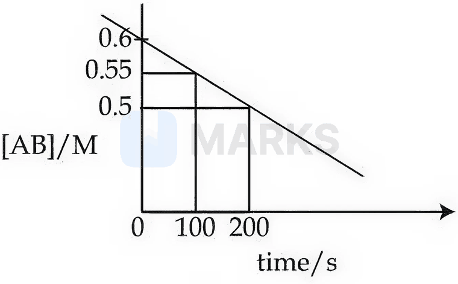

**Answer: 10** · key (compiled)

**Solution.** $[\mathrm{AB}]$ falls linearly with time (0.6 M at 0 s, 0.55 M at 100 s, 0.5 M at 200 s), the signature of a zero-order reaction, with $k=\dfrac{0.05}{100}=5\times10^{-4}\ \mathrm{M\,s^{-1}}$. For zero order $t_{1/2}=\dfrac{[\mathrm A]_0}{2k}=\dfrac{0.6}{2\times5\times10^{-4}}=600\ \text{s}=10$ min.

### § — JEE Main 2026 · 28 Jan Shift 2 · set Q3 · Numerical

Consider the two first-order reactions $\mathrm{A\to B}$ (first reaction) and $\mathrm{C\to D}$ (second reaction). The rate constant for the first reaction at 500 K is double of that at 300 K. At 500 K, 50% of the first reaction becomes complete in 2 hours. The activation energy of the second reaction is half of that of the first reaction. If the rate constant at 500 K of the second reaction is double the rate constant of the first reaction at the same temperature, then the rate constant for the second reaction at 300 K is ______ $\times10^{-1}\ \mathrm{hour^{-1}}$ (nearest integer).

**Answer: 5** · key (compiled)

**Solution.** First reaction at 500 K: $k_1=\dfrac{\ln2}{2}\ \mathrm{h^{-1}}$. Second reaction: $k_2(500)=2k_1=\ln2\ \mathrm{h^{-1}}$. $\ln\dfrac{k_1(500)}{k_1(300)}=\ln2=\dfrac{E_{a1}}{R}\left(\dfrac1{300}-\dfrac1{500}\right)=\dfrac{E_{a1}}{750R}$, so $E_{a1}/R=750\ln2$ and $E_{a2}/R=375\ln2$. Then $\ln\dfrac{k_2(500)}{k_2(300)}=\dfrac{375\ln2}{750}=\tfrac12\ln2$, i.e. $k_2(500)/k_2(300)=\sqrt2$ and $k_2(300)=\dfrac{\ln2}{\sqrt2}=0.49\ \mathrm{h^{-1}}=4.9\times10^{-1}\approx5\times10^{-1}$.

### § — JEE Main 2026 · 24 Jan Shift 2 · set Q4 · Numerical

The half-life of $^{65}\mathrm{Zn}$ is 245 days. After $x$ days, 75% of the original activity remained. The value of $x$ in days is ______ (nearest integer). (Given: $\log3=0.4771$ and $\log2=0.3010$)

**Answer: 102** · key (compiled)

**Solution.** $A=A_0(\tfrac12)^{t/t_{1/2}}$: $0.75=(\tfrac12)^{x/245}\Rightarrow x=245\dfrac{\log(4/3)}{\log2}=245\times\dfrac{0.6020-0.4771}{0.3010}=245\times0.415=101.7\approx102$ days.

### § — JEE Main 2026 · 22 Jan Shift 2 · set Q5 · MCQ

Correct statements regarding the Arrhenius equation $k=Ae^{-E_a/RT}$ among the following are:

A. The factor $e^{-E_a/RT}$ corresponds to the fraction of molecules having kinetic energy less than $E_a$.
B. At a given temperature, the lower the $E_a$, the faster is the reaction.
C. An increase in temperature by about $10^\circ$C doubles the rate of the reaction.
D. A plot of $\log k$ vs $\dfrac1T$ gives a straight line with slope $=-\dfrac{E_a}{R}$.

(1) B and D only  (2) A and B only  (3) B and C only  (4) A and C only

**Answer: (3)** · key (compiled)

**Solution.** A false: $e^{-E_a/RT}$ is the fraction of molecules with energy *equal to or greater than* $E_a$. B true. C true (the usual rule of thumb: $k$ roughly doubles per $10^\circ$C). D false: $\log k=\log A-\dfrac{E_a}{2.303RT}$, so the slope is $-\dfrac{E_a}{2.303R}$.

### § — JEE Main 2026 · 22 Jan Shift 2 · set Q6 · Numerical

Consider $\mathrm{A\to B}$ ($k_1$) and $\mathrm{C\to D}$ ($k_2$) as two reactions. The rate constant $k_1$ of $\mathrm{A\to B}$ is $\log_{10}k=14.34-\dfrac{1.5\times10^4}{T/\mathrm K}$, and the activation energy of $\mathrm{C\to D}$ ($E_{a2}$) is $\tfrac15$th of that of $\mathrm{A\to B}$ ($E_{a1}$). The value of $E_{a2}$ is ______ kJ mol$^{-1}$ (nearest integer).

**Answer: 57** · key (compiled)

**Solution.** $\log k=\log A-\dfrac{E_a}{2.303RT}$, so $\dfrac{E_{a1}}{2.303R}=1.5\times10^4$ K and $E_{a1}=2.303\times8.314\times1.5\times10^4=2.87\times10^5$ J mol$^{-1}=287$ kJ mol$^{-1}$. $E_{a2}=\dfrac{287}{5}=57.4\approx57$ kJ mol$^{-1}$.

### § — JEE Main 2026 · 22 Jan Shift 1 · set Q7 · MCQ

For a first-order reaction $\mathrm{A\to}$ product, three sets of experiments were performed under similar experimental conditions: Run 1: 100 mL of 10 M solution of reactant A; Run 2: 200 mL of 10 M solution of reactant A; Run 3: 100 mL of 10 M solution of reactant A + 100 mL of $\mathrm{H_2O}$ added. The correct variation of the rate of reaction is:

(1) Run 1 < Run 2 < Run 3  (2) Run 3 < Run 1 < Run 2  (3) Run 3 < Run 1 = Run 2  (4) Run 1 = Run 2 = Run 3

**Answer: (3)** · key (compiled)

**Solution.** For a first-order reaction, rate $=k[\mathrm A]$ depends on *concentration*, not on amount. Run 1: 10 M; Run 2: still 10 M (a larger volume of the same solution); Run 3: dilution to $\dfrac{1\text{ mol}}{0.2\text{ L}}=5$ M. So rate$_3<$ rate$_1=$ rate$_2$.

### § — JEE Main 2026 · 22 Jan Shift 1 · set Q8 · Numerical

The temperature at which the rate constants of the two gaseous reactions below become equal is ______ K (nearest integer). $\mathrm{X\to Y}$: $k_1=10^{6}e^{-30000/T}$; $\mathrm{P\to Q}$: $k_2=10^{4}e^{-24000/T}$. (Given: $\ln10=2.303$)

**Answer: 1303** · key (compiled)

**Solution.** $k_1=k_2$: $10^6e^{-30000/T}=10^4e^{-24000/T}\Rightarrow100=e^{6000/T}\Rightarrow\ln100=\dfrac{6000}{T}$. $T=\dfrac{6000}{2\times2.303}=\dfrac{6000}{4.606}=1302.7\approx1303$ K.

### § — JEE Main 2026 · 23 Jan Shift 2 · set Q9 · MCQ

The concentration vs time plot given above is for a dissociation reaction $\mathrm{A\to}n\mathrm{B}$. Based on the data of the initial phase of the reaction (initial 10 min), the value of $n$ is ______.

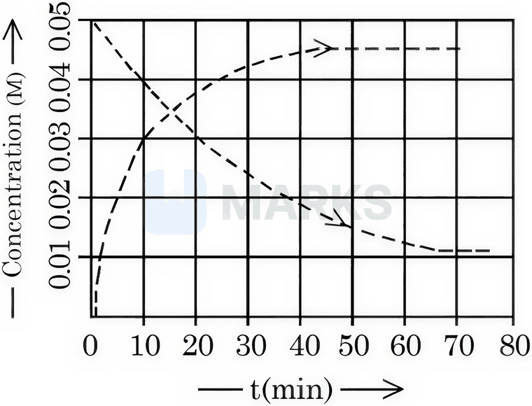

(1) 3  (2) 2  (3) 4  (4) 5

**Answer: (1)** · key (compiled)

**Solution.** From the graph, in the first 10 min $[\mathrm A]$ falls from 0.05 M to 0.04 M ($\Delta[\mathrm A]=0.01$ M) while $[\mathrm B]$ rises from 0 to 0.03 M. Since $\Delta[\mathrm B]=n\,\Delta[\mathrm A]$, $n=\dfrac{0.03}{0.01}=3$.

### § — JEE Main 2026 · 23 Jan Shift 2 · set Q10 · MCQ

Observe the following reactions at $T$ (K). I. $\mathrm A\to$ products. II. $\mathrm{5Br^-(aq)+BrO_3^-(aq)+6H^+(aq)\to3Br_2(aq)+3H_2O(l)}$. Both reactions are started at 10.00 am. The rates of these reactions at 10.10 am are the same. The value of $-\dfrac{\Delta[\mathrm{Br^-}]}{\Delta t}$ at 10.10 am is $2\times10^{-4}$ mol L$^{-1}$ min$^{-1}$. The concentration of A at 10.10 am is $10^{-2}$ mol L$^{-1}$. What is the first-order rate constant (in $\mathrm{min^{-1}}$) of reaction I?

(1) $10^{-2}$  (2) $10^{-3}$  (3) $2\times10^{-3}$  (4) $4\times10^{-3}$

**Answer: (4)** · key (compiled)

**Solution.** Rate of reaction II $=-\dfrac15\dfrac{\Delta[\mathrm{Br^-}]}{\Delta t}=\dfrac{2\times10^{-4}}{5}=4\times10^{-5}$ mol L$^{-1}$ min$^{-1}$. Reaction I is first order: rate $=k[\mathrm A]$, so $k=\dfrac{4\times10^{-5}}{10^{-2}}=4\times10^{-3}\ \mathrm{min^{-1}}$.

### § — JEE Main 2026 · 21 Jan Shift 1 · set Q11 · Numerical

The pre-exponential factors of two different reactions of the same order are identical. Let the activation energy of the first reaction exceed that of the second by $20$ kJ mol$^{-1}$. If $k_1$ and $k_2$ are the rate constants of the first and second reaction respectively at 300 K, then $\ln\dfrac{k_2}{k_1}$ will be ______ (nearest integer). [$R=8.3$ J K$^{-1}$ mol$^{-1}$]

**Answer: 8** · key (compiled)

**Solution.** $\dfrac{k_2}{k_1}=\dfrac{Ae^{-E_{a2}/RT}}{Ae^{-E_{a1}/RT}}=e^{(E_{a1}-E_{a2})/RT}$, so $\ln\dfrac{k_2}{k_1}=\dfrac{20000}{8.3\times300}=8.03\approx8$.

### § — JEE Main 2026 · 28 Jan Shift 1 · set Q12 · MCQ

An organic compound undergoes first-order decomposition. The times taken for its decomposition to $\left(\tfrac18\right)^{\text{th}}$ and $\left(\tfrac1{10}\right)^{\text{th}}$ of its initial concentration are $t_{1/8}$ and $t_{1/10}$ respectively. What is the value of $\dfrac{t_{1/8}}{t_{1/10}}\times10$? ($\log2=0.3$)

(1) 3  (2) 9  (3) 0.9  (4) 30

**Answer: (2)** · key (compiled)

**Solution.** First order: $t=\dfrac1k\ln\dfrac{[\mathrm A]_0}{[\mathrm A]}$. $\dfrac{t_{1/8}}{t_{1/10}}=\dfrac{\ln8}{\ln10}=\dfrac{3\log2}{\log10}=3\times0.3=0.9$, so $0.9\times10=9$.

### § — JEE Main 2026 · 24 Jan Shift 1 · set Q13 · MCQ

At $27^\circ$C, in the presence of a catalyst, the activation energy of a reaction is lowered by $10$ kJ mol$^{-1}$. The logarithm of the ratio $\dfrac{k(\text{catalysed})}{k(\text{uncatalysed})}$ is ... (Consider that the frequency factor for both reactions is the same.)

(1) 1.741  (2) 17.41  (3) 3.482  (4) 0.1741

**Answer: (1)** · key (compiled)

**Solution.** $\dfrac{k_{\text{cat}}}{k_{\text{uncat}}}=e^{\Delta E_a/RT}$, so $\log\dfrac{k_{\text{cat}}}{k_{\text{uncat}}}=\dfrac{\Delta E_a}{2.303RT}=\dfrac{10000}{2.303\times8.314\times300}=1.741$.

### § — JEE Main 2025 · Jan session · Kin set Q1 · MCQ

Which of the following graphs most appropriately represents a zero order reaction?

**(1)** 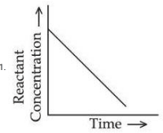

**(2)** 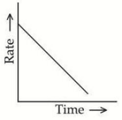

**(3)** 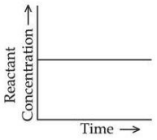

**(4)** 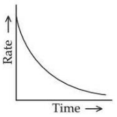

**Answer: (1)** · key (compiled)

**Solution.** For a zero-order reaction $-\dfrac{d[A]}{dt}=k$, so $[A]=[A]_0-kt$: concentration falls linearly with time (graph 1), while the rate stays constant (a horizontal line), so graphs (2), (3) and (4) are wrong.

### § — JEE Main 2025 · Jan session · Kin set Q2 · MCQ

For bacterial growth in a cell culture, the growth law is very similar to the law of radioactive decay. Which of the following graphs is most suitable to represent bacterial colony growth? (N = number of bacteria at any time, $N_0$ = initial number of bacteria.)

**(1)** 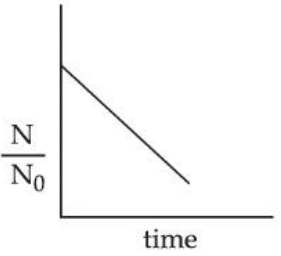

**(2)** 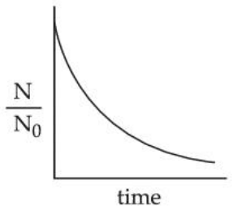

**(3)** 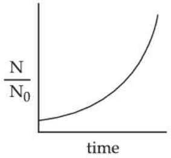

**Answer: (3)** · key (compiled)

**Solution.** Growth follows first-order kinetics with a positive rate constant, $N=N_0e^{kt}$, so $N/N_0$ rises exponentially with time and the curve bends upward: graph (3).

### § — JEE Main 2025 · Jan session · Kin set Q3 · MCQ

Consider an elementary reaction A(g) + B(g) → C(g) + D(g). If the volume of the reaction mixture is suddenly reduced to $\tfrac13$ of its initial volume, the reaction rate will become $x$ times the original rate. The value of $x$ is:

(1) 3  (2) $\tfrac19$  (3) 9  (4) $\tfrac13$

**Answer: (3)** · key (compiled)

**Solution.** Reducing the volume to one third triples each concentration. The rate law is $r=k[A][B]$ (elementary), so the rate becomes $3\times3=9$ times.

### § — JEE Main 2025 · Jan session · Kin set Q4 · MCQ

Which of the following statements is not true for radioactive decay?

(1) Decay constant increases with increase in temperature.  (2) The amount of radioactive substance remaining after three half-lives is $\tfrac18$th of the original amount.  (3) Decay constant does not depend upon temperature.  (4) Half-life is $\ln2$ times of $\dfrac1{\text{rate constant}}$.

**Answer: (1)** · key (compiled)

**Solution.** Radioactive decay is a nuclear process, unaffected by temperature, so (1) is false and (3) is true. After three half-lives $\left(\tfrac12\right)^3=\tfrac18$ remains (true), and $t_{1/2}=\dfrac{\ln2}{\lambda}$ (true). The statement that is not true is (1).

### § — JEE Main 2025 · Jan session · Kin set Q5 · Numerical

The molecule A changes into its isomeric form B by following first-order kinetics at a temperature of 1000 K. If the energy barrier with respect to the reactant energy for such isomeric transformation is 191.48 kJ mol$^{-1}$ and the frequency factor is $10^{20}$, the time required for 50% of the molecules of A to become B is ______ picoseconds (nearest integer). [$R=8.314$ J K$^{-1}$ mol$^{-1}$]

**Answer: 69** · key (compiled)

**Solution.** $k=A\,e^{-E_a/RT}=10^{20}\,e^{-191480/8314}=10^{20}\,e^{-23.03}=10^{20}\times10^{-10}=10^{10}\ \text s^{-1}$. $t_{1/2}=\dfrac{0.693}{10^{10}}=6.93\times10^{-11}$ s $=69$ ps.

### § — JEE Main 2025 · Jan session · Kin set Q6 · Numerical

For the thermal decomposition of N$_2$O$_5$(g) at constant volume, 2N$_2$O$_5$(g) → 2N$_2$O$_4$(g) + O$_2$(g): at $t=0$ the total pressure is 0.6 atm and at $t=100$ s the total pressure is '$x$' atm. $x=\ldots\times10^{-3}$ atm [nearest integer]. Given: rate constant for the reaction $=4.606\times10^{-2}\ \text s^{-1}$.

**Answer: 897** · key (compiled)

**Solution.** The reaction is first order in N$_2$O$_5$, with $kt=4.606\times10^{-2}\times100=4.606=2\times2.303$, so $P_{N_2O_5}=0.6\,e^{-4.606}=0.6\times10^{-2}=0.006$ atm. Pressure of N$_2$O$_5$ reacted $=0.594$ atm, producing $0.594$ atm of N$_2$O$_4$ and $0.297$ atm of O$_2$. Total $=0.006+0.594+0.297=0.897$ atm $=897\times10^{-3}$ atm.

### § — JEE Main 2025 · Jan session · Kin set Q7 · MCQ

For a given reaction R → P, $t_{1/2}$ is related to $[A]_0$ as given in the table: $[A]_0=0.100$ mol L$^{-1}$ with $t_{1/2}=200$ min; $[A]_0=0.025$ mol L$^{-1}$ with $t_{1/2}=100$ min. Given $\log2=0.30$. Which of the following is true?

A. The order of the reaction is $\tfrac12$.
B. If $[A]_0$ is 1 M, then $t_{1/2}$ is $200\sqrt{10}$ min.
C. The order of the reaction changes to 1 if the concentration of the reactant changes from 0.100 M to 0.500 M.
D. $t_{1/2}$ is 800 min for $[A]_0=1.6$ M.

Choose the correct answer from the options given below:

(1) A and C only  (2) A, B and D only  (3) C and D only  (4) A and B only

**Answer: (2)** · key (compiled)

**Solution.** $t_{1/2}\propto[A]_0^{\,1-n}$: $\dfrac{200}{100}=4^{\,1-n}\Rightarrow1-n=\tfrac12$, so $n=\tfrac12$ (A true). For $[A]_0=1$ M (10 times 0.1 M): $t_{1/2}=200\times10^{1/2}=200\sqrt{10}$ min (B true). The order is a property of the reaction and does not change with concentration (C false). For 1.6 M (16 times 0.1 M): $t_{1/2}=200\times16^{1/2}=800$ min (D true). So A, B and D.

### § — JEE Main 2025 · Jan session · Kin set Q10 · MCQ

The reaction A$_2$ + B$_2$ → 2AB follows the mechanism: A$_2$ ⇌ A + A (fast, $k_1$/$k_{-1}$); A + B$_2$ → AB + B (slow, $k_2$); A + B → AB (fast). The overall order of the reaction is:

(1) 2  (2) 2.5  (3) 3  (4) 1.5

**Answer: (4)** · key (compiled)

**Solution.** The rate is set by the slow step: $r=k_2[A][B_2]$. From the fast equilibrium $[A]=\sqrt{K[A_2]}$, so $r=k_2K^{1/2}[A_2]^{1/2}[B_2]$. Overall order $=\tfrac12+1=1.5$.

### § — JEE Main 2025 · Jan session · Kin set Q12 · Numerical

Consider a complex reaction taking place in three steps with rate constants $k_1$, $k_2$ and $k_3$ respectively. The overall rate constant $k$ is given by $k=\sqrt{\dfrac{k_1k_3}{k_2}}$. If the activation energies of the three steps are 60, 30 and 10 kJ mol$^{-1}$ respectively, then the overall energy of activation in kJ mol$^{-1}$ is ______. (Nearest integer)

**Answer: 20** · key (compiled)

**Solution.** Taking logs, $E_a=\tfrac12\left(E_{a1}+E_{a3}-E_{a2}\right)=\tfrac12(60+10-30)=20$ kJ mol$^{-1}$.

### § — JEE Main 2025 · Apr session · Kin set Q1 · MCQ

The rate law for a reaction between A and B is given by $R=k[A]^n[B]^m$. If the concentration of A is doubled and the concentration of B is halved from their initial values, the ratio of the new rate of reaction to the initial rate of reaction $\left(\dfrac{r_2}{r_1}\right)$ is:

(1) $2^{(n-m)}$  (2) $(n-m)$  (3) $(m+n)$  (4) $\dfrac1{2^{m+n}}$

**Answer: (1)** · key (compiled)

**Solution.** $\dfrac{r_2}{r_1}=\dfrac{k(2[A])^n(\tfrac12[B])^m}{k[A]^n[B]^m}=2^n\cdot2^{-m}=2^{(n-m)}$.

### § — JEE Main 2025 · Apr session · Kin set Q2 · MCQ

The reaction A(g) → 2B(g) + C(g) is a first-order reaction. It was started with pure A. The total pressure of the system was 160 mm Hg at $t=10$ min and 240 mm Hg at $t=\infty$. Which of the following options is incorrect?

(1) Initial pressure of A is 80 mm Hg.  (2) The reaction never goes to completion.  (3) The rate constant of the reaction is 1.693 min$^{-1}$.  (4) Partial pressure of A after 10 minutes is 40 mm Hg.

**Answer: (3)** · key (compiled)

**Solution.** Complete reaction triples the pressure: $P_\infty=3P_0=240\Rightarrow P_0=80$ mm Hg (1 true). At $t=10$: $P=80+2p=160\Rightarrow p=40$, so $P_A=80-40=40$ mm Hg (4 true), and the first-order reaction decays exponentially, never strictly completing (2 true). $k=\dfrac1{10}\ln\dfrac{80}{40}=0.0693$ min$^{-1}$, not 1.693 min$^{-1}$ — so (3) is incorrect.

### § — JEE Main 2025 · Apr session · Kin set Q4 · MCQ

A(g) → B(g) + C(g) is a first-order reaction, with total pressure $P_t$ at time $t$ and $P_\infty$ at infinite time. The reaction was started with reactant A only. Which of the following expressions is correct for the rate constant $k$?

(1) $k=\dfrac1t\ln\dfrac{2(P_\infty-P_t)}{P_t}$  (2) $k=\dfrac1t\ln\dfrac{P_\infty}{P_t}$  (3) $k=\dfrac1t\ln\dfrac{P_\infty}{2(P_\infty-P_t)}$  (4) $k=\dfrac1t\ln\dfrac{P_\infty}{(P_\infty-P_t)}$

**Answer: (3)** · key (compiled)

**Solution.** $P_\infty=2P_0$, so $P_0=\dfrac{P_\infty}2$. At time $t$: $P_t=P_0+x$, and the pressure of A is $P_0-x=2P_0-P_t=P_\infty-P_t$. $k=\dfrac1t\ln\dfrac{P_0}{P_0-x}=\dfrac1t\ln\dfrac{P_\infty}{2(P_\infty-P_t)}$.

### § — JEE Main 2025 · Apr session · Kin set Q5 · Numerical

For the reaction A → products, the plot of $t_{1/2}$ (min) against $[A]_0$ (mol L$^{-1}$) is a straight line through the origin with slope 76.92 (appropriate units), as shown. The concentration of A at 10 minutes is ______ $\times10^{-3}$ mol L$^{-1}$ (nearest integer). The reaction was started with 2.5 mol L$^{-1}$ of A.

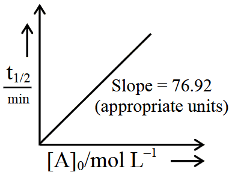

**Answer: 2435** · key (compiled)

**Solution.** $t_{1/2}\propto[A]_0$ means a zero-order reaction, with $t_{1/2}=\dfrac{[A]_0}{2k}$, so the slope is $\dfrac1{2k}=76.92\Rightarrow k=6.5\times10^{-3}$ mol L$^{-1}$ min$^{-1}$. $[A]=2.5-kt=2.5-0.065=2.435$ mol L$^{-1}$ $=2435\times10^{-3}$.

### § — JEE Main 2025 · Apr session · Kin set Q6 · MCQ

In a reaction A + B → C, the initial concentrations of A and B are related as $[A]_0=8[B]_0$. The half-lives of A and B are 10 min and 40 min respectively. If they start to disappear at the same time, both following first-order kinetics, after how much time will the concentration of both the reactants be the same?

(1) 60 min  (2) 80 min  (3) 20 min  (4) 40 min

**Answer: (4)** · key (compiled)

**Solution.** Need $8[B]_0\left(\tfrac12\right)^{t/10}=[B]_0\left(\tfrac12\right)^{t/40}$, i.e. $2^{t/10-t/40}=8=2^3\Rightarrow\dfrac{3t}{40}=3\Rightarrow t=40$ min.

### § — JEE Main 2025 · Apr session · Kin set Q7 · MCQ

The half-life of a zero-order reaction A → product is 1 hour when the initial concentration of the reaction is 2.0 mol L$^{-1}$. The time required to decrease the concentration of A from 0.50 to 0.25 mol L$^{-1}$ is:

(1) 0.5 hour  (2) 4 hour  (3) 15 min  (4) 60 min

**Answer: (3)** · key (compiled)

**Solution.** For zero order $t_{1/2}=\dfrac{[A]_0}{2k}\Rightarrow k=\dfrac{2.0}{2\times1}=1$ mol L$^{-1}$ h$^{-1}$. Time $=\dfrac{\Delta[A]}k=\dfrac{0.25}1=0.25$ h $=15$ min.

### § — JEE Main 2025 · Apr session · Kin set Q9 · MCQ

Consider the following statements related to the temperature dependence of rate constants. Identify the correct statements:

A. The Arrhenius equation holds true only for an elementary homogeneous reaction.
B. The unit of $A$ is the same as that of $k$ in the Arrhenius equation.
C. At a given temperature, a low activation energy means a fast reaction.
D. $A$ and $E_a$ as used in the Arrhenius equation depend on temperature.
E. When $E_a\gg RT$, $A$ and $E_a$ become interdependent.

(1) A, C and D only  (2) B, D and E only  (3) B and C only  (4) A and B only

**Answer: (3)** · key (compiled)

**Solution.** $k=Ae^{-E_a/RT}$: the exponential factor is dimensionless, so $A$ has the units of $k$ (B true). A lower $E_a$ gives a larger $e^{-E_a/RT}$ and a faster reaction (C true). The Arrhenius equation also describes complex reactions (A false), and $A$ and $E_a$ are taken as essentially temperature independent (D false), nor interdependent (E false). So B and C only.

### § — JEE Main 2025 · Apr session · Kin set Q10 · MCQ

For A$_2$ + B$_2$ ⇌ 2AB, the activation energies for the forward and backward reactions are 180 and 200 kJ mol$^{-1}$ respectively. If a catalyst lowers $E_a$ for both reactions by 100 kJ mol$^{-1}$, which of the following statements is correct?

(1) Catalyst does not alter the Gibbs energy change of a reaction.  (2) Catalyst can cause non-spontaneous reactions to occur.  (3) The enthalpy change for the reaction is +20 kJ mol$^{-1}$.  (4) The enthalpy change for the catalysed reaction is different from that of the uncatalysed reaction.

**Answer: (1)** · key (compiled)

**Solution.** A catalyst only provides a lower-energy path; it changes neither $\Delta H$ nor $\Delta G$ nor the spontaneity. Here $\Delta H=E_{a,f}-E_{a,b}=180-200=-20$ kJ mol$^{-1}$ both with and without the catalyst, so (3) and (4) are wrong, (2) is wrong, and (1) is correct.

### § — JEE Main 2025 · Apr session · Kin set Q11 · MCQ

Consider the following plots of $\log k$ against $\dfrac1T$ for three different reactions. The correct order of the activation energies of these reactions is:

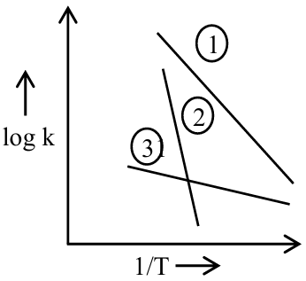

(1) $E_{a2}>E_{a1}>E_{a3}$  (2) $E_{a1}>E_{a3}>E_{a2}$  (3) $E_{a1}>E_{a2}>E_{a3}$  (4) $E_{a3}>E_{a2}>E_{a1}$

**Answer: (1)** · key (compiled)

**Solution.** $\log k=\log A-\dfrac{E_a}{2.303R}\cdot\dfrac1T$, so the slope is $-\dfrac{E_a}{2.303R}$: the steeper the line, the larger the activation energy. From the figure, line 2 is steepest, then line 1, and line 3 is almost flat: $E_{a2}>E_{a1}>E_{a3}$.

