# Chemical Thermodynamics

> Theory: [../../theory/chemistry/chemical-thermodynamics.md](../../theory/chemistry/chemical-thermodynamics.md)

### C-CTH-01 — JEE Main 2024 · 27 Jan Shift 1 · Q54 · Numerical

Three moles of an ideal gas at $300$ K expand isothermally from $30\ \text{dm}^3$ to $45\ \text{dm}^3$ against a constant opposing pressure of $80$ kPa. The amount of heat transferred is ______ J.

**Answer: 1200** · key ✔

**Solution.** Isothermal ideal gas: $\Delta U=0\Rightarrow q=-w=P_{ext}\Delta V=80\times10^3\times(15\times10^{-3})=1200$ J absorbed by the gas.

### C-CTH-02 — JEE Main 2024 · 27 Jan Shift 2 · Q56 · Numerical

For a thermochemical reaction $\text{M}\to\text{N}$ at $T=400$ K, $\Delta H^\circ=77.2$ kJ mol$^{-1}$ and $\Delta S^\circ=122\ \text{J K}^{-1}$. The value of $\log K$ is $-$ ______ $\times10^{-1}$. ($R=8.314\ \text{J K}^{-1}\text{mol}^{-1}$)

**Answer: 37** · key ✔

**Solution.** $\Delta G^\circ=\Delta H^\circ-T\Delta S^\circ=77200-400(122)=28400$ J. $\log K=-\dfrac{\Delta G^\circ}{2.303RT}=-\dfrac{28400}{2.303\times8.314\times400}\approx-3.7=-37\times10^{-1}$.

### C-CTH-03 — JEE Main 2024 · 27 Jan Shift 2 · Q58 · Numerical

(electrochemistry) A hydrogen electrode is dipped in a solution of $\text{pH}=3$ at $25^\circ$C. The potential of the electrode will be $-$ ______ $\times10^{-2}$ V. ($\dfrac{2.303RT}F=0.059$ V; round off to the nearest integer.)

**Answer: 18** · key ✔

**Solution.** For $\text{H}^+/\tfrac12\text{H}_2$ at $1$ atm: $E=E^\circ-0.059\log\dfrac1{[\text{H}^+]}=-0.059\,\text{pH}=-0.059\times3=-0.177$ V $\approx-18\times10^{-2}$ V.

### C-CTH-04 — JEE Main 2024 · 29 Jan Shift 1 · Q33 · MCQ

Which of the following is **not** correct?

(1) $\Delta G$ is negative for a spontaneous reaction  (2) $\Delta G$ is positive for a spontaneous reaction  (3) $\Delta G$ is zero for a reversible reaction  (4) $\Delta G$ is positive for a non-spontaneous reaction

**Answer: (2)** · key ✔

**Solution.** At constant $T,P$: $\Delta G<0$ spontaneous, $\Delta G=0$ equilibrium (reversible), $\Delta G>0$ non-spontaneous. So the statement that $\Delta G$ is positive for a spontaneous reaction is wrong.

### C-CTH-05 — JEE Main 2024 · 29 Jan Shift 2 · Q54 · Numerical

The standard enthalpy of vapourisation for $\text{CCl}_4$ is $30.5\ \text{kJ mol}^{-1}$. The heat required for vapourisation of $284$ g of $\text{CCl}_4$ at constant temperature is ______ kJ (nearest integer). (Molar masses: C = 12, Cl = 35.5)

**Answer: 56** · key ✔

**Solution.** $M(\text{CCl}_4)=12+4(35.5)=154$ g/mol. $n=\dfrac{284}{154}=1.844$ mol, so $q=1.844\times30.5=56.2\approx56$ kJ.

### C-CTH-06 — JEE Main 2024 · 30 Jan Shift 2 · Q52 · Numerical

Given $2\text{Fe}(s)+\tfrac32\text{O}_2(g)\to\text{Fe}_2\text{O}_3(s)$, $\Delta H^\circ=-822$ kJ/mol and $\text{C}(s)+\tfrac12\text{O}_2(g)\to\text{CO}(g)$, $\Delta H^\circ=-110$ kJ/mol, the enthalpy change (kJ) for $3\text{C}(s)+\text{Fe}_2\text{O}_3(s)\to2\text{Fe}(s)+3\text{CO}(g)$ is ______.

**Answer: 492** · key ✔

**Solution.** Hess's law: reverse the first reaction ($+822$) and add three times the second ($3\times-110=-330$): $\Delta H=822-330=+492$ kJ.

### C-CTH-07 — JEE Main 2024 · 1 Feb Shift 1 · Q35 · MCQ

Choose the correct option for free expansion of an ideal gas under adiabatic condition:

(1) $q=0,\ \Delta T\neq 0,\ w=0$  (2) $q=0,\ \Delta T<0,\ w\neq 0$  (3) $q\neq 0,\ \Delta T<0,\ w=0$  (4) $q=0,\ \Delta T=0,\ w=0$

**Answer: (4)** · key ✔

**Solution.** Adiabatic: $q=0$. Free expansion is against zero external pressure: $w=-p_{ext}\Delta V=0$. Then $\Delta U=q+w=0$, and for an ideal gas $U$ depends only on $T$, so $\Delta T=0$.

### C-CTH-08 — JEE Main 2024 · 4 Apr Shift 1 · Q53 · Numerical

For $\text{C}_2\text{H}_4+\text{H}_2\to\text{C}_2\text{H}_6$, the bond energies of C–H, C–C, C=C and H–H are $414$, $347$, $615$ and $435$ kJ mol$^{-1}$. The magnitude of the enthalpy change is ______ kJ.

**Answer: 125** · key ✔

**Solution.** Bonds broken: $\text{C=C}$ ($615$) + $\text{H-H}$ ($435$) $=1050$. Bonds formed: $\text{C-C}$ ($347$) + $2\,\text{C-H}$ ($828$) $=1175$. $\Delta H=1050-1175=-125$ kJ mol$^{-1}$; the value asked is $125$ kJ (exothermic).

### C-CTH-09 — JEE Main 2024 · 4 Apr Shift 2 · Q53 · Numerical

Three moles of an ideal gas are compressed isothermally from $60$ L to $20$ L using a constant external pressure of $5$ atm. The heat exchange $Q$ for the compression is $-$ ______ L atm.

**Answer: 200** · key ✔

**Solution.** $w=-p_{ext}\Delta V=-5(20-60)=+200$ L atm. Isothermal ideal gas: $\Delta U=0$, so $q=-w=-200$ L atm (heat is released).

### C-CTH-10 — JEE Main 2024 · 5 Apr Shift 1 · Q35 · MCQ

Assertion A: The enthalpy of neutralisation of a strong monobasic acid with a strong monoacidic base is always $-57\ \text{kJ mol}^{-1}$.
Reason R: Enthalpy of neutralisation is the heat liberated when one mole of $\text{H}^+$ furnished by an acid combines with one mole of $\text{OH}^-$ furnished by a base to form one mole of water.

(1) A true, R false  (2) Both true, R does not explain A  (3) Both true, R explains A

**Answer: (3)** · key ✔

**Solution.** For strong acid and strong base everything is fully ionised, and the net change is $\text{H}^++\text{OH}^-\to\text{H}_2\text{O}$ with $\Delta H\approx-57.3$ kJ mol$^{-1}$. R defines the quantity and thereby explains why it is constant.

### C-CTH-11 — JEE Main 2024 · 5 Apr Shift 1 · Q54 · Numerical

The heat of combustion of solid benzoic acid at constant volume is $-321.30$ kJ at $27^\circ$C. The heat of combustion at constant pressure is $(-321.30-xR)$ kJ. $x=$ ______.

**Answer: 150** · key ✔

**Solution.** $\text{C}_6\text{H}_5\text{COOH}(s)+\tfrac{15}{2}\text{O}_2(g)\to7\text{CO}_2(g)+3\text{H}_2\text{O}(l)$: $\Delta n_g=7-7.5=-\tfrac12$. $\Delta H=\Delta U+\Delta n_gRT=-321.30-\tfrac12R(300)=-321.30-150R$. So $x=150$.

### C-CTH-12 — JEE Main 2024 · 5 Apr Shift 2 · Q53 · Numerical

For $\text{C}_6\text{H}_6(l)+\tfrac{15}2\text{O}_2(g)\to6\text{CO}_2(g)+3\text{H}_2\text{O}(l)$, the standard enthalpy of combustion of $2$ mol of benzene is $-x$ kJ. $x=$ ______. (Given $\Delta_fH^\circ$: $\text{C}_6\text{H}_6(l)=+48.5$; $\text{CO}_2=-393.5$; $\text{H}_2\text{O}(l)=-286$ kJ mol$^{-1}$)

**Answer: 6535** · key ✔

**Solution.** $\Delta_cH^\circ=6(-393.5)+3(-286)-48.5=-2361-858-48.5=-3267.5$ kJ per mole of benzene. For $2$ mol: $-6535$ kJ, so $x=6535$.

### C-CTH-13 — JEE Main 2024 · 6 Apr Shift 1 · Q53 · Numerical

An ideal gas with $\bar C_v=\tfrac52R$ is expanded adiabatically against a constant pressure of $1$ atm until its volume doubles. The initial temperature and pressure are $298$ K and $5$ atm. The final temperature is ______ K (nearest integer).

**Answer: 274** · key ✔

**Solution.** Let $V_1=\dfrac{nRT_1}{5}$ (litres, with $P_1=5$ atm). Work done by the gas $=P_{ext}\Delta V=1\times V_1$. First law ($q=0$): $nC_v(T_2-T_1)=-V_1=-\dfrac{nRT_1}{5}$. So $\tfrac52(T_2-T_1)=-\tfrac{T_1}5\Rightarrow T_2=T_1\left(1-\tfrac{2}{25}\right)=298\times0.92=274$ K.

### C-CTH-14 — JEE Main 2024 · 6 Apr Shift 2 · Q54 · Numerical

For the reaction at $298$ K, $2\text{A}+\text{B}\to\text{C}$, $\Delta H=400$ kJ mol$^{-1}$ and $\Delta S=0.2$ kJ mol$^{-1}$K$^{-1}$. The reaction will become spontaneous above ______ K.

**Answer: 2000** · key ✔

**Solution.** $\Delta G=\Delta H-T\Delta S<0\Rightarrow T>\dfrac{\Delta H}{\Delta S}=\dfrac{400}{0.2}=2000$ K.

### C-CTH-15 — JEE Main 2024 · 8 Apr Shift 2 · Q53 · Numerical

$\Delta_{vap}H^\ominus$ for water is $+40.79$ kJ mol$^{-1}$ at $1$ bar and $100^\circ$C. The change in internal energy for this vaporisation under the same conditions is ______ kJ mol$^{-1}$ (integer). ($R=8.3\ \text{J K}^{-1}\text{mol}^{-1}$)

**Answer: 38** · key ✔

**Solution.** $\text{H}_2\text{O}(l)\to\text{H}_2\text{O}(g)$: $\Delta n_g=1$. $\Delta U=\Delta H-\Delta n_gRT=40.79-\dfrac{8.3\times373}{1000}=40.79-3.10=37.69\approx38$ kJ mol$^{-1}$.

### C-CTH-16 — JEE Main 2024 · 9 Apr Shift 1 · Q53 · Numerical

When equal volumes of $1$ M HCl and $1$ M $\text{H}_2\text{SO}_4$ are separately neutralised by excess $1$ M NaOH solution, $x$ and $y$ kJ of heat are liberated respectively. The value of $y/x$ is ______.

**Answer: 2** · key ✔

**Solution.** The heat depends on the moles of $\text{H}^+$ neutralised ($\Delta H\approx-57$ kJ per mole of water formed). $1$ M HCl gives $1$ mol $\text{H}^+$ per litre; $1$ M $\text{H}_2\text{SO}_4$ gives $2$ mol. So $y=2x$ and $y/x=2$.

### C-CTH-17 — JEE Main 2024 · 9 Apr Shift 1 · Q54 · Numerical

The heats of solution of anhydrous $\text{CuSO}_4$ and $\text{CuSO}_4\cdot5\text{H}_2\text{O}$ are $-70$ kJ mol$^{-1}$ and $+12$ kJ mol$^{-1}$ respectively. The heat of hydration of $\text{CuSO}_4$ to $\text{CuSO}_4\cdot5\text{H}_2\text{O}$ is $-x$ kJ. $x=$ ______.

**Answer: 82** · key ✔

**Solution.** Hess's law: $\text{CuSO}_4(s)+5\text{H}_2\text{O}\to\text{CuSO}_4\cdot5\text{H}_2\text{O}(s)$. $\Delta H_{hyd}=\Delta H_{sol}(\text{anhydrous})-\Delta H_{sol}(\text{pentahydrate})=-70-12=-82$ kJ. So $x=82$.

### C-CTH-18 — JEE Advanced 2025 · Paper 1 · Q11 · Numerical

Considering ideal gas behaviour, the expansion work done (in kJ) when $144$ g of water is electrolysed completely under constant pressure at $300$ K is ______. ($R=8.3\ \text{J K}^{-1}\text{mol}^{-1}$; H $=1$, O $=16$)

**Answer: −29.88** (accepted $29.8$–$29.95$ in magnitude, sign as per the work-on-system convention) · official key ✔ (re-derived)

**Solution.** $144$ g $=8$ mol $\text{H}_2\text{O}$: $2\text{H}_2\text{O}(l)\to2\text{H}_2(g)+\text{O}_2(g)$ gives $8$ mol $\text{H}_2$ and $4$ mol $\text{O}_2$, $\Delta n_g=12$. At constant $P$ the gas does work $P\Delta V=\Delta n_gRT=12\times8.3\times300=29.88$ kJ against the surroundings; in the IUPAC convention (work done *on* the system) $w=-29.88$ kJ.

### § — JEE Main 2026 · 21 Jan Shift 2 · set Q1 · MCQ

Consider the following data: $\Delta_fH^\ominus(\text{methane, g})=-X$ kJ mol$^{-1}$; enthalpy of sublimation of graphite $=Y$ kJ mol$^{-1}$; dissociation enthalpy of $\mathrm{H_2}=Z$ kJ mol$^{-1}$. The bond enthalpy of the C–H bond is given by:

(1) $\dfrac{-X+Y+Z}{4}$  (2) $\dfrac{X+Y+4Z}{2}$  (3) $\dfrac{X+Y+2Z}{4}$  (4) $X+Y+Z$

**Answer: (3)** · key (compiled)

**Solution.** $\mathrm{C(s)+2H_2(g)\to CH_4(g)}$: $\Delta_fH=\Sigma$(bonds broken) $-\Sigma$(bonds formed) $\Rightarrow-X=Y+2Z-4\varepsilon_{\mathrm{C-H}}$, so $\varepsilon_{\mathrm{C-H}}=\dfrac{X+Y+2Z}{4}$.

### § — JEE Main 2026 · 23 Jan Shift 1 · set Q2 · MCQ

A cup of water at $5^\circ$C (system) is placed in a microwave oven and the oven is turned on for one minute, during which the water begins to boil. Which of the following options is true?

(1) $q=+$ve, $w=0$, $\Delta U=-$ve  (2) $q=+$ve, $w=-$ve, $\Delta U=-$ve  (3) $q=-$ve, $w=-$ve, $\Delta U=-$ve  (4) $q=+$ve, $w=-$ve, $\Delta U=+$ve

**Answer: (4)** · key (compiled)

**Solution.** The water absorbs energy from the microwaves, so $q>0$. On heating it expands (and vaporises) against the atmosphere, so the system does work on the surroundings: $w<0$ (IUPAC sign). The temperature rises, so $\Delta U>0$ (indeed $\Delta U=q+w$ with $q>|w|$).

### § — JEE Main 2026 · 28 Jan Shift 2 · set Q3 · MCQ

The plot of $\log_{10}K$ vs $\dfrac1T$ gives a straight line. The intercept and slope respectively are (where $K$ is the equilibrium constant):

(1) $\dfrac{\Delta S^\circ}{2.303R},\ -\dfrac{\Delta H^\circ}{2.303R}$  (2) $-\dfrac{\Delta S^\circ R}{2.303},\ \dfrac{\Delta H^\circ R}{2.303}$  (3) $\dfrac{2.303R}{\Delta H^\circ},\ \dfrac{2.303R}{\Delta S^\circ}$  (4) $-\dfrac{\Delta H^\circ}{2.303R},\ \dfrac{\Delta S^\circ}{2.303R}$

**Answer: (1)** · key (compiled)

**Solution.** $-RT\ln K=\Delta G^\circ=\Delta H^\circ-T\Delta S^\circ$, so $\log_{10}K=\dfrac{\Delta S^\circ}{2.303R}-\dfrac{\Delta H^\circ}{2.303R}\cdot\dfrac1T$. This is $y=c+mx$ with intercept $\dfrac{\Delta S^\circ}{2.303R}$ and slope $-\dfrac{\Delta H^\circ}{2.303R}$ (van 't Hoff plot).

### § — JEE Main 2026 · 24 Jan Shift 2 · set Q4 · MCQ

The heats of atomisation of methane and ethane are $x$ kJ mol$^{-1}$ and $y$ kJ mol$^{-1}$ respectively. The longest wavelength ($\lambda$) of light capable of breaking the C–C bond can be expressed in SI units as:

(1) $\dfrac{N_Ahc}{250(4y-6x)}$  (2) $\dfrac{hc}{1000}\left(\dfrac{y-6x}{4}\right)^{-1}$  (3) $\dfrac{N_Ahc}{250(y-6x)}$  (4) $N_Ahc\left(y-\dfrac{6x}{4}\right)^{-1}$

**Answer: (1)** · key (compiled)

**Solution.** Methane has 4 C–H bonds, so $\varepsilon_{\mathrm{CH}}=x/4$. Ethane has 1 C–C and 6 C–H bonds: $y=\varepsilon_{\mathrm{CC}}+6\cdot\dfrac x4\Rightarrow\varepsilon_{\mathrm{CC}}=\dfrac{4y-6x}{4}$ kJ mol$^{-1}$. Energy per bond $=\dfrac{\varepsilon_{\mathrm{CC}}\times1000}{N_A}=\dfrac{hc}{\lambda}$, so $\lambda=\dfrac{N_Ahc}{1000}\cdot\dfrac{4}{4y-6x}=\dfrac{N_Ahc}{250(4y-6x)}$.

### § — JEE Main 2026 · 22 Jan Shift 2 · set Q5 · Numerical

If the enthalpy of sublimation of Li is 155 kJ mol$^{-1}$, the enthalpy of dissociation of $\mathrm{F_2}$ is 150 kJ mol$^{-1}$, the ionisation enthalpy of Li is 520 kJ mol$^{-1}$, the electron gain enthalpy of F is $-313$ kJ mol$^{-1}$ and the standard enthalpy of formation of LiF is $-594$ kJ mol$^{-1}$, the magnitude of the lattice enthalpy of LiF is ______ kJ mol$^{-1}$. (Nearest integer)

**Answer: 1031** · key (compiled)

**Solution.** Born–Haber cycle: $\Delta_fH=\Delta_{sub}H(\mathrm{Li})+\tfrac12\Delta_{diss}H(\mathrm{F_2})+\mathrm{IE}(\mathrm{Li})+\Delta_{eg}H(\mathrm F)+\Delta_{lattice}H$. $-594=155+75+520-313+\Delta_{lattice}H=437+\Delta_{lattice}H\Rightarrow\Delta_{lattice}H=-1031$ kJ mol$^{-1}$. Magnitude $=1031$.

### § — JEE Main 2026 · 22 Jan Shift 1 · set Q6 · MCQ

Match List-I with List-II.

| List-I: thermodynamic process | List-II: magnitude (kJ) |
|---|---|
| A. Work done in reversible isothermal expansion of 2 mol ideal gas from 2 dm³ to 20 dm³ at 300 K | I. 4 |
| B. Work done in irreversible isothermal expansion of 1 mol ideal gas from 1 m³ to 3 m³ at 300 K against constant pressure 3 kPa | II. 11.5 |
| C. Change in internal energy for adiabatic expansion of 1 mol ideal gas, $\lvert\Delta T\rvert=320$ K, $C_V=\tfrac32R$ | III. 6 |
| D. Change in enthalpy at constant pressure of 1 mol ideal gas, $\lvert\Delta T\rvert=337$ K, $C_p=\tfrac52R$ | IV. 7 |

(1) A-II, B-III, C-I, D-IV  (2) A-III, B-II, C-IV, D-I  (3) A-II, B-I, C-III, D-IV  (4) A-I, B-II, C-III, D-IV

**Answer: (1)** · key (compiled)

**Solution.** A: $w=nRT\ln\dfrac{V_2}{V_1}=2\times8.314\times300\times2.303=11.5$ kJ (II). B: $w=p_{ex}\Delta V=3000\times2=6000$ J $=6$ kJ (III). C: $\Delta U=nC_V\Delta T=1.5\times8.314\times320=3.99\approx4$ kJ (I). D: $\Delta H=nC_p\Delta T=2.5\times8.314\times337=7.0$ kJ (IV). So A-II, B-III, C-I, D-IV.

### § — JEE Main 2026 · 21 Jan Shift 1 · set Q7 · MCQ

Which of the following graphs between pressure $p$ and volume $V$ represents the maximum work done?

**(1)** 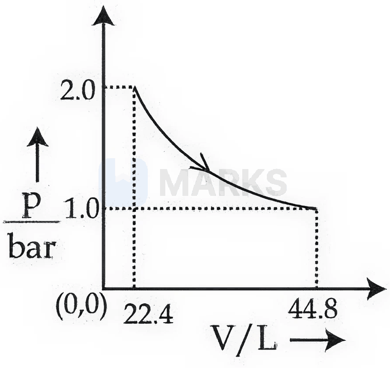

**(2)** 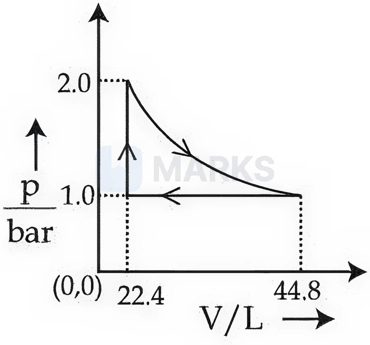

**(3)** 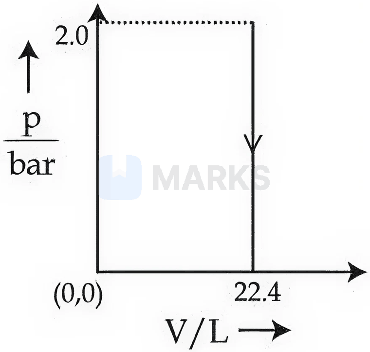

**(4)** 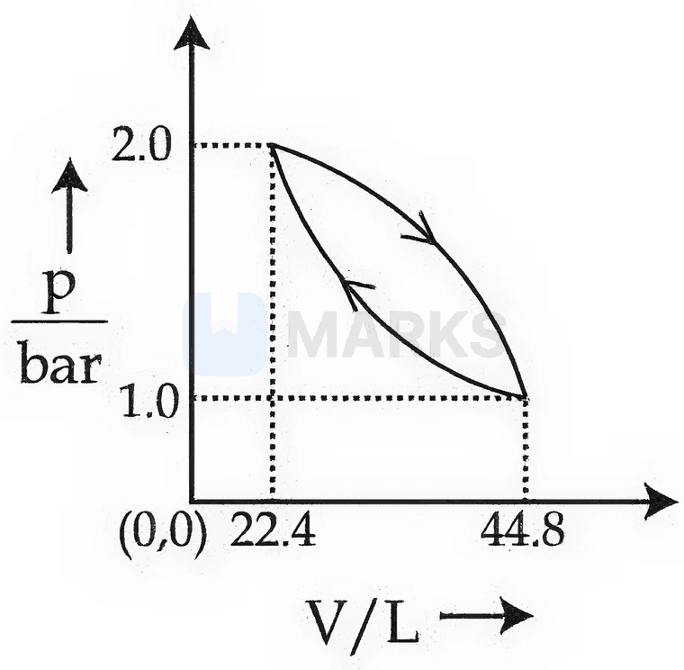

**Answer: (1)** · key (compiled)

**Solution.** Work is the area under the $p$–$V$ curve. (1) is a single expansion from 22.4 L to 44.8 L with the whole area under the curve counted as work done. (2) and (4) are cyclic processes, whose net work is only the small enclosed area. (3) is a constant-volume (vertical) path, with $w=0$. Hence (1).

### § — JEE Main 2026 · 21 Jan Shift 1 · set Q8 · Numerical

Use the following data:

| Substance | $\Delta_fH^\ominus$ (500 K) / kJ mol$^{-1}$ | $S^\ominus$ (500 K) / J K$^{-1}$ mol$^{-1}$ |
|---|---|---|
| $\mathrm{AB(g)}$ | 32 | 222 |
| $\mathrm{A_2(g)}$ | 6 | 146 |
| $\mathrm{B_2(g)}$ | $x$ | 280 |

One mole each of $\mathrm{A_2(g)}$ and $\mathrm{B_2(g)}$ are taken in a 1 L closed flask and allowed to establish the equilibrium $\mathrm{A_2(g)+B_2(g)\rightleftharpoons2AB(g)}$ at 500 K. The value of $x$ (in kJ mol$^{-1}$) is ______ (nearest integer). (Given: $\log K=2.2$, $R=8.3$ J K$^{-1}$ mol$^{-1}$)

**Answer: 70** · key (compiled)

**Solution.** $\Delta S^\circ=2(222)-(146+280)=18$ J K$^{-1}$ mol$^{-1}$; $\Delta H^\circ=2(32)-(6+x)=58-x$ kJ mol$^{-1}$. $\Delta G^\circ=-2.303RT\log K=-2.303\times8.3\times500\times2.2=-21.0$ kJ mol$^{-1}$. $\Delta G^\circ=\Delta H^\circ-T\Delta S^\circ$: $-21.03=58-x-500\times0.018=49-x\Rightarrow x=70.03\approx70$.

### § — JEE Main 2026 · 28 Jan Shift 1 · set Q9 · MCQ

$20.0\ \mathrm{dm^3}$ of an ideal gas X at 600 K and 0.5 MPa undergoes isothermal reversible expansion until the pressure of the gas is 0.2 MPa. Which of the following options is correct? (Given: $\log2=0.3010$ and $\log5=0.6989$)

(1) $w=-9.1$ kJ, $\Delta U=0$, $\Delta H=0$, $q=9.1$ kJ  (2) $w=+4.1$ kJ, $\Delta U=0$, $\Delta H=0$; $q=-4.1$ kJ  (3) $w=9.1$ J, $\Delta U=9.1$ J, $\Delta H=0$; $q=0$  (4) $w=-3.9$ kJ, $\Delta U=0$, $\Delta H=0$; $q=3.9$ kJ

**Answer: (1)** · key (compiled)

**Solution.** Isothermal ideal gas: $\Delta U=\Delta H=0$ and $q=-w$. $w=-p_1V_1\ln\dfrac{p_1}{p_2}=-(0.5\times10^6)(20\times10^{-3})\ln2.5=-10^4\times2.303\log2.5=-10^4\times2.303\times0.3979=-9.1$ kJ. So $q=+9.1$ kJ.

### § — JEE Main 2026 · 24 Jan Shift 1 · set Q10 · MCQ

Match List-I with List-II.

| List-I: isothermal process for an ideal gas system | List-II: work done ($V_f>V_i$) |
|---|---|
| A. Reversible expansion | I. $w=0$ |
| B. Free expansion | II. $w=-nRT\ln\dfrac{V_f}{V_i}$ |
| C. Irreversible expansion | III. $w=-p_{ex}(V_f-V_i)$ |
| D. Irreversible compression | IV. $w=-p_{ex}(V_i-V_f)$ |

(1) A-I, B-III, C-II, D-IV  (2) A-II, B-I, C-III, D-IV  (3) A-IV, B-I, C-III, D-II  (4) A-IV, B-II, C-III, D-I

**Answer: (2)** · key (compiled)

**Solution.** Reversible isothermal expansion: $w=-nRT\ln(V_f/V_i)$ (II). Free expansion (against zero external pressure): $w=0$ (I). Irreversible expansion against constant $p_{ex}$: $w=-p_{ex}(V_f-V_i)$ (III). Irreversible compression against constant $p_{ex}$: the formula is written as in IV, $w=-p_{ex}(V_i-V_f)$ (IV). So A-II, B-I, C-III, D-IV.

### § — JEE Main 2026 · 24 Jan Shift 1 · set Q11 · MCQ

$\mathrm{A\to D}$ is an endothermic reaction occurring in three (elementary) steps: (i) $\mathrm{A\to B}$, $\Delta H_i=+$ve; (ii) $\mathrm{B\to C}$, $\Delta H_{ii}=-$ve; (iii) $\mathrm{C\to D}$, $\Delta H_{iii}=-$ve. Which of the following graphs between potential energy ($y$-axis) and reaction coordinate ($x$-axis) correctly represents the reaction profile of $\mathrm{A\to D}$?

**(1)** 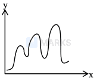

**(2)** 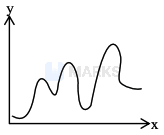

**(3)** 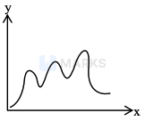

**(4)** 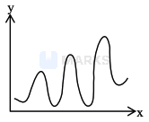

**Answer: (1)** · key (compiled)

**Solution.** Three elementary steps give three energy barriers and two intermediates (B and C). The energy order must be $E_A<E_D<E_C<E_B$: B above A (step i endothermic), C below B and D below C (steps ii and iii exothermic), yet D above A because the overall reaction is endothermic. Only graph (1) has this ordering. In (2) D lies above C, in (3) C lies above B, and in (4) B lies below A.

### § — JEE Main 2025 · Jan session · Thermo set Q1 · MCQ

A liquid kept inside a thermally insulated closed vessel at 25 °C was mechanically stirred from outside. What will be the correct option for the following thermodynamic parameters?

(1) $\Delta U<0$, $q=0$, $w>0$  (2) $\Delta U=0$, $q=0$, $w=0$  (3) $\Delta U>0$, $q=0$, $w>0$  (4) $\Delta U=0$, $q<0$, $w>0$

**Answer: (3)** · key (compiled)

**Solution.** The vessel is insulated, so $q=0$. Stirring does work on the liquid ($w>0$ in the convention where work done on the system is positive), so $\Delta U=q+w>0$ and the liquid warms up.

### § — JEE Main 2025 · Jan session · Thermo set Q2 · Numerical

Standard entropies of X$_2$, Y$_2$ and XY$_5$ are 70, 50 and 110 J K$^{-1}$ mol$^{-1}$ respectively. The temperature in kelvin at which the reaction $\tfrac12$X$_2$ + $\tfrac52$Y$_2$ ⇌ XY$_5$, $\Delta H^\ominus=-35$ kJ mol$^{-1}$, will be at equilibrium is ______. (Nearest integer)

**Answer: 700** · key (compiled)

**Solution.** $\Delta S^\circ=110-\tfrac12(70)-\tfrac52(50)=110-35-125=-50$ J K$^{-1}$ mol$^{-1}$. At equilibrium $\Delta G=0\Rightarrow T=\dfrac{\Delta H}{\Delta S}=\dfrac{-35000}{-50}=700$ K.

### § — JEE Main 2025 · Jan session · Thermo set Q3 · MCQ

The effect of temperature on spontaneity of reactions is represented as:

| | $\Delta H$ | $\Delta S$ | Temperature | Spontaneity |
|---|---|---|---|---|
| (A) | + | − | any T | Non-spontaneous |
| (B) | + | + | low T | spontaneous |
| (C) | − | − | low T | Non-spontaneous |
| (D) | − | + | any T | spontaneous |

The incorrect combinations are:

(1) (B) and (C) only  (2) (B) and (D) only  (3) (A) and (D) only  (4) (A) and (C) only

**Answer: (1)** · key (compiled)

**Solution.** Use $\Delta G=\Delta H-T\Delta S$. (A) $\Delta G>0$ always: non-spontaneous ✓. (B) $\Delta H>0$, $\Delta S>0$: spontaneous only at *high* T, so "low T, spontaneous" is wrong. (C) $\Delta H<0$, $\Delta S<0$: spontaneous at *low* T, so "non-spontaneous" is wrong. (D) $\Delta G<0$ always ✓. Incorrect: (B) and (C).

### § — JEE Main 2025 · Jan session · Thermo set Q4 · MCQ

If C(diamond) → C(graphite) + $X$ kJ mol$^{-1}$; C(diamond) + O$_2$(g) → CO$_2$(g) + $Y$ kJ mol$^{-1}$; C(graphite) + O$_2$(g) → CO$_2$(g) + $Z$ kJ mol$^{-1}$, at constant temperature. Then:

(1) $X=-Y+Z$  (2) $-X=Y+Z$  (3) $X=Y+Z$  (4) $X=Y-Z$

**Answer: (4)** · key (compiled)

**Solution.** Combustion of diamond = diamond → graphite followed by combustion of graphite (Hess's law): $Y=X+Z$, so $X=Y-Z$.

### § — JEE Main 2025 · Jan session · Thermo set Q6 · MCQ

An ideal gas undergoes a cyclic transformation starting from the point $A$ and coming back to the same point by tracing the path $A\to B\to C\to D\to A$ as shown in the three cases (Case I, II, III) in the figure. Choose the correct option regarding $\Delta U$:

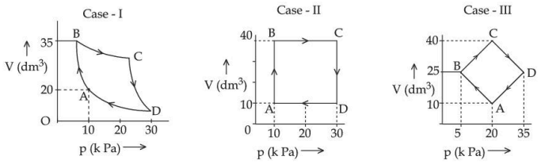

(1) $\Delta U$(Case-I) = $\Delta U$(Case-II) = $\Delta U$(Case-III)  (2) $\Delta U$(Case-I) > $\Delta U$(Case-III) > $\Delta U$(Case-II)  (3) $\Delta U$(Case-III) > $\Delta U$(Case-II) > $\Delta U$(Case-I)  (4) $\Delta U$(Case-I) > $\Delta U$(Case-II) > $\Delta U$(Case-III)

**Answer: (1)** · key (compiled)

**Solution.** $U$ is a state function. In every case the gas returns to its initial state $A$, so $\Delta U=0$ for the cycle, independent of the path or the area enclosed.

### § — JEE Main 2025 · Jan session · Thermo set Q7 · MCQ

500 J of energy is transferred as heat to 0.5 mol of argon gas at 298 K and 1.00 atm. The final temperature and the change in internal energy respectively are: (Given $R=8.3$ J K$^{-1}$ mol$^{-1}$)

(1) 378 K and 500 J  (2) 368 K and 500 J  (3) 348 K and 300 J  (4) 378 K and 300 J

**Answer: (3)** · key (compiled)

**Solution.** At constant pressure (1 atm) $q_p=nC_p\Delta T$ with $C_p=\tfrac52R=20.75$: $\Delta T=\dfrac{500}{0.5\times20.75}=48.2$ K, so $T\approx346\approx348$ K. $\Delta U=nC_v\Delta T=0.5\times12.45\times48.2\approx300$ J.

### § — JEE Main 2025 · Jan session · Thermo set Q8 · MCQ

Match List-I (partial derivatives) with List-II (thermodynamic quantity).

(A) $\left(\dfrac{\partial G}{\partial T}\right)_P$  (B) $\left(\dfrac{\partial H}{\partial T}\right)_P$  (C) $\left(\dfrac{\partial G}{\partial P}\right)_T$  (D) $\left(\dfrac{\partial U}{\partial T}\right)_V$ with (I) $C_P$ (II) $-S$ (III) $C_V$ (IV) $V$

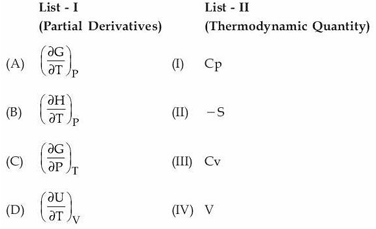

(1) (A)-(II), (B)-(I), (C)-(III), (D)-(IV)  (2) (A)-(I), (B)-(II), (C)-(IV), (D)-(III)  (3) (A)-(II), (B)-(I), (C)-(IV), (D)-(III)  (4) (A)-(II), (B)-(III), (C)-(I), (D)-(IV)

**Answer: (3)** · key (compiled)

**Solution.** From $dG=V\,dP-S\,dT$: $(\partial G/\partial T)_P=-S$ and $(\partial G/\partial P)_T=V$. By definition $C_P=(\partial H/\partial T)_P$ and $C_V=(\partial U/\partial T)_V$. So A-II, B-I, C-IV, D-III.

### § — JEE Main 2025 · Jan session · Thermo set Q9 · MCQ

Which of the following mixings of 1 M base and 1 M acid leads to the largest increase in temperature?

(1) 30 mL CH$_3$COOH and 30 mL NaOH  (2) 45 mL CH$_3$COOH and 25 mL NaOH  (3) 30 mL HCl and 30 mL NaOH  (4) 50 mL HCl and 20 mL NaOH

**Answer: (3)** · key (compiled)

**Solution.** Heat released $=n_{H_2O}\times\Delta H_{neut}$ and $\Delta T\propto\dfrac{q}{V_{total}}$. The strong acid–strong base reaction has the larger $|\Delta H|$ ($\approx-57$ kJ/mol, no ionisation penalty). (3): 0.030 mol in 60 mL (0.5 mol per litre); (4): 0.020 mol in 70 mL. So (3) gives the largest rise.

### § — JEE Main 2025 · Jan session · Thermo set Q10 · Numerical

The standard enthalpy and standard entropy of decomposition of N$_2$O$_4$ to NO$_2$ are 55.0 kJ mol$^{-1}$ and 175.0 J K$^{-1}$ mol$^{-1}$ respectively. The standard free energy change for this reaction at 25 °C in J mol$^{-1}$ is ______. (Nearest integer)

**Answer: 2850** · key (compiled)

**Solution.** $\Delta G^\circ=\Delta H^\circ-T\Delta S^\circ=55000-298\times175=55000-52150=2850$ J mol$^{-1}$.

### § — JEE Main 2025 · Jan session · Thermo set Q11 · MCQ

Consider an endothermic reaction which is non-spontaneous at the freezing point of water. However, the reaction is spontaneous at the boiling point of water. Choose the correct option.

(1) Both $\Delta H$ and $\Delta S$ are (−ve)  (2) $\Delta H$ is (−ve) but $\Delta S$ is (+ve)  (3) $\Delta H$ is (+ve) but $\Delta S$ is (−ve)  (4) Both $\Delta H$ and $\Delta S$ are (+ve)

**Answer: (4)** · key (compiled)

**Solution.** Endothermic means $\Delta H>0$. For $\Delta G=\Delta H-T\Delta S$ to turn negative on raising $T$, $\Delta S$ must be positive: spontaneous only above a threshold temperature.

### § — JEE Main 2025 · Jan session · Thermo set Q12 · Numerical

Consider the following cases of standard enthalpy of reaction ($\Delta H^\circ_r$ in kJ mol$^{-1}$): C$_2$H$_6$(g) + $\tfrac72$O$_2$(g) → 2CO$_2$(g) + 3H$_2$O(l), $\Delta H_1^\circ=-1550$; C(graphite) + O$_2$(g) → CO$_2$(g), $\Delta H_2^\circ=-393.5$; H$_2$(g) + $\tfrac12$O$_2$(g) → H$_2$O(l), $\Delta H_3^\circ=-286$. The magnitude of $\Delta H^\circ_{f(C_2H_6(g))}$ is ______ kJ mol$^{-1}$. (Nearest integer)

**Answer: 95** · key (compiled)

**Solution.** $\Delta H_1^\circ=2\Delta H_2^\circ+3\Delta H_3^\circ-\Delta H_f^\circ(C_2H_6)$, so $\Delta H_f^\circ(C_2H_6)=2(-393.5)+3(-286)+1550=-787-858+1550=-95$. Magnitude: 95.

### § — JEE Main 2025 · Jan session · Thermo set Q13 · Numerical

The bond dissociation enthalpy of X$_2$, $\Delta H_{bond}$, calculated from the given data is ______ kJ mol$^{-1}$. (Nearest integer) M$^+$X$^-$(s) → M$^+$(g) + X$^-$(g): $\Delta H^\circ_{lattice}=800$; M(s) → M(g): $\Delta H^\circ_{sub}=100$; M(g) → M$^+$(g) + e$^-$: $\Delta H_i=500$; X(g) + e$^-$ → X$^-$(g): $\Delta H^\circ_{eg}=-300$; M(s) + $\tfrac12$X$_2$(g) → M$^+$X$^-$(s): $\Delta H_f^\circ=-400$ kJ mol$^{-1}$.

**Answer: 200** · key (compiled)

**Solution.** Born–Haber cycle: $\Delta H_f=\Delta H_{sub}+\Delta H_i+\tfrac12\Delta H_{bond}+\Delta H_{eg}-\Delta H_{lattice}$. $-400=100+500+\tfrac12\Delta H_{bond}-300-800\Rightarrow\tfrac12\Delta H_{bond}=100$, so $\Delta H_{bond}=200$ kJ mol$^{-1}$.

### § — JEE Main 2025 · Jan session · Thermo set Q14 · MCQ

S(g) + $\tfrac32$O$_2$(g) → SO$_3$(g) + $2x$ kcal; SO$_2$(g) + $\tfrac12$O$_2$(g) → SO$_3$(g) + $y$ kcal. The heat of formation of SO$_2$(g) is given by:

(1) $x+y$ kcal  (2) $y-2x$ kcal  (3) $\dfrac{2x}y$ kcal  (4) $2x+y$ kcal

**Answer: (2)** · key (compiled)

**Solution.** Subtract the second equation from the first: S + O$_2$ → SO$_2$ with $\Delta H=-2x-(-y)=y-2x$ kcal (the heat evolved is $2x-y$).

### § — JEE Main 2025 · Jan session · Thermo set Q15 · Numerical

Consider the following data: heat of formation of CO$_2$(g) $=-393.5$ kJ mol$^{-1}$; heat of formation of H$_2$O(l) $=-286.0$ kJ mol$^{-1}$; heat of combustion of benzene $=-3267.0$ kJ mol$^{-1}$. The heat of formation of benzene is ______ kJ mol$^{-1}$. (Nearest integer)

**Answer: 48** · key (compiled)

**Solution.** C$_6$H$_6$ + $\tfrac{15}2$O$_2$ → 6CO$_2$ + 3H$_2$O. $\Delta H_c=6\Delta H_f(CO_2)+3\Delta H_f(H_2O)-\Delta H_f(C_6H_6)$, so $\Delta H_f(C_6H_6)=6(-393.5)+3(-286)+3267=-2361-858+3267=48$ kJ mol$^{-1}$.

### § — JEE Main 2025 · Jan session · Thermo set Q16 · MCQ

Ice at $-5$ °C is heated to become vapour with a temperature of 110 °C at atmospheric pressure. The entropy change associated with this process can be obtained from:

**(1)** 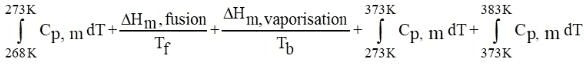

**(2)** 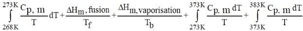

**(3)** 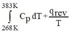

**(4)** 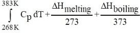

**Answer: (2)** · key (compiled)

**Solution.** Entropy change is $\int\dfrac{C_p\,dT}T$ for each heating stage and $\dfrac{\Delta H}{T}$ at each phase change (at the transition temperature): $\int_{268}^{273}\dfrac{C_{p,m}}TdT+\dfrac{\Delta H_{fus}}{T_f}+\int_{273}^{373}\dfrac{C_{p,m}}TdT+\dfrac{\Delta H_{vap}}{T_b}+\int_{373}^{383}\dfrac{C_{p,m}}TdT$. This is expression (2).

### § — JEE Main 2025 · Jan session · Thermo set Q17 · Numerical

The formation enthalpies $\Delta_fH^\ominus$ for H(g) and O(g) are 220.0 and 250.0 kJ mol$^{-1}$ respectively, at 298.15 K, and $\Delta_fH^\ominus$ for H$_2$O(g) is $-242.0$ kJ mol$^{-1}$ at the same temperature. The average bond enthalpy of the O–H bond in water at 298.15 K is ______ kJ mol$^{-1}$ (nearest integer).

**Answer: 466** · key (compiled)

**Solution.** Atomisation H$_2$O(g) → 2H(g) + O(g): $\Delta H=2(220)+250-(-242)=932$ kJ mol$^{-1}$, which breaks two O–H bonds. Average O–H $=\dfrac{932}2=466$ kJ mol$^{-1}$.

### § — JEE Main 2025 · Apr session · Thermo set Q2 · MCQ

The hydration energies of K$^+$ and Cl$^-$ are $-x$ and $-y$ kJ/mol respectively. If the lattice energy of KCl is $-z$ kJ/mol, then the heat of solution of KCl is:

(1) $+x-y-z$  (2) $x+y+z$  (3) $z-(x+y)$  (4) $-z-(x+y)$

**Answer: (3)** · key (compiled)

**Solution.** Dissolution = breaking the lattice (absorbs $+z$) followed by hydration of the gaseous ions (releases $x+y$): $\Delta H_{sol}=z-(x+y)$.

### § — JEE Main 2025 · Apr session · Thermo set Q3 · MCQ

Arrange the following in order of magnitude of work done by the system / on the system at constant temperature: (a) $|w_{reversible}|$ for expansion in infinite stages; (b) $|w_{irreversible}|$ for expansion in a single stage; (c) $|w_{reversible}|$ for compression in infinite stages; (d) $|w_{irreversible}|$ for compression in a single stage.

(1) $a>b>c>d$  (2) $d>c=a>b$  (3) $c=a>d>b$  (4) $a>c>b>d$

**Answer: (2)** · key (compiled)

**Solution.** A reversible path between the same two states gives the same magnitude of work whether it is an expansion or the reverse compression, so $|w_a|=|w_c|$. The reversible expansion gives the maximum work obtained, whereas the irreversible single-stage expansion gives the least ($b$ smallest). The reversible compression needs the minimum work input, so the irreversible single-stage compression requires the most ($d$ largest). Hence $d>c=a>b$.

### § — JEE Main 2025 · Apr session · Thermo set Q4 · Numerical

A perfect gas (0.1 mol) having $\bar C_v=1.50R$ (independent of temperature) undergoes the transformation shown in the figure from point 1 to point 4 (1→2 isochoric at 1000 cm$^3$ from 1 to 3 atm; 2→3 isobaric expansion at 3 atm to 2000 cm$^3$; 3→4 isochoric fall to 1 atm). If each step is reversible, the total work done ($w$) while going from point 1 to point 4 is ($-$) ______ J (nearest integer). [Given: $R=0.082$ L atm K$^{-1}$ mol$^{-1}$]

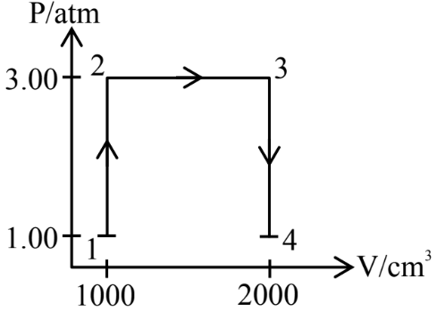

**Answer: 304** · key (compiled)

**Solution.** Work is done only in the isobaric step: $w=-P\Delta V=-3\ \text{atm}\times(2.000-1.000)\ \text{L}=-3$ L atm $=-3\times101.3=-304$ J (isochoric steps do no work). Magnitude: 304 J.

### § — JEE Main 2025 · Apr session · Thermo set Q6 · MCQ

Let us consider a reversible reaction at temperature $T$. In this reaction, both $\Delta H$ and $\Delta S$ were observed to have positive values. If the equilibrium temperature is $T_e$, then the reaction becomes spontaneous at:

(1) $T=T_e$  (2) $T_e>T$  (3) $T>T_e$  (4) $T_e=5T$

**Answer: (3)** · key (compiled)

**Solution.** At $T_e$, $\Delta G=0$, so $T_e=\dfrac{\Delta H}{\Delta S}$. With $\Delta H,\Delta S>0$, $\Delta G=\Delta H-T\Delta S<0$ requires $T>T_e$.

### § — JEE Main 2025 · Apr session · Thermo set Q7 · Numerical

Given: $\Delta H^\ominus_{sub}$[C(graphite)] $=710$ kJ mol$^{-1}$; $\Delta_{C-H}H^\ominus=414$; $\Delta_{H-H}H^\ominus=436$; $\Delta_{C=C}H^\ominus=611$ kJ mol$^{-1}$. The $\Delta H_f^\ominus$ for CH$_2$=CH$_2$ is ______ kJ mol$^{-1}$ (nearest integer value).

**Answer: 25** · key (compiled)

**Solution.** 2C(graphite) + 2H$_2$ → C$_2$H$_4$. Energy absorbed: atomise 2C: $2\times710=1420$; break 2 H–H: $2\times436=872$; total $2292$. Energy released forming 4 C–H and 1 C=C: $4\times414+611=2267$. $\Delta H_f=2292-2267=+25$ kJ mol$^{-1}$.

### § — JEE Main 2025 · Apr session · Thermo set Q8 · MCQ

Given below are two statements:

Statement I: When a system containing ice in equilibrium with water (liquid) is heated, heat is absorbed by the system and there is no change in the temperature of the system until the whole ice gets melted.
Statement II: At the melting point of ice, there is absorption of heat in order to overcome intermolecular forces of attraction within the molecules of water in ice and the kinetic energy of molecules is not increased at the melting point.

In the light of the above statements, choose the correct answer.

(1) Statement I is true but Statement II is false  (2) Both Statement I and Statement II are false  (3) Both Statement I and Statement II are true  (4) Statement I is false but Statement II is true

**Answer: (3)** · key (compiled)

**Solution.** During a phase change at constant pressure the temperature stays fixed at the melting point while the latent heat is absorbed. The heat goes into overcoming intermolecular attractions (increasing potential energy) and not the average kinetic energy. Both statements are true.

### § — JEE Main 2025 · Apr session · Thermo set Q9 · Numerical

A sample of n-octane (1.14 g) was completely burnt in excess of oxygen in a bomb calorimeter whose heat capacity is 5 kJ K$^{-1}$. As a result of the combustion reaction, the temperature of the calorimeter is increased by 5 K. The magnitude of the heat of combustion of octane at constant volume is ______ kJ mol$^{-1}$ (nearest integer).

**Answer: 2500** · key (compiled)

**Solution.** Moles of octane (C$_8$H$_{18}$, M = 114) $=\dfrac{1.14}{114}=0.01$. Heat released $=C\Delta T=5\times5=25$ kJ. Per mole: $\dfrac{25}{0.01}=2500$ kJ mol$^{-1}$.

### § — JEE Main 2025 · Apr session · Thermo set Q10 · MCQ

Consider the given data: (a) HCl(g) + 10H$_2$O(l) → HCl·10H$_2$O, $\Delta H=-69.01$ kJ mol$^{-1}$; (b) HCl(g) + 40H$_2$O(l) → HCl·40H$_2$O, $\Delta H=-72.79$ kJ mol$^{-1}$. Choose the correct statement:

(1) Dissolution of gas in water is an endothermic process.  (2) The heat of solution depends on the amount of solvent.  (3) The heat of dilution for the process (HCl·10H$_2$O to HCl·40H$_2$O) is 3.78 kJ mol$^{-1}$.  (4) The heat of formation of HCl solution is represented by both (a) and (b).

**Answer: (2)** · key (compiled)

**Solution.** Both dissolutions are exothermic (so (1) is false). The enthalpy of solution changes from $-69.01$ to $-72.79$ kJ mol$^{-1}$ as more solvent is used, so it depends on the amount of solvent (2 true). The heat of dilution is $-72.79-(-69.01)=-3.78$ kJ mol$^{-1}$, i.e. $-3.78$ (the sign matters: it is released), so (3) as written (+3.78) is false. (4) is false as the heat of formation refers to formation from the elements.

### § — JEE Main 2025 · Apr session · Thermo set Q11 · MCQ

The total enthalpy change for freezing of 1 mol of water at 10 °C to ice at $-10$ °C is ______. (Given: $\Delta_{fus}H=x$ kJ/mol, $C_p$[H$_2$O(l)] $=y$ J mol$^{-1}$ K$^{-1}$, $C_p$[H$_2$O(s)] $=z$ J mol$^{-1}$ K$^{-1}$)

(1) $-x-10y-10z$  (2) $-10(100x+y+z)$  (3) $10(100x+y+z)$  (4) $x-10y-10z$

**Answer: (2)** · key (compiled)

**Solution.** Three steps (in J): cool water 10 °C → 0 °C: $-10y$; freeze at 0 °C: $-1000x$ (x is in kJ); cool ice 0 °C → $-10$ °C: $-10z$. Total $=-(1000x+10y+10z)=-10(100x+y+z)$ J.

### § — JEE Main 2025 · Apr session · Thermo set Q12 · MCQ

The correct statement amongst the following is:

(1) The term 'standard state' implies that the temperature is 0 °C.  (2) The standard state of a pure gas is the pure gas at a pressure of 1 bar and temperature 273 K.  (3) $\Delta_fH^\theta_{298}$ is zero for O(g).  (4) $\Delta_fH^\theta_{500}$ is zero for O$_2$(g).

**Answer: (4)** · key (compiled)

**Solution.** The standard state refers to 1 bar pressure at *any specified* temperature (commonly 298 K), not necessarily 0 °C (1 and 2 false). O(g) is not the stable form of oxygen, so its $\Delta_fH^\circ$ is not zero (3 false). By definition the standard enthalpy of formation of an element in its most stable form (O$_2$(g)) is zero at every temperature, so (4) is correct.

### § — JEE Main 2025 · Apr session · Thermo set Q13 · Numerical

Resonance in X$_2$Y can be represented as X=X=Y ↔ X≡X–Y (with formal charges as drawn in the figure). The enthalpy of formation of X$_2$Y [X≡X(g) + $\tfrac12$Y=Y(g) → X$_2$Y(g)] is 80 kJ mol$^{-1}$. The magnitude of the resonance energy of X$_2$Y is ______ kJ mol$^{-1}$ (nearest integer value). Given: bond energies of X≡X, X=X, Y=Y and X=Y are 940, 410, 500 and 602 kJ mol$^{-1}$ respectively. Valence X: 3, Y: 2.

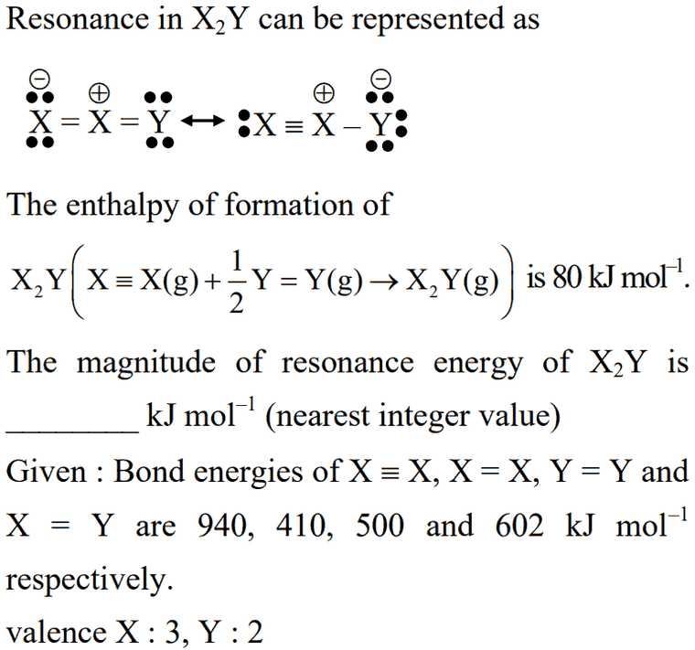

**Answer: 98** · key (compiled)

**Solution.** Take the canonical structure X=X=Y (bonds: one X=X and one X=Y). Bonds broken: X≡X (940) + $\tfrac12$Y=Y (250) = 1190 kJ. Bonds formed: X=X (410) + X=Y (602) = 1012 kJ. Calculated $\Delta H_f=1190-1012=+178$ kJ mol$^{-1}$. The experimental value is +80 kJ mol$^{-1}$, so resonance energy $=178-80=98$ kJ mol$^{-1}$.

