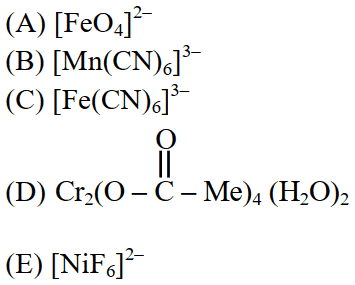
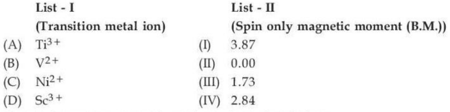
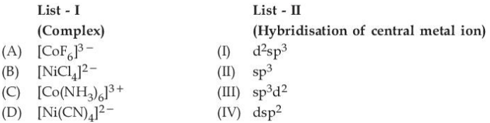
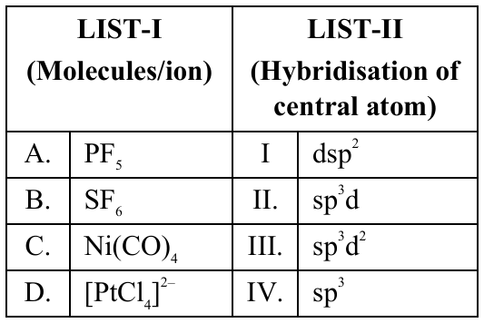

# Coordination Compounds

> Theory: [../../theory/chemistry/coordination-compounds.md](../../theory/chemistry/coordination-compounds.md)

### C-COO-01 — JEE Main 2024 · 27 Jan Shift 1 · Q46 · MCQ

Yellow lead chromate dissolves on treatment with hot $\text{NaOH}$ solution. The lead product formed is a

(1) tetraanionic complex with coordination number six  (2) neutral complex with coordination number four  (3) dianionic complex with coordination number six  (4) dianionic complex with coordination number four

**Answer: (4)** · key ✔

**Solution.** $\text{PbCrO}_4+4\text{NaOH}\to\text{Na}_2[\text{Pb(OH)}_4]+\text{Na}_2\text{CrO}_4$. The lead species $[\text{Pb(OH)}_4]^{2-}$ is a dianionic complex with coordination number 4.

### C-COO-02 — JEE Main 2024 · 27 Jan Shift 1 · Q47 · MCQ

Consider the complex ions $P=[\text{FeF}_6]^{3-}$, $Q=[\text{V(H}_2\text{O)}_6]^{2+}$, $R=[\text{Fe(H}_2\text{O)}_6]^{2+}$. The correct order according to spin-only magnetic moment (BM) is

(1) $R<Q<P$  (2) $R<P<Q$  (3) $Q<R<P$  (4) $Q<P<R$

**Answer: (3)** · key ✔

**Solution.** All three ligands ($\text{F}^-$, $\text{H}_2\text{O}$) are weak field, so complexes are high spin. $P$: $\text{Fe}^{3+}\,d^5$, 5 unpaired, $\mu=5.92$ BM. $Q$: $\text{V}^{2+}\,d^3$, 3 unpaired, $3.87$ BM. $R$: $\text{Fe}^{2+}\,d^6$, 4 unpaired, $4.90$ BM. Order: $Q<R<P$.

### C-COO-03 — JEE Main 2024 · 27 Jan Shift 2 · Q44 · MCQ

Identify the species in which the central atom shows $d^2sp^3$ hybridisation:

(1) $[\text{Co(NH}_3)_6]^{3+}$  (2) $\text{BrF}_5$  (3) $[\text{PtCl}_4]^{2-}$  (4) $\text{SF}_6$

**Answer: (1)** · key ✔

**Solution.** $\text{Co}^{3+}$ ($d^6$) with the strong-field ligand $\text{NH}_3$ pairs its electrons in $t_{2g}^6$, leaving two $3d$ orbitals for inner-orbital $d^2sp^3$ hybridisation. $\text{BrF}_5$ and $\text{SF}_6$ use $sp^3d^2$ (outer $d$) and $[\text{PtCl}_4]^{2-}$ is $dsp^2$.

### C-COO-04 — JEE Main 2024 · 27 Jan Shift 2 · Q60 · Numerical

The spin-only magnetic moment of the square planar complex $[\text{Pt(NH}_3)_2\text{Cl(NH}_2\text{CH}_3)]\text{Cl}$ is ______ BM (nearest integer). (Atomic number of Pt $=78$)

**Answer: 0** · key ✔

**Solution.** Pt is $[\text{Xe}]4f^{14}5d^96s^1$, so $\text{Pt}^{2+}$ is $5d^8$. In the strong ligand field of a $5d$ metal it is square planar with all electrons paired, giving $n=0$ and $\mu=0$ BM.

### C-COO-05 — JEE Main 2024 · 29 Jan Shift 1 · Q47 · MCQ

In which one of the following metal carbonyls does CO form a bridge between metal atoms?

(1) $[\text{Co}_2(\text{CO})_8]$  (2) $[\text{Mn}_2(\text{CO})_{10}]$  (3) $[\text{Os}_3(\text{CO})_{12}]$  (4) $[\text{Ru}_3(\text{CO})_{12}]$

**Answer: (1)** · key ✔

**Solution.** $\text{Co}_2(\text{CO})_8$ has a $\text{Co–Co}$ bond and two bridging ($\mu$) CO ligands, with six terminal CO. $\text{Mn}_2(\text{CO})_{10}$, $\text{Os}_3(\text{CO})_{12}$ and $\text{Ru}_3(\text{CO})_{12}$ contain only terminal CO (with M–M bonds).

### C-COO-06 — JEE Main 2024 · 29 Jan Shift 1 · Q50 · MCQ

Match List I with List II.

| List I (Substance) | List II (Element present) |
|---|---|
| A. Ziegler catalyst | I. Rhodium |
| B. Blood pigment | II. Cobalt |
| C. Wilkinson catalyst | III. Iron |
| D. Vitamin B$_{12}$ | IV. Titanium |

(1) A-II, B-IV, C-I, D-III  (2) A-II, B-III, C-IV, D-I  (3) A-III, B-II, C-IV, D-I  (4) A-IV, B-III, C-I, D-II

**Answer: (4)** · key ✔

**Solution.** Ziegler–Natta catalyst: $\text{TiCl}_4$ + $\text{Al(C}_2\text{H}_5)_3$ (Ti). Haemoglobin (blood pigment): Fe. Wilkinson's catalyst $[\text{RhCl(PPh}_3)_3]$: Rh. Vitamin B$_{12}$ (cyanocobalamin): Co.

### C-COO-07 — JEE Main 2024 · 29 Jan Shift 2 · Q42 · MCQ

The correct IUPAC name of $\text{K}_2\text{MnO}_4$ is

(1) Potassium tetraoxopermanganate(VI)  (2) Potassium tetraoxidomanganate(VI)  (3) Dipotassium tetraoxidomanganate(VII)  (4) Potassium tetraoxidomanganese(VI)

**Answer: (2)** · key ✔

**Solution.** The anion $\text{MnO}_4^{2-}$ has Mn in $+6$ ($x-8=-2$). Anionic complexes end in "-ate", oxide is named "oxido", and cation prefixes are not used: potassium tetraoxidomanganate(VI).

### C-COO-08 — JEE Main 2024 · 29 Jan Shift 2 · Q60 · Numerical

The oxidation state of Fe in the complex formed in the brown ring test is ______.

**Answer: 1** · key ✔

**Solution.** The brown ring is $[\text{Fe(H}_2\text{O)}_5\text{NO}]^{2+}$. Water is neutral and NO is present as $\text{NO}^+$, so $x+1=+2\Rightarrow x=+1$ (Fe is $+1$, NO$^+$ is the nitrosonium ligand).

### C-COO-09 — JEE Main 2024 · 30 Jan Shift 2 · Q46 · MCQ

The coordination geometry around manganese in decacarbonyldimanganese(0) is

(1) Octahedral  (2) Trigonal bipyramidal  (3) Square pyramidal  (4) Square planar

**Answer: (1)** · key ✔

**Solution.** In $\text{Mn}_2(\text{CO})_{10}$ each Mn is bonded to five terminal CO ligands and to the other Mn atom (a Mn–Mn bond), giving six neighbours in an octahedral arrangement.

### C-COO-10 — JEE Main 2024 · 30 Jan Shift 2 · Q57 · Numerical

The number of complexes which show optical isomerism among the following is ______: cis-$[\text{Cr(ox)}_2\text{Cl}_2]^{3-}$, $[\text{Co(en)}_3]^{3+}$, cis-$[\text{Pt(en)}_2\text{Cl}_2]^{2+}$, cis-$[\text{Co(en)}_2\text{Cl}_2]^+$, trans-$[\text{Pt(en)}_2\text{Cl}_2]^{2+}$, trans-$[\text{Cr(ox)}_2\text{Cl}_2]^{3-}$

**Answer: 4** · key ✔

**Solution.** Optical isomerism needs a chiral complex (no plane of symmetry). Octahedral cis-$[\text{M(AA)}_2\text{X}_2]$ and tris-chelates $[\text{M(AA)}_3]$ are chiral. The trans isomers have a mirror plane and are achiral. Chiral: cis-$[\text{Cr(ox)}_2\text{Cl}_2]^{3-}$, $[\text{Co(en)}_3]^{3+}$, cis-$[\text{Pt(en)}_2\text{Cl}_2]^{2+}$, cis-$[\text{Co(en)}_2\text{Cl}_2]^+$: $4$.

### C-COO-11 — JEE Main 2024 · 31 Jan Shift 1 · Q46 · MCQ

The correct statements from the following are:
A. The strength of anionic ligands can be explained by crystal field theory.
B. Valence bond theory does not give a quantitative interpretation of the kinetic stability of coordination compounds.
C. The hybridisation involved in the formation of the $[\text{Ni(CN)}_4]^{2-}$ complex is $dsp^2$.
D. The number of possible isomers of $\text{cis-}[\text{PtCl}_2(\text{en})_2]^{2+}$ is one.

(1) A, D only  (2) A, C only  (3) B, D only  (4) B, C only

**Answer: (4)** · key ✔

**Solution.** A is false: CFT treats ligands as point charges, so it cannot explain the strengths of anionic ligands (the spectrochemical series). B is true. C is true ($\text{Ni}^{2+}$, $d^8$, strong-field $\text{CN}^-$: square planar $dsp^2$). D is false: the cis isomer is chiral and exists as a pair of enantiomers.

### C-COO-12 — JEE Main 2024 · 31 Jan Shift 1 · Q57 · Numerical

The spin-only magnetic moment of $[\text{Ni(NH}_3)_6]^{2+}$ is ______ $\times10^{-1}$ BM. (Atomic number of Ni $=28$; round off to the nearest integer.)

**Answer: 28** · key ✔

**Solution.** $\text{Ni}^{2+}$ is $3d^8$. $\text{NH}_3$ is not strong enough to pair electrons here (octahedral $d^8$ has $2$ unpaired electrons regardless of field strength). $\mu=\sqrt{n(n+2)}=\sqrt8=2.83\ \text{BM}=28\times10^{-1}$ BM.

### C-COO-13 — JEE Main 2024 · 31 Jan Shift 2 · Q44 · MCQ

Select the option with the correct property:

(1) $\text{Ni(CO)}_4$ and $[\text{NiCl}_4]^{2-}$ both diamagnetic  (2) $\text{Ni(CO)}_4$ and $[\text{NiCl}_4]^{2-}$ both paramagnetic  (3) $[\text{NiCl}_4]^{2-}$ diamagnetic, $\text{Ni(CO)}_4$ paramagnetic  (4) $\text{Ni(CO)}_4$ diamagnetic, $[\text{NiCl}_4]^{2-}$ paramagnetic

**Answer: (4)** · key ✔

**Solution.** $\text{Ni(CO)}_4$: Ni(0) is $3d^{10}$ (or $3d^84s^2$ pairs up under the strong-field CO), tetrahedral $sp^3$, no unpaired electrons: diamagnetic. $[\text{NiCl}_4]^{2-}$: $\text{Ni}^{2+}$ $3d^8$ with the weak-field $\text{Cl}^-$ is tetrahedral $sp^3$ with $2$ unpaired electrons: paramagnetic.

### C-COO-14 — JEE Main 2024 · 31 Jan Shift 2 · Q45 · MCQ

Match List I (complex ion) with List II (electronic configuration): A. $[\text{Cr(H}_2\text{O)}_6]^{3+}$  B. $[\text{Fe(H}_2\text{O)}_6]^{3+}$  C. $[\text{Ni(H}_2\text{O)}_6]^{2+}$  D. $[\text{V(H}_2\text{O)}_6]^{3+}$; I. $t_{2g}^2e_g^0$  II. $t_{2g}^3e_g^0$  III. $t_{2g}^3e_g^2$  IV. $t_{2g}^6e_g^2$.

(1) A-III, B-II, C-IV, D-I  (2) A-IV, B-I, C-II, D-III  (3) A-IV, B-III, C-I, D-II  (4) A-II, B-III, C-IV, D-I

**Answer: (4)** · key ✔

**Solution.** $\text{H}_2\text{O}$ is a weak-field ligand. $\text{Cr}^{3+}$ $d^3$: $t_{2g}^3$. $\text{Fe}^{3+}$ $d^5$ (high spin): $t_{2g}^3e_g^2$. $\text{Ni}^{2+}$ $d^8$: $t_{2g}^6e_g^2$. $\text{V}^{3+}$ $d^2$: $t_{2g}^2$.

### C-COO-15 — JEE Main 2024 · 1 Feb Shift 1 · Q45 · MCQ

Statement I: A solution of $[\text{Ni(H}_2\text{O)}_6]^{2+}$ is green in colour.
Statement II: A solution of $[\text{Ni(CN)}_4]^{2-}$ is colourless.

(1) Both incorrect  (2) Both correct  (3) I incorrect, II correct  (4) I correct, II incorrect

**Answer: (2)** · key ✔

**Solution.** $[\text{Ni(H}_2\text{O)}_6]^{2+}$ ($d^8$, octahedral, two unpaired electrons) absorbs red light and appears green. $[\text{Ni(CN)}_4]^{2-}$ is square planar with strong-field $\text{CN}^-$ and is diamagnetic; its $d$–$d$ transitions lie in the UV, so the solution is taken as colourless (this is the NCERT/NTA answer).

### C-COO-16 — JEE Main 2024 · 1 Feb Shift 2 · Q47 · MCQ

Statement I: Dimethylglyoxime forms a six-membered covalent chelate with $\text{NiCl}_2$ in the presence of $\text{NH}_4\text{OH}$.
Statement II: The Prussian blue precipitate contains iron in both $+2$ and $+3$ oxidation states.

(1) I false, II true  (2) Both true  (3) Both false  (4) I true, II false

**Answer: (1)** · key ✔

**Solution.** In the red $[\text{Ni(dmg)}_2]$ precipitate, each dmg forms a **five**-membered chelate ring with Ni (the six-membered rings are the O–H···O hydrogen bonds). So I is false. Prussian blue, $\text{Fe}_4[\text{Fe(CN)}_6]_3$, has $\text{Fe}^{3+}$ and $\text{Fe}^{2+}$: II is true.

### C-COO-17 — JEE Main 2024 · 1 Feb Shift 2 · Q48 · MCQ

$[\text{Co(NH}_3)_6]^{3+}$ and $[\text{CoF}_6]^{3-}$ are respectively known as:

(1) Spin-free, spin-paired  (2) Spin-paired, spin-free  (3) Outer orbital, inner orbital  (4) Inner orbital, spin-paired

**Answer: (2)** · key ✔

**Solution.** $\text{NH}_3$ is a strong-field ligand: $t_{2g}^6$, diamagnetic, $d^2sp^3$ (spin-paired/low spin, inner orbital). $\text{F}^-$ is weak-field: $t_{2g}^4e_g^2$, four unpaired electrons, $sp^3d^2$ (spin-free/high spin, outer orbital).

### C-COO-18 — JEE Main 2024 · 4 Apr Shift 1 · Q44 · MCQ

The number of complexes with an even number of unpaired $d$ electrons among $[\text{V(H}_2\text{O)}_6]^{3+}$, $[\text{Cr(H}_2\text{O)}_6]^{2+}$, $[\text{Fe(H}_2\text{O)}_6]^{3+}$, $[\text{Ni(H}_2\text{O)}_6]^{3+}$, $[\text{Cu(H}_2\text{O)}_6]^{2+}$ is:

(1) 2  (2) 1  (3) 4  (4) 5

**Answer: (1)** · key ✔

**Solution.** $\text{H}_2\text{O}$ is weak-field, so high-spin. $\text{V}^{3+}$ ($d^2$): $2$ unpaired (even). $\text{Cr}^{2+}$ ($d^4$): $4$ (even). $\text{Fe}^{3+}$ ($d^5$): $5$. $\text{Ni}^{3+}$ ($d^7$): $3$. $\text{Cu}^{2+}$ ($d^9$): $1$. Count $=2$.

### C-COO-19 — JEE Main 2024 · 4 Apr Shift 1 · Q45 · MCQ

The correct order of ligands in decreasing field strength is:

(1) $\text{NCS}^->\text{EDTA}^{4-}>\text{CN}^->\text{CO}$  (2) $\text{CO}>\text{H}_2\text{O}>\text{F}^->\text{S}^{2-}$  (3) $\text{S}^{2-}>\text{OH}^->\text{EDTA}^{4-}>\text{CO}$  (4) $\text{OH}^->\text{F}^->\text{NH}_3>\text{CN}^-$

**Answer: (2)** · key ✔

**Solution.** Spectrochemical series (weak to strong): $\text{I}^-<\text{Br}^-<\text{S}^{2-}<\text{SCN}^-<\text{Cl}^-<\text{F}^-<\text{OH}^-<\text{H}_2\text{O}<\text{NCS}^-<\text{EDTA}^{4-}<\text{NH}_3<\text{en}<\text{CN}^-<\text{CO}$. Only (2) reads strong to weak.

### C-COO-20 — JEE Main 2024 · 4 Apr Shift 2 · Q46 · MCQ

If an iron(III) complex of formula $[\text{Fe(NH}_3)_x(\text{CN})_y]^{-}$ has no electron in its $e_g$ orbitals, then $x+y$ is:

(1) 4  (2) 5  (3) 6  (4) 3

**Answer: (3)** · key ✔

**Solution.** An octahedral complex has $6$ ligands: $x+y=6$. For $\text{Fe}^{3+}$ ($d^5$) to have no $e_g$ electron, it is low spin, $t_{2g}^5e_g^0$. (Charge: $3-y=-1\Rightarrow y=4$, $x=2$.)

### C-COO-21 — JEE Main 2024 · 4 Apr Shift 2 · Q47 · MCQ

The number of unpaired $d$-electrons in $[\text{Co(H}_2\text{O)}_6]^{3+}$ is:

(1) 2  (2) 1  (3) 0  (4) 4

**Answer: (3)** · key ✔

**Solution.** $\text{Co}^{3+}$ is $d^6$. The $+3$ charge gives a large splitting $\Delta_o$ (about $18{,}000\ \text{cm}^{-1}$), larger than the pairing energy, so the ion is low spin (experimentally $[\text{Co(H}_2\text{O)}_6]^{3+}$ is diamagnetic): $t_{2g}^6e_g^0$: $0$ unpaired electrons and a diamagnetic complex. (Contrast with $[\text{CoF}_6]^{3-}$, which is high spin.)

### C-COO-22 — JEE Main 2024 · 5 Apr Shift 1 · Q45 · MCQ

Which complex will exhibit the least paramagnetic behaviour? ($Z$: Cr $24$, Mn $25$, Fe $26$, Co $27$)

(1) $[\text{Cr(H}_2\text{O)}_6]^{2+}$  (2) $[\text{Fe(H}_2\text{O)}_6]^{2+}$  (3) $[\text{Co(H}_2\text{O)}_6]^{2+}$  (4) $[\text{Mn(H}_2\text{O)}_6]^{2+}$

**Answer: (3)** · key ✔

**Solution.** With the weak-field ligand $\text{H}_2\text{O}$ (high spin): $\text{Cr}^{2+}$ ($d^4$) has $4$ unpaired electrons, $\text{Fe}^{2+}$ ($d^6$) $4$, $\text{Co}^{2+}$ ($d^7$) $3$, $\text{Mn}^{2+}$ ($d^5$) $5$. $\text{Co}^{2+}$ has the fewest.

### C-COO-23 — JEE Main 2024 · 5 Apr Shift 1 · Q46 · MCQ

The correct order of ligands in increasing field strength is:

(1) $\text{F}^-<\text{Br}^-<\text{I}^-<\text{NH}_3$  (2) $\text{Br}^-<\text{F}^-<\text{H}_2\text{O}<\text{NH}_3$  (3) $\text{H}_2\text{O}<\text{OH}^-<\text{CN}^-<\text{NH}_3$  (4) $\text{Cl}^-<\text{OH}^-<\text{Br}^-<\text{CN}^-$

**Answer: (2)** · key ✔

**Solution.** Spectrochemical series: $\text{I}^-<\text{Br}^-<\text{Cl}^-<\text{F}^-<\text{OH}^-<\text{H}_2\text{O}<\text{NH}_3<\text{en}<\text{CN}^-<\text{CO}$. Only (2) is in the right order.

### C-COO-24 — JEE Main 2024 · 5 Apr Shift 2 · Q45 · MCQ

The number of complexes among $\text{TiCl}_4$, $[\text{MnO}_4]^-$, $[\text{FeO}_4]^{2-}$, $[\text{FeCl}_4]^-$, $[\text{CoCl}_4]^{2-}$ with no electrons in the $t_2$ orbitals is:

(1) 1  (2) 4  (3) 3  (4) 2

**Answer: (3)** · key ✔

**Solution.** In a tetrahedral field the $e$ set lies below $t_2$. $\text{TiCl}_4$ ($\text{Ti}^{4+}$, $d^0$) and $[\text{MnO}_4]^-$ ($\text{Mn}^{7+}$, $d^0$): none. $[\text{FeO}_4]^{2-}$ ($\text{Fe}^{6+}$, $d^2$): $e^2t_2^0$. $[\text{FeCl}_4]^-$ ($d^5$, high spin): $e^2t_2^3$, and $[\text{CoCl}_4]^{2-}$ ($d^7$): $e^4t_2^3$ both have $t_2$ electrons. Count $=3$.

### C-COO-25 — JEE Main 2024 · 5 Apr Shift 2 · Q46 · MCQ

The metal atom in a complex $\text{MABXL}$ (A, B, X, L unidentate) uses $sp^3$ hybridisation. The number of geometrical isomers is:

(1) 2  (2) 0  (3) 4  (4) 3

**Answer: (2)** · key ✔

**Solution.** $sp^3$ means a tetrahedral complex. A tetrahedral $\text{MABXL}$ (four different ligands) shows no geometrical isomerism, since all four positions are equivalent by rotation; it exhibits optical isomerism instead. So $0$.

### C-COO-26 — JEE Main 2024 · 6 Apr Shift 1 · Q45 · MCQ

For the complexes (A) $[\text{CoCl(NH}_3)_5]^{2+}$, (B) $[\text{Co(CN)}_6]^{3-}$, (C) $[\text{Co(NH}_3)_5(\text{H}_2\text{O})]^{3+}$, (D) $[\text{Cu(H}_2\text{O)}_4]^{2+}$, the correct order in terms of wavenumber of light absorbed is:

(1) C < D < A < B  (2) B < C < A < D  (3) A < C < B < D  (4) D < A < C < B

**Answer: (4)** · key ✔

**Solution.** The wavenumber absorbed is proportional to $\Delta$. $[\text{Co(CN)}_6]^{3-}$ (strong-field $\text{CN}^-$, $\text{Co}^{3+}$) has the largest $\Delta$. Among the $\text{Co}^{3+}$ pentammines $\text{H}_2\text{O}>\text{Cl}^-$, so C $>$ A. The $3d^9$ $[\text{Cu(H}_2\text{O)}_4]^{2+}$ with weak-field $\text{H}_2\text{O}$ (and a first-row $+2$ ion) has the smallest $\Delta$. Order: D < A < C < B.

### C-COO-27 — JEE Main 2024 · 6 Apr Shift 2 · Q40 · MCQ

The correct IUPAC name of $[\text{PtBr}_2(\text{PMe}_3)_2]$ is:

(1) dibromodi(trimethylphosphine)platinum(II)  (2) bis(trimethylphosphine)dibromoplatinum(II)  (3) dibromobis(trimethylphosphine)platinum(II)  (4) bis[bromo(trimethylphosphine)]platinum(II)

**Answer: (3)** · key ✔

**Solution.** Ligands are named alphabetically (bromo before trimethylphosphine, ignoring multipliers). The prefix "di" is used for simple ligands (bromo) and "bis" for ligands with substituent prefixes (trimethylphosphine). Pt is $+2$ ($2\times(-1)+0$). Name: dibromobis(trimethylphosphine)platinum(II).

### C-COO-28 — JEE Main 2024 · 6 Apr Shift 2 · Q42 · MCQ

Match the complex with its electronic configuration: (A) $\text{TiCl}_4$; (B) $[\text{FeO}_4]^{2-}$; (C) $[\text{FeCl}_4]^-$; (D) $[\text{CoCl}_4]^{2-}$; (I) $e^2,t_2^0$; (II) $e^4,t_2^3$; (III) $e^0,t_2^0$; (IV) $e^2,t_2^3$.

(1) A-III, B-IV, C-II, D-I  (2) A-IV, B-III, C-I, D-II  (3) A-III, B-I, C-IV, D-II  (4) A-I, B-III, C-IV, D-II

**Answer: (3)** · key ✔

**Solution.** All are tetrahedral ($e$ below $t_2$). $\text{Ti}^{4+}$ ($d^0$): $e^0t_2^0$. $\text{Fe}^{6+}$ ($d^2$): $e^2t_2^0$. $\text{Fe}^{3+}$ ($d^5$, high spin): $e^2t_2^3$. $\text{Co}^{2+}$ ($d^7$): $e^4t_2^3$.

### C-COO-29 — JEE Main 2024 · 8 Apr Shift 1 · Q35 · MCQ

Statement I: $\text{N(CH}_3)_3$ and $\text{P(CH}_3)_3$ can act as ligands to form transition metal complexes.
Statement II: As N and P are from the same group, the nature of bonding of $\text{N(CH}_3)_3$ and $\text{P(CH}_3)_3$ with transition metals is always the same.

(1) I correct, II incorrect  (2) I incorrect, II correct  (3) Both correct  (4) Both incorrect

**Answer: (1)** · key ✔

**Solution.** Both have a lone pair and act as $\sigma$-donor ligands (I true). $\text{P(CH}_3)_3$ also accepts electron density from the metal into vacant $3d$ (or $\sigma^*$) orbitals of P ($\pi$-back bonding), which N cannot do, so the bonding is not the same: II false.

### C-COO-30 — JEE Main 2024 · 8 Apr Shift 1 · Q44 · MCQ

The number of complexes with an even number of electrons in the $t_{2g}$ orbitals among $[\text{Fe(H}_2\text{O)}_6]^{2+}$, $[\text{Co(H}_2\text{O)}_6]^{2+}$, $[\text{Co(H}_2\text{O)}_6]^{3+}$, $[\text{Cu(H}_2\text{O)}_6]^{2+}$, $[\text{Cr(H}_2\text{O)}_6]^{2+}$ is:

(1) 2  (2) 3  (3) 1  (4) 5

**Answer: (2)** · key ✔

**Solution.** $\text{Fe}^{2+}$ ($d^6$, high spin) $t_{2g}^4e_g^2$: $4$ (even). $\text{Co}^{2+}$ ($d^7$, high spin) $t_{2g}^5e_g^2$: $5$ (odd). $\text{Co}^{3+}$ ($d^6$, low spin with $\text{H}_2\text{O}$) $t_{2g}^6$: $6$ (even). $\text{Cu}^{2+}$ ($d^9$) $t_{2g}^6e_g^3$: $6$ (even). $\text{Cr}^{2+}$ ($d^4$) $t_{2g}^3e_g^1$: $3$ (odd). Count $=3$.

### C-COO-31 — JEE Main 2024 · 8 Apr Shift 1 · Q45 · Numerical

An octahedral complex with formula $\text{CoCl}_3\cdot n\text{NH}_3$ upon reaction with excess $\text{AgNO}_3$ solution gives $2$ moles of AgCl. The oxidation state of Co in the complex is $x$. The value of $x+n$ is ______.

**Answer: 8** · key ✔

**Solution.** Two $\text{Cl}^-$ per formula unit are ionisable (outside the sphere), so the complex is $[\text{Co(NH}_3)_5\text{Cl}]\text{Cl}_2$ (octahedral with $5+1=6$ ligands). $n=5$ and Co is $+3$ ($x=3$). $x+n=8$.

### C-COO-32 — JEE Main 2024 · 8 Apr Shift 2 · Q58 · Numerical

The total number of unpaired electrons in the complex ions $[\text{Co(NH}_3)_6]^{3+}$ and $[\text{NiCl}_4]^{2-}$ is ______.

**Answer: 2** · key ✔

**Solution.** $[\text{Co(NH}_3)_6]^{3+}$: $\text{Co}^{3+}$ ($d^6$) with strong-field $\text{NH}_3$, low spin $t_{2g}^6$: $0$ unpaired. $[\text{NiCl}_4]^{2-}$: $\text{Ni}^{2+}$ ($d^8$), tetrahedral ($sp^3$) with weak-field $\text{Cl}^-$: $e^4t_2^4$, $2$ unpaired. Total $=2$.

### C-COO-33 — JEE Main 2024 · 9 Apr Shift 1 · Q46 · MCQ

Assertion A: The total number of geometrical isomers shown by the $[\text{Co(en)}_2\text{Cl}_2]^+$ complex ion is three.
Reason R: The $[\text{Co(en)}_2\text{Cl}_2]^+$ complex ion has an octahedral geometry.

(1) Both correct, R not the explanation  (2) A not correct, R correct  (3) Both correct, R explains A  (4) A correct, R not correct

**Answer: (2)** · key ✔

**Solution.** $[\text{M(AA)}_2\text{X}_2]$ has two geometrical isomers, cis and trans (the cis form is optically active, giving $3$ stereoisomers in total but $2$ geometrical isomers). So A is wrong and R is right.

### C-COO-34 — JEE Main 2024 · 9 Apr Shift 1 · Q59 · Numerical

The number of ambidentate ligands among $\text{NO}_2^-$, $\text{SCN}^-$, $\text{C}_2\text{O}_4^{2-}$, $\text{NH}_3$, $\text{CN}^-$, $\text{SO}_4^{2-}$, $\text{H}_2\text{O}$ is ______.

**Answer: 3** · key ✔

**Solution.** Ambidentate ligands can bind through either of two different donor atoms: $\text{NO}_2^-$ (N or O), $\text{SCN}^-$ (S or N) and $\text{CN}^-$ (C or N). $\text{C}_2\text{O}_4^{2-}$ is bidentate (chelating), $\text{SO}_4^{2-}$ can bridge but is not classed as ambidentate, and $\text{NH}_3$, $\text{H}_2\text{O}$ are simple unidentate. Count $=3$.

### C-COO-35 — JEE Advanced 2025 · Paper 1 · Q2 · MCQ

The correct order of the wavelength maxima of the absorption band in the UV–visible region for the complexes $[\text{Co(CN)}_6]^{3-}$, $[\text{Co(NH}_3)_6]^{3+}$, $[\text{Co(NH}_3)_5(\text{H}_2\text{O})]^{3+}$ and $[\text{Co(NH}_3)_5\text{Cl}]^{2+}$ is:

(A) $[\text{Co(CN)}_6]^{3-}<[\text{Co(NH}_3)_6]^{3+}<[\text{Co(NH}_3)_5(\text{H}_2\text{O})]^{3+}<[\text{Co(NH}_3)_5\text{Cl}]^{2+}$  (B) $[\text{Co(NH}_3)_5\text{Cl}]^{2+}<[\text{Co(NH}_3)_5(\text{H}_2\text{O})]^{3+}<[\text{Co(NH}_3)_6]^{3+}<[\text{Co(CN)}_6]^{3-}$  (C) $[\text{Co(CN)}_6]^{3-}<[\text{Co(NH}_3)_5\text{Cl}]^{2+}<[\text{Co(NH}_3)_5(\text{H}_2\text{O})]^{3+}<[\text{Co(NH}_3)_6]^{3+}$  (D) $[\text{Co(NH}_3)_6]^{3+}<[\text{Co(CN)}_6]^{3-}<[\text{Co(NH}_3)_5\text{Cl}]^{2+}<[\text{Co(NH}_3)_5(\text{H}_2\text{O})]^{3+}$

**Answer: (A)** · official key ✔ (re-derived)

**Solution.** $\lambda_{max}\propto1/\Delta_o$. Field strength: $\text{CN}^->\text{NH}_3>\text{H}_2\text{O}>\text{Cl}^-$, so $\Delta_o$ decreases from $[\text{Co(CN)}_6]^{3-}$ to $[\text{Co(NH}_3)_6]^{3+}$ to $[\text{Co(NH}_3)_5\text{H}_2\text{O}]^{3+}$ to $[\text{Co(NH}_3)_5\text{Cl}]^{2+}$ and the absorbed wavelength increases in that order.

### § — JEE Main 2026 · 21 Jan Shift 2 · set Q1 · MCQ

Given below are two statements:
**Statement I:** The Crystal Field Stabilization Energy (CFSE) of $[\text{Cr(H}_2\text{O)}_6]^{2+}$ is greater than that of $[\text{Mn(H}_2\text{O)}_6]^{2+}$.
**Statement II:** Potassium ferricyanide has a greater spin-only magnetic moment than sodium ferrocyanide.

(1) Both Statement I and Statement II are true  (2) Both Statement I and Statement II are false  (3) Statement I is true but Statement II is false  (4) Statement I is false but Statement II is true

**Answer: (1)** · key (compiled)

**Solution.** With the weak-field ligand $\text{H}_2\text{O}$: $\text{Cr}^{2+}$ ($d^4$, $t_{2g}^3e_g^1$) has CFSE $=-0.6\Delta_o$, while $\text{Mn}^{2+}$ ($d^5$, $t_{2g}^3e_g^2$) has CFSE $=0$, so I is true. $\text{K}_3[\text{Fe(CN)}_6]$ (Fe$^{3+}$, low spin $d^5$, 1 unpaired electron, $\sqrt3$ BM) has a larger moment than $\text{Na}_4[\text{Fe(CN)}_6]$ (Fe$^{2+}$, low spin $d^6$, 0 BM), so II is true.

### § — JEE Main 2026 · 21 Jan Shift 2 · set Q2 · Numerical

Identify the metal ions among $\text{Co}^{2+}$, $\text{Ni}^{2+}$, $\text{Fe}^{2+}$, $\text{V}^{3+}$ and $\text{Ti}^{2+}$ having a spin-only magnetic moment value of more than $3.0$ BM. The sum of the number of unpaired electrons present in the high spin octahedral complexes formed by those metal ions is ______.

**Answer: 7** · key (compiled)

**Solution.** Unpaired electrons: $\text{Co}^{2+}(d^7)$ 3 ($3.87$ BM), $\text{Ni}^{2+}(d^8)$ 2 ($2.83$), $\text{Fe}^{2+}(d^6)$ 4 ($4.90$), $\text{V}^{3+}(d^2)$ 2, $\text{Ti}^{2+}(d^2)$ 2. Only $\text{Co}^{2+}$ and $\text{Fe}^{2+}$ exceed $3.0$ BM: $3+4=7$.

### § — JEE Main 2026 · 23 Jan Shift 1 · set Q3 · MCQ

Given below are two statements:
**Statement I:** $[\text{CoBr}_4]^{2-}$ ion will absorb light of lower energy than the $[\text{CoCl}_4]^{2-}$ ion.
**Statement II:** In the $[\text{CoI}_4]^{2-}$ ion, the energy separation between the two sets of d-orbitals is more than in the $[\text{CoCl}_4]^{2-}$ ion.

(1) Both Statement I and Statement II are false  (2) Both Statement I and Statement II are true  (3) Statement I is false but Statement II is true  (4) Statement I is true but Statement II is false

**Answer: (4)** · key (compiled)

**Solution.** Field strength: $\text{I}^-<\text{Br}^-<\text{Cl}^-$. $\text{Br}^-$ gives a smaller splitting than $\text{Cl}^-$, so $[\text{CoBr}_4]^{2-}$ absorbs lower-energy light (I true). $\text{I}^-$ gives an even smaller splitting than $\text{Cl}^-$, so II is false.

### § — JEE Main 2026 · 23 Jan Shift 1 · set Q4 · MCQ

The statements that are incorrect about the nickel(II) complex of dimethylglyoxime are:
A. It is red in colour.
B. It has a high solubility in water at $\text{pH}=9$.
C. The Ni ion has two unpaired d-electrons.
D. The $\text{N–Ni–N}$ bond angle is almost close to $90^\circ$.
E. The complex contains four five-membered metallacycles (metal-containing rings).

(1) C and D only  (2) C and E only  (3) B, C and E only  (4) A, D and B only

**Answer: (3)** · key (compiled)

**Solution.** $[\text{Ni(dmgH)}_2]$ is a bright red, square planar, diamagnetic complex ($\text{Ni}^{2+}$, $d^8$, no unpaired electrons) that precipitates from ammoniacal solution, so it is insoluble (B false) and C is false. A is true; D is true (square planar). It has two five-membered chelate (metallacycle) rings, not four, so E is false. Incorrect: B, C and E.

### § — JEE Main 2026 · 23 Jan Shift 1 · set Q5 · Numerical

The crystal field splitting energy of the $[\text{Co(oxalate)}_3]^{3-}$ complex is $n'$ times that of the $[\text{Cr(oxalate)}_3]^{3-}$ complex. Here $n'$ is ______. (Assume $\Delta_0\gg P$)

**Answer: 2** · key (compiled)

**Solution.** The question compares the stabilisation energies. $\text{Co}^{3+}$ ($d^6$, low spin, $t_{2g}^6$): CFSE $=-2.4\Delta_o$. $\text{Cr}^{3+}$ ($d^3$, $t_{2g}^3$): CFSE $=-1.2\Delta_o$. Ratio $=\dfrac{2.4}{1.2}=2$.

### § — JEE Main 2026 · 28 Jan Shift 2 · set Q6 · MCQ

The correct increasing order of the spin-only magnetic moment values of the complex ions $[\text{MnBr}_4]^{2-}$ (A), $[\text{Cu(H}_2\text{O)}_6]^{2+}$ (B), $[\text{Ni(CN)}_4]^{2-}$ (C) and $[\text{Ni(H}_2\text{O)}_6]^{2+}$ (D) is:

(1) $C=D<B<A$  (2) $C<B<D<A$  (3) $A=B<D<C$  (4) $A=B<C<D$

**Answer: (2)** · key (compiled)

**Solution.** A: tetrahedral high-spin $\text{Mn}^{2+}$ ($d^5$), 5 unpaired, $5.92$ BM. B: $\text{Cu}^{2+}$ ($d^9$), 1 unpaired, $1.73$ BM. C: square planar $\text{Ni}^{2+}$ with strong-field CN$^-$, 0 unpaired, $0$. D: octahedral $\text{Ni}^{2+}$ ($d^8$), 2 unpaired, $2.83$ BM. Order: $C<B<D<A$.

### § — JEE Main 2026 · 28 Jan Shift 2 · set Q7 · Numerical

The number of isoelectronic species among $\text{Sc}^{3+}$, $\text{Cr}^{2+}$, $\text{Mn}^{3+}$, $\text{Co}^{3+}$ and $\text{Fe}^{3+}$ is $n'$. If $n'$ moles of AgCl are formed during the reaction of the complex of formula $\text{CoCl}_3(\text{en})_2\text{NH}_3$ with excess $\text{AgNO}_3$ solution, then the number of electrons present in the $t_{2g}$ orbitals of the complex is ______.

**Answer: 6** · key (compiled)

**Solution.** d-electron counts: $\text{Sc}^{3+}$ $d^0$, $\text{Cr}^{2+}$ $d^4$, $\text{Mn}^{3+}$ $d^4$, $\text{Co}^{3+}$ $d^6$, $\text{Fe}^{3+}$ $d^5$, so the isoelectronic pair is $\text{Cr}^{2+},\text{Mn}^{3+}$ and $n'=2$. Two moles of AgCl means $2$ ionisable chlorides: $[\text{Co(en)}_2(\text{NH}_3)\text{Cl}]\text{Cl}_2$, with $\text{Co}^{3+}$ ($d^6$) low spin, $t_{2g}^6e_g^0$. Electrons in $t_{2g}=6$.

### § — JEE Main 2026 · 24 Jan Shift 2 · set Q8 · MCQ

The wavelength of light absorbed for the following complexes is in the order: $[\text{Co(NH}_3)_6]^{3+}$ (I); $[\text{Co(H}_2\text{O)}_6]^{3+}$ (II); $[\text{Co(CN)}_6]^{3-}$ (III); $[\text{Co(NH}_3)_5(\text{H}_2\text{O})]^{3+}$ (IV); $[\text{CoF}_6]^{3-}$ (V).

(1) III < I < IV < V < II  (2) III < I < IV < II < V  (3) III < I < II < IV < V  (4) III < IV < I < II < V

**Answer: (2)** · key (compiled)

**Solution.** The stronger the field, the larger $\Delta_o$ and the shorter the wavelength absorbed ($\lambda\propto1/\Delta_o$). Field strength: $\text{CN}^->\text{NH}_3>\text{H}_2\text{O}>\text{F}^-$. So $\Delta_o$: III $>$ I $>$ IV $>$ II $>$ V, and the wavelength order is III < I < IV < II < V.

### § — JEE Main 2026 · 24 Jan Shift 2 · set Q9 · Numerical

A chromium complex with formula $\text{CrCl}_3\cdot6\text{H}_2\text{O}$ has a spin-only magnetic moment value of $3.87$ BM and its solution conductivity corresponds to a $1:2$ electrolyte. $2.75$ g of the complex was initially passed through a cation exchanger. The solution obtained after the process was reacted with excess $\text{AgNO}_3$. The amount of AgCl formed in the above process is ______ g. (Nearest integer) [Given molar mass in g mol$^{-1}$: Cr 52; Cl 35.5; Ag 108; O 16; H 1]

**Answer: 3** · key (compiled)

**Solution.** $3.87$ BM means 3 unpaired electrons ($\text{Cr}^{3+}$, $d^3$). A $1:2$ electrolyte is $[\text{Cr(H}_2\text{O)}_5\text{Cl}]\text{Cl}_2\cdot\text{H}_2\text{O}$. $M=52+106.5+108=266.5$ g/mol, so $\dfrac{2.75}{266.5}=0.0103$ mol. The cation $[\text{Cr(H}_2\text{O)}_5\text{Cl}]^{2+}$ is retained; the eluate contains $2$ Cl$^-$ per formula unit: $0.0206$ mol Cl$^-$ gives AgCl $=0.0206\times143.5=2.96\approx3$ g.

### § — JEE Main 2026 · 22 Jan Shift 2 · set Q10 · MCQ

$[\text{Ni(PPh}_3)_2\text{Cl}_2]$ is a paramagnetic complex. Identify the INCORRECT statements about this complex.
A. The complex exhibits geometrical isomerism.
B. The complex is white in colour.
C. The calculated spin-only magnetic moment of the complex is $2.84$ BM.
D. The calculated CFSE (crystal field stabilisation energy) of Ni in this complex is $-0.8\Delta_o$.
E. The geometrical arrangement of ligands in this complex is similar to that in $\text{Ni(CO)}_4$.

(1) C, D and E only  (2) C and D only  (3) A, B and D only  (4) A and B only

**Answer: (3)** · key (compiled)

**Solution.** The paramagnetic $\text{Ni}^{2+}$ ($d^8$) complex is tetrahedral ($sp^3$) with 2 unpaired electrons. A is incorrect (a tetrahedral $\text{MA}_2\text{B}_2$ complex has no geometrical isomers). B is incorrect (it is coloured, dark green/blue). C is correct ($\approx2.83$ BM). D is incorrect: the CFSE of a tetrahedral $d^8$ ion is $-0.8\Delta_t$, not $\Delta_o$. E is correct ($\text{Ni(CO)}_4$ is tetrahedral). Incorrect: A, B, D.

### § — JEE Main 2026 · 22 Jan Shift 1 · set Q11 · MCQ

Consider the transition metal ions $\text{Mn}^{3+}$, $\text{Cr}^{3+}$, $\text{Fe}^{3+}$ and $\text{Co}^{3+}$, all forming low-spin octahedral complexes. The correct decreasing order of the number of unpaired electrons in their respective d-orbitals of the complexes is:

(1) $\text{Mn}^{3+}>\text{Fe}^{3+}>\text{Co}^{3+}>\text{Cr}^{3+}$  (2) $\text{Cr}^{3+}>\text{Mn}^{3+}>\text{Fe}^{3+}>\text{Co}^{3+}$  (3) $\text{Fe}^{3+}>\text{Co}^{3+}>\text{Mn}^{3+}>\text{Cr}^{3+}$  (4) $\text{Cr}^{3+}>\text{Fe}^{3+}>\text{Co}^{3+}>\text{Mn}^{3+}$

**Answer: (2)** · key (compiled)

**Solution.** Low-spin octahedral: $\text{Cr}^{3+}$ $d^3$ ($t_{2g}^3$): 3 unpaired; $\text{Mn}^{3+}$ $d^4$ ($t_{2g}^4$): 2; $\text{Fe}^{3+}$ $d^5$ ($t_{2g}^5$): 1; $\text{Co}^{3+}$ $d^6$ ($t_{2g}^6$): 0. Order: $\text{Cr}^{3+}>\text{Mn}^{3+}>\text{Fe}^{3+}>\text{Co}^{3+}$.

### § — JEE Main 2026 · 23 Jan Shift 2 · set Q12 · MCQ

Identify the CORRECT set of details from the following:
A. $[\text{Co(NH}_3)_6]^{3+}$: inner orbital complex; $d^2sp^3$ hybridised
B. $[\text{MnCl}_6]^{3-}$: outer orbital complex; $sp^3d^2$ hybridised
C. $[\text{CoF}_6]^{3-}$: outer orbital complex; $d^2sp^3$ hybridised
D. $[\text{FeF}_6]^{3-}$: outer orbital complex; $sp^3d^2$ hybridised
E. $[\text{Ni(CN)}_4]^{2-}$: inner orbital complex; $sp^3$ hybridised

(1) A, C and E only  (2) A, B and D only  (3) C and D only  (4) A, B, C, D and E

**Answer: (2)** · key (compiled)

**Solution.** A ✓ (strong-field NH$_3$ pairs the $3d$ electrons of $\text{Co}^{3+}$). B ✓ and D ✓ (weak-field Cl$^-$/F$^-$: no pairing, outer $4d$ orbitals used). C is wrong: $[\text{CoF}_6]^{3-}$ is outer-orbital but $sp^3d^2$ (not $d^2sp^3$). E is wrong: $[\text{Ni(CN)}_4]^{2-}$ is square planar $dsp^2$. Correct: A, B, D.

### § — JEE Main 2026 · 23 Jan Shift 2 · set Q13 · Numerical

The total number of unpaired electrons present in the central metal atoms/ions of $[\text{Ni(CO)}_4]$, $[\text{NiCl}_4]^{2-}$, $[\text{PtCl}_2(\text{NH}_3)_2]$, $[\text{Ni(CN)}_4]^{2-}$ and $[\text{Pt(CN)}_4]^{2-}$ is ______.

**Answer: 2** · key (compiled)

**Solution.** $\text{Ni(CO)}_4$: $\text{Ni}(0)$ $d^{10}$, 0. $[\text{NiCl}_4]^{2-}$: tetrahedral $\text{Ni}^{2+}$ $d^8$, 2. $[\text{PtCl}_2(\text{NH}_3)_2]$: $\text{Pt}^{2+}$ square planar, 0. $[\text{Ni(CN)}_4]^{2-}$: square planar, 0. $[\text{Pt(CN)}_4]^{2-}$: 0. Total $=2$.

### § — JEE Main 2026 · 21 Jan Shift 1 · set Q14 · MCQ

Given below are two statements:
**Statement I:** Among $[\text{Cu(NH}_3)_4]^{2+}$, $[\text{Ni(en)}_3]^{2+}$, $[\text{Ni(NH}_3)_6]^{2+}$ and $[\text{Mn(H}_2\text{O)}_6]^{2+}$, $[\text{Mn(H}_2\text{O)}_6]^{2+}$ has the maximum number of unpaired electrons.
**Statement II:** The number of pairs among $\{[\text{NiCl}_4]^{2-},[\text{Ni(CO)}_4]\}$, $\{[\text{NiCl}_4]^{2-},[\text{Ni(CN)}_4]^{2-}\}$ and $\{[\text{Ni(CO)}_4],[\text{Ni(CN)}_4]^{2-}\}$ that contain only diamagnetic species is two.

(1) Statement I is true but Statement II is false  (2) Both Statement I and Statement II are false  (3) Both Statement I and Statement II are true  (4) Statement I is false but Statement II is true

**Answer: (1)** · key (compiled)

**Solution.** I is true: $\text{Cu}^{2+}$ 1, $\text{Ni}^{2+}$ (octahedral) 2 each, $\text{Mn}^{2+}$ ($d^5$, high spin) 5. II is false: $[\text{NiCl}_4]^{2-}$ is paramagnetic (2 unpaired), while $\text{Ni(CO)}_4$ and $[\text{Ni(CN)}_4]^{2-}$ are diamagnetic; so only the third pair is entirely diamagnetic (one pair).

### § — JEE Main 2026 · 28 Jan Shift 1 · set Q15 · MCQ

The correct statement among the following is:

(1) $\text{Ni(CO)}_4$ and $[\text{Ni(CN)}_4]^{2-}$ are diamagnetic and $[\text{NiCl}_4]^{2-}$ is paramagnetic  (2) $\text{Ni(CO)}_4$ and $[\text{NiCl}_4]^{2-}$ are diamagnetic and $[\text{Ni(CN)}_4]^{2-}$ is paramagnetic  (3) $[\text{Ni(CN)}_4]^{2-}$ and $[\text{NiCl}_4]^{2-}$ are diamagnetic and $\text{Ni(CO)}_4$ is paramagnetic  (4) $\text{Ni(CO)}_4$ is diamagnetic and $[\text{NiCl}_4]^{2-}$ and $[\text{Ni(CN)}_4]^{2-}$ are paramagnetic

**Answer: (1)** · key (compiled)

**Solution.** $\text{Ni(CO)}_4$: Ni(0) $3d^{10}$, tetrahedral $sp^3$, diamagnetic. $[\text{Ni(CN)}_4]^{2-}$: strong-field CN$^-$ pairs the $d^8$ electrons, square planar $dsp^2$, diamagnetic. $[\text{NiCl}_4]^{2-}$: weak-field Cl$^-$, tetrahedral $sp^3$ with 2 unpaired electrons, paramagnetic.

### § — JEE Main 2026 · 28 Jan Shift 1 · set Q16 · Numerical

$X$ is the number of geometrical isomers exhibited by $[\text{Pt(NH}_3)(\text{H}_2\text{O})\text{BrCl}]$. $Y$ is the number of optically inactive isomer(s) exhibited by $[\text{CrCl}_2(\text{ox})_2]^{3-}$. $Z$ is the number of geometrical isomers exhibited by $[\text{Co(NH}_3)_3(\text{NO}_2)_3]$. The value of $X+Y+Z$ is ______.

**Answer: 6** · key (compiled)

**Solution.** Square planar $[\text{Mabcd}]$ has $X=3$ geometrical isomers. For $[\text{CrCl}_2(\text{ox})_2]^{3-}$ the cis isomer is chiral (an optically active pair) while the trans isomer is optically inactive, so $Y=1$. $[\text{Co(NH}_3)_3(\text{NO}_2)_3]$ ($\text{MA}_3\text{B}_3$) has fac and mer isomers, $Z=2$. $X+Y+Z=3+1+2=6$.

### § — JEE Main 2026 · 24 Jan Shift 1 · set Q17 · MCQ

Given below are two statements:
**Statement I:** The hybridisation, shape and spin-only magnetic moment of $\text{K}_3[\text{Co(CO}_3)_3]$ are $sp^3d^2$, octahedral and $4.9$ BM respectively.
**Statement II:** The geometry, hybridisation and spin-only magnetic moment values (BM) of the ions $[\text{Ni(CN)}_4]^{2-}$, $[\text{MnBr}_4]^{2-}$ and $[\text{CoF}_6]^{3-}$ respectively are square planar, tetrahedral, octahedral; $dsp^2$, $sp^3$, $sp^3d^2$ and $0$, $5.9$, $4.9$.

(1) Statement I is true but Statement II is false  (2) Both Statement I and Statement II are false  (3) Both Statement I and Statement II are true  (4) Statement I is false but Statement II is true

**Answer: (3)** · key (compiled)

**Solution.** Following the key: in $[\text{Co(CO}_3)_3]^{3-}$ the weakly-binding carbonate leaves $\text{Co}^{3+}$ ($d^6$) high spin with 4 unpaired electrons ($\sqrt{24}\approx4.9$ BM, $sp^3d^2$, octahedral). In II: $[\text{Ni(CN)}_4]^{2-}$ is $dsp^2$ square planar, 0 BM; $[\text{MnBr}_4]^{2-}$ is $sp^3$ tetrahedral with 5 unpaired electrons, $5.9$ BM; $[\text{CoF}_6]^{3-}$ is $sp^3d^2$ octahedral, $4.9$ BM. Both are true.

### § — JEE Main 2026 · 24 Jan Shift 1 · set Q18 · MCQ

Given below are two statements:
**Statement I:** The number of paramagnetic species among $[\text{CoF}_6]^{3-}$, $[\text{TiF}_6]^{3-}$, $\text{V}_2\text{O}_5$ and $[\text{Fe(CN)}_6]^{3-}$ is 3.
**Statement II:** $\text{K}_4[\text{Fe(CN)}_6]<\text{K}_3[\text{Fe(CN)}_6]<[\text{Fe(H}_2\text{O)}_6]\text{SO}_4\cdot\text{H}_2\text{O}<[\text{Fe(H}_2\text{O)}_6]\text{Cl}_3$ is the correct order in terms of the number of unpaired electron(s) present in the complexes.

(1) Both Statement I and Statement II are true  (2) Statement I is false but Statement II is true  (3) Both Statement I and Statement II are false  (4) Statement I is true but Statement II is false

**Answer: (1)** · key (compiled)

**Solution.** I: $[\text{CoF}_6]^{3-}$ (4 unpaired), $[\text{TiF}_6]^{3-}$ ($\text{Ti}^{3+}$ $d^1$, 1), $[\text{Fe(CN)}_6]^{3-}$ (low spin $d^5$, 1) are paramagnetic; $\text{V}_2\text{O}_5$ ($\text{V}^{5+}$, $d^0$) is diamagnetic: 3 ✓. II: unpaired electrons $0$ (low-spin $\text{Fe}^{2+}$) $<1$ (low-spin $\text{Fe}^{3+}$) $<4$ (high-spin $\text{Fe}^{2+}$, $\text{H}_2\text{O}$) $<5$ (high-spin $\text{Fe}^{3+}$) ✓.

### § — JEE Main 2026 · 24 Jan Shift 1 · set Q19 · MCQ

A mixture X is made by dissolving $0.4$ mol of $[\text{Co(NH}_3)_5\text{SO}_4]\text{Br}$ and $0.4$ mol of $[\text{Co(NH}_3)_5\text{Br}]\text{SO}_4$ in water to make $4$ L of solution. $2$ L of mixture X is allowed to react with excess $\text{AgNO}_3$, forming precipitate Y. The remaining $2$ L of mixture X reacts with excess $\text{BaCl}_2$ to form precipitate Z. Which of the following statements is CORRECT?

(1) $0.1$ mol of Y is formed  (2) $0.2$ mol of Z is formed  (3) $0.4$ mol of Z is formed  (4) Y is $\text{BaSO}_4$ and Z is AgBr

**Answer: (2)** · key (compiled)

**Solution.** Each $2$ L portion contains $0.2$ mol of each complex. With $\text{AgNO}_3$, only the free $\text{Br}^-$ of $[\text{Co(NH}_3)_5\text{SO}_4]\text{Br}$ precipitates: Y $=$ AgBr, $0.2$ mol. With $\text{BaCl}_2$, only the free $\text{SO}_4^{2-}$ of $[\text{Co(NH}_3)_5\text{Br}]\text{SO}_4$ precipitates: Z $=$ $\text{BaSO}_4$, $0.2$ mol.

### § — JEE Main 2025 · Jan session · Coord set Q1 · MCQ

The calculated spin-only magnetic moments of K$_3$[Fe(OH)$_6$] and K$_4$[Fe(OH)$_6$] respectively are:

(1) 3.87 and 4.90 B.M.  (2) 4.90 and 5.92 B.M.  (3) 4.90 and 4.90 B.M.  (4) 5.92 and 4.90 B.M.

**Answer: (4)** · key (compiled)

**Solution.** OH$^-$ is a weak-field ligand, so both complexes are high spin. K$_3$[Fe(OH)$_6$]: Fe$^{3+}$, $d^5$, 5 unpaired electrons: $\mu=\sqrt{35}=5.92$ B.M. K$_4$[Fe(OH)$_6$]: Fe$^{2+}$, $d^6$ high spin, 4 unpaired electrons: $\mu=\sqrt{24}=4.90$ B.M.

### § — JEE Main 2025 · Jan session · Coord set Q2 · MCQ

Identify the coordination complexes in which the central metal ion has $d^4$ configuration.

(A) [FeO$_4$]$^{2-}$  (B) [Mn(CN)$_6$]$^{3-}$  (C) [Fe(CN)$_6$]$^{3-}$  (D) Cr$_2$(O–CO–Me)$_4$(H$_2$O)$_2$  (E) [NiF$_6$]$^{2-}$

Choose the correct answer from the options given below:

(1) (B), (C) and (D) only  (2) (C) and (E) only  (3) (B) and (D) only  (4) (A), (B) and (E) only

**Answer: (3)** · key (compiled)

**Solution.** (A) Fe$^{6+}$ is $d^2$; (B) Mn$^{3+}$ is $d^4$ ✓; (C) Fe$^{3+}$ is $d^5$; (D) chromium(II) acetate hydrate has Cr$^{2+}$, $d^4$ ✓; (E) Ni$^{4+}$ is $d^6$. So (B) and (D) only.

### § — JEE Main 2025 · Jan session · Coord set Q3 · Numerical

The complex of Ni$^{2+}$ ion and dimethylglyoxime contains ______ number of hydrogen (H) atoms.

**Answer: 14** · key (compiled)

**Solution.** The red precipitate is [Ni(dmgH)$_2$]. Each dimethylglyoximate anion (dmgH$^-$ = C$_4$H$_7$N$_2$O$_2$) has 7 H atoms (dmgH$_2$ = C$_4$H$_8$N$_2$O$_2$ has lost one H$^+$). Two ligands give $2\times7=14$ H atoms.

### § — JEE Main 2025 · Jan session · Coord set Q4 · MCQ

Identify the homoleptic complexes with an odd number of $d$ electrons in the central metal:

(A) [FeO$_4$]$^{2-}$  (B) [Fe(CN)$_6$]$^{3-}$  (C) [Fe(CN)$_5$NO]$^{2-}$  (D) [CoCl$_4$]$^{2-}$  (E) [Co(H$_2$O)$_3$F$_3$]

(1) (A), (B) and (D) only  (2) (C) and (E) only  (3) (B) and (D) only  (4) (A), (C) and (E) only

**Answer: (3)** · key (compiled)

**Solution.** Homoleptic = one kind of ligand: (A), (B) and (D). Their $d$-electron counts: Fe$^{6+}$ $d^2$; Fe$^{3+}$ $d^5$ (odd); Co$^{2+}$ $d^7$ (odd). So (B) and (D) only.

### § — JEE Main 2025 · Jan session · Coord set Q5 · MCQ

The complex that shows facial–meridional isomerism is:

(1) [Co(en)$_2$Cl$_2$]$^+$  (2) [Co(en)$_3$]$^{3+}$  (3) [Co(NH$_3$)$_3$Cl$_3$]  (4) [Co(NH$_3$)_4Cl$_2$]$^+$

**Answer: (3)** · key (compiled)

**Solution.** Facial/meridional isomerism occurs in octahedral complexes of the type $[MA_3B_3]$: three identical ligands either on one triangular face (fac) or around the meridian (mer). That is [Co(NH$_3$)$_3$Cl$_3$].

### § — JEE Main 2025 · Jan session · Coord set Q6 · MCQ

From the magnetic behaviour of [NiCl$_4$]$^{2-}$ (paramagnetic) and [Ni(CO)$_4$] (diamagnetic), choose the correct geometry and oxidation state.

(1) [NiCl$_4$]$^{2-}$: Ni$^{II}$, tetrahedral; [Ni(CO)$_4$]: Ni$^{II}$, square planar  (2) [NiCl$_4$]$^{2-}$: Ni$^{II}$, square planar; [Ni(CO)$_4$]: Ni(0), square planar  (3) [NiCl$_4$]$^{2-}$: Ni$^{II}$, tetrahedral; [Ni(CO)$_4$]: Ni(0), tetrahedral  (4) [NiCl$_4$]$^{2-}$: Ni(0), tetrahedral; [Ni(CO)$_4$]: Ni(0), square planar

**Answer: (3)** · key (compiled)

**Solution.** In [NiCl$_4$]$^{2-}$ Ni is $+2$ ($d^8$), and Cl$^-$ is a weak-field ligand, so the complex is $sp^3$ tetrahedral with two unpaired electrons (paramagnetic). In [Ni(CO)$_4$] Ni is $0$ ($3d^{10}$) and the $sp^3$ hybrid complex is tetrahedral and diamagnetic.

### § — JEE Main 2025 · Jan session · Coord set Q7 · MCQ

Identify the homoleptic complex(es) that is/are low spin.

(A) [Fe(CN)$_5$NO]$^{2-}$  (B) [CoF$_6$]$^{3-}$  (C) [Fe(CN)$_6$]$^{4-}$  (D) [Co(NH$_3$)$_6$]$^{3+}$  (E) [Cr(H$_2$O)$_6$]$^{2+}$

(1) (C) only  (2) (C) and (D) only  (3) (A) and (C) only  (4) (B) and (E) only

**Answer: (2)** · key (compiled)

**Solution.** (A) is heteroleptic (CN$^-$ and NO$^+$). (B) F$^-$ is weak field: high spin. (E) H$_2$O is weak field: high spin. (C) CN$^-$ is a strong-field ligand ($d^6$, $t_{2g}^6$) and (D) Co$^{3+}$ with NH$_3$ ($d^6$, $t_{2g}^6$) are low spin. So (C) and (D).

### § — JEE Main 2025 · Jan session · Coord set Q8 · MCQ

One mole of the octahedral complex compound Co(NH$_3$)$_5$Cl$_3$ gives 3 moles of ions on dissolution in water. One mole of the same complex reacts with excess AgNO$_3$ solution to yield two moles of AgCl(s). The structure of the complex is:

(1) [Co(NH$_3$)$_4$Cl$_2$]·Cl·NH$_3$  (2) [Co(NH$_3$)$_3$Cl$_3$]·2NH$_3$  (3) [Co(NH$_3$)$_5$Cl]Cl$_2$  (4) [Co(NH$_3$)$_4$Cl]·Cl$_2$·NH$_3$

**Answer: (3)** · key (compiled)

**Solution.** Octahedral means six ligands inside the sphere. Three moles of ions mean one complex ion and two counter-ions; two moles of AgCl mean two ionisable Cl$^-$. Hence the coordination sphere holds 5 NH$_3$ and 1 Cl: [Co(NH$_3$)$_5$Cl]Cl$_2$.

### § — JEE Main 2025 · Jan session · Coord set Q9 · MCQ

Match List-I (transition metal ion) with List-II (spin-only magnetic moment, B.M.).

(A) Ti$^{3+}$ (B) V$^{2+}$ (C) Ni$^{2+}$ (D) Sc$^{3+}$ with (I) 3.87 (II) 0.00 (III) 1.73 (IV) 2.84

(1) (A)–(III), (B)–(I), (C)–(IV), (D)–(II)  (2) (A)–(III), (B)–(I), (C)–(II), (D)–(IV)  (3) (A)–(IV), (B)–(II), (C)–(III), (D)–(I)  (4) (A)–(II), (B)–(IV), (C)–(I), (D)–(III)

**Answer: (1)** · key (compiled)

**Solution.** Ti$^{3+}$ $d^1$: $\sqrt3=1.73$ (III). V$^{2+}$ $d^3$: $\sqrt{15}=3.87$ (I). Ni$^{2+}$ $d^8$: $\sqrt8=2.84$ (IV). Sc$^{3+}$ $d^0$: 0 (II).

### § — JEE Main 2025 · Jan session · Coord set Q10 · MCQ

Match List-I (complex) with List-II (hybridisation of the central metal ion).

(A) [CoF$_6$]$^{3-}$ (B) [NiCl$_4$]$^{2-}$ (C) [Co(NH$_3$)$_6$]$^{3+}$ (D) [Ni(CN)$_4$]$^{2-}$ with (I) $d^2sp^3$ (II) $sp^3$ (III) $sp^3d^2$ (IV) $dsp^2$

(1) (A)-(I), (B)-(IV), (C)-(III), (D)-(II)  (2) (A)-(I), (B)-(II), (C)-(III), (D)-(IV)  (3) (A)-(III), (B)-(IV), (C)-(I), (D)-(II)  (4) (A)-(III), (B)-(II), (C)-(I), (D)-(IV)

**Answer: (4)** · key (compiled)

**Solution.** [CoF$_6$]$^{3-}$: weak field, outer-orbital $sp^3d^2$. [NiCl$_4$]$^{2-}$: Cl$^-$ is weak field, $sp^3$. [Co(NH$_3$)$_6$]$^{3+}$: inner-orbital $d^2sp^3$. [Ni(CN)$_4$]$^{2-}$: strong field, square planar $dsp^2$. So (A)-III, (B)-II, (C)-I, (D)-IV.

### § — JEE Main 2025 · Jan session · Coord set Q13 · MCQ

In which of the following complexes is the CFSE, $\Delta_o$, equal to zero?

(1) [Fe(en)$_3$]Cl$_3$  (2) K$_4$[Fe(CN)$_6$]  (3) [Fe(NH$_3$)$_6$]Br$_2$  (4) K$_3$[Fe(SCN)$_6$]

**Answer: (4)** · key (compiled)

**Solution.** CFSE is zero for $d^0$, $d^{10}$ and high-spin $d^5$ ($t_{2g}^3e_g^2$: $-0.4\times3+0.6\times2=0$). K$_3$[Fe(SCN)$_6$] has Fe$^{3+}$ ($d^5$) with the weak-field SCN$^-$ ligand (high spin), so CFSE $=0$.

### § — JEE Main 2025 · Jan session · Coord set Q14 · MCQ

The correct order of the following complexes in terms of their crystal field stabilisation energies is:

(1) [Co(NH$_3$)$_4$]$^{2+}$ < [Co(NH$_3$)$_6$]$^{2+}$ < [Co(en)$_3$]$^{3+}$ < [Co(NH$_3$)$_6$]$^{3+}$  (2) [Co(NH$_3$)$_6$]$^{2+}$ < [Co(NH$_3$)$_6$]$^{3+}$ < [Co(NH$_3$)$_4$]$^{2+}$ < [Co(en)$_3$]$^{3+}$  (3) [Co(en)$_3$]$^{3+}$ < [Co(NH$_3$)$_6$]$^{3+}$ < [Co(NH$_3$)$_6$]$^{2+}$ < [Co(NH$_3$)$_4$]$^{2+}$  (4) [Co(NH$_3$)$_4$]$^{2+}$ < [Co(NH$_3$)$_6$]$^{2+}$ < [Co(NH$_3$)$_6$]$^{3+}$ < [Co(en)$_3$]$^{3+}$

**Answer: (4)** · key (compiled)

**Solution.** $\Delta_t=\tfrac49\Delta_o$ for the same metal and ligand, so the tetrahedral Co$^{2+}$ complex has the smallest CFSE. Co$^{2+}$ complexes have a smaller $\Delta_o$ than Co$^{3+}$ ones (lower charge), and en is a stronger ligand than NH$_3$. Therefore [Co(NH$_3$)$_4$]$^{2+}$ < [Co(NH$_3$)$_6$]$^{2+}$ < [Co(NH$_3$)$_6$]$^{3+}$ < [Co(en)$_3$]$^{3+}$.

### § — JEE Main 2025 · Jan session · Coord set Q15 · MCQ

The $d$-electronic configuration of an octahedral Co(II) complex having a magnetic moment of 3.95 B.M. is:

(1) $t_{2g}^3e_g^0$  (2) $t_{2g}^6e_g^1$  (3) $t_{2g}^5e_g^2$  (4) $e^4t_2^3$

**Answer: (3)** · key (compiled)

**Solution.** $\mu=\sqrt{n(n+2)}=3.95$ gives $n=3$ unpaired electrons. Co(II) is $d^7$; high-spin octahedral $d^7$ is $t_{2g}^5e_g^2$ (3 unpaired). (Low spin $t_{2g}^6e_g^1$ would have only 1.)

### § — JEE Main 2025 · Jan session · Coord set Q16 · MCQ

The condition and consequence that favour the $t_{2g}^3e_g^1$ configuration in a metal complex are:

(1) weak field ligand, low spin complex  (2) weak field ligand, high spin complex  (3) strong field ligand, high spin complex  (4) strong field ligand, low spin complex

**Answer: (2)** · key (compiled)

**Solution.** $t_{2g}^3e_g^1$ is a $d^4$ configuration with an electron in the $e_g$ level, which occurs only when $\Delta_o<P$: a weak-field ligand and a high-spin complex. (A strong field would give $t_{2g}^4$.)

### § — JEE Main 2025 · Jan session · Coord set Q18 · MCQ

CrCl$_3$·$x$NH$_3$ can exist as a complex. A 0.1 molal aqueous solution of this complex shows a depression in freezing point of 0.558 °C. Assuming 100% ionisation of this complex and a coordination number of Cr of 6, the complex will be: (Given $K_f=1.86$ K kg mol$^{-1}$)

(1) [Cr(NH$_3$)$_5$Cl]Cl$_2$  (2) [Cr(NH$_3$)$_6$]Cl$_3$  (3) [Cr(NH$_3$)$_3$Cl$_3$]  (4) [Cr(NH$_3$)$_4$Cl$_2$]Cl

**Answer: (1)** · key (compiled)

**Solution.** $\Delta T_f=i\,K_f\,m\Rightarrow i=\dfrac{0.558}{1.86\times0.1}=3$. Three particles per formula unit means one complex cation and two Cl$^-$ ions: [Cr(NH$_3$)$_5$Cl]Cl$_2$ (coordination number 6).

### § — JEE Main 2025 · Jan session · Coord set Q19 · MCQ

When ethane-1,2-diamine is added progressively to an aqueous solution of nickel(II) chloride, the sequence of colour change observed will be:

(1) Violet → Blue → Pale Blue → Green  (2) Pale Blue → Blue → Green → Violet  (3) Green → Pale Blue → Blue → Violet  (4) Pale Blue → Blue → Violet → Green

**Answer: (3)** · key (compiled)

**Solution.** [Ni(H$_2$O)$_6$]$^{2+}$ is green; as en replaces water the colour goes to pale blue [Ni(en)(H$_2$O)$_4$]$^{2+}$, blue [Ni(en)$_2$(H$_2$O)$_2$]$^{2+}$ and finally violet [Ni(en)$_3$]$^{2+}$ (the field strength and hence the absorbed energy increase).

### § — JEE Main 2025 · Apr session · Coord set Q1 · MCQ

The $d$-orbital electronic configuration of the complex among [Co(en)$_3$]$^{3+}$, [CoF$_6$]$^{3-}$, [Mn(H$_2$O)$_6$]$^{2+}$ and [Zn(H$_2$O)$_6$]$^{2+}$ that has the highest CFSE is:

(1) $t_{2g}^6e_g^0$  (2) $t_{2g}^6e_g^4$  (3) $t_{2g}^3e_g^2$  (4) $t_{2g}^4e_g^2$

**Answer: (1)** · key (compiled)

**Solution.** [Co(en)$_3$]$^{3+}$: low-spin $d^6$, $t_{2g}^6e_g^0$, CFSE $=-2.4\Delta_o$ (the largest of the four). [CoF$_6$]$^{3-}$ is $t_{2g}^4e_g^2$ ($-0.4\Delta_o$); [Mn(H$_2$O)$_6$]$^{2+}$ is $t_{2g}^3e_g^2$ (zero); [Zn(H$_2$O)$_6$]$^{2+}$ is $t_{2g}^6e_g^4$ (zero). The highest is $t_{2g}^6e_g^0$.

### § — JEE Main 2025 · Apr session · Coord set Q2 · MCQ

The correct order of [FeF$_6$]$^{3-}$, [CoF$_6$]$^{3-}$, [Ni(CO)$_4$] and [Ni(CN)$_4$]$^{2-}$ complex species based on the number of unpaired electrons present is:

(1) [FeF$_6$]$^{3-}$ > [CoF$_6$]$^{3-}$ > [Ni(CN)$_4$]$^{2-}$ > [Ni(CO)$_4$]  (2) [Ni(CN)$_4$]$^{2-}$ > [FeF$_6$]$^{3-}$ > [CoF$_6$]$^{3-}$ > [Ni(CO)$_4$]  (3) [CoF$_6$]$^{3-}$ > [FeF$_6$]$^{3-}$ > [Ni(CO)$_4$] > [Ni(CN)$_4$]$^{2-}$  (4) [FeF$_6$]$^{3-}$ > [CoF$_6$]$^{3-}$ > [Ni(CN)$_4$]$^{2-}$ = [Ni(CO)$_4$]

**Answer: (4)** · key (compiled)

**Solution.** [FeF$_6$]$^{3-}$: Fe$^{3+}$ $d^5$ high spin, 5 unpaired. [CoF$_6$]$^{3-}$: Co$^{3+}$ $d^6$ high spin, 4 unpaired. [Ni(CN)$_4$]$^{2-}$: square planar $d^8$, 0 unpaired. [Ni(CO)$_4$]: Ni(0) $d^{10}$, 0 unpaired. Order: 5 > 4 > 0 = 0.

### § — JEE Main 2025 · Apr session · Coord set Q4 · MCQ

Given below are two statements:

Statement I: A homoleptic octahedral complex, formed using monodentate ligands, will not show stereoisomerism.
Statement II: cis- and trans-platin are heteroleptic complexes of Pd.

In the light of the above statements, choose the correct answer.

(1) Both statements I and II are false.  (2) Statement I is false but Statement II is true.  (3) Both statements I and II are true.  (4) Statement I is true but Statement II is false.

**Answer: (4)** · key (compiled)

**Solution.** A homoleptic octahedral complex $[MA_6]$ has only one arrangement, so Statement I is true. Cis- and trans-platin, $[Pt(NH_3)_2Cl_2]$, are complexes of platinum (not palladium), so Statement II is false.

### § — JEE Main 2025 · Apr session · Coord set Q5 · Numerical

The number of optical isomers exhibited by the iron complex (A) obtained from the following reaction is ______: FeCl$_3$ + KOH + H$_2$C$_2$O$_4$ → A

**Answer: 2** · key (compiled)

**Solution.** The product is the tris(oxalato)ferrate(III) ion, [Fe(C$_2$O$_4$)$_3$]$^{3-}$, a tris-chelate octahedral complex. It has no plane or centre of symmetry and exists as two enantiomers (Δ and Λ): 2 optical isomers.

### § — JEE Main 2025 · Apr session · Coord set Q6 · MCQ

The number of stereoisomers possible for the complexes [CrCl$_3$(py)$_3$] and [CrCl$_2$(ox)$_2$]$^{3-}$ are, respectively: (py = pyridine, ox = oxalate)

(1) 3 & 3  (2) 2 & 2  (3) 2 & 3  (4) 1 & 2

**Answer: (3)** · key (compiled)

**Solution.** [CrCl$_3$(py)$_3$] is of the $MA_3B_3$ type: fac and mer, both achiral: 2 stereoisomers. [CrCl$_2$(ox)$_2$]$^{3-}$ is $M(AA)_2B_2$: the trans isomer (achiral) and the cis isomer (which exists as two enantiomers): 3 stereoisomers.

### § — JEE Main 2025 · Apr session · Coord set Q7 · MCQ

An octahedral complex having molecular composition Co·5NH$_3$·Cl·SO$_4$ has two isomers A and B. The solution of A gives a white precipitate with AgNO$_3$ solution and the solution of B gives a white precipitate with BaCl$_2$ solution. The type of isomerism exhibited by the complex is:

(1) Coordinate isomerism  (2) Linkage isomerism  (3) Ionisation isomerism  (4) Geometrical isomerism

**Answer: (3)** · key (compiled)

**Solution.** A is [Co(NH$_3$)$_5$SO$_4$]Cl (free Cl$^-$ gives AgCl) and B is [Co(NH$_3$)$_5$Cl]SO$_4$ (free SO$_4^{2-}$ gives BaSO$_4$). They differ in which anion is inside the coordination sphere and which is outside: ionisation isomerism.

### § — JEE Main 2025 · Apr session · Coord set Q8 · MCQ

The type of hybridisation and the magnetic property of [MnCl$_6$]$^{3-}$ are:

(1) $d^2sp^3$, paramagnetic with four unpaired electrons  (2) $sp^3d^2$, paramagnetic with four unpaired electrons  (3) $d^2sp^3$, paramagnetic with two unpaired electrons  (4) $sp^3d^2$, paramagnetic with two unpaired electrons

**Answer: (2)** · key (compiled)

**Solution.** Mn$^{3+}$ is $d^4$ and Cl$^-$ is a weak-field ligand, so the complex is high spin: 4 unpaired electrons, using outer $d$ orbitals ($sp^3d^2$).

### § — JEE Main 2025 · Apr session · Coord set Q10 · MCQ

Match List-I (molecule/ion) with List-II (hybridisation of the central atom).

A. PF$_5$  B. SF$_6$  C. Ni(CO)$_4$  D. [PtCl$_4$]$^{2-}$ with I. $dsp^2$ II. $sp^3d$ III. $sp^3d^2$ IV. $sp^3$

(1) A-II, B-III, C-IV, D-I  (2) A-IV, B-I, C-II, D-III  (3) A-I, B-II, C-III, D-IV  (4) A-III, B-II, C-I, D-IV

**Answer: (1)** · key (compiled)

**Solution.** PF$_5$ (trigonal bipyramidal): $sp^3d$. SF$_6$ (octahedral): $sp^3d^2$. Ni(CO)$_4$ (tetrahedral): $sp^3$. [PtCl$_4$]$^{2-}$ (square planar, $d^8$): $dsp^2$. So A-II, B-III, C-IV, D-I.

### § — JEE Main 2025 · Apr session · Coord set Q13 · MCQ

The number of unpaired electrons responsible for the paramagnetic nature of the complex species [Fe(CN)$_6$]$^{3-}$, [FeF$_6$]$^{3-}$, [CoF$_6$]$^{3-}$, [Mn(CN)$_6$]$^{3-}$ are respectively:

(1) 1, 5, 4, 2  (2) 1, 5, 5, 2  (3) 1, 1, 4, 2  (4) 1, 4, 4, 2

**Answer: (1)** · key (compiled)

**Solution.** [Fe(CN)$_6$]$^{3-}$: Fe$^{3+}$ $d^5$ low spin: 1. [FeF$_6$]$^{3-}$: $d^5$ high spin: 5. [CoF$_6$]$^{3-}$: Co$^{3+}$ $d^6$ high spin: 4. [Mn(CN)$_6$]$^{3-}$: Mn$^{3+}$ $d^4$ low spin: 2.

### § — JEE Main 2025 · Apr session · Coord set Q16 · MCQ

Match List-I (complex/species) with List-II (shape and magnetic moment).

A. [Ni(CO)$_4$]  B. [Ni(CN)$_4$]$^{2-}$  C. [NiCl$_4$]$^{2-}$  D. [MnBr$_4$]$^{2-}$ with I. Tetrahedral, 2.8 BM  II. Square planar, 0 BM  III. Tetrahedral, 0 BM  IV. Tetrahedral, 5.9 BM

(1) A-III, B-IV, C-II, D-I  (2) A-I, B-II, C-III, D-IV  (3) A-III, B-II, C-I, D-IV  (4) A-IV, B-I, C-III, D-II

**Answer: (3)** · key (compiled)

**Solution.** Ni(CO)$_4$: $d^{10}$, tetrahedral, 0 BM (III). [Ni(CN)$_4$]$^{2-}$: square planar, 0 BM (II). [NiCl$_4$]$^{2-}$: tetrahedral, 2 unpaired electrons, 2.8 BM (I). [MnBr$_4$]$^{2-}$: Mn$^{2+}$ $d^5$ tetrahedral, 5 unpaired, 5.9 BM (IV).

### § — JEE Main 2025 · Apr session · Coord set Q17 · MCQ

Given below are two statements:

Statement I: In octahedral complexes, when $\Delta_o<P$ high-spin complexes are formed. When $\Delta_o>P$ low-spin complexes are formed.
Statement II: In tetrahedral complexes, because of $\Delta_t<P$, low-spin complexes are rarely formed.

In the light of the above statements, choose the most appropriate answer.

(1) Statement I is correct but Statement II is incorrect.  (2) Both Statement I and Statement II are incorrect.  (3) Statement I is incorrect but Statement II is correct.  (4) Both Statement I and Statement II are correct.

**Answer: (4)** · key (compiled)

**Solution.** Statement I is the standard spin-state criterion. In tetrahedral complexes $\Delta_t=\tfrac49\Delta_o$ is small, always less than the pairing energy $P$, so tetrahedral complexes are almost always high spin. Both are correct.

### § — JEE Main 2025 · Apr session · Coord set Q18 · Numerical

A transition metal M among Mn, Cr, Co and Fe has the highest standard electrode potential ($M^{3+}/M^{2+}$). It forms a metal complex of the type [M(CN)$_6$]$^{4-}$. The number of electrons present in the $e_g$ orbitals of the complex is ______.

**Answer: 1** · key (compiled)

**Solution.** $E^\circ(M^{3+}/M^{2+})$: Mn $+1.57$, Cr $-0.41$, Co $+1.97$, Fe $+0.77$ V; the highest is Co. [Co(CN)$_6$]$^{4-}$ has Co$^{2+}$ ($d^7$) with strong-field CN$^-$: $t_{2g}^6e_g^1$, so 1 electron in $e_g$.

### § — JEE Main 2025 · Apr session · Coord set Q19 · MCQ

The correct order of the complexes [Co(NH$_3$)$_5$(H$_2$O)]$^{3+}$ (A), [Co(NH$_3$)$_6$]$^{3+}$ (B), [Co(CN)$_6$]$^{3-}$ (C) and [CoCl(NH$_3$)$_5$]$^{2+}$ (D) in terms of the wavelength of light absorbed is:

(1) D > A > B > C  (2) C > B > D > A  (3) D > C > B > A  (4) C > B > A > D

**Answer: (1)** · key (compiled)

**Solution.** Absorbed wavelength is inversely related to $\Delta_o$ (hence to ligand field strength). Spectrochemical order: Cl$^-$ < H$_2$O < NH$_3$ < CN$^-$, so $\Delta_o$: D < A < B < C and the wavelength absorbed is D > A > B > C.

### § — JEE Main 2025 · Apr session · Coord set Q20 · MCQ

Identify the diamagnetic octahedral complex ions from below:

A. [Mn(CN)$_6$]$^{3-}$  B. [Co(NH$_3$)$_6$]$^{3+}$  C. [Fe(CN)$_6$]$^{4-}$  D. [Co(H$_2$O)$_3$F$_3$]

(1) B and D only  (2) A and D only  (3) A and C only  (4) B and C only

**Answer: (4)** · key (compiled)

**Solution.** A: Mn$^{3+}$ $d^4$ low spin, 2 unpaired. B: Co$^{3+}$ $d^6$ with NH$_3$ (low spin, $t_{2g}^6$): diamagnetic. C: Fe$^{2+}$ $d^6$ with CN$^-$: diamagnetic. D: Co$^{3+}$ with weak-field H$_2$O/F$^-$: high spin, paramagnetic. So B and C only.

