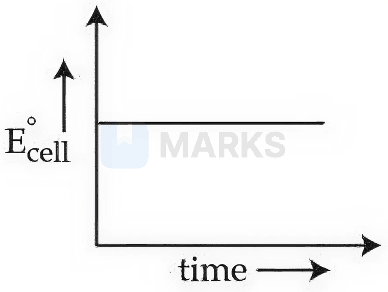
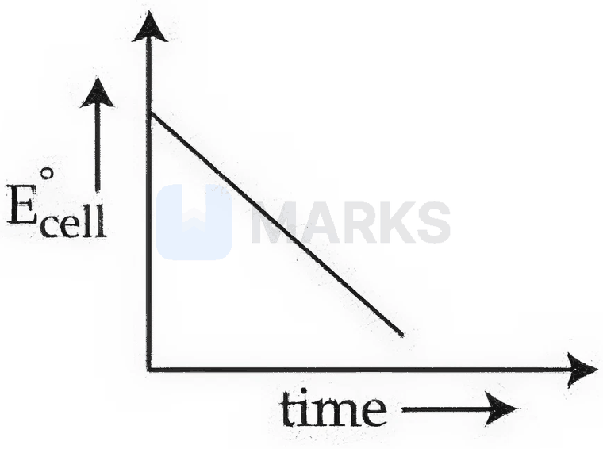
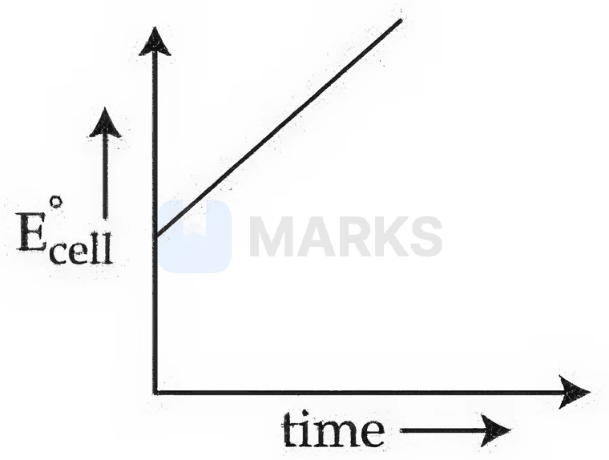
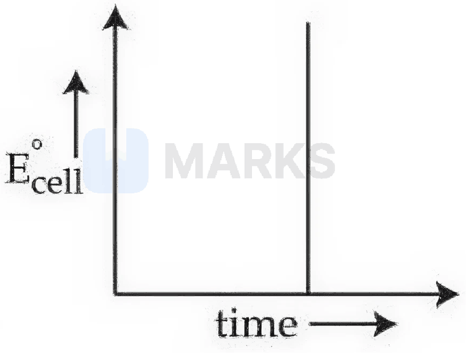
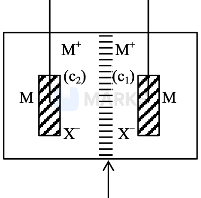

# Redox & Electrochemistry

> Theory: [../../theory/chemistry/electrochemistry.md](../../theory/chemistry/electrochemistry.md)

### C-ELC-01 · A — JEE Main 2026 · 21 Jan Shift 2 · set Q1 · MCQ

For a closed-circuit Daniell cell, which of the following plots is the accurate one at a given temperature?

**(1)** 

**(2)** 

**(3)** 

**(4)** 

**Answer: (1)** · key (compiled)

**Solution.** $E^\circ_{\text{cell}}$ is the emf under standard conditions (all concentrations 1 M); at a fixed temperature it is a constant of the cell reaction ($E^\circ = \frac{RT}{nF}\ln K$) and does not change as the cell runs. (The actual emf $E$ falls with time as $Q$ rises, but $E^\circ$ does not.) So the plot of $E^\circ_{\text{cell}}$ against time is a horizontal line – option (1).

### C-ELC-02 · A — JEE Main 2026 · 21 Jan Shift 2 · set Q2 · Numerical

$\mathrm{MX}$ is a sparingly soluble salt: $\mathrm{MX(s)\rightleftharpoons M^+(aq)+X^-(aq)}$, $K_{sp}=10^{-10}$ at 298 K. If the standard reduction potential for $\mathrm{M^+(aq)+e^-\to M(s)}$ is $E^\ominus_{\mathrm{M^+/M}}=0.79$ V, the standard reduction potential of the metal/metal-insoluble-salt electrode $\mathrm{X^-/MX(s)/M}$ is ______ mV (nearest integer).

[Given: $\frac{2.303RT}{F}=0.059$ V]

**Answer: 200** · key (compiled)

**Solution.** The electrode reaction $\mathrm{MX(s)+e^-\to M(s)+X^-}$ is the sum of $\mathrm{MX(s)\to M^+ + X^-}$ and $\mathrm{M^+ + e^-\to M}$. With $[\mathrm{X^-}]=1$ M, $[\mathrm{M^+}]=K_{sp}$, so $E^\ominus_{\mathrm{X^-/MX/M}}=E^\ominus_{\mathrm{M^+/M}}+0.059\log K_{sp}=0.79+0.059(-10)=0.20$ V $=200$ mV.

### C-ELC-03 · A — JEE Main 2026 · 23 Jan Shift 1 · set Q3 · MCQ

In the electrochemical cell $\mathrm{Ag(s)\,|\,AgCl(s)\,|\,FeCl_2(aq),FeCl_3(aq)\,|\,Pt(s)}$ at 298 K, the cell potential $E_{\text{cell}}$ will increase when:

A. Concentration of $\mathrm{Fe^{2+}}$ is increased.  
B. Concentration of $\mathrm{Fe^{3+}}$ is decreased.  
C. Concentration of $\mathrm{Fe^{2+}}$ is decreased.  
D. Concentration of $\mathrm{Fe^{3+}}$ is increased.  
E. Concentration of $\mathrm{Cl^-}$ is increased.

(1) B only  (2) A and E only  (3) C, D and E only  (4) A and B only

**Answer: (3)** · key (compiled)

**Solution.** Cell reaction: $\mathrm{Ag + Cl^- + Fe^{3+}\to AgCl + Fe^{2+}}$, so $Q=\dfrac{[\mathrm{Fe^{2+}}]}{[\mathrm{Fe^{3+}}][\mathrm{Cl^-}]}$ and $E=E^\circ-\frac{0.059}{1}\log Q$. $E$ rises when $Q$ falls: decrease $[\mathrm{Fe^{2+}}]$ (C), increase $[\mathrm{Fe^{3+}}]$ (D), increase $[\mathrm{Cl^-}]$ (E).

### C-ELC-04 · A — JEE Main 2026 · 28 Jan Shift 2 · set Q4 · Numerical

For a strong electrolyte, $\Lambda_m$ increases slowly with dilution and can be represented by $\Lambda_m=\Lambda_m^\circ-Ac^{1/2}$. Molar conductivity values of solutions of the strong electrolyte AB at $18^\circ$C are:

| $c$ (mol L$^{-1}$) | 0.04 | 0.09 | 0.16 | 0.25 |
|---|---|---|---|---|
| $\Lambda_m$ (S cm$^2$ mol$^{-1}$) | 96.1 | 95.7 | 95.3 | 94.9 |

The value of the constant $A$ based on the above data, in S cm$^2$ mol$^{-1}$/(mol L$^{-1}$)$^{1/2}$, is ______.

**Answer: 4** · key (compiled)

**Solution.** $\Lambda_m$ is linear in $\sqrt c$ with slope $-A$. $\sqrt c = 0.2, 0.3, 0.4, 0.5$ and $\Lambda_m$ falls by $0.4$ for every $0.1$ increase in $\sqrt c$, so slope $=\dfrac{94.9-96.1}{0.5-0.2}=-4$ and $A=4$.

### C-ELC-05 · A — JEE Main 2026 · 24 Jan Shift 2 · set Q6 · Numerical

The molar conductivity of a weak acid HQ of concentration 0.18 M was found to be $\tfrac1{30}$ of the molar conductivity of another weak acid HZ of concentration 0.02 M. If $\lambda^\circ_{\mathrm{Q^-}}$ happened to be equal to $\lambda^\circ_{\mathrm{Z^-}}$, the difference of the $\mathrm{p}K_a$ values of the two weak acids, $\mathrm{p}K_a(\mathrm{HQ})-\mathrm{p}K_a(\mathrm{HZ})$, is ______ (nearest integer).

[Given: degree of dissociation $\alpha\ll1$ for both weak acids; $\lambda^\circ$: limiting molar conductivity of ions]

**Answer: 2** · key (compiled)

**Solution.** Same $\Lambda^\circ$ for both acids, so $\Lambda_m=\alpha\Lambda^\circ$ gives $\alpha_Q=\alpha_Z/30$. For a weak acid ($\alpha\ll1$) $K_a=\alpha^2C$: $\dfrac{K_a(\mathrm{HZ})}{K_a(\mathrm{HQ})}=\dfrac{\alpha_Z^2(0.02)}{(\alpha_Z/30)^2(0.18)}=\dfrac{0.02\times900}{0.18}=100$. Hence $\mathrm{p}K_a(\mathrm{HQ})-\mathrm{p}K_a(\mathrm{HZ})=\log100=2$.

### C-ELC-06 · A — JEE Main 2026 · 22 Jan Shift 2 · set Q7 · MCQ

Consider the following reduction processes:

$\mathrm{Al^{3+}+3e^-\to Al(s)},\ E^0=-1.66$ V; $\mathrm{Fe^{3+}+e^-\to Fe^{2+}},\ E^0=+0.77$ V; $\mathrm{Co^{3+}+e^-\to Co^{2+}},\ E^0=+1.81$ V; $\mathrm{Cr^{3+}+3e^-\to Cr(s)},\ E^\circ=-0.74$ V

The tendency to act as a reducing agent decreases in the order:

(1) $\mathrm{Al>Cr>Fe^{2+}>Co^{2+}}$  (2) $\mathrm{Cr>Fe^{2+}>Al>Co^{2+}}$  (3) $\mathrm{Al>Fe^{2+}>Cr>Co^{2+}}$  (4) $\mathrm{Al>Cr>Co^{2+}>Fe^{2+}}$

**Answer: (1)** · key (compiled)

**Solution.** The reducing agents here are Al, Cr, $\mathrm{Fe^{2+}}$ and $\mathrm{Co^{2+}}$ (the reduced forms). The more negative the reduction potential of the couple, the stronger the reduced form is as a reducing agent: $-1.66<-0.74<+0.77<+1.81$, i.e. $\mathrm{Al>Cr>Fe^{2+}>Co^{2+}}$.

### C-ELC-07 · A — JEE Main 2026 · 22 Jan Shift 2 · set Q8 · Numerical

Consider the electrochemical cell: $\mathrm{Pt\,|\,O_2(g)(1\ bar)\,|\,HCl(aq)\,\|\,M^{2+}(aq,1.0\ M)\,|\,M(s)}$. The pH above which oxygen gas would start to evolve at the anode is ______ (nearest integer).

[Given: standard reduction potentials $E^o_{\mathrm{M^{2+}/M}}=0.994$ V, $E^o_{\mathrm{O_2/H_2O}}=1.23$ V; $\frac{2.303RT}{F}=0.059$ V]

**Answer: 4** · key (compiled)

**Solution.** Cathode: $E=0.994$ V. Anode couple $\mathrm{O_2+4H^++4e^-\to2H_2O}$: $E=1.23-\frac{0.059}{4}\log\frac{1}{[\mathrm{H^+}]^4}=1.23-0.059\,\mathrm{pH}$. Oxygen is evolved at the anode (the cell works spontaneously) once $E_{\text{cathode}}>E_{\text{anode}}$: $0.994>1.23-0.059\,\mathrm{pH}\Rightarrow\mathrm{pH}>\dfrac{0.236}{0.059}=4$.

### C-ELC-08 · A — JEE Main 2026 · 22 Jan Shift 1 · set Q9 · Numerical

Consider the following electrochemical cell at 298 K: $\mathrm{Pt\,|\,HSnO_2^-(aq)\,|\,Sn(OH)_6^{2-}(aq),OH^-(aq)\,|\,Bi_2O_3(s)\,|\,Bi(s)}$. If the reaction quotient at a given time is $10^6$, then the cell EMF ($E_{\text{cell}}$) is ______ $\times10^{-1}$ V (nearest integer).

Given the standard half-cell reduction potentials $E^\circ_{\mathrm{Bi_2O_3/Bi,OH^-}}=-0.44$ V and $E^\circ_{\mathrm{Sn(OH)_6^{2-}/HSnO_2^-,OH^-}}=-0.90$ V. [Take $\frac{2.303RT}{F}=0.059$ V]

**Answer: 4** · key (compiled)

**Solution.** Cathode (reduction): $\mathrm{Bi_2O_3+3H_2O+6e^-\to2Bi+6OH^-}$, $E^\circ=-0.44$ V. Anode (oxidation): $\mathrm{HSnO_2^-+H_2O+OH^-\to Sn(OH)_6^{2-}+2e^-}$ taken $\times3$, so the overall reaction transfers $n=6$ electrons. $E^\circ_{\text{cell}}=-0.44-(-0.90)=0.46$ V. $E=0.46-\dfrac{0.059}{6}\log10^6=0.46-0.059=0.401$ V $=4.01\times10^{-1}$ V, so the answer is 4.

### C-ELC-09 · A — JEE Main 2026 · 23 Jan Shift 2 · set Q10 · MCQ

Consider the above electrochemical cell where a metal electrode (M) is undergoing redox reaction by forming $\mathrm{M^+}$ ($\mathrm{M\to M^++e^-}$). The cation $\mathrm{M^+}$ is present in two different concentrations $c_1$ and $c_2$ as shown above. Which of the following statements is correct for generating a positive cell potential?

(1) If $c_1$ is present at the cathode, then $c_1<c_2$.  (2) If $c_1$ is present at the anode, then $c_1>c_2$.  (3) If $c_1$ is present at the cathode, then $c_1>c_2$.  (4) If $c_1$ is present at the anode, then $c_1=c_2$.

**Answer: (3)** · key (compiled)

**Solution.** Identical electrodes, so $E^\circ_{\text{cell}}=0$ and $E_{\text{cell}}=-\dfrac{0.059}{1}\log\dfrac{c_{\text{anode}}}{c_{\text{cathode}}}$. $E>0$ needs $c_{\text{cathode}}>c_{\text{anode}}$ (the cation is reduced in the more concentrated half-cell; the dilute half-cell dissolves metal). So if $c_1$ is at the cathode, $c_1>c_2$ – option (3).

### C-ELC-10 · A — JEE Main 2026 · 21 Jan Shift 1 · set Q11 · Numerical

The pH and conductance of a weak acid (HX) were found to be 5 and $4\times10^{-5}$ S, respectively. The conductance was measured under standard conditions using a cell whose electrode plates of surface area $1\ \text{cm}^2$ were 15 cm apart. The value of the limiting molar conductivity is ______ $\mathrm{S\,m^2\,mol^{-1}}$ (nearest integer). (Given: degree of dissociation $\alpha\ll1$)

**Answer: 6** · key (compiled)

**Solution.** Cell constant $l/A=15\ \text{cm}^{-1}$, so $\kappa=G\,(l/A)=4\times10^{-5}\times15=6\times10^{-4}\ \text{S cm}^{-1}$. $[\mathrm{H^+}]=C\alpha=10^{-5}$ M. For $\alpha\ll1$: $\Lambda_m^\circ\approx\dfrac{\Lambda_m}{\alpha}=\dfrac{1000\,\kappa}{C\alpha}=\dfrac{1000\times6\times10^{-4}}{10^{-5}}=6\times10^{4}\ \text{S cm}^2\text{mol}^{-1}=6\ \text{S m}^2\text{mol}^{-1}$.

### C-ELC-11 · A — JEE Main 2026 · 28 Jan Shift 1 · set Q12 · Numerical

Consider the following redox reaction taking place in acidic medium: $\mathrm{BH_4^-(aq)+ClO_3^-(aq)\to H_2BO_3^-(aq)+Cl^-(aq)}$. If the Nernst equation for the above balanced reaction is $E_{\text{cell}}=E^\circ_{\text{cell}}-\dfrac{RT}{nF}\ln Q$, then the value of $n$ is ______ (nearest integer).

**Answer: 24** · key (compiled)

**Solution.** B stays at $+3$ in both $\mathrm{BH_4^-}$ and $\mathrm{H_2BO_3^-}$; the four H change from $-1$ to $+1$: $4\times2=8$ electrons lost per $\mathrm{BH_4^-}$. $\mathrm{Cl}$: $+5\to-1$ gains 6 electrons per $\mathrm{ClO_3^-}$. LCM of 8 and 6 is 24: $3\,\mathrm{BH_4^-}+4\,\mathrm{ClO_3^-}\to\ldots$, so $n=24$.

### C-ELC-12 · A — JEE Main 2026 · 24 Jan Shift 1 · set Q13 · Numerical

Electricity is passed through an acidic solution of $\mathrm{Cu^{2+}}$ till all the $\mathrm{Cu^{2+}}$ is exhausted, leading to the deposition of 300 mg of Cu metal. However, a current of 600 mA is continued to pass through the same solution for another 28 minutes, the total volume of the solution being fixed at 200 mL. The total volume of oxygen evolved at STP during the entire process is ______ mL (nearest integer).

[Given: $\mathrm{Cu^{2+}+2e^-\to Cu}$, $E^o_{\text{red}}=+0.34$ V; $\mathrm{O_2+4H^++4e^-\to2H_2O}$, $E^o_{\text{red}}=+1.23$ V; molar mass Cu $=63.54$, $\mathrm{O_2}=32$ g mol$^{-1}$; $F=96500$ C mol$^{-1}$; molar volume at STP $=22.4$ L]

**Answer: 111** · key (compiled)

**Solution.** Anode reaction throughout: $2\mathrm{H_2O}\to\mathrm{O_2}+4\mathrm{H^+}+4e^-$. Phase 1 (Cu deposition): $n_{e^-}=2\times\dfrac{0.300}{63.54}=9.44\times10^{-3}$ mol. Phase 2 (water electrolysis): $n_{e^-}=\dfrac{0.6\times28\times60}{96500}=1.045\times10^{-2}$ mol. Total $n_{e^-}=1.989\times10^{-2}$ mol, so $n_{\mathrm{O_2}}=\dfrac{1.989\times10^{-2}}{4}=4.97\times10^{-3}$ mol and $V=4.97\times10^{-3}\times22400\approx111$ mL.

### C-ELC-13 · A — JEE Main 2026 · 24 Jan Shift 2 · Redox set Q1 · MCQ

One mole of $\mathrm{Cl_2(g)}$ was passed into 2 L of cold 2 M KOH solution. After the reaction, the concentrations of $\mathrm{Cl^-}$, $\mathrm{ClO^-}$ and $\mathrm{OH^-}$ are respectively (assume the volume remains constant):

(1) 0.5 M, 0.5 M, 1 M  (2) 0.75 M, 0.75 M, 1 M  (3) 0.5 M, 0.5 M, 0.5 M  (4) 1 M, 1 M, 1 M

**Answer: (1)** · key (compiled)

**Solution.** Cold dilute alkali: $\mathrm{Cl_2+2OH^-\to Cl^-+ClO^-+H_2O}$ (disproportionation). $\mathrm{OH^-}$ available $=2\ \text{L}\times2\ \text{M}=4$ mol; 1 mol $\mathrm{Cl_2}$ uses 2 mol and gives 1 mol $\mathrm{Cl^-}$ and 1 mol $\mathrm{ClO^-}$. In 2 L: $[\mathrm{Cl^-}]=[\mathrm{ClO^-}]=0.5$ M and $[\mathrm{OH^-}]=\dfrac{4-2}{2}=1$ M.

### C-ELC-14 · A — JEE Main 2026 · 23 Jan Shift 2 · Redox set Q3 · Numerical

$200\ \text{cc}$ of $x\times10^{-3}$ M potassium dichromate is required to oxidise 750 cc of 0.6 M Mohr's salt solution in acidic medium. Here $x=$ ______.

**Answer: 375** · key (compiled)

**Solution.** $\mathrm{Cr_2O_7^{2-}+14H^++6Fe^{2+}\to2Cr^{3+}+6Fe^{3+}+7H_2O}$. Moles of $\mathrm{Fe^{2+}}=0.6\times0.750=0.45$ mol, which needs $\dfrac{0.45}{6}=0.075$ mol dichromate. Molarity $=\dfrac{0.075}{0.200}=0.375\ \text{M}=375\times10^{-3}$ M, so $x=375$.

### C-ELC-15 · A — JEE Main 2026 · 28 Jan Shift 1 · Redox set Q4 · Numerical

500 mL of 1.2 M KI solution is mixed with 500 mL of 0.2 M $\mathrm{KMnO_4}$ solution in basic medium. The liberated iodine was titrated with standard 0.1 M $\mathrm{Na_2S_2O_3}$ solution in the presence of starch indicator till the blue colour disappeared. The volume (in L) of $\mathrm{Na_2S_2O_3}$ consumed is ______ (nearest integer).

**Answer: 3** · key (compiled)

**Solution.** In basic medium $\mathrm{MnO_4^-+2H_2O+3e^-\to MnO_2+4OH^-}$ ($n$-factor 3), and $\mathrm{I^-}$ is oxidised to $\mathrm{I_2}$. $\mathrm{KMnO_4}$: $0.5\times0.2=0.1$ mol $=0.3$ eq, which is limiting against $0.6$ mol KI. So 0.3 mol of electrons go to $\mathrm{I^-}$, giving $0.15$ mol $\mathrm{I_2}$. $\mathrm{I_2+2S_2O_3^{2-}\to2I^-+S_4O_6^{2-}}$ needs $0.3$ mol thiosulphate, $V=\dfrac{0.3}{0.1}=3$ L.

### C-ELC-16 · A — JEE Main 2025 · Jan session · Elec set Q1 · MCQ

Standard electrode potentials for a few half cells are: $E^\circ_{Cu^{2+}/Cu}=0.34$ V, $E^\circ_{Zn^{2+}/Zn}=-0.76$ V, $E^\circ_{Ag^+/Ag}=0.80$ V, $E^\circ_{Mg^{2+}/Mg}=-2.37$ V. Which one of the following cells gives the most negative value of $\Delta G^\circ$?

(1) Zn|Zn$^{2+}$(1M)||Ag$^+$(1M)|Ag  (2) Zn|Zn$^{2+}$(1M)||Mg$^{2+}$(1M)|Mg  (3) Ag|Ag$^+$(1M)||Mg$^{2+}$(1M)|Mg  (4) Cu|Cu$^{2+}$(1M)||Ag$^+$(1M)|Ag

**Answer: (1)** · key (compiled)

**Solution.** $\Delta G^\circ=-nFE^\circ_{cell}$, so the most negative value goes with the largest cell potential. (1) $0.80-(-0.76)=1.56$ V; (4) $0.80-0.34=0.46$ V; (2) and (3) are negative potentials (non-spontaneous as written). Largest is (1).

### C-ELC-17 · B — JEE Advanced 2025 · Paper 1 · Q8 · Numerical

In an electrochemical cell, dichromate ions in aqueous acidic medium are reduced to $\text{Cr}^{3+}$. The current (in amperes) flowing for $48.25$ minutes to produce $1$ mole of $\text{Cr}^{3+}$ is ______. ($1\ \text{F}=96500\ \text{C mol}^{-1}$)

**Answer: 100** · official key ✔ (re-derived)

**Solution.** $\text{Cr}^{6+}\to\text{Cr}^{3+}$ needs $3$ electrons per Cr, so $1$ mol of $\text{Cr}^{3+}$ needs $3\text{ F}=289500$ C. $t=48.25\times60=2895$ s. $I=\dfrac{289500}{2895}=100$ A.

### C-ELC-18 · B — JEE Main 2025 · Jan session · Elec set Q2 · MCQ

For Mg|Mg$^{2+}$(aq)||Ag$^+$(aq)|Ag the correct Nernst equation is:

(1) $E_{cell}=E^\circ_{cell}-\dfrac{RT}{2F}\ln\dfrac{[Ag^+]}{[Mg^{2+}]}$  (2) $E_{cell}=E^\circ_{cell}+\dfrac{RT}{2F}\ln\dfrac{[Ag^+]^2}{[Mg^{2+}]}$  (3) $E_{cell}=E^\circ_{cell}-\dfrac{RT}{2F}\ln\dfrac{[Ag^+]^2}{[Mg^{2+}]}$  (4) $E_{cell}=E^\circ_{cell}-\dfrac{RT}{2F}\ln\dfrac{[Mg^{2+}]}{[Ag^+]}$

**Answer: (2)** · key (compiled)

**Solution.** Cell reaction: Mg + 2Ag$^+$ → Mg$^{2+}$ + 2Ag, $n=2$, $Q=\dfrac{[Mg^{2+}]}{[Ag^+]^2}$. $E=E^\circ-\dfrac{RT}{2F}\ln\dfrac{[Mg^{2+}]}{[Ag^+]^2}=E^\circ+\dfrac{RT}{2F}\ln\dfrac{[Ag^+]^2}{[Mg^{2+}]}$.

### C-ELC-19 · B — JEE Main 2025 · Jan session · Elec set Q4 · MCQ

A solution of aluminium chloride is electrolysed for 30 minutes using a current of 2 A. The amount of aluminium deposited at the cathode is: [Given: molar mass of Al and Cl are 27 and 35.5 g mol$^{-1}$; Faraday constant $=96500$ C mol$^{-1}$]

(1) 1.660 g  (2) 0.336 g  (3) 0.441 g  (4) 1.007 g

**Answer: (2)** · key (compiled)

**Solution.** $Q=It=2\times1800=3600$ C. Al$^{3+}$ + 3e$^-$ → Al, so $m=\dfrac{M}{3F}Q=\dfrac{27\times3600}{3\times96500}=0.336$ g.

### C-ELC-20 · B — JEE Main 2025 · Jan session · Elec set Q5 · MCQ

FeO$_4^{2-}\xrightarrow{+2.0\text{ V}}$ Fe$^{3+}$ $\xrightarrow{0.8\text{ V}}$ Fe$^{2+}$ $\xrightarrow{-0.5\text{ V}}$ Fe$^0$. In the above diagram, the standard electrode potentials are given in volts over the arrows. The value of $E^\circ_{FeO_4^{2-}/Fe^{2+}}$ is:

(1) 2.1 V  (2) 1.7 V  (3) 1.4 V  (4) 1.2 V

**Answer: (2)** · key (compiled)

**Solution.** Add $\Delta G^\circ=-nFE^\circ$ over the steps: FeO$_4^{2-}\to$Fe$^{3+}$ ($n=3$, 2.0 V) and Fe$^{3+}\to$Fe$^{2+}$ ($n=1$, 0.8 V). $E^\circ=\dfrac{3(2.0)+1(0.8)}{4}=1.7$ V.

### C-ELC-21 · B — JEE Main 2025 · Jan session · Elec set Q6 · MCQ

For the cell Fe$^{2+}$(aq) + Ag$^+$(aq) → Fe$^{3+}$(aq) + Ag(s), given Ag$^+$ + e$^-$ → Ag, $E^\theta=x$ V; Fe$^{2+}$ + 2e$^-$ → Fe, $E^\theta=y$ V; Fe$^{3+}$ + 3e$^-$ → Fe, $E^\theta=z$ V. The standard cell potential of the above reaction is:

(1) $x+y-z$  (2) $x+2y$  (3) $x+2y-3z$  (4) $y-2x$

**Answer: (3)** · key (compiled)

**Solution.** Fe$^{3+}$ + e$^-$ → Fe$^{2+}$ is (Fe$^{3+}$→Fe) minus (Fe$^{2+}$→Fe): $\Delta G=-3zF+2yF=-1\cdot E^\circ_{Fe^{3+}/Fe^{2+}}F$, so $E^\circ_{Fe^{3+}/Fe^{2+}}=3z-2y$. Cell potential $=E^\circ_{cathode}-E^\circ_{anode}=x-(3z-2y)=x+2y-3z$.

### C-ELC-22 · B — JEE Main 2025 · Jan session · Elec set Q7 · MCQ

Based on the data given below: $E^\circ_{Cr_2O_7^{2-}/Cr^{3+}}=1.33$ V, $E^\circ_{Cl_2/Cl^-}=1.36$ V, $E^\circ_{MnO_4^-/Mn^{2+}}=1.51$ V, $E^\circ_{Cr^{3+}/Cr}=-0.74$ V; the strongest reducing agent is:

(1) Cr  (2) Cl$^-$  (3) MnO$_4^-$  (4) Mn$^{2+}$

**Answer: (1)** · key (compiled)

**Solution.** The strongest reducing agent is the reduced form of the couple with the lowest (most negative) reduction potential: $Cr^{3+}/Cr$ at $-0.74$ V, i.e. Cr.

### C-ELC-23 · B — JEE Main 2025 · Apr session · Elec set Q2 · MCQ

The standard cell potential ($E^\ominus_{cell}$) of a fuel cell based on the oxidation of methanol in air that has been used to power television relay stations is measured as 1.21 V. The standard half-cell reduction potential for O$_2$ ($E^\circ_{O_2/H_2O}$) is 1.229 V. Choose the correct statement:

(1) The standard half-cell reduction potential for the reduction of CO$_2$ ($E^\circ_{CO_2/CH_3OH}$) is 19 mV  (2) Oxygen is formed at the anode.  (3) Reactants are fed at one go to each electrode.  (4) Reduction of methanol takes place at the cathode.

**Answer: (1)** · key (compiled)

**Solution.** In the methanol–air fuel cell, O$_2$ is reduced at the cathode and methanol is oxidised at the anode, so (2) and (4) are false; the reactants are fed continuously, not "at one go" (3 false). $E^\circ_{cell}=E^\circ_{cathode}-E^\circ_{anode}\Rightarrow E^\circ_{CO_2/CH_3OH}=1.229-1.21=0.019$ V $=19$ mV.

### C-ELC-24 · B — JEE Main 2025 · Apr session · Elec set Q4 · MCQ

Given below are two statements: 1 M aqueous solution of each of Cu(NO$_3$)$_2$, AgNO$_3$, Hg$_2$(NO$_3$)$_2$ and Mg(NO$_3$)$_2$ are electrolysed using inert electrodes. Given: $E^\theta_{Ag^+/Ag}=0.80$ V, $E^\theta_{Hg_2^{2+}/Hg}=0.79$ V, $E^\theta_{Cu^{2+}/Cu}=0.24$ V and $E^\theta_{Mg^{2+}/Mg}=-2.37$ V.

Statement I: With increasing voltage, the sequence of deposition of metals on the cathode will be Ag, Hg and Cu.  
Statement II: Magnesium will not be deposited at the cathode; instead, oxygen gas will be evolved at the cathode.

In the light of the above statements, choose the most appropriate answer.

(1) Both statements I and II are incorrect  (2) Statement I is correct but statement II is incorrect  (3) Both statements I and II are correct  (4) Statement I is incorrect but statement II is correct

**Answer: (2)** · key (compiled)

**Solution.** Metal ions with higher reduction potential are reduced first as the voltage is raised: Ag (0.80) > Hg (0.79) > Cu (0.24), so Statement I is correct. Mg$^{2+}$ ($-2.37$ V) is not reduced in water; instead water is reduced at the cathode to give H$_2$ gas (O$_2$ is evolved at the anode, not the cathode), so Statement II is incorrect.

### C-ELC-25 · B — JEE Main 2025 · Apr session · Elec set Q5 · Numerical

Consider the following half-cell reaction: Cr$_2$O$_7^{2-}$(aq) + 6e$^-$ + 14H$^+$(aq) → 2Cr$^{3+}$(aq) + 7H$_2$O(l). The reaction was conducted with the ratio $\dfrac{[Cr^{3+}]^2}{[Cr_2O_7^{2-}]}=10^{-6}$. The pH value at which the EMF of the half cell will become zero is ______. (nearest integer) [Given: $E^\circ_{Cr_2O_7^{2-},H^+/Cr^{3+}}=1.33$ V, $\dfrac{2.303RT}F=0.059$ V]

**Answer: 10** · key (compiled)

**Solution.** $E=E^\circ-\dfrac{0.059}6\log\dfrac{[Cr^{3+}]^2}{[Cr_2O_7^{2-}][H^+]^{14}}=1.33-\dfrac{0.059}6\left(-6+14\,pH\right)=0$. So $14\,pH-6=\dfrac{1.33\times6}{0.059}=135.2$, giving $pH=10.1\approx10$.

### C-ELC-26 · B — JEE Main 2025 · Apr session · Elec set Q8 · MCQ

The correct order of limiting molar conductivity for cations in water at 298 K is:

(1) H$^+$ > Na$^+$ > K$^+$ > Ca$^{2+}$ > Mg$^{2+}$  (2) H$^+$ > Ca$^{2+}$ > Mg$^{2+}$ > K$^+$ > Na$^+$  (3) Mg$^{2+}$ > H$^+$ > Ca$^{2+}$ > K$^+$ > Na$^+$  (4) H$^+$ > Na$^+$ > Ca$^{2+}$ > Mg$^{2+}$ > K$^+$

**Answer: (2)** · key (compiled)

**Solution.** Limiting ionic conductivities (S cm$^2$ mol$^{-1}$): H$^+$ 349.8 (Grotthuss hopping), Ca$^{2+}$ 119, Mg$^{2+}$ 106, K$^+$ 73.5, Na$^+$ 50.1. Divalent ions conduct more than the monovalent K$^+$ and Na$^+$, and among the monovalent ions the smaller Na$^+$ is more heavily hydrated and slower than K$^+$.

### C-ELC-27 · B — JEE Main 2025 · Apr session · Elec set Q9 · Numerical

The molar conductance of an infinitely dilute solution of ammonium chloride was found to be 185 S cm$^2$ mol$^{-1}$ and the ionic conductances of hydroxyl and chloride ions are 170 and 70 S cm$^2$ mol$^{-1}$ respectively. If the molar conductance of 0.02 M solution of ammonium hydroxide is 85.5 S cm$^2$ mol$^{-1}$, its degree of dissociation is given by $x\times10^{-1}$. The value of $x$ is ______. (Nearest integer)

**Answer: 3** · key (compiled)

**Solution.** $\lambda^\circ_{NH_4^+}=185-70=115$, so $\Lambda^\circ_{NH_4OH}=115+170=285$ S cm$^2$ mol$^{-1}$. $\alpha=\dfrac{\Lambda_m}{\Lambda^\circ}=\dfrac{85.5}{285}=0.3=3\times10^{-1}$, so $x=3$.

### C-ELC-28 · B — JEE Main 2025 · Apr session · Elec set Q10 · MCQ

Given below are two statements:

Statement I: Mohr's salt is composed of only three types of ions: ferrous, ammonium and sulphate.  
Statement II: If the molar conductance at infinite dilution of ferrous, ammonium and sulphate ions are $x_1$, $x_2$ and $x_3$ S cm$^2$ mol$^{-1}$ respectively, then the molar conductance for Mohr's salt solution at infinite dilution would be given by $x_1+x_2+2x_3$.

In the light of the above statements, choose the correct answer.

(1) Both statements I and II are false  (2) Statement I is false but statement II is true  (3) Statement I is true but statement II is false  (4) Both statements I and II are true

**Answer: (3)** · key (compiled)

**Solution.** Mohr's salt, FeSO$_4$·(NH$_4$)$_2$SO$_4$·6H$_2$O, gives Fe$^{2+}$, NH$_4^+$ and SO$_4^{2-}$ ions only (Statement I true). Per formula unit there is 1 Fe$^{2+}$, 2 NH$_4^+$ and 2 SO$_4^{2-}$, so $\Lambda^\circ=x_1+2x_2+2x_3$; Statement II is false.

### C-ELC-29 · B — JEE Main 2024 · 27 Jan Shift 1 · Q58 · Numerical

The mass of silver (molar mass $108\ \text{g mol}^{-1}$) displaced by the quantity of electricity that displaces $5600$ mL of $\text{O}_2$ at STP is ______ g.

**Answer: 108** · key ✔

**Solution.** $5600$ mL $=0.25$ mol $\text{O}_2$, and each $\text{O}_2$ needs $4e^-$, so charge $=1$ mol $e^-$. One mole of electrons deposits $1$ mol Ag ($\text{Ag}^++e^-\to\text{Ag}$) $=108$ g.

### C-ELC-30 · C — JEE Main 2024 · 27 Jan Shift 2 · Q31 · MCQ

Which of the following cannot function as an oxidising agent?

(1) $\text{N}^{3-}$  (2) $\text{SO}_4^{2-}$  (3) $\text{BrO}_3^-$  (4) $\text{MnO}_4^-$

**Answer: (1)** · key ✔

**Solution.** An oxidising agent must be reducible. $\text{N}^{3-}$ has nitrogen in its lowest oxidation state ($-3$) and can only be oxidised. In $\text{SO}_4^{2-}$ (S: $+6$), $\text{BrO}_3^-$ (Br: $+5$) and $\text{MnO}_4^-$ (Mn: $+7$) the central atom can be reduced.

### C-ELC-31 · C — JEE Main 2024 · 29 Jan Shift 1 · Q34 · MCQ

Chlorine undergoes disproportionation in alkaline medium: $a\,\text{Cl}_2(g)+b\,\text{OH}^-(aq)\to c\,\text{ClO}^-(aq)+d\,\text{Cl}^-(aq)+e\,\text{H}_2\text{O}(l)$. The values of $a,b,c$ and $d$ in the balanced equation are respectively

(1) 1, 2, 1 and 1  (2) 2, 2, 1 and 3  (3) 3, 4, 4 and 2  (4) 2, 4, 1 and 3

**Answer: (1)** · key ✔

**Solution.** In $\text{Cl}_2$ one chlorine atom goes $0\to+1$ (losing $1e^-$) and the other goes $0\to-1$ (gaining $1e^-$), so $1$ mol of $\text{Cl}_2$ gives $1$ mol each of $\text{ClO}^-$ and $\text{Cl}^-$. Balancing charge with $\text{OH}^-$ and hydrogen with water: $\text{Cl}_2+2\text{OH}^-\to\text{ClO}^-+\text{Cl}^-+\text{H}_2\text{O}$. Hence $a=1,b=2,c=1,d=1$ (and $e=1$).

### C-ELC-32 · C — JEE Main 2024 · 31 Jan Shift 2 · Q36 · MCQ

Statement I: $\text{S}_8$ (solid) undergoes a disproportionation reaction under alkaline conditions to form $\text{S}^{2-}$ and $\text{S}_2\text{O}_3^{2-}$.  
Statement II: $\text{ClO}_4^-$ can undergo a disproportionation reaction under acidic conditions.

(1) I correct, II incorrect  (2) I incorrect, II correct  (3) Both incorrect  (4) Both correct

**Answer: (1)** · key ✔

**Solution.** I is true: $\text{S}_8+12\text{OH}^-\to4\text{S}^{2-}+2\text{S}_2\text{O}_3^{2-}+6\text{H}_2\text{O}$ (S goes from $0$ to $-2$ and $+2$). In $\text{ClO}_4^-$ chlorine is already in its maximum oxidation state $+7$ and can only be reduced, so it cannot disproportionate: II is false.

### C-ELC-33 · C — JEE Main 2024 · 1 Feb Shift 1 · Q36 · MCQ

Which of the following reactions are disproportionation reactions?  
1. $\text{Cu}^+\to \text{Cu}^{2+}+\text{Cu}$  
2. $3\text{MnO}_4^{2-}+4\text{H}^+\to 2\text{MnO}_4^-+\text{MnO}_2+2\text{H}_2\text{O}$  
3. $2\text{KMnO}_4\to \text{K}_2\text{MnO}_4+\text{MnO}_2+\text{O}_2$  
4. $2\text{MnO}_4^-+3\text{Mn}^{2+}+2\text{H}_2\text{O}\to 5\text{MnO}_2+4\text{H}^+$

(1) 1, 2  (2) 2, 3, 4  (3) 1, 2, 4  (4) 1, 4

**Answer: (1)** · key ✔

**Solution.** A disproportionation has one species of one element going both up and down in oxidation state. (1) $\text{Cu}^{+}\to \text{Cu}^{2+}$ and $\text{Cu}^0$: yes. (2) $\text{Mn}(+6)\to +7$ and $+4$: yes. (3) $\text{Mn}(+7)$ is only reduced (to $+6$ and $+4$); oxygen is the oxidised species: not a disproportionation. (4) $\text{Mn}(+7)$ and $\text{Mn}(+2)$ both go to $+4$: comproportionation. So 1, 2.

### C-ELC-34 · C — JEE Main 2024 · 4 Apr Shift 2 · Q42 · MCQ

For a strong electrolyte, a plot of molar conductivity against $c^{1/2}$ is a straight line with negative slope. The correct unit of the slope is:

(1) $\text{S cm}^2\text{mol}^{-3/2}\text{L}^{-1/2}$  (2) $\text{S cm}^2\text{mol}^{-3/2}\text{L}^{1/2}$  (3) $\text{S cm}^2\text{mol}^{-3/2}\text{L}$  (4) $\text{S cm}^2\text{mol}^{-1}\text{L}^{1/2}$

**Answer: (2)** · key ✔

**Solution.** Debye–Hückel–Onsager: $\Lambda_m=\Lambda_m^\circ-A\sqrt c$. The unit of $A$ is $\dfrac{\text{S cm}^2\text{mol}^{-1}}{(\text{mol L}^{-1})^{1/2}}=\text{S cm}^2\text{mol}^{-3/2}\text{L}^{1/2}$.

### C-ELC-35 · C — JEE Main 2024 · 5 Apr Shift 1 · Q42 · MCQ

The reaction at the cathode in the cells commonly used in clocks involves:

(1) reduction of Mn from $+7$ to $+2$  (2) reduction of Mn from $+4$ to $+3$  (3) oxidation of Mn from $+3$ to $+4$  (4) oxidation of Mn from $+2$ to $+7$

**Answer: (2)** · key ✔

**Solution.** In the dry (Leclanché/alkaline) cell used in clocks, the cathode reaction is $\text{MnO}_2+\text{NH}_4^++e^-\to\text{MnO(OH)}+\text{NH}_3$: Mn is reduced from $+4$ to $+3$.

### C-ELC-36 · C — JEE Main 2024 · 5 Apr Shift 2 · Q41 · MCQ

The quantity of silver deposited when one coulomb of charge is passed through $\text{AgNO}_3$ solution is:

(1) 1 g of silver  (2) 1 electrochemical equivalent of silver  (3) 1 chemical equivalent of silver  (4) 0.1 g atom of silver

**Answer: (2)** · key ✔

**Solution.** By Faraday's first law $m=ZQ$, where $Z$ is the electrochemical equivalent, the mass deposited by $1$ C. So the answer is $1$ electrochemical equivalent ($Z_{Ag}=1.118\times10^{-3}$ g/C).

### C-ELC-37 · C — JEE Main 2024 · 6 Apr Shift 2 · Q33 · MCQ

Match the reaction with the type of redox reaction: (A) $\text{N}_2+\text{O}_2\to2\text{NO}$; (B) $2\text{Pb(NO}_3)_2\to2\text{PbO}+4\text{NO}_2+\text{O}_2$; (C) $2\text{Na}+2\text{H}_2\text{O}\to2\text{NaOH}+\text{H}_2$; (D) $2\text{NO}_2+2\text{OH}^-\to\text{NO}_2^-+\text{NO}_3^-+\text{H}_2\text{O}$. (I) decomposition, (II) displacement, (III) disproportionation, (IV) combination.

(1) A-II, B-III, C-IV, D-I  (2) A-III, B-II, C-I, D-IV  (3) A-IV, B-I, C-II, D-III  (4) A-I, B-II, C-III, D-IV

**Answer: (3)** · key ✔

**Solution.** A: two elements combine: combination (IV). B: one compound splits into several: decomposition (I). C: Na displaces H from water: displacement (II). D: $\text{N}(+4)$ goes to $+3$ and $+5$: disproportionation (III).

### C-ELC-38 · C — JEE Main 2024 · 9 Apr Shift 1 · Q40 · MCQ

The molar conductivities of electrolytes A and B are plotted against $c^{1/2}$: A falls from $130$ ($c^{1/2}=0.2$) to $55$ ($0.4$) and B from $150$ to $120$. Electrolytes A and B respectively are:

(1) A strong, B weak  (2) both weak  (3) A weak, B strong  (4) both strong

**Answer: (3)** · key ✔

**Solution.** A strong electrolyte shows a gentle, nearly linear fall of $\Lambda_m$ with $\sqrt c$ (Debye–Hückel–Onsager). A weak electrolyte shows a sharp fall because the degree of dissociation drops quickly on concentration. A falls steeply: weak; B falls gently: strong.

