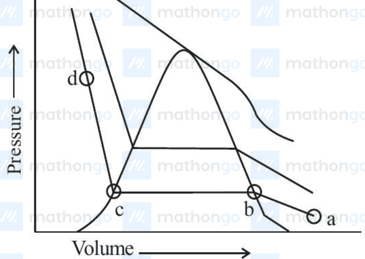
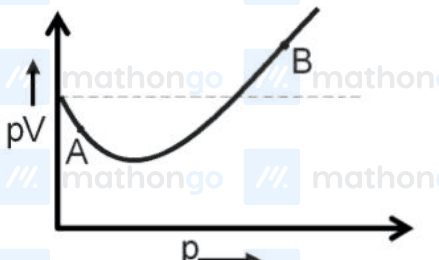

# Gaseous State

> Theory: [../../theory/chemistry/gaseous-state.md](../../theory/chemistry/gaseous-state.md)

### C-GAS-01 · C — JEE Advanced 2025 · Paper 1 · Q10 · Numerical

The van der Waals equation can be written as a cubic in $V_m$. For a gas with $a=6.0\ \text{dm}^6\text{atm mol}^{-2}$ and $b=0.060\ \text{dm}^3\text{mol}^{-1}$ at $300$ K and $300$ atm, the ratio (in mol dm$^{-3}$) of the coefficient of $V_m^2$ to the coefficient of $V_m$ is ______. ($R=0.082\ \text{dm}^3\text{atm mol}^{-1}\text{K}^{-1}$)

**Answer: −7.1** (accepted range $-7.2$ to $-7$) · official key ✔ (re-derived)

**Solution.** $\left(P+\dfrac a{V_m^2}\right)(V_m-b)=RT\Rightarrow PV_m^3-(Pb+RT)V_m^2+aV_m-ab=0$. The ratio of the $V_m^2$ coefficient to the $V_m$ coefficient is $-\dfrac{Pb+RT}{a}=-\dfrac{300(0.06)+0.082(300)}{6.0}=-\dfrac{18+24.6}{6}=-7.1$.

### C-GAS-02 · C — JEE Main 2023 · 24 Jan Shift 2 · Gas set Q2 · Numerical

The number of statement(s) which are correct with respect to the compression of carbon dioxide from point (a) in the Andrews isotherm from the following is ______.

A. Carbon dioxide remains as a gas up to point (b).  
B. Liquid carbon dioxide appears at point (c).  
C. Liquid and gaseous carbon dioxide coexist between points (b) and (c).  
D. As the volume decreases from (b) to (c), the amount of liquid decreases.

**Answer: 2** · key (compiled)

**Solution.** At (a) CO$_2$ is a gas; on compression, liquefaction starts at (b) and is complete at (c). So (A) is true (it stays a gas up to b); (B) is false (liquid first appears at b, not c); (C) is true (gas and liquid coexist between b and c); (D) is false (the amount of liquid increases from b to c). Two statements are correct.

### C-GAS-03 · C — JEE Main 2023 · 29 Jan Shift 1 · Gas set Q3 · MCQ

For 1 mol of a gas, the plot of $pV$ vs $p$ is shown below. $p$ is the pressure and $V$ is the volume of the gas. What is the value of the compressibility factor at point A?

(1) $1-\dfrac a{RTV}$  (2) $1+\dfrac bV$  (3) $1-\dfrac bV$  (4) $1+\dfrac a{RTV}$

**Answer: (1)** · key (compiled)

**Solution.** At point A, $pV<RT$, so $Z=\dfrac{pV}{RT}<1$. Attractive forces dominate there; from the van der Waals equation $\left(p+\dfrac a{V^2}\right)(V-b)=RT$ with $b$ neglected at low pressure, $pV=RT-\dfrac aV$, so $Z=1-\dfrac a{RTV}$.

