# General Organic Chemistry

> Theory: [../../theory/chemistry/goc.md](../../theory/chemistry/goc.md)

### C-GOC-01 · A — JEE Main 2026 · 21 Jan Shift 2 · GOC set Q3 · MCQ

Given below are two statements:

Statement I: Compound (X), shown below, dissolves in $\mathrm{NaHCO_3}$ solution and has two chiral carbon atoms.  
Statement II: Compound (Y), shown below, has two carbons with $sp^3$ hybridisation, one carbon with $sp^2$ and one carbon with $sp$ hybridisation.

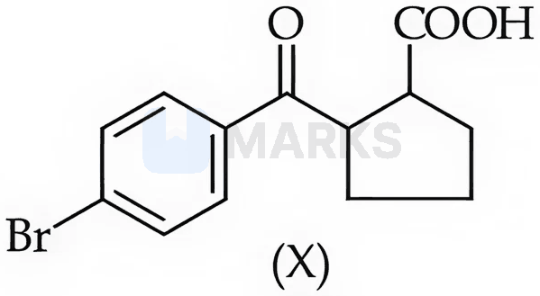

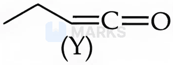

(1) Both Statement I and Statement II are false  (2) Statement I is false but Statement II is true  (3) Statement I is true but Statement II is false  (4) Both Statement I and Statement II are true

**Answer: (4)** · key (compiled)

**Solution.** (X) is a carboxylic acid ($-\mathrm{COOH}$), which is acidic enough ($\mathrm{p}K_a\approx4$) to react with $\mathrm{NaHCO_3}$ and dissolve; the ring carbon bearing $-\mathrm{COOH}$ and the ring carbon bearing the aroyl group are both stereocentres (two chiral carbons) – I true. (Y) is ethylketene, $\mathrm{CH_3CH_2CH{=}C{=}O}$: $\mathrm{CH_3}$ and $\mathrm{CH_2}$ are $sp^3$, $=\mathrm{CH}-$ is $sp^2$ and the central ketene carbon is $sp$ – II true.

### C-GOC-02 · A — JEE Main 2026 · 28 Jan Shift 2 · GOC set Q5 · MCQ

The cyclic cations having the same number of hyperconjugation structures (the same number of $\alpha$-hydrogens) are:

Choose the correct answer:

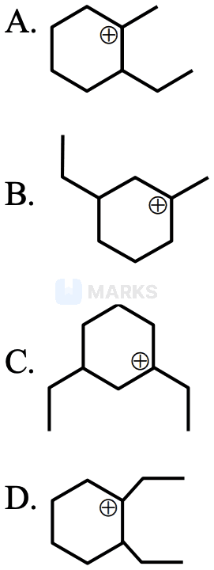

(1) A, C and D only  (2) A and B only  (3) A and C only  (4) B and C only

**Answer: (3)** · key (compiled)

**Solution.** Count the $\alpha$-H on the carbons adjacent to $\mathrm{C^+}$. A: $\mathrm{CH_3}$ (3) + ring CH bearing ethyl (1) + ring $\mathrm{CH_2}$ (2) = 6. B: $\mathrm{CH_3}$ (3) + two ring $\mathrm{CH_2}$ (2+2) = 7. C: ethyl $\mathrm{CH_2}$ (2) + two ring $\mathrm{CH_2}$ (2+2) = 6. D: ethyl $\mathrm{CH_2}$ (2) + ring CH bearing ethyl (1) + ring $\mathrm{CH_2}$ (2) = 5. So A and C match.

### C-GOC-03 · A — JEE Main 2026 · 24 Jan Shift 2 · GOC set Q7 · MCQ

Find out the statements which are NOT true.

A. Resonating structures with more covalent bonds and lesser charge separation are more stable.  
B. In the electromeric effect, an unsaturated system shows the $+E$ effect with a nucleophile and the $-E$ effect with an electrophile.  
C. The inductive effect is responsible for the high melting point, boiling point and dipole moment of polar compounds.  
D. The greater the number of alkyl groups attached to the doubly bonded carbon atoms, the higher is the heat of hydrogenation.  
E. The stability of a carbanion increases with an increase in the $s$-character of the carbon carrying the negative charge.

(1) B and D only  (2) A, C and D only  (3) B, D and E only  (4) A, D and E only

**Answer: (1)** · key (compiled)

**Solution.** A true. B false – it is reversed: with an electrophile the $\pi$ pair shifts towards the attacking species ($+E$), with a nucleophile it shifts away ($-E$). C true. D false – more alkyl groups on the double bond make the alkene more stable (hyperconjugation), so its heat of hydrogenation is *lower*. E true ($sp>sp^2>sp^3$). Not true: B and D.

### C-GOC-04 · A — JEE Main 2026 · 23 Jan Shift 2 · GOC set Q13 · MCQ

Given below are two statements:

Statement I: $(\mathrm{CH_3})_3\overset{+}{\mathrm{C}}$ is more stable than $\overset{+}{\mathrm{C}}\mathrm{H_3}$ as nine hyperconjugation interactions are possible in $(\mathrm{CH_3})_3\overset{+}{\mathrm{C}}$.  
Statement II: $\overset{+}{\mathrm{C}}\mathrm{H_3}$ is less stable than $(\mathrm{CH_3})_3\overset{+}{\mathrm{C}}$ as only three hyperconjugation interactions are possible in $\overset{+}{\mathrm{C}}\mathrm{H_3}$.

(1) Statement I is false but Statement II is true  (2) Statement I is true but Statement II is false  (3) Both Statement I and Statement II are true  (4) Both Statement I and Statement II are false

**Answer: (2)** · key (compiled)

**Solution.** $(\mathrm{CH_3})_3\mathrm{C^+}$ has three methyl groups, each with 3 $\alpha$-H, giving 9 hyperconjugative structures – I true. In $\mathrm{CH_3^+}$ the three H are attached directly to the cationic carbon, so there is no $\alpha$-C–H bond at all and *zero* hyperconjugation (not three) – II false.

### C-GOC-05 · A — JEE Main 2026 · 21 Jan Shift 1 · GOC set Q16 · MCQ

From the following, the least stable (resonance) structure is:

**(1)** 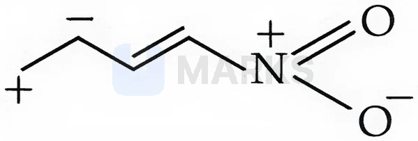

**(2)** 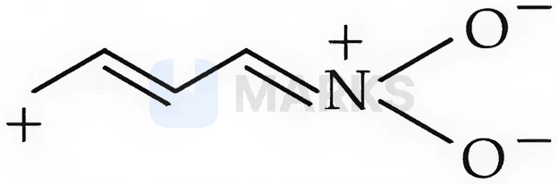

**(3)** 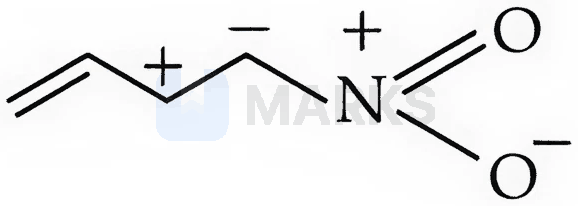

**(4)** 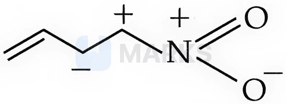

**Answer: (4)** · key (compiled)

**Solution.** Compare the charge-separated structures of nitro-butadiene. In (4) the carbon carrying the positive charge is bonded directly to the $\mathrm{N^+}$ of the nitro group, so two like charges sit on adjacent atoms and an electron-deficient carbon is attached to an electron-poor nitrogen: strong destabilisation. In (1) and (3) the charges on adjacent atoms are opposite, and (2) is a normal conjugation contributor with the negative charge on oxygen. Hence (4) is the least stable.

### C-GOC-06 · A — JEE Main 2026 · 28 Jan Shift 1 · GOC set Q17 · MCQ

The CORRECT order of stability for the following carbanions is: $\mathrm{CH_2{=}CH^-}$, $\mathrm{CH_3-\overset{-}{C}H_2}$, $\mathrm{CH{\equiv}C^-}$

(1) $\mathrm{CH_2{=}CH^->CH{\equiv}C^->CH_3\overset{-}{C}H_2}$  (2) $\mathrm{CH{\equiv}C^->CH_2{=}CH^->CH_3\overset{-}{C}H_2}$  (3) $\mathrm{CH{\equiv}C^->CH_3\overset{-}{C}H_2>CH_2{=}CH^-}$  (4) $\mathrm{CH_3\overset{-}{C}H_2>CH_2{=}CH^->CH{\equiv}C^-}$

**Answer: (2)** · key (compiled)

**Solution.** A carbanion is stabilised by the $s$-character of the orbital holding the lone pair (the electrons are held closer to the nucleus): $sp$ (50%) $>sp^2$ (33%) $>sp^3$ (25%). So $\mathrm{HC{\equiv}C^->H_2C{=}CH^->CH_3CH_2^-}$.

### C-GOC-07 · A — JEE Main 2026 · 24 Jan Shift 1 · GOC set Q19 · MCQ

Arrange the following carbanions in decreasing order of stability.

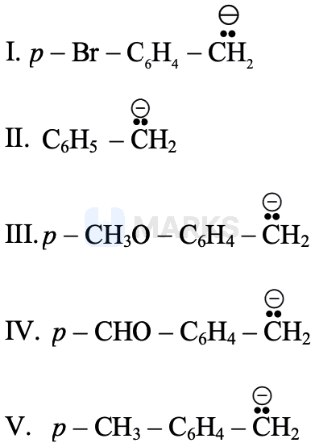

(1) I > IV > II > V > III  (2) I > II > IV > V > III  (3) IV > I > II > V > III  (4) IV > II > I > III > V

**Answer: (3)** · key (compiled)

**Solution.** Electron-withdrawing substituents stabilise the benzylic carbanion and electron-donating ones destabilise it. $p$-CHO is strongly electron-withdrawing ($-M,-I$): most stable (IV). $p$-Br is $-I$ (weakly $+M$): more stable than unsubstituted (II). $p$-$\mathrm{CH_3}$ is $+I$/hyperconjugating and $p$-$\mathrm{OCH_3}$ is a strong $+M$ donor: least stable. Order: IV > I > II > V > III.

### C-GOC-08 · A — JEE Main 2026 · 24 Jan Shift 1 · GOC set Q20 · MCQ

Arrange the following alkenes in decreasing order of stability.

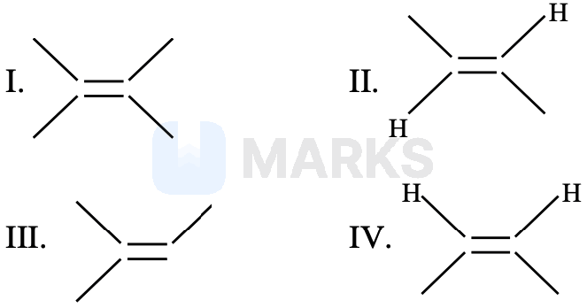

(1) III > II > I > IV  (2) I > III > IV > II  (3) III > I > II > IV  (4) I > III > II > IV

**Answer: (4)** · key (compiled)

**Solution.** Stability rises with the number of alkyl groups on the double bond (hyperconjugation): I is tetrasubstituted, III trisubstituted, II and IV are disubstituted. Of II and IV, the *trans* isomer (II, alkyl groups on opposite sides) is more stable than the *cis* isomer (IV, steric strain). Order: I > III > II > IV.

### C-GOC-09 · A — JEE Main 2025 · Jan session · GOC set Q1 · MCQ

The IUPAC name of the following compound is:

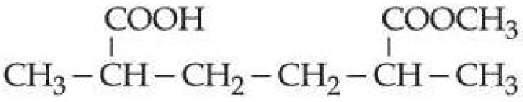

(1) Methyl-6-carboxy-2,5-dimethylhexanoate.  (2) 2-Carboxy-5-methoxycarbonylhexane.  (3) 6-Methoxycarbonyl-2,5-dimethylhexanoic acid.  (4) Methyl-5-carboxy-2-methylhexanoate.

**Answer: (3)** · key (compiled)

**Solution.** The carboxylic acid group has higher priority than the ester, so the compound is named as an acid with the ester treated as a substituent (methoxycarbonyl); the parent chain is chosen so as to include the –COOH carbon. Of the options, only (3) names the compound as an acid.

### C-GOC-10 · A — JEE Main 2025 · Jan session · GOC set Q3 · MCQ

The purification method based on the following physical transformation is: Solid (X) →(heat) Vapour (X) →(cool) Solid (X)

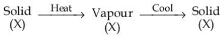

(1) Distillation  (2) Extraction  (3) Sublimation  (4) Crystallization

**Answer: (3)** · key (compiled)

**Solution.** A solid that passes directly to vapour on heating and back to solid on cooling, without a liquid stage, is purified by sublimation.

### C-GOC-11 · A — JEE Main 2025 · Jan session · GOC set Q4 · MCQ

Given below are two statements:

Statement I: In partition chromatography, the stationary phase is a thin film of liquid present in the inert support.  
Statement II: In paper chromatography, the material of the paper acts as a stationary phase.

In the light of the above statements, choose the correct answer.

(1) Statement I is true but Statement II is false  (2) Statement I is false but Statement II is true  (3) Both Statement I and Statement II are false  (4) Both Statement I and Statement II are true

**Answer: (1)** · key (compiled)

**Solution.** Statement I is correct (partition chromatography). In paper chromatography the stationary phase is the water adsorbed on the cellulose fibres, not the paper material itself, so Statement II is false.

### C-GOC-12 · A — JEE Main 2025 · Jan session · GOC set Q5 · MCQ

Given below are two statements:

Statement I: The Dumas method is used for the estimation of nitrogen in an organic compound.  
Statement II: The Dumas method involves the formation of ammonium sulphate by heating the organic compound with conc. H$_2$SO$_4$.

In the light of the above statements, choose the correct answer.

(1) Statement I is true but Statement II is false  (2) Both Statement I and Statement II are false  (3) Statement I is false but Statement II is true  (4) Both Statement I and Statement II are true

**Answer: (1)** · key (compiled)

**Solution.** Statement I is true: Dumas' method converts the nitrogen to N$_2$ gas over hot CuO and measures its volume. Statement II describes the Kjeldahl method (ammonium sulphate formation), not Dumas, so it is false.

### C-GOC-13 · A — JEE Main 2025 · Jan session · GOC set Q7 · MCQ

The most stable carbocation from the following is:

**(1)** 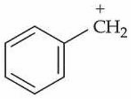

**(2)** 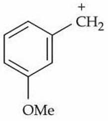

**(3)** 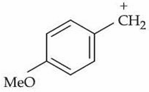

**(4)** 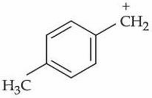

**Answer: (3)** · key (compiled)

**Solution.** A carbocation is stabilised by electron-donating groups through resonance. In the benzyl cations, an OMe group at the *para* position donates its lone pair directly into the ring and the cationic carbon (an extra resonance structure), whereas at the *meta* position it cannot conjugate and acts only inductively (withdrawing). CH$_3$ stabilises only by hyperconjugation/+I. So the *p*-methoxybenzyl cation, option (3), is the most stable.

### C-GOC-14 · A — JEE Main 2025 · Jan session · GOC set Q8 · MCQ

Which one of the carbocations from the following is most stable?

**(1)** 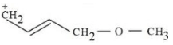

**(2)** 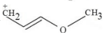

**(3)** 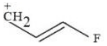

**(4)** 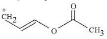

**Answer: (2)** · key (compiled)

**Solution.** Option (2), CH$_2^+$–CH=CH–O–CH$_3$, is stabilised by extended resonance: the oxygen lone pair is conjugated through the C=C with the cationic carbon (CH$_2^+$–CH=CH–OCH$_3$ ↔ CH$_2$=CH–CH=O$^+$CH$_3$, all atoms with octets). In (1) the oxygen is separated from the allyl system by a CH$_2$ (only a –I effect); in (3) fluorine is a poor $\pi$-donor with strong –I; in (4) the oxygen lone pair is delocalised into the acetyl C=O. So (2) is the most stable.

### C-GOC-15 · A — JEE Main 2025 · Jan session · GOC set Q9 · MCQ

Identify the correct statement(s):

(A) –OCH$_3$ and –NHCOCH$_3$ are activating groups.  
(B) –CN and –OH are meta directing groups.  
(C) –CN and –SO$_3$H are meta directing groups.  
(D) Activating groups act as ortho- and para-directing groups.  
(E) Halides are activating groups.

(1) (A) only  (2) (A), (B) and (E) only  (3) (A) and (C) only  (4) (A), (C) and (D) only

**Answer: (4)** · key (compiled)

**Solution.** (A) true. (B) false: –OH is *o,p*-directing. (C) true: –CN and –SO$_3$H are deactivating *m*-directors. (D) true. (E) false: halogens are deactivating (though *o,p*-directing). So (A), (C), (D).

### C-GOC-16 · A — JEE Main 2025 · Jan session · GOC set Q10 · MCQ

The correct order of stability of the following carbocations is: (A) triphenylmethyl cation, (B) diphenylmethyl cation, (C) tropylium cation, (D) 2-butyl (sec-butyl) cation.

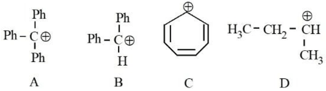

(1) C > B > A > D  (2) A > B > C > D  (3) B > C > A > D  (4) C > A > B > D

**Answer: (4)** · key (compiled)

**Solution.** The tropylium ion is aromatic (6 $\pi$ electrons in a planar cyclic conjugated 7-membered ring) and is the most stable carbocation. Trityl is stabilised by three phenyl rings, more than diphenylmethyl; the simple secondary alkyl cation is least stable. So C > A > B > D.

### C-GOC-17 · A — JEE Main 2025 · Jan session · GOC set Q11 · MCQ

The correct stability order of the following species/molecules is: (p) cyclopropenyl anion, (q) cyclopentadienyl anion, (r) cyclooctatetraene.

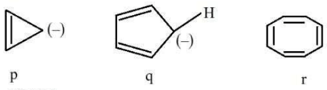

(1) q > r > p  (2) r > q > p  (3) q > p > r  (4) p > q > r

**Answer: (1)** · key (compiled)

**Solution.** Cyclopentadienyl anion ($6\pi$, planar) is aromatic and the most stable. Cyclooctatetraene is non-planar and non-aromatic (tub shape). Cyclopropenyl anion ($4\pi$) is anti-aromatic and the least stable. So q > r > p.

### C-GOC-18 · A — JEE Main 2025 · Jan session · GOC set Q13 · MCQ

The incorrect statements regarding geometrical isomerism are:

(A) Propene shows geometrical isomerism.  
(B) Trans isomer has identical atoms/groups on the opposite sides of the double bond.  
(C) Cis-but-2-ene has a higher dipole moment than trans-but-2-ene.  
(D) 2-Methylbut-2-ene shows two geometrical isomers.  
(E) Trans isomer has a lower melting point than the cis isomer.

(1) (A) and (E) only  (2) (A), (D) and (E) only  (3) (B) and (C) only  (4) (C), (D) and (E) only

**Answer: (2)** · key (compiled)

**Solution.** (A) incorrect: one alkene carbon of propene carries two H atoms. (D) incorrect: one carbon of 2-methylbut-2-ene carries two methyl groups. (E) incorrect: the more symmetric trans isomer usually packs better and has the higher melting point. (B) and (C) are correct. Incorrect: (A), (D), (E).

### C-GOC-19 · A — JEE Main 2025 · Jan session · GOC set Q14 · MCQ

How many different stereoisomers are possible for the given molecule, CH$_3$–CH(OH)–CH=CH–CH$_3$?

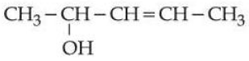

(1) 2  (2) 1  (3) 4  (4) 3

**Answer: (3)** · key (compiled)

**Solution.** The molecule has one stereocentre (the C–OH carbon) and one stereogenic C=C (cis/trans). These are independent, so $2\times2=4$ stereoisomers.

### C-GOC-20 · A — JEE Main 2025 · Jan session · GOC set Q15 · MCQ

Propane on chlorination under photochemical conditions gives two dichloro products, x and y. Of these, x is optically active. How many trichloro products (consider only structural isomers) will be obtained from x when it is further treated with chlorine under the same conditions?

(1) 2  (2) 5  (3) 4  (4) 3

**Answer: (4)** · key (compiled)

**Solution.** The optically active dichloropropane is 1,2-dichloropropane, CH$_2$Cl–CHCl–CH$_3$ (stereocentre at C-2). Further chlorination can occur at C-1, C-2 or C-3, giving 1,1,2-, 1,2,2- and 1,2,3-trichloropropane: 3 structural isomers.

### C-GOC-21 · A — JEE Main 2025 · Jan session · GOC set Q16 · Numerical

The possible number of stereoisomers for 5-phenylpent-4-en-2-ol is ______.

**Answer: 4** · key (compiled)

**Solution.** Ph–CH=CH–CH$_2$–CH(OH)–CH$_3$ has one stereocentre (C-2) and one stereogenic double bond (C4=C5): $2\times2=4$ stereoisomers.

### C-GOC-22 · B — JEE Main 2025 · Jan session · GOC set Q17 · MCQ

The steam volatile compounds among the following are the compounds (A)–(D) shown below, in order: (A) 2-nitrophenol, (B) 2-nitroaniline, (C) and (D) two para-aminophenol structures.

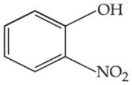

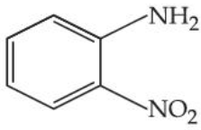

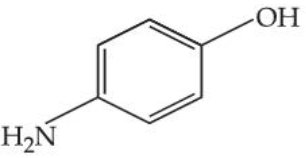

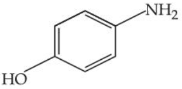

(1) (B) and (D) only  (2) (A) and (C) only  (3) (A), (B) and (C) only  (4) (A) and (B) only

**Answer: (4)** · key (compiled)

**Solution.** Steam volatility needs weak intermolecular forces. The *ortho* isomers (A) and (B) have intramolecular hydrogen bonding (–OH···O$_2$N and –NH$_2$···O$_2$N), so they do not associate with each other and distil with steam. The *para*-aminophenols (C) and (D) form intermolecular hydrogen bonds and are not steam volatile. Hence (A) and (B) only.

### C-GOC-23 · B — JEE Main 2025 · Jan session · GOC set Q18 · MCQ

Given below are two statements:

Statement I: Nitrogen, sulphur, halogen and phosphorus present in an organic compound are detected by Lassaigne's test.  
Statement II: The elements present in the compound are converted from covalent form into ionic form by fusing the compound with magnesium in Lassaigne's test.

In the light of the above statements, choose the correct answer.

(1) Statement I is false but Statement II is true  (2) Both Statement I and Statement II are true  (3) Both Statement I and Statement II are false  (4) Statement I is true but Statement II is false

**Answer: (4)** · key (compiled)

**Solution.** Lassaigne's sodium fusion extract detects N, S, halogens and P (Statement I true). The compound is fused with *sodium* metal, not magnesium (Statement II false).

### C-GOC-24 · B — JEE Main 2025 · Apr session · GOC set Q1 · MCQ

The IUPAC name of the compound HC≡C–CH$_2$–CH(OH)–CH$_2$–CH=CH$_2$ (shown in the figure) is:

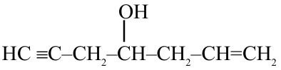

(1) 4-Hydroxyhept-1-en-6-yne  (2) 4-Hydroxyhept-6-en-1-yne  (3) Hept-6-en-1-yn-4-ol  (4) Hept-1-en-6-yn-4-ol

**Answer: (4)** · key (compiled)

**Solution.** The alcohol is the principal group: *-ol* at C-4 whichever way the chain is numbered. The double and triple bonds then get the locant set {1,6} either way, and the tie is broken in favour of the double bond (ene gets the lower number). Name: hept-1-en-6-yn-4-ol.

### C-GOC-25 · B — JEE Main 2025 · Apr session · GOC set Q2 · MCQ

What is the correct IUPAC name of the compound shown in the figure (a benzene ring with –CO$_2$H, –OH, –Br and –NO$_2$)?

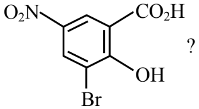

(1) 3-Bromo-2-hydroxy-5-nitrobenzoic acid  (2) 3-Bromo-4-hydroxy-1-nitrobenzoic acid  (3) 2-Hydroxy-3-bromo-5-nitrobenzoic acid  (4) 5-Nitro-3-bromo-2-hydroxybenzoic acid

**Answer: (1)** · key (compiled)

**Solution.** Benzoic acid is the parent (C-1 bears COOH). Numbering to give the lowest locants to the substituents (2, 3, 5) gives –OH at 2, –Br at 3 and –NO$_2$ at 5. Substituents are cited alphabetically (bromo, hydroxy, nitro): 3-bromo-2-hydroxy-5-nitrobenzoic acid.

### C-GOC-26 · B — JEE Main 2025 · Apr session · GOC set Q3 · MCQ

Which of the following is the correct IUPAC name of the organic compound (X) shown in the figure?

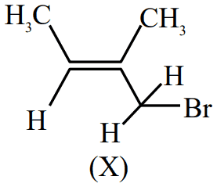

(1) 2-Bromo-2-methylbut-2-ene  (2) 3-Bromo-3-methylprop-2-ene  (3) 1-Bromo-2-methylbut-2-ene  (4) 4-Bromo-3-methylbut-2-ene

**Answer: (3)** · key (compiled)

**Solution.** The structure is CH$_3$–CH=C(CH$_3$)–CH$_2$Br. The longest chain containing the double bond has 4 carbons: CH$_2$Br–C(CH$_3$)=CH–CH$_3$. Numbering from the CH$_2$Br end gives the double bond locant 2 (from the other end it would be 2 as well but Br would be at 4). So: 1-bromo-2-methylbut-2-ene.

### C-GOC-27 · B — JEE Main 2025 · Apr session · GOC set Q4 · MCQ

What is the correct IUPAC name of the compound shown in the figure (a cyclopentene ring bearing –OH and an ethyl group)?

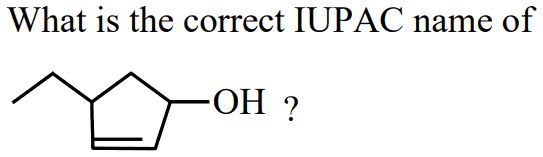

(1) 4-Ethyl-1-hydroxycyclopent-2-ene  (2) 1-Ethyl-3-hydroxycyclopent-2-ene  (3) 1-Ethylcyclopent-2-en-3-ol  (4) 4-Ethylcyclopent-2-en-1-ol

**Answer: (4)** · key (compiled)

**Solution.** The –OH is the principal group, so the carbon carrying it is C-1. The ring is numbered in the direction that gives the double bond the lowest locant (2), which puts the ethyl group at C-4. Name: 4-ethylcyclopent-2-en-1-ol.

### C-GOC-28 · B — JEE Main 2025 · Apr session · GOC set Q5 · MCQ

Consider the compound (X): H–C≡C–CH$_2$–CH(CH$_3$)–CH$_3$ (the C–H bonds of the carbons marked I, II, III and IV are: I = the terminal sp C–H, II = the CH$_2$, III = the CH, IV = the CH$_3$ groups). The most stable and the least stable carbon radicals produced by homolytic cleavage of the corresponding C–H bond are:

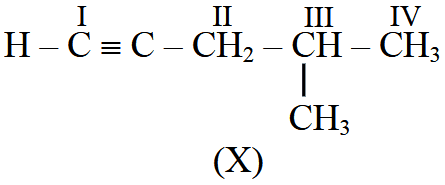

(1) II, IV  (2) III, II  (3) I, IV  (4) II, I

**Answer: (4)** · key (compiled)

**Solution.** Cleavage at II gives a propargylic radical (stabilised by resonance with the triple bond), the most stable. Cleavage at the terminal sp C–H (I) gives an sp-hybridised radical, which is the least stable because of the high s-character (strongest C–H bond). So the most stable is II and the least stable is I.

### C-GOC-29 · B — JEE Main 2025 · Apr session · GOC set Q6 · MCQ

Given below are two statements:

Statement I: Hyperconjugation is not a permanent effect.  
Statement II: In general, the greater the number of alkyl groups attached to a positively charged C atom, the greater is the hyperconjugation interaction and the stabilisation of the cation.

In the light of the above statements, choose the correct answer.

(1) Statement I is true but Statement II is false  (2) Both statements are false  (3) Statement I is false but Statement II is true  (4) Both statements are true

**Answer: (3)** · key (compiled)

**Solution.** Hyperconjugation is a permanent effect (σ–π conjugation of C–H bonds, present in the ground state), so Statement I is false. More alkyl groups mean more α C–H bonds available for hyperconjugation and a more stable cation, so Statement II is true.

### C-GOC-30 · B — JEE Main 2025 · Apr session · GOC set Q7 · MCQ

Designate whether each of the following compounds is aromatic or not aromatic: (a) cyclopentadienyl anion, (b) cyclopentadienyl cation, (c) cyclobutadiene dication, (d) cyclobutadiene dianion, (e) cycloheptatrienyl cation, (f) cyclooctatetraene, (g) cyclobutadiene, (h) cyclopropenyl cation.

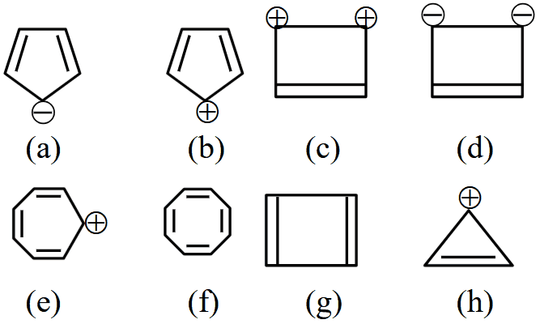

(1) e, g aromatic and a, b, c, d, f, h not aromatic  (2) b, e, f, g aromatic and a, c, d, h not aromatic  (3) a, b, c, d aromatic and e, f, g, h not aromatic  (4) a, c, d, e, h aromatic and b, f, g not aromatic

**Answer: (4)** · key (compiled)

**Solution.** Aromatic needs a planar, fully conjugated ring with $(4n+2)\,\pi$ electrons. (a) 6$\pi$ ✓; (b) 4$\pi$ anti-aromatic; (c) 2$\pi$ ✓; (d) 6$\pi$ ✓; (e) 6$\pi$ ✓; (f) non-planar, non-aromatic; (g) 4$\pi$ anti-aromatic; (h) 2$\pi$ ✓. Aromatic: a, c, d, e, h.

### C-GOC-31 · B — JEE Main 2025 · Apr session · GOC set Q9 · MCQ

Match List-I with List-II.

A. Carbocation  B. C-free radical  C. Nucleophile  D. Electrophile

I. Species that can supply a pair of electrons  II. Species that can receive a pair of electrons  III. $sp^2$ hybridised carbon with empty p-orbital  IV. $sp^2/sp^3$ hybridised carbon with one unpaired electron

(1) A-IV, B-II, C-III, D-I  (2) A-II, B-III, C-I, D-IV  (3) A-III, B-IV, C-II, D-I  (4) A-III, B-IV, C-I, D-II

**Answer: (4)** · key (compiled)

**Solution.** A carbocation is a trigonal planar $sp^2$ carbon with an empty p orbital (III). A carbon free radical has one unpaired electron on an $sp^2$ or $sp^3$ carbon (IV). A nucleophile donates a pair of electrons (I); an electrophile accepts a pair (II).

### C-GOC-32 · B — JEE Main 2025 · Apr session · GOC set Q12 · MCQ

Match List-I (purification technique) with List-II (mixture of organic compounds).

A. Distillation (simple)  B. Fractional distillation  C. Distillation under reduced pressure  D. Steam distillation

I. Diesel + petrol  II. Aniline + water  III. Chloroform + aniline  IV. Glycerol + spent lye

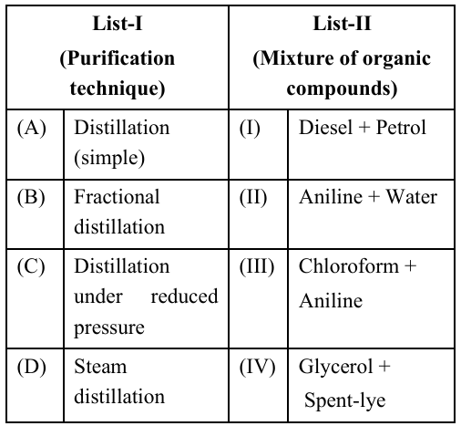

(1) (A)-(II), (B)-(III), (C)-(IV), (D)-(I)  (2) (A)-(II), (B)-(IV), (C)-(I), (D)-(III)  (3) (A)-(III), (B)-(IV), (C)-(II), (D)-(I)  (4) (A)-(III), (B)-(I), (C)-(IV), (D)-(II)

**Answer: (4)** · key (compiled)

**Solution.** Chloroform (b.p. 61 °C) and aniline (184 °C) differ widely in boiling point: simple distillation. Diesel and petrol are close-boiling liquid fractions: fractional distillation. Glycerol decomposes at its normal boiling point, so it is separated from spent lye under reduced pressure. Aniline is separated from water by steam distillation.

### C-GOC-33 · B — JEE Main 2025 · Apr session · GOC set Q13 · MCQ

Match List-I (separation of) with List-II (separation technique).

A. Aniline from an aniline–water mixture  B. Glycerol from spent lye in the soap industry  C. Different fractions of crude oil in the petroleum industry  D. Chloroform–aniline mixture

I. Simple distillation  II. Fractional distillation  III. Distillation at reduced pressure  IV. Steam distillation

(1) (A)-(IV), (B)-(III), (C)-(II), (D)-(I)  (2) (A)-(I), (B)-(II), (C)-(III), (D)-(IV)  (3) (A)-(III), (B)-(IV), (C)-(I), (D)-(II)  (4) (A)-(II), (B)-(I), (C)-(IV), (D)-(III)

**Answer: (1)** · key (compiled)

**Solution.** Aniline–water: steam distillation (IV). Glycerol from spent lye: reduced pressure (III). Crude oil fractions: fractional distillation (II). Chloroform–aniline: simple distillation (I).

### C-GOC-34 · B — JEE Main 2025 · Apr session · GOC set Q14 · MCQ

In Dumas' method for estimation of nitrogen, 0.5 g of an organic compound gave 60 mL of nitrogen collected at 300 K and 715 mm Hg pressure. The percentage composition of nitrogen in the compound is (aqueous tension at 300 K = 15 mm Hg):

(1) 1.257  (2) 20.87  (3) 18.67  (4) 12.57

**Answer: (4)** · key (compiled)

**Solution.** Pressure of dry N$_2$ $=715-15=700$ mm Hg. Volume at STP $=\dfrac{700\times60\times273}{300\times760}=50.3$ mL. Mass of N $=\dfrac{50.3}{22400}\times28=0.0629$ g, so the percentage is $\dfrac{0.0629}{0.5}\times100=12.57\%$.

### C-GOC-35 · B — JEE Main 2025 · Apr session · GOC set Q16 · MCQ

In Dumas' method for estimation of nitrogen, 0.4 g of an organic compound gave 60 mL of nitrogen collected at 300 K and 715 mm Hg pressure. The percentage composition of nitrogen in the compound is: (aqueous tension at 300 K = 15 mm Hg)

(1) 15.71%  (2) 20.95%  (3) 17.46%  (4) 7.85%

**Answer: (1)** · key (compiled)

**Solution.** $V_{STP}=\dfrac{(715-15)\times60\times273}{300\times760}=50.3$ mL, so the mass of N is $\dfrac{50.3}{22400}\times28=0.0629$ g. Percentage $=\dfrac{0.0629}{0.4}\times100=15.7\%$.

### C-GOC-36 · B — JEE Main 2025 · Apr session · GOC set Q17 · Numerical

In Dumas' method for estimation of nitrogen, 1 g of an organic compound gave 150 mL of nitrogen collected at 300 K and 900 mm Hg pressure. The percentage composition of nitrogen in the compound is ______ % (nearest integer). (Aqueous tension at 300 K = 15 mm Hg)

**Answer: 20** · key (compiled)

**Solution.** $P_{N_2}=900-15=885$ mm Hg. $V_{STP}=\dfrac{885\times150\times273}{300\times760}=158.9$ mL. Mass of N $=\dfrac{158.9}{22400}\times28=0.199$ g, i.e. $19.9\approx20\%$.

### C-GOC-37 · B — JEE Main 2025 · Apr session · GOC set Q18 · Numerical

In Dumas' method, 292 mg of an organic compound released 50 mL of nitrogen gas (N$_2$) at 300 K and 715 mm Hg pressure. The percentage composition of N in the organic compound is ______ % (nearest integer). (Aqueous tension at 300 K = 15 mm Hg)

**Answer: 18** · key (compiled)

**Solution.** $V_{STP}=\dfrac{(715-15)\times50\times273}{300\times760}=41.9$ mL. Mass of N $=\dfrac{41.9}{22400}\times28=52.4$ mg. Percentage $=\dfrac{52.4}{292}\times100=17.9\approx18\%$.

### C-GOC-38 · B — JEE Main 2025 · Apr session · GOC set Q19 · MCQ

In which of the following pairs is the first ion more stable than the second? (A) cyclohexyl cation bearing –OMe vs. cyclohexyl cation bearing –Me; (B) the carbanion on a cyclohexyl ring bearing *o*-nitrophenyl vs. the corresponding carbocation; (C) cyclohexylmethyl cation vs. cyclohex-1-enylmethyl cation; (D) a *tert*-butyl-type cation vs. its –OMe-substituted analogue (as drawn).

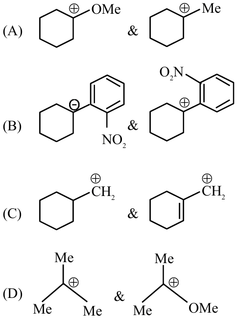

(1) (B) & (D) only  (2) (A) & (B) only  (3) (B) & (C) only  (4) (A) & (C) only

**Answer: (2)** · key (compiled)

**Solution.** (A) The α-OMe cation is stabilised by the oxygen lone pair (extra resonance), more than α-Me: ✓. (B) A carbanion is stabilised by an electron-withdrawing nitrophenyl, whereas the same group destabilises a carbocation: ✓. (C) The cyclohexenylmethyl (allylic) cation is stabilised by resonance, so the first is less stable. (D) The OMe-substituted cation is more stable than the plain tertiary one, so the first is less stable. Hence (A) and (B).

### C-GOC-39 · B — JEE Main 2024 · 27 Jan Shift 1 · Q55 · Numerical

Among the following, the total number of meta-directing functional groups is: $-\text{OCH}_3,\ -\text{NO}_2,\ -\text{CN},\ -\text{CH}_3,\ -\text{NHCOCH}_3,\ -\text{COR},\ -\text{OH},\ -\text{COOH},\ -\text{Cl}$

**Answer: 4** · key ✔

**Solution.** Electron-withdrawing groups by $-M$ deactivate the ring and direct meta: $-\text{NO}_2$, $-\text{CN}$, $-\text{COR}$, $-\text{COOH}$. The others ($-\text{OCH}_3$, $-\text{CH}_3$, $-\text{NHCOCH}_3$, $-\text{OH}$, $-\text{Cl}$) are ortho/para directing.

### C-GOC-40 · C — JEE Main 2024 · 27 Jan Shift 2 · Q35 · MCQ

The incorrect statement regarding conformations of ethane is

(1) Ethane has an infinite number of conformations  
(2) The dihedral angle in the staggered conformation is $60^\circ$  
(3) The eclipsed conformation is the most stable conformation  
(4) The conformations of ethane are interconvertible

**Answer: (3)** · key ✔

**Solution.** Free rotation about C–C gives infinitely many conformations that interconvert easily (barrier $\approx12$ kJ/mol). The staggered form has a $60^\circ$ dihedral angle and is the most stable because torsional strain is minimal. The eclipsed form is the least stable, so (3) is incorrect.

### C-GOC-41 · C — JEE Main 2024 · 29 Jan Shift 1 · Q37 · MCQ

The interaction between a $\pi$ bond and a lone pair of electrons present on an adjacent atom is responsible for

(1) Hyperconjugation  (2) Inductive effect  (3) Electromeric effect  (4) Resonance effect

**Answer: (4)** · key ✔

**Solution.** Overlap of a $p$-orbital carrying a lone pair with an adjacent $\pi$ system delocalises electrons: this is the resonance (mesomeric, $+R$) effect. Hyperconjugation involves a $\sigma$ bond (C–H) with a $\pi$ bond, and the inductive effect is $\sigma$-polarisation.

### C-GOC-42 · C — JEE Main 2024 · 29 Jan Shift 1 · Q38 · MCQ

The difference in energy between the actual structure and the lowest-energy resonance structure of a compound is

(1) electromeric energy  (2) resonance energy  (3) ionisation energy  (4) hyperconjugation energy

**Answer: (2)** · key ✔

**Solution.** This is the definition of resonance (delocalisation) energy: the extra stability of the resonance hybrid relative to its most stable contributing structure.

### C-GOC-43 · C — JEE Main 2024 · 29 Jan Shift 1 · Q54 · Numerical

The number of compounds among the following that contain sulphur as a heteroatom is ______: furan, thiophene, pyridine, pyrrole, cysteine, tyrosine.

**Answer: 2** · key ✔

**Solution.** Furan has O, pyridine and pyrrole have N, and tyrosine has O and N only. Thiophene (S in the ring) and cysteine ($\text{HS-CH}_2\text{-CH(NH}_2)\text{COOH}$) contain sulphur. Count $=2$.

### C-GOC-44 · C — JEE Main 2024 · 29 Jan Shift 2 · Q52 · Numerical

The total number of $\sigma$ and $\pi$ bonds in 2-formylhex-4-enoic acid is ______.

**Answer: 22** · key ✔

**Solution.** Structure: $\text{HOOC-CH(CHO)-CH}_2\text{-CH=CH-CH}_3$. $\sigma$ bonds: C–C: $6$ (including the C=C's $\sigma$ component and the branch to CHO); C–H: $1+2+1+1+3+1=9$; in COOH: C=O (1), C–O (1), O–H (1) $=3$; in CHO: C=O (1). Total $\sigma=6+9+3+1=19$. $\pi$ bonds: C=O of COOH, C=C, C=O of CHO $=3$. Total $=22$.

### C-GOC-45 · C — JEE Main 2024 · 30 Jan Shift 2 · Q36 · MCQ

The correct stability order of the carbocations $(\text{CH}_3)_3\text{C}^+$, $(\text{CH}_3)_2\text{CH}^+$, $\text{CH}_3\text{CH}_2^+$ and $\text{CH}_3^+$ is

(the correct choice is option (3))

**Answer: $(\text{CH}_3)_3\text{C}^+>(\text{CH}_3)_2\text{CH}^+>\text{CH}_3\text{CH}_2^+>\text{CH}_3^+$** · key ✔

**Solution.** Alkyl groups stabilise a carbocation by $+I$ and hyperconjugation. The number of $\alpha$-hydrogens available for hyperconjugation is $9,6,3,0$, so stability follows $3^\circ>2^\circ>1^\circ>\text{methyl}$.

### C-GOC-46 · C — JEE Main 2024 · 31 Jan Shift 1 · Q35 · MCQ

A species having a carbon with a sextet of electrons that can act as an electrophile is called

(1) carbon free radical  (2) carbanion  (3) carbocation  (4) pentavalent carbon

**Answer: (3)** · key ✔

**Solution.** A carbocation ($\text{R}_3\text{C}^+$) has only $6$ electrons in the valence shell of the carbon, so it is electron-deficient and electrophilic. A free radical has $7$ and a carbanion has $8$.

### C-GOC-47 · C — JEE Main 2024 · 1 Feb Shift 1 · Q40 · MCQ

Ionic reactions with organic compounds proceed through:  
(A) Homolytic bond cleavage  (B) Heterolytic bond cleavage  (C) Free radical formation  (D) Primary free radical  (E) Secondary free radical

(1) (A) only  (2) (C) only  (3) (B) only  (4) (D) and (E) only

**Answer: (3)** · key ✔

**Solution.** Ionic (polar) reactions involve carbocations/carbanions produced by heterolytic cleavage, where the bonding pair goes to one atom. Homolysis and free radicals belong to radical reactions.

### C-GOC-48 · C — JEE Main 2024 · 1 Feb Shift 2 · Q39 · MCQ

The set of meta-directing groups is:

(1) $-\text{CN},-\text{NH}_2,-\text{NHR},-\text{OCH}_3$  (2) $-\text{NO}_2,-\text{NH}_2,-\text{COOH},-\text{COOR}$  (3) $-\text{NO}_2,-\text{CHO},-\text{SO}_3\text{H},-\text{COR}$  (4) $-\text{CN},-\text{CHO},-\text{NHCOCH}_3,-\text{COOR}$

**Answer: (3)** · key ✔

**Solution.** Meta directors are electron-withdrawing ($-M$/$-I$) groups: $-\text{NO}_2,-\text{CHO},-\text{SO}_3\text{H},-\text{COR}$. $-\text{NH}_2,-\text{NHR},-\text{OCH}_3,-\text{NHCOCH}_3$ are ortho/para directing.

### C-GOC-49 · C — JEE Main 2024 · 1 Feb Shift 2 · Q40 · MCQ

The functional group that shows a negative resonance effect ($-R$) is:

(1) $-\text{NH}_2$  (2) $-\text{OH}$  (3) $-\text{COOH}$  (4) $-\text{OR}$

**Answer: (3)** · key ✔

**Solution.** $-\text{NH}_2$, $-\text{OH}$ and $-\text{OR}$ donate a lone pair into the ring ($+R$). $-\text{COOH}$ withdraws electrons by resonance ($-R$).

### C-GOC-50 · C — JEE Main 2024 · 4 Apr Shift 1 · Q37 · MCQ

Which of the following is an **incorrect** statement?

(1) The electromeric effect dominates over the inductive effect  (2) The electromeric effect is a temporary effect  (3) The hydrogen ion shows a negative electromeric effect  (4) An organic compound shows the electromeric effect in the presence of the reagent only

**Answer: (3)** · key ✔

**Solution.** The electromeric effect is a temporary complete transfer of $\pi$ electrons, shown only in the presence of an attacking reagent, and it dominates the inductive effect. When the attacking reagent is an electrophile such as $\text{H}^+$ the transfer is towards the attacked atom: $+E$, not $-E$. Statement (3) is wrong.

### C-GOC-51 · C — JEE Main 2024 · 8 Apr Shift 2 · Q32 · MCQ

The shape of a carbocation is:

(1) diagonal pyramidal  (2) trigonal planar  (3) tetrahedral  (4) diagonal

**Answer: (2)** · key ✔

**Solution.** The positively charged carbon of a carbocation ($\text{R}_3\text{C}^+$) has three bond pairs and no lone pair: it is $sp^2$ hybridised with a vacant $p$ orbital, giving a trigonal planar shape.

