# Haloalkanes & Haloarenes

> Theory: [../../theory/chemistry/haloalkanes-haloarenes.md](../../theory/chemistry/haloalkanes-haloarenes.md)

### C-HAL-01 · A — JEE Main 2026 · 21 Jan Shift 2 · set Q1 · MCQ

The correct order of the rate of the reaction $\mathrm{CH_3Br+Nu^\ominus\to CH_3Nu+Br^\ominus}$ with respect to the nucleophiles is:

(1) $\mathrm{PhO^->{}^-OH>CH_3COO^->ClO_4^-}$  (2) $\mathrm{CH_3COO^->PhO^->{}^-OH>ClO_4^-}$  (3) $\mathrm{{}^-OH>PhO^->CH_3COO^->ClO_4^-}$  (4) $\mathrm{ClO_4^->CH_3COO^->{}^-OH>PhO^-}$

**Answer: (3)** · key (compiled)

**Solution.** $\mathrm{CH_3Br}$ reacts by $S_N2$, and when the attacking atom is the same (O here) nucleophilicity follows basicity, i.e. the $\mathrm{p}K_a$ of the conjugate acid: $\mathrm{H_2O}$ (15.7) > $\mathrm{PhOH}$ (10) > $\mathrm{CH_3COOH}$ (4.8) > $\mathrm{HClO_4}$ ($\approx-10$). So $\mathrm{HO^->PhO^->CH_3COO^->ClO_4^-}$.

### C-HAL-02 · A — JEE Main 2026 · 23 Jan Shift 1 · set Q3 · Numerical

Consider all the structural isomers with molecular formula $\mathrm{C_5H_{11}Br}$. They are separately treated with aqueous KOH to give the respective substitution products, without any rearrangement. The number of products which can exhibit optical isomerism is ______.

**Answer: 3** · key (compiled)

**Solution.** The eight isomers give the alcohols pentan-1-ol, pentan-2-ol, pentan-3-ol, 2-methylbutan-1-ol, 3-methylbutan-1-ol, 2-methylbutan-2-ol, 3-methylbutan-2-ol and 2,2-dimethylpropan-1-ol. Those with a chiral carbon (four different groups) are pentan-2-ol, 2-methylbutan-1-ol and 3-methylbutan-2-ol: **3**.

### C-HAL-03 · A — JEE Main 2026 · 28 Jan Shift 2 · set Q4 · MCQ

Which of the following reactions is NOT correctly represented?

**(1)** 

**(2)** 

**(3)** 

**(4)** 

**Answer: (4)** · key (compiled)

**Solution.** (1) is electrophilic substitution – $\mathrm{CH_3}$ is $o,p$-directing – correct. (2) is the Sandmeyer reaction – correct. (3) is free-radical side-chain bromination of toluene (benzylic radical) – correct. In (4) the $\mathrm{CH_3}$ sits on the ring carbon next to the double bond; the abstractable allylic/tertiary ring C–H gives a far more stable allylic radical than the one from the $\mathrm{CH_3}$ group, and $\mathrm{Br_2}$ can also add across the $\mathrm{C{=}C}$, so formation of $\mathrm{CH_2Br}$ is not correct. Answer (4).

### C-HAL-04 · A — JEE Main 2026 · 24 Jan Shift 2 · set Q5 · Numerical

Grignard reagent $\mathrm{RMgBr}$ (P) reacts with water and forms a gas (Q). One gram of Q occupies $1.4\ \mathrm{dm^3}$ at STP. (P) on reaction with dry ice in dry ether followed by $\mathrm{H_3O^+}$ forms a compound (Z). 0.1 mole of (Z) will weigh ______ g (nearest integer).

**Answer: 6** · key (compiled)

**Solution.** $n(\mathrm Q)=\dfrac{1.4}{22.4}=0.0625$ mol, so $M=\dfrac1{0.0625}=16$ g/mol: Q is $\mathrm{CH_4}$, hence P is $\mathrm{CH_3MgBr}$. $\mathrm{CH_3MgBr+CO_2\to CH_3COOMgBr\xrightarrow{H_3O^+}CH_3COOH}$ (Z, $M=60$). $0.1\times60=6$ g.

### C-HAL-05 · A — JEE Main 2026 · 22 Jan Shift 1 · set Q7 · MCQ

The correct order of the rate of reaction of the following reactants with a nucleophile by the $S_N1$ mechanism is: (Given: structures I and II are rigid)

(1) III < I < II < IV  (2) IV < III < II < I  (3) I < II < III < IV  (4) II < I < III < IV

**Answer: (4)** · key (compiled)

**Solution.** $S_N1$ rate depends on carbocation stability. I and II are bridgehead bromides: the rigid bicyclic skeleton cannot flatten to a planar carbocation (Bredt's rule), so they are very unreactive, II (bicyclo[2.2.1], more strained) even less than I (bicyclo[2.2.2]). III gives the tertiary $t$-butyl cation, and IV gives the triphenylmethyl cation, stabilised by three phenyl rings. Order: II < I < III < IV.

### C-HAL-06 · A — JEE Main 2026 · 24 Jan Shift 1 · set Q10 · MCQ

Given below are two statements:

Statement I: The C–Cl bond is stronger in $\mathrm{CH_2{=}CH{-}Cl}$ than in $\mathrm{CH_3{-}CH_2{-}Cl}$.  
Statement II: The given optically active molecule, shown below, on hydrolysis gives a solution that can rotate the plane polarised light.

(1) Statement I is false but Statement II is true  (2) Both Statement I and Statement II are true  (3) Both Statement I and Statement II are false  (4) Statement I is true but Statement II is false

**Answer: (4)** · key (compiled)

**Solution.** I true: in vinyl chloride the C is $sp^2$ and Cl's lone pair conjugates with the double bond, giving the C–Cl bond partial double-bond character (shorter, stronger). II false: the molecule is a tertiary *and* benzylic chloride, so it hydrolyses by $S_N1$ through a planar carbocation, and attack of $\mathrm{OH^-}$ from either face gives a racemic mixture, which is optically inactive.

### C-HAL-07 · A — JEE Main 2024 · 27 Jan Shift 1 · Q48 · MCQ

The correct statement regarding nucleophilic substitution in a chiral alkyl halide is

(1) Retention occurs in $S_N1$ and inversion in $S_N2$  (2) Racemisation in $S_N1$, retention in $S_N2$  (3) Racemisation in both  (4) Racemisation in $S_N1$ and inversion in $S_N2$

**Answer: (4)** · key ✔

**Solution.** $S_N1$ goes through a planar carbocation attacked from both faces, giving (partial) racemisation. $S_N2$ is a concerted back-side attack, giving inversion (Walden inversion).

### C-HAL-08 · A — JEE Main 2024 · 29 Jan Shift 2 · Q43 · MCQ

An alkyl halide is converted into an alkyl isocyanide by reaction with

(1) NaCN  (2) $\text{NH}_4\text{CN}$  (3) KCN  (4) AgCN

**Answer: (4)** · key ✔

**Solution.** $\text{KCN}$ and $\text{NaCN}$ are ionic and attack through carbon (giving nitriles). $\text{AgCN}$ is covalent, so the lone pair on nitrogen attacks the alkyl halide: $\text{R-X}+\text{AgCN}\to\text{R-NC}+\text{AgX}$ (isocyanide).

### C-HAL-09 · A — JEE Main 2024 · 30 Jan Shift 1 · Q36 · MCQ

Assertion (A): $\text{CH}_2{=}\text{CH-CH}_2\text{-Cl}$ is an example of an allyl halide.  
Reason (R): Allyl halides are the compounds in which the halogen atom is attached to an $sp^2$ hybridised carbon atom.

(1) A true, R false  (2) Both true, R does not explain A  (3) A false, R true  (4) Both true, R explains A

**Answer: (1)** · key ✔

**Solution.** In an allyl halide the halogen is attached to an $sp^3$ carbon that is adjacent to a $\text{C=C}$ (allylic position). Halogen on an $sp^2$ carbon of the double bond is a vinylic halide. So A is true and R is false.

### C-HAL-10 · B — JEE Main 2024 · 01 Feb Shift 1 · Fig set Q2 · MCQ

Identify A and B in the following sequence of reaction (toluene → A → B; the reagents are shown in the figure).

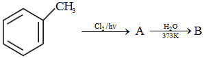

**(1)** 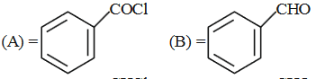

**(2)** 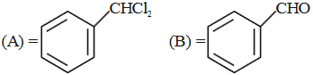

**(3)** 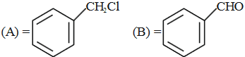

**(4)** 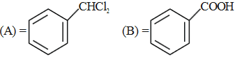

**Answer: (2)** · key (compiled)

**Solution.** Under light, free-radical chlorination replaces the three benzylic hydrogens: toluene → benzyl chloride → benzal chloride (A = C$_6$H$_5$CHCl$_2$). Hydrolysis of the gem-dichloride at 373 K gives the unstable gem-diol, which loses water to form benzaldehyde (B = C$_6$H$_5$CHO). This is option (2).

### C-HAL-11 · B — JEE Main 2024 · 01 Feb Shift 2 · Fig set Q3 · MCQ

In the reaction sequence shown in the figure, C$_2$H$_5$Br → (alc. KOH) A → (Br$_2$/CCl$_4$) B → (KCN, excess) C → (H$_3$O$^+$, excess) D, the acid D formed is:

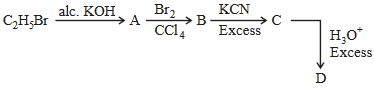

(1) Gluconic acid  (2) Succinic acid  (3) Oxalic acid  (4) Malonic acid

**Answer: (2)** · key (compiled)

**Solution.** Alcoholic KOH eliminates HBr: A = ethene. Br$_2$ adds: B = 1,2-dibromoethane. KCN replaces both Br: C = NC–CH$_2$CH$_2$–CN (succinonitrile). Complete hydrolysis converts each –CN to –COOH: D = HOOC–CH$_2$CH$_2$–COOH, succinic acid.

### C-HAL-12 · B — JEE Main 2024 · 27 Jan Shift 2 · Fig set Q5 · MCQ

Which among the following halide(s) will not show S$_N$1 reaction? (A) H$_2$C=CH–CH$_2$Cl  (B) CH$_3$–CH=CH–Cl  (C) benzyl chloride, C$_6$H$_5$CH$_2$Cl  (D) (CH$_3$)$_2$CH–Cl (2-chloropropane). Choose the most appropriate answer from the options given below:

(1) (A), (B) and (D) only  (2) (A) and (B) only  (3) (B) and (C) only  (4) (B) only

**Answer: (4)** · key (compiled)

**Solution.** S$_N$1 needs a reasonably stable carbocation. (A) allyl and (C) benzyl chlorides give resonance-stabilised cations, and (D) gives a secondary cation. (B) is a vinylic halide: the C–Cl bond has partial double-bond character and the vinyl cation is very unstable, so it does not undergo S$_N$1. Answer: (B) only.

### C-HAL-13 · B — JEE Main 2024 · 27 Jan Shift 2 · Fig set Q6 · MCQ

Identify B formed in the reaction: Cl–(CH$_2$)$_4$–Cl $\xrightarrow{\text{excess NH}_3}$ A $\xrightarrow{\text{NaOH}}$ B + H$_2$O + NaCl.

(1) pyrrolidine (the five-membered cyclic secondary amine, NH in a ring)  (2) H$_2$N–(CH$_2$)$_4$–NH$_2$  (3) ClH$_3$N$^+$–(CH$_2$)$_4$–N$^+$H$_3$Cl$^-$  (4) 1,1'-bipyrrolidine (two pyrrolidine rings joined N–N)

**Answer: (2)** · key (compiled)

**Solution.** Excess NH$_3$ replaces both chlorides: Cl–(CH$_2$)$_4$–Cl + 2NH$_3$ → the diammonium salt A = $^+$H$_3$N–(CH$_2$)$_4$–N$^+$H$_3$ 2Cl$^-$ (alkylammonium chloride). NaOH liberates the free base: B = H$_2$N–(CH$_2$)$_4$–NH$_2$ (putrescine).

### C-HAL-14 · B — JEE Main 2024 · 30 Jan Shift 1 · Fig set Q9 · MCQ

The final product A formed in the following multistep reaction sequence is (the sequence is shown in the figure): bromobenzene → (i) Mg, ether, then CO$_2$, H$^+$; (ii) NH$_3$, Δ; (iii) Br$_2$, NaOH.

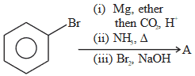

**(1)** 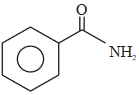

**(2)** 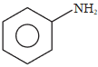

**(3)** 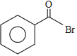

**(4)** 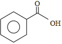

**Answer: (2)** · key (compiled)

**Solution.** (i) The Grignard reagent adds to CO$_2$; acidification gives benzoic acid. (ii) Heating with NH$_3$ gives benzamide. (iii) Br$_2$/NaOH is the Hofmann bromamide degradation: the amide loses one carbon (as CO$_3^{2-}$) to give aniline, C$_6$H$_5$NH$_2$ — option (2).

### C-HAL-15 · B — JEE Main 2024 · 31 Jan Shift 1 · Fig set Q12 · Numerical

In the reaction shown in the figure (CH$_3$CH$_2$Br + NaOH, with C$_2$H$_5$OH giving product A and with H$_2$O giving product B), the total number of hydrogen atoms in product A and product B is ______.

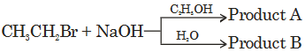

**Answer: 10** · key (compiled)

**Solution.** With alcoholic NaOH (strong base, ethanol solvent) elimination occurs: A = CH$_2$=CH$_2$ (4 H). With aqueous NaOH substitution occurs: B = CH$_3$CH$_2$OH (6 H). Total $=4+6=10$.

### C-HAL-16 · B — JEE Main 2024 · 31 Jan Shift 2 · Fig set Q13 · MCQ

The correct order of reactivity in electrophilic substitution reaction of the following compounds is: A = benzene, B = toluene, C = chlorobenzene, D = nitrobenzene.

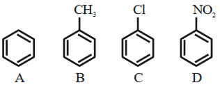

(1) B > C > A > D  (2) D > C > B > A  (3) A > B > C > D  (4) B > A > C > D

**Answer: (4)** · key (compiled)

**Solution.** Electron-donating CH$_3$ activates the ring (toluene is the most reactive); benzene is the reference; Cl deactivates by its –I effect (though *o,p*-directing); NO$_2$ is a strong deactivator. Order: B > A > C > D.

### C-HAL-17 · C — JEE Main 2024 · 04 Apr Shift 1 · Fig set Q1 · MCQ

Identify the correct set of reagents or reaction conditions 'X' and 'Y' in the following set of transformations: CH$_3$–CH$_2$–CH$_2$–Br →(X) Product →(Y) CH$_3$–CH(Br)–CH$_3$.

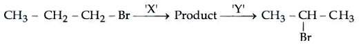

(1) X = dil. aq. NaOH, 20 °C; Y = Br$_2$/CHCl$_3$  (2) X = conc. alc. NaOH, 80 °C; Y = Br$_2$/CHCl$_3$  (3) X = dil. aq. NaOH, 20 °C; Y = HBr/acetic acid  (4) X = conc. alc. NaOH, 80 °C; Y = HBr/acetic acid

**Answer: (4)** · key (compiled)

**Solution.** Conc. alcoholic NaOH at 80 °C eliminates HBr from 1-bromopropane to give propene (dil. aq. NaOH at 20 °C would substitute to give propan-1-ol). Propene adds HBr in acetic acid by Markovnikov's rule to give 2-bromopropane. (Br$_2$/CHCl$_3$ would give a dibromide.) So (4).

### C-HAL-18 · C — JEE Main 2024 · 05 Apr Shift 1 · Fig set Q2 · Numerical

The number of halobenzenes from the following (fluoro-, chloro-, bromo-, iodo- and astato-benzene, I–V in the figure) that can be prepared by Sandmeyer's reaction is ______.

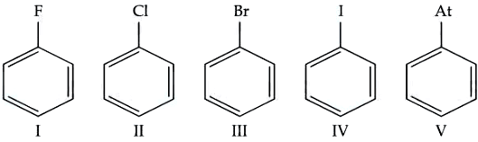

**Answer: 2** · key (compiled)

**Solution.** Sandmeyer's reaction uses Cu(I) halides (CuCl, CuBr, CuCN) with a diazonium salt. So chlorobenzene and bromobenzene are made this way. Fluorobenzene needs the Balz–Schiemann reaction (HBF$_4$), iodobenzene is made with KI without any copper catalyst, and astatobenzene is not made by this route. The number is 2.

### C-HAL-19 · C — JEE Main 2024 · 05 Apr Shift 2 · Fig set Q3 · MCQ

Identify the major product in the following reaction: 1-bromo-1-methylcyclopentane treated with $^-$OH in C$_2$H$_5$OH.

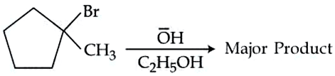

**(1)** 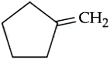

**(2)** 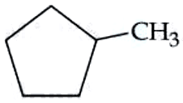

**(3)** 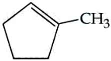

**(4)** 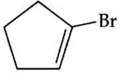

**Answer: (3)** · key (compiled)

**Solution.** A strong base in ethanol brings about E2 elimination, and by Zaitsev's rule the more substituted (more stable) alkene is the major product: the endocyclic trisubstituted alkene 1-methylcyclopentene (option 3), not the disubstituted exocyclic methylenecyclopentane.

### C-HAL-20 · C — JEE Main 2024 · 06 Apr Shift 2 · Fig set Q5 · MCQ

The correct arrangement for decreasing order of electrophilic substitution of the compounds (I) toluene, (II) benzene, (III) anisole (methoxybenzene) and (IV) trifluoromethylbenzene (figure) is:

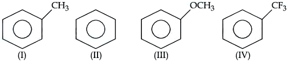

(1) (III) > (I) > (II) > (IV)  (2) (IV) > (I) > (II) > (III)  (3) (III) > (IV) > (II) > (I)  (4) (II) > (IV) > (III) > (I)

**Answer: (1)** · key (compiled)

**Solution.** Reactivity towards electrophiles follows the electron density of the ring: –OCH$_3$ (strong +M) > –CH$_3$ (+I, hyperconjugation) > H > –CF$_3$ (strong –I deactivating). Order: III > I > II > IV.

### C-HAL-21 · C — JEE Main 2024 · 08 Apr Shift 1 · Fig set Q6 · MCQ

Which among the following compounds will undergo the fastest S$_N$2 reaction?

**(1)** 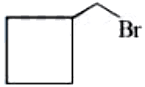

**(2)** 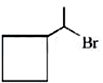

**(3)** 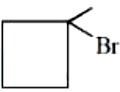

**(4)** 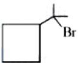

**Answer: (1)** · key (compiled)

**Solution.** S$_N$2 rate falls with steric hindrance at the carbon bearing the halogen. Option (1) is a primary alkyl bromide (bromomethylcyclobutane): the carbon carrying Br is unhindered. Options (2), (3) and (4) are secondary or tertiary halides and are much slower.

