# Haloalkanes & Haloarenes

> Theory: [../../theory/chemistry/haloalkanes-haloarenes.md](../../theory/chemistry/haloalkanes-haloarenes.md)

### C-HAL-01 · B — JEE Main 2026 · 21 Jan Shift 2 · set Q1 · MCQ

The correct order of the rate of the reaction $\mathrm{CH_3Br+Nu^\ominus\to CH_3Nu+Br^\ominus}$ with respect to the nucleophiles is:

(1) $\mathrm{PhO^->{}^-OH>CH_3COO^->ClO_4^-}$  (2) $\mathrm{CH_3COO^->PhO^->{}^-OH>ClO_4^-}$  (3) $\mathrm{{}^-OH>PhO^->CH_3COO^->ClO_4^-}$  (4) $\mathrm{ClO_4^->CH_3COO^->{}^-OH>PhO^-}$

**Answer: (3)** · key (compiled)

**Solution.** $\mathrm{CH_3Br}$ reacts by $S_N2$, and when the attacking atom is the same (O here) nucleophilicity follows basicity, i.e. the $\mathrm{p}K_a$ of the conjugate acid: $\mathrm{H_2O}$ (15.7) > $\mathrm{PhOH}$ (10) > $\mathrm{CH_3COOH}$ (4.8) > $\mathrm{HClO_4}$ ($\approx-10$). So $\mathrm{HO^->PhO^->CH_3COO^->ClO_4^-}$.

### C-HAL-02 · B — JEE Main 2026 · 21 Jan Shift 2 · set Q2 · MCQ

The correct order of reactivity of the following benzyl halides towards reaction with KCN is:

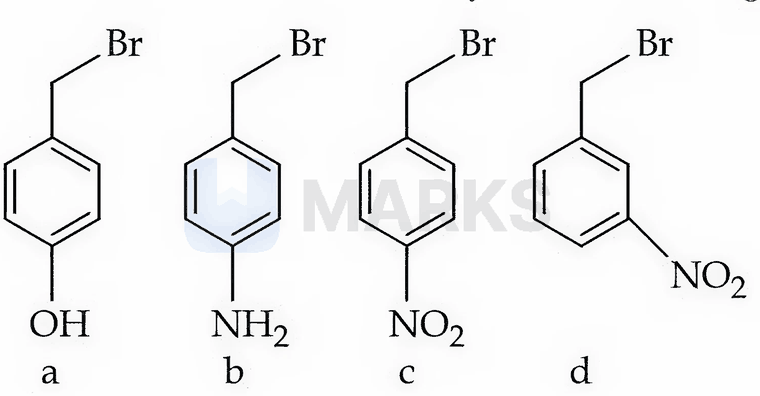

(1) b > a > c > d  (2) b > a > d > c  (3) a > b > d > c  (4) a > b > c > d

**Answer: (2)** · key (compiled)

**Solution.** Benzylic halides with an electron-donating group react largely through the benzylic carbocation ($S_N1$ character), so reactivity follows the cation stability. $p$-$\mathrm{NH_2}$ (b) is a stronger $+M$ donor than $p$-OH (a). The nitro compounds are the least reactive; the $p$-$\mathrm{NO_2}$ (c) is worse than the $m$-$\mathrm{NO_2}$ (d) because it withdraws by both $-I$ and $-M$ (direct conjugation with the carbocation centre), while meta withdraws only inductively. Order: b > a > d > c.

### C-HAL-03 · B — JEE Main 2026 · 23 Jan Shift 1 · set Q3 · Numerical

Consider all the structural isomers with molecular formula $\mathrm{C_5H_{11}Br}$. They are separately treated with aqueous KOH to give the respective substitution products, without any rearrangement. The number of products which can exhibit optical isomerism is ______.

**Answer: 3** · key (compiled)

**Solution.** The eight isomers give the alcohols pentan-1-ol, pentan-2-ol, pentan-3-ol, 2-methylbutan-1-ol, 3-methylbutan-1-ol, 2-methylbutan-2-ol, 3-methylbutan-2-ol and 2,2-dimethylpropan-1-ol. Those with a chiral carbon (four different groups) are pentan-2-ol, 2-methylbutan-1-ol and 3-methylbutan-2-ol: **3**.

### C-HAL-04 · B — JEE Main 2026 · 28 Jan Shift 2 · set Q4 · MCQ

Which of the following reactions is NOT correctly represented?

**(1)** 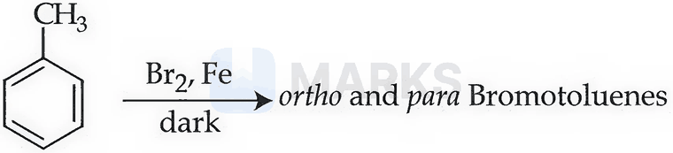

**(2)** 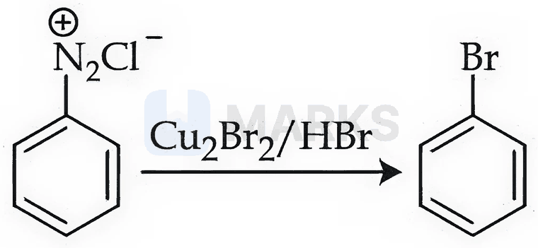

**(3)** 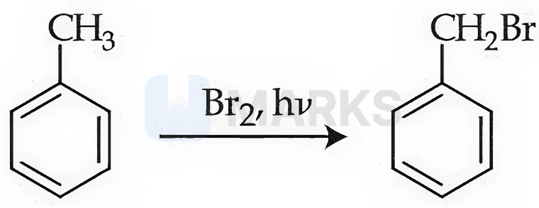

**(4)** 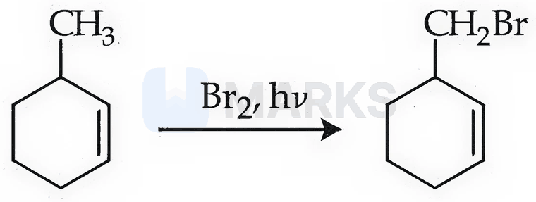

**Answer: (4)** · key (compiled)

**Solution.** (1) is electrophilic substitution – $\mathrm{CH_3}$ is $o,p$-directing – correct. (2) is the Sandmeyer reaction – correct. (3) is free-radical side-chain bromination of toluene (benzylic radical) – correct. In (4) the $\mathrm{CH_3}$ sits on the ring carbon next to the double bond; the abstractable allylic/tertiary ring C–H gives a far more stable allylic radical than the one from the $\mathrm{CH_3}$ group, and $\mathrm{Br_2}$ can also add across the $\mathrm{C{=}C}$, so formation of $\mathrm{CH_2Br}$ is not correct. Answer (4).

### C-HAL-05 · B — JEE Main 2026 · 24 Jan Shift 2 · set Q5 · Numerical

Grignard reagent $\mathrm{RMgBr}$ (P) reacts with water and forms a gas (Q). One gram of Q occupies $1.4\ \mathrm{dm^3}$ at STP. (P) on reaction with dry ice in dry ether followed by $\mathrm{H_3O^+}$ forms a compound (Z). 0.1 mole of (Z) will weigh ______ g (nearest integer).

**Answer: 6** · key (compiled)

**Solution.** $n(\mathrm Q)=\dfrac{1.4}{22.4}=0.0625$ mol, so $M=\dfrac1{0.0625}=16$ g/mol: Q is $\mathrm{CH_4}$, hence P is $\mathrm{CH_3MgBr}$. $\mathrm{CH_3MgBr+CO_2\to CH_3COOMgBr\xrightarrow{H_3O^+}CH_3COOH}$ (Z, $M=60$). $0.1\times60=6$ g.

### C-HAL-06 · B — JEE Main 2026 · 22 Jan Shift 2 · set Q6 · MCQ

The dibromo compound [P] (molecular formula $\mathrm{C_9H_{10}Br_2}$), when heated with excess sodamide followed by treatment with dilute HCl, gives [Q]. On warming [Q] with mercuric sulphate and dilute sulphuric acid it yields [R], which gives a positive iodoform test but a negative Tollens' test. The compound [P] is:

**(1)** 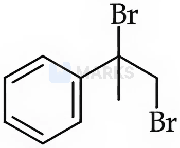

**(2)** 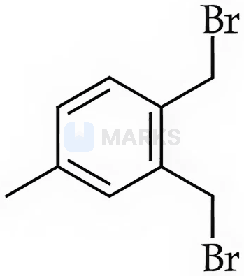

**(3)** 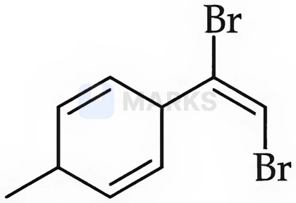

**(4)** 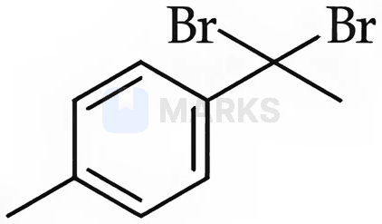

**Answer: (4)** · key (compiled)

**Solution.** [R] is a methyl ketone, so [Q] is a *terminal* aryl alkyne, $\mathrm{Ar{-}C{\equiv}CH}$ (hydration of a terminal alkyne with $\mathrm{HgSO_4/H_2SO_4}$ gives a methyl ketone, $\mathrm{ArCOCH_3}$). Excess $\mathrm{NaNH_2}$ converts a *gem*-dibromide into the alkyne by double dehydrohalogenation (the sodium acetylide is protonated by dil. HCl). $\mathrm{p\text{-}CH_3C_6H_4C(CH_3)Br_2}$ ($\mathrm{C_9H_{10}Br_2}$) fits: it gives $p$-tolylacetylene, then $p$-methylacetophenone. Answer (4).

### C-HAL-07 · B — JEE Main 2026 · 22 Jan Shift 1 · set Q7 · MCQ

The correct order of the rate of reaction of the following reactants with a nucleophile by the $S_N1$ mechanism is: (Given: structures I and II are rigid)

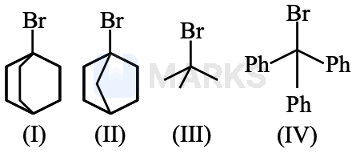

(1) III < I < II < IV  (2) IV < III < II < I  (3) I < II < III < IV  (4) II < I < III < IV

**Answer: (4)** · key (compiled)

**Solution.** $S_N1$ rate depends on carbocation stability. I and II are bridgehead bromides: the rigid bicyclic skeleton cannot flatten to a planar carbocation (Bredt's rule), so they are very unreactive, II (bicyclo[2.2.1], more strained) even less than I (bicyclo[2.2.2]). III gives the tertiary $t$-butyl cation, and IV gives the triphenylmethyl cation, stabilised by three phenyl rings. Order: II < I < III < IV.

### C-HAL-08 · B — JEE Main 2026 · 22 Jan Shift 1 · set Q8 · MCQ

As compared with chlorocyclohexane, which of the following statements correctly apply to chlorobenzene?

A. The magnitude of the negative charge is more on the chlorine atom.  
B. The C–Cl bond has partial double bond character.  
C. The C–Cl bond is less polar.  
D. The C–Cl bond is longer due to repulsion between the delocalised electrons of the aromatic ring and the lone pairs of electrons of chlorine.  
E. The C–Cl bond is formed using an $sp^2$ hybridised orbital of carbon.

(1) B, C and E only  (2) A, C and E only  (3) A, D and E only  (4) B, C and D only

**Answer: (1)** · key (compiled)

**Solution.** In chlorobenzene Cl's lone pair is delocalised into the ring (resonance), which gives the C–Cl bond partial double-bond character (B), makes it shorter (1.69 Å vs 1.78 Å; D false) and less polar with less negative charge on Cl (C true, A false); the carbon is $sp^2$ (E true). So B, C and E.

### C-HAL-09 · B — JEE Main 2026 · 22 Jan Shift 1 · set Q9 · MCQ

The correct order of reactivity of $\mathrm{CH_3Br}$ in methanol with the nucleophiles $\mathrm{F^-}$, $\mathrm{I^-}$, $\mathrm{C_2H_5O^-}$ and $\mathrm{C_6H_5O^-}$ is:

(1) $\mathrm{I^->C_2H_5O^->F^->C_6H_5O^-}$  (2) $\mathrm{I^->C_2H_5O^->C_6H_5O^->F^-}$  (3) $\mathrm{I^->F^->C_6H_5O^->C_2H_5O^-}$  (4) $\mathrm{I^->C_6H_5O^->F^->C_2H_5O^-}$

**Answer: (2)** · key (compiled)

**Solution.** In a protic solvent such as methanol, small and hard anions are tightly solvated by hydrogen bonding, which cuts their nucleophilicity, so the large, polarisable $\mathrm{I^-}$ is the best nucleophile and the small $\mathrm{F^-}$ (heavily H-bonded) the poorest. Between the two alkoxides the more basic ethoxide beats the resonance-stabilised phenoxide: $\mathrm{I^->EtO^->PhO^->F^-}$.

### C-HAL-10 · B — JEE Main 2026 · 24 Jan Shift 1 · set Q10 · MCQ

Given below are two statements:

Statement I: The C–Cl bond is stronger in $\mathrm{CH_2{=}CH{-}Cl}$ than in $\mathrm{CH_3{-}CH_2{-}Cl}$.  
Statement II: The given optically active molecule, shown below, on hydrolysis gives a solution that can rotate the plane polarised light.

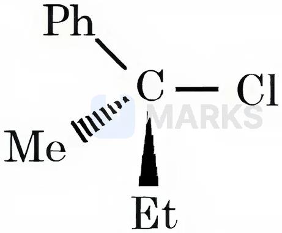

(1) Statement I is false but Statement II is true  (2) Both Statement I and Statement II are true  (3) Both Statement I and Statement II are false  (4) Statement I is true but Statement II is false

**Answer: (4)** · key (compiled)

**Solution.** I true: in vinyl chloride the C is $sp^2$ and Cl's lone pair conjugates with the double bond, giving the C–Cl bond partial double-bond character (shorter, stronger). II false: the molecule is a tertiary *and* benzylic chloride, so it hydrolyses by $S_N1$ through a planar carbocation, and attack of $\mathrm{OH^-}$ from either face gives a racemic mixture, which is optically inactive.

### C-HAL-11 · B — JEE Main 2026 · 24 Jan Shift 1 · set Q11 · MCQ

Match List-I with List-II.

| List-I (chloro derivative) | List-II (example) |
|---|---|
| A. Vinyl chloride | I. $\mathrm{CH_2{=}CH{-}CH_2Cl}$ |
| B. Benzyl chloride | II. $\mathrm{CH_3{-}CH(Cl){-}CH_3}$ |
| C. Alkyl chloride | III. $\mathrm{CH_2{=}CHCl}$ |
| D. Allyl chloride | IV. the structure shown below |

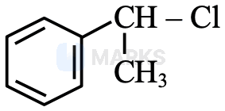

(1) A-III, B-IV, C-I, D-II  (2) A-I, B-II, C-IV, D-III  (3) A-IV, B-I, C-III, D-II  (4) A-III, B-IV, C-II, D-I

**Answer: (4)** · key (compiled)

**Solution.** Vinyl chloride has Cl on a $\mathrm{C{=}C}$ carbon: $\mathrm{CH_2{=}CHCl}$ (III). Benzyl-type chloride has Cl on a carbon directly attached to the benzene ring: structure IV. Alkyl chloride: Cl on an $sp^3$ carbon of a saturated alkyl chain, $\mathrm{CH_3CHClCH_3}$ (II). Allyl chloride has Cl on the carbon next to a $\mathrm{C{=}C}$: $\mathrm{CH_2{=}CHCH_2Cl}$ (I). So A-III, B-IV, C-II, D-I.

### C-HAL-12 · C — JEE Main 2024 · 27 Jan Shift 1 · Q48 · MCQ

The correct statement regarding nucleophilic substitution in a chiral alkyl halide is

(1) Retention occurs in $S_N1$ and inversion in $S_N2$  (2) Racemisation in $S_N1$, retention in $S_N2$  (3) Racemisation in both  (4) Racemisation in $S_N1$ and inversion in $S_N2$

**Answer: (4)** · key ✔

**Solution.** $S_N1$ goes through a planar carbocation attacked from both faces, giving (partial) racemisation. $S_N2$ is a concerted back-side attack, giving inversion (Walden inversion).

### C-HAL-13 · C — JEE Main 2024 · 29 Jan Shift 2 · Q43 · MCQ

An alkyl halide is converted into an alkyl isocyanide by reaction with

(1) NaCN  (2) $\text{NH}_4\text{CN}$  (3) KCN  (4) AgCN

**Answer: (4)** · key ✔

**Solution.** $\text{KCN}$ and $\text{NaCN}$ are ionic and attack through carbon (giving nitriles). $\text{AgCN}$ is covalent, so the lone pair on nitrogen attacks the alkyl halide: $\text{R-X}+\text{AgCN}\to\text{R-NC}+\text{AgX}$ (isocyanide).

### C-HAL-14 · C — JEE Main 2024 · 30 Jan Shift 1 · Q36 · MCQ

Assertion (A): $\text{CH}_2{=}\text{CH-CH}_2\text{-Cl}$ is an example of an allyl halide.  
Reason (R): Allyl halides are the compounds in which the halogen atom is attached to an $sp^2$ hybridised carbon atom.

(1) A true, R false  (2) Both true, R does not explain A  (3) A false, R true  (4) Both true, R explains A

**Answer: (1)** · key ✔

**Solution.** In an allyl halide the halogen is attached to an $sp^3$ carbon that is adjacent to a $\text{C=C}$ (allylic position). Halogen on an $sp^2$ carbon of the double bond is a vinylic halide. So A is true and R is false.

### C-HAL-15 · C — JEE Main 2024 · 30 Jan Shift 2 · Q47 · MCQ

Statement I: A high concentration of a strong nucleophilic reagent with secondary alkyl halides which do not have bulky substituents will follow the $S_N2$ mechanism.  
Statement II: A secondary alkyl halide treated with a large excess of ethanol follows the $S_N1$ mechanism.

(1) I true, II false  (2) I false, II true  (3) Both false  (4) Both true

**Answer: (4)** · key ✔

**Solution.** Secondary substrates can go by either path depending on conditions. A strong nucleophile at high concentration, unhindered substrate: $S_N2$ (rate $=k[\text{RX}][\text{Nu}]$). Ethanol is a weak, polar protic nucleophile/solvent that favours ionisation, so an $S_N1$ path operates. Both are true.

### C-HAL-16 · C — JEE Main 2024 · 31 Jan Shift 1 · Q58 · Numerical

$\text{CH}_3\text{CH}_2\text{Br}+\text{NaOH}$ gives product A in $\text{C}_2\text{H}_5\text{OH}$ (alcoholic) and product B in $\text{H}_2\text{O}$ (aqueous). The total number of hydrogen atoms in products A and B is ______.

**Answer: 10** · key ✔

**Solution.** Alcoholic NaOH favours elimination: A $=\text{CH}_2{=}\text{CH}_2$ ($4$ H). Aqueous NaOH favours substitution: B $=\text{CH}_3\text{CH}_2\text{OH}$ ($6$ H). Total $=10$.

### C-HAL-17 · C — JEE Main 2024 · 1 Feb Shift 1 · Q46 · MCQ

Assertion A: Haloalkanes react with KCN to form alkyl cyanides as the main product, while with AgCN they form isocyanides as the main product.  
Reason R: KCN and AgCN both are highly ionic compounds.

(1) A is correct but R is not correct  (2) Both correct, R is not the correct explanation  (3) A is not correct but R is correct  (4) Both correct, R is the correct explanation

**Answer: (1)** · key ✔

**Solution.** KCN is ionic, so the free $\text{CN}^-$ attacks through carbon (the better nucleophilic site, giving $\text{R-CN}$). AgCN is largely covalent, so the lone pair on N attacks, giving $\text{R-NC}$. R is therefore false.

### C-HAL-18 · C — JEE Main 2024 · 1 Feb Shift 2 · Q49 · MCQ

$\text{C}_2\text{H}_5\text{Br}\xrightarrow{\text{alc. KOH}}A\xrightarrow{\text{Br}_2/\text{CCl}_4}B\xrightarrow{\text{excess KCN}}C\xrightarrow{\text{H}_3\text{O}^+,\ \text{excess}}D$. The acid D is:

(1) Gluconic acid  (2) Succinic acid  (3) Oxalic acid  (4) Malonic acid

**Answer: (2)** · key ✔

**Solution.** $A=\text{CH}_2{=}\text{CH}_2$; $B=\text{BrCH}_2\text{CH}_2\text{Br}$; $C=\text{NC-CH}_2\text{CH}_2\text{-CN}$; hydrolysis gives $\text{HOOC-CH}_2\text{CH}_2\text{-COOH}$, succinic acid.

### C-HAL-19 · C — JEE Main 2024 · 4 Apr Shift 1 · Q46 · MCQ

Identify $X$ and $Y$: $\text{CH}_3\text{CH}_2\text{CH}_2\text{Br}\xrightarrow{X}\text{Product}\xrightarrow{Y}\text{CH}_3\text{CHBrCH}_3$

(1) $X$ = dil. aq. NaOH, $20^\circ$C; $Y$ = $\text{Br}_2/\text{CHCl}_3$  (2) $X$ = conc. alc. NaOH, $80^\circ$C; $Y$ = $\text{Br}_2/\text{CHCl}_3$  (3) $X$ = dil. aq. NaOH, $20^\circ$C; $Y$ = HBr/acetic acid  (4) $X$ = conc. alc. NaOH, $80^\circ$C; $Y$ = HBr/acetic acid

**Answer: (4)** · key ✔

**Solution.** Alcoholic NaOH at high temperature gives E2 elimination: propene. Addition of HBr follows Markovnikov's rule to give $2$-bromopropane. (With peroxides it would be anti-Markovnikov.)

### C-HAL-20 · C — JEE Main 2024 · 8 Apr Shift 2 · Q46 · MCQ

Statement I: $S_N2$ reactions are stereospecific, resulting in the formation of only one stereoisomer as the product.  
Statement II: $S_N1$ reactions generally result in the formation of products as racemic mixtures.

(1) Both false  (2) I false, II true  (3) I true, II false  (4) Both true

**Answer: (4)** · key ✔

**Solution.** $S_N2$ proceeds with backside attack (inversion of configuration), so a single stereoisomer forms. $S_N1$ goes through a planar carbocation that the nucleophile can attack from either face, giving (partial) racemisation.

### C-HAL-21 · C — JEE Main 2024 · 9 Apr Shift 1 · Q47 · MCQ

Assertion A: The $S_N2$ reaction of $\text{C}_6\text{H}_5\text{CH}_2\text{Br}$ occurs more readily than the $S_N2$ reaction of $\text{CH}_3\text{CH}_2\text{Br}$.  
Reason R: The partially bonded unhybridised $p$ orbital that develops in the trigonal bipyramidal transition state is stabilised by conjugation with the phenyl ring.

(1) A correct, R not correct  (2) A not correct, R correct  (3) Both correct, R not the explanation  (4) Both correct, R explains A

**Answer: (4)** · key ✔

**Solution.** In the $S_N2$ transition state the central carbon is $sp^2$-like with a $p$ orbital shared by the entering and leaving groups. For a benzylic carbon this $p$ orbital overlaps with the ring $\pi$ system and is stabilised, lowering the activation energy. So benzyl bromide reacts faster.

