# Hydrocarbons

> Theory: [../../theory/chemistry/hydrocarbons.md](../../theory/chemistry/hydrocarbons.md)

### C-HYD-01 — JEE Main 2024 · 27 Jan Shift 1 · Q57 · Numerical

3-Methylhex-2-ene reacts with $\text{HBr}$ in the presence of peroxide to form an addition product (A). The number of possible stereoisomers of (A) is ______.

**Answer: 4** · key ✔

**Solution.** Peroxide effect gives anti-Markovnikov addition: Br goes to C-2, H to C-3, giving $\text{CH}_3\text{CH(Br)CH(CH}_3)\text{CH}_2\text{CH}_2\text{CH}_3$. There are two different stereocentres (C-2 and C-3), so $2^2=4$ stereoisomers.

### C-HYD-02 — JEE Main 2024 · 31 Jan Shift 1 · Q55 · Numerical

The number of alkanes obtained on electrolysis of a mixture of $\text{CH}_3\text{COONa}$ and $\text{C}_2\text{H}_5\text{COONa}$ is ______.

**Answer: 3** · key ✔

**Solution.** Kolbe electrolysis couples the alkyl radicals formed at the anode: $\text{CH}_3\cdot+\text{CH}_3\cdot\to\text{C}_2\text{H}_6$, $\text{C}_2\text{H}_5\cdot+\text{C}_2\text{H}_5\cdot\to\text{C}_4\text{H}_{10}$ and the cross product $\text{CH}_3\cdot+\text{C}_2\text{H}_5\cdot\to\text{C}_3\text{H}_8$. Three alkanes.

### C-HYD-03 — JEE Main 2024 · 31 Jan Shift 2 · Q54 · Numerical

The number of isomeric products formed by monochlorination of 2-methylbutane in the presence of sunlight is ______.

**Answer: 6** · key ✔

**Solution.** 2-Methylbutane is $\text{CH}_3\text{-CH(CH}_3)\text{-CH}_2\text{-CH}_3$. Chlorination at C-1 (either equivalent $\text{CH}_3$) gives 1-chloro-2-methylbutane (chiral: $2$ enantiomers); at C-2 gives 2-chloro-2-methylbutane ($1$); at C-3 gives 2-chloro-3-methylbutane (chiral: $2$); at C-4 gives 1-chloro-3-methylbutane ($1$). Total $=2+1+2+1=6$.

### C-HYD-04 — JEE Main 2024 · 4 Apr Shift 2 · Q48 · MCQ

$\text{CH}_3\text{CH}_2\text{CH}_2\text{Br}+\text{NaOH}\xrightarrow{\text{C}_2\text{H}_5\text{OH}}A$. Then $A\xrightarrow{\text{H}_2\text{O},\text{H}^+}B$ and $A\xrightarrow{\text{B}_2\text{H}_6;\ \text{H}_2\text{O}/\text{H}_2\text{O}_2/\text{OH}^-}C$. Identify B and C.

(1) B = 1-propanol, C = 2-propanol  (2) B = C = 2-propanol  (3) B = 2-propanol, C = 1-propanol  (4) B = C = 1-propanol

**Answer: (3)** · key ✔

**Solution.** Alcoholic NaOH gives propene (A). Acid-catalysed hydration follows Markovnikov's rule: B = propan-2-ol. Hydroboration–oxidation gives anti-Markovnikov addition: C = propan-1-ol.

### § — JEE Main 2026 · 23 Jan Shift 1 · set Q1 · MCQ

Consider the compounds a (chlorobenzene), b (nitrobenzene) and c (anisole), shown below. Arrange these compounds in increasing order of reactivity with nitrating mixture.

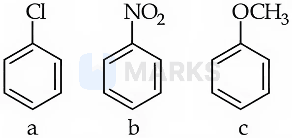

(1) c < a < b  (2) b < a < c  (3) c < b < a  (4) b < c < a

**Answer: (2)** · key (compiled)

**Solution.** Reactivity towards electrophilic substitution depends on the substituent: $-\mathrm{OCH_3}$ is a strong activating group ($+M$), $-\mathrm{Cl}$ is weakly deactivating ($-I$ outweighs $+M$) and $-\mathrm{NO_2}$ is strongly deactivating ($-M,-I$). Increasing reactivity: nitrobenzene (b) < chlorobenzene (a) < anisole (c).

### § — JEE Main 2026 · 23 Jan Shift 1 · set Q2 · MCQ

But-2-yne and hydrogen (one mole each) are separately treated with (i) Pd/C and (ii) Na/liq. $\mathrm{NH_3}$ to give the products X and Y respectively. Identify the incorrect statements.

A. X and Y are stereoisomers.
B. The dipole moment of X is zero.
C. The boiling point of X is higher than that of Y.
D. X and Y react with $\mathrm{O_3/Zn+H_2O}$ to give different products.

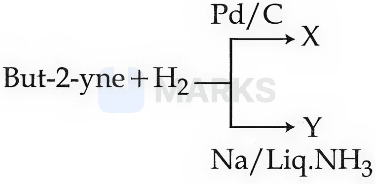

(1) B and D only  (2) A and C only  (3) A and B only  (4) B and C only

**Answer: (1)** · key (compiled)

**Solution.** With one mole of $\mathrm{H_2}$ the catalytic (syn) addition gives X = *cis*-but-2-ene, and Na/liq. $\mathrm{NH_3}$ (anti addition) gives Y = *trans*-but-2-ene. A true (geometric isomers). B false: the cis isomer has a small non-zero dipole moment (the trans isomer has zero). C true: cis-but-2-ene boils higher (3.7 °C vs 0.9 °C) because of its dipole moment. D false: ozonolysis of either isomer gives the same product, 2 $\mathrm{CH_3CHO}$. Incorrect: B and D.

### § — JEE Main 2026 · 28 Jan Shift 2 · set Q3 · MCQ

Identify the correct statements. The presence of the $-\mathrm{NO_2}$ group in a benzene ring:

A. activates the ring towards electrophilic substitution.
B. deactivates the ring towards electrophilic substitution.
C. activates the ring towards nucleophilic substitution.
D. deactivates the ring towards nucleophilic substitution.

(1) C and A only  (2) B and C only  (3) A and D only  (4) B and D only

**Answer: (2)** · key (compiled)

**Solution.** $-\mathrm{NO_2}$ withdraws electrons by $-M$ and $-I$. This lowers the ring's electron density, so electrophilic substitution is deactivated (B), while nucleophilic substitution (which needs an electron-poor ring, e.g. in 2,4-dinitrochlorobenzene) is activated (C).

### § — JEE Main 2026 · 22 Jan Shift 2 · set Q4 · MCQ

Consider the following reaction. The product Y formed is:

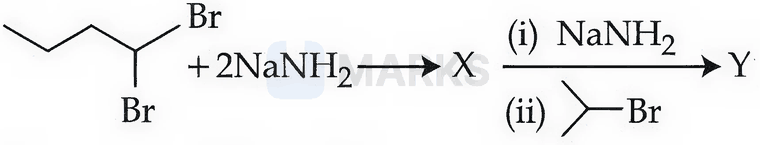

(1) 5-methylhex-2-yne  (2) isopropylbut-1-yne  (3) 2-methylhex-3-yne  (4) 2-methylhex-2-yne

**Answer: (3)** · key (compiled)

**Solution.** The *gem*-dibromide (1,1-dibromobutane) loses 2 HBr with 2 $\mathrm{NaNH_2}$ to give the terminal alkyne X = but-1-yne. A further equivalent of $\mathrm{NaNH_2}$ removes the acidic $\equiv$C–H to give the acetylide, which attacks 2-bromopropane ($S_N2$): $\mathrm{CH_3CH_2C{\equiv}C^-+(CH_3)_2CHBr\to CH_3CH_2C{\equiv}C{-}CH(CH_3)_2}$ = 2-methylhex-3-yne.

### § — JEE Main 2026 · 22 Jan Shift 1 · set Q5 · MCQ

Given below are two statements:

Statement I: Benzene is nitrated to give nitrobenzene, which on further treatment with $\mathrm{CH_3COCl/AlCl_3}$ will give the compound shown below.
Statement II: The $-\mathrm{NO_2}$ group is a $m$-directing and deactivating group.

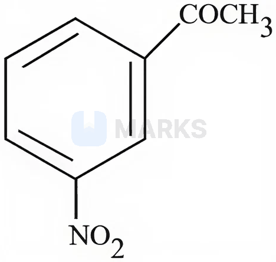

(1) Statement I is incorrect but Statement II is correct  (2) Both Statement I and Statement II are incorrect  (3) Both Statement I and Statement II are correct  (4) Statement I is correct but Statement II is incorrect

**Answer: (1)** · key (compiled)

**Solution.** I incorrect: nitrobenzene is so strongly deactivated that it does not undergo Friedel–Crafts alkylation or acylation (and the $\mathrm{AlCl_3}$ complexes with the nitro group), so 3-nitroacetophenone is not obtained this way. II correct: $-\mathrm{NO_2}$ is a $m$-director and a deactivator.

### § — JEE Main 2026 · 22 Jan Shift 1 · set Q6 · Numerical

The cycloalkene (X) on bromination consumes one mole of bromine per mole of (X) and gives the product (Y) in which the C : Br ratio is 3 : 1. The percentage of bromine in the product (Y) is ______ % (nearest integer). (Given: molar mass in g mol$^{-1}$: H 1, C 12, O 16, Br 80)

**Answer: 66** · key (compiled)

**Solution.** One mole of $\mathrm{Br_2}$ adds across the double bond, so Y has 2 Br atoms and the number of carbons is $3\times2=6$: X = cyclohexene $\mathrm{C_6H_{10}}$ and Y = 1,2-dibromocyclohexane $\mathrm{C_6H_{10}Br_2}$, $M=72+10+160=242$. $\%\mathrm{Br}=\dfrac{160}{242}\times100=66.1\approx66$.

### § — JEE Main 2026 · 23 Jan Shift 2 · set Q7 · MCQ

Identify (P):

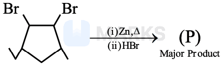

**(1)** 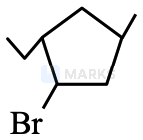

**(2)** 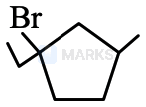

**(3)** 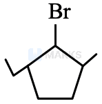

**(4)** 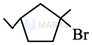

**Answer: (4)** · key (compiled)

**Solution.** $\mathrm{Zn,\Delta}$ removes the two vicinal Br atoms (dehalogenation) to give the cyclopentene, 3-ethyl-5-methylcyclopentene. HBr then adds: protonation gives a secondary carbocation next to an allylic ring C–H, and a 1,2-hydride shift gives a more stable *tertiary* carbocation. Two tertiary cations are possible, one on the methyl-bearing carbon (7 $\alpha$-H: 3 + 2 + 2) and one on the ethyl-bearing carbon (6 $\alpha$-H: 2 + 2 + 2); the former has more hyperconjugation and is more stable. Bromide adds there: 1-bromo-3-ethyl-1-methylcyclopentane – option (4).

### § — JEE Main 2026 · 23 Jan Shift 2 · set Q8 · Numerical

Consider the following reaction of benzene. In compound (Q), the percentage of oxygen is ______ % (nearest integer).

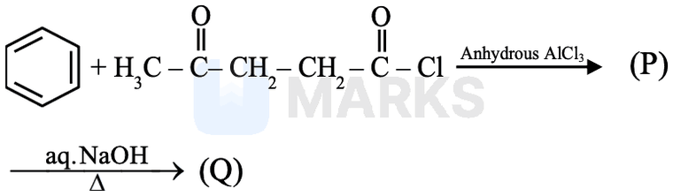

**Answer: 10** · key (compiled)

**Solution.** Friedel–Crafts acylation of benzene with the acid chloride gives (P) = $\mathrm{PhCO{-}CH_2CH_2{-}CO{-}CH_3}$, a 1,4-diketone. Hot aq. NaOH brings about an *intramolecular aldol condensation*: the $\mathrm{CH_3}$ (as an enolate) attacks the benzoyl C=O to form a five-membered ring, and dehydration gives (Q) = 3-phenylcyclopent-2-en-1-one, $\mathrm{C_{11}H_{10}O}$, $M=158$. $\%\mathrm O=\dfrac{16}{158}\times100=10.1\approx10$.

### § — JEE Main 2026 · 21 Jan Shift 1 · set Q9 · MCQ

Identify A in the following reaction.

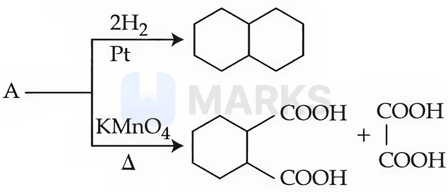

**(1)** 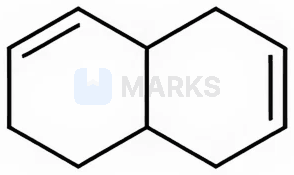

**(2)** 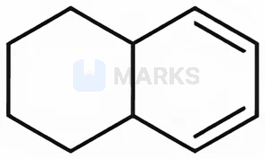

**(3)** 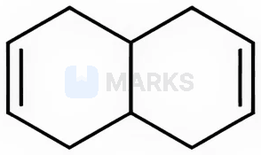

**(4)** 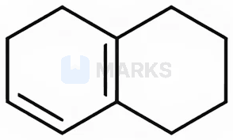

**Answer: (2)** · key (compiled)

**Solution.** A takes up 2 $\mathrm{H_2}$ to give decalin, so it is a bicyclic compound with two C=C ($\mathrm{C_{10}H_{14}}$). Oxidative cleavage of the two double bonds gives cyclohexane-1,2-dicarboxylic acid plus oxalic acid: the two carboxyl groups on adjacent carbons of the saturated ring are the ends of the original ring, and oxalic acid $(\mathrm{HOOC{-}COOH})$ comes from the two middle carbons of a conjugated 1,3-diene $\mathrm{C{=}C{-}C{=}C}$ in the other ring. So A is the hexahydronaphthalene with the 1,3-diene in one ring and sp$^3$ ring-fusion carbons – option (2). (Tetralin, option (2)'s look-alike with an aromatic ring, would need 3 $\mathrm{H_2}$ and would give phthalic acid instead.)

### § — JEE Main 2026 · 28 Jan Shift 1 · set Q10 · MCQ

$\mathrm{Ph{-}CH{=}CH_2\xrightarrow[(PhCOO)_2]{HBr}}$ Product. Consider the above reaction.

A. The reaction proceeds through a more stable radical intermediate.
B. The role of the peroxide is to generate $\mathrm H^\bullet$ (hydrogen radical).
C. During this reaction, benzene is formed as a by-product.
D. 1-Bromo-2-phenylethane is formed as the minor product.
E. The same reaction in the absence of peroxide proceeds via a carbocation intermediate.

Identify the correct statements.

(1) C, D and E only  (2) A, B and D only  (3) A, C and E only  (4) A and E only

**Answer: (3)** · key (compiled)

**Solution.** With peroxide this is the free-radical (anti-Markovnikov) addition: $\mathrm{Br^\bullet}$ adds to the terminal carbon to give the more stable benzylic radical (A true), and the major product is 1-bromo-2-phenylethane (D false). The peroxide generates $\mathrm{Br^\bullet}$ from HBr, not $\mathrm H^\bullet$ (B false). $\mathrm{PhCOO^\bullet\to Ph^\bullet+CO_2}$ and $\mathrm{Ph^\bullet+HBr\to PhH+Br^\bullet}$, so some benzene is formed (C true). Without peroxide the ionic mechanism (benzylic carbocation, Markovnikov product) operates (E true). So A, C and E.

### § — JEE Main 2026 · 28 Jan Shift 1 · set Q11 · MCQ

The method used for separation of the mixture of products (B and C) obtained in the following reaction is:

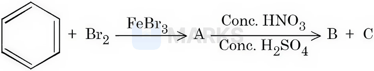

(1) steam distillation  (2) simple distillation  (3) sublimation  (4) fractional distillation

**Answer: (4)** · key (compiled)

**Solution.** Bromination of benzene gives bromobenzene (A); nitration of bromobenzene (Br is $o,p$-directing) gives $o$- and $p$-bromonitrobenzene (B and C). They are liquids/solids of close boiling points (261 °C and 256 °C), so they are separated by *fractional* distillation; simple distillation cannot resolve close boiling points, steam distillation is the classic method for $o$-/$p$-nitrophenols (intramolecular H-bonding), and the compounds are not sublimable here.

### § — JEE Main 2026 · 28 Jan Shift 1 · set Q12 · MCQ

Given below are two statements for the following reaction sequence.

Statement I: Compound 'Z' will give a yellow precipitate with NaOI.
Statement II: Compound 'Q' has two different types of 'H' atoms (aromatic : aliphatic) in the ratio 1 : 3.

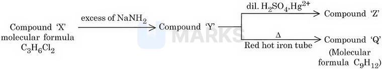

(1) Both Statement I and Statement II are false  (2) Statement I is true but Statement II is false  (3) Both Statement I and Statement II are true  (4) Statement I is false but Statement II is true

**Answer: (3)** · key (compiled)

**Solution.** X ($\mathrm{C_3H_6Cl_2}$, a *gem*-dichloride) with excess $\mathrm{NaNH_2}$ gives propyne, Y = $\mathrm{CH_3C{\equiv}CH}$. Y with dil. $\mathrm{H_2SO_4/Hg^{2+}}$ gives acetone (Z), a methyl ketone, so it gives the iodoform test with NaOI (I true). Passing Y through a red-hot iron tube trimerises it to mesitylene (1,3,5-trimethylbenzene, Q, $\mathrm{C_9H_{12}}$), which has 3 aromatic H and 9 methyl H, a 1 : 3 ratio (II true).

