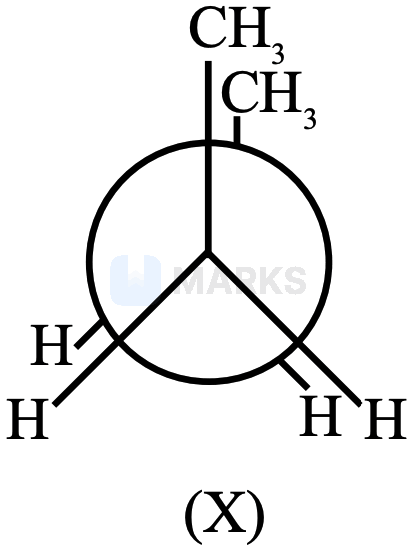
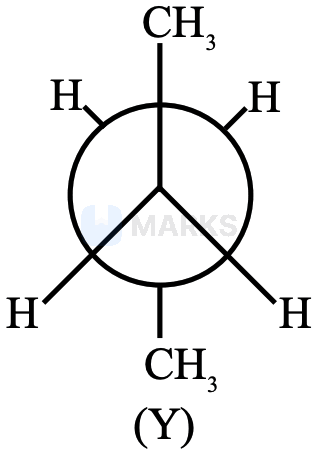
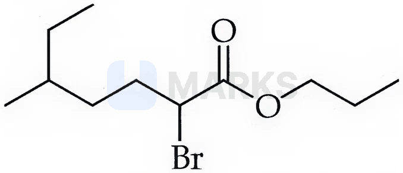

# IUPAC Nomenclature & Isomerism

> Theory: [../../theory/chemistry/iupac-isomerism.md](../../theory/chemistry/iupac-isomerism.md)

### C-ISO-01 · C — JEE Main 2026 · 21 Jan Shift 2 · Isomerism set Q1 · MCQ

Match List-I with List-II.

| List-I (pair of compounds) | List-II (type of isomers) |
|---|---|
| A. 2-Methylpropene and but-1-ene | I. Stereoisomers |
| B. cis-But-2-ene and trans-but-2-ene | II. Position isomers |
| C. 2-Butanol and diethyl ether | III. Chain isomers |
| D. But-1-ene and but-2-ene | IV. Functional group isomers |

(1) A-II, B-I, C-IV, D-III  (2) A-III, B-I, C-II, D-IV  (3) A-I, B-IV, C-III, D-II  (4) A-III, B-I, C-IV, D-II

**Answer: (4)** · key (compiled)

**Solution.** A: same formula $\mathrm{C_4H_8}$, branched vs straight chain – chain isomers (III). B: same connectivity, different spatial arrangement – stereoisomers (I). C: alcohol vs ether ($\mathrm{C_4H_{10}O}$) – functional isomers (IV). D: double bond at a different position – position isomers (II).

### C-ISO-02 · C — JEE Main 2026 · 21 Jan Shift 2 · Isomerism set Q2 · MCQ

Given below are four compounds: (a) n-propyl chloride, (b) iso-propyl chloride, (c) sec-butyl chloride, (d) neo-pentyl chloride. The percentage of carbon in the one which exhibits optical isomerism is:

(1) 56  (2) 40  (3) 52  (4) 46

**Answer: (3)** · key (compiled)

**Solution.** Only sec-butyl chloride, $\mathrm{CH_3CH_2\overset{*}{C}HClCH_3}$ (2-chlorobutane), has a chiral carbon. $\mathrm{C_4H_9Cl}$: $M=48+9+35.5=92.5$, so $\%\mathrm C=\dfrac{48}{92.5}\times100=51.9\approx52$.

### C-ISO-03 · C — JEE Main 2026 · 24 Jan Shift 2 · Isomerism set Q6 · MCQ

Given below are two statements:

Statement I: There are several conformers of n-butane. Of these, (X) is the least stable and (Y) is the most stable conformer.  
Statement II: As the dihedral angle increases, the torsional strain decreases from (X) to (Y).

(1) Statement I is true but Statement II is false  (2) Both Statement I and Statement II are true  (3) Statement I is false but Statement II is true  (4) Both Statement I and Statement II are false

**Answer: (2)** · key (compiled)

**Solution.** In (X) the two methyl groups are eclipsed (dihedral angle $0^\circ$): the fully eclipsed conformer, the least stable (torsional + steric strain). In (Y) the methyls are anti ($180^\circ$): the most stable conformer. Going from $0^\circ$ to $180^\circ$ the strain falls from its maximum to its minimum (with a smaller eclipsed maximum at $120^\circ$ and the gauche minimum at $60^\circ$), so both statements are accepted as true.

### C-ISO-04 · C — JEE Main 2026 · 22 Jan Shift 2 · Isomerism set Q9 · MCQ

The IUPAC name of the following compound is:

(1) n-propyl 2-bromo-5-methylheptanoate  (2) n-propyl 1-bromo-4-methylhexanoate  (3) 2-bromo-5-methylpropanoate  (4) 2-bromo-5-methylhexylpropanoate

**Answer: (1)** · key (compiled)

**Solution.** It is an ester: the alkyl part (on O) is n-propyl. The acid part: the longest chain containing the carbonyl carbon runs C1 (C=O) – C2 (CHBr) – C3 – C4 – C5 (branch point) – C6 – C7 (through the ethyl group), so it is a heptanoate with Br at C2 and a methyl at C5: **n-propyl 2-bromo-5-methylheptanoate**.

### C-ISO-05 · C — JEE Main 2026 · 21 Jan Shift 1 · Isomerism set Q15 · MCQ

Identify the correct statements:

A. Propanal and propanone are functional isomers.  
B. Ethoxyethane and methoxypropane are metamers.  
C. But-2-ene shows optical isomerism.  
D. But-1-ene and but-2-ene are functional isomers.  
E. Pentane and 2,2-dimethylpropane are chain isomers.

(1) A, B and C only  (2) B, C and D only  (3) C, D and E only  (4) A, B and E only

**Answer: (4)** · key (compiled)

**Solution.** A true (aldehyde vs ketone, $\mathrm{C_3H_6O}$). B true (same functional group, different alkyl groups on O: $\mathrm{C_2H_5OC_2H_5}$ and $\mathrm{CH_3OC_3H_7}$). C false (but-2-ene has no chiral centre; it shows geometrical isomerism). D false (they are position isomers). E true ($\mathrm{C_5H_{12}}$, straight vs branched chain).

### C-ISO-06 · C — JEE Main 2024 · 30 Jan Shift 2 · Q34 · MCQ

The IUPAC name of $\text{CH}_3\text{-CH(NH}_2)\text{-CH}_2\text{-CN}$ is

(1) 2-Aminopentanenitrile  (2) 2-Aminobutanenitrile  (3) 3-Aminobutanenitrile  (4) 3-Aminopropanenitrile

**Answer: (3)** · key ✔

**Solution.** The nitrile carbon is C-1: $\overset{4}{\text{C}}\text{H}_3-\overset{3}{\text{C}}\text{H(NH}_2)-\overset{2}{\text{C}}\text{H}_2-\overset{1}{\text{C}}\text{N}$. The chain has $4$ carbons with $-\text{NH}_2$ at C-3: 3-aminobutanenitrile.

### C-ISO-07 · C — JEE Main 2024 · 31 Jan Shift 1 · Q37 · MCQ

Statement I: The IUPAC name of $\text{HO-CH}_2\text{-(CH}_2)_3\text{-CH}_2\text{-COCH}_3$ is 7-hydroxyheptan-2-one.  
Statement II: 2-Oxoheptan-7-ol is the correct IUPAC name for the same compound.

(1) I correct, II incorrect  (2) Both incorrect  (3) Both correct  (4) I incorrect, II correct

**Answer: (1)** · key ✔

**Solution.** The principal characteristic group is the ketone (it outranks alcohol), so the chain is numbered from the end giving C=O the lowest locant: $\text{CH}_3\text{-CO-(CH}_2)_4\text{-CH}_2\text{OH}$ is heptan-2-one with OH at C-7. II uses "oxo" as a prefix and "-ol" as the suffix, which is wrong.

### C-ISO-08 · C — JEE Main 2024 · 1 Feb Shift 1 · Q39 · MCQ

Statement I: Aminobenzene and aniline are the same organic compound.  
Statement II: Aminobenzene and aniline are different organic compounds.

(1) Both true  (2) I true, II false  (3) I false, II true  (4) Both false

**Answer: (2)** · key ✔

**Solution.** Aniline is the common name and aminobenzene the IUPAC name of $\text{C}_6\text{H}_5\text{NH}_2$, so I is true and II is false.

### C-ISO-09 · C — JEE Main 2024 · 1 Feb Shift 2 · Q54 · Numerical

The total number of isomeric compounds (including stereoisomers) formed by monochlorination of 2-methylbutane is ______.

**Answer: 6** · key ✔

**Solution.** $(\text{CH}_3)_2\text{CH-CH}_2\text{CH}_3$ has four types of H: (i) $\text{ClCH}_2\text{CH(CH}_3)\text{CH}_2\text{CH}_3$ – chiral, $2$; (ii) $(\text{CH}_3)_2\text{CCl-CH}_2\text{CH}_3$ – $1$; (iii) $(\text{CH}_3)_2\text{CH-CHClCH}_3$ – chiral, $2$; (iv) $(\text{CH}_3)_2\text{CH-CH}_2\text{CH}_2\text{Cl}$ – $1$. Total $=6$.

### C-ISO-10 · C — JEE Main 2024 · 4 Apr Shift 1 · Q55 · Numerical

The number of different chain isomers for $\text{C}_7\text{H}_{16}$ is ______.

**Answer: 9** · key ✔

**Solution.** Heptane, 2-methylhexane, 3-methylhexane, 2,2-, 2,3-, 2,4-, 3,3-dimethylpentane, 3-ethylpentane and 2,2,3-trimethylbutane: $9$ isomers.

### C-ISO-11 · C — JEE Main 2024 · 4 Apr Shift 2 · Q54 · Numerical

The total number of $\sigma$ and $\pi$ bonds in 2-oxohex-4-ynoic acid is ______.

**Answer: 18** · key ✔

**Solution.** Structure: $\text{HOOC-CO-CH}_2\text{-C}\equiv\text{C-CH}_3$. $\sigma$ bonds: C–C $5$ (including the $\sigma$ of the triple bond), C–H $5$, O–H $1$, C–O $1$, C=O $2$ = $14$. $\pi$ bonds: $2$ (two C=O) $+2$ (C≡C) $=4$. Total $14+4=18$.

### C-ISO-12 · C — JEE Main 2024 · 5 Apr Shift 1 · Q39 · MCQ

Assertion A: The cis form of an alkene is more polar than the trans form.  
Reason R: The dipole moment of trans-2-butene is zero.

(1) A false, R true  (2) Both true, R explains A  (3) A true, R false  (4) Both true, R does not explain A

**Answer: (2)** · key ✔

**Solution.** In the cis isomer the two $\text{C-CH}_3$ bond dipoles add to a resultant; in the trans isomer they are equal and opposite and cancel, giving $\mu=0$. R is true and explains A.

