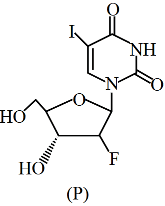

# Mole Concept & Stoichiometry

> Theory: [../../theory/chemistry/mole-concept.md](../../theory/chemistry/mole-concept.md)

### C-MOL-01 · A — JEE Main 2026 · 21 Jan Shift 2 · set Q1 · MCQ

Aqueous HCl reacts with $\mathrm{MnO_2(s)}$ to form $\mathrm{MnCl_2(aq)}$, $\mathrm{Cl_2(g)}$ and $\mathrm{H_2O(l)}$. What is the weight (in g) of $\mathrm{Cl_2}$ liberated when 8.7 g of $\mathrm{MnO_2(s)}$ is reacted with excess aqueous HCl solution? (Given molar mass in g mol$^{-1}$: Mn = 55, Cl = 35.5, O = 16, H = 1)

(1) 21.3  (2) 71  (3) 14.2  (4) 7.1

**Answer: (4)** · key (compiled)

**Solution.** $\mathrm{MnO_2+4HCl\to MnCl_2+Cl_2+2H_2O}$. $n(\mathrm{MnO_2})=\dfrac{8.7}{87}=0.1$ mol gives $0.1$ mol $\mathrm{Cl_2}$, i.e. $0.1\times71=7.1$ g.

### C-MOL-02 · A — JEE Main 2026 · 28 Jan Shift 2 · set Q2 · MCQ

For the reaction $\mathrm{CaCO_3+2HCl\to CaCl_2+H_2O+CO_2}$: if 90 g $\mathrm{CaCO_3}$ is added to 300 mL of HCl which contains 38.55% HCl by mass and has density $1.13$ g mL$^{-1}$, which of the following options is correct? (Given molar mass of H, Cl, Ca and O are 1, 35.5, 40 and 16 g mol$^{-1}$ respectively.)

(1) 64.97 g of HCl remains unreacted  (2) 60.32 g of HCl remains unreacted  (3) 97.30 g of HCl reacted  (4) 32.85 g of $\mathrm{CaCO_3}$ remains unreacted

**Answer: (1)** · key (compiled)

**Solution.** Mass of solution $=300\times1.13=339$ g, HCl $=339\times0.3855=130.7$ g $=3.58$ mol. $\mathrm{CaCO_3}=\dfrac{90}{100}=0.9$ mol needs $1.8$ mol HCl, so $\mathrm{CaCO_3}$ is limiting and HCl is in excess: left over $=(3.58-1.8)\times36.5=64.97$ g.

### C-MOL-03 · A — JEE Main 2026 · 22 Jan Shift 2 · set Q3 · MCQ

$\mathrm{A+2B\to AB_2}$. 36.0 g of 'A' (molar mass 60 g mol$^{-1}$) and 56.0 g of 'B' (molar mass 80 g mol$^{-1}$) are allowed to react. Which of the following statements are correct?

A. 'A' is the limiting reagent.  
B. 77.0 g of $\mathrm{AB_2}$ is formed.  
C. The molar mass of $\mathrm{AB_2}$ is 140 g mol$^{-1}$.  
D. 15.0 g of A is left unreacted after the completion of the reaction.

(1) C and D only  (2) A and B only  (3) A and C only  (4) B and D only

**Answer: (4)** · key (compiled)

**Solution.** $n_A=\dfrac{36}{60}=0.6$ mol, $n_B=\dfrac{56}{80}=0.7$ mol. 0.6 mol of A would need 1.2 mol of B, so **B is limiting** (A false). $n(\mathrm{AB_2})=\dfrac{0.7}{2}=0.35$ mol, and $M(\mathrm{AB_2})=60+2\times80=220$ g mol$^{-1}$ (C false), so mass $=0.35\times220=77.0$ g (B true). A left $=0.6-0.35=0.25$ mol $=15.0$ g (D true).

### C-MOL-04 · A — JEE Main 2026 · 22 Jan Shift 1 · set Q4 · MCQ

In the reaction $\mathrm{2Al(s)+6HCl(aq)\to2Al^{3+}(aq)+6Cl^-(aq)+3H_2(g)}$:

(1) 11.2 L $\mathrm{H_2(g)}$ at STP is produced for every mole of HCl consumed.  (2) 33.6 L $\mathrm{H_2(g)}$ is produced regardless of temperature and pressure for every mole of Al that reacts.  (3) 12 L HCl(aq) is consumed for every 6 L $\mathrm{H_2(g)}$ produced.  (4) 67.2 L $\mathrm{H_2(g)}$ at STP is produced for every mole of Al that reacts.

**Answer: (1)** · key (compiled)

**Solution.** 6 mol HCl gives 3 mol $\mathrm{H_2}$, so 1 mol HCl gives 0.5 mol $\mathrm{H_2}=11.2$ L at STP – (1) true. (2) false: the gas volume depends on $T$ and $p$ (33.6 L is the volume at STP only). (3) false: HCl(aq) is a solution; litres of solution have no fixed relation to litres of gas. (4) false: 1 mol Al gives 1.5 mol $\mathrm{H_2}=33.6$ L, not 67.2 L.

### C-MOL-05 · A — JEE Main 2026 · 21 Jan Shift 1 · set Q5 · MCQ

14.0 g of calcium metal is allowed to react with excess HCl at 1.0 atm pressure and 273 K. Which of the following statements is incorrect? [Given: molar mass in g mol$^{-1}$: Ca 40, Cl 35.5, H 1]

(1) 0.35 mol of $\mathrm{H_2}$ gas is evolved.  (2) 7.84 L of $\mathrm{H_2}$ gas is evolved.  (3) The limiting reagent is calcium metal.  (4) 33.3 g of $\mathrm{CaCl_2}$ is produced.

**Answer: (4)** · key (compiled)

**Solution.** $\mathrm{Ca+2HCl\to CaCl_2+H_2}$. $n(\mathrm{Ca})=\dfrac{14}{40}=0.35$ mol gives $0.35$ mol $\mathrm{H_2}$ (1 true), $0.35\times22.4=7.84$ L (2 true); HCl is in excess so Ca is limiting (3 true). $\mathrm{CaCl_2}=0.35\times111=38.85$ g, not 33.3 g – (4) is incorrect.

### C-MOL-06 · A — JEE Main 2026 · 21 Jan Shift 1 · set Q6 · MCQ

80 mL of a hydrocarbon on mixing with 264 mL of oxygen in a closed U-tube undergoes complete combustion. The residual gases after cooling to 273 K occupy 224 mL. When the system is treated with KOH solution, the volume decreases to 64 mL. The formula of the hydrocarbon is:

(1) $\mathrm{C_2H_2}$  (2) $\mathrm{C_2H_4}$  (3) $\mathrm{C_2H_6}$  (4) $\mathrm{C_4H_{10}}$

**Answer: (1)** · key (compiled)

**Solution.** KOH absorbs $\mathrm{CO_2}$: $V(\mathrm{CO_2})=224-64=160$ mL; the remaining 64 mL is unused $\mathrm{O_2}$, so $\mathrm{O_2}$ consumed $=264-64=200$ mL (water condenses). For $\mathrm{C_xH_y}$: $x=\dfrac{160}{80}=2$ and $x+\dfrac y4=\dfrac{200}{80}=2.5\Rightarrow y=2$. The hydrocarbon is $\mathrm{C_2H_2}$.

### C-MOL-07 · A — JEE Main 2025 · Jan session · Mole set Q1 · Numerical

20 mL of 2 M NaOH solution is added to 400 mL of 0.5 M NaOH solution. The final concentration of the solution is ______ $\times10^{-2}$ M. (Nearest integer)

**Answer: 57** · key (compiled)

**Solution.** Moles $=0.020\times2+0.400\times0.5=0.24$ mol in 0.420 L: $M=0.5714=57.14\times10^{-2}$ M, so the answer is 57.

### C-MOL-08 · A — JEE Main 2025 · Jan session · Mole set Q2 · Numerical

The hydrocarbon (X) with molar mass 80 g mol$^{-1}$ and 90% carbon has ______ degree of unsaturation.

**Answer: 3** · key (compiled)

**Solution.** Carbon $=0.9\times80=72$ g, i.e. 6 C atoms; hydrogen $=8$ g, i.e. 8 H atoms: C$_6$H$_8$. Degree of unsaturation $=\dfrac{2\cdot6+2-8}2=3$.

### C-MOL-09 · A — JEE Main 2025 · Jan session · Mole set Q3 · MCQ

The elemental composition of a compound is 54.2% C, 9.2% H and 36.6% O. If the molar mass of the compound is 132 g mol$^{-1}$, the molecular formula of the compound is: [Given: relative atomic mass of C : H : O = 12 : 1 : 16]

(1) C$_4$H$_9$O$_3$  (2) C$_6$H$_{12}$O$_6$  (3) C$_4$H$_8$O$_2$  (4) C$_6$H$_{12}$O$_3$

**Answer: (4)** · key (compiled)

**Solution.** Mole ratio $C:H:O=\dfrac{54.2}{12}:\dfrac{9.2}1:\dfrac{36.6}{16}=4.52:9.2:2.29\approx2:4:1$, so the empirical formula is C$_2$H$_4$O (mass 44). $\dfrac{132}{44}=3$, giving C$_6$H$_{12}$O$_3$.

### C-MOL-10 · B — JEE Main 2025 · Jan session · Mole set Q4 · MCQ

$2.8\times10^{-3}$ mol of CO$_2$ is left after removing $10^{21}$ molecules from its '$x$' mg sample. The mass of CO$_2$ taken initially is: Given $N_A=6.02\times10^{23}$ mol$^{-1}$.

(1) 98.3 mg  (2) 48.2 mg  (3) 196.2 mg  (4) 150.4 mg

**Answer: (3)** · key (compiled)

**Solution.** Moles removed $=\dfrac{10^{21}}{6.02\times10^{23}}=1.66\times10^{-3}$. Initial moles $=(2.8+1.66)\times10^{-3}=4.46\times10^{-3}$, and the mass is $4.46\times10^{-3}\times44=196.2$ mg.

### C-MOL-11 · B — JEE Main 2025 · Jan session · Mole set Q5 · Numerical

0.01 mole of an organic compound (X) containing 10% hydrogen, on complete combustion produced 0.9 g H$_2$O. The molar mass of (X) is ______ g mol$^{-1}$.

**Answer: 100** · key (compiled)

**Solution.** 0.9 g H$_2$O is 0.05 mol, containing 0.1 mol (0.1 g) of H. This hydrogen comes from 0.01 mol of (X) and is 10% of its mass, so 0.01 mol has mass 1 g and $M=100$ g mol$^{-1}$.

### C-MOL-12 · B — JEE Main 2025 · Apr session · Mole set Q1 · Numerical

The amount of calcium oxide produced on heating 150 kg limestone (75% pure) is ______ kg. (Nearest integer) Given: molar mass (in g mol$^{-1}$) of Ca 40, O 16, C 12.

**Answer: 63** · key (compiled)

**Solution.** Pure CaCO$_3$ $=0.75\times150=112.5$ kg. CaCO$_3$ → CaO + CO$_2$: CaO $=\dfrac{56}{100}\times112.5=63$ kg.

### C-MOL-13 · B — JEE Main 2025 · Apr session · Mole set Q2 · Numerical

20 mL of sodium iodide solution gave 4.74 g silver iodide when treated with excess of silver nitrate solution. The molarity of the sodium iodide solution is ______ M. (Nearest integer) (Na = 23, I = 127, Ag = 108, N = 14, O = 16 g mol$^{-1}$)

**Answer: 1** · key (compiled)

**Solution.** AgI: $M=235$, so moles $=\dfrac{4.74}{235}=0.0202$ mol $=$ moles of NaI. $M=\dfrac{0.0202}{0.020}=1.01\approx1$ M.

### C-MOL-14 · B — JEE Main 2025 · Apr session · Mole set Q3 · Numerical

0.1 mol of the antiviral compound (P) shown in the figure will weigh ______ $\times10^{-1}$ g. (Given: molar mass in g mol$^{-1}$ H 1, C 12, N 14, O 16, F 19, I 127.)

**Answer: 372** · key (compiled)

**Solution.** Counting atoms in the structure: the iodouracil ring gives C$_4$H$_2$IN$_2$O$_2$ (two ring H: one on N and one on C), and the fluorinated deoxy-sugar gives C$_5$H$_8$FO$_3$. The formula is C$_9$H$_{10}$FIN$_2$O$_5$: $108+10+19+127+28+80=372$ g mol$^{-1}$. 0.1 mol weighs 37.2 g $=372\times10^{-1}$ g.

### C-MOL-15 · B — JEE Main 2025 · Apr session · Mole set Q4 · MCQ

Among $10^{-9}$ g (each) of the following elements, which one will have the highest number of atoms? Elements: Pb, Po, Pr and Pt.

(1) Po  (2) Pr  (3) Pb  (4) Pt

**Answer: (2)** · key (compiled)

**Solution.** For equal masses, the number of atoms is inversely proportional to the atomic mass. Atomic masses: Pb 207, Po 209, Pr 141, Pt 195. Pr has the smallest, so it has the most atoms.

### C-MOL-16 · B — JEE Main 2024 · 27 Jan Shift 1 · Q51 · Numerical

The mass of methane required to produce $22$ g of $\text{CO}_2$ after complete combustion is ______ g. (Molar masses: C = 12.0, H = 1.0, O = 16.0)

**Answer: 8** · key ✔

**Solution.** $\text{CH}_4+2\text{O}_2\to\text{CO}_2+2\text{H}_2\text{O}$. $22$ g $\text{CO}_2=0.5$ mol, so $0.5$ mol $\text{CH}_4=0.5\times16=8$ g.

### C-MOL-17 · B — JEE Main 2024 · 27 Jan Shift 2 · Q51 · Numerical

The volume of $3$ M NaOH (formula weight $40\ \text{g mol}^{-1}$) which can be prepared from $84$ g of NaOH is ______ $\times10^{-1}\ \text{dm}^3$.

**Answer: 7** · key ✔

**Solution.** Moles of NaOH $=84/40=2.1$. Volume $=\dfrac{2.1}{3}=0.7\ \text{dm}^3=7\times10^{-1}\ \text{dm}^3$.

### C-MOL-18 · C — JEE Main 2024 · 29 Jan Shift 2 · Q56 · Numerical

$50$ mL of $0.5$ M oxalic acid is required to neutralise $25$ mL of NaOH solution. The amount of NaOH in $50$ mL of the given solution is ______ g.

**Answer: 4** · key ✔

**Solution.** Oxalic acid is dibasic: $n$-factor $=2$. Milliequivalents $=50\times0.5\times2=50$. So $25\times N_{\text{NaOH}}=50\Rightarrow N=2$ N $=2$ M. In $50$ mL: $0.1$ mol $\times40=4$ g.

### C-MOL-19 · C — JEE Main 2024 · 31 Jan Shift 2 · Q31 · MCQ

A sample of $\text{CaCO}_3$ and $\text{MgCO}_3$ weighing $2.21$ g is ignited to a constant weight of $1.152$ g. The composition of the mixture is (molar masses: $\text{CaCO}_3$ 100, $\text{MgCO}_3$ 84 g mol$^{-1}$)

(1) $1.187$ g $\text{CaCO}_3$ + $1.023$ g $\text{MgCO}_3$  (2) $1.023$ g $\text{CaCO}_3$ + $1.023$ g $\text{MgCO}_3$  (3) $1.187$ g $\text{CaCO}_3$ + $1.187$ g $\text{MgCO}_3$  (4) $1.023$ g $\text{CaCO}_3$ + $1.187$ g $\text{MgCO}_3$

**Answer: (1)** · key ✔

**Solution.** Let $x$ g be $\text{CaCO}_3$ (leaving $\text{CaO}$, mass ratio $\tfrac{56}{100}$) and $2.21-x$ g $\text{MgCO}_3$ (leaving $\text{MgO}$, ratio $\tfrac{40}{84}$). $0.56x+0.4762(2.21-x)=1.152\Rightarrow0.0838x=0.0996\Rightarrow x=1.187$ g. So $\text{MgCO}_3=1.023$ g.

### C-MOL-20 · C — JEE Main 2024 · 1 Feb Shift 2 · Q51 · Numerical

$10$ mL of a gaseous hydrocarbon on combustion gives $40$ mL $\text{CO}_2(g)$ and $50$ mL water vapour. The total number of carbon and hydrogen atoms in the hydrocarbon is ______.

**Answer: 14** · key ✔

**Solution.** By Avogadro's law, volumes are in mole ratio: $\text{C}_x\text{H}_y$ : $\text{CO}_2$ : $\text{H}_2\text{O}=1:4:5$. So $x=4$, $y=10$ ($\text{C}_4\text{H}_{10}$). Total atoms $=14$.

### C-MOL-21 · C — JEE Main 2024 · 4 Apr Shift 1 · Q39 · MCQ

The molarity of an aqueous solution containing $5.85$ g of NaCl in $500$ mL of water is (Na $=23$, Cl $=35.5$ g mol$^{-1}$):

(1) 2  (2) 20  (3) 4  (4) 0.2

**Answer: (4)** · key ✔

**Solution.** $n=\dfrac{5.85}{58.5}=0.1$ mol; $M=\dfrac{0.1}{0.5\ \text{L}}=0.2$ M.

### C-MOL-22 · C — JEE Main 2024 · 5 Apr Shift 1 · Q31 · MCQ

An organic compound has $42.1\%$ carbon, $6.4\%$ hydrogen and the rest oxygen. If its molecular weight is $342$, its molecular formula is:

(1) $\text{C}_{11}\text{H}_{18}\text{O}_{12}$  (2) $\text{C}_{12}\text{H}_{20}\text{O}_{12}$  (3) $\text{C}_{12}\text{H}_{22}\text{O}_{11}$  (4) $\text{C}_{14}\text{H}_{20}\text{O}_{10}$

**Answer: (3)** · key ✔

**Solution.** Oxygen $=51.5\%$. In $342$ g: C $=0.421\times342=144\Rightarrow12$ atoms; H $=0.064\times342=21.9\Rightarrow22$; O $=0.515\times342=176\Rightarrow11$. So $\text{C}_{12}\text{H}_{22}\text{O}_{11}$ (sucrose).

