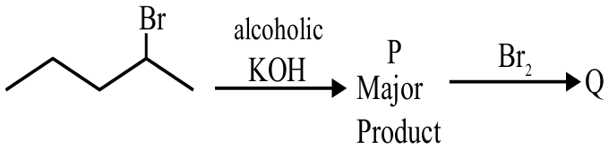

# Mole Concept & Stoichiometry

> Theory: [../../theory/chemistry/mole-concept.md](../../theory/chemistry/mole-concept.md)

### C-MOL-01 — JEE Main 2024 · 27 Jan Shift 1 · Q51 · Numerical

The mass of methane required to produce $22$ g of $\text{CO}_2$ after complete combustion is ______ g. (Molar masses: C = 12.0, H = 1.0, O = 16.0)

**Answer: 8** · key ✔

**Solution.** $\text{CH}_4+2\text{O}_2\to\text{CO}_2+2\text{H}_2\text{O}$. $22$ g $\text{CO}_2=0.5$ mol, so $0.5$ mol $\text{CH}_4=0.5\times16=8$ g.

### C-MOL-02 — JEE Main 2024 · 27 Jan Shift 2 · Q51 · Numerical

The volume of $3$ M NaOH (formula weight $40\ \text{g mol}^{-1}$) which can be prepared from $84$ g of NaOH is ______ $\times10^{-1}\ \text{dm}^3$.

**Answer: 7** · key ✔

**Solution.** Moles of NaOH $=84/40=2.1$. Volume $=\dfrac{2.1}{3}=0.7\ \text{dm}^3=7\times10^{-1}\ \text{dm}^3$.

### C-MOL-03 — JEE Main 2024 · 29 Jan Shift 2 · Q56 · Numerical

$50$ mL of $0.5$ M oxalic acid is required to neutralise $25$ mL of NaOH solution. The amount of NaOH in $50$ mL of the given solution is ______ g.

**Answer: 4** · key ✔

**Solution.** Oxalic acid is dibasic: $n$-factor $=2$. Milliequivalents $=50\times0.5\times2=50$. So $25\times N_{\text{NaOH}}=50\Rightarrow N=2$ N $=2$ M. In $50$ mL: $0.1$ mol $\times40=4$ g.

### C-MOL-04 — JEE Main 2024 · 30 Jan Shift 1 · Q58 · Numerical

The mass of sodium acetate ($\text{CH}_3\text{COONa}$) required to prepare $250$ mL of $0.35$ M aqueous solution is ______ g. (Molar mass of $\text{CH}_3\text{COONa}=82.02\ \text{g mol}^{-1}$; round off to the nearest integer.)

**Answer: 7** · key ✔

**Solution.** Moles $=0.35\times0.250=0.0875$. Mass $=0.0875\times82.02=7.18\approx7$ g.

### C-MOL-05 — JEE Main 2024 · 31 Jan Shift 2 · Q31 · MCQ

A sample of $\text{CaCO}_3$ and $\text{MgCO}_3$ weighing $2.21$ g is ignited to a constant weight of $1.152$ g. The composition of the mixture is (molar masses: $\text{CaCO}_3$ 100, $\text{MgCO}_3$ 84 g mol$^{-1}$)

(1) $1.187$ g $\text{CaCO}_3$ + $1.023$ g $\text{MgCO}_3$  (2) $1.023$ g $\text{CaCO}_3$ + $1.023$ g $\text{MgCO}_3$  (3) $1.187$ g $\text{CaCO}_3$ + $1.187$ g $\text{MgCO}_3$  (4) $1.023$ g $\text{CaCO}_3$ + $1.187$ g $\text{MgCO}_3$

**Answer: (1)** · key ✔

**Solution.** Let $x$ g be $\text{CaCO}_3$ (leaving $\text{CaO}$, mass ratio $\tfrac{56}{100}$) and $2.21-x$ g $\text{MgCO}_3$ (leaving $\text{MgO}$, ratio $\tfrac{40}{84}$). $0.56x+0.4762(2.21-x)=1.152\Rightarrow0.0838x=0.0996\Rightarrow x=1.187$ g. So $\text{MgCO}_3=1.023$ g.

### C-MOL-06 — JEE Main 2024 · 31 Jan Shift 2 · Q51 · Numerical

The molarity of $1$ L orthophosphoric acid ($\text{H}_3\text{PO}_4$) having $70\%$ purity by weight (specific gravity $1.54\ \text{g cm}^{-3}$) is ______ M. (Molar mass of $\text{H}_3\text{PO}_4=98\ \text{g mol}^{-1}$)

**Answer: 11** · key ✔

**Solution.** Mass of $1$ L solution $=1540$ g, of which $70\%$ is acid: $1078$ g. Moles $=\dfrac{1078}{98}=11$, in $1$ L, so molarity $=11$ M.

### C-MOL-07 — JEE Main 2024 · 1 Feb Shift 1 · Q51 · Numerical

For $3\text{PbCl}_2+2(\text{NH}_4)_3\text{PO}_4\to \text{Pb}_3(\text{PO}_4)_2+6\text{NH}_4\text{Cl}$: if $72$ mmol $\text{PbCl}_2$ is mixed with $50$ mmol $(\text{NH}_4)_3\text{PO}_4$, the amount of $\text{Pb}_3(\text{PO}_4)_2$ formed is ______ mmol (nearest integer).

**Answer: 24** · key ✔

**Solution.** From $\text{PbCl}_2$: $72/3=24$ mmol of product. From phosphate: $50/2=25$ mmol. The smaller value fixes the limiting reagent ($\text{PbCl}_2$): $24$ mmol.

### C-MOL-08 — JEE Main 2024 · 1 Feb Shift 2 · Q51 · Numerical

$10$ mL of a gaseous hydrocarbon on combustion gives $40$ mL $\text{CO}_2(g)$ and $50$ mL water vapour. The total number of carbon and hydrogen atoms in the hydrocarbon is ______.

**Answer: 14** · key ✔

**Solution.** By Avogadro's law, volumes are in mole ratio: $\text{C}_x\text{H}_y$ : $\text{CO}_2$ : $\text{H}_2\text{O}=1:4:5$. So $x=4$, $y=10$ ($\text{C}_4\text{H}_{10}$). Total atoms $=14$.

### C-MOL-09 — JEE Main 2024 · 1 Feb Shift 2 · Q53 · Numerical

In Kjeldahl's method, $1$ g of an organic compound released ammonia that neutralised $10$ mL of $2\ \text{M}\ \text{H}_2\text{SO}_4$. The percentage of nitrogen is ______ %.

**Answer: 56** · key ✔

**Solution.** $10$ mL $\times2$ M $=20$ mmol $\text{H}_2\text{SO}_4$, which neutralises $40$ mmol $\text{NH}_3$ ($2\text{NH}_3+\text{H}_2\text{SO}_4$). $40$ mmol N $=0.56$ g, so $56\%$.

### C-MOL-10 — JEE Main 2024 · 4 Apr Shift 1 · Q39 · MCQ

The molarity of an aqueous solution containing $5.85$ g of NaCl in $500$ mL of water is (Na $=23$, Cl $=35.5$ g mol$^{-1}$):

(1) 2  (2) 20  (3) 4  (4) 0.2

**Answer: (4)** · key ✔

**Solution.** $n=\dfrac{5.85}{58.5}=0.1$ mol; $M=\dfrac{0.1}{0.5\ \text{L}}=0.2$ M.

### C-MOL-11 — JEE Main 2024 · 4 Apr Shift 1 · Q54 · Numerical

Only $2$ mL of $\text{KMnO}_4$ solution of unknown molarity is required to reach the end point of a titration of $20$ mL of oxalic acid ($2$ M) in acidic medium. The molarity of the $\text{KMnO}_4$ solution should be ______ M.

**Answer: 8** · key ✔

**Solution.** Equivalents: $\text{KMnO}_4$ has $n=5$, oxalic acid $n=2$. $M\times5\times2=2\times2\times20\Rightarrow M=8$ M.

### C-MOL-12 — JEE Main 2024 · 5 Apr Shift 1 · Q31 · MCQ

An organic compound has $42.1\%$ carbon, $6.4\%$ hydrogen and the rest oxygen. If its molecular weight is $342$, its molecular formula is:

(1) $\text{C}_{11}\text{H}_{18}\text{O}_{12}$  (2) $\text{C}_{12}\text{H}_{20}\text{O}_{12}$  (3) $\text{C}_{12}\text{H}_{22}\text{O}_{11}$  (4) $\text{C}_{14}\text{H}_{20}\text{O}_{10}$

**Answer: (3)** · key ✔

**Solution.** Oxygen $=51.5\%$. In $342$ g: C $=0.421\times342=144\Rightarrow12$ atoms; H $=0.064\times342=21.9\Rightarrow22$; O $=0.515\times342=176\Rightarrow11$. So $\text{C}_{12}\text{H}_{22}\text{O}_{11}$ (sucrose).

### C-MOL-13 — JEE Main 2024 · 5 Apr Shift 1 · Q32 · MCQ

The incorrect postulates of Dalton's atomic theory are: (A) Atoms of different elements differ in mass. (B) Matter consists of divisible atoms. (C) Compounds are formed when atoms of different elements combine in a fixed ratio. (D) All atoms of a given element have different properties including mass. (E) Chemical reactions involve reorganisation of atoms.

(1) (C), (D), (E) only  (2) (B), (D) only  (3) (A), (B), (D) only  (4) (B), (D), (E) only

**Answer: (2)** · key ✔

**Solution.** Dalton's actual postulates: atoms are *indivisible* (so B is wrong) and all atoms of an element are *identical* in mass and properties (so D is wrong). A, C and E are true statements of the theory.

### C-MOL-14 — JEE Main 2024 · 5 Apr Shift 2 · Q31 · MCQ

The number of moles of methane required to produce $11$ g of $\text{CO}_2(g)$ after complete combustion is (molar mass of methane $=16$ g mol$^{-1}$):

(1) 0.35  (2) 0.5  (3) 0.75  (4) 0.25

**Answer: (4)** · key ✔

**Solution.** $\text{CH}_4+2\text{O}_2\to\text{CO}_2+2\text{H}_2\text{O}$. $11$ g $\text{CO}_2=\dfrac{11}{44}=0.25$ mol, so $0.25$ mol of methane is needed (1:1).

### C-MOL-15 — JEE Main 2024 · 8 Apr Shift 1 · Q31 · MCQ

The amount of oxygen (in g) required for the complete combustion of $900$ g of glucose is ($M$ of glucose $=180$ g mol$^{-1}$):

(1) 480  (2) 800  (3) 960  (4) 32

**Answer: (3)** · key ✔

**Solution.** $\text{C}_6\text{H}_{12}\text{O}_6+6\text{O}_2\to6\text{CO}_2+6\text{H}_2\text{O}$. $900$ g $=5$ mol glucose needs $30$ mol $\text{O}_2=30\times32=960$ g.

### C-MOL-16 — JEE Main 2024 · 9 Apr Shift 1 · Q34 · MCQ

Identify the incorrect statements regarding a primary standard in titrimetric analysis. (A) It should be available in pure, dry form. (B) It should not undergo chemical change in air. (C) It should be hygroscopic and should react with another chemical instantaneously and stoichiometrically. (D) It should be readily soluble in water. (E) $\text{KMnO}_4$ and NaOH can be used as primary standards.

(1) (A), (B) only  (2) (C), (E) only  (3) (B), (E) only  (4) (C), (D) only

**Answer: (2)** · key ✔

**Solution.** A primary standard must be pure, stable in air, **non**-hygroscopic and soluble. C is wrong because it must not be hygroscopic. E is wrong: $\text{KMnO}_4$ (reduced by traces of organic matter) and NaOH (absorbs $\text{CO}_2$ and moisture) are secondary standards.

### § — JEE Main 2026 · 21 Jan Shift 2 · set Q1 · MCQ

Aqueous HCl reacts with $\mathrm{MnO_2(s)}$ to form $\mathrm{MnCl_2(aq)}$, $\mathrm{Cl_2(g)}$ and $\mathrm{H_2O(l)}$. What is the weight (in g) of $\mathrm{Cl_2}$ liberated when 8.7 g of $\mathrm{MnO_2(s)}$ is reacted with excess aqueous HCl solution? (Given molar mass in g mol$^{-1}$: Mn = 55, Cl = 35.5, O = 16, H = 1)

(1) 21.3  (2) 71  (3) 14.2  (4) 7.1

**Answer: (4)** · key (compiled)

**Solution.** $\mathrm{MnO_2+4HCl\to MnCl_2+Cl_2+2H_2O}$. $n(\mathrm{MnO_2})=\dfrac{8.7}{87}=0.1$ mol gives $0.1$ mol $\mathrm{Cl_2}$, i.e. $0.1\times71=7.1$ g.

### § — JEE Main 2026 · 28 Jan Shift 2 · set Q2 · MCQ

For the reaction $\mathrm{CaCO_3+2HCl\to CaCl_2+H_2O+CO_2}$: if 90 g $\mathrm{CaCO_3}$ is added to 300 mL of HCl which contains 38.55% HCl by mass and has density $1.13$ g mL$^{-1}$, which of the following options is correct? (Given molar mass of H, Cl, Ca and O are 1, 35.5, 40 and 16 g mol$^{-1}$ respectively.)

(1) 64.97 g of HCl remains unreacted  (2) 60.32 g of HCl remains unreacted  (3) 97.30 g of HCl reacted  (4) 32.85 g of $\mathrm{CaCO_3}$ remains unreacted

**Answer: (1)** · key (compiled)

**Solution.** Mass of solution $=300\times1.13=339$ g, HCl $=339\times0.3855=130.7$ g $=3.58$ mol. $\mathrm{CaCO_3}=\dfrac{90}{100}=0.9$ mol needs $1.8$ mol HCl, so $\mathrm{CaCO_3}$ is limiting and HCl is in excess: left over $=(3.58-1.8)\times36.5=64.97$ g.

### § — JEE Main 2026 · 22 Jan Shift 2 · set Q3 · MCQ

$\mathrm{A+2B\to AB_2}$. 36.0 g of 'A' (molar mass 60 g mol$^{-1}$) and 56.0 g of 'B' (molar mass 80 g mol$^{-1}$) are allowed to react. Which of the following statements are correct?

A. 'A' is the limiting reagent.
B. 77.0 g of $\mathrm{AB_2}$ is formed.
C. The molar mass of $\mathrm{AB_2}$ is 140 g mol$^{-1}$.
D. 15.0 g of A is left unreacted after the completion of the reaction.

(1) C and D only  (2) A and B only  (3) A and C only  (4) B and D only

**Answer: (4)** · key (compiled)

**Solution.** $n_A=\dfrac{36}{60}=0.6$ mol, $n_B=\dfrac{56}{80}=0.7$ mol. 0.6 mol of A would need 1.2 mol of B, so **B is limiting** (A false). $n(\mathrm{AB_2})=\dfrac{0.7}{2}=0.35$ mol, and $M(\mathrm{AB_2})=60+2\times80=220$ g mol$^{-1}$ (C false), so mass $=0.35\times220=77.0$ g (B true). A left $=0.6-0.35=0.25$ mol $=15.0$ g (D true).

### § — JEE Main 2026 · 22 Jan Shift 1 · set Q4 · MCQ

In the reaction $\mathrm{2Al(s)+6HCl(aq)\to2Al^{3+}(aq)+6Cl^-(aq)+3H_2(g)}$:

(1) 11.2 L $\mathrm{H_2(g)}$ at STP is produced for every mole of HCl consumed.  (2) 33.6 L $\mathrm{H_2(g)}$ is produced regardless of temperature and pressure for every mole of Al that reacts.  (3) 12 L HCl(aq) is consumed for every 6 L $\mathrm{H_2(g)}$ produced.  (4) 67.2 L $\mathrm{H_2(g)}$ at STP is produced for every mole of Al that reacts.

**Answer: (1)** · key (compiled)

**Solution.** 6 mol HCl gives 3 mol $\mathrm{H_2}$, so 1 mol HCl gives 0.5 mol $\mathrm{H_2}=11.2$ L at STP – (1) true. (2) false: the gas volume depends on $T$ and $p$ (33.6 L is the volume at STP only). (3) false: HCl(aq) is a solution; litres of solution have no fixed relation to litres of gas. (4) false: 1 mol Al gives 1.5 mol $\mathrm{H_2}=33.6$ L, not 67.2 L.

### § — JEE Main 2026 · 21 Jan Shift 1 · set Q5 · MCQ

14.0 g of calcium metal is allowed to react with excess HCl at 1.0 atm pressure and 273 K. Which of the following statements is incorrect? [Given: molar mass in g mol$^{-1}$: Ca 40, Cl 35.5, H 1]

(1) 0.35 mol of $\mathrm{H_2}$ gas is evolved.  (2) 7.84 L of $\mathrm{H_2}$ gas is evolved.  (3) The limiting reagent is calcium metal.  (4) 33.3 g of $\mathrm{CaCl_2}$ is produced.

**Answer: (4)** · key (compiled)

**Solution.** $\mathrm{Ca+2HCl\to CaCl_2+H_2}$. $n(\mathrm{Ca})=\dfrac{14}{40}=0.35$ mol gives $0.35$ mol $\mathrm{H_2}$ (1 true), $0.35\times22.4=7.84$ L (2 true); HCl is in excess so Ca is limiting (3 true). $\mathrm{CaCl_2}=0.35\times111=38.85$ g, not 33.3 g – (4) is incorrect.

### § — JEE Main 2026 · 21 Jan Shift 1 · set Q6 · MCQ

80 mL of a hydrocarbon on mixing with 264 mL of oxygen in a closed U-tube undergoes complete combustion. The residual gases after cooling to 273 K occupy 224 mL. When the system is treated with KOH solution, the volume decreases to 64 mL. The formula of the hydrocarbon is:

(1) $\mathrm{C_2H_2}$  (2) $\mathrm{C_2H_4}$  (3) $\mathrm{C_2H_6}$  (4) $\mathrm{C_4H_{10}}$

**Answer: (1)** · key (compiled)

**Solution.** KOH absorbs $\mathrm{CO_2}$: $V(\mathrm{CO_2})=224-64=160$ mL; the remaining 64 mL is unused $\mathrm{O_2}$, so $\mathrm{O_2}$ consumed $=264-64=200$ mL (water condenses). For $\mathrm{C_xH_y}$: $x=\dfrac{160}{80}=2$ and $x+\dfrac y4=\dfrac{200}{80}=2.5\Rightarrow y=2$. The hydrocarbon is $\mathrm{C_2H_2}$.

### § — JEE Main 2025 · Jan session · Mole set Q1 · Numerical

20 mL of 2 M NaOH solution is added to 400 mL of 0.5 M NaOH solution. The final concentration of the solution is ______ $\times10^{-2}$ M. (Nearest integer)

**Answer: 57** · key (compiled)

**Solution.** Moles $=0.020\times2+0.400\times0.5=0.24$ mol in 0.420 L: $M=0.5714=57.14\times10^{-2}$ M, so the answer is 57.

### § — JEE Main 2025 · Jan session · Mole set Q2 · Numerical

The hydrocarbon (X) with molar mass 80 g mol$^{-1}$ and 90% carbon has ______ degree of unsaturation.

**Answer: 3** · key (compiled)

**Solution.** Carbon $=0.9\times80=72$ g, i.e. 6 C atoms; hydrogen $=8$ g, i.e. 8 H atoms: C$_6$H$_8$. Degree of unsaturation $=\dfrac{2\cdot6+2-8}2=3$.

### § — JEE Main 2025 · Jan session · Mole set Q3 · MCQ

The elemental composition of a compound is 54.2% C, 9.2% H and 36.6% O. If the molar mass of the compound is 132 g mol$^{-1}$, the molecular formula of the compound is: [Given: relative atomic mass of C : H : O = 12 : 1 : 16]

(1) C$_4$H$_9$O$_3$  (2) C$_6$H$_{12}$O$_6$  (3) C$_4$H$_8$O$_2$  (4) C$_6$H$_{12}$O$_3$

**Answer: (4)** · key (compiled)

**Solution.** Mole ratio $C:H:O=\dfrac{54.2}{12}:\dfrac{9.2}1:\dfrac{36.6}{16}=4.52:9.2:2.29\approx2:4:1$, so the empirical formula is C$_2$H$_4$O (mass 44). $\dfrac{132}{44}=3$, giving C$_6$H$_{12}$O$_3$.

### § — JEE Main 2025 · Jan session · Mole set Q4 · MCQ

$2.8\times10^{-3}$ mol of CO$_2$ is left after removing $10^{21}$ molecules from its '$x$' mg sample. The mass of CO$_2$ taken initially is: Given $N_A=6.02\times10^{23}$ mol$^{-1}$.

(1) 98.3 mg  (2) 48.2 mg  (3) 196.2 mg  (4) 150.4 mg

**Answer: (3)** · key (compiled)

**Solution.** Moles removed $=\dfrac{10^{21}}{6.02\times10^{23}}=1.66\times10^{-3}$. Initial moles $=(2.8+1.66)\times10^{-3}=4.46\times10^{-3}$, and the mass is $4.46\times10^{-3}\times44=196.2$ mg.

### § — JEE Main 2025 · Jan session · Mole set Q5 · Numerical

0.01 mole of an organic compound (X) containing 10% hydrogen, on complete combustion produced 0.9 g H$_2$O. The molar mass of (X) is ______ g mol$^{-1}$.

**Answer: 100** · key (compiled)

**Solution.** 0.9 g H$_2$O is 0.05 mol, containing 0.1 mol (0.1 g) of H. This hydrogen comes from 0.01 mol of (X) and is 10% of its mass, so 0.01 mol has mass 1 g and $M=100$ g mol$^{-1}$.

### § — JEE Main 2025 · Jan session · Mole set Q6 · Numerical

When 81.0 g of aluminium is allowed to react with 128.0 g of oxygen gas, the mass of aluminium oxide produced in grams is ______ (nearest integer). Molar mass of Al is 27.0 and of O is 16.0 g mol$^{-1}$.

**Answer: 153** · key (compiled)

**Solution.** 4Al + 3O$_2$ → 2Al$_2$O$_3$. Al: 3 mol; O$_2$: 4 mol. 3 mol Al needs only 2.25 mol O$_2$, so Al is limiting: Al$_2$O$_3$ $=1.5$ mol $\times102=153$ g.

### § — JEE Main 2025 · Jan session · Mole set Q7 · Numerical

$X$ g of benzoic acid on reaction with aq. NaHCO$_3$ released CO$_2$ that occupied 11.2 L volume at STP. $X$ is ______ g.

**Answer: 61** · key (compiled)

**Solution.** C$_6$H$_5$COOH + NaHCO$_3$ → C$_6$H$_5$COONa + H$_2$O + CO$_2$. 11.2 L at STP is 0.5 mol CO$_2$, which needs 0.5 mol benzoic acid: $0.5\times122=61$ g.

### § — JEE Main 2025 · Jan session · Mole set Q8 · MCQ

The density of 3 M NaCl solution is 1.25 g/mL. The molality of the solution is:

(1) 1.79 m  (2) 2.79 m  (3) 2 m  (4) 3 m

**Answer: (2)** · key (compiled)

**Solution.** 1 L of solution weighs 1250 g and contains $3\times58.5=175.5$ g NaCl, so the solvent is $1250-175.5=1074.5$ g $=1.0745$ kg. $m=\dfrac3{1.0745}=2.79$.

### § — JEE Main 2025 · Jan session · Mole set Q9 · Numerical

The molarity of a 70% (mass/mass) aqueous solution of a monobasic acid (X) is ______ $\times10^{-1}$ M (nearest integer). [Density of the solution is 1.25 g mL$^{-1}$; molar mass of the acid is 70 g mol$^{-1}$]

**Answer: 125** · key (compiled)

**Solution.** $M=\dfrac{\%\times d\times10}{M_w}=\dfrac{70\times1.25\times10}{70}=12.5$ M $=125\times10^{-1}$.

### § — JEE Main 2025 · Jan session · Mole set Q10 · MCQ

Concentrated nitric acid is labelled as 75% by mass. The volume in mL of the solution which contains 30 g of nitric acid is ______. (Density of the solution: 1.25 g/mL.)

(1) 40  (2) 32  (3) 45  (4) 55

**Answer: (2)** · key (compiled)

**Solution.** 30 g of HNO$_3$ is in $\dfrac{30}{0.75}=40$ g of solution, whose volume is $\dfrac{40}{1.25}=32$ mL.

### § — JEE Main 2025 · Jan session · Mole set Q11 · Numerical

Consider the following reaction occurring in the blast furnace: Fe$_3$O$_4$(s) + 4CO(g) → 3Fe(l) + 4CO$_2$(g). '$x$' kg of iron is produced when $2.32\times10^3$ kg Fe$_3$O$_4$ and $2.8\times10^2$ kg CO are brought together in the furnace. The value of '$x$' is ______ (nearest integer). Molar masses: Fe$_3$O$_4$ 232, CO 28, Fe 56 g mol$^{-1}$.

**Answer: 420** · key (compiled)

**Solution.** Fe$_3$O$_4$: $\dfrac{2.32\times10^6}{232}=10^4$ mol; CO: $\dfrac{2.8\times10^5}{28}=10^4$ mol. CO is limiting (4 mol per mol Fe$_3$O$_4$): Fe$_3$O$_4$ used $=2500$ mol, so Fe $=3\times2500=7500$ mol $=7500\times56$ g $=420$ kg.

### § — JEE Main 2025 · Jan session · Mole set Q12 · Numerical

Quantitative analysis of an organic compound (X) shows the following % composition: C 14.5%, Cl 64.46%, H 1.8%. The empirical formula mass of the compound (X) is ______ $\times10^{-1}$. (Given molar mass in g mol$^{-1}$ of C: 12, H: 1, O: 16, Cl: 35.5)

**Answer: 1655** · key (compiled)

**Solution.** The remainder is oxygen: $100-14.5-64.46-1.8=19.24\%$. Mole ratios: C $\dfrac{14.5}{12}=1.21$, Cl $\dfrac{64.46}{35.5}=1.82$, H $1.8$, O $\dfrac{19.24}{16}=1.20$. Dividing by 1.2: $1:1.5:1.5:1$, i.e. C$_2$Cl$_3$H$_3$O$_2$. Mass $=24+106.5+3+32=165.5=1655\times10^{-1}$.

### § — JEE Main 2025 · Jan session · Mole set Q13 · MCQ

Choose the correct statements.

(A) Weight of a substance is the amount of matter present in it.
(B) Mass is the force exerted by gravity on an object.
(C) Volume is the amount of space occupied by a substance.
(D) Temperatures below 0 °C are possible in the Celsius scale, but in the Kelvin scale negative temperature is not possible.
(E) Precision refers to the closeness of various measurements for the same quantity.

(1) (A), (D) and (E) only  (2) (C), (D) and (E) only  (3) (A), (B) and (C) only  (4) (B), (C) and (D) only

**Answer: (2)** · key (compiled)

**Solution.** Mass (not weight) is the amount of matter, and weight is the force exerted by gravity, so (A) and (B) are wrong. (C), (D) and (E) are standard definitions and are true.

### § — JEE Main 2025 · Apr session · Mole set Q1 · Numerical

The amount of calcium oxide produced on heating 150 kg limestone (75% pure) is ______ kg. (Nearest integer) Given: molar mass (in g mol$^{-1}$) of Ca 40, O 16, C 12.

**Answer: 63** · key (compiled)

**Solution.** Pure CaCO$_3$ $=0.75\times150=112.5$ kg. CaCO$_3$ → CaO + CO$_2$: CaO $=\dfrac{56}{100}\times112.5=63$ kg.

### § — JEE Main 2025 · Apr session · Mole set Q2 · Numerical

20 mL of sodium iodide solution gave 4.74 g silver iodide when treated with excess of silver nitrate solution. The molarity of the sodium iodide solution is ______ M. (Nearest integer) (Na = 23, I = 127, Ag = 108, N = 14, O = 16 g mol$^{-1}$)

**Answer: 1** · key (compiled)

**Solution.** AgI: $M=235$, so moles $=\dfrac{4.74}{235}=0.0202$ mol $=$ moles of NaI. $M=\dfrac{0.0202}{0.020}=1.01\approx1$ M.

### § — JEE Main 2025 · Apr session · Mole set Q3 · Numerical

0.1 mol of the antiviral compound (P) shown in the figure will weigh ______ $\times10^{-1}$ g. (Given: molar mass in g mol$^{-1}$ H 1, C 12, N 14, O 16, F 19, I 127.)

**Answer: 372** · key (compiled)

**Solution.** Counting atoms in the structure: the iodouracil ring gives C$_4$H$_2$IN$_2$O$_2$ (two ring H: one on N and one on C), and the fluorinated deoxy-sugar gives C$_5$H$_8$FO$_3$. The formula is C$_9$H$_{10}$FIN$_2$O$_5$: $108+10+19+127+28+80=372$ g mol$^{-1}$. 0.1 mol weighs 37.2 g $=372\times10^{-1}$ g.

### § — JEE Main 2025 · Apr session · Mole set Q4 · MCQ

Among $10^{-9}$ g (each) of the following elements, which one will have the highest number of atoms? Elements: Pb, Po, Pr and Pt.

(1) Po  (2) Pr  (3) Pb  (4) Pt

**Answer: (2)** · key (compiled)

**Solution.** For equal masses, the number of atoms is inversely proportional to the atomic mass. Atomic masses: Pb 207, Po 209, Pr 141, Pt 195. Pr has the smallest, so it has the most atoms.

### § — JEE Main 2025 · Apr session · Mole set Q5 · Numerical

Fortification of food with iron is done using FeSO$_4$·7H$_2$O. The mass in grams of FeSO$_4$·7H$_2$O required to achieve 12 ppm of iron in 150 kg of wheat is ______ (nearest integer). [Molar mass of Fe, S and O respectively are 56, 32 and 16 g mol$^{-1}$]

**Answer: 9** · key (compiled)

**Solution.** 12 ppm of 150 kg $=12\times10^{-6}\times150\times10^3$ g $=1.8$ g Fe. FeSO$_4$·7H$_2$O ($M=278$) contains 56 g Fe per 278 g: $\dfrac{1.8\times278}{56}=8.9\approx9$ g.

### § — JEE Main 2025 · Apr session · Mole set Q6 · MCQ

For the reaction CaCO$_3$(s) + 2HCl(aq) → CaCl$_2$(aq) + CO$_2$(g) + H$_2$O(l), what mass of CaCl$_2$ will be formed if 250 mL of 0.76 M HCl reacts with 1000 g of CaCO$_3$? (Molar mass of Ca, C, O, H and Cl are 40, 12, 16, 1 and 35.5 g mol$^{-1}$)

(1) 3.908 g  (2) 2.636 g  (3) 10.545 g  (4) 5.272 g

**Answer: (3)** · key (compiled)

**Solution.** HCl $=0.25\times0.76=0.19$ mol is limiting (1000 g CaCO$_3$ is in huge excess). CaCl$_2$ $=\dfrac{0.19}2=0.095$ mol $\times111=10.545$ g.

### § — JEE Main 2025 · Apr session · Mole set Q7 · Numerical

2-Bromopentane (151 g) is reacted with alcoholic KOH to give the major product P (yield 80%), which is then reacted with Br$_2$ to give Q (yield 100%). The mass of product Q obtained is ______ g. (Given molar mass in g mol$^{-1}$: H 1, C 12, O 16, Br 80)

**Answer: 184** · key (compiled)

**Solution.** 151 g of 2-bromopentane (C$_5$H$_{11}$Br, $M=151$) is 1 mol. The major product (Zaitsev) is pent-2-ene: $0.8$ mol. Addition of Br$_2$ gives 2,3-dibromopentane (C$_5$H$_{10}$Br$_2$, $M=230$): $0.8\times230=184$ g.

### § — JEE Main 2025 · Apr session · Mole set Q8 · MCQ

The mass of magnesium required to produce 220 mL of hydrogen gas at STP on reaction with excess dil. HCl is: (Molar mass of Mg is 24 g mol$^{-1}$.)

(1) 235.7 g  (2) 0.24 mg  (3) 236 mg  (4) 2.444 g

**Answer: (3)** · key (compiled)

**Solution.** Mg + 2HCl → MgCl$_2$ + H$_2$. $n(H_2)=\dfrac{0.220}{22.4}=9.82\times10^{-3}$ mol $=n(Mg)$. Mass $=9.82\times10^{-3}\times24=0.2357$ g $\approx236$ mg.

### § — JEE Main 2025 · Apr session · Mole set Q9 · Numerical

An organic compound weighing 500 mg produced 220 mg of CO$_2$ on complete combustion. The percentage composition of carbon in the compound is ______ %. (nearest integer) (Given molar mass in g mol$^{-1}$ of C: 12, O: 16)

**Answer: 12** · key (compiled)

**Solution.** Carbon in 220 mg CO$_2$: $\dfrac{12}{44}\times220=60$ mg. Percentage $=\dfrac{60}{500}\times100=12\%$.

### § — JEE Main 2025 · Apr session · Mole set Q10 · Numerical

Butane reacts with oxygen to give carbon dioxide and water: C$_4$H$_{10}$(g) + $\tfrac{13}2$O$_2$(g) → 4CO$_2$(g) + 5H$_2$O(l). If 174.0 kg of butane is mixed with 320.0 kg of O$_2$, the volume of water formed in litres is ______. (nearest integer) [Molar mass of C, H, O: 12, 1, 16; density of water 1 g mL$^{-1}$]

**Answer: 138** · key (compiled)

**Solution.** Butane $=\dfrac{174000}{58}=3000$ mol; O$_2$ $=\dfrac{320000}{32}=10000$ mol. Butane would need $3000\times6.5=19500$ mol O$_2$, so O$_2$ is limiting: butane consumed $=\dfrac{10000}{6.5}=1538.5$ mol and water formed $=5\times1538.5=7692$ mol $=138.5$ kg $\approx138$ L.

### § — JEE Main 2025 · Apr session · Mole set Q11 · MCQ

On combustion, 0.210 g of an organic compound containing C, H and O gave 0.127 g H$_2$O and 0.307 g CO$_2$. The percentages of hydrogen and oxygen in the given organic compound respectively are:

(1) 53.41, 39.6  (2) 6.72, 53.41  (3) 7.55, 43.85  (4) 6.72, 39.87

**Answer: (2)** · key (compiled)

**Solution.** H $=\dfrac2{18}\times0.127=0.01411$ g $\Rightarrow6.72\%$. C $=\dfrac{12}{44}\times0.307=0.0837$ g $\Rightarrow39.87\%$. O $=100-6.72-39.87=53.41\%$.

### § — JEE Main 2025 · Apr session · Mole set Q12 · MCQ

On complete combustion, 1.0 g of an organic compound (X) gave 1.46 g of CO$_2$ and 0.567 g of H$_2$O. The empirical formula mass of compound (X) is ______ g. (Given molar mass in g mol$^{-1}$: C 12, H 1, O 16)

(1) 30  (2) 45  (3) 60  (4) 15

**Answer: (1)** · key (compiled)

**Solution.** C $=\dfrac{12}{44}\times1.46=0.398$ g ($0.0332$ mol); H $=\dfrac2{18}\times0.567=0.063$ g ($0.063$ mol); O $=1-0.398-0.063=0.539$ g ($0.0337$ mol). Ratio C : H : O $\approx1:1.9:1$, so the empirical formula is CH$_2$O with mass 30 g.

