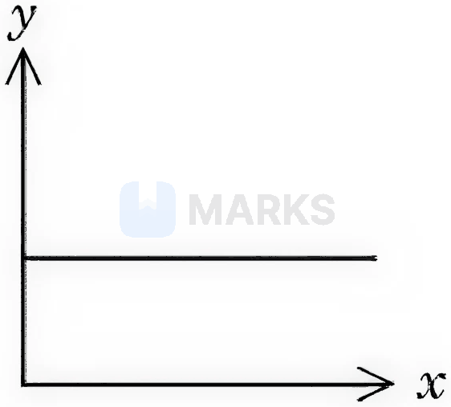
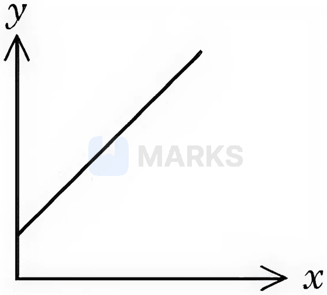
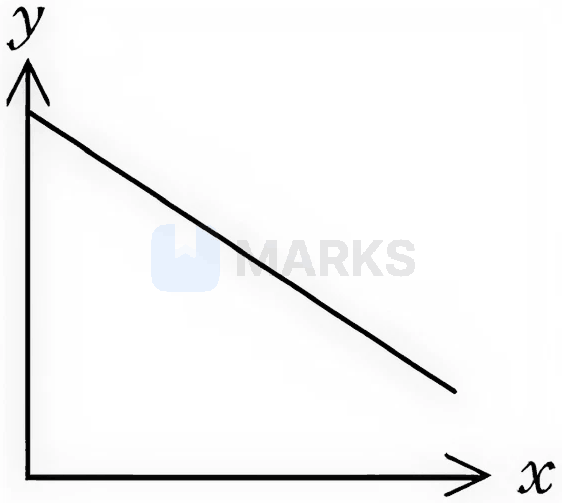
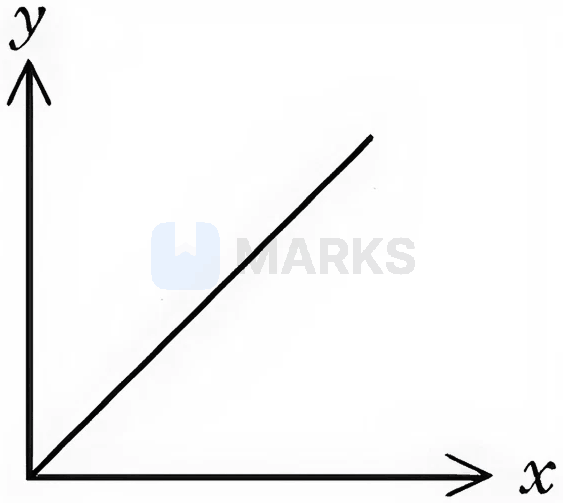

# Solutions & Colligative Properties

> Theory: [../../theory/chemistry/solutions.md](../../theory/chemistry/solutions.md)

### C-SOL-01 — JEE Main 2024 · 27 Jan Shift 1 · Q42 · MCQ

A solution of two miscible liquids showing negative deviation from Raoult's law will have

(1) increased vapour pressure, increased boiling point  (2) increased vapour pressure, decreased boiling point  (3) decreased vapour pressure, decreased boiling point  (4) decreased vapour pressure, increased boiling point

**Answer: (4)** · key ✔

**Solution.** Negative deviation means A–B attractions exceed A–A and B–B, so escaping tendency falls: vapour pressure is lower than ideal, and boiling point higher (maximum-boiling azeotropes such as $\text{HNO}_3$–water).

### C-SOL-02 — JEE Main 2024 · 27 Jan Shift 2 · Q38 · MCQ

The quantity which changes with temperature is

(1) Molarity  (2) Mass percentage  (3) Molality  (4) Mole fraction

**Answer: (1)** · key ✔

**Solution.** Molarity $=\dfrac{\text{moles of solute}}{\text{volume of solution}}$ and the volume changes with temperature. Mass percentage, molality and mole fraction depend only on masses or amounts, so they are temperature independent.

### C-SOL-03 — JEE Main 2024 · 29 Jan Shift 1 · Q56 · Numerical

A solution of $\text{H}_2\text{SO}_4$ is $31.4\%$ by mass and has a density of $1.25\ \text{g mL}^{-1}$. The molarity of the solution is ______ M (nearest integer). [Molar mass of $\text{H}_2\text{SO}_4=98\ \text{g mol}^{-1}$]

**Answer: 4** · key ✔

**Solution.** In $100$ g of solution there is $31.4$ g of $\text{H}_2\text{SO}_4=0.3204$ mol. Volume $=\dfrac{100}{1.25}=80$ mL $=0.08$ L. $M=\dfrac{0.3204}{0.08}=4.0$.

### C-SOL-04 — JEE Main 2024 · 29 Jan Shift 1 · Q57 · Numerical

The osmotic pressure of a dilute solution is $7\times10^5$ Pa at $273$ K. The osmotic pressure of the same solution at $283$ K is ______ $\times10^4\ \text{N m}^{-2}$ (nearest integer).

**Answer: 73** · key ✔

**Solution.** $\pi=CRT$, so at constant concentration $\pi\propto T$: $\pi_2=7\times10^5\times\dfrac{283}{273}=7.256\times10^5$ Pa $=72.6\times10^4\approx73\times10^4$ N m$^{-2}$.

### C-SOL-05 — JEE Main 2024 · 29 Jan Shift 2 · Q57 · Numerical

The molality of a $0.8$ M $\text{H}_2\text{SO}_4$ solution (density $1.06\ \text{g cm}^{-3}$) is ______ $\times10^{-3}$ m (nearest integer).

**Answer: 815** · key ✔

**Solution.** In $1$ L: mass of solution $=1060$ g and $\text{H}_2\text{SO}_4=0.8\times98=78.4$ g, so solvent $=1060-78.4=981.6$ g. Molality $=\dfrac{0.8}{0.9816}=0.815$ mol/kg $=815\times10^{-3}$ m.

### C-SOL-06 — JEE Main 2024 · 30 Jan Shift 1 · Q40 · MCQ

What happens to the freezing point of benzene when a small quantity of naphthalene is added to benzene?

(1) Increases  (2) Remains unchanged  (3) First decreases and then increases  (4) Decreases

**Answer: (4)** · key ✔

**Solution.** A non-volatile solute lowers the vapour pressure of the solvent, giving depression of freezing point: $\Delta T_f=K_fm$. The solution freezes at a lower temperature than pure benzene.

### C-SOL-07 — JEE Main 2024 · 31 Jan Shift 1 · Q40 · MCQ

Identify the mixture that shows positive deviation from Raoult's law.

(1) $(\text{CH}_3)_2\text{CO}+\text{C}_6\text{H}_5\text{NH}_2$  (2) $\text{CHCl}_3+\text{C}_6\text{H}_6$  (3) $\text{CHCl}_3+(\text{CH}_3)_2\text{CO}$  (4) $(\text{CH}_3)_2\text{CO}+\text{CS}_2$

**Answer: (4)** · key ✔

**Solution.** Positive deviation arises when A–B interactions are weaker than A–A and B–B. In acetone + $\text{CS}_2$ the polar acetone dipoles are disrupted by non-polar $\text{CS}_2$. Acetone + aniline and acetone + chloroform show negative deviation (hydrogen bonding), and chloroform + benzene is near-ideal.

### C-SOL-08 — JEE Main 2024 · 1 Feb Shift 1 · Q43 · MCQ

Three aqueous solutions of NaCl, A, B and C, have concentrations $0.1$ M, $0.01$ M and $0.001$ M respectively. The order of the van't Hoff factor $i$ is:

(1) $i_A<i_B<i_C$  (2) $i_A<i_C<i_B$  (3) $i_A=i_B=i_C$  (4) $i_A>i_B>i_C$

**Answer: (1)** · key ✔

**Solution.** Dissociation of an electrolyte increases on dilution (less ion–ion attraction), and $i\to 2$ for NaCl at infinite dilution. So the more dilute the solution, the larger $i$: $i_A<i_B<i_C$.

### C-SOL-09 — JEE Main 2024 · 1 Feb Shift 2 · Q55 · Numerical

The mass of ethylene glycol (antifreeze) to be added to $18.6$ kg of water to protect the freezing point at $-24^\circ$C is ______ kg. (Molar mass $62$ g mol$^{-1}$; $K_f=1.86$ K kg mol$^{-1}$)

**Answer: 15** · key ✔

**Solution.** $\Delta T_f=K_fm\Rightarrow m=\dfrac{24}{1.86}=12.9$ mol kg$^{-1}$. Moles $=12.9\times18.6=240$ mol; mass $=240\times62=14880$ g $\approx15$ kg.

### C-SOL-10 — JEE Main 2024 · 4 Apr Shift 2 · Q55 · Numerical

$2.7$ kg of each of water and acetic acid are mixed. The freezing point of the solution will be $-x^\circ$C (acetic acid neither dimerises nor dissociates). $x=$ ______ (nearest integer). ($K_f$ of water $=1.86$, molar masses $18$ and $60$ g mol$^{-1}$)

**Answer: 31** · key ✔

**Solution.** Treat acetic acid as the solute in water: $n=\dfrac{2700}{60}=45$ mol in $2.7$ kg, so $m=16.67$ mol kg$^{-1}$. $\Delta T_f=1.86\times16.67=31$ K. Freezing point $=0-31=-31^\circ$C, $x=31$.

### C-SOL-11 — JEE Main 2024 · 5 Apr Shift 1 · Q55 · Numerical

An artificial cell is made by encapsulating $0.2$ M glucose solution within a semipermeable membrane. The osmotic pressure developed when it is placed in a $0.05$ M NaCl solution at $300$ K is ______ $\times10^{-1}$ bar (nearest integer). ($R=0.083$ L bar mol$^{-1}$K$^{-1}$; NaCl fully dissociates)

**Answer: 25** · key ✔

**Solution.** Outside: $0.05$ M NaCl gives $0.10$ M of particles. Inside: $0.2$ M glucose. Net osmotic concentration $=0.2-0.1=0.1$ M. $\pi=CRT=0.1\times0.083\times300=2.49\ \text{bar}\approx25\times10^{-1}$ bar.

### C-SOL-12 — JEE Main 2024 · 5 Apr Shift 2 · Q55 · Numerical

$5$ mL of acetic acid (density $1.2\ \text{g mL}^{-1}$) is dissolved in $1$ L of water ($1\ \text{g cm}^{-3}$). Acetic acid dissociates with $K_a=6.25\times10^{-5}$. The solution freezes at $-x\times10^{-2}\ ^\circ$C. $x=$ ______ (nearest integer). ($K_f=1.86\ \text{K kg mol}^{-1}$; molar mass $60$ g mol$^{-1}$)

**Answer: 19** · key ✔

**Solution.** Moles $=\dfrac{5\times1.2}{60}=0.1$ mol in $1$ kg water, $m=0.1$. $\alpha=\sqrt{K_a/C}=\sqrt{6.25\times10^{-4}}=0.025$. $i=1+\alpha=1.025$. $\Delta T_f=i\,K_fm=1.025\times1.86\times0.1=0.1907\ \text{K}$, so $x=19$.

### C-SOL-13 — JEE Main 2024 · 6 Apr Shift 1 · Q31 · MCQ

The density of a solution of NaOH ($x$ molar) is $1.12\ \text{g mL}^{-1}$, while in molality the concentration of the solution is $3$ m ($3$ molal). Then $x$ is (molar mass of NaOH $=40$ g/mol):

(1) 3.5  (2) 3.8  (3) 2.8  (4) 3.0

**Answer: (4)** · key ✔

**Solution.** Take $1$ kg of solvent: $3$ mol NaOH $=120$ g. Solution mass $=1120$ g. Volume $=\dfrac{1120}{1.12}=1000$ mL $=1$ L. Molarity $=\dfrac{3\ \text{mol}}{1\ \text{L}}=3.0$ M.

### C-SOL-14 — JEE Main 2024 · 6 Apr Shift 1 · Q55 · Numerical

For $\text{HX}(aq)\rightleftharpoons\text{H}^+(aq)+\text{X}^-(aq)$, $K_a=1.2\times10^{-5}$. The osmotic pressure of a $0.03$ M aqueous solution of HX at $300$ K is ______ $\times10^{-2}$ bar (nearest integer). ($R=0.083$ L bar mol$^{-1}$K$^{-1}$)

**Answer: 76** · key ✔

**Solution.** $\alpha=\sqrt{K_a/C}=\sqrt{\dfrac{1.2\times10^{-5}}{0.03}}=0.02$. $i=1+\alpha=1.02$. $\pi=iCRT=1.02\times0.03\times0.083\times300=0.762$ bar $=76\times10^{-2}$ bar.

### C-SOL-15 — JEE Main 2024 · 6 Apr Shift 2 · Q31 · MCQ

The molality of a $3$ M aqueous solution of NaCl (density $1.25\ \text{g mL}^{-1}$; Na $=23$, Cl $=35.5$ g mol$^{-1}$) is:

(1) 1.9 m  (2) 3.85 m  (3) 2.79 m  (4) 2.90 m

**Answer: (3)** · key ✔

**Solution.** In $1$ L: solution mass $=1250$ g; NaCl $=3\times58.5=175.5$ g; water $=1074.5$ g. Molality $=\dfrac{3}{1.0745}=2.79$ m.

### C-SOL-16 — JEE Main 2024 · 6 Apr Shift 2 · Q55 · Numerical

For $\text{A}+\text{B}\to\text{C}$ (reaction 1) and $\text{P}\to\text{Q}$ (reaction 2), both first order, the ratio of half-lives $t_{1/2}(1):t_{1/2}(2)=5:2$. If $t_1$ and $t_2$ are the times to complete $\tfrac23$ (reaction 1) and $\tfrac45$ (reaction 2), then $t_1:t_2=$ ______ $\times10^{-1}$. ($\log3=0.477$, $\log5=0.699$)

**Answer: 17** · key ✔

**Solution.** $t=\dfrac{2.303}{k}\log\dfrac{1}{1-f}$. Reaction 1: $\log3=0.477$; reaction 2: $\log5=0.699$. $k\propto1/t_{1/2}$, so $\dfrac{k_1}{k_2}=\dfrac25$. $\dfrac{t_1}{t_2}=\dfrac{0.477}{0.699}\times\dfrac{k_2}{k_1}=0.682\times2.5=1.7=17\times10^{-1}$.

### C-SOL-17 — JEE Main 2024 · 8 Apr Shift 1 · Q55 · Numerical

A solution containing $10$ g of the electrolyte $\text{AB}_2$ in $100$ g of water boils at $100.52^\circ$C. The degree of ionisation of $\text{AB}_2\to\text{A}^{2+}+2\text{B}^-$ is ______ $\times10^{-1}$ (nearest integer). ($M_{\text{AB}_2}=200$ g mol$^{-1}$, $K_b=0.52$ K kg mol$^{-1}$)

**Answer: 5** · key ✔

**Solution.** $m=\dfrac{10/200}{0.1\ \text{kg}}=0.5$ mol kg$^{-1}$. $\Delta T_b=iK_bm\Rightarrow0.52=i(0.52)(0.5)\Rightarrow i=2$. For $n=3$ ions, $i=1+2\alpha\Rightarrow\alpha=0.5=5\times10^{-1}$.

### C-SOL-18 — JEE Main 2024 · 8 Apr Shift 2 · Q56 · Numerical

A solution is prepared by adding $1$ mole of ethyl alcohol to $9$ mole of water. The mass percent of solute in the solution is ______ (integer). (Molar masses: ethyl alcohol $46$, water $18$ g mol$^{-1}$)

**Answer: 22** · key ✔

**Solution.** Mass of ethanol $=46$ g; mass of water $=9\times18=162$ g. Mass percent $=\dfrac{46}{208}\times100=22.1\%\approx22$.

### C-SOL-19 — JEE Main 2024 · 8 Apr Shift 2 · Q57 · Numerical

The molality of an aqueous solution of urea is $4.44$ m. The mole fraction of urea in the solution is $x\times10^{-3}$. $x=$ ______ (integer).

**Answer: 74** · key ✔

**Solution.** In $1$ kg of water there are $\dfrac{1000}{18}=55.5$ mol. $\chi_{urea}=\dfrac{4.44}{4.44+55.5}=0.0741=74\times10^{-3}$.

### C-SOL-20 — JEE Main 2024 · 9 Apr Shift 1 · Q51 · Numerical

The molarity of an aqueous solution containing $x$ g of anhydrous $\text{CuSO}_4$ in $500$ mL of solution at $32^\circ$C is $2\times10^{-1}$ M. Its molality is ______ $\times10^{-3}$ m (nearest integer). (Density of the solution $=1.25$ g/mL; $\text{CuSO}_4=159.5$ g mol$^{-1}$)

**Answer: 164** · key ✔

**Solution.** In $500$ mL: $0.1$ mol $\text{CuSO}_4=15.95$ g. Solution mass $=500\times1.25=625$ g; water $=625-15.95=609.05$ g. Molality $=\dfrac{0.1}{0.60905}=0.164\ \text{m}=164\times10^{-3}$ m.

### § — JEE Main 2026 · 21 Jan Shift 2 · set Q1 · Numerical

A substance 'X' (1.5 g) dissolved in 150 g of a solvent 'Y' (molar mass $=300$ g mol$^{-1}$) led to an elevation of the boiling point by 0.5 K. The relative lowering in the vapour pressure of the solvent 'Y' is ______ $\times10^{-2}$ (nearest integer). [Given: $K_b$ of the solvent $=5.0$ K kg mol$^{-1}$. Assume the solution to be dilute and no association or dissociation of X takes place in solution.]

**Answer: 3** · key (compiled)

**Solution.** $\Delta T_b=K_bm\Rightarrow m=\dfrac{0.5}{5.0}=0.1$ mol kg$^{-1}$, so $n_X=0.1\times0.150=0.015$ mol. $n_Y=\dfrac{150}{300}=0.5$ mol. Relative lowering $=x_X=\dfrac{0.015}{0.015+0.5}=0.029\approx3\times10^{-2}$.

### § — JEE Main 2026 · 21 Jan Shift 2 · set Q2 · Numerical

The osmotic pressure of a living cell is 12 atm at 300 K. The strength of the sodium chloride solution that is isotonic with the living cell at this temperature is ______ g L$^{-1}$ (nearest integer). Given: $R=0.08$ L atm K$^{-1}$ mol$^{-1}$; assume complete dissociation of NaCl; molar masses of Na and Cl are 23 and 35.5 g mol$^{-1}$.

**Answer: 15** · key (compiled)

**Solution.** Isotonic means the same osmotic pressure: $\pi=iCRT$ with $i=2$: $12=2\times C\times0.08\times300\Rightarrow C=0.25$ M. Strength $=0.25\times58.5=14.6\approx15$ g L$^{-1}$.

### § — JEE Main 2026 · 28 Jan Shift 2 · set Q4 · MCQ

Consider the following aqueous solutions. I. 2.2 g glucose in 125 mL of solution. II. 1.9 g calcium chloride in 250 mL of solution. III. 9.0 g urea in 500 mL of solution. IV. 20.5 g aluminium sulphate in 750 mL of solution. The correct increasing order of boiling point of these solutions will be: [Given molar mass in g mol$^{-1}$: H 1, C 12, N 14, O 16, Cl 35.5, Ca 40, Al 27, S 32]

(1) III < I < II < IV  (2) I < II < III < IV  (3) II < III < I < IV  (4) II < III < IV < I

**Answer: (2)** · key (compiled)

**Solution.** The boiling-point elevation follows $i\times$(concentration). I: glucose ($M=180$), $i=1$: $\dfrac{2.2/180}{0.125}=0.098$. II: $\mathrm{CaCl_2}$ ($M=111$), $i=3$: $3\times\dfrac{1.9/111}{0.25}=0.205$. III: urea ($M=60$), $i=1$: $\dfrac{9/60}{0.5}=0.30$. IV: $\mathrm{Al_2(SO_4)_3}$ ($M=342$), $i=5$: $5\times\dfrac{20.5/342}{0.75}=0.40$. Order of boiling points: I < II < III < IV.

### § — JEE Main 2026 · 24 Jan Shift 2 · set Q5 · MCQ

At 298 K, the mole percentage of $\mathrm{N_2(g)}$ in air is 80%. Water is in equilibrium with air at a pressure of 10 atm. What is the mole fraction of $\mathrm{N_2(g)}$ in water at 298 K? ($K_H$ for $\mathrm{N_2}$ is $6.5\times10^7$ mmHg)

(1) $1.23\times10^{-7}$  (2) $1.17\times10^{-4}$  (3) $9.35\times10^{5}$  (4) $9.35\times10^{-5}$

**Answer: (4)** · key (compiled)

**Solution.** $p_{\mathrm{N_2}}=0.80\times10\ \text{atm}=8\ \text{atm}=8\times760=6080$ mmHg. Henry's law, $p=K_Hx$: $x=\dfrac{6080}{6.5\times10^7}=9.35\times10^{-5}$.

### § — JEE Main 2026 · 24 Jan Shift 2 · set Q6 · MCQ

Two liquids A and B form an ideal solution at temperature $T$ K. At $T$ K the vapour pressures of pure A and B are $55$ and $15$ kN m$^{-2}$ respectively. What is the mole fraction of A in the solution of A and B in equilibrium with a vapour in which the mole fraction of A is 0.8?

(1) 0.340  (2) 0.663  (3) 0.5217  (4) 0.480

**Answer: (3)** · key (compiled)

**Solution.** With $\chi_A$ in the liquid, $y_A=\dfrac{p_A^\circ\chi_A}{p_A^\circ\chi_A+p_B^\circ(1-\chi_A)}$, so $0.8=\dfrac{55\chi_A}{55\chi_A+15(1-\chi_A)}$. $0.8(40\chi_A+15)=55\chi_A\Rightarrow32\chi_A+12=55\chi_A\Rightarrow\chi_A=\dfrac{12}{23}=0.5217$.

### § — JEE Main 2026 · 22 Jan Shift 2 · set Q7 · MCQ

At $T$ (K), 100 g of 98% $\mathrm{H_2SO_4}$ (w/w) aqueous solution is mixed with 100 g of 49% $\mathrm{H_2SO_4}$ (w/w) aqueous solution. What is the mole fraction of $\mathrm{H_2SO_4}$ in the resultant solution? (Given: atomic mass H = 1 u, S = 32 u, O = 16 u. Assume that the temperature after mixing remains constant.)

(1) 0.663  (2) 0.9  (3) 0.337  (4) 0.1

**Answer: (3)** · key (compiled)

**Solution.** $\mathrm{H_2SO_4}$: $98+49=147$ g $=1.5$ mol. Water: $2+51=53$ g $=2.94$ mol. $x(\mathrm{H_2SO_4})=\dfrac{1.5}{1.5+2.94}=0.337$.

### § — JEE Main 2026 · 22 Jan Shift 1 · set Q8 · MCQ

Consider a solution of $\mathrm{CO_2(g)}$ dissolved in water in a closed container. Which one of the following plots correctly represents the variation of $\log$ (partial pressure of $\mathrm{CO_2}$ in the vapour phase above water) [$y$-axis] with $\log[x]$ ($x$ = mole fraction of $\mathrm{CO_2}$ in water) [$x$-axis] at $25^\circ$C?

**(1)** 

**(2)** 

**(3)** 

**(4)** 

**Answer: (2)** · key (compiled)

**Solution.** Henry's law: $p=K_Hx\Rightarrow\log p=\log K_H+\log x$. A plot of $\log p$ against $\log x$ is a straight line of slope $+1$ with a *non-zero positive intercept* $\log K_H$ – graph (2). (A line through the origin, (4), would need $K_H=1$; (1) and (3) have zero or negative slope.)

### § — JEE Main 2026 · 22 Jan Shift 1 · set Q9 · MCQ

Given below are two statements:

Statement I: The Henry's law constant $K_H$ is constant with respect to variations in the solution's concentration over the range for which the solution is ideally dilute.
Statement II: $K_H$ does not differ for the same solute in different solvents.

(1) Statement I is false but Statement II is true  (2) Both Statement I and Statement II are false  (3) Statement I is true but Statement II is false  (4) Both Statement I and Statement II are true

**Answer: (3)** · key (compiled)

**Solution.** I true: $K_H$ depends on temperature and on the solute–solvent pair, not on concentration (in the ideal-dilute range). II false: $K_H$ depends on the nature of the solvent as well, e.g. $\mathrm{CO_2}$ has different $K_H$ in water, benzene and ethanol.

### § — JEE Main 2026 · 23 Jan Shift 2 · set Q10 · Numerical

Two liquids A and B form an ideal solution. At 320 K, the vapour pressure of the solution containing 3 mol of A and 1 mol of B is 500 mm Hg. At the same temperature, if 1 mol of A is further added to this solution, the vapour pressure of the solution increases by 20 mm Hg. The vapour pressure (in mm Hg) of B in the pure state is ______ (nearest integer).

**Answer: 200** · key (compiled)

**Solution.** $\tfrac34p_A^\circ+\tfrac14p_B^\circ=500\Rightarrow3p_A^\circ+p_B^\circ=2000$. After adding A (4 mol A, 1 mol B): $\tfrac45p_A^\circ+\tfrac15p_B^\circ=520\Rightarrow4p_A^\circ+p_B^\circ=2600$. Subtracting: $p_A^\circ=600$ mm Hg, so $p_B^\circ=2000-1800=200$ mm Hg.

### § — JEE Main 2026 · 21 Jan Shift 1 · set Q11 · MCQ

Elements P and Q form two types of non-volatile, non-ionisable compounds PQ and $\mathrm{PQ_2}$. When 1 g of PQ is dissolved in 50 g of solvent 'A', $\Delta T_b$ was 1.176 K, while when 1 g of $\mathrm{PQ_2}$ is dissolved in 50 g of solvent 'A', $\Delta T_b$ was 0.689 K. ($K_b$ of 'A' $=5$ K kg mol$^{-1}$). The molar masses of elements P and Q (in g mol$^{-1}$) respectively are:

(1) 70, 110  (2) 65, 145  (3) 25, 60  (4) 60, 25

**Answer: (3)** · key (compiled)

**Solution.** $M=\dfrac{K_b\,w\times1000}{\Delta T_b\,W}$: $M_{PQ}=\dfrac{5\times1\times1000}{1.176\times50}=85$ and $M_{PQ_2}=\dfrac{5\times1000}{0.689\times50}=145$. Then $P+Q=85$ and $P+2Q=145$, so $Q=60$ and $P=25$ g mol$^{-1}$.

### § — JEE Main 2026 · 28 Jan Shift 1 · set Q12 · MCQ

At $T$ (K), 2 moles of liquid A and 3 moles of liquid B are mixed. The vapour pressure of the ideal solution formed is 320 mm Hg. At this stage, one mole of A and one mole of B are added to the solution. The vapour pressure is now measured as 328.6 mm Hg. The vapour pressures (in mm Hg) of pure A and B are respectively:

(1) 400, 300  (2) 600, 400  (3) 300, 200  (4) 500, 200

**Answer: (4)** · key (compiled)

**Solution.** Initially $x_A=0.4$, $x_B=0.6$: $0.4p_A^\circ+0.6p_B^\circ=320\Rightarrow2p_A^\circ+3p_B^\circ=1600$. After the addition (3 mol A, 4 mol B): $\tfrac37p_A^\circ+\tfrac47p_B^\circ=328.6\Rightarrow3p_A^\circ+4p_B^\circ=2300.2$. Solving: $p_B^\circ\approx200$ and $p_A^\circ=\dfrac{1600-600}{2}=500$ mm Hg.

### § — JEE Main 2026 · 24 Jan Shift 1 · set Q13 · MCQ

A solution is prepared by dissolving 0.3 g of a non-volatile non-electrolyte solute 'A' of molar mass 60 g mol$^{-1}$ and 0.9 g of a non-volatile non-electrolyte solute 'B' of molar mass 180 g mol$^{-1}$ in 100 mL $\mathrm{H_2O}$ at $27^\circ$C. The osmotic pressure of the solution will be: [Given: $R=0.082$ L atm K$^{-1}$ mol$^{-1}$]

(1) 0.82 atm  (2) 2.46 atm  (3) 1.23 atm  (4) 1.47 atm

**Answer: (2)** · key (compiled)

**Solution.** $n_A=\dfrac{0.3}{60}=0.005$ mol and $n_B=\dfrac{0.9}{180}=0.005$ mol, so $n=0.01$ mol in $V=0.1$ L at $T=300$ K. $\pi=\dfrac nVRT=\dfrac{0.01}{0.1}\times0.082\times300=2.46$ atm.

### § — JEE Main 2026 · 24 Jan Shift 1 · set Q14 · MCQ

'W' g of a non-volatile electrolyte solid solute of molar mass 'M' g mol$^{-1}$, when dissolved in 100 mL of water, decreases the vapour pressure of water from 640 mm Hg to 600 mm Hg. If the aqueous solution of the electrolyte boils at 375 K and $K_b$ for water is $0.52$ K kg mol$^{-1}$, then the mole fraction of the electrolyte solute ($x_2$) in the solution can be expressed as: (Given: density of water $=1$ g/mL and boiling point of water $=373$ K)

(1) $\dfrac{2.6}{16}\times\dfrac MW$  (2) $\dfrac{16}{2.6}\times\dfrac WM$  (3) $\dfrac{1.3}{8}\times\dfrac MW$  (4) $\dfrac{1.3}{8}\times\dfrac WM$

**Answer: (4)** · key (compiled)

**Solution.** Relative lowering $\dfrac{640-600}{640}=\dfrac1{16}=i\,x_2$. Boiling-point elevation: $\Delta T_b=2=i\times0.52\times\dfrac{W/M}{0.1\ \text{kg}}\Rightarrow i=\dfrac{M}{2.6\,W}$. Hence $x_2=\dfrac{1}{16\,i}=\dfrac{2.6\,W}{16\,M}=\dfrac{1.3}{8}\times\dfrac WM$.

