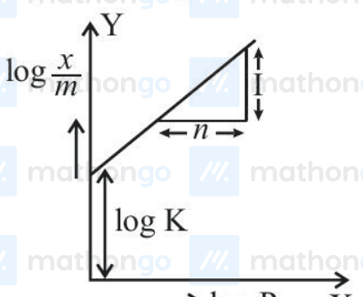

# Surface Chemistry

> Theory: [../../theory/chemistry/surface-chemistry.md](../../theory/chemistry/surface-chemistry.md)

### § — JEE Main 2022 · 24 Jun Shift 1 · Q39 · MCQ

Given below are two statements.
**Statement I:** Emulsions of oil in water are unstable and sometimes they separate into two layers on standing.
**Statement II:** For stabilisation of an emulsion, excess of electrolyte is added.
Choose the most appropriate answer.

(1) Both Statement I and Statement II are correct  (2) Both Statement I and Statement II are incorrect  (3) Statement I is correct but Statement II is incorrect  (4) Statement I is incorrect but Statement II is correct

**Answer: (3)** · key ✔

**Solution.** A pure oil–water emulsion is thermodynamically unstable and breaks into two layers on standing, so Statement I is correct. Emulsions are stabilised by adding an **emulsifying agent** (soap, gelatin, gum, etc.), not an excess of electrolyte; excess electrolyte neutralises the charge on the dispersed droplets and *coagulates* (breaks) the emulsion. Statement II is incorrect.

### § — JEE Main 2023 · 24 Jan Shift 2 · Surf set Q2 · Numerical

The number of statement(s) which are characteristics of physisorption is ______.

A. It is highly specific in nature.
B. Enthalpy of adsorption is high.
C. It decreases with increase in temperature.
D. It results in a unimolecular layer.
E. No activation energy is needed.

**Answer: 2** · key (compiled)

**Solution.** Physisorption (van der Waals) is non-specific (A false), has a low enthalpy of adsorption, about 20–40 kJ mol$^{-1}$ (B false), decreases with rise in temperature (C true), can form multimolecular layers (D false) and needs no appreciable activation energy (E true). Two statements are correct.

### § — JEE Main 2023 · 29 Jan Shift 1 · Surf set Q4 · MCQ

Which of the following salt solutions would coagulate the colloidal solution formed when FeCl$_3$ is added to NaOH solution, at the fastest rate?

(1) 10 mL of 0.2 mol dm$^{-3}$ AlCl$_3$  (2) 10 mL of 0.1 mol dm$^{-3}$ Na$_2$SO$_4$  (3) 10 mL of 0.1 mol dm$^{-3}$ Ca$_3$(PO$_4$)$_2$  (4) 10 mL of 0.15 mol dm$^{-3}$ CaCl$_2$

**Answer: (1)** · key (compiled)

**Solution.** FeCl$_3$ added to NaOH gives a negatively charged sol of Fe(OH)$_3$ (adsorbing OH$^-$). By the Hardy–Schulze rule the coagulating power of the cation increases with its charge, so Al$^{3+}$ is the most effective; AlCl$_3$ is also the most concentrated. Hence (1).

### § — JEE Main 2023 · 30 Jan Shift 1 · Surf set Q5 · MCQ

Given below are two statements: one is labelled as Assertion (A) and the other as Reason (R).

Assertion (A): In expensive scientific instruments, silica gel is kept in watch-glasses or in semipermeable membrane bags.
Reason (R): Silica gel adsorbs moisture via adsorption, thus protects the instrument from water corrosion (rusting) and/or prevents malfunctioning.

In the light of the above statements, choose the correct answer from the options given below.

(1) (A) is false but (R) is true  (2) (A) is true but (R) is false  (3) Both (A) and (R) are true and (R) is the correct explanation of (A)  (4) Both (A) and (R) are true but (R) is not the correct explanation of (A)

**Answer: (3)** · key (compiled)

**Solution.** Silica gel is a good adsorbent for moisture, so it is placed in watch-glasses or permeable bags near delicate instruments to keep the air dry, preventing rusting and malfunction. Both statements are true and the reason explains the assertion.

### § — JEE Main 2023 · 30 Jan Shift 2 · Surf set Q6 · Numerical

The graph of $\log\dfrac xm$ vs $\log p$ for an adsorption process is a straight line inclined at an angle of $45^\circ$ with intercept equal to 0.6020. The mass of gas adsorbed per unit mass of adsorbent at the pressure of 0.4 atm is ______ $\times10^{-1}$ (nearest integer). Given: $\log2=0.3010$.

**Answer: 16** · key (compiled)

**Solution.** Freundlich isotherm: $\log\dfrac xm=\log k+\dfrac1n\log p$. The slope is $\dfrac1n=\tan45^\circ=1$ and $\log k=0.6020=\log4\Rightarrow k=4$. $\dfrac xm=kp^{1/n}=4\times0.4=1.6=16\times10^{-1}$.

### § — JEE Main 2023 · 1 Feb Shift 2 · Surf set Q9 · MCQ

In the figure, a straight line is given for the Freundlich adsorption isotherm ($y=3x+2.505$, with $y=\log\frac xm$ and $x=\log P$). The values of $\dfrac1n$ and $\log K$ respectively are:

(1) 0.3 and $\log2.505$  (2) 0.3 and 0.7033  (3) 3 and 2.505  (4) 3 and 0.7033

**Answer: (3)** · key (compiled)

**Solution.** Compare $y=3x+2.505$ with $\log\dfrac xm=\dfrac1n\log P+\log K$: the slope is $\dfrac1n=3$ and the intercept is $\log K=2.505$.

