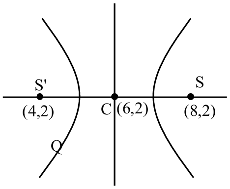

# Parabola, Ellipse & Hyperbola

> Theory: [../../theory/maths/conic-sections.md](../../theory/maths/conic-sections.md)

### M-CON-01 — JEE Main 2024 · 27 Jan Shift 1 · Q67 · MCQ

If $d$ is the shortest distance of the parabola $y^2=4x$ from the centre of the circle $x^2+y^2-4x-16y+64=0$, then $d^2$ is equal to

(1) 16  (2) 24  (3) 20  (4) 36

**Answer: (3)** · key ✔

**Solution.** The centre is $(2,8)$. For a point $(t^2,2t)$ on the parabola, $D^2=(t^2-2)^2+(2t-8)^2=t^4-32t+68$. Setting $\dfrac{d}{dt}=4t^3-32=0$ gives $t=2$, so $D^2=16-64+68=20$. Hence $d^2=20$.

### M-CON-02 — JEE Main 2024 · 27 Jan Shift 1 · Q68 · MCQ

The length of the chord of the ellipse $\dfrac{x^2}{25}+\dfrac{y^2}{16}=1$ whose midpoint is $\left(1,\tfrac25\right)$ is

(1) $\dfrac{\sqrt{1691}}5$  (2) $\dfrac{\sqrt{2009}}5$  (3) $\dfrac{\sqrt{1741}}5$  (4) $\dfrac{\sqrt{1541}}5$

**Answer: (1)** · key ✔

**Solution.** Chord with given midpoint: $T=S_1\Rightarrow\dfrac x{25}+\dfrac{y}{40}=\dfrac1{25}+\dfrac1{100}\Rightarrow8x+5y=10$. Substituting $y=2-\tfrac{8x}5$ gives $4x^2-8x-15=0$, so $|x_1-x_2|=\dfrac{\sqrt{64+240}}4=\dfrac{\sqrt{304}}4$. The slope is $-\tfrac85$, so the length is $|x_1-x_2|\sqrt{1+\tfrac{64}{25}}=\dfrac{\sqrt{304}}4\cdot\dfrac{\sqrt{89}}5=\dfrac{\sqrt{1691}}5$.

### M-CON-03 — JEE Main 2024 · 27 Jan Shift 2 · Q67 · MCQ

Let $e_1$ be the eccentricity of the hyperbola $\dfrac{x^2}{16}-\dfrac{y^2}9=1$ and $e_2$ the eccentricity of the ellipse $\dfrac{x^2}{a^2}+\dfrac{y^2}{b^2}=1$ ($a>b$) that passes through the foci of the hyperbola. If $e_1e_2=1$, the length of the chord of the ellipse parallel to the $x$-axis and passing through $(0,2)$ is

(1) $4\sqrt5$  (2) $\dfrac{8\sqrt5}3$  (3) $\dfrac{10\sqrt5}3$  (4) $3\sqrt5$

**Answer: (3)** · key ✔

**Solution.** $e_1=\sqrt{1+\tfrac9{16}}=\tfrac54$, so $e_2=\tfrac45$. The foci of the hyperbola are $(\pm5,0)$, so the ellipse has $a=5$ and $b^2=25(1-\tfrac{16}{25})=9$. At $y=2$: $\dfrac{x^2}{25}=1-\dfrac49=\dfrac59\Rightarrow x=\pm\dfrac{5\sqrt5}3$. Chord length $=\dfrac{10\sqrt5}3$.

### M-CON-04 — JEE Main 2024 · 29 Jan Shift 1 · Q85 · Numerical

If the points of intersection of two distinct conics $x^2+y^2=4b$ and $\dfrac{x^2}{16}+\dfrac{y^2}{b^2}=1$ lie on the curve $y^2=3x^2$, then $3\sqrt3$ times the area of the rectangle formed by the intersection points is ______.

**Answer: 432** · key ✔

**Solution.** On $y^2=3x^2$: $x^2+3x^2=4b\Rightarrow x^2=b,\ y^2=3b$. Substituting in the ellipse: $\dfrac b{16}+\dfrac3b=1\Rightarrow b^2-16b+48=0\Rightarrow b=4$ or $12$. For $b=4$ both conics are the same circle $x^2+y^2=16$, which is not allowed (distinct conics), so $b=12$. Then $x=\pm2\sqrt3,\ y=\pm6$ and the rectangle has sides $4\sqrt3$ and $12$: area $48\sqrt3$. Hence $3\sqrt3\times48\sqrt3=432$.

### M-CON-05 — JEE Main 2024 · 29 Jan Shift 2 · Q84 · Numerical

Let $P(\alpha,\beta)$ be a point on the parabola $y^2=4x$. If $P$ also lies on the chord of the parabola $x^2=8y$ whose midpoint is $\left(1,\tfrac54\right)$, then $(\alpha-28)(\beta-8)$ is equal to ______.

**Answer: 192** · key ✔

**Solution.** Chord of $x^2=8y$ with midpoint $(1,\tfrac54)$: $T=S_1\Rightarrow x-4\left(y+\tfrac54\right)=1-10\Rightarrow x-4y+4=0$, so $x=4y-4$. Meeting $y^2=4x$: $y^2=16y-16\Rightarrow\beta^2-16\beta+16=0\Rightarrow(\beta-8)^2=48$. With $\alpha=4\beta-4$: $(\alpha-28)(\beta-8)=(4\beta-32)(\beta-8)=4(\beta-8)^2=192$.

### M-CON-06 — JEE Main 2024 · 30 Jan Shift 1 · Q67 · MCQ

If the length of the minor axis of an ellipse is equal to half of the distance between the foci, then the eccentricity of the ellipse is

(1) $\dfrac{\sqrt5}3$  (2) $\dfrac{\sqrt3}2$  (3) $\dfrac1{\sqrt3}$  (4) $\dfrac2{\sqrt5}$

**Answer: (4)** · key ✔

**Solution.** Minor axis $=2b$ and focal distance $=2ae$, so $2b=\tfrac12(2ae)\Rightarrow b=\tfrac{ae}2$. Then $a^2(1-e^2)=\dfrac{a^2e^2}4\Rightarrow1-e^2=\dfrac{e^2}4\Rightarrow e^2=\dfrac45$, so $e=\dfrac2{\sqrt5}$.

### M-CON-07 — JEE Main 2024 · 30 Jan Shift 1 · Q84 · Numerical

Let the latus rectum of the hyperbola $\dfrac{x^2}9-\dfrac{y^2}{b^2}=1$ subtend an angle of $\dfrac\pi3$ at the centre of the hyperbola. If $b^2=\dfrac lm\left(1+\sqrt n\right)$, where $l$ and $m$ are coprime, then $l^2+m^2+n^2$ is equal to ______.

**Answer: 182** · key ✔

**Solution.** An end of the latus rectum is $\left(ae,\dfrac{b^2}a\right)$ with $a=3$ and $ae=\sqrt{9+b^2}$. The two ends subtend $\dfrac\pi3$ at the centre, so each makes $\dfrac\pi6$ with the $x$-axis: $\tan\dfrac\pi6=\dfrac{b^2/3}{\sqrt{9+b^2}}=\dfrac1{\sqrt3}\Rightarrow b^4=3(9+b^2)\Rightarrow b^4-3b^2-27=0\Rightarrow b^2=\dfrac{3+3\sqrt{13}}2=\dfrac32\left(1+\sqrt{13}\right)$. So $l=3,\ m=2,\ n=13$ and $l^2+m^2+n^2=9+4+169=182$.

### M-CON-08 — JEE Main 2024 · 30 Jan Shift 2 · Q66 · MCQ

Let $A(\alpha,0)$ and $B(0,\beta)$ be points on the line $5x+7y=50$. Let the point $P$ divide $AB$ internally in the ratio $7:3$. Let $3x-25=0$ be a directrix of the ellipse $E:\dfrac{x^2}{a^2}+\dfrac{y^2}{b^2}=1$ and the corresponding focus be $S$. If the perpendicular from $S$ on the $x$-axis passes through $P$, the length of the latus rectum of $E$ is

(1) $\tfrac{25}3$  (2) $\tfrac{25}9$  (3) $\tfrac{32}9$  (4) $\tfrac{32}5$

**Answer: (4)** · key ✔

**Solution.** $A=(10,0)$ and $B=\left(0,\tfrac{50}7\right)$. $P=\dfrac{3A+7B}{10}=(3,5)$, so the focus is $S=(3,0)$: $ae=3$. The directrix gives $\dfrac ae=\dfrac{25}3$. Multiplying: $a^2=25$, so $a=5$ and $e=\tfrac35$. $b^2=25\left(1-\tfrac9{25}\right)=16$. Latus rectum $=\dfrac{2b^2}a=\dfrac{32}5$.

### M-CON-09 — JEE Main 2024 · 30 Jan Shift 2 · Q67 · MCQ

Let $P$ be a point on the hyperbola $H:\dfrac{x^2}9-\dfrac{y^2}4=1$ in the first quadrant such that the area of the triangle formed by $P$ and the two foci of $H$ is $2\sqrt{13}$. Then the square of the distance of $P$ from the origin is

(1) 18  (2) 26  (3) 22  (4) 20

**Answer: (3)** · key ✔

**Solution.** Foci: $(\pm\sqrt{13},0)$ since $c^2=9+4$. Area $=\tfrac12(2\sqrt{13})y=2\sqrt{13}\Rightarrow y=2$. Then $\dfrac{x^2}9=1+\dfrac44=2\Rightarrow x^2=18$. $OP^2=18+4=22$.

### M-CON-10 — JEE Main 2024 · 31 Jan Shift 1 · Q66 · MCQ

If the foci of a hyperbola are the same as those of the ellipse $\dfrac{x^2}9+\dfrac{y^2}{25}=1$ and the eccentricity of the hyperbola is $\dfrac{15}8$ times the eccentricity of the ellipse, then the smaller focal distance of the point $\left(\sqrt2,\ \dfrac{14}3\sqrt{\dfrac25}\right)$ on the hyperbola is

(1) $7\sqrt{\dfrac25}-\dfrac83$  (2) $14\sqrt{\dfrac25}-\dfrac43$  (3) $14\sqrt{\dfrac25}-\dfrac{16}3$  (4) $7\sqrt{\dfrac25}+\dfrac83$

**Answer: (1)** · key ✔

**Solution.** The ellipse has $a=5$ along $y$, $e=\dfrac45$, foci $(0,\pm4)$. The hyperbola has $c=4$ and $e_h=\dfrac{15}8\cdot\dfrac45=\dfrac32$, so its transverse semi-axis is $a_h=\dfrac c{e_h}=\dfrac83$ (along $y$). For a point on it the focal distances are $|e_hy\pm a_h|$. Here $e_hy=\dfrac32\cdot\dfrac{14}3\sqrt{\dfrac25}=7\sqrt{\dfrac25}$, so the smaller focal distance is $7\sqrt{\dfrac25}-\dfrac83$.

### M-CON-11 — JEE Main 2024 · 31 Jan Shift 1 · Q84 · Numerical

Let the foci and the length of the latus rectum of the ellipse $\dfrac{x^2}{a^2}+\dfrac{y^2}{b^2}=1$, $a>b$, be $(\pm5,0)$ and $\sqrt{50}$ respectively. Then the square of the eccentricity of the hyperbola $\dfrac{x^2}{b^2}-\dfrac{y^2}{a^2b^2}=1$ equals ______.

**Answer: 51** · key ✔

**Solution.** $ae=5\Rightarrow a^2-b^2=25$, and $\dfrac{2b^2}a=\sqrt{50}\Rightarrow b^2=\dfrac{5\sqrt2}2a$. Substituting: $a^2-\dfrac{5\sqrt2}2a-25=0\Rightarrow a=5\sqrt2$, so $a^2=50$ and $b^2=25$. For the hyperbola, $e^2=1+\dfrac{a^2b^2}{b^2}=1+a^2=51$.

### M-CON-12 — JEE Main 2024 · 31 Jan Shift 2 · Q68 · MCQ

Let $P$ be a parabola with vertex $(2,3)$ and directrix $2x+y=6$. Let an ellipse $E:\dfrac{x^2}{a^2}+\dfrac{y^2}{b^2}=1$, $a>b$, of eccentricity $\dfrac1{\sqrt2}$ pass through the focus of the parabola $P$. Then the square of the length of the latus rectum of $E$ is

(1) $\tfrac{385}8$  (2) $\tfrac{347}8$  (3) $\tfrac{512}{25}$  (4) $\tfrac{656}{25}$

**Answer: (4)** · key ✔

**Solution.** The vertex is at distance $\dfrac{|4+3-6|}{\sqrt5}=\dfrac1{\sqrt5}$ from the directrix, on the side where $2x+y>6$. The focus lies the same distance beyond the vertex along $\dfrac{(2,1)}{\sqrt5}$: $F=\left(2+\tfrac25,\ 3+\tfrac15\right)=\left(\tfrac{12}5,\tfrac{16}5\right)$. With $e=\tfrac1{\sqrt2}$, $b^2=\tfrac{a^2}2$. Passing through $F$: $\dfrac{144/25}{a^2}+\dfrac{256/25}{a^2/2}=1\Rightarrow a^2=\dfrac{656}{25}$. Latus rectum $=\dfrac{2b^2}a=a$, so its square is $a^2=\dfrac{656}{25}$.

### § — JEE Main 2026 · 21 Jan Shift 2 · Parabola set Q1 · MCQ

Let $y^2=12x$ be the parabola with its vertex at $O$. Let $P$ be a point on the parabola and $A$ be a point on the $x$-axis such that $\angle OPA=90^\circ$. Then the locus of the centroid of such triangles $OPA$ is:

(1) $y^2-2x+8=0$  (2) $y^2-9x+6=0$  (3) $y^2-4x+8=0$  (4) $y^2-6x+4=0$

**Answer: (1)** · key (compiled)

**Solution.** $a=3$, so $P=(3t^2,6t)$; let $A=(h,0)$. $\vec{PO}\cdot\vec{PA}=0$: $(-3t^2)(h-3t^2)+(-6t)(-6t)=0\Rightarrow h=3t^2+12$ (for $t\ne0$). Centroid $G=\left(\dfrac{3t^2+h}3,\dfrac{6t}3\right)=(2t^2+4,\ 2t)$. With $t=\tfrac Y2$: $X=\tfrac{Y^2}2+4$, so the locus is $y^2-2x+8=0$.

### § — JEE Main 2026 · 21 Jan Shift 2 · Parabola set Q2 · MCQ

Let one end of a focal chord of the parabola $y^2=16x$ be $(16,16)$. If $P(\alpha,\beta)$ divides this focal chord internally in the ratio $5:2$, then the minimum value of $\alpha+\beta$ is equal to:

(1) 16  (2) 5  (3) 7  (4) 22

**Answer: (3)** · key (compiled)

**Solution.** $a=4$; the end $(16,16)$ has parameter $t_1=2$ ($2at=16$). The other end of a focal chord has $t_2=-\tfrac1{t_1}=-\tfrac12$: $(at_2^2,2at_2)=(1,-4)$. Dividing internally in the ratio $5:2$ can be done from either end. From $(16,16)$ to $(1,-4)$: $P=\left(\dfrac{2\cdot16+5\cdot1}7,\dfrac{2\cdot16+5(-4)}7\right)=\left(\tfrac{37}7,\tfrac{12}7\right)$, $\alpha+\beta=7$. From $(1,-4)$ to $(16,16)$: $P=\left(\tfrac{82}7,\tfrac{72}7\right)$, $\alpha+\beta=22$. The minimum is 7.

### § — JEE Main 2026 · 28 Jan Shift 2 · Parabola set Q3 · MCQ

Let $A$ be the focus of the parabola $y^2=8x$. Let the line $y=mx+c$ intersect the parabola at two distinct points $B$ and $C$. If the centroid of the triangle $ABC$ is $\left(\dfrac73,\dfrac43\right)$, then $(BC)^2$ is equal to:

(1) 80  (2) 41  (3) 89  (4) 32

**Answer: (1)** · key (compiled)

**Solution.** $a=2$, $A=(2,0)$, $B=(2t_1^2,4t_1)$, $C=(2t_2^2,4t_2)$. Centroid: $\dfrac{2+2t_1^2+2t_2^2}3=\dfrac73\Rightarrow t_1^2+t_2^2=\tfrac52$, and $\dfrac{4(t_1+t_2)}3=\dfrac43\Rightarrow t_1+t_2=1$. Then $2t_1t_2=1-\tfrac52\Rightarrow t_1t_2=-\tfrac34$ and $(t_1-t_2)^2=1+3=4$. $BC^2=4(t_1^2-t_2^2)^2+16(t_1-t_2)^2=4\cdot4\cdot1+16\cdot4=80$.

### § — JEE Main 2026 · 24 Jan Shift 2 · Parabola set Q4 · MCQ

Let the image of the parabola $x^2=4y$ in the line $x-y=1$ be $(y+a)^2=b(x-c)$, $a,b,c\in\mathbb N$. Then $a+b+c$ is equal to:

(1) 8  (2) 6  (3) 12  (4) 4

**Answer: (2)** · key (compiled)

**Solution.** Reflection in the line $x-y-1=0$ maps $(h,k)$ to $(k+1,\ h-1)$. If $(X,Y)=(k+1,h-1)$ then $h=Y+1$ and $k=X-1$. The point $(h,k)$ is on $h^2=4k$, so $(Y+1)^2=4(X-1)$, i.e. $(y+1)^2=4(x-1)$: $a=1$, $b=4$, $c=1$ and $a+b+c=6$.

### § — JEE Main 2026 · 22 Jan Shift 2 · Parabola set Q5 · MCQ

Let the locus of the mid-point of the chord through the origin $O$ of the parabola $y^2=4x$ be the curve $S$. Let $P$ be any point on $S$. Then the locus of the point which internally divides $OP$ in the ratio $3:1$ is:

(1) $2x^2=3y$  (2) $3y^2=2x$  (3) $2y^2=3x$  (4) $3x^2=2y$

**Answer: (3)** · key (compiled)

**Solution.** A chord from $O$ ends at $(t^2,2t)$, so its mid-point is $\left(\tfrac{t^2}2,t\right)$: $y^2=2x$ – this is $S$. Take $P=\left(\tfrac{p^2}2,p\right)$ on $S$; the point dividing $OP$ in $3:1$ is $\tfrac34P=\left(\tfrac{3p^2}8,\tfrac{3p}4\right)=(h,k)$. Then $p=\tfrac{4k}3$ and $h=\tfrac38\cdot\tfrac{16k^2}9=\tfrac{2k^2}3$, i.e. $2y^2=3x$.

### § — JEE Main 2026 · 22 Jan Shift 1 · Parabola set Q6 · MCQ

If the chord joining the points $P_1(x_1,y_1)$ and $P_2(x_2,y_2)$ on the parabola $y^2=12x$ subtends a right angle at the vertex of the parabola, then $x_1x_2-y_1y_2$ is equal to:

(1) 284  (2) 280  (3) 288  (4) 292

**Answer: (3)** · key (compiled)

**Solution.** $a=3$; take $P_i=(3t_i^2,6t_i)$. $\vec{OP_1}\cdot\vec{OP_2}=9t_1^2t_2^2+36t_1t_2=0\Rightarrow t_1t_2=-4$. $x_1x_2-y_1y_2=9(t_1t_2)^2-36t_1t_2=9\cdot16+144=288$.

### § — JEE Main 2026 · 23 Jan Shift 2 · Parabola set Q7 · MCQ

An equilateral triangle $OAB$ is inscribed in the parabola $y^2=4x$ with the vertex $O$ at the vertex of the parabola. Then the minimum distance of the circle having $AB$ as a diameter from the origin is:

(1) $2(8-3\sqrt3)$  (2) $2(3+\sqrt3)$  (3) $4(6+\sqrt3)$  (4) $4(3-\sqrt3)$

**Answer: (4)** · key (compiled)

**Solution.** By symmetry $A=(t^2,2t)$, $B=(t^2,-2t)$. $OA=t\sqrt{t^2+4}$ and $AB=4t$; $OA=AB\Rightarrow t^2+4=16\Rightarrow t=2\sqrt3$, so $A=(12,4\sqrt3)$ and $B=(12,-4\sqrt3)$. The circle on $AB$ as diameter has centre $(12,0)$ and radius $4\sqrt3$. The origin is outside it, at distance 12 from the centre, so the minimum distance is $12-4\sqrt3=4(3-\sqrt3)$.

### § — JEE Main 2026 · 21 Jan Shift 1 · Parabola set Q8 · MCQ

Let $O$ be the vertex of the parabola $x^2=4y$ and $Q$ be any point on it. Let the locus of the point $P$, which divides the line segment $OQ$ internally in the ratio $2:3$, be the conic $C$. Then the equation of the chord of $C$ which is bisected at the point $(1,2)$ is:

(1) $5x-4y+3=0$  (2) $5x-y-3=0$  (3) $4x-5y+6=0$  (4) $x-2y+3=0$

**Answer: (1)** · key (compiled)

**Solution.** $Q=(2t,t^2)$ and $P=\tfrac25Q=\left(\tfrac{4t}5,\tfrac{2t^2}5\right)$. Eliminating $t$: $y=\tfrac25\cdot\tfrac{25x^2}{16}=\tfrac{5x^2}8$, so $C:\ 5x^2=8y$. The chord bisected at $(x_1,y_1)$ is $T=S_1$: for $x^2-\tfrac85y=0$, $xx_1-\tfrac45(y+y_1)=x_1^2-\tfrac85y_1$. At $(1,2)$: $x-\tfrac45(y+2)=1-\tfrac{16}5\Rightarrow5x-4y-8=5-16\Rightarrow5x-4y+3=0$.

### § — JEE Main 2026 · 21 Jan Shift 2 · Ellipse set Q1 · MCQ

If the line $\alpha x+4y=\sqrt7$, where $\alpha\in\mathbb R$, touches the ellipse $3x^2+4y^2=1$ at the point $P$ in the first quadrant, then one of the focal distances of $P$ is:

(1) $\dfrac1{\sqrt3}+\dfrac1{2\sqrt7}$  (2) $\dfrac1{\sqrt3}-\dfrac1{2\sqrt5}$  (3) $\dfrac1{\sqrt3}+\dfrac1{2\sqrt5}$  (4) $\dfrac1{\sqrt3}-\dfrac1{2\sqrt{11}}$

**Answer: (1)** · key (compiled)

**Solution.** The ellipse is $\dfrac{x^2}{1/3}+\dfrac{y^2}{1/4}=1$: $a^2=\tfrac13$, $b^2=\tfrac14$, $e^2=1-\tfrac34=\tfrac14$, $e=\tfrac12$. The tangent at $(x_0,y_0)$ is $3x_0x+4y_0y=1$. Comparing with $\alpha x+4y=\sqrt7$ (multiply the tangent by $\sqrt7$): $4\sqrt7y_0=4\Rightarrow y_0=\tfrac1{\sqrt7}$. $P$ is on the ellipse: $3x_0^2+\tfrac47=1\Rightarrow x_0=\tfrac1{\sqrt7}$ (first quadrant). Focal distances are $a\pm ex_0=\tfrac1{\sqrt3}\pm\tfrac1{2\sqrt7}$; the sum option is (1).

### § — JEE Main 2026 · 23 Jan Shift 1 · Ellipse set Q2 · MCQ

Let the line $y-x=1$ intersect the ellipse $\dfrac{x^2}2+\dfrac{y^2}1=1$ at the points $A$ and $B$. Then the angle made by the line segment $AB$ at the centre of the ellipse is:

(1) $\dfrac\pi2+\tan^{-1}\!\left(\dfrac14\right)$  (2) $\dfrac\pi2+2\tan^{-1}\!\left(\dfrac14\right)$  (3) $\dfrac\pi2-\tan^{-1}\!\left(\dfrac14\right)$  (4) $\pi-\tan^{-1}\!\left(\dfrac14\right)$

**Answer: (1)** · key (compiled)

**Solution.** Substituting $y=x+1$: $\tfrac{x^2}2+(x+1)^2=1\Rightarrow\tfrac32x^2+2x=0\Rightarrow x=0$ or $-\tfrac43$. So $A=(0,1)$ and $B=\left(-\tfrac43,-\tfrac13\right)$. $OA$ points along $+y$ (angle $\tfrac\pi2$) and $OB$ makes angle $\pi+\tan^{-1}\tfrac14$ with the $+x$ axis. The angle $AOB=\pi+\tan^{-1}\tfrac14-\tfrac\pi2=\dfrac\pi2+\tan^{-1}\tfrac14$.

### § — JEE Main 2026 · 28 Jan Shift 2 · Ellipse set Q3 · MCQ

An ellipse has its centre at $(1,-2)$, one focus at $(3,-2)$ and one vertex at $(5,-2)$. Then the length of its latus rectum is:

(1) 6  (2) $4\sqrt3$  (3) $\dfrac{16}{\sqrt3}$  (4) $6\sqrt3$

**Answer: (1)** · key (compiled)

**Solution.** The centre, focus and vertex lie on a horizontal line, so $c=3-1=2$ and $a=5-1=4$. $b^2=a^2-c^2=16-4=12$. Latus rectum $=\dfrac{2b^2}a=\dfrac{24}4=6$.

### § — JEE Main 2026 · 28 Jan Shift 2 · Ellipse set Q4 · MCQ

Let the ellipse $E:\dfrac{x^2}{144}+\dfrac{y^2}{169}=1$ and the hyperbola $H:\dfrac{x^2}{16}-\dfrac{y^2}{\lambda^2}=-1$ have the same foci. If $e$ and $L$ respectively denote the eccentricity and the length of the latus rectum of $H$, then the value of $24(e+L)$ is:

(1) 148  (2) 126  (3) 67  (4) 296

**Answer: (4)** · key (compiled)

**Solution.** For $E$ the major axis is along $y$: $c^2=169-144=25$, foci $(0,\pm5)$. $H$ is $\dfrac{y^2}{\lambda^2}-\dfrac{x^2}{16}=1$ with $c^2=\lambda^2+16=25\Rightarrow\lambda=3$: transverse semi-axis $a=3$, conjugate $b=4$. $e=\dfrac53$ and $L=\dfrac{2b^2}a=\dfrac{32}3$. $24(e+L)=24\cdot\dfrac{37}3=296$.

### § — JEE Main 2026 · 24 Jan Shift 2 · Ellipse set Q5 · MCQ

Let the length of the latus rectum of an ellipse $\dfrac{x^2}{a^2}+\dfrac{y^2}{b^2}=1$, $(a>b)$, be 30. If its eccentricity is the maximum value of the function $f(t)=-\dfrac34+2t-t^2$, then $(a^2+b^2)$ is equal to:

(1) 276  (2) 256  (3) 516  (4) 496

**Answer: (4)** · key (compiled)

**Solution.** $f(t)=\tfrac14-(t-1)^2$ has maximum $\tfrac14$, so $e=\tfrac14$. Latus rectum $\dfrac{2b^2}a=30\Rightarrow b^2=15a$. Also $b^2=a^2(1-e^2)=\tfrac{15}{16}a^2$, so $15a=\tfrac{15}{16}a^2\Rightarrow a=16$, $b^2=240$. $a^2+b^2=256+240=496$.

### § — JEE Main 2026 · 24 Jan Shift 2 · Ellipse set Q6 · Numerical

Let $(h,k)$ lie on the circle $C:x^2+y^2=4$ and the point $(2h+1,3k+2)$ lie on an ellipse with eccentricity $e$. Then the value of $\dfrac5{e^2}$ is equal to ______.

**Answer: 9** · key (compiled)

**Solution.** Put $h=2\cos\theta$, $k=2\sin\theta$. The point $(2h+1,3k+2)=(4\cos\theta+1,\ 6\sin\theta+2)$ lies on $\dfrac{(x-1)^2}{16}+\dfrac{(y-2)^2}{36}=1$, an ellipse with $a^2=36$ (along $y$) and $b^2=16$. $e^2=1-\dfrac{16}{36}=\dfrac59$, so $\dfrac5{e^2}=9$.

### § — JEE Main 2026 · 22 Jan Shift 2 · Ellipse set Q7 · MCQ

Let $S$ and $S'$ be the foci of the ellipse $\dfrac{x^2}{25}+\dfrac{y^2}9=1$ and $P(\alpha,\beta)$ be a point on the ellipse in the first quadrant. If $(SP)^2+(S'P)^2-SP\cdot S'P=37$, then $\alpha^2+\beta^2$ is equal to:

(1) 15  (2) 11  (3) 17  (4) 13

**Answer: (4)** · key (compiled)

**Solution.** $a=5$, $b=3$, $c=4$: foci $(\pm4,0)$, and $SP+S'P=10$. Let $r_1=SP$, $r_2=S'P$: $r_1^2+r_2^2=100-2r_1r_2$, so the condition gives $100-3r_1r_2=37\Rightarrow r_1r_2=21$ and $r_1^2+r_2^2=58$. By the median (Apollonius) formula, $SP^2+S'P^2=2\left(OP^2+OS^2\right)$: $58=2(OP^2+16)\Rightarrow OP^2=13$. So $\alpha^2+\beta^2=13$.

### § — JEE Main 2026 · 24 Jan Shift 1 · Ellipse set Q8 · MCQ

Let each of the two ellipses $E_1:\dfrac{x^2}{a^2}+\dfrac{y^2}{b^2}=1$, $(a>b)$ and $E_2:\dfrac{x^2}{A^2}+\dfrac{y^2}{B^2}=1$, $(A<B)$ have eccentricity $\dfrac45$. Let the lengths of the latus recta of $E_1$ and $E_2$ be $l_1$ and $l_2$ respectively, such that $2l_1^2=9l_2$. If the distance between the foci of $E_1$ is 8, then the distance between the foci of $E_2$ is:

(1) $\dfrac{32}5$  (2) $\dfrac85$  (3) $\dfrac{16}5$  (4) $\dfrac{96}5$

**Answer: (1)** · key (compiled)

**Solution.** $E_1$: $2ae=8$ with $e=\tfrac45$ gives $a=5$; $b^2=a^2(1-e^2)=9$, so $l_1=\dfrac{2b^2}a=\dfrac{18}5$. Then $l_2=\dfrac{2l_1^2}9=\dfrac{2\cdot324/25}9=\dfrac{72}{25}$. $E_2$ has its major axis along $y$: $A^2=B^2(1-e^2)=\tfrac{9B^2}{25}$ and $l_2=\dfrac{2A^2}B=\dfrac{18B}{25}=\dfrac{72}{25}\Rightarrow B=4$. Distance between the foci of $E_2$ $=2Be=2\cdot4\cdot\tfrac45=\dfrac{32}5$.

### § — JEE Main 2026 · 23 Jan Shift 1 · Hyperbola set Q1 · MCQ

Let the domain of the function $f(x)=\log_3\log_5\log_7(9x-x^2-13)$ be the interval $(m,n)$. Let the hyperbola $\dfrac{x^2}{a^2}-\dfrac{y^2}{b^2}=1$ have eccentricity $\dfrac n3$ and the length of the latus rectum $\dfrac{8m}3$. Then $b^2-a^2$ is equal to:

(1) 7  (2) 11  (3) 5  (4) 9

**Answer: (1)** · key (compiled)

**Solution.** $\log_3\log_5\log_7(\cdot)$ needs $\log_5\log_7(\cdot)>0\Rightarrow\log_7(\cdot)>1\Rightarrow9x-x^2-13>7\Rightarrow(x-4)(x-5)<0$, so the domain is $(4,5)$: $m=4$, $n=5$. Then $e=\tfrac53$ gives $\dfrac{b^2}{a^2}=e^2-1=\tfrac{16}9$, and the latus rectum $\dfrac{2b^2}a=\dfrac{32a}9=\dfrac{32}3\Rightarrow a=3$, $b^2=16$. $b^2-a^2=16-9=7$.

### § — JEE Main 2026 · 22 Jan Shift 2 · Hyperbola set Q2 · MCQ

Let $P(10,2\sqrt{15})$ be a point on the hyperbola $\dfrac{x^2}{a^2}-\dfrac{y^2}{b^2}=1$, whose foci are $S$ and $S'$. If the length of its latus rectum is 8, then the square of the area of $\triangle PSS'$ is equal to:

(1) 900  (2) 4200  (3) 1462  (4) 2700

**Answer: (4)** · key (compiled)

**Solution.** Latus rectum $\dfrac{2b^2}a=8\Rightarrow b^2=4a$. $P$ on the hyperbola: $\dfrac{100}{a^2}-\dfrac{60}{4a}=1\Rightarrow a^2+15a-100=0\Rightarrow a=5$, $b^2=20$. $c^2=a^2+b^2=45$, so the foci are $(\pm3\sqrt5,0)$ and $SS'=6\sqrt5$. Area $=\tfrac12\cdot6\sqrt5\cdot2\sqrt{15}=30\sqrt3$, and its square is $2700$.

### § — JEE Main 2026 · 22 Jan Shift 1 · Hyperbola set Q3 · MCQ

If the line $\alpha x+2y=1$, where $\alpha\in\mathbb R$, does not meet the hyperbola $x^2-9y^2=9$, then a possible value of $\alpha$ is:

(1) 0.5  (2) 0.6  (3) 0.7  (4) 0.8

**Answer: (4)** · key (compiled)

**Solution.** Substitute $y=\dfrac{1-\alpha x}2$: $4x^2-9(1-\alpha x)^2=36\Rightarrow(4-9\alpha^2)x^2+18\alpha x-45=0$. No intersection needs a negative discriminant: $324\alpha^2+180(4-9\alpha^2)=720-1296\alpha^2<0\Rightarrow\alpha^2>\dfrac59\Rightarrow|\alpha|>\dfrac{\sqrt5}3\approx0.745$. (If $\alpha^2=\tfrac49$ the line is parallel to an asymptote and meets the curve once.) Of the options only $0.8$ qualifies.

### § — JEE Main 2026 · 23 Jan Shift 2 · Hyperbola set Q4 · MCQ

Let $PQ$ be a chord of the hyperbola $\dfrac{x^2}4-\dfrac{y^2}{b^2}=1$, perpendicular to the $x$-axis such that $OPQ$ is an equilateral triangle, $O$ being the centre of the hyperbola. If the eccentricity of the hyperbola is $\sqrt3$, then the area of the triangle $OPQ$ is:

(1) $2\sqrt3$  (2) $\dfrac{11}5$  (3) $\dfrac95$  (4) $\dfrac{8\sqrt3}5$

**Answer: (4)** · key (compiled)

**Solution.** $e^2=1+\dfrac{b^2}4=3\Rightarrow b^2=8$. Let $P=(x_0,y_0)$ and $Q=(x_0,-y_0)$. Equilateral: $OP=PQ\Rightarrow x_0^2+y_0^2=4y_0^2\Rightarrow x_0^2=3y_0^2$. On the hyperbola: $\dfrac{3y_0^2}4-\dfrac{y_0^2}8=1\Rightarrow y_0^2=\dfrac85$. Area $=\dfrac{\sqrt3}4(2y_0)^2=\sqrt3\,y_0^2=\dfrac{8\sqrt3}5$.

### § — JEE Main 2026 · 21 Jan Shift 1 · Hyperbola set Q5 · MCQ

Let the foci of a hyperbola coincide with the foci of the ellipse $\dfrac{x^2}{36}+\dfrac{y^2}{16}=1$. If the eccentricity of the hyperbola is 5, then the length of its latus rectum is:

(1) 16  (2) $24\sqrt5$  (3) 12  (4) $\dfrac{96}{\sqrt5}$

**Answer: (4)** · key (compiled)

**Solution.** For the ellipse $c=\sqrt{36-16}=2\sqrt5$, foci $(\pm2\sqrt5,0)$. For the hyperbola $e=\dfrac{c}{A}=5\Rightarrow A=\dfrac{2\sqrt5}5$ and $B^2=c^2-A^2=20-\dfrac45=\dfrac{96}5$. Latus rectum $=\dfrac{2B^2}A=\dfrac{192/5}{2\sqrt5/5}=\dfrac{96}{\sqrt5}$.

### § — JEE Main 2026 · 28 Jan Shift 1 · Hyperbola set Q6 · Numerical

For some $\theta\in\left(0,\dfrac\pi2\right)$, let the eccentricity and the length of the latus rectum of the hyperbola $x^2-y^2\sec^2\theta=8$ be $e_1$ and $l_1$, respectively, and let the eccentricity and the length of the latus rectum of the ellipse $x^2\sec^2\theta+y^2=6$ be $e_2$ and $l_2$, respectively. If $e_1^2=e_2^2\left(\sec^2\theta+1\right)$, then $\left(\dfrac{l_1l_2}{e_1e_2}\right)\tan^2\theta$ is equal to ______.

**Answer: 8** · key (compiled)

**Solution.** Hyperbola: $\dfrac{x^2}8-\dfrac{y^2}{8\cos^2\theta}=1$, so $e_1^2=1+\cos^2\theta$ and $l_1=\dfrac{2\cdot8\cos^2\theta}{\sqrt8}=4\sqrt2\cos^2\theta$. Ellipse: $\dfrac{x^2}{6\cos^2\theta}+\dfrac{y^2}6=1$ (major axis along $y$), so $e_2^2=1-\cos^2\theta=\sin^2\theta$ and $l_2=\dfrac{2\cdot6\cos^2\theta}{\sqrt6}=2\sqrt6\cos^2\theta$. The condition $1+\cos^2\theta=\sin^2\theta\cdot\dfrac{1+\cos^2\theta}{\cos^2\theta}$ gives $\tan^2\theta=1$, $\theta=\tfrac\pi4$. Then $e_1^2=\tfrac32$, $e_2^2=\tfrac12$, $e_1e_2=\tfrac{\sqrt3}2$; $l_1=2\sqrt2$, $l_2=\sqrt6$, $l_1l_2=4\sqrt3$. $\dfrac{l_1l_2}{e_1e_2}\tan^2\theta=\dfrac{4\sqrt3}{\sqrt3/2}\cdot1=8$.

### § — JEE Main 2025 · Jan session · Parabola set Q2 · MCQ

If the equation of the parabola with vertex $V\left(\tfrac32,3\right)$ and directrix $x+2y=0$ is $\alpha x^2+\beta y^2-\gamma xy-30x-60y+225=0$, then $\alpha+\beta+\gamma$ is equal to:

(1) 7  (2) 9  (3) 8  (4) 6

**Answer: (2)** · key (compiled)

**Solution.** The foot of the perpendicular from $V$ to the directrix is $V-\dfrac{(3/2+6)}{5}(1,2)=(0,0)$, so the focus is the reflection of this foot in $V$: $F=(3,6)$. Then $(x-3)^2+(y-6)^2=\dfrac{(x+2y)^2}5\Rightarrow4x^2+y^2-4xy-30x-60y+225=0$. So $\alpha=4$, $\beta=1$, $\gamma=4$ and $\alpha+\beta+\gamma=9$.

### § — JEE Main 2025 · Jan session · Parabola set Q3 · MCQ

Two parabolas have the same focus $(4,3)$ and their directrices are the $x$-axis and the $y$-axis respectively. If these parabolas intersect at the points $A$ and $B$, then $(AB)^2$ is equal to:

(1) 392  (2) 384  (3) 192  (4) 96

**Answer: (3)** · key (compiled)

**Solution.** Parabola 1: $(x-4)^2+(y-3)^2=y^2\Rightarrow x^2-8x-6y+25=0$. Parabola 2: $(x-4)^2+(y-3)^2=x^2\Rightarrow y^2-6y-8x+25=0$. Subtracting gives $x^2=y^2$. For $y=x$: $x^2-14x+25=0$, $x=7\pm2\sqrt6$ (for $y=-x$ the discriminant is negative). The points lie on $y=x$, so $AB=\sqrt2\,|x_1-x_2|=\sqrt2\cdot4\sqrt6$ and $(AB)^2=2\cdot16\cdot6=192$.

### § — JEE Main 2025 · Jan session · Parabola set Q4 · MCQ

Let the parabola $y=x^2+px-3$ meet the coordinate axes at the points $P$, $Q$ and $R$. If the circle $C$ with centre at $(-1,-1)$ passes through $P$, $Q$ and $R$, then the area of $\triangle PQR$ is:

(1) 7  (2) 4  (3) 6  (4) 5

**Answer: (3)** · key (compiled)

**Solution.** $R=(0,-3)$ lies on the circle: $r^2=1+4=5$. Meeting the $x$-axis: $(x+1)^2+1=5\Rightarrow x=1$ or $-3$, so the parabola is $y=(x-1)(x+3)$ ($p=2$). The area is $\tfrac12\cdot PQ\cdot OR=\tfrac12\cdot4\cdot3=6$.

### § — JEE Main 2025 · Jan session · Parabola set Q5 · MCQ

Let the shortest distance from $(a,0)$, $a>0$, to the parabola $y^2=4x$ be 4. Then the equation of the circle passing through the point $(a,0)$ and the focus of the parabola, and having its centre on the axis of the parabola, is:

(1) $x^2+y^2-10x+9=0$  (2) $x^2+y^2-6x+5=0$  (3) $x^2+y^2-4x+3=0$  (4) $x^2+y^2-8x+7=0$

**Answer: (2)** · key (compiled)

**Solution.** For $a>2$ the nearest point of $y^2=4x$ to $(a,0)$ has $x=a-2$ and the distance is $\sqrt{4a-4}=4$, so $a=5$. The circle through $(5,0)$ and the focus $(1,0)$ with centre on the $x$-axis has these as ends of a diameter: $(x-5)(x-1)+y^2=0$, i.e. $x^2+y^2-6x+5=0$.

### § — JEE Main 2025 · Jan session · Parabola set Q7 · MCQ

If the line $3x-2y+12=0$ intersects the parabola $4y=3x^2$ at the points $A$ and $B$, then at the vertex of the parabola, the line segment $AB$ subtends an angle equal to:

(1) $\tan^{-1}\left(\tfrac45\right)$  (2) $\tan^{-1}\left(\tfrac97\right)$  (3) $\tan^{-1}\left(\tfrac{11}9\right)$  (4) $\tfrac\pi2-\tan^{-1}\left(\tfrac32\right)$

**Answer: (2)** · key (compiled)

**Solution.** With $y=\tfrac{3x+12}2$: $4y=6x+24=3x^2\Rightarrow x^2-2x-8=0$, so $A(4,12)$ and $B(-2,3)$. At the vertex $O$: $\vec{OA}\cdot\vec{OB}=-8+36=28$ and $|\vec{OA}\times\vec{OB}|=|12+24|=36$, so $\tan\theta=\dfrac{36}{28}=\dfrac97$.

### § — JEE Main 2025 · Jan session · Parabola set Q9 · MCQ

Let $P(4,4\sqrt3)$ be a point on the parabola $y^2=4ax$ and $PQ$ be a focal chord of the parabola. If $M$ and $N$ are the feet of the perpendiculars drawn from $P$ and $Q$ respectively on the directrix of the parabola, then the area of the quadrilateral $PQMN$ is equal to:

(1) $17\sqrt3$  (2) $\dfrac{263\sqrt3}8$  (3) $\dfrac{34\sqrt3}3$  (4) $\dfrac{343\sqrt3}8$

**Answer: (4)** · key (compiled)

**Solution.** $48=16a\Rightarrow a=3$; $P=(3t^2,6t)$ with $t=\tfrac2{\sqrt3}$. The other end of the focal chord has parameter $-\tfrac1t=-\tfrac{\sqrt3}2$: $Q=\left(\tfrac94,-3\sqrt3\right)$. The directrix is $x=-3$, so $PM=4+3=7$ and $QN=\tfrac94+3=\tfrac{21}4$ are the parallel sides of a trapezium of height $|y_P-y_Q|=7\sqrt3$. Area $=\tfrac12\left(7+\tfrac{21}4\right)7\sqrt3=\dfrac{343\sqrt3}8$.

### § — JEE Main 2025 · Apr session · Parabola set Q2 · MCQ

Let $P$ be the parabola whose focus is $(-2,1)$ and whose directrix is $2x+y+2=0$. Then the sum of the ordinates of the points on $P$ whose abscissa is $-2$ is:

(1) $\tfrac32$  (2) $\tfrac52$  (3) $\tfrac14$  (4) $\tfrac34$

**Answer: (1)** · key (compiled)

**Solution.** $(x+2)^2+(y-1)^2=\dfrac{(2x+y+2)^2}5$. At $x=-2$: $(y-1)^2=\dfrac{(y-2)^2}5\Rightarrow5y^2-10y+5=y^2-4y+4\Rightarrow4y^2-6y+1=0$. The sum of the roots is $\tfrac64=\tfrac32$.

### § — JEE Main 2025 · Apr session · Parabola set Q3 · MCQ

Let the focal chord $PQ$ of the parabola $y^2=4x$ make an angle of $60^\circ$ with the positive $x$-axis, where $P$ lies in the first quadrant. If the circle, one of whose diameters is $PS$, $S$ being the focus of the parabola, touches the $y$-axis at the point $(0,\alpha)$, then $5\alpha^2$ is equal to:

(1) 15  (2) 25  (3) 30  (4) 20

**Answer: (1)** · key (compiled)

**Solution.** The chord through $S(1,0)$ is $y=\sqrt3(x-1)$; with $y^2=4x$: $3x^2-10x+3=0$, $x=3$ or $\tfrac13$, and the point in the first quadrant is $P(3,2\sqrt3)$. The circle on $PS$ as diameter has centre $(2,\sqrt3)$ and radius $\tfrac{PS}2=\tfrac{3+1}2=2$, so it touches the $y$-axis at $(0,\sqrt3)$: $\alpha=\sqrt3$ and $5\alpha^2=15$.

### § — JEE Main 2025 · Apr session · Parabola set Q4 · MCQ

Let the point $P$ of the focal chord $PQ$ of the parabola $y^2=16x$ be $(1,-4)$. If the focus of the parabola divides the chord $PQ$ in the ratio $m:n$, $\gcd(m,n)=1$, then $m^2+n^2$ is equal to:

(1) 17  (2) 10  (3) 37  (4) 26

**Answer: (1)** · key (compiled)

**Solution.** $a=4$, $P=(4t^2,8t)$ with $t=-\tfrac12$. The other end has parameter $-\tfrac1t=2$: $Q=(16,16)$. The focal distances are $PS=1+4=5$ and $SQ=16+4=20$, so $m:n=1:4$ and $m^2+n^2=17$.

### § — JEE Main 2025 · Apr session · Parabola set Q6 · MCQ

A line passing through the point $A(-2,0)$ touches the parabola $P:y^2=x-2$ at the point $B$ in the first quadrant. The area of the region bounded by the line $AB$, the parabola $P$ and the $x$-axis is:

(1) $\tfrac73$  (2) 2  (3) $\tfrac83$  (4) 3

**Answer: (3)** · key (compiled)

**Solution.** For the line $y=m(x+2)$ to touch the parabola, $m^2x^2+(4m^2-1)x+4m^2+2=0$ must have zero discriminant: $16m^2=1$, $m=\tfrac14$. The touching point is $B(6,2)$. The area of triangle $A\,(6,0)\,B$ is $\tfrac12\cdot8\cdot2=8$; the part of it under the parabola is $\int_2^6\sqrt{x-2}\,dx=\tfrac23\cdot8=\tfrac{16}3$. The required area is $8-\tfrac{16}3=\tfrac83$.

### § — JEE Main 2025 · Apr session · Parabola set Q7 · Numerical

Let $r$ be the radius of the circle which touches the $x$-axis at the point $(a,0)$, $a<0$, and the parabola $y^2=9x$ at the point $(4,6)$. Then $r$ is equal to ______.

**Answer: 30** · key (compiled)

**Solution.** The tangent to the parabola at $(4,6)$ is $6y=\tfrac92(x+4)$, i.e. $3x-4y+12=0$, meeting the $x$-axis at $T(-4,0)$. Tangent lengths from $T$ to the circle are equal: $TA=TP=\sqrt{64+36}=10$, where $A=(a,0)$, so $a=-14$ ($a<0$). The centre is $(-14,r)$, and $18^2+(6-r)^2=r^2\Rightarrow360=12r\Rightarrow r=30$.

### § — JEE Main 2025 · Jan session · Ellipse set Q3 · MCQ

The length of the chord of the ellipse $\dfrac{x^2}4+\dfrac{y^2}2=1$ whose mid-point is $\left(1,\tfrac12\right)$ is:

(1) $\tfrac53\sqrt{15}$  (2) $\tfrac13\sqrt{15}$  (3) $\tfrac23\sqrt{15}$  (4) $\sqrt{15}$

**Answer: (3)** · key (compiled)

**Solution.** Chord with a given mid-point: $T=S_1$: $\dfrac x4+\dfrac y4=\dfrac14+\dfrac18\Rightarrow x+y=\tfrac32$. Substituting in the ellipse: $6x^2-12x+1=0$, so $|x_1-x_2|=\dfrac{\sqrt{144-24}}6=\dfrac{\sqrt{30}}3$. The chord has slope $-1$, so its length is $\sqrt2\cdot\dfrac{\sqrt{30}}3=\dfrac23\sqrt{15}$.

### § — JEE Main 2025 · Jan session · Ellipse set Q4 · MCQ

The equation of the chord of the ellipse $\dfrac{x^2}{25}+\dfrac{y^2}{16}=1$ whose mid-point is $(3,1)$ is:

(1) $48x+25y=169$  (2) $5x+16y=31$  (3) $25x+101y=176$  (4) $4x+122y=134$

**Answer: (1)** · key (compiled)

**Solution.** $T=S_1$: $\dfrac{3x}{25}+\dfrac y{16}=\dfrac9{25}+\dfrac1{16}$. Multiplying by 400: $48x+25y=144+25=169$.

### § — JEE Main 2025 · Jan session · Ellipse set Q5 · MCQ

If the mid-point of a chord of the ellipse $\dfrac{x^2}9+\dfrac{y^2}4=1$ is $\left(\sqrt2,\tfrac43\right)$ and the length of the chord is $\dfrac{2\sqrt\alpha}3$, then $\alpha$ is:

(1) 20  (2) 22  (3) 18  (4) 26

**Answer: (2)** · key (compiled)

**Solution.** $T=S_1$: $\dfrac{\sqrt2x}9+\dfrac y3=\dfrac23\Rightarrow\sqrt2x+3y=6$. Substituting $y=\dfrac{6-\sqrt2x}3$: $4x^2+(6-\sqrt2x)^2=36\Rightarrow6x^2-12\sqrt2x=0$, so $x=0$ or $2\sqrt2$, giving the end points $(0,2)$ and $\left(2\sqrt2,\tfrac23\right)$. Length$^2=8+\tfrac{16}9=\tfrac{88}9$, so the length is $\dfrac{2\sqrt{22}}3$ and $\alpha=22$.

### § — JEE Main 2025 · Jan session · Ellipse set Q6 · MCQ

If $\alpha x+\beta y=109$ is the equation of the chord of the ellipse $\dfrac{x^2}9+\dfrac{y^2}4=1$ whose mid-point is $\left(\tfrac52,\tfrac12\right)$, then $\alpha+\beta$ is equal to:

(1) 58  (2) 46  (3) 37  (4) 72

**Answer: (1)** · key (compiled)

**Solution.** $T=S_1$: $\dfrac{5x}{18}+\dfrac y8=\dfrac{25}{36}+\dfrac1{16}=\dfrac{109}{144}$. Multiplying by 144: $40x+18y=109$, so $\alpha+\beta=58$.

### § — JEE Main 2025 · Apr session · Ellipse set Q1 · MCQ

If $S$ and $S'$ are the foci of the ellipse $\dfrac{x^2}{18}+\dfrac{y^2}9=1$ and $P$ is a point on the ellipse, then $\min(SP\cdot S'P)+\max(SP\cdot S'P)$ is equal to:

(1) $3(1+\sqrt2)$  (2) $3(6+\sqrt2)$  (3) 9  (4) 27

**Answer: (4)** · key (compiled)

**Solution.** $e^2=1-\tfrac9{18}=\tfrac12$. $SP\cdot S'P=(a-ex)(a+ex)=a^2-e^2x^2=18-\tfrac{x^2}2$, with $x^2\in[0,18]$, so it ranges over $[9,18]$. Min + max $=27$.

### § — JEE Main 2025 · Apr session · Ellipse set Q2 · MCQ

If the length of the minor axis of an ellipse is equal to one fourth of the distance between the foci, then the eccentricity of the ellipse is:

(1) $\tfrac4{\sqrt{17}}$  (2) $\tfrac{\sqrt3}{16}$  (3) $\tfrac3{\sqrt{19}}$  (4) $\tfrac{\sqrt5}7$

**Answer: (1)** · key (compiled)

**Solution.** $2b=\tfrac14(2ae)\Rightarrow b=\tfrac{ae}4$. $b^2=a^2(1-e^2)=\tfrac{a^2e^2}{16}\Rightarrow16-16e^2=e^2\Rightarrow e^2=\tfrac{16}{17}$, so $e=\dfrac4{\sqrt{17}}$.

### § — JEE Main 2025 · Apr session · Ellipse set Q4 · MCQ

The length of the latus rectum of the ellipse whose foci are $(2,5)$ and $(2,-3)$ and whose eccentricity is $\tfrac45$ is:

(1) $\tfrac65$  (2) $\tfrac{50}3$  (3) $\tfrac{10}3$  (4) $\tfrac{18}5$

**Answer: (4)** · key (compiled)

**Solution.** $2ae=8\Rightarrow ae=4$, and $e=\tfrac45\Rightarrow a=5$, $b^2=a^2(1-e^2)=9$. Latus rectum $=\dfrac{2b^2}a=\dfrac{18}5$.

### § — JEE Main 2025 · Apr session · Ellipse set Q8 · MCQ

Let the ellipse $3x^2+py^2=4$ pass through the centre $C$ of the circle $x^2+y^2-2x-4y-11=0$ of radius $r$. Let $f_1$, $f_2$ be the focal distances of the point $C$ on the ellipse. Then $6f_1f_2-r$ is equal to:

(1) 74  (2) 68  (3) 70  (4) 78

**Answer: (3)** · key (compiled)

**Solution.** The centre is $C(1,2)$ and $r^2=1+4+11=16$, $r=4$. $3+4p=4\Rightarrow p=\tfrac14$: the ellipse is $\dfrac{x^2}{4/3}+\dfrac{y^2}{16}=1$ with major axis along $y$ ($a^2=16$) and $e^2=1-\tfrac{4/3}{16}=\tfrac{11}{12}$. The focal distances are $a\pm ey_0$, so $f_1f_2=a^2-e^2y_0^2=16-\tfrac{11}{12}\cdot4=\tfrac{37}3$. $6f_1f_2-r=74-4=70$.

### § — JEE Main 2025 · Jan session · Hyperbola set Q1 · MCQ

Let the foci of a hyperbola be $(1,14)$ and $(1,-12)$. If it passes through the point $(1,6)$, then the length of its latus rectum is:

(1) $\tfrac{24}5$  (2) $\tfrac{25}6$  (3) $\tfrac{144}5$  (4) $\tfrac{288}5$

**Answer: (4)** · key (compiled)

**Solution.** The centre is $(1,1)$, the transverse axis is vertical and $2ae=26$, so $ae=13$. The point $(1,6)$ lies on the transverse axis, so it is a vertex: $a=6-1=5$. $b^2=13^2-5^2=144$, and the latus rectum is $\dfrac{2b^2}a=\dfrac{288}5$.

### § — JEE Main 2025 · Apr session · Hyperbola set Q1 · MCQ

Let one focus of the hyperbola $H:\dfrac{x^2}{a^2}-\dfrac{y^2}{b^2}=1$ be at $(\sqrt{10},0)$ and the corresponding directrix be $x=\dfrac9{\sqrt{10}}$. If $e$ and $l$ respectively are the eccentricity and the length of the latus rectum of $H$, then $9(e^2+l)$ is equal to:

(1) 14  (2) 15  (3) 16  (4) 12

**Answer: (3)** · key (compiled)

**Solution.** $ae=\sqrt{10}$ and $\dfrac ae=\dfrac9{\sqrt{10}}$ give $a^2=9$ and $e^2=\tfrac{10}9$. $b^2=a^2(e^2-1)=1$, so $l=\dfrac{2b^2}a=\tfrac23$. $9(e^2+l)=10+6=16$.

### § — JEE Main 2025 · Apr session · Hyperbola set Q2 · Numerical

If the equation of the hyperbola with foci $(4,2)$ and $(8,2)$ is $3x^2-y^2-\alpha x+\beta y+\gamma=0$, then $\alpha+\beta+\gamma$ is equal to ______.

**Answer: 141** · key (compiled)

**Solution.** The centre is $C(6,2)$ and $c=2$. The coefficients $3:-1$ give $b^2=3a^2$, so $c^2=a^2+b^2=4a^2=4\Rightarrow a=1$, $b^2=3$. The hyperbola is $\dfrac{(x-6)^2}1-\dfrac{(y-2)^2}3=1$, i.e. $3x^2-y^2-36x+4y+101=0$. So $\alpha+\beta+\gamma=36+4+101=141$.

### § — JEE Main 2025 · Apr session · Hyperbola set Q4 · Numerical

Let the product of the focal distances of the point $P(4,2\sqrt3)$ on the hyperbola $H:\dfrac{x^2}{a^2}-\dfrac{y^2}{b^2}=1$ be 32. Let the length of the conjugate axis of $H$ be $p$ and the length of its latus rectum be $q$. Then $p^2+q^2$ is equal to ______.

**Answer: 120** · key (compiled)

**Solution.** The product of focal distances is $e^2x^2-a^2=16e^2-a^2=32$, and $P$ lies on $H$: $\dfrac{16}{a^2}-\dfrac{12}{b^2}=1$ with $b^2=a^2(e^2-1)$. Writing $A=a^2$: $e^2=\dfrac{32+A}{16}$, $e^2-1=\dfrac{16+A}{16}$, so $\dfrac{16}A-\dfrac{192}{A(16+A)}=1\Rightarrow A^2=64$, $a^2=8$, $b^2=12$. $p=2b$: $p^2=48$; $q=\dfrac{2b^2}a$: $q^2=\dfrac{576}8=72$. So $p^2+q^2=120$.

### § — JEE Main 2025 · Apr session · Hyperbola set Q5 · MCQ

Let the sum of the focal distances of the point $P(4,3)$ on the hyperbola $H:\dfrac{x^2}{a^2}-\dfrac{y^2}{b^2}=1$ be $8\sqrt{\tfrac53}$. If for $H$ the length of the latus rectum is $l$ and the product of the focal distances of the point $P$ is $m$, then $9l^2+6m$ is equal to:

(1) 184  (2) 186  (3) 185  (4) 187

**Answer: (3)** · key (compiled)

**Solution.** For a point on the right branch the focal distances are $ex-a$ and $ex+a$, so their sum is $2ex=8e=8\sqrt{\tfrac53}$ and $e^2=\tfrac53$. Then $b^2=\tfrac23a^2$ and $P$ on $H$: $\dfrac{16}{a^2}-\dfrac{27}{2a^2}=1\Rightarrow a^2=\tfrac52$, $b^2=\tfrac53$. $l^2=\dfrac{4b^4}{a^2}=\dfrac{40}9\Rightarrow9l^2=40$. $m=e^2x^2-a^2=\tfrac{80}3-\tfrac52=\tfrac{145}6\Rightarrow6m=145$. Total $=185$.

