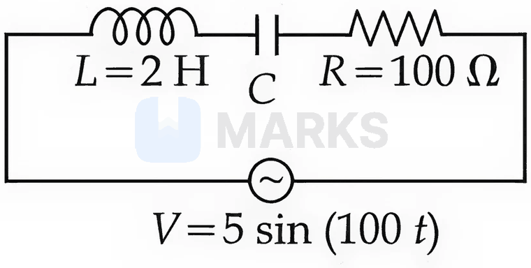
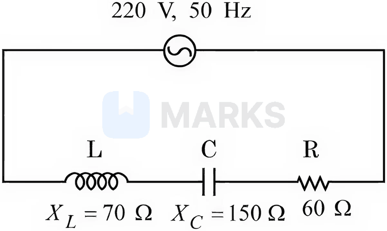

# Alternating Current

> Theory: [../../theory/physics/alternating-current.md](../../theory/physics/alternating-current.md)

### P-ACC-01 · A — JEE Main 2026 · 21 Jan Shift 2 · set Q1 · MCQ

A capacitor $C$ is first charged fully to a potential difference $V_0$ and disconnected from the battery. The charged capacitor is then connected across an inductor of inductance $L$. In time $t$, $25\%$ of the initial energy of the capacitor is transferred to the inductor. The value of $t$ is ______ s.

(1) $\dfrac{\pi\sqrt{LC}}{3}$  (2) $\dfrac{\pi\sqrt{LC}}{6}$  (3) $\dfrac{\pi\sqrt{LC}}{2}$  (4) $\pi\sqrt{\dfrac{LC}{2}}$

**Answer: (2)** · key (compiled)

**Solution.** $E_C(t)=E_0\cos^2\omega t$ with $E_0=\tfrac12CV_0^2$ and $\omega=\dfrac1{\sqrt{LC}}$. If $25\%$ has moved to the inductor, $75\%$ remains: $\cos^2\omega t=0.75\Rightarrow\sin\omega t=\tfrac12\Rightarrow\omega t=\dfrac\pi6$, so $t=\dfrac{\pi\sqrt{LC}}{6}$.

### P-ACC-02 · A — JEE Main 2026 · 23 Jan Shift 1 · set Q2 · Numerical

Using a variable-frequency a.c. voltage source $V=5\sin(100t)$ volt, the maximum current measured in the given LCR circuit is $50$ mA. The values of $L$ and $R$ are shown in the figure. The capacitance of the capacitor $C$ used is ______ $\mu$F.

**Answer: 50** · key (compiled)

**Solution.** The current is largest at resonance, where the impedance equals $R=100\ \Omega$ and $I_0=\dfrac{V_0}{R}=\dfrac{5}{100}=50$ mA, consistent with the data. Resonance at $\omega=100$ rad/s with $L=2$ H gives $\omega L=\dfrac1{\omega C}\Rightarrow C=\dfrac{1}{\omega^2L}=\dfrac{1}{10^4\times2}=5\times10^{-5}$ F $=50\ \mu$F.

### P-ACC-03 · A — JEE Main 2026 · 28 Jan Shift 2 · set Q3 · Numerical

An inductor stores $16$ J of magnetic field energy and dissipates $32$ W of thermal energy due to its resistance when an a.c. current of $2$ A (rms) and frequency $50$ Hz flows through it. The ratio of inductive reactance to its resistance is ______. ($\pi=3.14$)

**Answer: 314** · key (compiled)

**Solution.** Following the paper's convention $\tfrac12LI_{rms}^2=16\Rightarrow L=8$ H. From $I_{rms}^2R=32$: $R=8\ \Omega$. Then $X_L=2\pi fL=2\times3.14\times50\times8=2512\ \Omega$ and $X_L/R=314$.

### P-ACC-04 · A — JEE Main 2026 · 28 Jan Shift 1 · set Q4 · MCQ

The current in a circuit varies as $i=i_0\,(t/T)$. The rms current for the period $t=0$ to $t=T$ is:

(1) $i_0$  (2) $\dfrac{i_0}{\sqrt6}$  (3) $\dfrac{i_0}{\sqrt3}$  (4) $\dfrac{i_0}{\sqrt2}$

**Answer: (3)** · key (compiled)

**Solution.** $I_{rms}^2=\dfrac1T\int_0^T i_0^2\dfrac{t^2}{T^2}dt=\dfrac{i_0^2}{T^3}\cdot\dfrac{T^3}{3}=\dfrac{i_0^2}{3}$, so $I_{rms}=\dfrac{i_0}{\sqrt3}$.

### P-ACC-05 · A — JEE Main 2026 · 24 Jan Shift 1 · set Q5 · MCQ

A series LCR circuit is connected to a $220$ V, $50$ Hz a.c. source as shown in the figure, with $X_L=70\ \Omega$, $X_C=150\ \Omega$ and $R=60\ \Omega$. The power factor of the circuit is $\dfrac{\alpha}{10}$. The value of $\alpha$ is:

(1) 10  (2) 4  (3) 6  (4) 8

**Answer: (3)** · key (compiled)

**Solution.** Net reactance $X=150-70=80\ \Omega$ and $Z=\sqrt{60^2+80^2}=100\ \Omega$, so $\cos\phi=\dfrac{R}{Z}=0.6=\dfrac{6}{10}$ and $\alpha=6$.

### P-ACC-06 · A — JEE Main 2025 · Jan session · AC set Q1 · MCQ

A series LCR circuit is connected to an alternating source of emf $E$. The current amplitude at resonant frequency is $I_0$. If the value of resistance $R$ becomes twice its initial value, then the amplitude of current at resonance will be:

(1) $2I_0$  (2) $I_0$  (3) $\dfrac{I_0}2$  (4) $\dfrac{I_0}{\sqrt2}$

**Answer: (3)** · key (compiled)

**Solution.** At resonance $Z=R$, so $I_0=\dfrac{E_0}R$. Doubling $R$ halves the amplitude: $\dfrac{I_0}2$.

### P-ACC-07 · B — JEE Main 2025 · Jan session · AC set Q2 · Numerical

In a series LCR circuit, a resistor of 300 $\Omega$, a capacitor of 25 nF and an inductor of 100 mH are used. For maximum current in the circuit, the angular frequency of the ac source is ______ $\times10^4$ radians s$^{-1}$.

**Answer: 2** · key (compiled)

**Solution.** The current is maximum at resonance: $\omega=\dfrac1{\sqrt{LC}}=\dfrac1{\sqrt{0.1\times25\times10^{-9}}}=\dfrac1{5\times10^{-5}}=2\times10^4\ \text{rad/s}$. (The resistance does not affect the resonant frequency.)

### P-ACC-08 · B — JEE Main 2025 · Jan session · AC set Q3 · MCQ

An alternating current is given by $I=I_A\sin\omega t+I_B\cos\omega t$. The r.m.s. current will be:

(1) $\dfrac{|I_A+I_B|}{\sqrt2}$  (2) $\sqrt{\dfrac{I_A^2+I_B^2}2}$  (3) $\sqrt{I_A^2+I_B^2}$  (4) $\dfrac{\sqrt{I_A^2+I_B^2}}2$

**Answer: (2)** · key (compiled)

**Solution.** Combine into a single sinusoid: $I=I_0\sin(\omega t+\phi)$ with $I_0=\sqrt{I_A^2+I_B^2}$. Hence $I_{rms}=\dfrac{I_0}{\sqrt2}=\sqrt{\dfrac{I_A^2+I_B^2}2}$.

### P-ACC-09 · B — JEE Main 2025 · Apr session · AC set Q1 · MCQ

An electric bulb rated 100 W – 220 V is connected to an ac source of rms voltage 220 V. The peak value of the current through the bulb is:

(1) 0.64 A  (2) 0.45 A  (3) 2.2 A  (4) 0.32 A

**Answer: (1)** · key (compiled)

**Solution.** $I_{rms}=\dfrac PV=\dfrac{100}{220}=0.4545$ A, so $I_0=\sqrt2\,I_{rms}=0.64$ A.

### P-ACC-10 · B — JEE Main 2025 · Apr session · AC set Q3 · MCQ

An ac current is represented as $i=5\sqrt2+10\cos\left(650\pi t+\dfrac\pi6\right)$ A. The r.m.s. value of the current is:

(1) 50 A  (2) 100 A  (3) 10 A  (4) $5\sqrt2$ A

**Answer: (3)** · key (compiled)

**Solution.** For a constant (dc) part plus a sinusoid, $I_{rms}^2=I_{dc}^2+\dfrac{I_0^2}2=(5\sqrt2)^2+\dfrac{10^2}2=50+50=100$, so $I_{rms}=10$ A.

### P-ACC-11 · B — JEE Main 2024 · 30 Jan Shift 2 · Q12 · MCQ

An alternating voltage $V(t)=220\sin100\pi t$ volt is applied to a purely resistive load. The time taken for the current to rise from half of the peak value to the peak value is

(1) 5 ms  (2) 3.3 ms  (3) 7.2 ms  (4) 2.2 ms

**Answer: (2)** · key ✔

**Solution.** The current is in phase with the voltage: $I=I_0\sin\omega t$ with $\omega=100\pi$. Half the peak occurs at $\omega t=\tfrac\pi6$ and the peak at $\omega t=\tfrac\pi2$. $\Delta t=\dfrac{\pi/3}{100\pi}=\dfrac1{300}\ \text{s}=3.3$ ms.

### P-ACC-12 · C — JEE Main 2024 · 1 Feb Shift 1 · Q14 · MCQ

A parallel plate capacitor has capacitance $C=200$ pF. It is connected to a $230$ V ac supply with an angular frequency of $300\ \text{rad s}^{-1}$. The rms values of the conduction current in the circuit and the displacement current in the capacitor respectively are

(1) 1.38 μA and 1.38 μA  (2) 14.3 μA and 143 μA  (3) 13.8 μA and 138 μA  (4) 13.8 μA and 13.8 μA

**Answer: (4)** · key ✔

**Solution.** $I_{rms}=\dfrac{V_{rms}}{X_C}=V_{rms}\,\omega C=230\times300\times200\times10^{-12}=13.8\ \mu\text{A}$. By continuity of current, the displacement current between the plates has the same value, $13.8\ \mu$A.

### P-ACC-13 · C — JEE Main 2024 · 4 Apr Shift 1 · Q15 · MCQ

In an ac circuit the instantaneous current is zero when the instantaneous voltage is maximum. The source may be connected to: A. pure inductor  B. pure capacitor  C. pure resistor  D. a combination of an inductor and a capacitor.

(1) A, B and C only  (2) A and B only  (3) B, C and D only  (4) A, B and D only

**Answer: (4)** · key ✔

**Solution.** This needs a $90^\circ$ phase difference between $V$ and $I$. A pure $L$ or pure $C$ gives exactly $\pm90^\circ$, and an ideal series $L$–$C$ combination (no resistance) also gives $\pm90^\circ$. A pure resistor gives $0^\circ$. So A, B and D.

