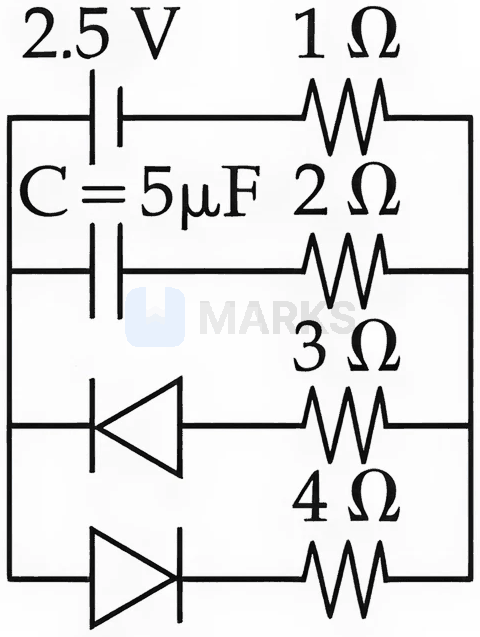
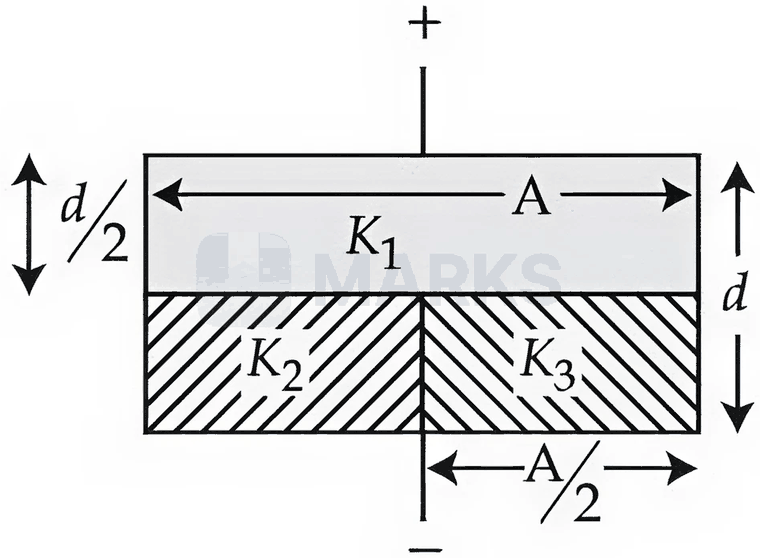
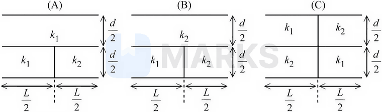
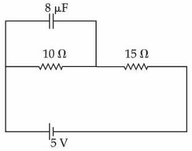
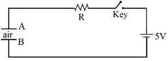
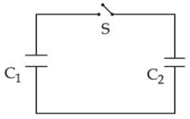
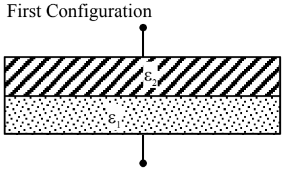
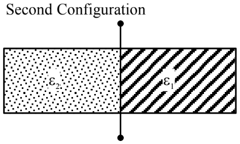
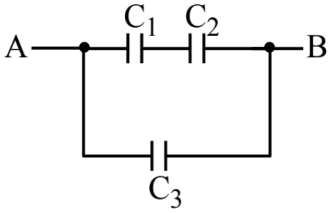
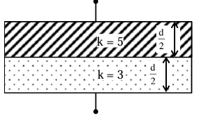

# Capacitors

> Theory: [../../theory/physics/capacitors.md](../../theory/physics/capacitors.md)

### P-CAP-01 — JEE Main 2024 · 30 Jan Shift 1 · Q25 · Numerical

A capacitor of capacitance $C$ and potential $V$ has energy $E$. It is connected to another capacitor of capacitance $2C$ and potential $2V$. Then the loss of energy is $\dfrac x3E$. The value of $x$ is ______.

**Answer: 2** · key ✔

**Solution.** Loss on connecting like terminals: $\Delta U=\dfrac{C_1C_2}{2(C_1+C_2)}(V_1-V_2)^2=\dfrac{C\cdot2C}{2\cdot3C}(V)^2=\dfrac{CV^2}3$. Since $E=\tfrac12CV^2$, $\Delta U=\dfrac23E$, so $x=2$.

### P-CAP-02 — JEE Main 2024 · 31 Jan Shift 1 · Q25 · Numerical

A parallel plate capacitor with plate separation $5$ mm is charged up by a battery. On introducing a dielectric sheet of thickness $2$ mm while keeping the battery connected, the capacitor draws $25\%$ more charge from the battery than before. The dielectric constant of the sheet is ______.

**Answer: 2** · key ✔

**Solution.** At fixed voltage $Q\propto C$, so $C'=1.25C$. $C'=\dfrac{\varepsilon_0A}{d-t+t/K}=1.25\dfrac{\varepsilon_0A}d\Rightarrow d-t+\dfrac tK=\dfrac d{1.25}=4$ mm. So $5-2+\dfrac2K=4\Rightarrow\dfrac2K=1\Rightarrow K=2$.

### P-CAP-03 — JEE Main 2024 · 1 Feb Shift 1 · Q11 · MCQ

Two identical capacitors have the same capacitance $C$. One of them is charged to potential $V$ and the other to potential $2V$. The negative ends of both are connected together. When the positive ends are also joined together, the decrease in energy of the combined system is

(1) $\tfrac14CV^2$  (2) $2CV^2$  (3) $\tfrac12CV^2$  (4) $\tfrac34CV^2$

**Answer: (1)** · key ✔

**Solution.** Loss of energy $=\dfrac{C_1C_2}{2(C_1+C_2)}(V_1-V_2)^2=\dfrac{C\cdot C}{2\cdot2C}(V)^2=\dfrac{CV^2}4$.

### P-CAP-04 — JEE Main 2024 · 4 Apr Shift 2 · Q25 · Numerical

A $12.5$ pF parallel plate capacitor is charged to $12.0$ V, the battery is disconnected and a dielectric slab ($\epsilon_r=6$) is inserted. The change in the potential energy is ______ $\times10^{-12}$ J (magnitude).

**Answer: 750** · key ✔

**Solution.** $U_i=\tfrac12CV^2=\tfrac12(12.5\times10^{-12})(144)=900\times10^{-12}$ J. With the battery off, $Q$ is fixed and $C\to6C$, so $U_f=U_i/6=150\times10^{-12}$ J. The change is $-750\times10^{-12}$ J: the energy decreases by $750\times10^{-12}$ J.

### P-CAP-05 — JEE Main 2024 · 5 Apr Shift 1 · Q24 · Numerical

Capacitors of $25\ \mu\text{F}$, $30\ \mu\text{F}$ and $45\ \mu\text{F}$ are connected in parallel to a $100$ V supply; the stored energy is $E$. When connected in series to the same supply the stored energy is $\dfrac9x E$. The value of $x$ is ______.

**Answer: 86** · key ✔

**Solution.** Parallel: $C_p=100\ \mu\text{F}$. Series: $\dfrac1{C_s}=\dfrac1{25}+\dfrac1{30}+\dfrac1{45}=\dfrac{18+15+10}{450}=\dfrac{43}{450}$, so $C_s=\dfrac{450}{43}\ \mu\text{F}$. With the same $V$: $\dfrac{E_s}{E_p}=\dfrac{C_s}{C_p}=\dfrac{4.5}{43}=\dfrac{9}{86}$. So $x=86$.

### P-CAP-06 — JEE Main 2024 · 5 Apr Shift 1 · Q25 · Numerical

The electric field between the plates of a $1.5\ \mu\text{F}$ capacitor drops to one-third of its initial value in $6.6\ \mu\text{s}$ when the plates are joined by a thin wire. The resistance of the wire is ______ $\Omega$. ($\ln3=1.1$)

**Answer: 4** · key ✔

**Solution.** Discharge: $E\propto q=q_0e^{-t/RC}$. $\dfrac13=e^{-t/RC}\Rightarrow t=RC\ln3\Rightarrow R=\dfrac{6.6\times10^{-6}}{1.5\times10^{-6}\times1.1}=4\ \Omega$.

### § — JEE Main 2026 · 21 Jan Shift 2 · set Q1 · MCQ

The charge stored by the capacitor $C$ in the given circuit in the steady state is ______ $\mu$C.

(1) 5  (2) 12.5  (3) 10  (4) 7.5

**Answer: (3)** · key (compiled)

**Solution.** In steady state the capacitor branch carries no current. The diode in the $3\ \Omega$ branch is reverse biased while the diode in the $4\ \Omega$ branch is forward biased, so current flows only through the $2.5$ V source, the $1\ \Omega$ and the $4\ \Omega$ resistors: $i=\dfrac{2.5}{5}=0.5$ A. The capacitor sits across the $4\ \Omega$ branch, so $V_C=0.5\times4=2$ V and $Q=CV_C=5\ \mu\text{F}\times2\ \text{V}=10\ \mu$C.

### § — JEE Main 2026 · 23 Jan Shift 1 · set Q2 · Numerical

The space between the plates of a parallel plate capacitor of capacitance $C$ (without any dielectric) is filled with three dielectric slabs of dielectric constants $K_1=2$, $K_2=3$ and $K_3=5$ as shown in the figure. If the new capacitance is $\dfrac{n}{3}C$, the value of $n$ is ______.

**Answer: 8** · key (compiled)

**Solution.** With $C=\dfrac{\epsilon_0A}{d}$: the lower layer is two parallel capacitors, each of area $A/2$ and thickness $d/2$: $C_2=3C$, $C_3=5C$, so the lower part is $8C$. The upper layer is a single capacitor $C_1=K_1\dfrac{\epsilon_0A}{d/2}=4C$. The two layers are in series: $\dfrac1{C'}=\dfrac1{4C}+\dfrac1{8C}=\dfrac{3}{8C}\Rightarrow C'=\dfrac{8}{3}C$, so $n=8$.

### § — JEE Main 2026 · 28 Jan Shift 2 · set Q3 · MCQ

Identify the correct statements:
A. The effective capacitance of a series combination of capacitors is always smaller than the smallest capacitance in the combination.
B. When a dielectric medium is placed between the charged plates of a capacitor, displacement of charges cannot occur due to the insulating property of the dielectric.
C. Increasing the area of the capacitor plate or decreasing the thickness of the dielectric is an alternate method to increase the capacitance.
D. For a point charge, concentric spherical shells centred at the location of the charge are equipotential surfaces.

(1) B and D only  (2) A, B and C only  (3) C and D only  (4) A, C and D only

**Answer: (4)** · key (compiled)

**Solution.** A is true ($\tfrac1{C_{eff}}=\sum\tfrac1{C_i}>\tfrac1{C_{min}}$). B is false: a dielectric polarises, i.e. bound charges are displaced. C is true since $C=\dfrac{\epsilon_0\epsilon_rA}{d}$. D is true since $V=kq/r$ depends only on $r$. So A, C, D.

### § — JEE Main 2026 · 24 Jan Shift 2 · set Q4 · MCQ

Three parallel plate capacitors, each of area $A$ and separation $d$, are filled with two dielectrics ($k_1$ and $k_2$, $k_1>k_2$) in the fashion shown in the figure. Which of the following is true?

(1) $C_C>C_A>C_B$  (2) $C_C>C_B>C_A$  (3) $C_A>C_C>C_B$  (4) $C_B>C_C>C_A$

**Answer: (3)** · key (compiled)

**Solution.** Let $C=\dfrac{\epsilon_0A}{d}$ and treat each vertical column separately (columns in parallel, layers in a column in series). $C_A=\dfrac{k_1C}{2}+\dfrac{k_1k_2C}{k_1+k_2}$, $C_B=\dfrac{k_2C}{2}+\dfrac{k_1k_2C}{k_1+k_2}$, $C_C=\dfrac{2k_1k_2C}{k_1+k_2}$. With $k_1>k_2$: $C_A-C_C=\dfrac{Ck_1(k_1-k_2)}{2(k_1+k_2)}>0$ and $C_C-C_B=\dfrac{Ck_2(k_1-k_2)}{2(k_1+k_2)}>0$, so $C_A>C_C>C_B$.

### § — JEE Main 2026 · 22 Jan Shift 2 · set Q5 · Numerical

A capacitor $P$ of capacitance $10\times10^{-6}$ F is fully charged to a potential difference of $6.0$ V and disconnected from the battery. The charged capacitor $P$ is connected across another capacitor $Q$ of capacitance $20\times10^{-6}$ F (initially uncharged). The charge on capacitor $Q$ when equilibrium is established is $\alpha\times10^{-5}$ C. The value of $\alpha$ is ______.

**Answer: 4** · key (compiled)

**Solution.** Initial charge $=10\times10^{-6}\times6=60\ \mu$C. After connection the common potential is $V=\dfrac{60\ \mu\text{C}}{30\ \mu\text{F}}=2$ V, so $Q_Q=20\ \mu\text{F}\times2\ \text{V}=40\ \mu\text{C}=4\times10^{-5}$ C and $\alpha=4$.

### § — JEE Main 2026 · 23 Jan Shift 2 · set Q6 · MCQ

A parallel plate capacitor with plate separation $5$ mm is charged by a battery. On introducing a mica sheet of thickness $2$ mm while keeping the plates connected to the battery, it is found that it draws $25\%$ more charge from the battery. The dielectric constant of the mica is ______.

(1) 1.0  (2) 2.5  (3) 2.0  (4) 1.5

**Answer: (3)** · key (compiled)

**Solution.** The new capacitance is $C_2=\dfrac{\epsilon_0A}{3+2/k}$ (mm) versus $C_1=\dfrac{\epsilon_0A}{5}$. At constant $V$, $\dfrac{Q_2}{Q_1}=\dfrac{5}{3+2/k}=1.25\Rightarrow3+\dfrac2k=4\Rightarrow k=2$.

### § — JEE Main 2026 · 21 Jan Shift 1 · set Q7 · MCQ

A parallel plate capacitor has capacitance $C$ when there is vacuum between the plates. A sheet of thickness $\left(\tfrac13\right)^{\text{rd}}$ of the separation between the plates and relative permittivity $K$ is introduced between the plates. The new capacitance of the system is:

(1) $\dfrac{4KC}{3K-1}$  (2) $\dfrac{3CK^2}{(2K+1)^2}$  (3) $\dfrac{3KC}{2K+1}$  (4) $\dfrac{CK}{2+K}$

**Answer: (3)** · key (compiled)

**Solution.** The system is two capacitors in series: vacuum region of thickness $\tfrac{2d}{3}$, $C_1=\tfrac32C$, and the dielectric region of thickness $\tfrac d3$, $C_2=3KC$. $\dfrac1{C_{new}}=\dfrac{2}{3C}+\dfrac1{3KC}=\dfrac{2K+1}{3KC}\Rightarrow C_{new}=\dfrac{3KC}{2K+1}$.

### § — JEE Main 2025 · Jan session · Cap set Q2 · Numerical

At steady state the charge on the capacitor, as shown in the circuit below, is ______ $\mu$C.

**Answer: 16** · key (compiled)

**Solution.** At steady state no current flows through the capacitor branch. The 10 $\Omega$ and 15 $\Omega$ resistors are in series with the 5 V battery: $I=\dfrac5{10+15}=0.2$ A. The capacitor is connected across the 10 $\Omega$ resistor only, so $V=0.2\times10=2$ V and $Q=CV=8\ \mu\text{F}\times2\ \text V=16\ \mu$C.

### § — JEE Main 2025 · Jan session · Cap set Q3 · MCQ

A parallel-plate capacitor of capacitance 40 $\mu$F is connected to a 100 V power supply. Now the intermediate space between the plates is filled with a dielectric material of dielectric constant $K=2$. Due to the introduction of the dielectric material, the extra charge and the change in the electrostatic energy in the capacitor, respectively, are:

(1) 4 mC and 0.2 J  (2) 8 mC and 2.0 J  (3) 2 mC and 0.4 J  (4) 2 mC and 0.2 J

**Answer: (1)** · key (compiled)

**Solution.** The supply stays connected, so $V=100$ V is fixed and $C'=KC=80\ \mu$F. Extra charge $\Delta Q=(C'-C)V=40\times10^{-6}\times100=4$ mC. Change in energy $\Delta U=\tfrac12(C'-C)V^2=\tfrac12\times40\times10^{-6}\times10^4=0.2$ J.

### § — JEE Main 2025 · Jan session · Cap set Q7 · MCQ

Identify the valid statements relevant to the given circuit at the instant when the key is closed.

A. There will be no current through resistor $R$.
B. There will be maximum current in the connecting wires.
C. Potential difference between the capacitor plates $A$ and $B$ is minimum.
D. Charge on the capacitor plates is minimum.

Choose the correct answer from the options given below:

(1) A, C only  (2) A, B, D only  (3) C, D only  (4) B, C, D only

**Answer: (4)** · key (compiled)

**Solution.** Just after the key is closed the uncharged capacitor behaves like a short circuit: its charge $q=0$ and $V_C=0$ are both at their minimum, so the full 5 V is across $R$ and the current $I=5/R$ is at its maximum. Hence B, C and D are correct; A is false.

### § — JEE Main 2025 · Jan session · Cap set Q8 · MCQ

A parallel-plate capacitor was made with two rectangular plates, each of length $l=3$ cm and breadth $b=1$ cm. The distance between the plates is $3\ \mu$m. Which of the following are ways to increase the capacitance by a factor of 10?

A. $l=30$ cm, $b=1$ cm, $d=1\ \mu$m
B. $l=3$ cm, $b=1$ cm, $d=30\ \mu$m
C. $l=6$ cm, $b=5$ cm, $d=3\ \mu$m
D. $l=1$ cm, $b=1$ cm, $d=10\ \mu$m
E. $l=5$ cm, $b=2$ cm, $d=1\ \mu$m

Choose the correct answer from the options given below:

(1) A only  (2) C only  (3) B and D only  (4) C and E only

**Answer: (4)** · key (compiled)

**Solution.** $C=\dfrac{\varepsilon_0lb}{d}\propto\dfrac{lb}{d}$. Original: $\dfrac{3\times1}{3}=1$. A: $\dfrac{30\times1}{1}=30$; B: $\dfrac3{30}=0.1$; C: $\dfrac{6\times5}3=10$ ✓; D: $\dfrac1{10}=0.1$; E: $\dfrac{5\times2}1=10$ ✓. So C and E.

### § — JEE Main 2025 · Jan session · Cap set Q10 · MCQ

A capacitor $C_1=6\ \mu$F is charged to a potential difference of $V_0=5$ V using a 5 V battery. The battery is removed and another capacitor $C_2=12\ \mu$F is inserted in its place. When the switch $S$ is closed, charge flows between the capacitors until equilibrium is reached. What are the charges ($q_1$ and $q_2$) on the capacitors $C_1$ and $C_2$ when equilibrium is reached?

(1) $q_1=10\ \mu$C, $q_2=20\ \mu$C  (2) $q_1=30\ \mu$C, $q_2=15\ \mu$C  (3) $q_1=20\ \mu$C, $q_2=10\ \mu$C  (4) $q_1=15\ \mu$C, $q_2=30\ \mu$C

**Answer: (1)** · key (compiled)

**Solution.** Initially only $C_1$ is charged: $Q=C_1V_0=30\ \mu$C. At equilibrium the two capacitors (in parallel) share a common potential $V=\dfrac Q{C_1+C_2}=\dfrac{30}{18}=\dfrac53$ V. Then $q_1=C_1V=10\ \mu$C and $q_2=C_2V=20\ \mu$C.

### § — JEE Main 2025 · Apr session · Cap set Q2 · MCQ

A parallel-plate capacitor is filled equally (half) with two dielectrics of dielectric constants $\varepsilon_1$ and $\varepsilon_2$, as shown in the figures. The distance between the plates is $d$ and the area of each plate is $A$. If the capacitances in the first and second configurations are $C_1$ and $C_2$ respectively, then $\dfrac{C_1}{C_2}$ is:

(1) $\dfrac{\varepsilon_1\varepsilon_2^2}{(\varepsilon_1+\varepsilon_2)^2}$  (2) $\dfrac{4\varepsilon_1\varepsilon_2}{(\varepsilon_1+\varepsilon_2)^2}$  (3) $\dfrac{\varepsilon_1\varepsilon_2}{\varepsilon_1+\varepsilon_2}$  (4) $\dfrac{\varepsilon_0(\varepsilon_1+\varepsilon_2)}2$

**Answer: (2)** · key (compiled)

**Solution.** First configuration: two layers of thickness $d/2$ in series, $C_1=\dfrac{\varepsilon_0A}{\frac d{2\varepsilon_1}+\frac d{2\varepsilon_2}}=\dfrac{2\varepsilon_0A}{d}\cdot\dfrac{\varepsilon_1\varepsilon_2}{\varepsilon_1+\varepsilon_2}$. Second configuration: two halves of area $A/2$ in parallel, $C_2=\dfrac{\varepsilon_0A}{2d}(\varepsilon_1+\varepsilon_2)$. Hence $\dfrac{C_1}{C_2}=\dfrac{4\varepsilon_1\varepsilon_2}{(\varepsilon_1+\varepsilon_2)^2}$.

### § — JEE Main 2025 · Apr session · Cap set Q4 · MCQ

Three parallel plate capacitors $C_1$, $C_2$ and $C_3$, each of capacitance $5\ \mu$F, are connected as shown in the figure. The effective capacitance between points $A$ and $B$, when the space between the plates of $C_1$ is filled with a dielectric medium of dielectric constant 4, is:

(1) 22.5 $\mu$F  (2) 7.5 $\mu$F  (3) 9 $\mu$F  (4) 30 $\mu$F

**Answer: (3)** · key (compiled)

**Solution.** With the dielectric, $C_1'=4\times5=20\ \mu$F. $C_1'$ and $C_2$ are in series: $\dfrac{20\times5}{20+5}=4\ \mu$F. This branch is in parallel with $C_3=5\ \mu$F (connected directly between $A$ and $B$): $C_{AB}=4+5=9\ \mu$F.

### § — JEE Main 2025 · Apr session · Cap set Q5 · Numerical

The space between the plates of a parallel-plate capacitor of plate area 4 cm$^2$ and separation $d=1.77$ mm is filled with uniform dielectric materials of dielectric constants 3 and 5 (each of thickness $d/2$), as shown in the figure. Another capacitor of capacitance 7.5 pF is connected in parallel with it. The effective capacitance of this combination is ______ pF. (Given $\varepsilon_0=8.85\times10^{-12}$ F/m)

**Answer: 15** · key (compiled)

**Solution.** $\dfrac{\varepsilon_0A}{d}=\dfrac{8.85\times10^{-12}\times4\times10^{-4}}{1.77\times10^{-3}}=2$ pF. The two layers are in series: $C_a=\dfrac{5\varepsilon_0A}{d/2}=20$ pF and $C_b=\dfrac{3\varepsilon_0A}{d/2}=12$ pF, so $C_{series}=\dfrac{20\times12}{32}=7.5$ pF. Adding the parallel capacitor: $7.5+7.5=15$ pF.

### § — JEE Main 2025 · Apr session · Cap set Q6 · Numerical

A parallel-plate capacitor has charge $5\times10^{-6}$ C. A dielectric slab is inserted between the plates and almost fills the space between the plates. If the induced charge on one face of the slab is $4\times10^{-6}$ C, then the dielectric constant of the slab is ______.

**Answer: 5** · key (compiled)

**Solution.** The free charge $Q$ on the plates is unchanged, and the induced (bound) charge on a face of the slab is $Q_i=Q\left(1-\dfrac1K\right)$. So $4=5\left(1-\dfrac1K\right)\Rightarrow\dfrac1K=\dfrac15\Rightarrow K=5$.

