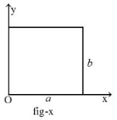
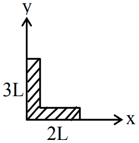

# Centre of Mass & Collisions

> Theory: [../../theory/physics/centre-of-mass-collisions.md](../../theory/physics/centre-of-mass-collisions.md)

### P-COM-01 · C — JEE Main 2026 · 23 Jan Shift 1 · set Q1 · MCQ

In a perfectly inelastic collision, two spheres made of the same material, of masses $15$ kg and $25$ kg, moving in opposite directions with speeds of $10$ m/s and $30$ m/s respectively, strike each other and stick together. The rise in temperature (in $^\circ$C), if all the heat produced during the collision is retained by these spheres, is: (specific heat of the sphere material $=31$ cal/kg $^\circ$C and $1$ cal $=4.2$ J)

(1) 1.15  (2) 1.75  (3) 1.44  (4) 1.95

**Answer: (3)** · key (compiled)

**Solution.** Momentum: $15(10)-25(30)=40v\Rightarrow v=-15$ m/s. Kinetic energy lost $=\tfrac12(15)(10)^2+\tfrac12(25)(30)^2-\tfrac12(40)(15)^2=12000-4500=7500$ J $=1785.7$ cal. $\Delta T=\dfrac{1785.7}{40\times31}=1.44^\circ$C.

### P-COM-02 · C — JEE Main 2026 · 22 Jan Shift 2 · set Q2 · MCQ

Given below are two statements:  
**Statement I:** For a mechanical system of many particles, the total kinetic energy is the sum of the kinetic energies of all the particles.  
**Statement II:** The total kinetic energy can be the sum of the kinetic energy of the centre of mass with respect to the origin and the kinetic energy of all the particles with respect to the centre of mass as the reference.

(1) Statement I is true but Statement II is false  (2) Both Statement I and Statement II are false  (3) Statement I is false but Statement II is true  (4) Both Statement I and Statement II are true

**Answer: (4)** · key (compiled)

**Solution.** I is true by definition, $K=\sum\tfrac12m_iv_i^2$. II is the König decomposition, $K=\tfrac12Mv_{cm}^2+\sum\tfrac12m_iv_i'^2$, also true.

### P-COM-03 · C — JEE Main 2026 · 23 Jan Shift 2 · set Q3 · MCQ

A body of mass $14$ kg initially at rest explodes and breaks into three fragments of masses in the ratio $2:2:3$. The two pieces of equal masses fly off perpendicular to each other with a speed of $18$ m/s each. The velocity of the heavier fragment is ______ m/s.

(1) 12  (2) $10\sqrt2$  (3) $24\sqrt2$  (4) $12\sqrt2$

**Answer: (4)** · key (compiled)

**Solution.** The masses are $4$, $4$ and $6$ kg. The two equal fragments have momenta $72$ kg m/s along perpendicular directions, with resultant $72\sqrt2$. Total momentum is zero, so $6v=72\sqrt2\Rightarrow v=12\sqrt2$ m/s.

### P-COM-04 · C — JEE Advanced 2025 · Paper 1 · Q2 · MCQ

A particle of mass $2m$ collides elastically with a particle of mass $m$ initially at rest. The maximum angular deviation $\theta$ of the heavier particle from its original direction is

(A) $\pi$  (B) $\tan^{-1}\!\left(\tfrac12\right)$  (C) $\pi/3$  (D) $\pi/6$

**Answer: (D)** · official key ✔ (re-derived)

**Solution.** When the projectile is heavier ($m_1=2m>m_2=m$) it cannot be scattered backwards, and the maximum deflection satisfies $\sin\theta_{max}=\dfrac{m_2}{m_1}=\dfrac12$, so $\theta_{max}=\dfrac\pi6$.

### P-COM-05 · C — JEE Main 2025 · Jan session · COM set Q1 · MCQ

The centre of mass of a thin rectangular plate (figure) with sides of length $a$ and $b$, whose mass per unit area $\sigma$ varies as $\sigma=\dfrac{\sigma_0x}{ab}$ (where $\sigma_0$ is a constant), would be ______.

(1) $\left(\dfrac23a,\ \dfrac b2\right)$  (2) $\left(\dfrac a2,\ \dfrac b2\right)$  (3) $\left(\dfrac13a,\ \dfrac b2\right)$  (4) $\left(\dfrac23a,\ \dfrac23b\right)$

**Answer: (1)** · key (compiled)

**Solution.** The density depends on $x$ only, so $y_{cm}=\dfrac b2$ by symmetry. $x_{cm}=\dfrac{\int_0^a x\,\sigma\,b\,dx}{\int_0^a\sigma\,b\,dx}=\dfrac{\int_0^ax^2dx}{\int_0^ax\,dx}=\dfrac{a^3/3}{a^2/2}=\dfrac{2a}3$.

### P-COM-06 · C — JEE Main 2025 · Jan session · COM set Q2 · MCQ

Consider a circular disc of radius 20 cm with its centre located at the origin. A circular hole of radius 5 cm is cut from this disc in such a way that the edge of the hole touches the edge of the disc. The distance of the centre of mass of the residual (remaining) disc from the origin will be:

(1) 2.0 cm  (2) 1.5 cm  (3) 1.0 cm  (4) 0.5 cm

**Answer: (3)** · key (compiled)

**Solution.** Mass $\propto$ area, so the hole has $\dfrac1{16}$ of the original mass $M$, with its centre at $20-5=15$ cm from the origin. $x_{cm}=\dfrac{M\cdot0-\frac M{16}\cdot15}{M-\frac M{16}}=-\dfrac{15}{15}=-1$ cm. The centre of mass of the remaining disc is 1.0 cm from the origin, on the side opposite to the hole.

### P-COM-07 · C — JEE Main 2025 · Apr session · COM set Q1 · MCQ

A rod of length $5L$ is bent at a right angle keeping one side of length $2L$ (the other side is then $3L$), as shown in the figure. The position of the centre of mass of the system is: (consider $L=10$ cm)

(1) $2\hat i+3\hat j$  (2) $3\hat i+7\hat j$  (3) $5\hat i+8\hat j$  (4) $4\hat i+9\hat j$

**Answer: (4)** · key (compiled)

**Solution.** Take the corner as the origin, the side $2L$ along $x$ and the side $3L$ along $y$ (uniform linear density $\lambda$). $x_{cm}=\dfrac{(2L\lambda)(L)+(3L\lambda)(0)}{5L\lambda}=\dfrac{2L}5=4$ cm and $y_{cm}=\dfrac{(3L\lambda)(1.5L)}{5L\lambda}=0.9L=9$ cm. So $\vec r_{cm}=4\hat i+9\hat j$ (in cm).

### P-COM-08 · C — JEE Main 2024 · 30 Jan Shift 1 · Q5 · MCQ

A spherical body of mass $100$ g is dropped from a height of $10$ m. After hitting the ground the body rebounds to a height of $5$ m. The impulse of force imparted by the ground to the body is (given $g=9.8\ \text{m s}^{-2}$)

Find the impulse in kg m s$^{-1}$ (the options were $4.32$, $23.9$, $43.2$ and $2.39$).

**Answer: $2.39\ \text{kg m s}^{-1}$ (option 4)** · key ✔

**Solution.** Speed just before impact: $v_1=\sqrt{2gh_1}=\sqrt{2(9.8)(10)}=14$ m/s (downward). Speed just after: $v_2=\sqrt{2(9.8)(5)}=9.9$ m/s (upward). Impulse $=\Delta p=m(v_1+v_2)=0.1\times(14+9.9)=2.39$ kg m s$^{-1}$.

### P-COM-09 · C — JEE Main 2024 · 1 Feb Shift 1 · Q5 · MCQ

A simple pendulum of length $1$ m has a wooden bob of mass $1$ kg. It is struck by a bullet of mass $10^{-2}$ kg moving with a speed of $2\times10^2\ \text{m s}^{-1}$. The bullet gets embedded into the bob. The height to which the bob rises before swinging back is ($g=10\ \text{m s}^{-2}$)

(1) 0.30 m  (2) 0.20 m  (3) 0.35 m  (4) 0.40 m

**Answer: (2)** · key ✔

**Solution.** Momentum conservation: $0.01\times200=(1.01)v\Rightarrow v=1.98$ m/s. Then $h=\dfrac{v^2}{2g}=\dfrac{3.92}{20}=0.196\approx0.20$ m.

