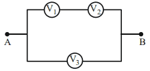
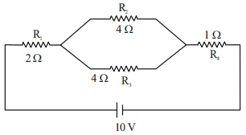
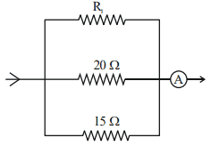
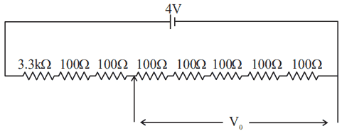
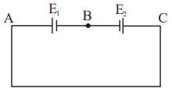
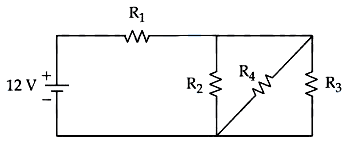
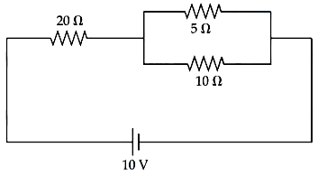
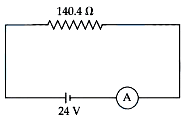
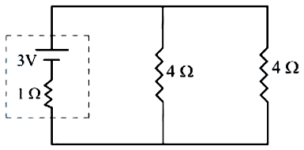
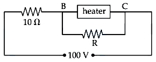

# Current Electricity

> Theory: [../../theory/physics/current-electricity.md](../../theory/physics/current-electricity.md)

### P-CUR-01 · A — JEE Main 2026 · 21 Jan Shift 2 · set Q1 · MCQ

Two known resistances $R\ \Omega$ and $2R\ \Omega$ and one unknown resistance $X\ \Omega$ are connected in a circuit as shown in the figure. If the equivalent resistance between points $A$ and $B$ is $X\ \Omega$, then the value of $X$ is ______ $\Omega$.

(1) $(\sqrt3-1)R$  (2) $2(\sqrt3-1)R$  (3) $(\sqrt3+1)R$  (4) $R$

**Answer: (1)** · key (compiled)

**Solution.** The branch $2R+X$ is in parallel with $R$, so $R_{AB}=\dfrac{R(2R+X)}{3R+X}=X\Rightarrow X(3R+X)=R(2R+X)\Rightarrow X^2+2RX-2R^2=0$, giving $X=R(\sqrt3-1)$ (positive root).

### P-CUR-02 · A — JEE Main 2026 · 23 Jan Shift 1 · set Q4 · MCQ

A wire of uniform resistance $\lambda\ \Omega\,\text{m}^{-1}$ is bent into a circle of radius $r$, and another piece of wire of length $2r$ (two radii, $A\!-\!O\!-\!B$) is connected between points $A$ and $B$ as shown in the figure. The equivalent resistance between $A$ and $B$ is:

(1) $\dfrac{3\pi\lambda r}{8}$  (2) $\dfrac{6\pi\lambda r}{3\pi+16}$  (3) $2\pi\lambda r$  (4) $(\pi+1)\,2r\lambda$

**Answer: (2)** · key (compiled)

**Solution.** $\angle AOB=90^\circ$, so there are three parallel paths between $A$ and $B$: the minor arc ($\lambda\cdot\tfrac{\pi r}{2}$), the major arc ($\lambda\cdot\tfrac{3\pi r}{2}$) and the wire $A\!-\!O\!-\!B$ ($2\lambda r$). Then $\dfrac1{R_{AB}}=\dfrac{2}{\pi\lambda r}+\dfrac{2}{3\pi\lambda r}+\dfrac{1}{2\lambda r}=\dfrac{16+3\pi}{6\pi\lambda r}$, so $R_{AB}=\dfrac{6\pi\lambda r}{3\pi+16}$.

### P-CUR-03 · A — JEE Main 2026 · 28 Jan Shift 2 · set Q5 · MCQ

Which one of the following is not a measurable quantity?

(1) Voltage  (2) Resistance  (3) Displacement current  (4) Voltage difference

**Answer: (1)** · key (compiled)

**Solution.** Only potential *differences* can be measured (with a voltmeter); the potential at a single point depends on the arbitrary choice of zero, so "voltage" in the absolute sense is not measurable. Resistance (ohmmeter, bridge) and voltage difference are measurable, and the magnetic effect of a displacement current can be measured.

### P-CUR-04 · A — JEE Main 2026 · 24 Jan Shift 2 · set Q7 · MCQ

The reading of the ammeter $A$ in steady state in the circuit shown (ammeter resistance negligible) is ______ A.

(1) 1  (2) 1/2  (3) 0  (4) 2

**Answer: (1)** · key (compiled)

**Solution.** In steady state the capacitor branch carries no current. The $4\ \Omega$ resistor in series with the two parallel $8\ \Omega$ resistors ($4\ \Omega$) gives $8\ \Omega$, which (through the ideal ammeter) is in parallel with the left $8\ \Omega$: $4\ \Omega$. With the $1\ \Omega$ in series the total is $5\ \Omega$, so $I=\dfrac{10}{5}=2$ A and the voltage across the parallel part is $8$ V. The ammeter path carries $\dfrac{8}{8}=1$ A.

### P-CUR-05 · A — JEE Main 2026 · 22 Jan Shift 2 · set Q11 · MCQ

An electric power line having a total resistance of $2\ \Omega$ delivers $1$ kW of power at $250$ V. The percentage efficiency of the transmission line is:

(1) 100  (2) 92.5  (3) 96.9  (4) 86.5

**Answer: (3)** · key (compiled)

**Solution.** Line current $I=\dfrac{1000}{250}=4$ A, loss $=I^2R=16\times2=32$ W. Efficiency $=\dfrac{\text{delivered}}{\text{delivered}+\text{loss}}=\dfrac{1000}{1032}\times100\approx96.9\%$.

### P-CUR-06 · A — JEE Main 2026 · 22 Jan Shift 1 · set Q13 · MCQ

A meter bridge with two resistances $R_1$ and $R_2$ as shown in the figure was balanced (null point) at $40$ cm from the point $P$. The null point changed to $50$ cm from $P$ when a $16\ \Omega$ resistance is connected in parallel to $R_2$. The values of $R_1$ and $R_2$ are:

(1) $R_2=4\ \Omega,\ R_1=\tfrac43\ \Omega$  (2) $R_2=16\ \Omega,\ R_1=\tfrac{16}{3}\ \Omega$  (3) $R_2=12\ \Omega,\ R_1=\tfrac{12}{3}\ \Omega$  (4) $R_2=8\ \Omega,\ R_1=\tfrac{16}{3}\ \Omega$

**Answer: (4)** · key (compiled)

**Solution.** First balance: $\dfrac{R_1}{R_2}=\dfrac{40}{60}=\dfrac23$. Second: $\dfrac{R_1}{R_2\parallel16}=\dfrac{50}{50}=1\Rightarrow R_1=\dfrac{16R_2}{16+R_2}$. Substituting $R_1=\tfrac23R_2$: $\tfrac23=\dfrac{16}{16+R_2}\Rightarrow R_2=8\ \Omega$, $R_1=\tfrac{16}{3}\ \Omega$.

### P-CUR-07 · A — JEE Main 2026 · 23 Jan Shift 2 · set Q14 · MCQ

To compare the emfs of two cells using a potentiometer, the balancing lengths are $200$ cm and $150$ cm. The least count of the scale is $1$ cm. The percentage error in the ratio of the emfs is:

(1) 1.65  (2) 1.45  (3) 1.75  (4) 1.16

**Answer: (4)** · key (compiled)

**Solution.** $\dfrac{\varepsilon_1}{\varepsilon_2}=\dfrac{\ell_1}{\ell_2}$, so $\dfrac{\Delta y}{y}=\dfrac{1}{200}+\dfrac{1}{150}=\dfrac{7}{600}$, i.e. $\dfrac{7}{6}\%\approx1.16\%$.

### P-CUR-08 · A — JEE Main 2026 · 21 Jan Shift 1 · set Q15 · Numerical

The heat generated in $1$ minute between points $A$ and $B$ in the given circuit, when a battery of $9$ V with internal resistance $1\ \Omega$ is connected across these points, is ______ J.

**Answer: 1080** · key (compiled)

**Solution.** The bridge is balanced ($\tfrac12=\tfrac24$), so no current flows in the middle $1\ \Omega$. The upper branch $1+2=3\ \Omega$ in parallel with the lower branch $2+4=6\ \Omega$ gives $R_{AB}=2\ \Omega$. Total resistance $=2+1=3\ \Omega$, $I=3$ A, power in the network $=I^2R_{AB}=9\times2=18$ W, so heat in $60$ s $=18\times60=1080$ J.

### P-CUR-09 · A — JEE Main 2026 · 28 Jan Shift 1 · set Q16 · MCQ

Two cells have the same emf $E$ and internal resistance $r$. The current through an external $6\ \Omega$ resistor is the same whether the two cells are connected in parallel or in series. The value of $r$ (in $\Omega$) is:

(1) 6  (2) 3  (3) 4  (4) 9

**Answer: (1)** · key (compiled)

**Solution.** Series: $I=\dfrac{2E}{2r+6}$. Parallel: $I=\dfrac{E}{r/2+6}=\dfrac{2E}{r+12}$. Equal currents give $2r+6=r+12\Rightarrow r=6\ \Omega$.

### P-CUR-10 · A — JEE Main 2026 · 24 Jan Shift 1 · set Q19 · MCQ

Two resistors $2\ \Omega$ and $3\ \Omega$ are connected in the gaps of a meter bridge $XY$ as shown in the figure. The null point is obtained with the jockey at some point on the wire $XY$. When an unknown resistor is connected in parallel with the $3\ \Omega$ resistor, the null point shifts by $22.5$ cm toward $Y$. The resistance of the unknown resistor is ______ $\Omega$.

(1) 2  (2) 1  (3) 4  (4) 3

**Answer: (1)** · key (compiled)

**Solution.** Initially $\dfrac{2}{3}=\dfrac{l}{100-l}\Rightarrow l=40$ cm; after the shift $l=62.5$ cm. So $\dfrac{2}{R'}=\dfrac{62.5}{37.5}=\dfrac53\Rightarrow R'=1.2\ \Omega$. Since $R'=\dfrac{3x}{3+x}$: $3x=3.6+1.2x\Rightarrow x=2\ \Omega$.

### P-CUR-11 · A — JEE Main 2025 · Jan session · Cur set Q2 · MCQ

The difference of temperature in a material can convert heat energy into electrical energy. To harvest the heat energy, the material should have:

(1) high thermal conductivity and high electrical conductivity  (2) low thermal conductivity and low electrical conductivity  (3) high thermal conductivity and low electrical conductivity  (4) low thermal conductivity and high electrical conductivity

**Answer: (4)** · key (compiled)

**Solution.** This is the thermoelectric (Seebeck) effect. To maintain a temperature difference across the material its thermal conductivity must be low (otherwise heat simply flows through and the gradient disappears), and to deliver the generated current with little Joule loss its electrical conductivity must be high.

### P-CUR-12 · A — JEE Main 2025 · Jan session · Cur set Q3 · MCQ

Find the equivalent resistance between the two ends of the following circuit.

(1) $\dfrac r9$  (2) $\dfrac r3$  (3) $r$  (4) $\dfrac r6$

**Answer: (1)** · key (compiled)

**Solution.** Trace the wires in the figure. The top wire joins the left terminal to the junction between the 2nd and 3rd resistors; the bottom wire joins the junction between the 1st and 2nd resistors to the right terminal. Hence the left ends of all three resistors are at the left node and the right ends at the right node: the three $\dfrac r3$ resistors are in parallel and $R_{eq}=\dfrac{r/3}{3}=\dfrac r9$.

### P-CUR-13 · A — JEE Main 2025 · Jan session · Cur set Q5 · Numerical

A wire of resistance 9 $\Omega$ is bent to form an equilateral triangle. Then the equivalent resistance across any two vertices will be ______ ohm.

**Answer: 2** · key (compiled)

**Solution.** Each side has $3\ \Omega$. Between two vertices one side ($3\ \Omega$) is in parallel with the other two sides in series ($6\ \Omega$): $\dfrac{3\times6}{3+6}=2\ \Omega$.

### P-CUR-14 · A — JEE Main 2025 · Jan session · Cur set Q6 · MCQ

A wire of resistance $R$ is bent into an equilateral triangle and an identical wire is bent into a square. The ratio of the resistance between the two end points of an edge of the triangle to that of the square is:

(1) $\dfrac89$  (2) $\dfrac{27}{32}$  (3) $\dfrac{32}{27}$  (4) $\dfrac98$

**Answer: (3)** · key (compiled)

**Solution.** Triangle: each side is $\dfrac R3$; across one side $\dfrac R3\parallel\dfrac{2R}3=\dfrac{2R}9$. Square: each side is $\dfrac R4$; across one side $\dfrac R4\parallel\dfrac{3R}4=\dfrac{3R}{16}$. Ratio $=\dfrac{2/9}{3/16}=\dfrac{32}{27}$.

### P-CUR-15 · B — JEE Main 2025 · Apr session · Cur set Q1 · MCQ

Current passing through a wire as a function of time is given as $I(t)=0.02t+0.01$ A. The charge that will flow through the wire from $t=1$ s to $t=2$ s is:

(1) 0.06 C  (2) 0.02 C  (3) 0.07 C  (4) 0.04 C

**Answer: (4)** · key (compiled)

**Solution.** $q=\int_1^2(0.02t+0.01)\,dt=0.01\left[t^2\right]_1^2+0.01(2-1)=0.03+0.01=0.04$ C.

### P-CUR-16 · B — JEE Main 2025 · Apr session · Cur set Q2 · MCQ

A motor operating on 100 V draws a current of 1 A. If the efficiency of the motor is 91.6%, then the loss of power in units of cal/s is:

(1) 4  (2) 8.4  (3) 2  (4) 6.2

**Answer: (3)** · key (compiled)

**Solution.** Input power $=100\times1=100$ W. Loss $=(1-0.916)\times100=8.4$ W $=\dfrac{8.4}{4.2}=2$ cal/s (taking 1 cal $=4.2$ J).

### P-CUR-17 · B — JEE Main 2025 · Apr session · Cur set Q5 · Numerical

Two cells of emf 1 V and 2 V and internal resistances 2 $\Omega$ and 1 $\Omega$ respectively are connected in series with an external resistance of 6 $\Omega$. The total current in the circuit is $I_1$. Now the same two cells in parallel configuration are connected to the same external resistance. In this case the total current drawn is $I_2$. The value of $\left(\dfrac{I_1}{I_2}\right)$ is $\dfrac x3$. The value of $x$ is ______.

**Answer: 4** · key (compiled)

**Solution.** Series: $I_1=\dfrac{1+2}{2+1+6}=\dfrac13$ A. Parallel: $\varepsilon_{eq}=\dfrac{\frac12+\frac21}{\frac12+\frac11}=\dfrac53$ V and $r_{eq}=\dfrac{2\times1}{2+1}=\dfrac23\ \Omega$, so $I_2=\dfrac{5/3}{6+2/3}=\dfrac14$ A. $\dfrac{I_1}{I_2}=\dfrac43=\dfrac x3\Rightarrow x=4$.

### P-CUR-18 · B — JEE Main 2025 · Apr session · Cur set Q6 · MCQ

The battery of a mobile phone is rated as 4.2 V, 5800 mAh. How much energy is stored in it when fully charged?

(1) 43.8 kJ  (2) 48.7 kJ  (3) 87.7 kJ  (4) 24.4 kJ

**Answer: (3)** · key (compiled)

**Solution.** $E=VQ=4.2\ \text V\times\left(5.8\ \text{A h}\times3600\ \text{s/h}\right)=4.2\times20880\approx87\,700$ J $=87.7$ kJ.

### P-CUR-19 · B — JEE Main 2024 · 27 Jan Shift 1 · Q11 · MCQ

A wire of resistance $R$ and length $L$ is cut into $5$ equal parts. If these parts are joined in parallel, the resultant resistance is

(1) $R/25$  (2) $R/5$  (3) $25R$  (4) $5R$

**Answer: (1)** · key ✔

**Solution.** Each part has resistance $R/5$. Five such in parallel give $\dfrac{R/5}{5}=\dfrac{R}{25}$.

### P-CUR-20 · B — JEE Main 2024 · 27 Jan Shift 2 · Q11 · MCQ

The Wheatstone bridge principle is used to measure the specific resistance $S_1$ of a wire of length $L$ and radius $r$: $S_1=\dfrac{X\pi r^2}{L}$, where $X$ is its resistance. If the length of the wire is doubled, the specific resistance will be

(1) $S_1/4$  (2) $2S_1$  (3) $S_1/2$  (4) $S_1$

**Answer: (4)** · key ✔

**Solution.** Resistivity is a property of the material. Doubling $L$ doubles $X$ (at fixed $r$), so $X/L$ is unchanged and $S_1$ stays the same.

### P-CUR-21 · B — JEE Main 2024 · 29 Jan Shift 1 · Q13 · MCQ

The electric current through a wire varies with time as $I=I_0+\beta t$, where $I_0=20$ A and $\beta=3\ \text{A s}^{-1}$. The amount of charge crossing a section of the wire in $20$ s is

(1) 80 C  (2) 1000 C  (3) 800 C  (4) 1600 C

**Answer: (2)** · key ✔

**Solution.** $q=\int_0^{20}(I_0+\beta t)\,dt=20(20)+3\cdot\dfrac{20^2}{2}=400+600=1000$ C.

### P-CUR-22 · B — JEE Main 2024 · 30 Jan Shift 1 · Q12 · MCQ

An electric toaster has resistance $60\ \Omega$ at room temperature ($27^\circ$C). The toaster is connected to a $220$ V supply. If the current flowing through it reaches $2.75$ A, the temperature attained by the toaster is around (if $\alpha=2\times10^{-4}\ ^\circ\text{C}^{-1}$)

(1) 694°C  (2) 1235°C  (3) 1694°C  (4) 1667°C

**Answer: (3)** · key ✔

**Solution.** Hot resistance $R=\dfrac{220}{2.75}=80\ \Omega$. $R=R_0\left[1+\alpha(T-27)\right]\Rightarrow\dfrac{80}{60}-1=2\times10^{-4}(T-27)\Rightarrow T-27=1667\Rightarrow T\approx1694^\circ$C.

### P-CUR-23 · B — JEE Main 2024 · 30 Jan Shift 2 · Q11 · MCQ

When a potential difference $V$ is applied across a wire of resistance $R$, it dissipates energy at a rate $W$. If the wire is cut into two halves and these halves are connected in parallel across the same supply, the rate of energy dissipation will become

(1) $\tfrac14W$  (2) $\tfrac12W$  (3) $2W$  (4) $4W$

**Answer: (4)** · key ✔

**Solution.** $W=\dfrac{V^2}R$. Each half has resistance $\dfrac R2$; two in parallel give $\dfrac R4$. New power $=\dfrac{V^2}{R/4}=4W$.

### P-CUR-24 · B — JEE Main 2024 · 31 Jan Shift 2 · Q11 · MCQ

By what percentage will the illumination of a lamp decrease if the current drops by $20\%$?

(1) 46%  (2) 26%  (3) 36%  (4) 56%

**Answer: (3)** · key ✔

**Solution.** The lamp's light output tracks its power $P=I^2R$. With $I\to0.8I$: $P\to0.64P$, a decrease of $36\%$.

### P-CUR-25 · B — JEE Main 2024 · 27 Jan Shift 2 · Fig set Q11 · MCQ

Three voltmeters, all having different internal resistances, are joined as shown in the figure. When some potential difference is applied across A and B, their readings are $V_1$, $V_2$ and $V_3$. Choose the correct option.

(1) $V_1=V_2$  (2) $V_1\ne V_3-V_2$  (3) $V_1+V_2>V_3$  (4) $V_1+V_2=V_3$

**Answer: (4)** · key (compiled)

**Solution.** $V_1$ and $V_2$ are in series and that branch is in parallel with $V_3$ between $A$ and $B$. Parallel elements have the same potential difference, so $V_3=V_1+V_2$ (the voltage across the series pair).

### P-CUR-26 · B — JEE Main 2024 · 29 Jan Shift 2 · Fig set Q15 · MCQ

In the given circuit, the current in resistance $R_3$ is:

(1) 1 A  (2) 1.5 A  (3) 2 A  (4) 2.5 A

**Answer: (1)** · key (compiled)

**Solution.** The 10 V cell drives the 2 Ω resistor in series with the parallel combination of the two 4 Ω resistors ($R_2$, $R_3$) and the 1 Ω resistor. Total resistance $=2+\dfrac{4\times4}{4+4}+1=5\ \Omega$ and $I=\dfrac{10}5=2$ A. The current splits equally between the two equal 4 Ω resistors, so $R_3$ carries 1 A.

### P-CUR-27 · C — JEE Main 2024 · 29 Jan Shift 2 · Fig set Q16 · Numerical

In the given circuit, the current flowing through the resistance 20 Ω is 0.3 A, while the ammeter reads 0.9 A. The value of $R_1$ is ______ Ω.

**Answer: 30** · key (compiled)

**Solution.** Voltage across the parallel branches $=0.3\times20=6$ V. Current in the 15 Ω resistor $=\dfrac6{15}=0.4$ A. The remaining branch carries $0.9-0.3-0.4=0.2$ A, so $R_1=\dfrac6{0.2}=30\ \Omega$.

### P-CUR-28 · C — JEE Main 2024 · 30 Jan Shift 1 · Fig set Q17 · MCQ

A potential divider circuit is shown in the figure. The output voltage $V_0$ is:

(1) 4 V  (2) 2 mV  (3) 0.5 V  (4) 12 mV

**Answer: (3)** · key (compiled)

**Solution.** The total resistance is $3.3\ \text{k}\Omega+7\times100\ \Omega=4\ \text{k}\Omega$, so the current from the 4 V source is $1$ mA. The output is taken across the last five 100 Ω resistors ($500\ \Omega$): $V_0=10^{-3}\times500=0.5$ V.

### P-CUR-29 · C — JEE Main 2024 · 30 Jan Shift 1 · Fig set Q19 · Numerical

Two cells are connected in opposition as shown. Cell $E_1$ is of 8 V emf and 2 Ω internal resistance; the cell $E_2$ is of 2 V emf and 4 Ω internal resistance. The terminal potential difference of cell $E_2$ is ______ V.

**Answer: 6** · key (compiled)

**Solution.** The stronger cell $E_1$ drives current through $E_2$ in the direction opposite to its emf: $I=\dfrac{8-2}{2+4}=1$ A. $E_2$ is being charged, so its terminal voltage is $V=E_2+Ir_2=2+1\times4=6$ V.

### P-CUR-30 · C — JEE Main 2024 · 05 Apr Shift 1 · Fig set Q5 · MCQ

In the given figure ($R_1=10\ \Omega$, $R_2=8\ \Omega$, $R_3=4\ \Omega$, $R_4=8\ \Omega$), the battery is ideal with emf 12 V. The equivalent resistance of the circuit and the current supplied by the battery are respectively:

(1) 10.5 Ω and 1.14 A  (2) 12 Ω and 1 A  (3) 10.5 Ω and 1 A  (4) 12 Ω and 11.4 A

**Answer: (2)** · key (compiled)

**Solution.** The diagonal wire joins the two nodes so that $R_2$, $R_4$ and $R_3$ are all connected between the same two nodes, i.e. in parallel: $\dfrac1R=\dfrac18+\dfrac18+\dfrac14=\dfrac12\Rightarrow R=2\ \Omega$. Total $=10+2=12\ \Omega$ and $I=\dfrac{12}{12}=1$ A.

### P-CUR-31 · C — JEE Main 2024 · 05 Apr Shift 2 · Fig set Q8 · MCQ

The ratio of heat dissipated per second through the resistances 5 Ω and 10 Ω in the circuit given below is:

(1) 1 : 2  (2) 2 : 1  (3) 4 : 1  (4) 1 : 1

**Answer: (2)** · key (compiled)

**Solution.** The 5 Ω and 10 Ω resistors are in parallel, so they have the same voltage $V$. Power $=V^2/R$ is inversely proportional to $R$: $\dfrac{P_5}{P_{10}}=\dfrac{10}5=2:1$.

### P-CUR-32 · C — JEE Main 2024 · 06 Apr Shift 2 · Fig set Q13 · Numerical

In the given figure an ammeter A consists of a 240 Ω coil connected in parallel to a 10 Ω shunt. The reading of the ammeter is ______ mA.

**Answer: 160** · key (compiled)

**Solution.** Ammeter with shunt: $\dfrac{240\times10}{240+10}=9.6\ \Omega$. Total resistance $=140.4+9.6=150\ \Omega$, so the total current is $\dfrac{24}{150}=0.16$ A $=160$ mA (the ammeter assembly reads the total current).

### P-CUR-33 · C — JEE Main 2024 · 08 Apr Shift 1 · Fig set Q14 · MCQ

In the given circuit, the terminal potential difference of the cell is:

(1) 2 V  (2) 3 V  (3) 4 V  (4) 1.5 V

**Answer: (1)** · key (compiled)

**Solution.** The two 4 Ω resistors are in parallel: $2\ \Omega$. The cell has emf 3 V and internal resistance 1 Ω, so $I=\dfrac{3}{1+2}=1$ A and the terminal voltage is $V=3-Ir=3-1=2$ V (equivalently $IR=1\times2$).

### P-CUR-34 · C — JEE Main 2024 · 08 Apr Shift 2 · Fig set Q17 · Numerical

A heater is designed to operate with a power of 1000 W in a 100 V line. It is connected in combination with a resistance of 10 Ω and a resistance $R$, to a 100 V mains as shown in the figure. For the heater to operate at 62.5 W, the value of $R$ should be ______ Ω.

**Answer: 5** · key (compiled)

**Solution.** Heater resistance $=\dfrac{100^2}{1000}=10\ \Omega$. At 62.5 W: $I_h^2\times10=62.5\Rightarrow I_h=2.5$ A and $V_h=25$ V. The 10 Ω series resistor then has $100-25=75$ V across it, so the total current is 7.5 A. $R$ (in parallel with the heater) carries $7.5-2.5=5$ A at 25 V: $R=\dfrac{25}5=5\ \Omega$.

