# Current Electricity

> Theory: [../../theory/physics/current-electricity.md](../../theory/physics/current-electricity.md)

### P-CUR-01 — JEE Main 2024 · 27 Jan Shift 1 · Q11 · MCQ

A wire of resistance $R$ and length $L$ is cut into $5$ equal parts. If these parts are joined in parallel, the resultant resistance is

(1) $R/25$  (2) $R/5$  (3) $25R$  (4) $5R$

**Answer: (1)** · key ✔

**Solution.** Each part has resistance $R/5$. Five such in parallel give $\dfrac{R/5}{5}=\dfrac{R}{25}$.

### P-CUR-02 — JEE Main 2024 · 27 Jan Shift 1 · Q12 · MCQ

A wire of length $10$ cm and radius $\sqrt7\times10^{-4}$ m is connected across the right gap of a meter bridge. When a resistance of $4.5\ \Omega$ is connected in the left gap, the balance point is found at $60$ cm from the left end. If the resistivity of the wire is $R\times10^{-7}\ \Omega$ m, the value of $R$ is

(1) 63  (2) 70  (3) 66  (4) 35

**Answer: (3)** · key ✔

**Solution.** Balance: $\dfrac{4.5}{X}=\dfrac{60}{40}\Rightarrow X=3\ \Omega$. Then $\rho=\dfrac{XA}{l}=\dfrac{3\cdot\pi\cdot7\times10^{-8}}{0.1}=\dfrac{3\cdot22\times10^{-8}}{0.1}=66\times10^{-7}\ \Omega$ m (using $\pi=22/7$). So $R=66$.

### P-CUR-03 — JEE Main 2024 · 27 Jan Shift 2 · Q11 · MCQ

The Wheatstone bridge principle is used to measure the specific resistance $S_1$ of a wire of length $L$ and radius $r$: $S_1=\dfrac{X\pi r^2}{L}$, where $X$ is its resistance. If the length of the wire is doubled, the specific resistance will be

(1) $S_1/4$  (2) $2S_1$  (3) $S_1/2$  (4) $S_1$

**Answer: (4)** · key ✔

**Solution.** Resistivity is a property of the material. Doubling $L$ doubles $X$ (at fixed $r$), so $X/L$ is unchanged and $S_1$ stays the same.

### P-CUR-04 — JEE Main 2024 · 27 Jan Shift 2 · Q12 · MCQ

A current of $200\ \mu$A deflects the coil of a moving-coil galvanometer through $60^\circ$. The current needed to cause a deflection of $\dfrac\pi{10}$ rad is

(1) 30 μA  (2) 120 μA  (3) 60 μA  (4) 180 μA

**Answer: (3)** · key ✔

**Solution.** Deflection is proportional to current ($\theta=\tfrac{NAB}{k}I$). $\dfrac\pi{10}$ rad $=18^\circ$, so $I=200\times\dfrac{18}{60}=60\ \mu$A.

### P-CUR-05 — JEE Main 2024 · 29 Jan Shift 1 · Q13 · MCQ

The electric current through a wire varies with time as $I=I_0+\beta t$, where $I_0=20$ A and $\beta=3\ \text{A s}^{-1}$. The amount of charge crossing a section of the wire in $20$ s is

(1) 80 C  (2) 1000 C  (3) 800 C  (4) 1600 C

**Answer: (2)** · key ✔

**Solution.** $q=\int_0^{20}(I_0+\beta t)\,dt=20(20)+3\cdot\dfrac{20^2}{2}=400+600=1000$ C.

### P-CUR-06 — JEE Main 2024 · 29 Jan Shift 1 · Q14 · MCQ

A galvanometer of coil resistance $10\ \Omega$ shows full-scale deflection for a current of $3$ mA. For it to measure a current of $8$ A, the value of the shunt should be

(1) $3\times10^{-3}\ \Omega$  (2) $4.85\times10^{-3}\ \Omega$  (3) $3.75\times10^{-3}\ \Omega$  (4) $2.75\times10^{-3}\ \Omega$

**Answer: (3)** · key ✔

**Solution.** $S=\dfrac{I_gG}{I-I_g}=\dfrac{3\times10^{-3}\times10}{8-0.003}=\dfrac{0.03}{7.997}=3.75\times10^{-3}\ \Omega$.

### P-CUR-07 — JEE Main 2024 · 29 Jan Shift 1 · Q15 · MCQ

The deflection in a moving-coil galvanometer falls from $25$ divisions to $5$ divisions when a shunt of $24\ \Omega$ is applied. The resistance of the galvanometer coil is

(1) 12 Ω  (2) 96 Ω  (3) 48 Ω  (4) 100 Ω

**Answer: (2)** · key ✔

**Solution.** Deflection is proportional to the current through the coil, so the coil now carries $\dfrac5{25}=\dfrac15$ of the total. With a shunt $S$: $\dfrac{I_g}{I}=\dfrac{S}{G+S}=\dfrac15\Rightarrow G=4S=96\ \Omega$.

### P-CUR-08 — JEE Main 2024 · 30 Jan Shift 1 · Q12 · MCQ

An electric toaster has resistance $60\ \Omega$ at room temperature ($27^\circ$C). The toaster is connected to a $220$ V supply. If the current flowing through it reaches $2.75$ A, the temperature attained by the toaster is around (if $\alpha=2\times10^{-4}\ ^\circ\text{C}^{-1}$)

(1) 694°C  (2) 1235°C  (3) 1694°C  (4) 1667°C

**Answer: (3)** · key ✔

**Solution.** Hot resistance $R=\dfrac{220}{2.75}=80\ \Omega$. $R=R_0\left[1+\alpha(T-27)\right]\Rightarrow\dfrac{80}{60}-1=2\times10^{-4}(T-27)\Rightarrow T-27=1667\Rightarrow T\approx1694^\circ$C.

### P-CUR-09 — JEE Main 2024 · 30 Jan Shift 1 · Q26 · Numerical

Two cells are connected in opposition. Cell $E_1$ has emf $8$ V and internal resistance $2\ \Omega$; cell $E_2$ has emf $2$ V and internal resistance $4\ \Omega$. The terminal potential difference of cell $E_2$ is ______ V.

**Answer: 6** · key ✔

**Solution.** The stronger cell drives current through the weaker one: $I=\dfrac{8-2}{2+4}=1$ A. Cell $E_2$ is being charged, so its terminal voltage is $V_2=E_2+Ir_2=2+1(4)=6$ V.

### P-CUR-10 — JEE Main 2024 · 30 Jan Shift 2 · Q11 · MCQ

When a potential difference $V$ is applied across a wire of resistance $R$, it dissipates energy at a rate $W$. If the wire is cut into two halves and these halves are connected in parallel across the same supply, the rate of energy dissipation will become

(1) $\tfrac14W$  (2) $\tfrac12W$  (3) $2W$  (4) $4W$

**Answer: (4)** · key ✔

**Solution.** $W=\dfrac{V^2}R$. Each half has resistance $\dfrac R2$; two in parallel give $\dfrac R4$. New power $=\dfrac{V^2}{R/4}=4W$.

### P-CUR-11 — JEE Main 2024 · 30 Jan Shift 2 · Q27 · Numerical

Two resistances of $100\ \Omega$ and $200\ \Omega$ are connected in series with a battery of $4$ V and negligible internal resistance. A voltmeter measuring the voltage across the $100\ \Omega$ resistance reads $1$ V. The resistance of the voltmeter must be ______ $\Omega$.

**Answer: 200** · key ✔

**Solution.** Let $R_p$ be the parallel combination of $100\ \Omega$ and the voltmeter. Voltage across it: $4\cdot\dfrac{R_p}{R_p+200}=1\Rightarrow R_p=\dfrac{200}3\ \Omega$. Then $\dfrac{100R_V}{100+R_V}=\dfrac{200}3\Rightarrow300R_V=20000+200R_V\Rightarrow R_V=200\ \Omega$.

### P-CUR-12 — JEE Main 2024 · 31 Jan Shift 1 · Q9 · MCQ

Two conductors have the same resistance at $0^\circ$C but their temperature coefficients of resistance are $\alpha_1$ and $\alpha_2$. The respective temperature coefficients of their series and parallel combinations are nearly

(1) $\alpha_1+\alpha_2,\ \dfrac{\alpha_1+\alpha_2}2$  (2) $\dfrac{\alpha_1+\alpha_2}2,\ \dfrac{\alpha_1+\alpha_2}2$  (3) $\alpha_1+\alpha_2,\ \dfrac{\alpha_1^2\alpha_2}{\alpha_1+\alpha_2}$  (4) $\dfrac{\alpha_1+\alpha_2}2,\ \alpha_1+\alpha_2$

**Answer: (2)** · key ✔

**Solution.** Series: $R_s=R_0[(1+\alpha_1t)+(1+\alpha_2t)]=2R_0\left[1+\dfrac{\alpha_1+\alpha_2}2t\right]$, so $\alpha_s=\dfrac{\alpha_1+\alpha_2}2$. Parallel: $R_p=\dfrac{R_0(1+\alpha_1t)(1+\alpha_2t)}{2+(\alpha_1+\alpha_2)t}\approx\dfrac{R_0}2\left[1+(\alpha_1+\alpha_2)t-\dfrac{(\alpha_1+\alpha_2)t}2\right]=\dfrac{R_0}2\left[1+\dfrac{\alpha_1+\alpha_2}2t\right]$ (first order). So $\alpha_p=\dfrac{\alpha_1+\alpha_2}2$.

### P-CUR-13 — JEE Main 2024 · 31 Jan Shift 2 · Q11 · MCQ

By what percentage will the illumination of a lamp decrease if the current drops by $20\%$?

(1) 46%  (2) 26%  (3) 36%  (4) 56%

**Answer: (3)** · key ✔

**Solution.** The lamp's light output tracks its power $P=I^2R$. With $I\to0.8I$: $P\to0.64P$, a decrease of $36\%$.

### P-CUR-14 — JEE Main 2024 · 31 Jan Shift 2 · Q12 · MCQ

The resistance per centimetre of a meter bridge wire is $r$, with $X\ \Omega$ resistance in the left gap. The balancing length from the left end is $40$ cm with a $25\ \Omega$ resistance in the right gap. The wire is now replaced by another wire of $2r$ resistance per centimetre. The new balancing length for the same settings will be at

(1) 20 cm  (2) 10 cm  (3) 80 cm  (4) 40 cm

**Answer: (4)** · key ✔

**Solution.** At balance $\dfrac X{25}=\dfrac{r\,l}{r(100-l)}=\dfrac l{100-l}$. Only the ratio of the two wire segments matters, and both scale by the same factor $2$ for the new wire, so the balance point is unchanged at $40$ cm.

### P-CUR-15 — JEE Main 2024 · 1 Feb Shift 1 · Q13 · MCQ

A galvanometer has a resistance of $50\ \Omega$ and it allows a maximum current of $5$ mA. It can be converted into a voltmeter to measure up to $100$ V by connecting in series a resistor of resistance

(1) 5975 Ω  (2) 20050 Ω  (3) 19950 Ω  (4) 19500 Ω

**Answer: (3)** · key ✔

**Solution.** $R_{series}=\dfrac V{I_g}-G=\dfrac{100}{5\times10^{-3}}-50=20000-50=19950\ \Omega$.

### P-CUR-16 — JEE Main 2024 · 1 Feb Shift 1 · Q26 · Numerical

The current in a conductor is $I=3t^2+4t^3$ (in ampere, $t$ in second). The amount of electric charge that flows through a section of the conductor from $t=1$ s to $t=2$ s is ______ C.

**Answer: 22** · key ✔

**Solution.** $q=\int_1^2(3t^2+4t^3)dt=\left[t^3+t^4\right]_1^2=(8+16)-(1+1)=22$ C.

### P-CUR-17 — JEE Main 2024 · 1 Feb Shift 2 · Q12 · MCQ

In a metre bridge the resistance in the left gap is $2\ \Omega$ and the unknown resistance is in the right gap; the balance length is $40$ cm. On shunting the unknown resistance with $2\ \Omega$, the balance length changes by:

(1) 22.5 cm  (2) 20 cm  (3) 62.5 cm  (4) 65 cm

**Answer: (1)** · key ✔

**Solution.** $\dfrac{2}{X}=\dfrac{40}{60}\Rightarrow X=3\ \Omega$. Shunted: $X'=\dfrac{3\cdot2}{5}=1.2\ \Omega$. $\dfrac{2}{1.2}=\dfrac{l}{100-l}\Rightarrow l=62.5$ cm. Change $=62.5-40=22.5$ cm.

### P-CUR-18 — JEE Main 2024 · 1 Feb Shift 2 · Q13 · MCQ

In an ammeter, $5\%$ of the main current passes through the galvanometer of resistance $G$. The resistance of the ammeter is:

(1) $\dfrac{G}{20}$  (2) $\dfrac{G}{199}$  (3) $199G$  (4) $200G$

**Answer: (1)** · key ✔

**Solution.** $I_g=0.05I$, shunt current $0.95I$: $0.05\,G=0.95\,S\Rightarrow S=G/19$. Ammeter resistance $=\dfrac{GS}{G+S}=\dfrac{G\cdot G/19}{20G/19}=\dfrac{G}{20}$.

### P-CUR-19 — JEE Main 2024 · 4 Apr Shift 2 · Q12 · MCQ

An electric bulb rated $50\ \text{W}$–$200\ \text{V}$ is connected across a $100$ V supply. The power dissipated by the bulb is:

(1) 25 W  (2) 12.5 W  (3) 50 W  (4) 100 W

**Answer: (2)** · key ✔

**Solution.** $R=\dfrac{V^2}{P}=\dfrac{200^2}{50}=800\ \Omega$. At $100$ V: $P=\dfrac{100^2}{800}=12.5$ W (power scales as $V^2$).

### P-CUR-20 — JEE Main 2024 · 4 Apr Shift 2 · Q26 · Numerical

Two wires A and B are made of the same material and have the same mass. Wire B has radius $4.0$ mm and resistance $2\ \Omega$. Wire A has radius $2.0$ mm. The resistance of wire A is ______ $\Omega$.

**Answer: 32** · key ✔

**Solution.** Same material and mass means the same volume: $l\propto1/r^2$. $R=\rho\dfrac lA\propto\dfrac{1}{r^4}$. $\dfrac{R_A}{R_B}=\left(\dfrac{4}{2}\right)^4=16\Rightarrow R_A=32\ \Omega$.

### P-CUR-21 — JEE Main 2024 · 5 Apr Shift 2 · Q11 · MCQ

A galvanometer of resistance $100\ \Omega$ connected in series with $400\ \Omega$ measures a voltage up to $10$ V. The resistance required to convert the galvanometer into an ammeter reading up to $10$ A is $x\times10^{-2}\ \Omega$. The value of $x$ is:

(1) 2  (2) 800  (3) 20  (4) 200

**Answer: (3)** · key ✔

**Solution.** $I_g=\dfrac{10}{100+400}=0.02$ A. Shunt: $S=\dfrac{I_gG}{I-I_g}=\dfrac{0.02\times100}{9.98}\approx0.2\ \Omega=20\times10^{-2}\ \Omega$.

### P-CUR-22 — JEE Main 2024 · 5 Apr Shift 2 · Q26 · Numerical

A wire of resistance $20\ \Omega$ is divided into $10$ equal parts. Pairs of parts are connected in parallel, and the resulting parallel pairs are then connected in series. The equivalent resistance of the final combination is ______ $\Omega$.

**Answer: 5** · key ✔

**Solution.** Each part is $2\ \Omega$. Two in parallel give $1\ \Omega$; there are $5$ such pairs, in series: $5\ \Omega$.

### P-CUR-23 — JEE Main 2024 · 6 Apr Shift 1 · Q26 · Numerical

A wire of resistance $R$ and radius $r$ is stretched until its radius becomes $r/2$. If the new resistance is $xR$, then $x=$ ______.

**Answer: 16** · key ✔

**Solution.** Volume is constant: area falls to $\tfrac14$, so length rises $4\times$. $R\propto\dfrac{l}{A}$ increases by $4\times4=16$. Hence $R'=16R$.

### P-CUR-24 — JEE Main 2024 · 6 Apr Shift 2 · Q11 · MCQ

The number of electrons flowing per second in the filament of a $110$ W, $220$ V bulb operating at $220$ V is ($e=1.6\times10^{-19}$ C):

(1) $6.25\times10^{17}$  (2) $1.25\times10^{19}$  (3) $6.25\times10^{18}$  (4) $31.25\times10^{17}$

**Answer: (4)** · key ✔

**Solution.** $I=\dfrac PV=\dfrac{110}{220}=0.5$ A. Electrons per second $=\dfrac{I}{e}=\dfrac{0.5}{1.6\times10^{-19}}=3.125\times10^{18}=31.25\times10^{17}$.

### P-CUR-25 — JEE Main 2024 · 8 Apr Shift 1 · Q26 · Numerical

The resistance of a wire at $0^\circ$C, $100^\circ$C and $t^\circ$C is found to be $10\ \Omega$, $10.2\ \Omega$ and $10.95\ \Omega$ respectively. The temperature $t$ on the Kelvin scale is ______.

**Answer: 748** · key ✔

**Solution.** Linear $R(t)$: $\dfrac{R_t-R_0}{R_{100}-R_0}=\dfrac{t}{100}$. $\dfrac{0.95}{0.2}=\dfrac{t}{100}\Rightarrow t=475^\circ$C $=748$ K.

### P-CUR-26 — JEE Main 2024 · 8 Apr Shift 2 · Q12 · MCQ

Water boils in an electric kettle in $20$ minutes after being switched on. Using the same mains supply, the length of the heating element should be ______ to ______ times of its initial length if the water is to be boiled in $15$ minutes.

(1) decreased, $\tfrac34$  (2) increased, $\tfrac43$  (3) decreased, $\tfrac43$  (4) increased, $\tfrac34$

**Answer: (1)** · key ✔

**Solution.** $t=\dfrac{H}{P}=\dfrac{HR}{V^2}\propto R\propto l$ for the same supply and wire. $\dfrac{l'}{l}=\dfrac{15}{20}=\dfrac34$: the length must be decreased to $\tfrac34$ of its initial value.

### § — JEE Main 2026 · 21 Jan Shift 2 · set Q1 · MCQ

Two known resistances $R\ \Omega$ and $2R\ \Omega$ and one unknown resistance $X\ \Omega$ are connected in a circuit as shown in the figure. If the equivalent resistance between points $A$ and $B$ is $X\ \Omega$, then the value of $X$ is ______ $\Omega$.

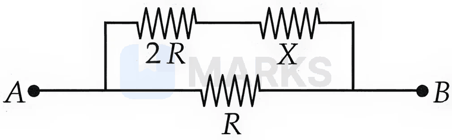

(1) $(\sqrt3-1)R$  (2) $2(\sqrt3-1)R$  (3) $(\sqrt3+1)R$  (4) $R$

**Answer: (1)** · key (compiled)

**Solution.** The branch $2R+X$ is in parallel with $R$, so $R_{AB}=\dfrac{R(2R+X)}{3R+X}=X\Rightarrow X(3R+X)=R(2R+X)\Rightarrow X^2+2RX-2R^2=0$, giving $X=R(\sqrt3-1)$ (positive root).

### § — JEE Main 2026 · 21 Jan Shift 2 · set Q2 · MCQ

The total length of the potentiometer wire $AB$ is $50$ cm in the arrangement shown in the figure. If $P$ is the point where the galvanometer shows zero reading, the length $AP$ is ______ cm.

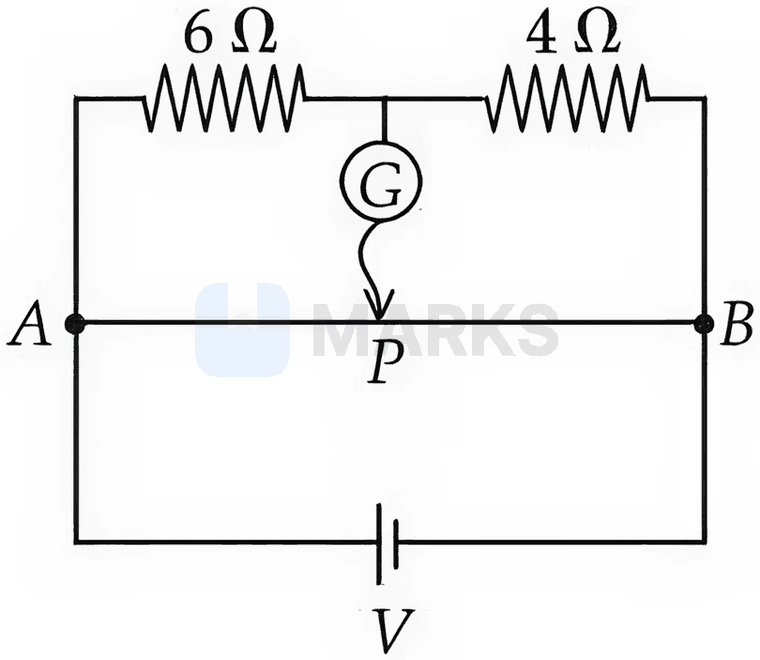

(1) 25  (2) 30  (3) 20  (4) 15

**Answer: (2)** · key (compiled)

**Solution.** At balance no current flows through the galvanometer, so $P$ is at the same potential as the junction of the $6\ \Omega$ and $4\ \Omega$ resistors. That junction is at the fraction $\dfrac{6}{6+4}=0.6$ of the applied potential difference measured from $A$. The wire has a uniform potential gradient, so $AP=0.6\times50=30$ cm.

### § — JEE Main 2026 · 21 Jan Shift 2 · set Q3 · MCQ

A battery of emf $E$ and internal resistance $r$ is connected across a resistance $R$. The power consumed in $R$ will be maximum when:

(1) $R=2r$  (2) $R=r/2$  (3) $R=r$  (4) $R=\sqrt2\,r$

**Answer: (3)** · key (compiled)

**Solution.** $P=\dfrac{E^2R}{(R+r)^2}$ and $\dfrac{dP}{dR}=E^2\dfrac{r-R}{(R+r)^3}=0\Rightarrow R=r$ (maximum power transfer theorem).

### § — JEE Main 2026 · 23 Jan Shift 1 · set Q4 · MCQ

A wire of uniform resistance $\lambda\ \Omega\,\text{m}^{-1}$ is bent into a circle of radius $r$, and another piece of wire of length $2r$ (two radii, $A\!-\!O\!-\!B$) is connected between points $A$ and $B$ as shown in the figure. The equivalent resistance between $A$ and $B$ is:

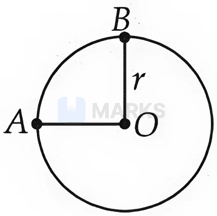

(1) $\dfrac{3\pi\lambda r}{8}$  (2) $\dfrac{6\pi\lambda r}{3\pi+16}$  (3) $2\pi\lambda r$  (4) $(\pi+1)\,2r\lambda$

**Answer: (2)** · key (compiled)

**Solution.** $\angle AOB=90^\circ$, so there are three parallel paths between $A$ and $B$: the minor arc ($\lambda\cdot\tfrac{\pi r}{2}$), the major arc ($\lambda\cdot\tfrac{3\pi r}{2}$) and the wire $A\!-\!O\!-\!B$ ($2\lambda r$). Then $\dfrac1{R_{AB}}=\dfrac{2}{\pi\lambda r}+\dfrac{2}{3\pi\lambda r}+\dfrac{1}{2\lambda r}=\dfrac{16+3\pi}{6\pi\lambda r}$, so $R_{AB}=\dfrac{6\pi\lambda r}{3\pi+16}$.

### § — JEE Main 2026 · 28 Jan Shift 2 · set Q5 · MCQ

Which one of the following is not a measurable quantity?

(1) Voltage  (2) Resistance  (3) Displacement current  (4) Voltage difference

**Answer: (1)** · key (compiled)

**Solution.** Only potential *differences* can be measured (with a voltmeter); the potential at a single point depends on the arbitrary choice of zero, so "voltage" in the absolute sense is not measurable. Resistance (ohmmeter, bridge) and voltage difference are measurable, and the magnetic effect of a displacement current can be measured.

### § — JEE Main 2026 · 28 Jan Shift 2 · set Q6 · MCQ

A Wheatstone bridge is initially at room temperature with all four arms equal, $R_1=R_2=R_3=R_4$, and is connected to a $40$ V battery as shown. When $R_3$ is heated its resistance rises by $10\%$. The potential difference $(V_a-V_b)$ after $R_3$ is heated is ______ V.

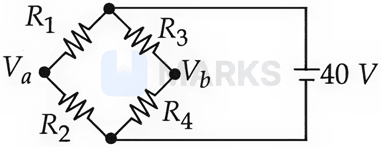

(1) 1.05  (2) 0.95  (3) 0  (4) 2

**Answer: (2)** · key (compiled)

**Solution.** $V_a=40\cdot\dfrac{R_2}{R_1+R_2}=20$ V. After heating, $V_b=40\cdot\dfrac{R_4}{R_3'+R_4}=\dfrac{40}{2.1}=19.05$ V. So $V_a-V_b\approx0.95$ V.

### § — JEE Main 2026 · 24 Jan Shift 2 · set Q7 · MCQ

The reading of the ammeter $A$ in steady state in the circuit shown (ammeter resistance negligible) is ______ A.

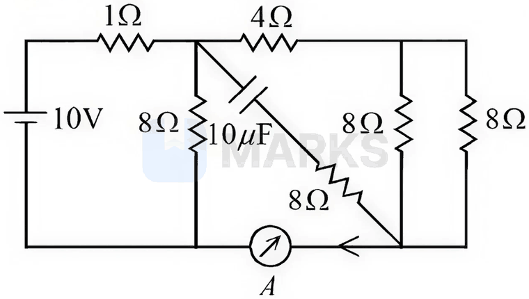

(1) 1  (2) 1/2  (3) 0  (4) 2

**Answer: (1)** · key (compiled)

**Solution.** In steady state the capacitor branch carries no current. The $4\ \Omega$ resistor in series with the two parallel $8\ \Omega$ resistors ($4\ \Omega$) gives $8\ \Omega$, which (through the ideal ammeter) is in parallel with the left $8\ \Omega$: $4\ \Omega$. With the $1\ \Omega$ in series the total is $5\ \Omega$, so $I=\dfrac{10}{5}=2$ A and the voltage across the parallel part is $8$ V. The ammeter path carries $\dfrac{8}{8}=1$ A.

### § — JEE Main 2026 · 24 Jan Shift 2 · set Q8 · MCQ

A moving coil galvanometer of resistance $100\ \Omega$ shows full-scale deflection for a current of $1$ mA. The value of the resistance (in $\Omega$) required to convert this galvanometer into an ammeter showing full-scale deflection for a current of $5$ mA is:

(1) 0.5  (2) 2.5  (3) 10  (4) 25

**Answer: (4)** · key (compiled)

**Solution.** The shunt $S$ carries $5-1=4$ mA at the same voltage as the galvanometer: $1\ \text{mA}\times100=4\ \text{mA}\times S\Rightarrow S=25\ \Omega$.

### § — JEE Main 2026 · 24 Jan Shift 2 · set Q9 · MCQ

A regular hexagon is formed by six wires each of resistance $r\ \Omega$, and its corners are joined to the centre by wires of the same resistance. If current enters at one corner and leaves at the opposite corner, the equivalent resistance between these two opposite corners is:

(1) $\dfrac34 r$  (2) $\dfrac45 r$  (3) $\dfrac35 r$  (4) $\dfrac58 r$

**Answer: (2)** · key (compiled)

**Solution.** Put the entry corner at $1$ V and the exit corner at $0$. By symmetry the centre is at $\tfrac12$ V, the two corners next to the entry corner share a potential $b$ and those next to the exit corner share $1-b$. KCL at a neighbour of the entry corner: $(1-b)+(1-2b)+(\tfrac12-b)=0\Rightarrow b=\tfrac58$. Current drawn from the entry corner $=\dfrac{2(3/8)+1/2}{r}=\dfrac{5}{4r}$, so $R_{eq}=\dfrac{4r}{5}$.

### § — JEE Main 2026 · 24 Jan Shift 2 · set Q10 · Numerical

In a meter bridge experiment, resistances $2\ \Omega$ and $3\ \Omega$ are connected in the left and right gaps and the null point is obtained at $l$ cm from the left. When an unknown resistance $x\ \Omega$ is connected in parallel with the $3\ \Omega$ resistance, the null point shifts by $10$ cm to the right. The value of $x$ is ______ $\Omega$.

**Answer: 6** · key (compiled)

**Solution.** Initially $\dfrac{2}{3}=\dfrac{l}{100-l}\Rightarrow l=40$ cm. Now the null point is at $50$ cm, so $\dfrac{2}{R'}=1\Rightarrow R'=2\ \Omega$ with $R'=\dfrac{3x}{3+x}$. Thus $3x=6+2x\Rightarrow x=6\ \Omega$.

### § — JEE Main 2026 · 22 Jan Shift 2 · set Q11 · MCQ

An electric power line having a total resistance of $2\ \Omega$ delivers $1$ kW of power at $250$ V. The percentage efficiency of the transmission line is:

(1) 100  (2) 92.5  (3) 96.9  (4) 86.5

**Answer: (3)** · key (compiled)

**Solution.** Line current $I=\dfrac{1000}{250}=4$ A, loss $=I^2R=16\times2=32$ W. Efficiency $=\dfrac{\text{delivered}}{\text{delivered}+\text{loss}}=\dfrac{1000}{1032}\times100\approx96.9\%$.

### § — JEE Main 2026 · 22 Jan Shift 2 · set Q12 · Numerical

A cylindrical conductor of length $2$ m and cross-section $0.2\ \text{mm}^2$ carries a current of $1.6$ A when its ends are connected to a $2$ V battery. The electron concentration is $5\times10^{28}\ \text{m}^{-3}$ and $e=1.6\times10^{-19}$ C. The mobility of electrons in the conductor is $\alpha\times10^{-3}\ \text{m}^2\text{V}^{-1}\text{s}^{-1}$. The value of $\alpha$ is ______.

**Answer: 1** · key (compiled)

**Solution.** $R=\dfrac{2}{1.6}=1.25\ \Omega$, $\rho=\dfrac{RA}{L}=\dfrac{1.25\times0.2\times10^{-6}}{2}=1.25\times10^{-7}\ \Omega\,\text{m}$. Mobility $\mu=\dfrac{1}{ne\rho}=\dfrac{1}{5\times10^{28}\times1.6\times10^{-19}\times1.25\times10^{-7}}=10^{-3}\ \text{m}^2\text{V}^{-1}\text{s}^{-1}$, so $\alpha=1$.

### § — JEE Main 2026 · 22 Jan Shift 1 · set Q13 · MCQ

A meter bridge with two resistances $R_1$ and $R_2$ as shown in the figure was balanced (null point) at $40$ cm from the point $P$. The null point changed to $50$ cm from $P$ when a $16\ \Omega$ resistance is connected in parallel to $R_2$. The values of $R_1$ and $R_2$ are:

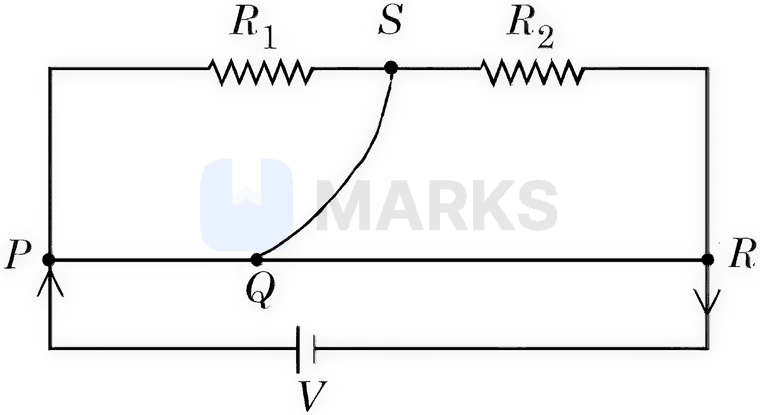

(1) $R_2=4\ \Omega,\ R_1=\tfrac43\ \Omega$  (2) $R_2=16\ \Omega,\ R_1=\tfrac{16}{3}\ \Omega$  (3) $R_2=12\ \Omega,\ R_1=\tfrac{12}{3}\ \Omega$  (4) $R_2=8\ \Omega,\ R_1=\tfrac{16}{3}\ \Omega$

**Answer: (4)** · key (compiled)

**Solution.** First balance: $\dfrac{R_1}{R_2}=\dfrac{40}{60}=\dfrac23$. Second: $\dfrac{R_1}{R_2\parallel16}=\dfrac{50}{50}=1\Rightarrow R_1=\dfrac{16R_2}{16+R_2}$. Substituting $R_1=\tfrac23R_2$: $\tfrac23=\dfrac{16}{16+R_2}\Rightarrow R_2=8\ \Omega$, $R_1=\tfrac{16}{3}\ \Omega$.

### § — JEE Main 2026 · 23 Jan Shift 2 · set Q14 · MCQ

To compare the emfs of two cells using a potentiometer, the balancing lengths are $200$ cm and $150$ cm. The least count of the scale is $1$ cm. The percentage error in the ratio of the emfs is:

(1) 1.65  (2) 1.45  (3) 1.75  (4) 1.16

**Answer: (4)** · key (compiled)

**Solution.** $\dfrac{\varepsilon_1}{\varepsilon_2}=\dfrac{\ell_1}{\ell_2}$, so $\dfrac{\Delta y}{y}=\dfrac{1}{200}+\dfrac{1}{150}=\dfrac{7}{600}$, i.e. $\dfrac{7}{6}\%\approx1.16\%$.

### § — JEE Main 2026 · 21 Jan Shift 1 · set Q15 · Numerical

The heat generated in $1$ minute between points $A$ and $B$ in the given circuit, when a battery of $9$ V with internal resistance $1\ \Omega$ is connected across these points, is ______ J.

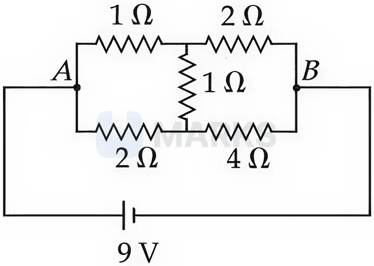

**Answer: 1080** · key (compiled)

**Solution.** The bridge is balanced ($\tfrac12=\tfrac24$), so no current flows in the middle $1\ \Omega$. The upper branch $1+2=3\ \Omega$ in parallel with the lower branch $2+4=6\ \Omega$ gives $R_{AB}=2\ \Omega$. Total resistance $=2+1=3\ \Omega$, $I=3$ A, power in the network $=I^2R_{AB}=9\times2=18$ W, so heat in $60$ s $=18\times60=1080$ J.

### § — JEE Main 2026 · 28 Jan Shift 1 · set Q16 · MCQ

Two cells have the same emf $E$ and internal resistance $r$. The current through an external $6\ \Omega$ resistor is the same whether the two cells are connected in parallel or in series. The value of $r$ (in $\Omega$) is:

(1) 6  (2) 3  (3) 4  (4) 9

**Answer: (1)** · key (compiled)

**Solution.** Series: $I=\dfrac{2E}{2r+6}$. Parallel: $I=\dfrac{E}{r/2+6}=\dfrac{2E}{r+12}$. Equal currents give $2r+6=r+12\Rightarrow r=6\ \Omega$.

### § — JEE Main 2026 · 28 Jan Shift 1 · set Q17 · MCQ

In a potentiometer, when the cell in the secondary circuit is shunted with a $4\ \Omega$ resistance, the balance length is $120$ cm; when shunted with $12\ \Omega$, the balance length becomes $180$ cm. The internal resistance of the cell (in $\Omega$) is:

(1) 4  (2) 12  (3) 6  (4) 3

**Answer: (1)** · key (compiled)

**Solution.** With shunt $R$ the terminal voltage is $E\dfrac{R}{R+r}$, so $\ell\propto\dfrac{R}{R+r}$. Then $\dfrac{180}{120}=\dfrac{12/(12+r)}{4/(4+r)}=\dfrac{3(4+r)}{12+r}\Rightarrow 18+1.5r=12+3r\Rightarrow r=4\ \Omega$.

### § — JEE Main 2026 · 28 Jan Shift 1 · set Q18 · Numerical

The equivalent resistance between the points $A$ and $B$ in the circuit shown is $\dfrac{x}{5}\ \Omega$. The value of $x$ is ______.

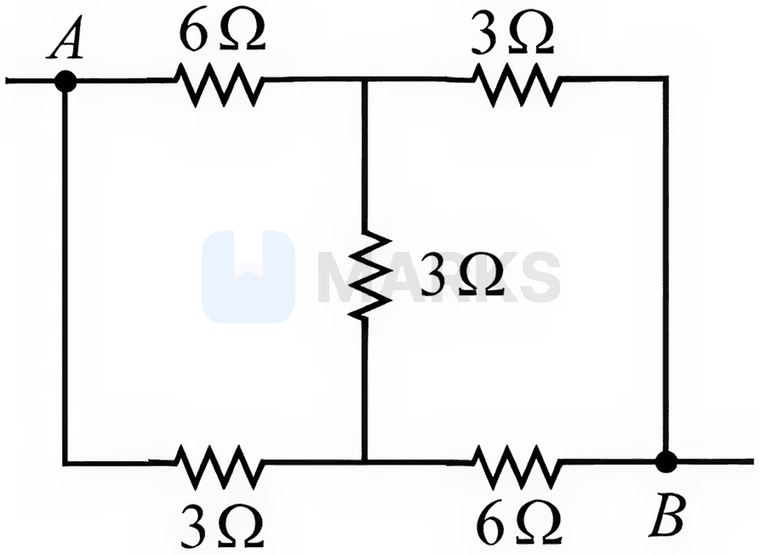

**Answer: 21** · key (compiled)

**Solution.** Apply $1$ V between $A$ and $B$ ($V_A=1,\ V_B=0$) and let $p,q$ be the potentials of the upper and lower middle nodes. KCL: $\dfrac{1-p}{6}-\dfrac{p}{3}+\dfrac{q-p}{3}=0$ and $\dfrac{1-q}{3}-\dfrac{q}{6}+\dfrac{p-q}{3}=0$, giving $p=\tfrac37,\ q=\tfrac47$. Current from the source $=\dfrac{4/7}{6}+\dfrac{3/7}{3}=\dfrac{5}{21}$ A, so $R_{AB}=\dfrac{21}{5}\ \Omega$ and $x=21$.

### § — JEE Main 2026 · 24 Jan Shift 1 · set Q19 · MCQ

Two resistors $2\ \Omega$ and $3\ \Omega$ are connected in the gaps of a meter bridge $XY$ as shown in the figure. The null point is obtained with the jockey at some point on the wire $XY$. When an unknown resistor is connected in parallel with the $3\ \Omega$ resistor, the null point shifts by $22.5$ cm toward $Y$. The resistance of the unknown resistor is ______ $\Omega$.

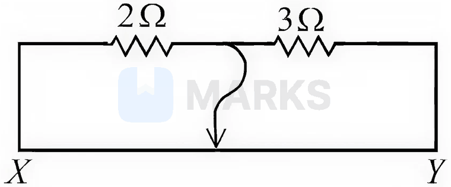

(1) 2  (2) 1  (3) 4  (4) 3

**Answer: (1)** · key (compiled)

**Solution.** Initially $\dfrac{2}{3}=\dfrac{l}{100-l}\Rightarrow l=40$ cm; after the shift $l=62.5$ cm. So $\dfrac{2}{R'}=\dfrac{62.5}{37.5}=\dfrac53\Rightarrow R'=1.2\ \Omega$. Since $R'=\dfrac{3x}{3+x}$: $3x=3.6+1.2x\Rightarrow x=2\ \Omega$.

### § — JEE Main 2026 · 24 Jan Shift 1 · set Q20 · MCQ

Two resistors of $100\ \Omega$ each are connected in series with a $9$ V battery. A voltmeter of resistance $400\ \Omega$ is connected to measure the voltage across one of the resistors. The voltmeter reading (in V) is:

(1) 2  (2) 3  (3) 4  (4) 4.5

**Answer: (3)** · key (compiled)

**Solution.** The voltmeter in parallel with one resistor gives $\dfrac{100\times400}{500}=80\ \Omega$. The total resistance is $100+80=180\ \Omega$, so $I=\dfrac{9}{180}=0.05$ A and the reading is $0.05\times80=4$ V.

### § — JEE Main 2025 · Jan session · Cur set Q2 · MCQ

The difference of temperature in a material can convert heat energy into electrical energy. To harvest the heat energy, the material should have:

(1) high thermal conductivity and high electrical conductivity  (2) low thermal conductivity and low electrical conductivity  (3) high thermal conductivity and low electrical conductivity  (4) low thermal conductivity and high electrical conductivity

**Answer: (4)** · key (compiled)

**Solution.** This is the thermoelectric (Seebeck) effect. To maintain a temperature difference across the material its thermal conductivity must be low (otherwise heat simply flows through and the gradient disappears), and to deliver the generated current with little Joule loss its electrical conductivity must be high.

### § — JEE Main 2025 · Jan session · Cur set Q3 · MCQ

Find the equivalent resistance between the two ends of the following circuit.

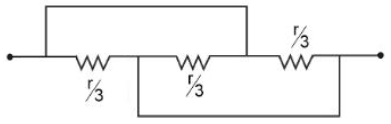

(1) $\dfrac r9$  (2) $\dfrac r3$  (3) $r$  (4) $\dfrac r6$

**Answer: (1)** · key (compiled)

**Solution.** Trace the wires in the figure. The top wire joins the left terminal to the junction between the 2nd and 3rd resistors; the bottom wire joins the junction between the 1st and 2nd resistors to the right terminal. Hence the left ends of all three resistors are at the left node and the right ends at the right node: the three $\dfrac r3$ resistors are in parallel and $R_{eq}=\dfrac{r/3}{3}=\dfrac r9$.

### § — JEE Main 2025 · Jan session · Cur set Q5 · Numerical

A wire of resistance 9 $\Omega$ is bent to form an equilateral triangle. Then the equivalent resistance across any two vertices will be ______ ohm.

**Answer: 2** · key (compiled)

**Solution.** Each side has $3\ \Omega$. Between two vertices one side ($3\ \Omega$) is in parallel with the other two sides in series ($6\ \Omega$): $\dfrac{3\times6}{3+6}=2\ \Omega$.

### § — JEE Main 2025 · Jan session · Cur set Q6 · MCQ

A wire of resistance $R$ is bent into an equilateral triangle and an identical wire is bent into a square. The ratio of the resistance between the two end points of an edge of the triangle to that of the square is:

(1) $\dfrac89$  (2) $\dfrac{27}{32}$  (3) $\dfrac{32}{27}$  (4) $\dfrac98$

**Answer: (3)** · key (compiled)

**Solution.** Triangle: each side is $\dfrac R3$; across one side $\dfrac R3\parallel\dfrac{2R}3=\dfrac{2R}9$. Square: each side is $\dfrac R4$; across one side $\dfrac R4\parallel\dfrac{3R}4=\dfrac{3R}{16}$. Ratio $=\dfrac{2/9}{3/16}=\dfrac{32}{27}$.

### § — JEE Main 2025 · Jan session · Cur set Q7 · MCQ

Given below are two statements:

Statement I: The equivalent emf of two non-ideal batteries connected in parallel is smaller than either of the two emfs.
Statement II: The equivalent internal resistance of two non-ideal batteries connected in parallel is smaller than the internal resistance of either of the two batteries.

In the light of the above statements, choose the correct answer from the options given below.

(1) Both Statement I and Statement II are false  (2) Statement I is false but Statement II is true  (3) Both Statement I and Statement II are true  (4) Statement I is true but Statement II is false

**Answer: (2)** · key (compiled)

**Solution.** For two cells in parallel $\varepsilon_{eq}=\dfrac{\varepsilon_1/r_1+\varepsilon_2/r_2}{1/r_1+1/r_2}$, a weighted average that lies between $\varepsilon_1$ and $\varepsilon_2$, so Statement I is false. Also $\dfrac1{r_{eq}}=\dfrac1{r_1}+\dfrac1{r_2}$ gives $r_{eq}<r_1$ and $r_{eq}<r_2$, so Statement II is true.

### § — JEE Main 2025 · Jan session · Cur set Q9 · Numerical

The value of current $I$ in the electrical circuit given below, when the potential at $A$ is equal to the potential at $B$, will be ______ A.

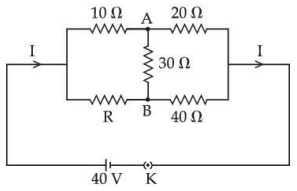

**Answer: 2** · key (compiled)

**Solution.** $V_A=V_B$ means the bridge is balanced and no current flows through the 30 $\Omega$ resistor: $\dfrac{10}{20}=\dfrac R{40}\Rightarrow R=20\ \Omega$. The upper branch is $10+20=30\ \Omega$ and the lower branch is $20+40=60\ \Omega$, in parallel $=20\ \Omega$. So $I=\dfrac{40}{20}=2$ A.

### § — JEE Main 2025 · Jan session · Cur set Q10 · MCQ

The sliding contact of a potentiometer is in the middle of the potentiometer wire having resistance $R_p=1\ \Omega$ as shown in the figure. An external resistance of $R_e=2\ \Omega$ is connected via the sliding contact. The electric current in the circuit is:

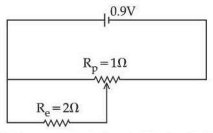

(1) 0.9 A  (2) 1.35 A  (3) 0.3 A  (4) 1.0 A

**Answer: (4)** · key (compiled)

**Solution.** The 0.9 V battery is connected across the whole wire. The slider divides the wire into two halves of $0.5\ \Omega$. $R_e$ is connected between one end of the wire and the slider, i.e. across one half: $0.5\ \Omega\parallel2\ \Omega=\dfrac{0.5\times2}{2.5}=0.4\ \Omega$, in series with the other half ($0.5\ \Omega$). $R_{total}=0.9\ \Omega$ and $I=\dfrac{0.9}{0.9}=1.0$ A.

### § — JEE Main 2025 · Jan session · Cur set Q11 · MCQ

A galvanometer having a coil of resistance 30 $\Omega$ needs 20 mA of current for full-scale deflection. If a maximum current of 3 A is to be measured using this galvanometer, the resistance of the shunt to be added to the galvanometer should be $\dfrac{30}X\ \Omega$, where $X$ is:

(1) 596  (2) 149  (3) 298  (4) 447

**Answer: (2)** · key (compiled)

**Solution.** $S=\dfrac{I_gG}{I-I_g}=\dfrac{0.02\times30}{3-0.02}=\dfrac{0.6}{2.98}=\dfrac{30}{149}\ \Omega$, so $X=149$.

### § — JEE Main 2025 · Apr session · Cur set Q1 · MCQ

Current passing through a wire as a function of time is given as $I(t)=0.02t+0.01$ A. The charge that will flow through the wire from $t=1$ s to $t=2$ s is:

(1) 0.06 C  (2) 0.02 C  (3) 0.07 C  (4) 0.04 C

**Answer: (4)** · key (compiled)

**Solution.** $q=\int_1^2(0.02t+0.01)\,dt=0.01\left[t^2\right]_1^2+0.01(2-1)=0.03+0.01=0.04$ C.

### § — JEE Main 2025 · Apr session · Cur set Q2 · MCQ

A motor operating on 100 V draws a current of 1 A. If the efficiency of the motor is 91.6%, then the loss of power in units of cal/s is:

(1) 4  (2) 8.4  (3) 2  (4) 6.2

**Answer: (3)** · key (compiled)

**Solution.** Input power $=100\times1=100$ W. Loss $=(1-0.916)\times100=8.4$ W $=\dfrac{8.4}{4.2}=2$ cal/s (taking 1 cal $=4.2$ J).

### § — JEE Main 2025 · Apr session · Cur set Q5 · Numerical

Two cells of emf 1 V and 2 V and internal resistances 2 $\Omega$ and 1 $\Omega$ respectively are connected in series with an external resistance of 6 $\Omega$. The total current in the circuit is $I_1$. Now the same two cells in parallel configuration are connected to the same external resistance. In this case the total current drawn is $I_2$. The value of $\left(\dfrac{I_1}{I_2}\right)$ is $\dfrac x3$. The value of $x$ is ______.

**Answer: 4** · key (compiled)

**Solution.** Series: $I_1=\dfrac{1+2}{2+1+6}=\dfrac13$ A. Parallel: $\varepsilon_{eq}=\dfrac{\frac12+\frac21}{\frac12+\frac11}=\dfrac53$ V and $r_{eq}=\dfrac{2\times1}{2+1}=\dfrac23\ \Omega$, so $I_2=\dfrac{5/3}{6+2/3}=\dfrac14$ A. $\dfrac{I_1}{I_2}=\dfrac43=\dfrac x3\Rightarrow x=4$.

### § — JEE Main 2025 · Apr session · Cur set Q6 · MCQ

The battery of a mobile phone is rated as 4.2 V, 5800 mAh. How much energy is stored in it when fully charged?

(1) 43.8 kJ  (2) 48.7 kJ  (3) 87.7 kJ  (4) 24.4 kJ

**Answer: (3)** · key (compiled)

**Solution.** $E=VQ=4.2\ \text V\times\left(5.8\ \text{A h}\times3600\ \text{s/h}\right)=4.2\times20880\approx87\,700$ J $=87.7$ kJ.

### § — JEE Main 2025 · Apr session · Cur set Q7 · MCQ

There are $n$ identical electric bulbs, each designed to draw a power $p$ independently from the mains supply. They are now joined in series across the mains supply. The total power drawn by the combination is:

(1) $np$  (2) $\dfrac p{n^2}$  (3) $\dfrac pn$  (4) $p$

**Answer: (3)** · key (compiled)

**Solution.** For each bulb $p=\dfrac{V^2}{R}$. In series the resistance is $nR$ across the same mains, so $P=\dfrac{V^2}{nR}=\dfrac pn$.

### § — JEE Main 2025 · Apr session · Cur set Q8 · MCQ

A wire of resistance $R$ is bent into a triangular pyramid as shown in the figure, with each segment having the same length. The resistance between points $A$ and $B$ is $R/n$. The value of $n$ is:

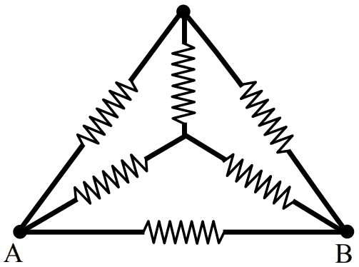

(1) 16  (2) 14  (3) 10  (4) 12

**Answer: (4)** · key (compiled)

**Solution.** The wire has six equal edges of resistance $\dfrac R6$ each. For current entering at $A$ and leaving at $B$, the other two vertices $C$ and $D$ are at the same potential by symmetry, so the edge $CD$ carries no current. The paths between $A$ and $B$ are then in parallel: the direct edge $AB$ ($\dfrac R6$), and the routes $A\!-\!C\!-\!B$ and $A\!-\!D\!-\!B$ ($\dfrac R3$ each). $\dfrac1{R_{AB}}=\dfrac6R+\dfrac3R+\dfrac3R=\dfrac{12}R$, so $R_{AB}=\dfrac R{12}$ and $n=12$.

### § — JEE Main 2025 · Apr session · Cur set Q9 · Numerical

In the figure shown below, a resistance of 150.4 $\Omega$ is connected in series to an ammeter $A$ of resistance 240 $\Omega$. A shunt resistance of 10 $\Omega$ is connected in parallel with the ammeter. The reading of the ammeter is ______ mA.

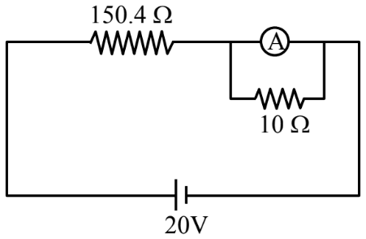

**Answer: 5** · key (compiled)

**Solution.** Ammeter $\parallel$ shunt: $\dfrac{240\times10}{250}=9.6\ \Omega$. Total resistance $=150.4+9.6=160\ \Omega$, so the line current is $\dfrac{20}{160}=0.125$ A. It divides inversely with resistance: the ammeter branch carries $0.125\times\dfrac{10}{250}=5\times10^{-3}$ A $=5$ mA.

