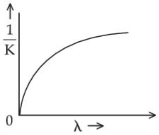
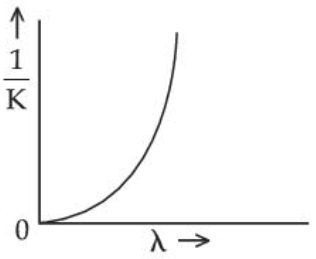
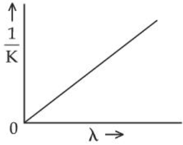

# Dual Nature of Matter & Radiation

> Theory: [../../theory/physics/dual-nature.md](../../theory/physics/dual-nature.md)

### P-DUL-01 — JEE Main 2024 · 27 Jan Shift 1 · Q17 · MCQ

A convex lens of focal length $40$ cm forms an image of an extended source of light on a photoelectric cell, producing a current $I$. The lens is replaced by another convex lens of the same diameter but focal length $20$ cm. The photoelectric current now is

(1) $I/2$  (2) $4I$  (3) $2I$  (4) $I$

**Answer: (4)** · key ✔

**Solution.** Photocurrent (at fixed frequency) is proportional to the number of photons reaching the cell per second. Both lenses have the same aperture, so they gather the same light power from the source, and in both cases the whole image falls on the cell. Only the image size changes, so the current stays $I$.

### P-DUL-02 — JEE Main 2024 · 27 Jan Shift 2 · Q17 · MCQ

The threshold frequency of a metal with work function $6.63$ eV is

(1) $16\times10^{15}$ Hz  (2) $16\times10^{12}$ Hz  (3) $1.6\times10^{12}$ Hz  (4) $1.6\times10^{15}$ Hz

**Answer: (4)** · key ✔

**Solution.** $\nu_0=\dfrac\phi h=\dfrac{6.63\times1.6\times10^{-19}}{6.63\times10^{-34}}=1.6\times10^{15}$ Hz.

### P-DUL-03 — JEE Main 2024 · 29 Jan Shift 1 · Q18 · MCQ

The de Broglie wavelength of an electron is the same as that of a photon. If the velocity of the electron is $25\%$ of the velocity of light, the ratio of the K.E. of the electron to the K.E. of the photon will be

(1) $\tfrac14$  (2) $\tfrac18$  (3) $\tfrac{1}{1}$  (4) $\tfrac{8}{1}$

**Answer: (2)** · key ✔

**Solution.** Equal wavelengths mean equal momentum $p$. For the electron $K_e=\tfrac12pv$ (non-relativistic), and for the photon $E=pc$. So $\dfrac{K_e}{E}=\dfrac{v}{2c}=\dfrac{0.25}{2}=\dfrac18$.

### P-DUL-04 — JEE Main 2024 · 29 Jan Shift 2 · Q18 · MCQ

Two sources of light each emit with a power of $200$ W. The ratio of the number of photons of visible light emitted per second by the sources having wavelengths $300$ nm and $500$ nm respectively will be

(1) 1 : 5  (2) 1 : 3  (3) 5 : 3  (4) 3 : 5

**Answer: (4)** · key ✔

**Solution.** Number of photons per second $n=\dfrac{P}{hc/\lambda}\propto\lambda$ at equal power. So $n_1:n_2=300:500=3:5$.

### P-DUL-05 — JEE Main 2024 · 30 Jan Shift 1 · Q18 · MCQ

The work function of a substance is $3.0$ eV. The longest wavelength of light that can cause the emission of photoelectrons from this substance is approximately

(1) 215 nm  (2) 414 nm  (3) 400 nm  (4) 200 nm

**Answer: (2)** · key ✔

**Solution.** $\lambda_{\max}=\dfrac{hc}{\phi}=\dfrac{1240\ \text{eV nm}}{3.0\ \text{eV}}\approx413\text{–}414$ nm.

### P-DUL-06 — JEE Main 2024 · 31 Jan Shift 1 · Q18 · MCQ

When a metal surface is illuminated by light of wavelength $\lambda$, the stopping potential is $8$ V. When the same surface is illuminated by light of wavelength $3\lambda$, the stopping potential is $2$ V. The threshold wavelength for this surface is

(1) $5\lambda$  (2) $3\lambda$  (3) $9\lambda$  (4) $4.5\lambda$

**Answer: (3)** · key ✔

**Solution.** Let $E=\dfrac{hc}{\lambda}$ (in eV). $8=E-\phi$ and $2=\dfrac E3-\phi$. Subtracting: $6=\dfrac{2E}3\Rightarrow E=9$ eV, so $\phi=1$ eV. $\lambda_0=\dfrac{hc}\phi=9\,\dfrac{hc}{E}=9\lambda$.

### P-DUL-07 — JEE Main 2024 · 31 Jan Shift 2 · Q17 · MCQ

In a photoelectric effect experiment, light of frequency $1.5$ times the threshold frequency is made to fall on the surface of a photosensitive material. Now, if the frequency is halved and the intensity is doubled, the number of photoelectrons emitted will be

(1) Doubled  (2) Quadrupled  (3) Zero  (4) Halved

**Answer: (3)** · key ✔

**Solution.** Initially $\nu=1.5\nu_0>\nu_0$, so emission occurs. After halving, $\nu=0.75\nu_0<\nu_0$, below the threshold, so no photoelectrons are emitted however intense the light is.

### P-DUL-08 — JEE Main 2024 · 1 Feb Shift 1 · Q17 · MCQ

The de Broglie wavelengths of a proton and an $\alpha$-particle are $\lambda$ and $2\lambda$ respectively. The ratio of the velocities of the proton and the $\alpha$-particle will be

(1) 1 : 8  (2) 1 : 2  (3) 4 : 1  (4) 8 : 1

**Answer: (4)** · key ✔

**Solution.** $\lambda=\dfrac h{mv}\Rightarrow v\propto\dfrac1{m\lambda}$. $m_\alpha=4m_p$, so $\dfrac{v_p}{v_\alpha}=\dfrac{m_\alpha\lambda_\alpha}{m_p\lambda_p}=\dfrac{4\times2\lambda}{1\times\lambda}=8$.

### P-DUL-09 — JEE Main 2024 · 1 Feb Shift 2 · Q18 · MCQ

Monochromatic light of frequency $6\times10^{14}$ Hz is produced by a laser of power $2\times10^{-3}$ W. The number of photons emitted per second is ($h=6.63\times10^{-34}$ J s):

(1) $9\times10^{18}$  (2) $6\times10^{15}$  (3) $5\times10^{15}$  (4) $7\times10^{16}$

**Answer: (3)** · key ✔

**Solution.** $N=\dfrac{P}{h\nu}=\dfrac{2\times10^{-3}}{6.63\times10^{-34}\times6\times10^{14}}\approx5\times10^{15}\ \text{s}^{-1}$.

### P-DUL-10 — JEE Main 2024 · 4 Apr Shift 2 · Q17 · MCQ

Assertion A: The number of photons increases with an increase in the frequency of light.
Reason R: The maximum kinetic energy of emitted electrons increases with the frequency of the incident radiation.

(1) Both correct, R explains A  (2) Both correct, R does not explain A  (3) A is not correct but R is correct  (4) A is correct but R is not correct

**Answer: (3)** · key ✔

**Solution.** For a fixed intensity, the photon number per second is $I/(h\nu)$, which *decreases* as $\nu$ rises; A is false. R is Einstein's equation $K_{max}=h\nu-\phi$, which is true.

### P-DUL-11 — JEE Main 2024 · 5 Apr Shift 2 · Q17 · MCQ

Which statement is NOT true about the stopping potential $V_0$?

(1) It is $1/e$ times the maximum kinetic energy of the emitted electrons  (2) It increases with an increase in the intensity of the incident light  (3) It depends on the nature of the emitter material  (4) It depends on the frequency of the incident light

**Answer: (2)** · key ✔

**Solution.** $eV_0=K_{max}=h\nu-\phi$, so $V_0$ depends on the frequency and the material (through $\phi$), not on the intensity. Intensity changes only the saturation current.

### P-DUL-12 — JEE Main 2024 · 6 Apr Shift 1 · Q16 · MCQ

In a photoelectric experiment, light of photon energy $2.48$ eV irradiates a photosensitive material. The stopping potential is measured to be $0.5$ V. The work function of the material is:

(1) 1.68 eV  (2) 2.48 eV  (3) 1.98 eV  (4) 0.5 eV

**Answer: (3)** · key ✔

**Solution.** $eV_0=h\nu-\phi\Rightarrow\phi=2.48-0.5=1.98$ eV.

### P-DUL-13 — JEE Main 2024 · 6 Apr Shift 1 · Q17 · MCQ

Which of the following phenomena is not explained by the wave nature of light? A. reflection  B. diffraction  C. photoelectric effect  D. interference  E. polarisation

(1) E only  (2) B, D only  (3) C only  (4) A, C only

**Answer: (3)** · key ✔

**Solution.** Reflection, diffraction, interference and polarisation are explained by the wave theory. The photoelectric effect (instantaneous emission, threshold frequency) needs the photon (particle) picture.

### P-DUL-14 — JEE Main 2024 · 6 Apr Shift 2 · Q17 · MCQ

UV light of wavelength $300$ nm is incident on a metal surface of work function $2.13$ eV. The stopping potential is ($hc=1240$ eV nm):

(1) 1.5 V  (2) 4.1 V  (3) 2 V  (4) 4 V

**Answer: (3)** · key ✔

**Solution.** Photon energy $=\dfrac{1240}{300}=4.13$ eV. $eV_0=4.13-2.13=2.0$ eV, so $V_0=2$ V.

### P-DUL-15 — JEE Main 2024 · 8 Apr Shift 1 · Q16 · MCQ

A proton and an electron are associated with the same de Broglie wavelength. The ratio of their kinetic energies (proton : electron) is ($m_p=1836\,m_e$):

(1) $1:\sqrt{1836}$  (2) $1:\dfrac1{1836}$  (3) $1:\dfrac1{\sqrt{1836}}$  (4) $1:1836$

**Answer: (4)** · key ✔

**Solution.** $K=\dfrac{h^2}{2m\lambda^2}\propto\dfrac1m$ at equal $\lambda$. $\dfrac{K_p}{K_e}=\dfrac{m_e}{m_p}=\dfrac1{1836}$, i.e. $1:1836$.

### P-DUL-16 — JEE Main 2024 · 9 Apr Shift 1 · Q17 · MCQ

A proton, an electron and an alpha particle have the same energies. Their de Broglie wavelengths compare as:

(1) $\lambda_\alpha<\lambda_p<\lambda_e$  (2) $\lambda_e>\lambda_\alpha>\lambda_p$  (3) $\lambda_p>\lambda_e>\lambda_\alpha$  (4) $\lambda_p<\lambda_e<\lambda_\alpha$

**Answer: (1)** · key ✔

**Solution.** $\lambda=\dfrac{h}{\sqrt{2mK}}\propto\dfrac1{\sqrt m}$ at equal energy. Masses: $m_e<m_p<m_\alpha$, so $\lambda_e>\lambda_p>\lambda_\alpha$, i.e. $\lambda_\alpha<\lambda_p<\lambda_e$.

### § — JEE Main 2026 · 21 Jan Shift 2 · set Q1 · Numerical

A particle having electric charge $3\times10^{-19}$ C and mass $6\times10^{-27}$ kg is accelerated by applying an electric potential of $1.21$ V. The wavelength of the matter wave associated with the particle is $\alpha\times10^{-12}$ m. The value of $\alpha$ is ______. (Take Planck's constant $h=6.6\times10^{-34}$ J s)

**Answer: 10** · key (compiled)

**Solution.** $qV=\tfrac12mv^2\Rightarrow v=\sqrt{\dfrac{2qV}{m}}=\sqrt{\dfrac{2\times3\times10^{-19}\times1.21}{6\times10^{-27}}}=1.1\times10^4$ m/s. $\lambda=\dfrac{h}{mv}=\dfrac{6.6\times10^{-34}}{6\times10^{-27}\times1.1\times10^4}=10^{-11}\ \text{m}=10\times10^{-12}$ m, so $\alpha=10$.

### § — JEE Main 2026 · 23 Jan Shift 1 · set Q2 · MCQ

The de Broglie wavelength of an oxygen molecule at $27^\circ$C is $x\times10^{-12}$ m. The value of $x$ is ______ (take $h=6.63\times10^{-34}$ J s, $k_B=1.38\times10^{-23}$ J/K, mass of an oxygen molecule $=5.31\times10^{-26}$ kg).

(1) 24  (2) 26  (3) 30  (4) 20

**Answer: (2)** · key (compiled)

**Solution.** Using $v_{rms}=\sqrt{\dfrac{3kT}{m}}$: $\lambda=\dfrac{h}{mv}=\dfrac{h}{\sqrt{3mkT}}=\dfrac{6.63\times10^{-34}}{\sqrt{3\times5.31\times10^{-26}\times1.38\times10^{-23}\times300}}=\dfrac{6.63\times10^{-34}}{2.57\times10^{-23}}=25.8\times10^{-12}$ m, so $x\approx26$.

### § — JEE Main 2026 · 28 Jan Shift 2 · set Q3 · MCQ

The number of photons of equal energy emitted per second by a $6$ mW laser source operating at $663$ nm is ______. (Given $h=6.63\times10^{-34}$ J s and $c=3\times10^8$ m/s)

(1) $2\times10^{16}$  (2) $10\times10^{15}$  (3) $5\times10^{15}$  (4) $5\times10^{16}$

**Answer: (1)** · key (compiled)

**Solution.** Photon energy $E=\dfrac{hc}{\lambda}=\dfrac{6.63\times10^{-34}\times3\times10^8}{663\times10^{-9}}=3\times10^{-19}$ J. Photons per second $=\dfrac{6\times10^{-3}}{3\times10^{-19}}=2\times10^{16}$.

### § — JEE Main 2026 · 24 Jan Shift 2 · set Q4 · MCQ

When light of a given wavelength falls on a metallic surface, the stopping potential for photoelectrons is $3.2$ V. If a second light of twice the wavelength is used, the stopping potential drops to $0.7$ V. The wavelength of the first light is ______ m. ($h=6.63\times10^{-34}$ J s, $e=1.6\times10^{-19}$ C, $c=3\times10^8$ m/s)

(1) $2.5\times10^{-7}$  (2) $2.2\times10^{-8}$  (3) $3.1\times10^{-7}$  (4) $2.9\times10^{-8}$

**Answer: (1)** · key (compiled)

**Solution.** $\dfrac{hc}{\lambda}=\phi+3.2e$ and $\dfrac{hc}{2\lambda}=\phi+0.7e$. Subtracting: $\dfrac{hc}{2\lambda}=2.5e\Rightarrow\lambda=\dfrac{hc}{5e}=\dfrac{6.63\times10^{-34}\times3\times10^8}{5\times1.6\times10^{-19}}\approx2.5\times10^{-7}$ m.

### § — JEE Main 2026 · 22 Jan Shift 2 · set Q5 · MCQ

Light is incident on a metallic plate having work function $110\times10^{-20}$ J. If the produced photoelectrons have zero kinetic energy, the angular frequency of the incident light is ______ rad/s. ($h=6.63\times10^{-34}$ J s)

(1) $1.04\times10^{13}$  (2) $1.04\times10^{16}$  (3) $1.66\times10^{16}$  (4) $1.66\times10^{15}$

**Answer: (2)** · key (compiled)

**Solution.** Zero kinetic energy means $h\nu=W$: $\nu=\dfrac{110\times10^{-20}}{6.63\times10^{-34}}=1.66\times10^{15}$ Hz. $\omega=2\pi\nu=1.04\times10^{16}$ rad/s.

### § — JEE Main 2026 · 21 Jan Shift 1 · set Q6 · MCQ

A light wave described by $E=60\left[\sin(3\times10^{15})t+\sin(12\times10^{15})t\right]$ (in SI units) falls on a metal surface of work function $2.8$ eV. The maximum kinetic energy of the ejected photoelectron is (approximately) ______ eV. ($h=6.6\times10^{-34}$ J s and $e=1.6\times10^{-19}$ C)

(1) 7.8  (2) 6.0  (3) 5.1  (4) 3.8

**Answer: (3)** · key (compiled)

**Solution.** The wave contains two angular frequencies; the larger one, $\omega=12\times10^{15}$ rad/s, gives the maximum photon energy: $\hbar\omega=\dfrac{6.6\times10^{-34}\times12\times10^{15}}{2\pi}=1.26\times10^{-18}$ J $=7.9$ eV. $K_{max}=7.9-2.8=5.1$ eV.

### § — JEE Main 2026 · 28 Jan Shift 1 · set Q7 · Numerical

The ratio of the de Broglie wavelength of a deuteron with kinetic energy $E$ to that of an alpha particle with kinetic energy $2E$ is $n:1$. The value of $n$ is ______. (Assume mass of proton $=$ mass of neutron)

**Answer: 2** · key (compiled)

**Solution.** $\lambda=\dfrac{h}{\sqrt{2mE_k}}$. Deuteron ($m=2m_p$, $E$): $\lambda_d=\dfrac{h}{\sqrt{4m_pE}}$. Alpha ($m=4m_p$, $2E$): $\lambda_\alpha=\dfrac{h}{\sqrt{16m_pE}}$. Ratio $\dfrac{\lambda_d}{\lambda_\alpha}=\sqrt{\dfrac{16}{4}}=2$, so $n=2$.

### § — JEE Main 2025 · Jan session · Dual set Q1 · MCQ

A sub-atomic particle of mass $10^{-30}$ kg is moving with a velocity of $2.21\times10^6$ m/s. Under the matter-wave consideration, the particle will behave closely like ______. ($h=6.63\times10^{-34}$ J s)

(1) Visible radiation  (2) Gamma rays  (3) Infra-red radiation  (4) X-rays

**Answer: (4)** · key (compiled)

**Solution.** $\lambda=\dfrac h{mv}=\dfrac{6.63\times10^{-34}}{10^{-30}\times2.21\times10^6}=3\times10^{-10}$ m $=3$ Å, which lies in the X-ray range.

### § — JEE Main 2025 · Jan session · Dual set Q2 · MCQ

The energy $E$ and momentum $p$ of a moving body of mass $m$ are related by some equation. Given that $c$ is the speed of light, identify the correct equation.

(1) $E^2=pc^2+m^2c^2$  (2) $E^2=p^2c^2+m^2c^2$  (3) $E^2=pc^2+m^2c^4$  (4) $E^2=p^2c^2+m^2c^4$

**Answer: (4)** · key (compiled)

**Solution.** The relativistic energy–momentum relation is $E^2=p^2c^2+m^2c^4$.

### § — JEE Main 2025 · Jan session · Dual set Q3 · MCQ

In the photoelectric effect an EM wave is incident on a metal surface and electrons are ejected. If the work function of the metal is 2.14 eV and the stopping potential is 2 V, what is the wavelength of the EM wave? (Given $hc=1242$ eV nm.)

(1) 300 nm  (2) 400 nm  (3) 600 nm  (4) 200 nm

**Answer: (1)** · key (compiled)

**Solution.** $E=\phi+eV_0=2.14+2=4.14$ eV, so $\lambda=\dfrac{1242}{4.14}=300$ nm.

### § — JEE Main 2025 · Jan session · Dual set Q5 · MCQ

An electron in the ground state of the hydrogen atom has an orbital radius of $5.3\times10^{-11}$ m, while that for the electron in the third excited state is $8.48\times10^{-10}$ m. The ratio of the de Broglie wavelengths of the electron in the excited state to that in the ground state is:

(1) 3  (2) 16  (3) 9  (4) 4

**Answer: (4)** · key (compiled)

**Solution.** Bohr quantisation gives $n\lambda=2\pi r$, so $\lambda=\dfrac{2\pi r}n$. $\dfrac{\lambda_4}{\lambda_1}=\dfrac{r_4/4}{r_1/1}=\dfrac{16}4=4$ (the radius ratio is $\dfrac{8.48\times10^{-10}}{5.3\times10^{-11}}=16$).

### § — JEE Main 2025 · Jan session · Dual set Q6 · MCQ

An electron of mass $m$ with an initial velocity $\vec v=v_0\hat i$ ($v_0>0$) enters an electric field $\vec E=-E_0\hat k$. If the initial de Broglie wavelength is $\lambda_0$, the value after time $t$ would be:

(1) $\dfrac{\lambda_0}{\sqrt{1+\frac{e^2E_0^2t^2}{m^2v_0^2}}}$  (2) $\lambda_0\sqrt{1+\frac{e^2E_0^2t^2}{m^2v_0^2}}$  (3) $\dfrac{\lambda_0}{\sqrt{1-\frac{e^2E_0^2t^2}{m^2v_0^2}}}$  (4) $\lambda_0$

**Answer: (1)** · key (compiled)

**Solution.** The force $eE_0$ acts along $z$, so $p_z=eE_0t$ while $p_x=mv_0$. $p^2=m^2v_0^2+e^2E_0^2t^2$ and $\lambda=\dfrac hp=\dfrac{\lambda_0}{\sqrt{1+\frac{e^2E_0^2t^2}{m^2v_0^2}}}$.

### § — JEE Main 2025 · Jan session · Dual set Q7 · MCQ

A proton of mass $m_p$ has the same energy as that of a photon of wavelength $\lambda$. If the proton is moving at non-relativistic speed, then the ratio of its de Broglie wavelength to the wavelength of the photon is:

(1) $\dfrac1c\sqrt{\dfrac E{m_p}}$  (2) $\dfrac1c\sqrt{\dfrac{2E}{m_p}}$  (3) $\dfrac1{2c}\sqrt{\dfrac E{m_p}}$  (4) $\dfrac1c\sqrt{\dfrac E{2m_p}}$

**Answer: (4)** · key (compiled)

**Solution.** Photon: $\lambda=\dfrac{hc}E$. Proton: $\lambda_p=\dfrac h{\sqrt{2m_pE}}$. $\dfrac{\lambda_p}\lambda=\dfrac{E}{c\sqrt{2m_pE}}=\dfrac1c\sqrt{\dfrac E{2m_p}}$.

### § — JEE Main 2025 · Jan session · Dual set Q8 · MCQ

If $\lambda$ and $K$ are the de Broglie wavelength and kinetic energy respectively of a particle with constant mass, the correct graphical representation of $\dfrac1K$ versus $\lambda$ for the particle will be:

**(1)** 

**(2)** 

**(3)** 

**Answer: (2)** · key (compiled)

**Solution.** $K=\dfrac{h^2}{2m\lambda^2}$, so $\dfrac1K=\dfrac{2m}{h^2}\lambda^2$, a parabola through the origin that rises with $\lambda$. This is graph (2).

### § — JEE Main 2025 · Jan session · Dual set Q9 · MCQ

The work functions of caesium (Cs) and lithium (Li) are 1.9 eV and 2.5 eV respectively. If we incident light of wavelength 550 nm on these two metal surfaces, then the photoelectric effect is possible for:

(1) Both Cs and Li  (2) Neither Cs nor Li  (3) Cs only  (4) Li only

**Answer: (3)** · key (compiled)

**Solution.** The photon energy is $E=\dfrac{1242}{550}=2.26$ eV. This exceeds 1.9 eV (Cs) but not 2.5 eV (Li), so Cs only.

### § — JEE Main 2025 · Jan session · Dual set Q10 · MCQ

A light source of wavelength $\lambda$ illuminates a metal surface and electrons are ejected with maximum kinetic energy of 2 eV. If the same surface is illuminated by light of wavelength $\dfrac\lambda2$, then the maximum kinetic energy of the ejected electrons will be (the work function of the metal is 1 eV):

(1) 3 eV  (2) 2 eV  (3) 6 eV  (4) 5 eV

**Answer: (4)** · key (compiled)

**Solution.** The first photon has $E_1=2+1=3$ eV. Halving the wavelength doubles the photon energy: $E_2=6$ eV, so $K_{max}=6-1=5$ eV.

### § — JEE Main 2025 · Jan session · Dual set Q12 · MCQ

In an experiment with the photoelectric effect, the stopping potential:

(1) increases with increase in the intensity of the incident light  (2) decreases with increase in the intensity of the incident light  (3) increases with increase in the wavelength of the incident light  (4) is $\left(\dfrac1e\right)$ times the maximum kinetic energy of the emitted photoelectrons

**Answer: (4)** · key (compiled)

**Solution.** $eV_0=K_{max}=h\nu-\phi$: it depends on the frequency, not on the intensity, and it decreases as the wavelength increases. The correct statement is $V_0=\dfrac{K_{max}}e$.

### § — JEE Main 2025 · Apr session · Dual set Q1 · MCQ

An electron of mass $m$ with an initial velocity $\vec v=v_0\hat i$ ($v_0>0$) enters a magnetic field $\vec B=B_0\hat j$. If the initial de Broglie wavelength at $t=0$ is $\lambda_0$, then its value after time $t$ would be:

(1) $\dfrac{\lambda_0}{\sqrt{1-\frac{e^2B_0^2t^2}{m^2}}}$  (2) $\dfrac{\lambda_0}{\sqrt{1+\frac{e^2B_0^2t^2}{m^2}}}$  (3) $\lambda_0\sqrt{1+\frac{e^2B_0^2t^2}{m^2}}$  (4) $\lambda_0$

**Answer: (4)** · key (compiled)

**Solution.** The magnetic force is always perpendicular to the velocity and does no work, so the speed (and hence the momentum magnitude and the de Broglie wavelength) remains $\lambda_0$.

### § — JEE Main 2025 · Apr session · Dual set Q2 · MCQ

A photo-emissive substance is illuminated with radiation of wavelength $\lambda_i$ so that it releases electrons with de Broglie wavelength $\lambda_e$. The longest wavelength of radiation that can emit a photoelectron is $\lambda_0$. The expression for the de Broglie wavelength is: ($m$: mass of the electron, $h$: Planck's constant, $c$: speed of light)

(1) $\lambda_e=\sqrt{\dfrac h{2mc\left(\frac1{\lambda_i}-\frac1{\lambda_0}\right)}}$  (2) $\lambda_e=\sqrt{\dfrac{h\lambda_0}{2mc}}$  (3) $\lambda_e=\dfrac h{\sqrt{2mc\left(\frac1{\lambda_i}-\frac1{\lambda_0}\right)}}$  (4) $\lambda_e=\sqrt{\dfrac{h\lambda_i}{2mc}}$

**Answer: (1)** · key (compiled)

**Solution.** $K_{max}=hc\left(\dfrac1{\lambda_i}-\dfrac1{\lambda_0}\right)$ and $\lambda_e=\dfrac h{\sqrt{2mK_{max}}}=\sqrt{\dfrac{h}{2mc\left(\frac1{\lambda_i}-\frac1{\lambda_0}\right)}}$, which is option (1).

### § — JEE Main 2025 · Apr session · Dual set Q3 · MCQ

A monochromatic light is incident on a metallic plate having work function $\phi$. An electron, emitted normally to the plate from a point $A$ with maximum kinetic energy, enters a constant magnetic field perpendicular to the initial velocity of the electron. The electron passes through a curve and hits back the plate at a point $B$. The distance between $A$ and $B$ is: (the magnetic field exists throughout the path of the electron)

(1) $\sqrt{2m\left(\frac{hc}\lambda-\phi\right)}/eB$  (2) $\sqrt{m\left(\frac{hc}\lambda-\phi\right)}/eB$  (3) $\sqrt{8m\left(\frac{hc}\lambda-\phi\right)}/eB$  (4) $2\sqrt{m\left(\frac{hc}\lambda-\phi\right)}/eB$

**Answer: (3)** · key (compiled)

**Solution.** $K_{max}=\dfrac{hc}\lambda-\phi$, so $p=\sqrt{2mK_{max}}$ and the radius is $r=\dfrac p{eB}$. The electron leaves normally, describes a semicircle and returns to the plate at distance $AB=2r=\dfrac{2\sqrt{2mK_{max}}}{eB}=\dfrac{\sqrt{8m\left(\frac{hc}\lambda-\phi\right)}}{eB}$.

### § — JEE Main 2025 · Apr session · Dual set Q4 · MCQ

The radiation pressure exerted by a 450 W light source on a perfectly reflecting surface placed 2 m away from it is:

(1) $1.5\times10^{-8}$ Pa  (2) 0  (3) $6\times10^{-8}$ Pa  (4) $3\times10^{-8}$ Pa

**Answer: (3)** · key (compiled)

**Solution.** Intensity $I=\dfrac{P}{4\pi r^2}=\dfrac{450}{4\pi(4)}=8.95$ W/m$^2$. For a perfect reflector the pressure is $\dfrac{2I}c=\dfrac{2\times8.95}{3\times10^8}=6\times10^{-8}$ Pa.

### § — JEE Main 2025 · Apr session · Dual set Q7 · MCQ

A small mirror of mass $m$ is suspended by a massless thread of length $l$. Then the small angle through which the thread will be deflected when a short pulse of laser of energy $E$ falls normal on the mirror ($c$ = speed of light in vacuum, $g$ = acceleration due to gravity) is:

(1) $\theta=\dfrac{3E}{4mc\sqrt{gl}}$  (2) $\theta=\dfrac E{mc\sqrt{gl}}$  (3) $\theta=\dfrac E{2mc\sqrt{gl}}$  (4) $\theta=\dfrac{2E}{mc\sqrt{gl}}$

**Answer: (4)** · key (compiled)

**Solution.** A perfectly reflecting mirror receives momentum $\dfrac{2E}c$, so $v=\dfrac{2E}{mc}$. The swing then follows energy conservation, $\tfrac12mv^2=mgl(1-\cos\theta)\approx\tfrac12mgl\theta^2$, so $\theta=\dfrac v{\sqrt{gl}}=\dfrac{2E}{mc\sqrt{gl}}$.

