# Electrostatics

> Theory: [../../theory/physics/electrostatics.md](../../theory/physics/electrostatics.md)

### P-ELS-01 · A — JEE Main 2026 · 21 Jan Shift 2 · set Q1 · MCQ

Consider two identical metallic spheres of radius $R$ each, having charge $Q$ and mass $m$. Their centres have an initial separation of $4R$. Both spheres are given an initial speed $u$ towards each other. The minimum value of $u$ so that they can just touch each other is: (take $k=\dfrac1{4\pi\epsilon_0}$ and assume $kQ^2>Gm^2$, where $G$ is the gravitational constant)

(1) $\sqrt{\dfrac{kQ^2}{2mR}\left(1-\dfrac{Gm^2}{kQ^2}\right)}$  (2) $\sqrt{\dfrac{kQ^2}{4mR}\left(1-\dfrac{Gm^2}{kQ^2}\right)}$  (3) $\sqrt{\dfrac{kQ^2}{2mR}\left(1-\dfrac{Gm^2}{2kQ^2}\right)}$  (4) $\sqrt{\dfrac{kQ^2}{4mR}\left(1+\dfrac{Gm^2}{kQ^2}\right)}$

**Answer: (2)** · key (compiled)

**Solution.** Initial kinetic energy $=2\cdot\tfrac12mu^2=mu^2$; at the touching point (separation $2R$) the speed is zero. The electrostatic PE rises by $kQ^2\left(\tfrac1{2R}-\tfrac1{4R}\right)=\tfrac{kQ^2}{4R}$ while the gravitational PE falls by $\tfrac{Gm^2}{4R}$. So $mu^2=\dfrac{kQ^2-Gm^2}{4R}\Rightarrow u=\sqrt{\dfrac{kQ^2}{4mR}\left(1-\dfrac{Gm^2}{kQ^2}\right)}$.

### P-ELS-02 · A — JEE Main 2026 · 23 Jan Shift 1 · set Q2 · MCQ

Two point charges $2q$ and $q$ are placed at the vertex $A$ and at the centre of the face $CDEF$ of the cube as shown in the figure. The electric flux passing through the cube is:

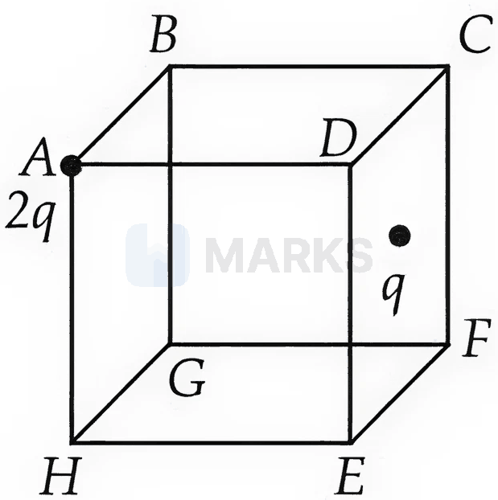

(1) $\dfrac{3q}{2\epsilon_0}$  (2) $\dfrac{3q}{4\epsilon_0}$  (3) $\dfrac{q}{\epsilon_0}$  (4) $\dfrac{3q}{\epsilon_0}$

**Answer: (2)** · key (compiled)

**Solution.** A charge at a vertex contributes $\tfrac18$ of its flux through the cube: $\dfrac{2q}{8\epsilon_0}=\dfrac{q}{4\epsilon_0}$. A charge at the centre of a face contributes $\tfrac12$: $\dfrac{q}{2\epsilon_0}$. Total $=\dfrac{3q}{4\epsilon_0}$.

### P-ELS-03 · A — JEE Main 2026 · 28 Jan Shift 2 · set Q3 · MCQ

Identify the correct statements:  
A. Electrostatic field lines form closed loops.  
B. The electric field lines point radially outward when the charge is greater than zero.  
C. Gauss's law is valid only for an inverse-square force.  
D. The work done in moving a charged particle in a static electric field around a closed path is zero.  
E. The motion of a particle under Coulomb's force must take place in a plane.

(1) A, B, D, E only  (2) A, C, E only  (3) A, B, C, D only  (4) B, C, D, E only

**Answer: (4)** · key (compiled)

**Solution.** A is false: electrostatic lines start on positive and end on negative charges (the field is conservative). B is true for a point charge. C is true: Gauss's law follows from the $1/r^2$ nature of the force. D is true: $\oint\vec E\cdot d\vec l=0$. E is true: Coulomb force is central, so angular momentum direction is constant and motion is planar. Hence B, C, D, E.

### P-ELS-04 · A — JEE Main 2026 · 24 Jan Shift 2 · set Q4 · Numerical

A point charge $q=1\ \mu\text{C}$ is located at a distance of $2$ cm from one end of a thin insulating wire of length $10$ cm having a charge $Q=24\ \mu\text{C}$ distributed uniformly along its length, as shown in the figure. The force between $q$ and the wire is ______ N. (Use $\dfrac{1}{4\pi\epsilon_0}=9\times10^9\ \text{N m}^2/\text{C}^2$)

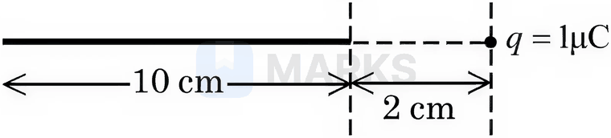

**Answer: 90** · key (compiled)

**Solution.** Take an element $dx$ of the wire at distance $x$ from $q$, with charge $\dfrac{Q}{L}dx$. $F=kq\dfrac QL\int_a^{a+L}\dfrac{dx}{x^2}=\dfrac{kqQ}{L}\left(\dfrac1a-\dfrac1{a+L}\right)=\dfrac{kqQ}{a(a+L)}$. With $a=0.02$ m, $a+L=0.12$ m: $F=\dfrac{9\times10^9\times10^{-6}\times24\times10^{-6}}{0.02\times0.12}=90$ N.

### P-ELS-05 · A — JEE Main 2026 · 22 Jan Shift 2 · set Q5 · MCQ

Five positive charges each of charge $q$ are placed at the vertices of a regular pentagon as shown in the figure. The electric potential $V$ and the electric field $\vec E$ at the centre $O$ of the pentagon due to these five charges are:

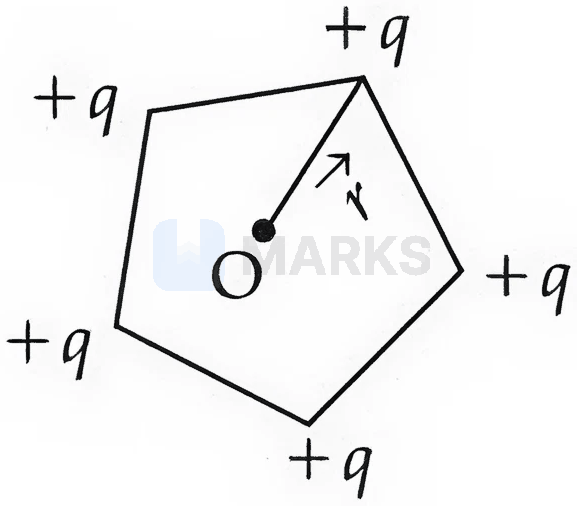

(1) $V=\dfrac{5q}{4\pi\epsilon_0r}$ and $\vec E=\dfrac{5\sqrt3\,q}{8\pi\epsilon_0r^2}\hat r$  (2) $V=\dfrac{5q}{4\pi\epsilon_0r}$ and $\vec E=0$  (3) $V=0$ and $\vec E=0$  (4) $V=\dfrac{5q}{4\pi\epsilon_0r}$ and $\vec E=\dfrac{5q}{4\pi\epsilon_0r^2}\hat r$

**Answer: (2)** · key (compiled)

**Solution.** Potential is a scalar: each charge is at distance $r$, so $V=5\cdot\dfrac{q}{4\pi\epsilon_0r}$. The five equal field vectors are radial and spaced $72^\circ$ apart, so their vector sum is zero: $\vec E=0$.

### P-ELS-06 · A — JEE Main 2026 · 22 Jan Shift 2 · set Q6 · MCQ

Three small identical bubbles of water having the same charge on each coalesce to form a bigger bubble. Then the ratio of the potential on one initial bubble to that on the resultant bigger bubble is:

(1) $3^{2/3}:1$  (2) $1:2^{2/3}$  (3) $1:3^{2/3}$  (4) $1:3^{1/3}$

**Answer: (3)** · key (compiled)

**Solution.** Each bubble has charge $q$ and radius $r$: $V_i=\dfrac{kq}{r}$. After coalescing, charge $=3q$ and (volume conserved) $R=3^{1/3}r$, so $V_f=\dfrac{k\cdot3q}{3^{1/3}r}=3^{2/3}V_i$. Ratio $V_i:V_f=1:3^{2/3}$.

### P-ELS-07 · A — JEE Main 2026 · 22 Jan Shift 1 · set Q7 · MCQ

Six point charges are kept $60^\circ$ apart from each other on the circumference of a circle of radius $R$ as shown in the figure. The net electric field at the centre of the circle is ______. ($\epsilon_0$ is the permittivity of free space)

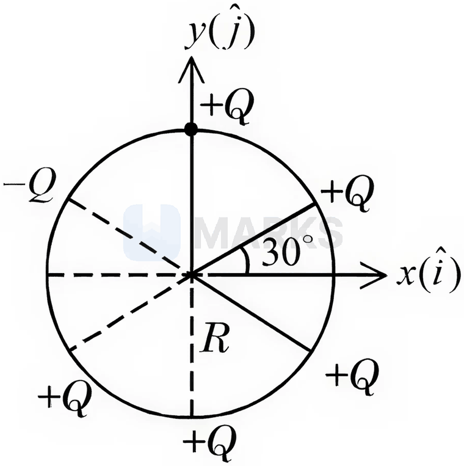

(1) $\dfrac{Q}{4\pi\epsilon_0R^2}(\sqrt3\hat i-\hat j)$  (2) $-\dfrac{5Q}{8\pi\epsilon_0R^2}(\hat i+\sqrt3\hat j)$  (3) $-\left(\dfrac{5Q}{8\pi\epsilon_0R^2}\right)(\hat i-3\hat j)$  (4) $-\dfrac{Q}{4\pi\epsilon_0R^2}(\sqrt3\hat i-\hat j)$

**Answer: (4)** · key (compiled)

**Solution.** Five charges are $+Q$ and the one at $150^\circ$ is $-Q$. Six equal $+Q$ charges would give zero field at the centre. Replacing the $+Q$ at $150^\circ$ by $-Q$ adds $2E_0$ directed *towards* that charge (along $\hat r_{150^\circ}$), with $E_0=\dfrac{Q}{4\pi\epsilon_0R^2}$: $\vec E=2E_0\left(-\tfrac{\sqrt3}{2}\hat i+\tfrac12\hat j\right)=-\dfrac{Q}{4\pi\epsilon_0R^2}(\sqrt3\hat i-\hat j)$.

### P-ELS-08 · A — JEE Main 2026 · 22 Jan Shift 1 · set Q8 · MCQ

A simple pendulum has a bob of mass $m$ and charge $q$; the string has negligible mass. When a uniform horizontal electric field $\vec E$ is applied, the tension in the string changes. The final tension in the string when the pendulum attains its equilibrium position is ______. ($g$: acceleration due to gravity)

(1) $\sqrt{m^2g^2+q^2E^2}$  (2) $mg+qE$  (3) $mg-qE$  (4) $\sqrt{m^2g^2-q^2E^2}$

**Answer: (1)** · key (compiled)

**Solution.** At equilibrium the string is along the resultant of $mg$ (down) and $qE$ (horizontal), which are perpendicular. The tension balances their resultant: $T=\sqrt{(mg)^2+(qE)^2}$.

### P-ELS-09 · A — JEE Main 2026 · 22 Jan Shift 1 · set Q9 · MCQ

The electric field in a region is given by $\vec E=Ax\,\hat i+By\,\hat j$ with $A=10\ \text{V/m}^2$ and $B=5\ \text{V/m}^2$. If the electric potential at the point $(10,20)$ is $500$ V, then the electric potential at the origin is ______ V.

(1) 0  (2) 2000  (3) 500  (4) 1000

**Answer: (2)** · key (compiled)

**Solution.** $\vec E=-\nabla V$ gives $V=-\dfrac{Ax^2}{2}-\dfrac{By^2}{2}+C=-5x^2-2.5y^2+C$. At $(10,20)$: $500=-500-1000+C\Rightarrow C=2000$. At the origin $V=C=2000$ V.

### P-ELS-10 · A — JEE Main 2026 · 23 Jan Shift 2 · set Q10 · MCQ

Two short dipoles $A$ (charges $\pm2\ \mu\text{C}$, length $1$ cm) and $B$ (charges $\pm4\ \mu\text{C}$, length $1$ cm) are placed with their centres $80$ cm apart as shown in the figure. The electric field at the point $P$, equidistant from the centres of both dipoles, is ______ N/C.

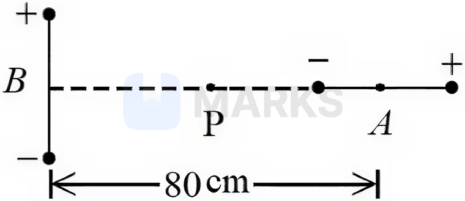

(1) $\dfrac{9}{16}\sqrt2\times10^4$  (2) $9\sqrt2\times10^4$  (3) $4.5\sqrt2\times10^4$  (4) $\dfrac{9}{16}\sqrt2\times10^5$

**Answer: (1)** · key (compiled)

**Solution.** $P$ is $40$ cm from each centre. It lies on the *axial* line of $A$: $E_A=\dfrac{2kp_A}{r^3}=\dfrac{2\times9\times10^9\times2\times10^{-8}}{0.4^3}=5625$ N/C, along the dipole direction (horizontal). It lies on the *equatorial* line of $B$: $E_B=\dfrac{kp_B}{r^3}=\dfrac{9\times10^9\times4\times10^{-8}}{0.4^3}=5625$ N/C, antiparallel to $\vec p_B$ (vertical). The two are perpendicular, so $E=5625\sqrt2=\dfrac{9}{16}\sqrt2\times10^4$ N/C.

### P-ELS-11 · A — JEE Main 2026 · 23 Jan Shift 2 · set Q11 · MCQ

Two charges $7\ \mu\text{C}$ and $-2\ \mu\text{C}$ are placed at $(-9,0,0)$ cm and $(9,0,0)$ cm respectively in an external field $\vec E=\dfrac{A}{r^2}\hat r$, where $A=9\times10^5\ \text{N C}^{-1}\text{m}^2$. Taking the potential at infinity as $0$, the electrostatic energy of the configuration is ______ J.

(1) 49.3  (2) -90.7  (3) 24.3  (4) 1.4

**Answer: (1)** · key (compiled)

**Solution.** The external field has potential $V(r)=\dfrac{A}{r}$. Energy $U=q_1V(r_1)+q_2V(r_2)+\dfrac{kq_1q_2}{r_{12}}$ with $r_1=r_2=0.09$ m, $r_{12}=0.18$ m. $q_1V_1=7\times10^{-6}\times10^{7}=70$ J, $q_2V_2=-2\times10^{-6}\times10^{7}=-20$ J, interaction $=\dfrac{9\times10^9\times7\times10^{-6}\times(-2\times10^{-6})}{0.18}=-0.7$ J. Total $=70-20-0.7=49.3$ J.

### P-ELS-12 · A — JEE Main 2026 · 21 Jan Shift 1 · set Q12 · MCQ

A point charge of $10^{-8}$ C is placed at the origin. The work done in moving a point charge $2\ \mu\text{C}$ from point $A(4,4,2)$ m to $B(2,2,1)$ m is ______ J. (in SI units, $\dfrac{1}{4\pi\epsilon_0}=9\times10^9$)

(1) $45\times10^{-6}$  (2) $15\times10^{-6}$  (3) 0  (4) $30\times10^{-6}$

**Answer: (4)** · key (compiled)

**Solution.** $r_A=\sqrt{16+16+4}=6$ m and $r_B=\sqrt{4+4+1}=3$ m. $W=q_2(V_B-V_A)=2\times10^{-6}\times9\times10^9\times10^{-8}\left(\dfrac13-\dfrac16\right)=2\times10^{-6}\times90\times\dfrac16=30\times10^{-6}$ J.

### P-ELS-13 · A — JEE Main 2026 · 28 Jan Shift 1 · set Q13 · MCQ

Two point charges of $1$ nC and $2$ nC are placed at two corners of an equilateral triangle of side $3$ cm. The work done in bringing a charge of $3$ nC from infinity to the third corner of the triangle is ______ $\mu$J. ($\dfrac{1}{4\pi\epsilon_0}=9\times10^9\ \text{N m}^2/\text{C}^2$)

(1) 27  (2) 5.4  (3) 2.7  (4) 3.3

**Answer: (3)** · key (compiled)

**Solution.** Potential at the third corner $=\dfrac{9\times10^9\times1\times10^{-9}}{0.03}+\dfrac{9\times10^9\times2\times10^{-9}}{0.03}=300+600=900$ V. $W=qV=3\times10^{-9}\times900=2.7\ \mu$J.

### P-ELS-14 · A — JEE Main 2026 · 24 Jan Shift 1 · set Q14 · MCQ

There are three concentric conducting spherical shells $A$, $B$ and $C$ of radii $a$, $b$ and $c$ respectively ($c>b>a$), carrying charges $q_1$, $q_2$ and $q_3$ respectively. The potentials of the shells $A$, $B$ and $C$ are respectively:

(1) $\dfrac{1}{4\pi\epsilon_0}\left(\dfrac{q_1+q_2+q_3}{a}\right),\ \dfrac{1}{4\pi\epsilon_0}\left(\dfrac{q_1+q_2+q_3}{b}\right),\ \dfrac{1}{4\pi\epsilon_0}\left(\dfrac{q_1+q_2+q_3}{c}\right)$  (2) $\dfrac{1}{4\pi\epsilon_0}\left(\dfrac{q_1}{a}+\dfrac{q_2}{b}+\dfrac{q_3}{c}\right),\ \dfrac{1}{4\pi\epsilon_0}\left(\dfrac{q_1+q_2+q_3}{b}\right),\ \dfrac{1}{4\pi\epsilon_0}\left(\dfrac{q_1+q_2+q_3}{c}\right)$  (3) $\dfrac{1}{4\pi\epsilon_0}\left(\dfrac{q_1}{a}+\dfrac{q_2}{b}+\dfrac{q_3}{c}\right),\ \dfrac{1}{4\pi\epsilon_0}\left(\dfrac{q_1+q_2}{b}+\dfrac{q_3}{c}\right),\ \dfrac{1}{4\pi\epsilon_0}\left(\dfrac{q_1+q_2+q_3}{c}\right)$  (4) $\dfrac{1}{4\pi\epsilon_0}\left(\dfrac{q_1+q_2+q_3}{a}\right),\ \dfrac{1}{4\pi\epsilon_0}\left(\dfrac{q_1+q_2}{b}+\dfrac{q_3}{c}\right),\ \dfrac{1}{4\pi\epsilon_0}\left(\dfrac{q_1}{a}+\dfrac{q_2}{b}+\dfrac{q_3}{c}\right)$

**Answer: (3)** · key (compiled)

**Solution.** For a shell of radius $R$: $V=kq/r$ at distance $r\ge R$ and $V=kq/R$ (constant) everywhere inside. Superposing: $V_A=k\left(\dfrac{q_1}{a}+\dfrac{q_2}{b}+\dfrac{q_3}{c}\right)$; $V_B=k\left(\dfrac{q_1+q_2}{b}+\dfrac{q_3}{c}\right)$ (shell $A$ is inside $B$, shell $C$ is outside); $V_C=k\,\dfrac{q_1+q_2+q_3}{c}$.

### P-ELS-15 · A — JEE Main 2026 · 24 Jan Shift 1 · set Q15 · MCQ

Three charges $+2q$, $+3q$ and $-4q$ are situated at $(0,-3a)$, $(2a,0)$ and $(-2a,0)$ respectively in the $xy$ plane. The resultant dipole moment about the origin is ______.

(1) $2qa(7\hat i-3\hat j)$  (2) $2qa(3\hat j-\hat i)$  (3) $2qa(3\hat i-7\hat j)$  (4) $2qa(3\hat j-7\hat i)$

**Answer: (1)** · key (compiled)

**Solution.** $\vec p=\sum q_i\vec r_i=(2q)(-3a\hat j)+(3q)(2a\hat i)+(-4q)(-2a\hat i)=14qa\,\hat i-6qa\,\hat j=2qa(7\hat i-3\hat j)$.

### P-ELS-16 · A — JEE Main 2026 · 24 Jan Shift 1 · set Q16 · MCQ

The electrostatic potential in a charged spherical region of radius $r$ varies as $V=ar^3+b$, where $a$ and $b$ are constants. The total charge in the sphere of unit radius is $\alpha\times\pi a\epsilon_0$. The value of $\alpha$ is ______. ($\epsilon_0$ is the permittivity of vacuum)

(1) -9  (2) -12  (3) -8  (4) -6

**Answer: (2)** · key (compiled)

**Solution.** $E=-\dfrac{dV}{dr}=-3ar^2$. By Gauss's law $Q(r)=\epsilon_0E\cdot4\pi r^2=-12\pi a\epsilon_0r^4$. At $r=1$: $Q=-12\pi a\epsilon_0$, so $\alpha=-12$.

### P-ELS-17 · A — JEE Main 2025 · Jan session · Elec set Q1 · MCQ

For a short dipole placed at the origin $O$, the dipole moment $\vec P$ is along the $x$-axis, as shown in the figure. If the electric potential and electric field at $A$ are $V_0$ and $E_0$ respectively, then the correct combination of the electric potential and electric field, respectively, at point $B$ on the $y$-axis is given by:

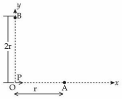

(1) $V_0$ and $\dfrac{E_0}{4}$  (2) zero and $\dfrac{E_0}{16}$  (3) zero and $\dfrac{E_0}{8}$  (4) $\dfrac{V_0}{2}$ and $\dfrac{E_0}{16}$

**Answer: (2)** · key (compiled)

**Solution.** $A$ lies on the axis of the dipole at distance $r$: $V_0=\dfrac{kp}{r^2}$, $E_0=\dfrac{2kp}{r^3}$. $B$ lies on the equatorial line at distance $2r$, where the potential is zero and $E_B=\dfrac{kp}{(2r)^3}=\dfrac{kp}{8r^3}=\dfrac{E_0}{16}$.

### P-ELS-18 · A — JEE Main 2025 · Jan session · Elec set Q2 · Numerical

A square loop of side $a=1$ m is held normally in front of a point charge $q=1$ C (figure). The flux of the electric field through the shaded region is $\dfrac5p\times\dfrac1{\varepsilon_0}\ \dfrac{\text{N m}^2}{\text C}$, where the value of $p$ is ______.

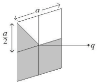

**Answer: 48** · key (compiled)

**Solution.** The charge lies on the normal through the centre of the loop at distance $a/2$, so the loop is one face of an imaginary cube of side $a$ with the charge at its centre. Flux through one face $=\dfrac q{6\varepsilon_0}$. The diagonals and mid-lines divide the square into 8 congruent triangles, each receiving equal flux by symmetry; the shaded region is made of 5 of them (the lower half plus one triangle of the upper-left quadrant). So $\phi=\dfrac58\cdot\dfrac q{6\varepsilon_0}=\dfrac5{48}\cdot\dfrac1{\varepsilon_0}$ and $p=48$.

### P-ELS-19 · B — JEE Main 2025 · Jan session · Elec set Q5 · MCQ

A small uncharged conducting sphere is placed in contact with an identical sphere having $4\times10^{-8}$ C charge and then removed to a distance such that the force of repulsion between them is $9\times10^{-3}$ N. The distance between them is (take $\dfrac1{4\pi\varepsilon_0}=9\times10^9$ in SI units):

(1) 3 cm  (2) 2 cm  (3) 4 cm  (4) 1 cm

**Answer: (2)** · key (compiled)

**Solution.** Identical conducting spheres share the charge equally on contact: $2\times10^{-8}$ C each. $F=\dfrac{kq^2}{r^2}\Rightarrow r^2=\dfrac{9\times10^9\times(2\times10^{-8})^2}{9\times10^{-3}}=4\times10^{-4}\ \text m^2$, so $r=2\times10^{-2}$ m $=2$ cm.

### P-ELS-20 · B — JEE Main 2025 · Jan session · Elec set Q6 · MCQ

An electron is made to enter symmetrically between two parallel, equally but oppositely charged metal plates, each of length 10 cm. The electron emerges from the electric field region with a horizontal component of velocity $10^6$ m/s. If the magnitude of the electric field between the plates is 9.1 V/cm, the vertical component of the velocity of the electron is (mass of electron $=9.1\times10^{-31}$ kg, charge of electron $=1.6\times10^{-19}$ C):

(1) 0  (2) $1\times10^6$ m/s  (3) $16\times10^6$ m/s  (4) $16\times10^4$ m/s

**Answer: (3)** · key (compiled)

**Solution.** $E=9.1\ \text{V/cm}=910$ V/m, so $a=\dfrac{eE}m=\dfrac{1.6\times10^{-19}\times910}{9.1\times10^{-31}}=1.6\times10^{14}\ \text{m/s}^2$. The horizontal velocity is unchanged, so the transit time is $t=\dfrac{0.10}{10^6}=10^{-7}$ s and $v_y=at=1.6\times10^{7}=16\times10^6$ m/s.

### P-ELS-21 · B — JEE Main 2025 · Jan session · Elec set Q7 · MCQ

A particle of mass $m$ and charge $q$ is fastened to one end $A$ of a massless string of equilibrium length $l$, whose other end is fixed at point $O$. The whole system is placed on a frictionless horizontal plane and is initially at rest. If a uniform electric field is switched on along the direction shown in the figure, then the speed of the particle when it crosses the $x$-axis is:

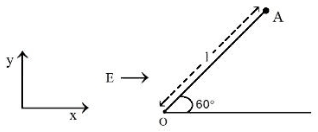

(1) $\sqrt{\dfrac{qEl}{2m}}$  (2) $\sqrt{\dfrac{qEl}{m}}$  (3) $\sqrt{\dfrac{qEl}{4m}}$  (4) $\sqrt{\dfrac{2qEl}{m}}$

**Answer: (2)** · key (compiled)

**Solution.** The string initially makes $60^\circ$ with the $x$-axis and the field $E$ points along $+x$. The force $qE$ has a component along the string directed away from $O$, so the string stays taut and the particle moves on a circle of radius $l$. From $A$ to the $x$-axis the displacement along the field is $l-l\cos60^\circ=\dfrac l2$. Work–energy theorem: $\tfrac12mv^2=qE\cdot\dfrac l2\Rightarrow v=\sqrt{\dfrac{qEl}m}$.

### P-ELS-22 · B — JEE Main 2025 · Jan session · Elec set Q10 · MCQ

Two point charges $-4\ \mu$C and $4\ \mu$C, constituting an electric dipole, are placed at $(-9,0,0)$ cm and $(9,0,0)$ cm in a uniform electric field of strength $10^4$ N/C. The work done on the dipole in rotating it from the equilibrium position through $180^\circ$ is:

(1) 18.4 mJ  (2) 14.4 mJ  (3) 12.4 mJ  (4) 16.4 mJ

**Answer: (2)** · key (compiled)

**Solution.** Dipole moment $p=q\cdot d=4\times10^{-6}\times0.18=7.2\times10^{-7}$ C m. Work to turn the dipole from the stable equilibrium ($\theta=0$) to $\theta=180^\circ$: $W=pE(1-\cos180^\circ)=2pE=2\times7.2\times10^{-7}\times10^4=1.44\times10^{-2}$ J $=14.4$ mJ.

### P-ELS-23 · B — JEE Main 2025 · Jan session · Elec set Q12 · MCQ

An electric dipole of mass $m$, charge $q$ and length $l$ is placed in a uniform electric field $\vec E=E_0\hat i$. When the dipole is rotated slightly from its equilibrium position and released, the time period of its oscillations will be:

(1) $\dfrac1{2\pi}\sqrt{\dfrac{ml}{2qE_0}}$  (2) $2\pi\sqrt{\dfrac{ml}{qE_0}}$  (3) $\dfrac1{2\pi}\sqrt{\dfrac{2ml}{qE_0}}$  (4) $2\pi\sqrt{\dfrac{ml}{2qE_0}}$

**Answer: (4)** · key (compiled)

**Solution.** Take mass $m$ at each end (the choice for which an option matches). Moment of inertia about the centre: $I=2\cdot m\left(\dfrac l2\right)^2=\dfrac{ml^2}2$. For a small angle $\theta$ the restoring torque is $\tau=-pE_0\sin\theta\approx-(ql)E_0\,\theta$, so $\omega^2=\dfrac{qlE_0}{ml^2/2}=\dfrac{2qE_0}{ml}$ and $T=2\pi\sqrt{\dfrac{ml}{2qE_0}}$.

### P-ELS-24 · B — JEE Main 2025 · Apr session · Elec set Q1 · MCQ

Two metal spheres of radius $R$ and $3R$ have the same surface charge density $\sigma$. If they are brought into contact and then separated, the surface charge densities on the smaller and bigger spheres become $\sigma_1$ and $\sigma_2$ respectively. The ratio $\dfrac{\sigma_1}{\sigma_2}$ is:

(1) $\dfrac19$  (2) 9  (3) $\dfrac13$  (4) 3

**Answer: (4)** · key (compiled)

**Solution.** After contact the spheres are at the same potential. Since $V=\dfrac{kQ}r=\dfrac{k\,4\pi r^2\sigma}{r}=\dfrac{\sigma r}{\varepsilon_0}$, we get $\sigma\propto\dfrac1r$, so $\dfrac{\sigma_1}{\sigma_2}=\dfrac{3R}{R}=3$.

### P-ELS-25 · B — JEE Main 2025 · Apr session · Elec set Q2 · MCQ

A point charge $+q$ is placed at the origin. A second point charge $+9q$ is placed at $(d,0,0)$ in a Cartesian coordinate system. The point in between them where the electric field vanishes is:

(1) $(4d/3,0,0)$  (2) $(d/4,0,0)$  (3) $(3d/4,0,0)$  (4) $(d/3,0,0)$

**Answer: (2)** · key (compiled)

**Solution.** At a distance $x$ from $q$ the fields cancel when $\dfrac{kq}{x^2}=\dfrac{k(9q)}{(d-x)^2}$, i.e. $d-x=3x$, so $x=\dfrac d4$.

### P-ELS-26 · B — JEE Main 2025 · Apr session · Elec set Q4 · MCQ

Two small spherical balls of mass 10 g each, with charges $-2\ \mu$C and $2\ \mu$C, are attached to the two ends of a very light rigid rod of length 20 cm. The arrangement is placed near an infinite non-conducting charge sheet with uniform charge density $100\ \mu\text{C/m}^2$ such that the rod makes an angle of $30^\circ$ with the electric field generated by the charge sheet. The net torque acting on the rod is: (Take $\varepsilon_0=8.85\times10^{-12}\ \text{C}^2/\text{N m}^2$)

(1) 112 N m  (2) 1.12 N m  (3) 2.24 N m  (4) 11.2 N m

**Answer: (2)** · key (compiled)

**Solution.** Field of the sheet: $E=\dfrac{\sigma}{2\varepsilon_0}=\dfrac{10^{-4}}{2\times8.85\times10^{-12}}=5.65\times10^6$ N/C (uniform). Dipole moment $p=2\times10^{-6}\times0.2=4\times10^{-7}$ C m. Torque $\tau=pE\sin30^\circ=4\times10^{-7}\times5.65\times10^6\times0.5\approx1.12$ N m.

### P-ELS-27 · B — JEE Main 2025 · Apr session · Elec set Q7 · MCQ

A small bob of mass 100 mg and charge $+10\ \mu$C is connected to an insulating string of length 1 m. It is brought near an infinitely long non-conducting sheet of charge density $\sigma$ as shown in the figure. If the string subtends an angle of $45^\circ$ with the sheet at equilibrium, the charge density of the sheet will be: (Given $\varepsilon_0=8.85\times10^{-12}$ F/m and $g=10$ m/s$^2$)

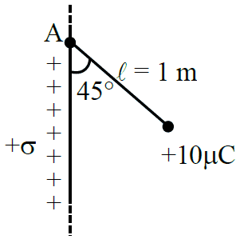

(1) 0.885 nC/m$^2$  (2) 17.7 nC/m$^2$  (3) 885 nC/m$^2$  (4) 1.77 nC/m$^2$

**Answer: (4)** · key (compiled)

**Solution.** Equilibrium of the bob under gravity, tension and the horizontal electric force: $\tan45^\circ=\dfrac{qE}{mg}\Rightarrow qE=mg$, so $E=\dfrac{10^{-4}\times10}{10^{-5}}=100$ N/C. For a non-conducting sheet $E=\dfrac\sigma{2\varepsilon_0}$, hence $\sigma=2\varepsilon_0E=2\times8.85\times10^{-12}\times100=1.77\times10^{-9}$ C/m$^2$ $=1.77$ nC/m$^2$.

### P-ELS-28 · B — JEE Main 2025 · Apr session · Elec set Q8 · MCQ

Consider two infinitely large plane parallel conducting plates as shown below. The plates are uniformly charged with surface charge densities $+\sigma$ and $-2\sigma$. The force experienced by a point charge $+q$ placed at the mid-point between the two plates will be:

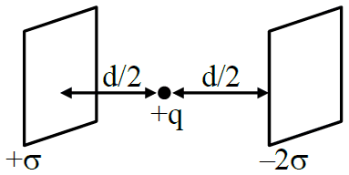

(1) $\dfrac{\sigma q}{4\varepsilon_0}$  (2) $\dfrac{3\sigma q}{2\varepsilon_0}$  (3) $\dfrac{3\sigma q}{4\varepsilon_0}$  (4) $\dfrac{\sigma q}{2\varepsilon_0}$

**Answer: (2)** · key (compiled)

**Solution.** For parallel conducting plates carrying total charge per unit area $\sigma_1=+\sigma$ and $\sigma_2=-2\sigma$, the charge on the outer faces is $\dfrac{\sigma_1+\sigma_2}{2}=-\dfrac\sigma2$ each, so the inner faces carry $+\dfrac{3\sigma}2$ and $-\dfrac{3\sigma}2$. The field between the plates is $E=\dfrac{3\sigma/2}{\varepsilon_0}=\dfrac{3\sigma}{2\varepsilon_0}$, and the force is $qE=\dfrac{3\sigma q}{2\varepsilon_0}$.

### P-ELS-29 · B — JEE Main 2025 · Apr session · Elec set Q12 · MCQ

Consider a circular loop that is uniformly charged and has a radius $a\sqrt2$. Find the position along the positive $z$-axis where the electric field is maximum, if the ring is placed in the $xy$-plane at the origin.

(1) $\dfrac a{\sqrt2}$  (2) $\dfrac a2$  (3) $a$  (4) 0

**Answer: (3)** · key (compiled)

**Solution.** On the axis of a ring of radius $R$: $E=\dfrac{kQz}{(R^2+z^2)^{3/2}}$. $\dfrac{dE}{dz}=0\Rightarrow(R^2+z^2)-3z^2=0\Rightarrow z=\dfrac R{\sqrt2}$. With $R=a\sqrt2$, $z=a$.

### P-ELS-30 · B — JEE Main 2024 · 27 Jan Shift 1 · Q10 · MCQ

An electric charge $10^{-6}\ \mu$C is placed at the origin of the $X$–$Y$ plane. Two points $P$ and $Q$ are situated at $(\sqrt3,\sqrt3)$ m and $(\sqrt6,0)$ m respectively. The potential difference between $P$ and $Q$ is

(1) $\sqrt3$ V  (2) $\sqrt6$ V  (3) 0 V  (4) 3 V

**Answer: (3)** · key ✔

**Solution.** $V=kq/r$ depends only on distance. $OP=\sqrt{3+3}=\sqrt6$ and $OQ=\sqrt6$, so both points sit on the same equipotential sphere and $V_P-V_Q=0$.

### P-ELS-31 · B — JEE Main 2024 · 27 Jan Shift 2 · Q10 · MCQ

Assertion (A): The work done by the electric field in moving a positive charge on an equipotential surface is always zero.  
Reason (R): Electric lines of force are always perpendicular to equipotential surfaces.

(1) Both correct, R not the explanation  (2) A correct, R not correct  (3) A not correct, R correct  (4) Both correct, R explains A

**Answer: (4)** · key ✔

**Solution.** $W=q\Delta V=0$ on an equipotential. Because $\vec E$ is perpendicular to the surface, any displacement along the surface is perpendicular to $\vec F=q\vec E$, so $W=\vec F\cdot d\vec s=0$. R gives the reason for A.

### P-ELS-32 · B — JEE Main 2024 · 29 Jan Shift 1 · Q10 · MCQ

Two charges $5Q$ and $-2Q$ are situated at the points $(3a,0)$ and $(-5a,0)$ respectively. The electric flux through a sphere of radius $4a$ having its centre at the origin is

(1) $\dfrac{2Q}{\varepsilon_0}$  (2) $\dfrac{5Q}{\varepsilon_0}$  (3) $\dfrac{7Q}{\varepsilon_0}$  (4) $\dfrac{3Q}{\varepsilon_0}$

**Answer: (2)** · key ✔

**Solution.** By Gauss's law only enclosed charge counts. $5Q$ at distance $3a<4a$ is inside; $-2Q$ at distance $5a>4a$ is outside. Flux $=\dfrac{5Q}{\varepsilon_0}$.

### P-ELS-33 · B — JEE Main 2024 · 29 Jan Shift 2 · Q11 · MCQ

An electric field is given by $(6\hat i+5\hat j+3\hat k)\ \text{N C}^{-1}$. The electric flux through a surface of area $30\hat i\ \text{m}^2$ lying in the $YZ$-plane (in SI units) is

(1) 90  (2) 150  (3) 180  (4) 60

**Answer: (3)** · key ✔

**Solution.** $\Phi=\vec E\cdot\vec A=(6\hat i+5\hat j+3\hat k)\cdot30\hat i=180$ N m$^2$ C$^{-1}$.

### P-ELS-34 · C — JEE Main 2024 · 30 Jan Shift 1 · Q10 · MCQ

The electrostatic potential due to an electric dipole at a distance $r$ varies as

(1) $\dfrac1r$  (2) $\dfrac1{r^2}$  (3) $\dfrac1{r^3}$

**Answer: (2)** · key ✔

**Solution.** Potential of a dipole: $V=\dfrac{1}{4\pi\varepsilon_0}\dfrac{p\cos\theta}{r^2}\propto\dfrac1{r^2}$ (whereas the field falls as $1/r^3$). It is monopole potential that varies as $1/r$.

### P-ELS-35 · C — JEE Main 2024 · 30 Jan Shift 2 · Q10 · MCQ

A particle of charge $-q$ and mass $m$ moves in a circle of radius $r$ around an infinitely long line charge of linear density $+\lambda$. The time period is (take $k$ as Coulomb's constant)

(1) $T^2=\dfrac{4\pi^2m}{2k\lambda q}r^3$  (2) $T=2\pi r\sqrt{\dfrac m{2k\lambda q}}$  (3) $T=\dfrac1{2\pi r}\sqrt{\dfrac m{2k\lambda q}}$  (4) $T=\dfrac1{2\pi}\sqrt{\dfrac{2k\lambda q}m}$

**Answer: (2)** · key ✔

**Solution.** The field of a line charge is $E=\dfrac{2k\lambda}r$, so the force $qE=\dfrac{2k\lambda q}{r}$ supplies the centripetal force: $\dfrac{mv^2}r=\dfrac{2k\lambda q}r\Rightarrow v=\sqrt{\dfrac{2k\lambda q}m}$ (independent of $r$). $T=\dfrac{2\pi r}v=2\pi r\sqrt{\dfrac m{2k\lambda q}}$.

### P-ELS-36 · C — JEE Main 2024 · 31 Jan Shift 1 · Q13 · MCQ

Two charges $q$ and $3q$ are separated by a distance $r$ in air. At a distance $x$ from charge $q$, the resultant electric field is zero. The value of $x$ is

(2) $\dfrac r{3(1+\sqrt3)}$  (3) $\dfrac r{1+\sqrt3}$  (4) $r(1+\sqrt3)$  (option (1) not legible in the source text)

**Answer: (3)** · key ✔

**Solution.** The field can vanish only between the like charges on the line joining them: $\dfrac{kq}{x^2}=\dfrac{k(3q)}{(r-x)^2}\Rightarrow(r-x)^2=3x^2\Rightarrow r-x=\sqrt3x\Rightarrow x=\dfrac r{1+\sqrt3}$.

### P-ELS-37 · C — JEE Main 2024 · 31 Jan Shift 2 · Q10 · MCQ

The force between two point charges $q_1$ and $q_2$ placed in vacuum at $r$ cm apart is $F$. The force between them when placed in a medium of dielectric constant $K=5$ at $\dfrac r5$ cm apart will be

(1) $\dfrac F{25}$  (2) $5F$  (3) $\dfrac F5$  (4) $25F$

**Answer: (2)** · key ✔

**Solution.** $F'=\dfrac{1}{4\pi\varepsilon_0K}\dfrac{q_1q_2}{(r/5)^2}=\dfrac{25}{K}F=\dfrac{25}5F=5F$.

### P-ELS-38 · C — JEE Main 2024 · 1 Feb Shift 1 · Q25 · Numerical

Two identical charged spheres are suspended by strings of equal lengths. The strings make an angle $\theta$ with each other. When suspended in water the angle remains the same. If the density of the material of the spheres is $1.5$ g/cc, the dielectric constant of water will be ______. (Density of water $=1$ g/cc)

**Answer: 3** · key ✔

**Solution.** In water the Coulomb force is divided by $K$ and the effective weight becomes $mg\left(1-\dfrac{\rho_w}{\rho_s}\right)$. For the same angle: $\dfrac F{mg}=\dfrac{F/K}{mg(1-1/1.5)}\Rightarrow K=\dfrac1{1-2/3}=3$.

### P-ELS-39 · C — JEE Main 2024 · 8 Apr Shift 1 · Q11 · MCQ

Two charged conducting spheres of radii $a$ and $b$ are connected by a conducting wire. The ratio of the charges of the two spheres respectively is:

(1) $\dfrac ab$  (2) $\sqrt{ab}$  (3) $\dfrac ba$  (4) $ab$

**Answer: (1)** · key ✔

**Solution.** After connection the potentials are equal: $\dfrac{kq_a}{a}=\dfrac{kq_b}{b}\Rightarrow\dfrac{q_a}{q_b}=\dfrac ab$.

### P-ELS-40 · C — JEE Main 2024 · 01 Feb Shift 2 · Fig set Q2 · MCQ

$C_1$ and $C_2$ are two hollow concentric cubes enclosing charges $2Q$ and $3Q$ respectively as shown in the figure (the cube $C_1$ encloses $2Q$; the outer cube $C_2$ encloses $2Q$ and $3Q$). The ratio of the electric flux passing through $C_1$ and $C_2$ is:

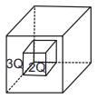

(1) 2 : 5  (2) 5 : 2  (3) 2 : 3  (4) 3 : 2

**Answer: (1)** · key (compiled)

**Solution.** By Gauss's law the flux depends only on the enclosed charge: $\phi_1=\dfrac{2Q}{\varepsilon_0}$ and $\phi_2=\dfrac{2Q+3Q}{\varepsilon_0}=\dfrac{5Q}{\varepsilon_0}$. Ratio $=2:5$.

### P-ELS-41 · C — JEE Main 2024 · 04 Apr Shift 1 · Fig set Q1 · MCQ

An infinitely long positively charged straight thread has a linear charge density $\lambda$ C m$^{-1}$. An electron revolves along a circular path having its axis along the length of the wire. The graph that correctly represents the variation of the kinetic energy of the electron as a function of the radius of the circular path from the wire is:

**(1)** 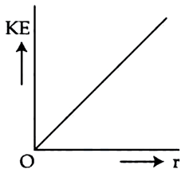

**(2)** 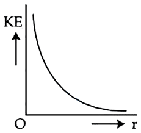

**(3)** 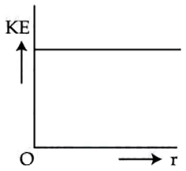

**(4)** 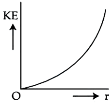

**Answer: (3)** · key (compiled)

**Solution.** The field of the wire is $E=\dfrac\lambda{2\pi\varepsilon_0r}$, so the electrostatic force provides the centripetal force: $\dfrac{e\lambda}{2\pi\varepsilon_0r}=\dfrac{mv^2}r\Rightarrow mv^2=\dfrac{e\lambda}{2\pi\varepsilon_0}$, independent of $r$. The kinetic energy is constant: a horizontal line, graph (3).

### P-ELS-42 · C — JEE Main 2024 · 05 Apr Shift 2 · Fig set Q5 · Numerical

The electric field at point $P$ (on the axis of an electric dipole, at distance $r$ from its centre $O$) due to the dipole is $E$. The electric field at point $R$ on the equatorial line, at distance $2r$ from $O$, will be $\dfrac Ex$. The value of $x$ is:

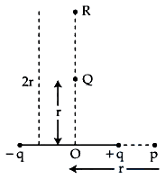

**Answer: 16** · key (compiled)

**Solution.** Axial point: $E=\dfrac{2kp}{r^3}$. Equatorial point at $2r$: $E_R=\dfrac{kp}{(2r)^3}=\dfrac{kp}{8r^3}=\dfrac E{16}$. So $x=16$.

### P-ELS-43 · C — JEE Main 2024 · 09 Apr Shift 2 · Fig set Q13 · MCQ

Five charges $+q$, $+5q$, $-2q$, $+3q$ and $-4q$ are situated as shown in the figure. The electric flux due to this configuration through the surface $S$ is:

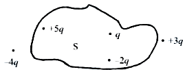

(1) $\dfrac{4q}{\varepsilon_0}$  (2) $\dfrac{5q}{\varepsilon_0}$  (3) $\dfrac q{\varepsilon_0}$  (4) $\dfrac{3q}{\varepsilon_0}$

**Answer: (1)** · key (compiled)

**Solution.** Only charges inside $S$ count (Gauss's law). The charges $+5q$, $+q$ and $-2q$ are inside the closed surface, while $+3q$ and $-4q$ lie outside it. Enclosed charge $=5q+q-2q=4q$, so $\phi=\dfrac{4q}{\varepsilon_0}$.

### P-ELS-44 · C — JEE Main 2024 · 09 Apr Shift 2 · Fig set Q14 · Numerical

An electric field $\vec E=(2x\hat i)$ N C$^{-1}$ exists in space. A cube of side 2 m is placed in the space as per the figure given below (its faces perpendicular to $x$ at $x=2$ m and $x=4$ m). The electric flux through the cube is ______ N m$^2$/C.

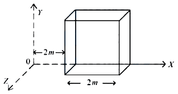

**Answer: 16** · key (compiled)

**Solution.** The field is along $x$, so only the two faces perpendicular to $x$ contribute. At $x=2$: $E=4$ N/C (flux inwards, $-4\times4=-16$); at $x=4$: $E=8$ N/C (outwards, $+8\times4=32$), where the face area is $4$ m$^2$. Net flux $=32-16=16$ N m$^2$/C.

