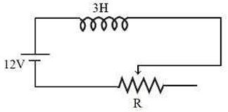
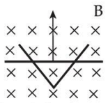
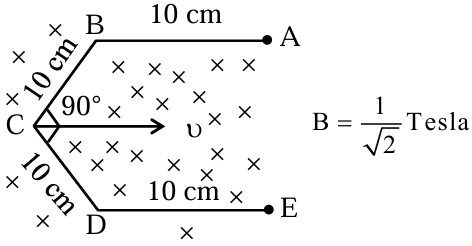

# Electromagnetic Induction

> Theory: [../../theory/physics/emi.md](../../theory/physics/emi.md)

### P-EMI-01 · A — JEE Main 2026 · 23 Jan Shift 1 · set Q1 · MCQ

A $20$ m long uniform copper wire held horizontally is allowed to fall under gravity ($g=10\ \text{m/s}^2$) through a uniform horizontal magnetic field of $0.5$ gauss perpendicular to the length of the wire. The induced emf across the wire when it has fallen a vertical distance of $200$ m is ______ mV.

(1) $20\sqrt{10}$  (2) $0.2\sqrt{10}$  (3) $200\sqrt{10}$  (4) $2\sqrt{10}$

**Answer: (1)** · key (compiled)

**Solution.** Speed after falling $200$ m: $v=\sqrt{2gh}=\sqrt{4000}=20\sqrt{10}$ m/s. With $B=0.5\ \text{G}=0.5\times10^{-4}$ T: $\varepsilon=BLv=0.5\times10^{-4}\times20\times20\sqrt{10}=0.02\sqrt{10}$ V $=20\sqrt{10}$ mV.

### P-EMI-02 · A — JEE Main 2026 · 23 Jan Shift 1 · set Q2 · Numerical

A simple pendulum made of a mass of $10$ g and a metallic wire of length $10$ cm is suspended vertically in a uniform magnetic field of $2$ T. The magnetic field is perpendicular to the plane of oscillation of the pendulum. If the pendulum is released from an angle of $60^\circ$ with the vertical, the maximum induced emf between the point of suspension and the bob is ______ mV. (Take $g=10\ \text{m/s}^2$)

**Answer: 100** · key (compiled)

**Solution.** The emf of a rod of length $\ell$ rotating at $\omega$ is $\tfrac12B\omega\ell^2$. It is maximum at the lowest point, where $\tfrac12m\ell^2\omega^2=mg\ell(1-\cos60^\circ)$, so $\omega=\sqrt{g/\ell}=10$ rad/s. Then $\varepsilon_{max}=\tfrac12\times2\times10\times(0.1)^2=0.1$ V $=100$ mV.

### P-EMI-03 · A — JEE Main 2026 · 22 Jan Shift 2 · set Q3 · MCQ

The figure shows a circuit containing three resistances ($9\ \Omega$ each) and two inductors ($4$ mH each). The reading of the ammeter at the moment the switch $K$ is turned ON is ______ A.

(1) 2  (2) 1  (3) zero  (4) 3

**Answer: (2)** · key (compiled)

**Solution.** At the instant of closing, an inductor opposes any sudden change of current, so it carries zero current and acts as an open circuit. The two branches containing inductors are therefore inactive and only the middle $9\ \Omega$ resistor conducts: $I=\dfrac{9\ \text{V}}{9\ \Omega}=1$ A.

### P-EMI-04 · A — JEE Main 2026 · 22 Jan Shift 1 · set Q5 · MCQ

Three identical coils $C_1$, $C_2$ and $C_3$ are placed closely so that they share a common axis, $C_2$ being exactly midway. $C_1$ carries current $I$ in the anti-clockwise direction while $C_3$ carries current $I$ in the clockwise direction. An induced current flows through $C_2$ in the clockwise direction when:

(1) $C_1$ moves away from $C_2$ and $C_3$ moves towards $C_2$  (2) $C_1$ and $C_3$ move with equal speeds away from $C_2$  (3) $C_1$ moves towards $C_2$ and $C_3$ moves away from $C_2$  (4) $C_1$ and $C_3$ move with equal speeds towards $C_2$

**Answer: (3)** · key (compiled)

**Solution.** At $C_2$ the field of $C_1$ (anti-clockwise) points one way, say $+z$, and that of $C_3$ (clockwise) points $-z$; initially they cancel. A clockwise induced current in $C_2$ produces a field in $-z$, so by Lenz's law the flux through $C_2$ must be increasing along $+z$ or decreasing along $-z$. Moving $C_1$ towards $C_2$ increases the $+z$ flux, and moving $C_3$ away decreases the $-z$ flux: option (3).

### P-EMI-05 · A — JEE Main 2026 · 22 Jan Shift 1 · set Q6 · MCQ

$XPQY$ is a vertical smooth long loop of total resistance $R$, where $PX$ is parallel to $QY$ and the separation between them is $l$. A constant magnetic field $B$ perpendicular to the plane of the loop exists in the entire space. A rod $CD$ of length $L$ ($L>l$) and mass $m$ is made to slide down from rest under gravity as shown in the figure. The terminal speed acquired by the rod is ______ m/s. ($g$ = acceleration due to gravity)

(1) $\dfrac{8mgR}{B^2l^2}$  (2) $\dfrac{2mgR}{B^2L^2}$  (3) $\dfrac{mgR}{B^2l^2}$  (4) $\dfrac{2mgR}{B^2l^2}$

**Answer: (3)** · key (compiled)

**Solution.** Only the part of the rod between the rails ($l$) is in the circuit, so $\varepsilon=Blv$, $I=\dfrac{Blv}{R}$ and the magnetic force is $F=BIl=\dfrac{B^2l^2v}{R}$ (upwards). At terminal speed $mg=\dfrac{B^2l^2v}{R}\Rightarrow v=\dfrac{mgR}{B^2l^2}$.

### P-EMI-06 · A — JEE Main 2026 · 23 Jan Shift 2 · set Q8 · MCQ

A long solenoid of length $100$ cm and radius $2$ cm, having $500$ turns per unit length, carries a current $I=10\sin(\omega t)$ A, where $\omega=1000$ rad/s. A circular conducting loop $B$ of radius $1$ cm is slid coaxially through the solenoid at a speed $v=1$ cm/s. The r.m.s. current through the loop when the loop is $10$ cm inside the solenoid is $\dfrac{\alpha}{\sqrt2}\ \mu$A. The value of $\alpha$ is ______. [Resistance of the loop $=10\ \Omega$]

(1) 197  (2) 80  (3) 100  (4) 280

**Answer: (1)** · key (compiled)

**Solution.** Inside a long solenoid the field is uniform, so the motion of the loop does not change the flux; the emf comes only from the changing current: $\varepsilon=\pi r^2\mu_0n\dfrac{di}{dt}=\pi r^2\mu_0n\,i_0\omega\cos\omega t$. Peak emf $=\pi(10^{-2})^2\times4\pi\times10^{-7}\times500\times10\times1000=1.97\times10^{-3}$ V, so the peak current is $\dfrac{1.97\times10^{-3}}{10}\approx197\ \mu$A and the r.m.s. value is $\dfrac{197}{\sqrt2}\ \mu$A.

### P-EMI-07 · A — JEE Main 2026 · 21 Jan Shift 1 · set Q10 · MCQ

A conducting circular loop of area $1.0\ \text{m}^2$ is placed perpendicular to a magnetic field which varies as $B=\sin(100t)$ tesla. If the resistance of the loop is $100\ \Omega$, the average thermal energy dissipated in the loop in one period is ______ J.

(1) $\pi^2$  (2) $\pi$  (3) $\dfrac{\pi}{2}$  (4) $2\pi$

**Answer: (2)** · key (compiled)

**Solution.** $\varepsilon=-\dfrac{d\phi}{dt}=-100\cos(100t)$ V, so $I=-\cos(100t)$ A and $P_{avg}=\tfrac12I_0^2R=50$ W. Period $T=\dfrac{2\pi}{100}$ s, so the energy per period $=50\times\dfrac{2\pi}{100}=\pi$ J.

### P-EMI-08 · B — JEE Advanced 2025 · Paper 1 · Q5 · Multiple correct

A square loop (side $L$, mass $M$, resistance $R$) moves in the $XY$ plane with edges parallel to the axes. The region $y\ge0$ has uniform $\vec B=B_0\hat k$. At $t=0$ the loop, with velocity $v_0\hat j$, starts entering the field. Let $K=\dfrac{B_0^2L^2}{RM}$; ignore self-inductance and gravity. Which are correct?

(A) If $v_0=1.5KL$, the loop stops before it enters completely  (B) When the loop is completely inside, the net force on it is zero  (C) If $v_0=KL/10$, the loop stops at $t=\tfrac1K\ln\tfrac52$  (D) If $v_0=3KL$, the loop is completely inside at $t=\tfrac1K\ln\tfrac32$

**Answer: (B), (D)** · official key ✔ (re-derived)

**Solution.** While entering, $\varepsilon=B_0Lv$, $F=\dfrac{B_0^2L^2v}R$, so $M\dfrac{dv}{dt}=-\dfrac{B_0^2L^2}Rv\Rightarrow v=v_0e^{-Kt}$ and the distance entered is $y=\dfrac{v_0}K(1-e^{-Kt})$. It can enter at most $y_{max}=v_0/K$. (A) $v_0/K=1.5L>L$: it enters completely (false). (B) With the whole loop inside the uniform field the flux is constant, so $F=0$ (true). (C) $v$ decays exponentially and reaches zero only as $t\to\infty$ (false). (D) $v_0/K=3L$: $L=3L(1-e^{-Kt})\Rightarrow e^{-Kt}=\dfrac23\Rightarrow t=\dfrac1K\ln\dfrac32$ (true).

### P-EMI-09 · B — JEE Main 2025 · Jan session · EMI set Q2 · Numerical

In the given circuit the sliding contact is pulled outwards such that the electric current in the circuit changes at the rate of 8 A/s. At an instant when $R$ is 12 $\Omega$, the value of the current in the circuit will be ______ A.

**Answer: 3** · key (compiled)

**Solution.** Pulling the slider outwards increases $R$, so the current decreases at 8 A/s and the inductor's induced emf $L\left|\dfrac{dI}{dt}\right|$ acts in the same sense as the 12 V battery: $12+3\times8=IR=I\times12\Rightarrow I=3$ A.

### P-EMI-10 · B — JEE Main 2025 · Jan session · EMI set Q4 · Numerical

A conducting bar moves on two conducting rails as shown in the figure. A constant magnetic field $B$ exists into the page. The bar starts to move from the vertex with a constant velocity. If the induced EMF is $E\propto t^n$, then the value of $n$ is ______.

**Answer: 1** · key (compiled)

**Solution.** Starting from the vertex, the length of the bar between the rails grows linearly with time, $\ell=2vt\tan\theta\propto t$. The motional emf $B\ell v\propto t$, so $n=1$.

### P-EMI-11 · B — JEE Main 2025 · Jan session · EMI set Q6 · MCQ

Regarding self-inductance:

A. The self-inductance of a coil depends on its geometry.  
B. Self-inductance does not depend on the permeability of the medium.  
C. Self-induced e.m.f. opposes any change in the current in a circuit.  
D. Self-inductance is the electromagnetic analogue of mass in mechanics.  
E. Work needs to be done against self-induced e.m.f. in establishing the current.

Choose the correct answer from the options given below:

(1) A, B, C, E only  (2) B, C, D, E only  (3) A, C, D, E only  (4) A, B, C, D only

**Answer: (3)** · key (compiled)

**Solution.** A is true ($L$ depends on the geometry, number of turns and the medium). B is false ($L\propto\mu$). C is true (Lenz's law). D is true ($L$ plays the role of inertia for the current). E is true (the energy $\tfrac12LI^2$ is stored by doing work against the back-emf). Hence A, C, D, E only.

### P-EMI-12 · B — JEE Main 2025 · Apr session · EMI set Q1 · Numerical

A conductor wire $ABCDE$ with each arm 10 cm in length is placed in a magnetic field of $\dfrac1{\sqrt2}$ tesla, perpendicular to its plane. When the conductor is pulled towards the right with a constant velocity of 10 cm/s, the induced emf between points $A$ and $E$ is ______ mV.

**Answer: 10** · key (compiled)

**Solution.** Only the component of the wire perpendicular to $\vec v$ contributes. $AB$ and $DE$ are parallel to $\vec v$ and give nothing; $BC$ and $CD$ (10 cm each, at $45^\circ$ to $\vec v$) each have a perpendicular extent $10\sin45^\circ$ cm, so $\ell_{eff}=10\sqrt2$ cm. $\varepsilon=B\ell_{eff}v=\dfrac1{\sqrt2}\times0.1\sqrt2\times0.1=0.01$ V $=10$ mV.

### P-EMI-13 · B — JEE Main 2024 · 27 Jan Shift 1 · Q14 · MCQ

A rectangular loop of length $2.5$ m and width $2$ m is placed at $60^\circ$ to a magnetic field of $4$ T. The loop is removed from the field in $10$ s. The average emf induced in the loop during this time is

(1) $-2$ V  (2) $+2$ V  (3) $+1$ V  (4) $-1$ V

**Answer: (3)** · key ✔

**Solution.** Taking $60^\circ$ as the angle between the loop's normal and $\vec B$: $\Phi=BA\cos60^\circ=4\times5\times\tfrac12=10$ Wb. Flux falls to zero, so $\varepsilon=-\dfrac{\Delta\Phi}{\Delta t}=-\dfrac{0-10}{10}=+1$ V.

### P-EMI-14 · C — JEE Main 2024 · 29 Jan Shift 1 · Q28 · Numerical

A square loop of side $10$ cm and resistance $0.7\ \Omega$ is placed vertically in the east–west plane. A uniform magnetic field of $0.20$ T is set up across the plane in the north-east direction. The field is decreased to zero in $1$ s at a steady rate. The magnitude of the induced emf is $\sqrt x\times10^{-3}$ V. Find $x$.

**Answer: 2** · key ✔

**Solution.** The loop's normal points north–south, so the field (north-east) makes $45^\circ$ with it. $\Phi=BA\cos45^\circ=0.20\times0.01\times\dfrac1{\sqrt2}=\sqrt2\times10^{-3}$ Wb. Emf $=\dfrac{\Delta\Phi}{\Delta t}=\sqrt2\times10^{-3}$ V, so $x=2$.

### P-EMI-15 · C — JEE Main 2024 · 29 Jan Shift 2 · Q27 · Numerical

A horizontal straight wire $5$ m long, extending from east to west, falls freely at right angles to the horizontal component of the earth's magnetic field $0.60\times10^{-4}\ \text{Wb m}^{-2}$. The instantaneous emf induced in the wire when its velocity is $10\ \text{m s}^{-1}$ is ______ $\times10^{-3}$ V.

**Answer: 3** · key ✔

**Solution.** Motional emf $\varepsilon=Blv=0.60\times10^{-4}\times5\times10=3\times10^{-3}$ V.

### P-EMI-16 · C — JEE Main 2024 · 30 Jan Shift 1 · Q27 · Numerical

A ceiling fan having $3$ blades of length $80$ cm each rotates with an angular velocity of $1200$ rpm. The magnetic field of the earth in that region is $0.5$ G and the angle of dip is $30^\circ$. The emf induced across the blades is $N\pi\times10^{-5}$ V. The value of $N$ is ______.

**Answer: 32** · key ✔

**Solution.** The blades sweep out a horizontal plane, so the relevant field is the vertical component $B_v=B\sin30^\circ=0.25$ G $=2.5\times10^{-5}$ T. $\omega=2\pi\cdot20=40\pi$ rad/s. Emf across each blade (the three are in parallel) $=\tfrac12B_v\omega l^2=\tfrac12(2.5\times10^{-5})(40\pi)(0.64)=32\pi\times10^{-5}$ V. So $N=32$.

