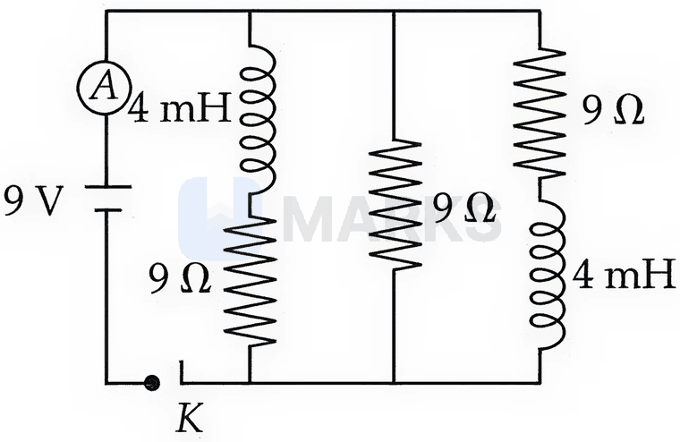
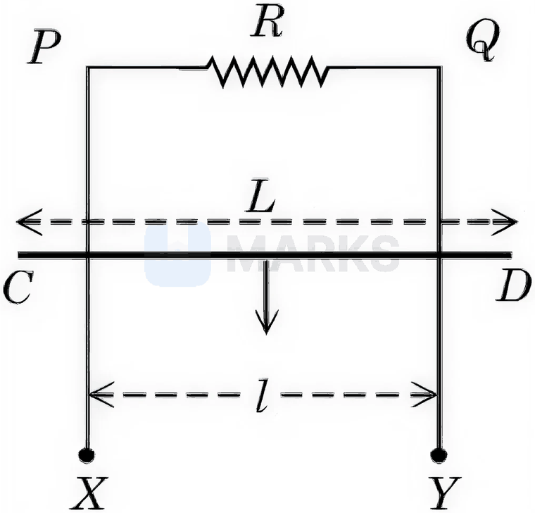
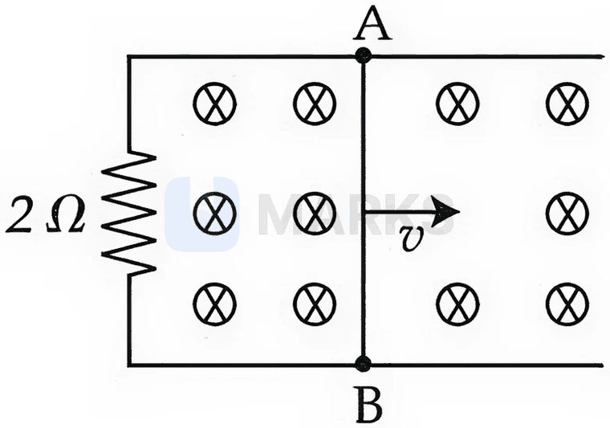

# Electromagnetic Induction

> Theory: [../../theory/physics/emi.md](../../theory/physics/emi.md)

### P-EMI-01 — JEE Main 2024 · 27 Jan Shift 1 · Q14 · MCQ

A rectangular loop of length $2.5$ m and width $2$ m is placed at $60^\circ$ to a magnetic field of $4$ T. The loop is removed from the field in $10$ s. The average emf induced in the loop during this time is

(1) $-2$ V  (2) $+2$ V  (3) $+1$ V  (4) $-1$ V

**Answer: (3)** · key ✔

**Solution.** Taking $60^\circ$ as the angle between the loop's normal and $\vec B$: $\Phi=BA\cos60^\circ=4\times5\times\tfrac12=10$ Wb. Flux falls to zero, so $\varepsilon=-\dfrac{\Delta\Phi}{\Delta t}=-\dfrac{0-10}{10}=+1$ V.

### P-EMI-02 — JEE Main 2024 · 27 Jan Shift 1 · Q28 · Numerical

Two coils have a mutual inductance $0.002$ H. The current in the first coil varies as $i=i_0\sin\omega t$ with $i_0=5$ A and $\omega=50\pi$ rad s$^{-1}$. The maximum value of the emf in the second coil is $\dfrac{\pi}{\alpha}$ V. Find $\alpha$.

**Answer: 2** · key ✔

**Solution.** $\varepsilon_{\max}=M\,i_0\,\omega=0.002\times5\times50\pi=0.5\pi=\dfrac{\pi}{2}$ V, so $\alpha=2$.

### P-EMI-03 — JEE Main 2024 · 29 Jan Shift 1 · Q28 · Numerical

A square loop of side $10$ cm and resistance $0.7\ \Omega$ is placed vertically in the east–west plane. A uniform magnetic field of $0.20$ T is set up across the plane in the north-east direction. The field is decreased to zero in $1$ s at a steady rate. The magnitude of the induced emf is $\sqrt x\times10^{-3}$ V. Find $x$.

**Answer: 2** · key ✔

**Solution.** The loop's normal points north–south, so the field (north-east) makes $45^\circ$ with it. $\Phi=BA\cos45^\circ=0.20\times0.01\times\dfrac1{\sqrt2}=\sqrt2\times10^{-3}$ Wb. Emf $=\dfrac{\Delta\Phi}{\Delta t}=\sqrt2\times10^{-3}$ V, so $x=2$.

### P-EMI-04 — JEE Main 2024 · 29 Jan Shift 2 · Q27 · Numerical

A horizontal straight wire $5$ m long, extending from east to west, falls freely at right angles to the horizontal component of the earth's magnetic field $0.60\times10^{-4}\ \text{Wb m}^{-2}$. The instantaneous emf induced in the wire when its velocity is $10\ \text{m s}^{-1}$ is ______ $\times10^{-3}$ V.

**Answer: 3** · key ✔

**Solution.** Motional emf $\varepsilon=Blv=0.60\times10^{-4}\times5\times10=3\times10^{-3}$ V.

### P-EMI-05 — JEE Main 2024 · 30 Jan Shift 1 · Q27 · Numerical

A ceiling fan having $3$ blades of length $80$ cm each rotates with an angular velocity of $1200$ rpm. The magnetic field of the earth in that region is $0.5$ G and the angle of dip is $30^\circ$. The emf induced across the blades is $N\pi\times10^{-5}$ V. The value of $N$ is ______.

**Answer: 32** · key ✔

**Solution.** The blades sweep out a horizontal plane, so the relevant field is the vertical component $B_v=B\sin30^\circ=0.25$ G $=2.5\times10^{-5}$ T. $\omega=2\pi\cdot20=40\pi$ rad/s. Emf across each blade (the three are in parallel) $=\tfrac12B_v\omega l^2=\tfrac12(2.5\times10^{-5})(40\pi)(0.64)=32\pi\times10^{-5}$ V. So $N=32$.

### P-EMI-06 — JEE Main 2024 · 31 Jan Shift 1 · Q15 · MCQ

A coil is placed perpendicular to a magnetic field of $5000$ T. When the field is changed to $3000$ T in $2$ s, an induced emf of $22$ V is produced in the coil. If the diameter of the coil is $0.02$ m, the number of turns in the coil is (take $\pi=\tfrac{22}7$)

(1) 7  (2) 70  (3) 35  (4) 140

**Answer: (2)** · key ✔

**Solution.** $|\varepsilon|=N\,A\left|\dfrac{\Delta B}{\Delta t}\right|$ with $A=\pi(0.01)^2=\dfrac{22}7\times10^{-4}$ m$^2$ and $\left|\dfrac{\Delta B}{\Delta t}\right|=\dfrac{2000}2=1000$ T/s. $22=N\cdot\dfrac{22}7\times10^{-4}\times10^3\Rightarrow N=70$.

### P-EMI-07 — JEE Main 2024 · 31 Jan Shift 2 · Q28 · Numerical

The magnetic flux $\phi$ (in weber) linked with a closed circuit of resistance $8\ \Omega$ varies with time (in seconds) as $\phi=5t^2-36t+1$. The induced current in the circuit at $t=2$ s is ______ A.

**Answer: 2** · key ✔

**Solution.** $\varepsilon=-\dfrac{d\phi}{dt}=-(10t-36)$; at $t=2$: $\varepsilon=16$ V. $I=\dfrac{16}8=2$ A.

### P-EMI-08 — JEE Main 2024 · 1 Feb Shift 1 · Q28 · Numerical

A rectangular loop of sides $12$ cm and $5$ cm, with its sides parallel to the $x$-axis and $y$-axis respectively, moves with a velocity of $5\ \text{cm s}^{-1}$ in the positive $x$ direction in a space containing a variable magnetic field in the positive $z$ direction. The field has a gradient of $10^{-3}\ \text{T cm}^{-1}$ along the negative $x$ direction and it is decreasing with time at the rate of $10^{-3}\ \text{T s}^{-1}$. If the resistance of the loop is $6\ \text{m}\Omega$, the power dissipated by the loop as heat is ______ $\times10^{-9}$ W.

**Answer: 216** · key ✔

**Solution.** Moving in $+x$, the loop enters weaker field (gradient towards $-x$): $\left|\dfrac{dB}{dt}\right|_{\text{motion}}=0.1\ \text{T/m}\times0.05\ \text{m/s}=5\times10^{-3}$ T/s, and the field also decreases at $10^{-3}$ T/s, giving a total rate $6\times10^{-3}$ T/s (both reduce the flux). Area $=0.12\times0.05=6\times10^{-3}\ \text{m}^2$. $\varepsilon=6\times10^{-3}\times6\times10^{-3}=3.6\times10^{-5}$ V and $P=\dfrac{\varepsilon^2}{R}=\dfrac{1.296\times10^{-9}}{6\times10^{-3}}=2.16\times10^{-7}$ W $=216\times10^{-9}$ W.

### P-EMI-09 — JEE Main 2024 · 1 Feb Shift 2 · Q28 · Numerical

A coil of $200$ turns and area $0.20\ \text{m}^2$ rotates at half a revolution per second in a uniform field of $0.01$ T perpendicular to the axis of rotation. The maximum voltage generated is $\dfrac{2\pi}{\beta}$ V; $\beta=$ ______.

**Answer: 5** · key ✔

**Solution.** $\varepsilon_{max}=NAB\omega$ with $\omega=2\pi(0.5)=\pi$ rad/s: $200\times0.20\times0.01\times\pi=0.4\pi=\dfrac{2\pi}{5}$ V. $\beta=5$.

### P-EMI-10 — JEE Main 2024 · 4 Apr Shift 2 · Q28 · Numerical

A rod of length $60$ cm rotates at $20\ \text{rad s}^{-1}$ about its perpendicular bisector in a uniform magnetic field of $0.5$ T parallel to the axis of rotation. The potential difference between the two ends of the rod is ______ V.

**Answer: 0** · key ✔

**Solution.** Each half of the rod gets the same motional emf $\tfrac12B\omega(L/2)^2$ with its high-potential end at the same side (the centre or the tip). Between the two ends the potentials are equal, so the p.d. is $0$.

### P-EMI-11 — JEE Main 2024 · 5 Apr Shift 2 · Q28 · Numerical

The current in an inductor is $I=(3t+8)$ A ($t$ in seconds). The magnitude of the induced emf is $12$ mV. The self-inductance is ______ mH.

**Answer: 4** · key ✔

**Solution.** $\varepsilon=L\dfrac{dI}{dt}=3L=12\times10^{-3}\Rightarrow L=4\times10^{-3}$ H $=4$ mH.

### P-EMI-12 — JEE Main 2024 · 6 Apr Shift 2 · Q13 · MCQ

In a coil the current changes from $-2$ A to $+2$ A in $0.2$ s and induces an emf of $0.1$ V. The self-inductance of the coil is:

(1) 4 mH  (2) 1 mH  (3) 5 mH  (4) 2.5 mH

**Answer: (3)** · key ✔

**Solution.** $|\varepsilon|=L\dfrac{|\Delta I|}{\Delta t}=L\dfrac{4}{0.2}=20L=0.1\Rightarrow L=5\times10^{-3}$ H $=5$ mH.

### P-EMI-13 — JEE Advanced 2025 · Paper 1 · Q5 · Multiple correct

A square loop (side $L$, mass $M$, resistance $R$) moves in the $XY$ plane with edges parallel to the axes. The region $y\ge0$ has uniform $\vec B=B_0\hat k$. At $t=0$ the loop, with velocity $v_0\hat j$, starts entering the field. Let $K=\dfrac{B_0^2L^2}{RM}$; ignore self-inductance and gravity. Which are correct?

(A) If $v_0=1.5KL$, the loop stops before it enters completely  (B) When the loop is completely inside, the net force on it is zero  (C) If $v_0=KL/10$, the loop stops at $t=\tfrac1K\ln\tfrac52$  (D) If $v_0=3KL$, the loop is completely inside at $t=\tfrac1K\ln\tfrac32$

**Answer: (B), (D)** · official key ✔ (re-derived)

**Solution.** While entering, $\varepsilon=B_0Lv$, $F=\dfrac{B_0^2L^2v}R$, so $M\dfrac{dv}{dt}=-\dfrac{B_0^2L^2}Rv\Rightarrow v=v_0e^{-Kt}$ and the distance entered is $y=\dfrac{v_0}K(1-e^{-Kt})$. It can enter at most $y_{max}=v_0/K$. (A) $v_0/K=1.5L>L$: it enters completely (false). (B) With the whole loop inside the uniform field the flux is constant, so $F=0$ (true). (C) $v$ decays exponentially and reaches zero only as $t\to\infty$ (false). (D) $v_0/K=3L$: $L=3L(1-e^{-Kt})\Rightarrow e^{-Kt}=\dfrac23\Rightarrow t=\dfrac1K\ln\dfrac32$ (true).

### § — JEE Main 2026 · 23 Jan Shift 1 · set Q1 · MCQ

A $20$ m long uniform copper wire held horizontally is allowed to fall under gravity ($g=10\ \text{m/s}^2$) through a uniform horizontal magnetic field of $0.5$ gauss perpendicular to the length of the wire. The induced emf across the wire when it has fallen a vertical distance of $200$ m is ______ mV.

(1) $20\sqrt{10}$  (2) $0.2\sqrt{10}$  (3) $200\sqrt{10}$  (4) $2\sqrt{10}$

**Answer: (1)** · key (compiled)

**Solution.** Speed after falling $200$ m: $v=\sqrt{2gh}=\sqrt{4000}=20\sqrt{10}$ m/s. With $B=0.5\ \text{G}=0.5\times10^{-4}$ T: $\varepsilon=BLv=0.5\times10^{-4}\times20\times20\sqrt{10}=0.02\sqrt{10}$ V $=20\sqrt{10}$ mV.

### § — JEE Main 2026 · 23 Jan Shift 1 · set Q2 · Numerical

A simple pendulum made of a mass of $10$ g and a metallic wire of length $10$ cm is suspended vertically in a uniform magnetic field of $2$ T. The magnetic field is perpendicular to the plane of oscillation of the pendulum. If the pendulum is released from an angle of $60^\circ$ with the vertical, the maximum induced emf between the point of suspension and the bob is ______ mV. (Take $g=10\ \text{m/s}^2$)

**Answer: 100** · key (compiled)

**Solution.** The emf of a rod of length $\ell$ rotating at $\omega$ is $\tfrac12B\omega\ell^2$. It is maximum at the lowest point, where $\tfrac12m\ell^2\omega^2=mg\ell(1-\cos60^\circ)$, so $\omega=\sqrt{g/\ell}=10$ rad/s. Then $\varepsilon_{max}=\tfrac12\times2\times10\times(0.1)^2=0.1$ V $=100$ mV.

### § — JEE Main 2026 · 22 Jan Shift 2 · set Q3 · MCQ

The figure shows a circuit containing three resistances ($9\ \Omega$ each) and two inductors ($4$ mH each). The reading of the ammeter at the moment the switch $K$ is turned ON is ______ A.

(1) 2  (2) 1  (3) zero  (4) 3

**Answer: (2)** · key (compiled)

**Solution.** At the instant of closing, an inductor opposes any sudden change of current, so it carries zero current and acts as an open circuit. The two branches containing inductors are therefore inactive and only the middle $9\ \Omega$ resistor conducts: $I=\dfrac{9\ \text{V}}{9\ \Omega}=1$ A.

### § — JEE Main 2026 · 22 Jan Shift 2 · set Q4 · Numerical

A conducting circular loop is rotated about its diameter at a constant angular speed of $100$ rad/s in a magnetic field of $0.5$ T perpendicular to the axis of rotation. When the loop has rotated by $30^\circ$ from the horizontal position, the induced emf is $15.4$ mV. The radius of the loop is ______ mm. (Take $\pi=\tfrac{22}{7}$)

**Answer: 14** · key (compiled)

**Solution.** $\varepsilon=B\omega A\sin\omega t$ with $\sin30^\circ=\tfrac12$: $15.4\times10^{-3}=0.5\times100\times\dfrac{22}{7}r^2\times\dfrac12\Rightarrow r^2=1.96\times10^{-4}\ \text{m}^2$, so $r=0.014$ m $=14$ mm.

### § — JEE Main 2026 · 22 Jan Shift 1 · set Q5 · MCQ

Three identical coils $C_1$, $C_2$ and $C_3$ are placed closely so that they share a common axis, $C_2$ being exactly midway. $C_1$ carries current $I$ in the anti-clockwise direction while $C_3$ carries current $I$ in the clockwise direction. An induced current flows through $C_2$ in the clockwise direction when:

(1) $C_1$ moves away from $C_2$ and $C_3$ moves towards $C_2$  (2) $C_1$ and $C_3$ move with equal speeds away from $C_2$  (3) $C_1$ moves towards $C_2$ and $C_3$ moves away from $C_2$  (4) $C_1$ and $C_3$ move with equal speeds towards $C_2$

**Answer: (3)** · key (compiled)

**Solution.** At $C_2$ the field of $C_1$ (anti-clockwise) points one way, say $+z$, and that of $C_3$ (clockwise) points $-z$; initially they cancel. A clockwise induced current in $C_2$ produces a field in $-z$, so by Lenz's law the flux through $C_2$ must be increasing along $+z$ or decreasing along $-z$. Moving $C_1$ towards $C_2$ increases the $+z$ flux, and moving $C_3$ away decreases the $-z$ flux: option (3).

### § — JEE Main 2026 · 22 Jan Shift 1 · set Q6 · MCQ

$XPQY$ is a vertical smooth long loop of total resistance $R$, where $PX$ is parallel to $QY$ and the separation between them is $l$. A constant magnetic field $B$ perpendicular to the plane of the loop exists in the entire space. A rod $CD$ of length $L$ ($L>l$) and mass $m$ is made to slide down from rest under gravity as shown in the figure. The terminal speed acquired by the rod is ______ m/s. ($g$ = acceleration due to gravity)

(1) $\dfrac{8mgR}{B^2l^2}$  (2) $\dfrac{2mgR}{B^2L^2}$  (3) $\dfrac{mgR}{B^2l^2}$  (4) $\dfrac{2mgR}{B^2l^2}$

**Answer: (3)** · key (compiled)

**Solution.** Only the part of the rod between the rails ($l$) is in the circuit, so $\varepsilon=Blv$, $I=\dfrac{Blv}{R}$ and the magnetic force is $F=BIl=\dfrac{B^2l^2v}{R}$ (upwards). At terminal speed $mg=\dfrac{B^2l^2v}{R}\Rightarrow v=\dfrac{mgR}{B^2l^2}$.

### § — JEE Main 2026 · 22 Jan Shift 1 · set Q7 · Numerical

The inductance of a coil with $10^4$ turns is $10$ mH and it is connected to a dc source of $10$ V with internal resistance $10\ \Omega$. The energy density in the inductor when the current reaches $\left(\dfrac1e\right)$ of its maximum value is $\alpha\pi\times\dfrac{1}{e^2}\ \text{J/m}^3$. The value of $\alpha$ is ______. ($\mu_0=4\pi\times10^{-7}\ \text{T m/A}$)

**Answer: 20** · key (compiled)

**Solution.** Maximum current $=\dfrac{10}{10}=1$ A, so $I=\tfrac1e$ A. The energy density of the field is $u=\dfrac{B^2}{2\mu_0}=\tfrac12\mu_0n^2I^2$; the paper's intended reading is $n=10^4\ \text{m}^{-1}$. Then $u=\tfrac12\times4\pi\times10^{-7}\times10^{8}\times\dfrac{1}{e^2}=\dfrac{20\pi}{e^2}$, so $\alpha=20$.

### § — JEE Main 2026 · 23 Jan Shift 2 · set Q8 · MCQ

A long solenoid of length $100$ cm and radius $2$ cm, having $500$ turns per unit length, carries a current $I=10\sin(\omega t)$ A, where $\omega=1000$ rad/s. A circular conducting loop $B$ of radius $1$ cm is slid coaxially through the solenoid at a speed $v=1$ cm/s. The r.m.s. current through the loop when the loop is $10$ cm inside the solenoid is $\dfrac{\alpha}{\sqrt2}\ \mu$A. The value of $\alpha$ is ______. [Resistance of the loop $=10\ \Omega$]

(1) 197  (2) 80  (3) 100  (4) 280

**Answer: (1)** · key (compiled)

**Solution.** Inside a long solenoid the field is uniform, so the motion of the loop does not change the flux; the emf comes only from the changing current: $\varepsilon=\pi r^2\mu_0n\dfrac{di}{dt}=\pi r^2\mu_0n\,i_0\omega\cos\omega t$. Peak emf $=\pi(10^{-2})^2\times4\pi\times10^{-7}\times500\times10\times1000=1.97\times10^{-3}$ V, so the peak current is $\dfrac{1.97\times10^{-3}}{10}\approx197\ \mu$A and the r.m.s. value is $\dfrac{197}{\sqrt2}\ \mu$A.

### § — JEE Main 2026 · 23 Jan Shift 2 · set Q9 · MCQ

A circular loop of radius $7$ cm is placed in a uniform magnetic field of $0.2$ T directed perpendicular to the plane of the loop. The loop is converted into a square loop in $0.5$ s. The emf induced in the loop is ______ mV.

(1) 13.2  (2) 1.32  (3) 8.25  (4) 6.6

**Answer: (2)** · key (compiled)

**Solution.** The perimeter is unchanged: $2\pi(0.07)=0.44$ m, so the square has side $0.11$ m. Initial area $=\dfrac{22}{7}(0.07)^2=1.54\times10^{-2}\ \text{m}^2$, final area $=1.21\times10^{-2}\ \text{m}^2$. $\Delta\Phi=0.2\times(1.54-1.21)\times10^{-2}=6.6\times10^{-4}$ Wb, so $\varepsilon=\dfrac{\Delta\Phi}{\Delta t}=\dfrac{6.6\times10^{-4}}{0.5}=1.32$ mV.

### § — JEE Main 2026 · 21 Jan Shift 1 · set Q10 · MCQ

A conducting circular loop of area $1.0\ \text{m}^2$ is placed perpendicular to a magnetic field which varies as $B=\sin(100t)$ tesla. If the resistance of the loop is $100\ \Omega$, the average thermal energy dissipated in the loop in one period is ______ J.

(1) $\pi^2$  (2) $\pi$  (3) $\dfrac{\pi}{2}$  (4) $2\pi$

**Answer: (2)** · key (compiled)

**Solution.** $\varepsilon=-\dfrac{d\phi}{dt}=-100\cos(100t)$ V, so $I=-\cos(100t)$ A and $P_{avg}=\tfrac12I_0^2R=50$ W. Period $T=\dfrac{2\pi}{100}$ s, so the energy per period $=50\times\dfrac{2\pi}{100}=\pi$ J.

### § — JEE Main 2026 · 21 Jan Shift 1 · set Q11 · MCQ

A $1$ m long metal rod $AB$ completes the circuit as shown in the figure. The area of the circuit is perpendicular to the magnetic field of $0.10$ T. If the resistance of the total circuit is $2\ \Omega$, the force needed to move the rod towards the right with a constant speed $v$ of $1.5$ m/s is ______ N.

(1) $5.7\times10^{-2}$  (2) $7.5\times10^{-2}$  (3) $7.5\times10^{-3}$  (4) $5.7\times10^{-3}$

**Answer: (3)** · key (compiled)

**Solution.** $\varepsilon=Blv=0.10\times1\times1.5=0.15$ V, $I=\dfrac{0.15}{2}=0.075$ A. At constant speed the applied force balances the magnetic force: $F=BIl=0.10\times0.075\times1=7.5\times10^{-3}$ N.

