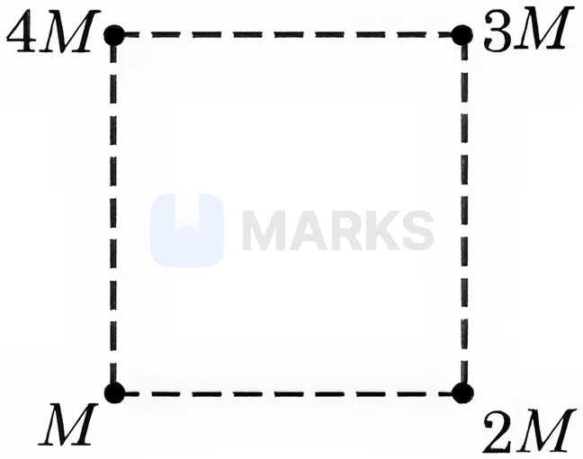

# Gravitation

> Theory: [../../theory/physics/gravitation.md](../../theory/physics/gravitation.md)

### P-GRV-01 · A — JEE Main 2026 · 22 Jan Shift 2 · set Q1 · MCQ

Given below are two statements:  
**Statement I:** A satellite is moving around the earth in an orbit very close to the earth's surface. The time period of revolution of the satellite depends upon the density of the earth.  
**Statement II:** The time period of revolution of the satellite is $T=2\pi\sqrt{\dfrac{R_e}{g}}$ (for a satellite very close to the earth's surface), where $R_e$ = radius of the earth and $g$ = acceleration due to gravity.

(1) Both Statement I and Statement II are true  (2) Statement I is false but Statement II is true  (3) Statement I is true but Statement II is false  (4) Both Statement I and Statement II are false

**Answer: (1)** · key (compiled)

**Solution.** With $g=\dfrac{GM}{R_e^2}=\dfrac{4\pi G\rho R_e}{3}$, the period $T=2\pi\sqrt{\dfrac{R_e}{g}}=\sqrt{\dfrac{3\pi}{G\rho}}$, which depends only on the density $\rho$. Both statements are true.

### P-GRV-02 · A — JEE Main 2026 · 22 Jan Shift 1 · set Q2 · MCQ

The escape velocity from a spherical planet $A$ is $10$ km/s. The escape velocity from another planet $B$ whose density and radius are $10\%$ of those of planet $A$ is ______ m/s.

(1) 1000  (2) $1000\sqrt2$  (3) $200\sqrt5$  (4) $100\sqrt{10}$

**Answer: (4)** · key (compiled)

**Solution.** $v_e=\sqrt{\dfrac{2GM}{R}}=R\sqrt{\dfrac{8\pi G\rho}{3}}\propto R\sqrt\rho$. So $\dfrac{v_B}{v_A}=0.1\sqrt{0.1}=\dfrac{1}{10\sqrt{10}}$ and $v_B=10^4\times\dfrac{1}{10\sqrt{10}}=\dfrac{1000}{\sqrt{10}}=100\sqrt{10}$ m/s.

### P-GRV-03 · A — JEE Main 2026 · 22 Jan Shift 1 · set Q3 · MCQ

The net gravitational force at the centre of a square is found to be $F_1$ when four particles of masses $M,2M,3M$ and $4M$ are placed at the four corners of the square as shown in the figure, and it is $F_2$ when the positions of $3M$ and $4M$ are interchanged. The ratio $\dfrac{F_1}{F_2}$ is $\dfrac{\alpha}{\sqrt5}$. The value of $\alpha$ is ______.

(1) $2\sqrt5$  (2) 3  (3) 1  (4) 2

**Answer: (4)** · key (compiled)

**Solution.** Let $k=\dfrac{G}{r^2}\cdot\dfrac1{\sqrt2}$ ($r$ = distance from the centre to a corner); resolve each pull along $x,y$. Original: $g_x=k(-4M+3M-M+2M)=0$, $g_y=k(4M+3M-M-2M)=4kM$, so $F_1=4kM$. After swapping $3M\leftrightarrow4M$: $g_x=k(-3M+4M-M+2M)=2kM$, $g_y=k(3M+4M-M-2M)=4kM$, so $F_2=kM\sqrt{4+16}=2\sqrt5\,kM$. Then $\dfrac{F_1}{F_2}=\dfrac{2}{\sqrt5}$ and $\alpha=2$.

### P-GRV-04 · A — JEE Main 2026 · 21 Jan Shift 1 · set Q4 · MCQ

Initially a satellite of $100$ kg is in a circular orbit of radius $1.5R_E$. This satellite can be moved to a circular orbit of radius $3R_E$ by supplying $\alpha\times10^6$ J of energy. The value of $\alpha$ is ______. (Take the radius of the earth $R_E=6\times10^6$ m and $g=10\ \text{m/s}^2$)

(1) 150  (2) 1000  (3) 500  (4) 100

**Answer: (2)** · key (compiled)

**Solution.** Total energy in a circular orbit $E=-\dfrac{GMm}{2r}=-\dfrac{gR_E^2m}{2r}$. $E_1=-\dfrac{gR_Em}{3}$ and $E_2=-\dfrac{gR_Em}{6}$. Energy supplied $=E_2-E_1=\dfrac{gR_Em}{6}=\dfrac{10\times6\times10^6\times100}{6}=10^9\ \text{J}=1000\times10^6$ J, so $\alpha=1000$.

### P-GRV-05 · A — JEE Main 2026 · 24 Jan Shift 1 · set Q5 · MCQ

Three masses $200$ kg, $300$ kg and $400$ kg are placed at the vertices of an equilateral triangle of side $20$ m. They are rearranged on the vertices of a bigger triangle of side $25$ m with the same centre. The work done in this process is ______ J. (Gravitational constant $G=6.7\times10^{-11}\ \text{N m}^2/\text{kg}^2$)

(1) $2.85\times10^{-7}$  (2) $4.77\times10^{-7}$  (3) $1.74\times10^{-7}$  (4) $9.86\times10^{-6}$

**Answer: (3)** · key (compiled)

**Solution.** $U=-G\dfrac{m_1m_2+m_2m_3+m_1m_3}{r}$ with $\sum m_im_j=200\cdot300+300\cdot400+200\cdot400=260000$. $W=U_f-U_i=260000\,G\left(\dfrac1{20}-\dfrac1{25}\right)=260000\times6.7\times10^{-11}\times0.01=1.74\times10^{-7}$ J.

### P-GRV-06 · A — JEE Main 2025 · Jan session · Grav set Q1 · MCQ

The Earth has a mass 8 times and a radius 2 times that of a planet. If the escape velocity from the Earth is 11.2 km/s, the escape velocity (in km/s) from the planet will be:

(1) 2.8  (2) 11.2  (3) 5.6  (4) 8.4

**Answer: (3)** · key (compiled)

**Solution.** $v_e=\sqrt{\dfrac{2GM}R}\propto\sqrt{\dfrac MR}$. For the planet $M_p=\dfrac M8$ and $R_p=\dfrac R2$: $v_p=v_e\sqrt{\dfrac{1/8}{1/2}}=\dfrac{v_e}2=5.6$ km/s.

### P-GRV-07 · B — JEE Main 2025 · Jan session · Grav set Q3 · MCQ

A satellite is launched into a circular orbit of radius $R$ around the Earth. A second satellite is launched into an orbit of radius $1.03R$. The time period of revolution of the second satellite is larger than the first one approximately by:

(1) 9%  (2) 3%  (3) 4.5%  (4) 2.5%

**Answer: (3)** · key (compiled)

**Solution.** Kepler's third law: $T\propto r^{3/2}$. $\dfrac{T_2}{T_1}=(1.03)^{3/2}\approx1+\dfrac32(0.03)=1.045$, i.e. about 4.5% larger.

### P-GRV-08 · B — JEE Main 2025 · Jan session · Grav set Q5 · Numerical

Two planets $A$ and $B$ are orbiting a common star in circular orbits of radii $R_A$ and $R_B$ respectively, with $R_B=2R_A$. Planet $B$ is $4\sqrt2$ times more massive than planet $A$. The ratio $\left(\dfrac{L_B}{L_A}\right)$ of the angular momentum ($L_B$) of planet $B$ to that of planet $A$ ($L_A$) is closest to the integer ______.

**Answer: 8** · key (compiled)

**Solution.** For a circular orbit $v=\sqrt{\dfrac{GM_s}r}$, so $L=mvr=m\sqrt{GM_s\,r}$. $\dfrac{L_B}{L_A}=\dfrac{m_B}{m_A}\sqrt{\dfrac{R_B}{R_A}}=4\sqrt2\cdot\sqrt2=8$.

### P-GRV-09 · B — JEE Main 2025 · Apr session · Grav set Q2 · Numerical

Three identical spheres of mass $m$ are placed at the vertices of an equilateral triangle of side $a$. When released, they interact only through the gravitational force and collide after a time $T=4$ s. If the sides of the triangle are increased to $2a$ and the masses of the spheres are also made $2m$, then they will collide after ______ seconds.

**Answer: 8** · key (compiled)

**Solution.** The motion depends only on $G$, $m$ and $a$; by dimensional analysis (or from $\ddot r\sim\dfrac{Gm}{a^2}$ acting over a distance $\sim a$) the collision time scales as $T\propto\sqrt{\dfrac{a^3}{Gm}}$. With $a\to2a$ and $m\to2m$: $T'=T\sqrt{\dfrac{2^3}{2}}=2T=8$ s.

### P-GRV-10 · B — JEE Main 2025 · Apr session · Grav set Q5 · MCQ

An object is kept at rest at a distance of $3R$ above the Earth's surface, where $R$ is the Earth's radius. The minimum speed with which it must be projected so that it does not return to the Earth is: (Assume $M$ = mass of the Earth, $G$ = universal gravitational constant)

(1) $\sqrt{\dfrac{GM}{2R}}$  (2) $\sqrt{\dfrac{GM}R}$  (3) $\sqrt{\dfrac{3GM}R}$  (4) $\sqrt{\dfrac{2GM}R}$

**Answer: (1)** · key (compiled)

**Solution.** The object is at distance $r=R+3R=4R$ from the centre. Not returning means reaching infinity with zero speed at best: $\tfrac12v^2=\dfrac{GM}{4R}\Rightarrow v=\sqrt{\dfrac{GM}{2R}}$ (the escape speed at $r=4R$).

### P-GRV-11 · B — JEE Main 2024 · 27 Jan Shift 1 · Q6 · MCQ

The acceleration due to gravity on the surface of the earth is $g$. If the diameter of the earth reduces to half of its original value and its mass remains constant, the acceleration due to gravity on the surface becomes

(1) $g/4$  (2) $2g$  (3) $g/2$  (4) $4g$

**Answer: (4)** · key ✔

**Solution.** $g=GM/R^2$ with $M$ fixed. Halving $R$ multiplies $g$ by $4$.

### P-GRV-12 · C — JEE Main 2024 · 27 Jan Shift 2 · Q6 · MCQ

Assertion (A): The angular speed of the moon in its orbit about the earth is more than the angular speed of the earth in its orbit about the sun.  
Reason (R): The moon takes less time to move around the earth than the earth takes to move around the sun.

(1) A correct, R not correct  (2) Both correct and R explains A  (3) Both correct but R does not explain A  (4) A not correct, R correct

**Answer: (2)** · key ✔

**Solution.** $\omega=2\pi/T$. The moon's period is about $27.3$ days versus $365$ days for the earth, so the moon's angular speed is larger. R states exactly the period comparison that gives A.

### P-GRV-13 · C — JEE Main 2024 · 29 Jan Shift 1 · Q6 · MCQ

At what distance above and below the surface of the earth will a body have the same weight? (Take the radius of the earth as $R$.)

(1) $\sqrt5R-R$  (2) $\dfrac{\sqrt3R-R}{2}$  (3) $\dfrac R2$  (4) $\dfrac{\sqrt5R-R}{2}$

**Answer: (4)** · key ✔

**Solution.** At height $h$: $g_h=g\dfrac{R^2}{(R+h)^2}$. At depth $h$: $g_d=g\left(1-\dfrac hR\right)$. Equate with $x=h/R$: $(1-x)(1+x)^2=1\Rightarrow x(1-x-x^2)=0\Rightarrow x^2+x-1=0\Rightarrow x=\dfrac{\sqrt5-1}2$. So $h=\dfrac{(\sqrt5-1)R}{2}$.

### P-GRV-14 · C — JEE Main 2024 · 4 Apr Shift 2 · Q5 · MCQ

A $90$ kg body is placed at a distance $2R$ from the surface of the earth ($R$ = radius of earth, $g=10\ \text{m s}^{-2}$). The gravitational pull on it is:

(1) 100 N  (2) 300 N  (3) 225 N  (4) 120 N

**Answer: (1)** · key ✔

**Solution.** The distance from the centre is $3R$, so $g'=g\left(\dfrac{R}{3R}\right)^2=\dfrac g9$. $F=\dfrac{90\times10}{9}=100$ N.

