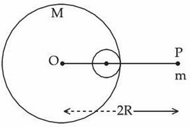

# Gravitation

> Theory: [../../theory/physics/gravitation.md](../../theory/physics/gravitation.md)

### P-GRV-01 — JEE Main 2024 · 27 Jan Shift 1 · Q6 · MCQ

The acceleration due to gravity on the surface of the earth is $g$. If the diameter of the earth reduces to half of its original value and its mass remains constant, the acceleration due to gravity on the surface becomes

(1) $g/4$  (2) $2g$  (3) $g/2$  (4) $4g$

**Answer: (4)** · key ✔

**Solution.** $g=GM/R^2$ with $M$ fixed. Halving $R$ multiplies $g$ by $4$.

### P-GRV-02 — JEE Main 2024 · 27 Jan Shift 2 · Q6 · MCQ

Assertion (A): The angular speed of the moon in its orbit about the earth is more than the angular speed of the earth in its orbit about the sun.
Reason (R): The moon takes less time to move around the earth than the earth takes to move around the sun.

(1) A correct, R not correct  (2) Both correct and R explains A  (3) Both correct but R does not explain A  (4) A not correct, R correct

**Answer: (2)** · key ✔

**Solution.** $\omega=2\pi/T$. The moon's period is about $27.3$ days versus $365$ days for the earth, so the moon's angular speed is larger. R states exactly the period comparison that gives A.

### P-GRV-03 — JEE Main 2024 · 29 Jan Shift 1 · Q6 · MCQ

At what distance above and below the surface of the earth will a body have the same weight? (Take the radius of the earth as $R$.)

(1) $\sqrt5R-R$  (2) $\dfrac{\sqrt3R-R}{2}$  (3) $\dfrac R2$  (4) $\dfrac{\sqrt5R-R}{2}$

**Answer: (4)** · key ✔

**Solution.** At height $h$: $g_h=g\dfrac{R^2}{(R+h)^2}$. At depth $h$: $g_d=g\left(1-\dfrac hR\right)$. Equate with $x=h/R$: $(1-x)(1+x)^2=1\Rightarrow x(1-x-x^2)=0\Rightarrow x^2+x-1=0\Rightarrow x=\dfrac{\sqrt5-1}2$. So $h=\dfrac{(\sqrt5-1)R}{2}$.

### P-GRV-04 — JEE Main 2024 · 29 Jan Shift 2 · Q6 · MCQ

A planet takes $200$ days to complete one revolution around the Sun. If the distance of the planet from the Sun is reduced to one fourth of the original distance, how many days will it take to complete one revolution?

(1) 25  (2) 50  (3) 100  (4) 20

**Answer: (1)** · key ✔

**Solution.** Kepler's third law: $T^2\propto r^3$, so $T\propto r^{3/2}$. With $r\to\tfrac r4$: $T'=200\times\left(\tfrac14\right)^{3/2}=\dfrac{200}8=25$ days.

### P-GRV-05 — JEE Main 2024 · 30 Jan Shift 1 · Q6 · MCQ

The gravitational potential at a point above the surface of the earth is $-5.12\times10^7\ \text{J kg}^{-1}$ and the acceleration due to gravity at that point is $6.4\ \text{m s}^{-2}$. Assume the mean radius of the earth to be $6400$ km. The height of this point above the earth's surface is

(1) 1600 km  (2) 540 km  (3) 1200 km  (4) 1000 km

**Answer: (1)** · key ✔

**Solution.** With $r$ the distance from the centre: $V=-\dfrac{GM}r$ and $g=\dfrac{GM}{r^2}$, so $r=\dfrac{|V|}{g}=\dfrac{5.12\times10^7}{6.4}=8\times10^6$ m $=8000$ km. Height $=8000-6400=1600$ km.

### P-GRV-06 — JEE Main 2024 · 30 Jan Shift 2 · Q6 · MCQ

The escape velocity of a body from the earth is $11.2\ \text{km s}^{-1}$. If the radius of a planet is one-third the radius of the earth and its mass is one-sixth that of the earth, the escape velocity from the planet is

(1) 11.2 km s$^{-1}$  (2) 8.4 km s$^{-1}$  (3) 4.2 km s$^{-1}$  (4) 7.9 km s$^{-1}$

**Answer: (4)** · key ✔

**Solution.** $v_e=\sqrt{\dfrac{2GM}R}\propto\sqrt{\dfrac MR}$. Ratio $=\sqrt{\dfrac{1/6}{1/3}}=\dfrac1{\sqrt2}$, so $v=\dfrac{11.2}{\sqrt2}\approx7.9$ km/s.

### P-GRV-07 — JEE Main 2024 · 31 Jan Shift 1 · Q8 · MCQ

Four identical particles of mass $m$ are kept at the four corners of a square of side $a$. The gravitational force exerted on one of the masses by the other three is $\dfrac{2\sqrt2+1}{32}\dfrac{Gm^2}{L^2}$. The length of the side of the square is

(1) $\dfrac L2$  (2) $4L$  (3) $3L$  (4) $2L$

**Answer: (2)** · key ✔

**Solution.** Two neighbours (distance $a$) give a resultant $\sqrt2\,\dfrac{Gm^2}{a^2}$ along the diagonal, and the opposite particle (distance $\sqrt2a$) adds $\dfrac{Gm^2}{2a^2}$ in the same direction. Total $=\dfrac{Gm^2}{a^2}\left(\sqrt2+\tfrac12\right)=\dfrac{2\sqrt2+1}{2}\dfrac{Gm^2}{a^2}$. Setting this equal to the given expression: $\dfrac1{2a^2}=\dfrac1{32L^2}\Rightarrow a=4L$.

### P-GRV-08 — JEE Main 2024 · 31 Jan Shift 2 · Q6 · MCQ

The mass of the moon is $\dfrac1{144}$ times the mass of a planet and its diameter is $\dfrac1{16}$ times the diameter of the planet. If the escape velocity on the planet is $v$, the escape velocity on the moon will be

(1) $\dfrac v3$  (2) $\dfrac v{12}$  (3) $\dfrac v4$  (4) $\dfrac v6$

**Answer: (1)** · key ✔

**Solution.** $v_e=\sqrt{\dfrac{2GM}R}\propto\sqrt{\dfrac MR}$. Ratio $=\sqrt{\dfrac{1/144}{1/16}}=\sqrt{\dfrac{16}{144}}=\dfrac13$, so $v_{moon}=\dfrac v3$.

### P-GRV-09 — JEE Main 2024 · 1 Feb Shift 1 · Q7 · MCQ

If $R$ is the radius of the earth and the acceleration due to gravity at the earth's surface is $g=\pi^2\ \text{m s}^{-2}$, then the length of the second's pendulum at a height $h=2R$ from the surface of the earth will be

(1) $\tfrac29$ m  (2) $\tfrac19$ m  (3) $\tfrac49$ m  (4) $\tfrac89$ m

**Answer: (2)** · key ✔

**Solution.** At $h=2R$ the distance from the centre is $3R$, so $g'=\dfrac g9=\dfrac{\pi^2}9$. A second's pendulum has $T=2$ s: $l=\dfrac{g'T^2}{4\pi^2}=\dfrac{(\pi^2/9)(4)}{4\pi^2}=\dfrac19$ m.

### P-GRV-10 — JEE Main 2024 · 1 Feb Shift 2 · Q6 · MCQ

A light planet revolves around a massive star in a circular orbit of radius $R$ with period $T$. If the force of attraction between planet and star is proportional to $R^{-3/2}$, then:

(1) $T^2\propto R^{5/2}$  (2) $T^2\propto R^{7/2}$  (3) $T^2\propto R^{3/2}$  (4) $T^2\propto R^3$

**Answer: (1)** · key ✔

**Solution.** $\dfrac{mv^2}{R}\propto R^{-3/2}\Rightarrow v^2\propto R^{-1/2}$. $T=\dfrac{2\pi R}{v}\Rightarrow T^2\propto\dfrac{R^2}{v^2}\propto R^{5/2}$.

### P-GRV-11 — JEE Main 2024 · 4 Apr Shift 2 · Q5 · MCQ

A $90$ kg body is placed at a distance $2R$ from the surface of the earth ($R$ = radius of earth, $g=10\ \text{m s}^{-2}$). The gravitational pull on it is:

(1) 100 N  (2) 300 N  (3) 225 N  (4) 120 N

**Answer: (1)** · key ✔

**Solution.** The distance from the centre is $3R$, so $g'=g\left(\dfrac{R}{3R}\right)^2=\dfrac g9$. $F=\dfrac{90\times10}{9}=100$ N.

### P-GRV-12 — JEE Main 2024 · 4 Apr Shift 2 · Q6 · MCQ

The correct formula for the height of a satellite above the earth's surface (period $T$, earth radius $R$) is:

(1) $\left(\dfrac{T^2R^2}{4\pi^2g}\right)^{1/3}-R$  (2) $\left(\dfrac{T^2R^2g}{4\pi^2}\right)^{1/3}-R$  (3) $\left(\dfrac{T^2R^2g}{4\pi^2}\right)^{-1/3}+R$  (4) $\left(\dfrac{T^2R^2g}{4\pi}\right)^{1/2}-R$

**Answer: (2)** · key ✔

**Solution.** With $GM=gR^2$, Kepler's third law gives $T^2=\dfrac{4\pi^2r^3}{gR^2}\Rightarrow r=\left(\dfrac{gR^2T^2}{4\pi^2}\right)^{1/3}$. Height $h=r-R$.

### P-GRV-13 — JEE Main 2024 · 5 Apr Shift 1 · Q7 · MCQ

A simple pendulum doing small oscillations at a height $R$ above the earth's surface has time period $T_1=4$ s. $T_2$ is its time period at a height $2R$ from the earth's surface ($R$ = radius of earth). The correct relation is:

(1) $2T_1=T_2$  (2) $2T_1=3T_2$  (3) $T_1=T_2$  (4) $3T_1=2T_2$

**Answer: (4)** · key ✔

**Solution.** $T=2\pi\sqrt{l/g'}$ with $g'=GM/r^2$, so $T\propto r$ (distance from the centre). At height $R$: $r=2R$; at height $2R$: $r=3R$. $\dfrac{T_2}{T_1}=\dfrac32\Rightarrow3T_1=2T_2$ (so $T_2=6$ s).

### P-GRV-14 — JEE Main 2024 · 5 Apr Shift 2 · Q6 · MCQ

A satellite revolves around a planet in a stationary orbit with period $6$ hours. The mass of the planet is one-fourth the mass of the earth. The orbit radius is (radius of the geostationary orbit for earth $=4.2\times10^4$ km):

(1) $1.4\times10^4$ km  (2) $1.05\times10^4$ km  (3) $8.4\times10^4$ km  (4) $1.68\times10^5$ km

**Answer: (2)** · key ✔

**Solution.** Kepler: $r^3\propto MT^2$. $\dfrac{r}{r_E}=\left(\dfrac{1}{4}\cdot\left(\dfrac{6}{24}\right)^2\right)^{1/3}=\left(\dfrac1{64}\right)^{1/3}=\dfrac14$. $r=\dfrac{4.2\times10^4}{4}=1.05\times10^4$ km.

### P-GRV-15 — JEE Main 2024 · 6 Apr Shift 1 · Q7 · MCQ

To project a body of mass $m$ from the earth's surface to infinity, the required kinetic energy is (radius of earth $R_E$, $g$ = gravitational acceleration at the surface):

(1) $2mgR_E$  (2) $4mgR_E$  (3) $mgR_E$  (4) $\tfrac12mgR_E$

**Answer: (3)** · key ✔

**Solution.** Total energy must be $\ge0$: $KE-\dfrac{GMm}{R_E}=0\Rightarrow KE=\dfrac{GMm}{R_E}=mgR_E$ (with $GM=gR_E^2$).

### P-GRV-16 — JEE Main 2024 · 6 Apr Shift 2 · Q6 · MCQ

Assuming the earth to be a sphere of uniform density, a body weighs $300$ N on the surface. How much would it weigh at a depth $R/4$ below the surface?

(1) 75 N  (2) 300 N  (3) 375 N  (4) 225 N

**Answer: (4)** · key ✔

**Solution.** Inside a uniform sphere $g'=g\left(1-\dfrac dR\right)=g\left(1-\dfrac14\right)=\dfrac{3g}{4}$. Weight $=\dfrac34\times300=225$ N.

### P-GRV-17 — JEE Main 2024 · 8 Apr Shift 1 · Q7 · MCQ

Two planets A and B of masses $m_1$ and $m_2$ move around the sun in circular orbits of radii $r_1$ and $r_2$. If the angular momentum of A is $L$ and that of B is $3L$, the ratio of time periods $\left(\dfrac{T_A}{T_B}\right)$ is:

(1) $\left(\dfrac{r_2}{r_1}\right)^{3/2}$  (2) $\dfrac1{27}\left(\dfrac{m_2}{m_1}\right)^3$  (3) $27\left(\dfrac{m_1}{m_2}\right)^3$  (4) $\left(\dfrac{r_1}{r_2}\right)^3$

**Answer: (2)** · key ✔

**Solution.** Kepler: $\dfrac{T_A}{T_B}=\left(\dfrac{r_1}{r_2}\right)^{3/2}$. Angular momentum of a circular orbit: $L=m\sqrt{GMr}$, so $\dfrac{L}{3L}=\dfrac{m_1\sqrt{r_1}}{m_2\sqrt{r_2}}\Rightarrow\sqrt{\dfrac{r_1}{r_2}}=\dfrac{m_2}{3m_1}$. Hence $\dfrac{T_A}{T_B}=\left(\dfrac{m_2}{3m_1}\right)^3=\dfrac1{27}\left(\dfrac{m_2}{m_1}\right)^3$.

### P-GRV-18 — JEE Main 2024 · 8 Apr Shift 2 · Q6 · MCQ

Two satellites A and B go round a planet in circular orbits of radii $4R$ and $R$ respectively. If the speed of A is $3v$, the speed of B will be:

(1) $3v$  (2) $6v$  (3) $\tfrac43v$  (4) $12v$

**Answer: (2)** · key ✔

**Solution.** Orbital speed $v_0=\sqrt{GM/r}\propto r^{-1/2}$. $\dfrac{v_B}{v_A}=\sqrt{\dfrac{4R}{R}}=2$, so $v_B=6v$.

### P-GRV-19 — JEE Main 2024 · 9 Apr Shift 1 · Q6 · MCQ

An astronaut throws a ball of mass $m$ into a circular orbit about the earth at an altitude of $318.5$ km. From the earth's surface to the orbit, the change in total mechanical energy of the ball is $x\dfrac{GM_em}{21R_e}$. The value of $x$ is ($R_e=6370$ km):

(1) 10  (2) 12  (3) 9  (4) 11

**Answer: (4)** · key ✔

**Solution.** Orbit radius $r=6370+318.5=6688.5=1.05R_e$. Initial energy (at rest on the surface) $=-\dfrac{GMm}{R_e}$. Orbital energy $=-\dfrac{GMm}{2r}=-\dfrac{GMm}{2.1R_e}$. $\Delta E=\dfrac{GMm}{R_e}\left(1-\dfrac1{2.1}\right)=\dfrac{GMm}{R_e}\cdot\dfrac{11}{21}$. So $x=11$.

### § — JEE Main 2026 · 22 Jan Shift 2 · set Q1 · MCQ

Given below are two statements:
**Statement I:** A satellite is moving around the earth in an orbit very close to the earth's surface. The time period of revolution of the satellite depends upon the density of the earth.
**Statement II:** The time period of revolution of the satellite is $T=2\pi\sqrt{\dfrac{R_e}{g}}$ (for a satellite very close to the earth's surface), where $R_e$ = radius of the earth and $g$ = acceleration due to gravity.

(1) Both Statement I and Statement II are true  (2) Statement I is false but Statement II is true  (3) Statement I is true but Statement II is false  (4) Both Statement I and Statement II are false

**Answer: (1)** · key (compiled)

**Solution.** With $g=\dfrac{GM}{R_e^2}=\dfrac{4\pi G\rho R_e}{3}$, the period $T=2\pi\sqrt{\dfrac{R_e}{g}}=\sqrt{\dfrac{3\pi}{G\rho}}$, which depends only on the density $\rho$. Both statements are true.

### § — JEE Main 2026 · 22 Jan Shift 1 · set Q2 · MCQ

The escape velocity from a spherical planet $A$ is $10$ km/s. The escape velocity from another planet $B$ whose density and radius are $10\%$ of those of planet $A$ is ______ m/s.

(1) 1000  (2) $1000\sqrt2$  (3) $200\sqrt5$  (4) $100\sqrt{10}$

**Answer: (4)** · key (compiled)

**Solution.** $v_e=\sqrt{\dfrac{2GM}{R}}=R\sqrt{\dfrac{8\pi G\rho}{3}}\propto R\sqrt\rho$. So $\dfrac{v_B}{v_A}=0.1\sqrt{0.1}=\dfrac{1}{10\sqrt{10}}$ and $v_B=10^4\times\dfrac{1}{10\sqrt{10}}=\dfrac{1000}{\sqrt{10}}=100\sqrt{10}$ m/s.

### § — JEE Main 2026 · 22 Jan Shift 1 · set Q3 · MCQ

The net gravitational force at the centre of a square is found to be $F_1$ when four particles of masses $M,2M,3M$ and $4M$ are placed at the four corners of the square as shown in the figure, and it is $F_2$ when the positions of $3M$ and $4M$ are interchanged. The ratio $\dfrac{F_1}{F_2}$ is $\dfrac{\alpha}{\sqrt5}$. The value of $\alpha$ is ______.

(1) $2\sqrt5$  (2) 3  (3) 1  (4) 2

**Answer: (4)** · key (compiled)

**Solution.** Let $k=\dfrac{G}{r^2}\cdot\dfrac1{\sqrt2}$ ($r$ = distance from the centre to a corner); resolve each pull along $x,y$. Original: $g_x=k(-4M+3M-M+2M)=0$, $g_y=k(4M+3M-M-2M)=4kM$, so $F_1=4kM$. After swapping $3M\leftrightarrow4M$: $g_x=k(-3M+4M-M+2M)=2kM$, $g_y=k(3M+4M-M-2M)=4kM$, so $F_2=kM\sqrt{4+16}=2\sqrt5\,kM$. Then $\dfrac{F_1}{F_2}=\dfrac{2}{\sqrt5}$ and $\alpha=2$.

### § — JEE Main 2026 · 21 Jan Shift 1 · set Q4 · MCQ

Initially a satellite of $100$ kg is in a circular orbit of radius $1.5R_E$. This satellite can be moved to a circular orbit of radius $3R_E$ by supplying $\alpha\times10^6$ J of energy. The value of $\alpha$ is ______. (Take the radius of the earth $R_E=6\times10^6$ m and $g=10\ \text{m/s}^2$)

(1) 150  (2) 1000  (3) 500  (4) 100

**Answer: (2)** · key (compiled)

**Solution.** Total energy in a circular orbit $E=-\dfrac{GMm}{2r}=-\dfrac{gR_E^2m}{2r}$. $E_1=-\dfrac{gR_Em}{3}$ and $E_2=-\dfrac{gR_Em}{6}$. Energy supplied $=E_2-E_1=\dfrac{gR_Em}{6}=\dfrac{10\times6\times10^6\times100}{6}=10^9\ \text{J}=1000\times10^6$ J, so $\alpha=1000$.

### § — JEE Main 2026 · 24 Jan Shift 1 · set Q5 · MCQ

Three masses $200$ kg, $300$ kg and $400$ kg are placed at the vertices of an equilateral triangle of side $20$ m. They are rearranged on the vertices of a bigger triangle of side $25$ m with the same centre. The work done in this process is ______ J. (Gravitational constant $G=6.7\times10^{-11}\ \text{N m}^2/\text{kg}^2$)

(1) $2.85\times10^{-7}$  (2) $4.77\times10^{-7}$  (3) $1.74\times10^{-7}$  (4) $9.86\times10^{-6}$

**Answer: (3)** · key (compiled)

**Solution.** $U=-G\dfrac{m_1m_2+m_2m_3+m_1m_3}{r}$ with $\sum m_im_j=200\cdot300+300\cdot400+200\cdot400=260000$. $W=U_f-U_i=260000\,G\left(\dfrac1{20}-\dfrac1{25}\right)=260000\times6.7\times10^{-11}\times0.01=1.74\times10^{-7}$ J.

### § — JEE Main 2025 · Jan session · Grav set Q1 · MCQ

The Earth has a mass 8 times and a radius 2 times that of a planet. If the escape velocity from the Earth is 11.2 km/s, the escape velocity (in km/s) from the planet will be:

(1) 2.8  (2) 11.2  (3) 5.6  (4) 8.4

**Answer: (3)** · key (compiled)

**Solution.** $v_e=\sqrt{\dfrac{2GM}R}\propto\sqrt{\dfrac MR}$. For the planet $M_p=\dfrac M8$ and $R_p=\dfrac R2$: $v_p=v_e\sqrt{\dfrac{1/8}{1/2}}=\dfrac{v_e}2=5.6$ km/s.

### § — JEE Main 2025 · Jan session · Grav set Q3 · MCQ

A satellite is launched into a circular orbit of radius $R$ around the Earth. A second satellite is launched into an orbit of radius $1.03R$. The time period of revolution of the second satellite is larger than the first one approximately by:

(1) 9%  (2) 3%  (3) 4.5%  (4) 2.5%

**Answer: (3)** · key (compiled)

**Solution.** Kepler's third law: $T\propto r^{3/2}$. $\dfrac{T_2}{T_1}=(1.03)^{3/2}\approx1+\dfrac32(0.03)=1.045$, i.e. about 4.5% larger.

### § — JEE Main 2025 · Jan session · Grav set Q5 · Numerical

Two planets $A$ and $B$ are orbiting a common star in circular orbits of radii $R_A$ and $R_B$ respectively, with $R_B=2R_A$. Planet $B$ is $4\sqrt2$ times more massive than planet $A$. The ratio $\left(\dfrac{L_B}{L_A}\right)$ of the angular momentum ($L_B$) of planet $B$ to that of planet $A$ ($L_A$) is closest to the integer ______.

**Answer: 8** · key (compiled)

**Solution.** For a circular orbit $v=\sqrt{\dfrac{GM_s}r}$, so $L=mvr=m\sqrt{GM_s\,r}$. $\dfrac{L_B}{L_A}=\dfrac{m_B}{m_A}\sqrt{\dfrac{R_B}{R_A}}=4\sqrt2\cdot\sqrt2=8$.

### § — JEE Main 2025 · Jan session · Grav set Q6 · MCQ

A small point mass $m$ is placed at a distance $2R$ from the centre $O$ of a big uniform solid sphere of mass $M$ and radius $R$. The gravitational force on $m$ due to $M$ is $F_1$. A spherical part of radius $R/3$ is removed from the big sphere as shown in the figure, and the gravitational force on $m$ due to the remaining part of $M$ is found to be $F_2$. The value of the ratio $F_1:F_2$ is:

(1) 12 : 11  (2) 11 : 10  (3) 12 : 9  (4) 16 : 9

**Answer: (1)** · key (compiled)

**Solution.** $F_1=\dfrac{GMm}{(2R)^2}=\dfrac{GMm}{4R^2}$. The removed sphere (touching the surface on the side of $m$) has mass $\dfrac M{27}$ and its centre is at distance $2R-\dfrac{2R}3=\dfrac{4R}3$ from $m$: $F_{rem}=\dfrac{G(M/27)m}{(4R/3)^2}=\dfrac{GMm}{48R^2}$. $F_2=F_1-F_{rem}=\dfrac{GMm}{R^2}\left(\dfrac14-\dfrac1{48}\right)=\dfrac{11}{48}\dfrac{GMm}{R^2}$. $F_1:F_2=\dfrac14:\dfrac{11}{48}=12:11$.

### § — JEE Main 2025 · Jan session · Grav set Q7 · Numerical

A satellite of mass $\dfrac M2$ is revolving around the Earth in a circular orbit at a height of $\dfrac R3$ from the Earth's surface. The angular momentum of the satellite is $M\sqrt{\dfrac{GMR}{x}}$. The value of $x$ is ______, where $M$ and $R$ are the mass and radius of the Earth respectively ($G$ is the gravitational constant).

**Answer: 3** · key (compiled)

**Solution.** Orbit radius $r=R+\dfrac R3=\dfrac{4R}3$. $L=m\sqrt{GMr}=\dfrac M2\sqrt{\dfrac{4GMR}3}=M\sqrt{\dfrac{GMR}{3}}$, so $x=3$.

### § — JEE Main 2025 · Apr session · Grav set Q2 · Numerical

Three identical spheres of mass $m$ are placed at the vertices of an equilateral triangle of side $a$. When released, they interact only through the gravitational force and collide after a time $T=4$ s. If the sides of the triangle are increased to $2a$ and the masses of the spheres are also made $2m$, then they will collide after ______ seconds.

**Answer: 8** · key (compiled)

**Solution.** The motion depends only on $G$, $m$ and $a$; by dimensional analysis (or from $\ddot r\sim\dfrac{Gm}{a^2}$ acting over a distance $\sim a$) the collision time scales as $T\propto\sqrt{\dfrac{a^3}{Gm}}$. With $a\to2a$ and $m\to2m$: $T'=T\sqrt{\dfrac{2^3}{2}}=2T=8$ s.

### § — JEE Main 2025 · Apr session · Grav set Q5 · MCQ

An object is kept at rest at a distance of $3R$ above the Earth's surface, where $R$ is the Earth's radius. The minimum speed with which it must be projected so that it does not return to the Earth is: (Assume $M$ = mass of the Earth, $G$ = universal gravitational constant)

(1) $\sqrt{\dfrac{GM}{2R}}$  (2) $\sqrt{\dfrac{GM}R}$  (3) $\sqrt{\dfrac{3GM}R}$  (4) $\sqrt{\dfrac{2GM}R}$

**Answer: (1)** · key (compiled)

**Solution.** The object is at distance $r=R+3R=4R$ from the centre. Not returning means reaching infinity with zero speed at best: $\tfrac12v^2=\dfrac{GM}{4R}\Rightarrow v=\sqrt{\dfrac{GM}{2R}}$ (the escape speed at $r=4R$).

