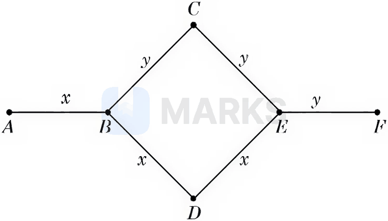
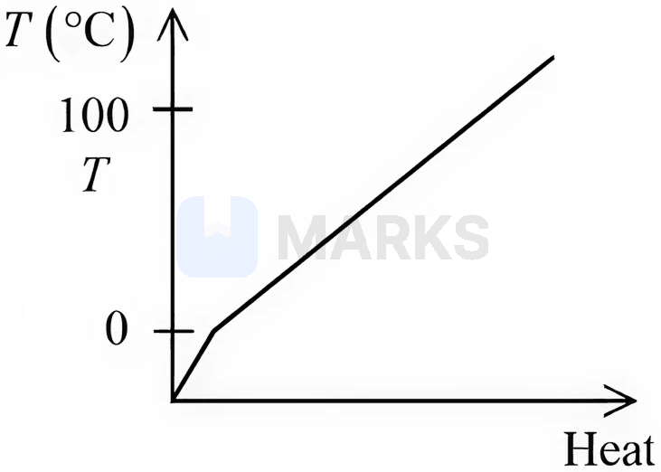
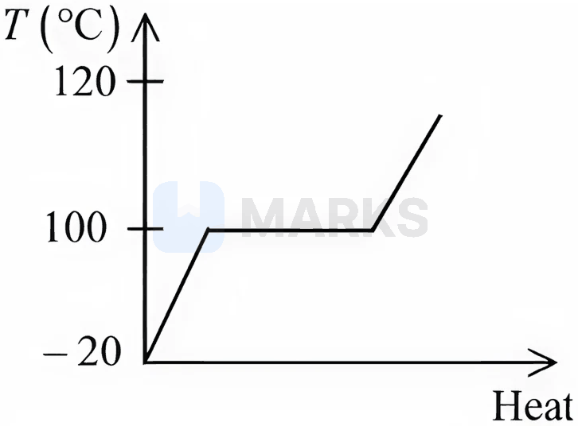
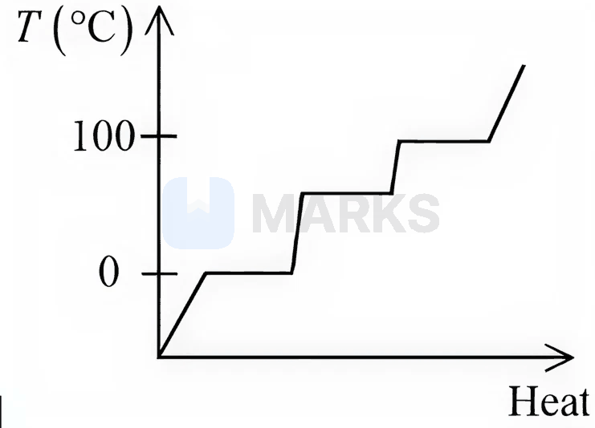
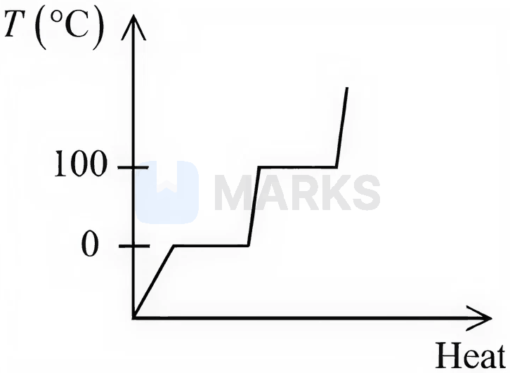
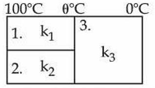

# Calorimetry, Thermal Expansion & Heat Transfer

> Theory: [../../theory/physics/heat-transfer.md](../../theory/physics/heat-transfer.md)

### P-HET-01 · C — JEE Main 2026 · 22 Jan Shift 1 · Thermal set Q1 · MCQ

Rods $x$ and $y$ of equal dimensions but different materials are joined as shown in the figure. The temperatures of the end points $A$ and $F$ are maintained at $100^\circ$C and $40^\circ$C respectively. The thermal conductivity of rod $x$ is three times that of rod $y$. The temperatures at the junction points $B$ and $E$ are (close to):

(1) $80^\circ$C and $70^\circ$C respectively  (2) $80^\circ$C and $60^\circ$C respectively  (3) $60^\circ$C and $45^\circ$C respectively  (4) $89^\circ$C and $73^\circ$C respectively

**Answer: (4)** · key (compiled)

**Solution.** Let a rod $x$ have thermal resistance $R$; then a rod $y$ has $3R$. Between $B$ and $E$ there are two parallel paths: $B\!-\!C\!-\!E$ ($y+y=6R$) and $B\!-\!D\!-\!E$ ($x+x=2R$), giving $\dfrac{6R\cdot2R}{8R}=1.5R$. Total resistance $A\to F$: $R+1.5R+3R=5.5R$. Heat current $H=\dfrac{100-40}{5.5R}=\dfrac{10.9}{R}$. $T_B=100-HR=89^\circ$C and $T_E=40+H(3R)=73^\circ$C.

### P-HET-02 · C — JEE Main 2026 · 21 Jan Shift 1 · Thermal set Q2 · MCQ

An aluminium rod and a steel rod having the same lengths and cross-sections are joined to make a total length of $120$ cm at $30^\circ$C. The coefficients of linear expansion of aluminium and steel are $24\times10^{-6}/^\circ$C and $1.2\times10^{-5}/^\circ$C respectively. The length of this composite rod when its temperature is raised to $100^\circ$C is ______ cm.

(1) 120.20  (2) 120.15  (3) 120.06  (4) 120.03

**Answer: (2)** · key (compiled)

**Solution.** Each rod is $60$ cm and $\Delta T=70^\circ$C. $\Delta L=60\times70\,(24\times10^{-6}+12\times10^{-6})=0.1512$ cm, so the length is $120.15$ cm.

### P-HET-03 · C — JEE Main 2026 · 21 Jan Shift 1 · Thermal set Q3 · MCQ

A gas-based geyser heats water flowing at the rate of $5.0$ litres per minute from $27^\circ$C to $87^\circ$C. The rate of consumption of the gas is ______ g/s. (Take the heat of combustion of the gas $=5.0\times10^4$ J/g; specific heat capacity of water $=4200\ \text{J kg}^{-1}\,^\circ\text{C}^{-1}$)

(1) 0.42  (2) 2.1  (3) 0.21  (4) 4.2

**Answer: (1)** · key (compiled)

**Solution.** Heat needed per minute $=5.0\times4200\times60=1.26\times10^6$ J. Gas per minute $=\dfrac{1.26\times10^6}{5.0\times10^4}=25.2$ g, i.e. $\dfrac{25.2}{60}=0.42$ g/s.

### P-HET-04 · C — JEE Main 2026 · 28 Jan Shift 1 · Thermal set Q4 · MCQ

Which of the following best represents the temperature versus heat supplied graph for water, in the range $-20^\circ$C to $120^\circ$C?

**(1)** 

**(2)** 

**(3)** 

**(4)** 

**Answer: (4)** · key (compiled)

**Solution.** Starting as ice the temperature rises with a steep slope (small specific heat, $2100$), then stays at $0^\circ$C during melting, rises more slowly as water (specific heat $4200$), stays at $100^\circ$C during the (longer) vaporisation, and finally rises steeply again as steam. Only graph (4) shows both plateaus at $0^\circ$C and $100^\circ$C with these slopes.

### P-HET-05 · C — JEE Main 2026 · 28 Jan Shift 1 · Thermal set Q5 · MCQ

$10$ kg of ice at $-10^\circ$C is added to $100$ kg of water at $25^\circ$C. Assuming no heat exchange with the surroundings, the decrease in the temperature of the water is ______ $^\circ$C. (specific heat of ice $=2100\ \text{J kg}^{-1}\,^\circ\text{C}^{-1}$, specific heat of water $=4200\ \text{J kg}^{-1}\,^\circ\text{C}^{-1}$, latent heat of fusion of ice $=3.36\times10^5\ \text{J/kg}$)

(1) 6.67  (2) 11.6  (3) 15  (4) 10

**Answer: (4)** · key (compiled)

**Solution.** Heat to warm the ice to $0^\circ$C: $10\times2100\times10=0.21\times10^6$ J; to melt it: $3.36\times10^6$ J. If the final temperature is $T$: $100\times4200\,(25-T)=0.21\times10^6+3.36\times10^6+10\times4200\,T$, i.e. $10.5\times10^6-4.2\times10^5T=3.57\times10^6+4.2\times10^4T\Rightarrow T=15^\circ$C. The water cools by $25-15=10^\circ$C.

### P-HET-06 · C — JEE Main 2026 · 24 Jan Shift 1 · Thermal set Q6 · MCQ

A brass wire of length $2$ m and radius $1$ mm at $27^\circ$C is held taut between two rigid supports. Initially it was cooled to a temperature of $-43^\circ$C, creating a tension $T$ in the wire. The temperature to which the wire has to be cooled in order to increase the tension to $1.4T$ is ______ $^\circ$C.

(1) -86  (2) -65  (3) -71  (4) -80

**Answer: (3)** · key (compiled)

**Solution.** The thermal tension is $YA\alpha\,\Delta T$, proportional to the temperature drop below $27^\circ$C. Initially $\Delta T_1=70^\circ$C; for $1.4T$, $\Delta T_2=1.4\times70=98^\circ$C, so the temperature is $27-98=-71^\circ$C.

### P-HET-07 · C — JEE Advanced 2025 · Paper 1 · Q10

Two identical plates P and Q, radiating as perfect black bodies, are at fixed temperatures $T_P>T_Q$ in vacuum; the radiated power per unit area transferred from P to Q is $W_0$. Two more identical plates are then inserted between P and Q, with heat transferred only between adjacent plates. If the steady-state power per unit area from P to Q is $W_S$, then $W_0/W_S=$ ______.

**Answer: 3** · official key ✔ (re-derived)

**Solution.** Initially $W_0=\sigma(T_P^4-T_Q^4)$. With four plates there are three gaps in series and, in steady state, the same power flows through each: $W_S=\sigma(T_1^4-T_2^4)=\sigma(T_2^4-T_3^4)=\sigma(T_3^4-T_4^4)$. Adding: $3W_S=\sigma(T_P^4-T_Q^4)=W_0$, so $W_0/W_S=3$.

### P-HET-08 · C — JEE Main 2025 · Jan session · Heat set Q2 · MCQ

An amount of ice of mass $10^{-3}$ kg and temperature $-10^\circ$C is transformed to vapour of temperature $110^\circ$C by applying heat. The total amount of heat required for this conversion is: (Take specific heat of ice $=2100\ \text{J kg}^{-1}\text{K}^{-1}$, specific heat of water $=4180\ \text{J kg}^{-1}\text{K}^{-1}$, specific heat of steam $=1920\ \text{J kg}^{-1}\text{K}^{-1}$, latent heat of ice $=3.35\times10^5\ \text{J kg}^{-1}$ and latent heat of steam $=2.25\times10^6\ \text{J kg}^{-1}$)

(1) 3043 J  (2) 3024 J  (3) 3003 J  (4) 3022 J

**Answer: (1)** · key (compiled)

**Solution.** Five stages: $Q=m\left[c_{ice}(10)+L_f+c_w(100)+L_v+c_s(10)\right]=10^{-3}\left[21000+3.35\times10^5+4.18\times10^5+2.25\times10^6+19200\right]=10^{-3}\times3.0432\times10^6\approx3043$ J.

### P-HET-09 · C — JEE Main 2025 · Jan session · Heat set Q4 · Numerical

Three conductors of the same length having thermal conductivities $k_1$, $k_2$ and $k_3$ are connected as shown in the figure. The areas of cross-section of the 1st and 2nd conductors are the same, and for the 3rd conductor it is double that of the 1st conductor. The temperatures are given in the figure. In steady state, the value of $\theta$ is ______ $^\circ$C. (Given: $k_1=60$, $k_2=120$, $k_3=135\ \text{J s}^{-1}\text{m}^{-1}\text{K}^{-1}$)

**Answer: 40** · key (compiled)

**Solution.** Conductors 1 and 2 (each of area $A$) carry heat in parallel from the $100^\circ$C end to the junction at $\theta$; conductor 3 (area $2A$) carries it from $\theta$ to $0^\circ$C. In steady state $(k_1+k_2)A\dfrac{100-\theta}{L}=k_3(2A)\dfrac{\theta-0}{L}\Rightarrow180(100-\theta)=270\,\theta\Rightarrow\theta=40^\circ$C.

### P-HET-10 · C — JEE Main 2025 · Jan session · Heat set Q5 · MCQ

Two spherical bodies of the same material, having radii 0.2 m and 0.8 m, are placed in the same atmosphere. The temperature of the smaller body is 800 K and the temperature of the bigger body is 400 K. If the energy radiated from the smaller body is $E$, the energy radiated from the bigger body is (assume the effect of the surrounding temperature to be negligible):

(1) 16 E  (2) E  (3) 64 E  (4) 256 E

**Answer: (2)** · key (compiled)

**Solution.** Radiated power $\propto AT^4\propto r^2T^4$. $\dfrac{E_{big}}{E_{small}}=\left(\dfrac{0.8}{0.2}\right)^2\left(\dfrac{400}{800}\right)^4=16\times\dfrac1{16}=1$, so the bigger body radiates $E$.

### P-HET-11 · C — JEE Main 2025 · Apr session · Heat set Q1 · MCQ

Consider a rectangular sheet of solid material of length $\ell=9$ cm and width $d=4$ cm. The coefficient of linear expansion is $\alpha=3.1\times10^{-5}\ \text{K}^{-1}$ at room temperature and one atmospheric pressure. The mass of the sheet is $m=0.1$ kg and the specific heat capacity is $C_v=900\ \text{J kg}^{-1}\text{K}^{-1}$. If the amount of heat supplied to the material is $8.1\times10^2$ J, then the change in area of the rectangular sheet is:

(1) $2.0\times10^{-6}\ \text{m}^2$  (2) $3.0\times10^{-7}\ \text{m}^2$  (3) $6.0\times10^{-7}\ \text{m}^2$  (4) $4.0\times10^{-7}\ \text{m}^2$

**Answer: (1)** · key (compiled)

**Solution.** $\Delta T=\dfrac{Q}{mC}=\dfrac{810}{0.1\times900}=9$ K. Areal expansion: $\Delta A=A\,(2\alpha)\,\Delta T=(36\times10^{-4})(2\times3.1\times10^{-5})(9)=2.0\times10^{-6}\ \text{m}^2$.

### P-HET-12 · C — JEE Main 2025 · Apr session · Heat set Q3 · Numerical

A wire of length 10 cm and diameter 0.5 mm is used in a bulb. The temperature of the wire is $1727^\circ$C and the power radiated by the wire is 94.2 W. Its emissivity is $\dfrac x8$, where $x=$ ______. (Given $\sigma=6.0\times10^{-8}\ \text{W m}^{-2}\text{K}^{-4}$, $\pi=3.14$, and assume that the emissivity of the wire material is the same at all wavelengths.)

**Answer: 5** · key (compiled)

**Solution.** $T=1727+273=2000$ K. Radiating area $A=\pi dL=3.14\times0.5\times10^{-3}\times0.1=1.57\times10^{-4}\ \text{m}^2$. From $P=e\sigma AT^4$: $e=\dfrac{94.2}{(6\times10^{-8})(1.57\times10^{-4})(2000)^4}=\dfrac{94.2}{150.7}=0.625=\dfrac58$. So $x=5$.

### P-HET-13 · C — JEE Main 2024 · 4 Apr Shift 1 · Q9 · MCQ

The resistances of a platinum wire in a platinum resistance thermometer at the ice point and steam point are $8\ \Omega$ and $10\ \Omega$ respectively. After inserting it in a hot bath of temperature $400^\circ$C, the resistance of the wire is:

(1) $10\ \Omega$  (2) $8\ \Omega$  (3) $16\ \Omega$  (4) $2\ \Omega$

**Answer: (3)** · key ✔

**Solution.** $R_t=R_0\left[1+\alpha t\right]$ is linear: $R_{100}-R_0=2\ \Omega$ per $100^\circ$C. So $R_{400}=8+4\times2=16\ \Omega$.

### P-HET-14 · C — JEE Main 2023 · 24 Jan Shift 1 · Q24 · Numerical

A hole is drilled in a metal sheet. At $27^\circ$C the diameter of the hole is $5$ cm. When the sheet is heated to $177^\circ$C, the change in the diameter of the hole is $d\times10^{-3}$ cm. $d=$ ______ (coefficient of linear expansion $1.6\times10^{-5}\,/^\circ$C).

**Answer: 12** · key ✔

**Solution.** A hole expands exactly as if it were filled with the same metal. $\Delta d=d\,\alpha\,\Delta T=5\times1.6\times10^{-5}\times150=1.2\times10^{-2}$ cm $=12\times10^{-3}$ cm.

