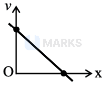
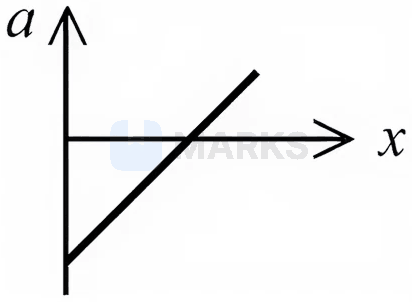
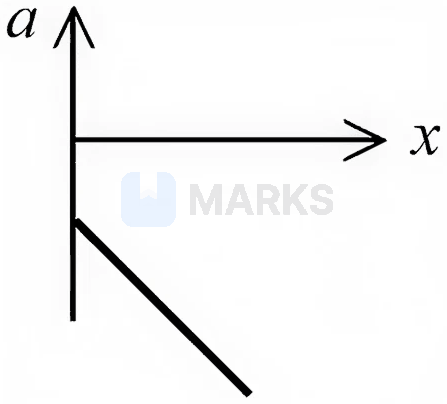
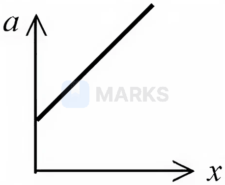
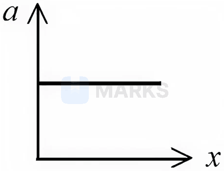
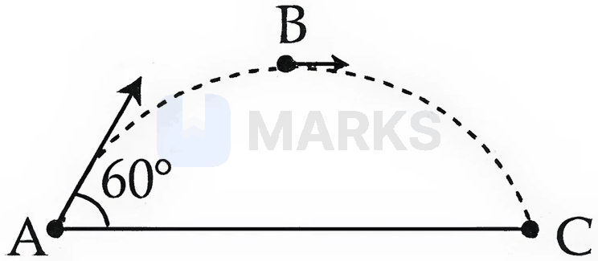
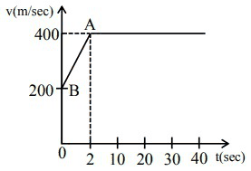
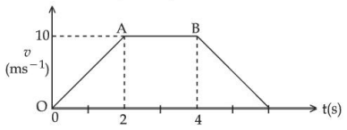

# Kinematics

> Theory: [../../theory/physics/kinematics.md](../../theory/physics/kinematics.md)

### P-KIN-01 — JEE Main 2024 · 27 Jan Shift 1 · Q21 · Numerical

A particle starts from the origin at $t=0$ with velocity $5\hat i\ \text{m s}^{-1}$ and moves in the $x$–$y$ plane under a force that produces a constant acceleration $(3\hat i+2\hat j)\ \text{m s}^{-2}$. If the $x$-coordinate of the particle at some instant is $84$ m, its speed then is $\sqrt\alpha\ \text{m s}^{-1}$. Find $\alpha$.

**Answer: 673** · key ✔

**Solution.** $x=5t+\tfrac32t^2=84\Rightarrow3t^2+10t-168=0\Rightarrow t=6$ s. Then $v_x=5+3(6)=23$, $v_y=2(6)=12$, and $v^2=529+144=673$.

### P-KIN-02 — JEE Main 2024 · 27 Jan Shift 2 · Q2 · MCQ

A bullet fired into a fixed target loses one third of its velocity after travelling $4$ cm. It penetrates a further $D\times10^{-3}$ m before coming to rest. The value of $D$ is

(1) 32  (2) 5  (3) 3  (4) 4

**Answer: (1)** · key ✔

**Solution.** Let the initial speed be $u$ and the (constant) retardation be $a$. First stage ($s=0.04$ m): $\left(\tfrac{2u}{3}\right)^2=u^2-2a(0.04)\Rightarrow0.08a=\tfrac{5u^2}{9}\Rightarrow a=\dfrac{5u^2}{0.72}$. Second stage: $0=\left(\tfrac{2u}{3}\right)^2-2as'\Rightarrow s'=\dfrac{4u^2/9}{2a}=\dfrac49\cdot\dfrac{0.72}{10}=0.032$ m $=32\times10^{-3}$ m. So $D=32$.

### P-KIN-03 — JEE Main 2024 · 27 Jan Shift 2 · Q21 · Numerical

A body falling under gravity covers two points $A$ and $B$ separated by $80$ m in $2$ s. The distance of the upper point $A$ from the starting point is ______ m. (Use $g=10\ \text{m s}^{-2}$)

**Answer: 45** · key ✔

**Solution.** If the speed at $A$ is $u$: $80=2u+\tfrac12(10)(2)^2=2u+20\Rightarrow u=30$ m/s. Then $h=\dfrac{u^2}{2g}=\dfrac{900}{20}=45$ m.

### P-KIN-04 — JEE Main 2024 · 29 Jan Shift 1 · Q2 · MCQ

A body starts from rest with constant acceleration. It covers a displacement $S_1$ in the first $(p-1)$ seconds and $S_2$ in the first $p$ seconds. The displacement $S_1+S_2$ will be covered in time

(1) $(2p+1)$ s  (2) $\sqrt{2p^2-2p+1}$ s  (3) $(2p-1)$ s  (4) $(2p^2-2p+1)$ s

**Answer: (2)** · key ✔

**Solution.** From rest, $S=\tfrac12at^2$. So $S_1+S_2=\tfrac12a\left[(p-1)^2+p^2\right]=\tfrac12a\,(2p^2-2p+1)$. Setting $\tfrac12at^2$ equal to this gives $t=\sqrt{2p^2-2p+1}$ s.

### P-KIN-05 — JEE Main 2024 · 29 Jan Shift 2 · Q2 · MCQ

A particle moves in a straight line with position $x=(t^3-6t^2+20t+15)$ m. The velocity of the body when its acceleration becomes zero is

(1) 4 m s$^{-1}$  (2) 8 m s$^{-1}$  (3) 10 m s$^{-1}$  (4) 6 m s$^{-1}$

**Answer: (2)** · key ✔

**Solution.** $v=\dfrac{dx}{dt}=3t^2-12t+20$ and $a=\dfrac{dv}{dt}=6t-12=0\Rightarrow t=2$ s. Then $v=12-24+20=8$ m/s.

### P-KIN-06 — JEE Main 2024 · 30 Jan Shift 1 · Q21 · Numerical

The displacement and the increase in velocity of a moving particle in the time interval $t$ to $(t+1)$ s are $125$ m and $50\ \text{m s}^{-1}$ respectively. The distance travelled by the particle in the $(t+2)^{th}$ s is ______ m.

**Answer: 175** · key ✔

**Solution.** The increase in velocity in $1$ s gives $a=50\ \text{m s}^{-2}$. For the interval $t\to t+1$: $125=v_t(1)+\tfrac12(50)(1)^2\Rightarrow v_t=100$ m/s. Then $v_{t+1}=150$ m/s, and in the next second $s=150(1)+\tfrac12(50)=175$ m.

### P-KIN-07 — JEE Main 2024 · 30 Jan Shift 2 · Q2 · MCQ

Projectiles $A$ and $B$ are thrown at angles of $45^\circ$ and $60^\circ$ with the vertical respectively from the top of a $400$ m high tower. If their times of flight are the same, the ratio of their speeds of projection $v_A:v_B$ is

(1) $1:\sqrt3$  (2) $\sqrt2:1$  (3) $1:2$  (4) $1:\sqrt2$

**Answer: (4)** · key ✔

**Solution.** Elevation angles above the horizontal are $45^\circ$ and $30^\circ$. Landing on the ground below satisfies $-400=v\sin\theta\,t-\tfrac12gt^2$, so equal $t$ needs equal $v\sin\theta$: $v_A\sin45^\circ=v_B\sin30^\circ\Rightarrow\dfrac{v_A}{v_B}=\dfrac{1/2}{1/\sqrt2}=\dfrac1{\sqrt2}$.

### P-KIN-08 — JEE Main 2024 · 31 Jan Shift 1 · Q3 · MCQ

The relation between time $t$ and distance $x$ is $t=\alpha x^2+\beta x$, where $\alpha$ and $\beta$ are constants. The relation between acceleration $a$ and velocity $v$ is

(1) $a=-2\alpha v^3$  (2) $a=-5\alpha v^5$  (3) $a=-3\alpha v^2$  (4) $a=-4\alpha v^4$

**Answer: (1)** · key ✔

**Solution.** $\dfrac{dt}{dx}=2\alpha x+\beta\Rightarrow v=\dfrac1{2\alpha x+\beta}$. Then $a=\dfrac{dv}{dt}=\dfrac{dv}{dx}\cdot v=-\dfrac{2\alpha}{(2\alpha x+\beta)^2}\,v=-2\alpha v^2\cdot v=-2\alpha v^3$.

### P-KIN-09 — JEE Main 2024 · 31 Jan Shift 1 · Q21 · Numerical

A body starts falling freely from a height $H$ and hits an inclined plane in its path at height $h$. As a result of this perfectly elastic impact the direction of its velocity becomes horizontal. The value of $\dfrac Hh$ for which the body takes the maximum time to reach the ground is ______.

**Answer: 2** · key ✔

**Solution.** Time to the plane: $\sqrt{\dfrac{2(H-h)}g}$. After the impact the velocity is horizontal, so the fall through $h$ takes $\sqrt{\dfrac{2h}g}$. Total $T=\sqrt{\dfrac2g}\left(\sqrt{H-h}+\sqrt h\right)$. $\dfrac{dT}{dh}=0\Rightarrow\dfrac1{\sqrt{H-h}}=\dfrac1{\sqrt h}\Rightarrow h=\dfrac H2$. So $\dfrac Hh=2$.

### P-KIN-10 — JEE Main 2024 · 1 Feb Shift 1 · Q3 · MCQ

A particle moving in a circle of radius $R$ with uniform speed takes time $T$ to complete one revolution. If this particle is projected with the same speed at an angle $\theta$ to the horizontal, the maximum height attained by it is $4R$. The angle of projection $\theta$ is given by

(the correct choice is $\theta=\sin^{-1}\left(\dfrac{2gT^2}{\pi^2R}\right)^{1/2}$, option (1))

**Answer: $\theta=\sin^{-1}\!\left(\dfrac{2gT^2}{\pi^2R}\right)^{1/2}$** · key ✔

**Solution.** Speed $v=\dfrac{2\pi R}T$. Maximum height $H=\dfrac{v^2\sin^2\theta}{2g}=4R\Rightarrow\sin^2\theta=\dfrac{8gR}{v^2}=\dfrac{8gRT^2}{4\pi^2R^2}=\dfrac{2gT^2}{\pi^2R}$. So $\theta=\sin^{-1}\left(\dfrac{2gT^2}{\pi^2R}\right)^{1/2}$.

### P-KIN-11 — JEE Main 2024 · 1 Feb Shift 1 · Q21 · Numerical

A particle moves along the $x$-axis under a variable force with $x=-3t^3+18t^2+16t$ ($x$ in m, $t$ in s). The velocity of the particle when its acceleration becomes zero is ______ m s$^{-1}$.

**Answer: 52** · key ✔

**Solution.** $v=\dfrac{dx}{dt}=-9t^2+36t+16$ and $a=\dfrac{dv}{dt}=-18t+36=0\Rightarrow t=2$ s. Then $v=-36+72+16=52\ \text{m s}^{-1}$.

### P-KIN-12 — JEE Main 2024 · 1 Feb Shift 2 · Q2 · MCQ

Train A moves north at $72\ \text{km h}^{-1}$ and train B moves south at $108\ \text{km h}^{-1}$ on parallel tracks. The velocity of B with respect to A and the velocity of the ground with respect to B are (in $\text{m s}^{-1}$):

(1) $-30$ and $50$  (2) $-50$ and $-30$  (3) $-50$ and $30$  (4) $50$ and $-30$

**Answer: (3)** · key ✔

**Solution.** Take north as positive: $v_A=+20$, $v_B=-30$ m/s. $v_{BA}=v_B-v_A=-30-20=-50$. The ground is at rest, so $v_{GB}=0-(-30)=+30$.

### P-KIN-13 — JEE Main 2024 · 1 Feb Shift 2 · Q21 · Numerical

A particle starts from rest at $x=0$ with velocity $v=4\sqrt x\ \text{m s}^{-1}$. Its acceleration is ______ $\text{m s}^{-2}$.

**Answer: 8** · key ✔

**Solution.** $a=v\dfrac{dv}{dx}=4\sqrt x\cdot\dfrac{2}{\sqrt x}=8\ \text{m s}^{-2}$, a constant.

### P-KIN-14 — JEE Main 2024 · 4 Apr Shift 1 · Q3 · MCQ

A body travels $102.5$ m in the $n$th second and $115.0$ m in the $(n+2)$th second. The acceleration is:

(1) $6.25\ \text{m/s}^2$  (2) $12.5\ \text{m/s}^2$  (3) $9\ \text{m/s}^2$  (4) $5\ \text{m/s}^2$

**Answer: (1)** · key ✔

**Solution.** Distance in the $n$th second: $s_n=u+a\left(n-\tfrac12\right)$. Between the $n$th and $(n+2)$th second the increase is $2a=115.0-102.5=12.5$, so $a=6.25\ \text{m/s}^2$.

### P-KIN-15 — JEE Main 2024 · 4 Apr Shift 1 · Q4 · MCQ

The coordinates of a particle in the $x$–$y$ plane are $x=2+4t$, $y=3t+8t^2$. The motion of the particle is:

(1) uniformly accelerated along a parabolic path  (2) uniform motion along a straight line  (3) uniformly accelerated along a straight line  (4) non-uniformly accelerated

**Answer: (1)** · key ✔

**Solution.** $a_x=0$, $a_y=16$ (constant), so the acceleration is uniform. Eliminating $t=(x-2)/4$: $y=\tfrac34(x-2)+\tfrac12(x-2)^2$, a parabola. The initial velocity $(4,3)$ is not parallel to $a$, so the path is not straight.

### P-KIN-16 — JEE Main 2024 · 4 Apr Shift 2 · Q21 · Numerical

A bus moving at $72$ km/h is brought to a halt within $4$ s after applying the brakes (uniform retardation). The distance travelled during this time is ______ m.

**Answer: 40** · key ✔

**Solution.** $u=72\ \text{km/h}=20$ m/s, final speed $0$: $s=\dfrac{u+0}{2}t=10\times4=40$ m.

### P-KIN-17 — JEE Main 2024 · 5 Apr Shift 1 · Q21 · Numerical

A body starts from rest on a frictionless plane. If $S_{n-1}$ is the distance moved between $t=n-2$ and $t=n-1$, and $S_n$ between $t=n-1$ and $t=n$, then $\dfrac{S_{n-1}}{S_n}=\left(1-\dfrac2x\right)$ for $n=10$. The value of $x$ is ______.

**Answer: 19** · key ✔

**Solution.** Uniform acceleration from rest: $S_n\propto(2n-1)$. $\dfrac{S_{n-1}}{S_n}=\dfrac{2n-3}{2n-1}=1-\dfrac{2}{2n-1}$. For $n=10$: $1-\dfrac2{19}$, so $x=19$.

### P-KIN-18 — JEE Main 2024 · 5 Apr Shift 2 · Q3 · MCQ

A man carrying a monkey on his shoulder cycles smoothly on a circular track of radius $9$ m and completes $120$ revolutions in $3$ minutes. The magnitude of the centripetal acceleration of the monkey is (in $\text{m/s}^2$):

(1) $57600\pi^2$  (2) zero  (3) $4\pi^2$  (4) $16\pi^2$

**Answer: (4)** · key ✔

**Solution.** $f=\dfrac{120}{180}=\dfrac23$ Hz, $\omega=2\pi f=\dfrac{4\pi}{3}$ rad/s. $a=\omega^2R=\dfrac{16\pi^2}{9}\times9=16\pi^2\ \text{m s}^{-2}$.

### P-KIN-19 — JEE Main 2024 · 5 Apr Shift 2 · Q21 · Numerical

The maximum height reached by a projectile is $64$ m. If the initial velocity is halved, the new maximum height is ______ m.

**Answer: 16** · key ✔

**Solution.** $H=\dfrac{u^2\sin^2\theta}{2g}\propto u^2$. Halving $u$ divides $H$ by $4$: $64/4=16$ m.

### P-KIN-20 — JEE Main 2024 · 6 Apr Shift 1 · Q3 · MCQ

A train starting from rest first accelerates uniformly up to a speed of $80$ km/h for time $t$, then moves with constant speed for time $3t$. The average speed of the train for this duration of journey is (in km/h):

(1) 40  (2) 80  (3) 30  (4) 70

**Answer: (4)** · key ✔

**Solution.** Distance in the acceleration phase: $\tfrac12(80)t=40t$. Constant-speed phase: $80\times3t=240t$. Total $280t$ in time $4t$: average speed $=70$ km/h.

### P-KIN-21 — JEE Main 2024 · 6 Apr Shift 1 · Q21 · Numerical

For vectors $\vec A=-x\hat i-6\hat j-2\hat k$, $\vec B=-\hat i+4\hat j+3\hat k$ and $\vec C=-8\hat i-\hat j+3\hat k$, if $\vec A\cdot(\vec B\times\vec C)=0$, then $x=$ ______.

**Answer: 4** · key ✔

**Solution.** $\vec B\times\vec C=(4\cdot3-3\cdot(-1),\ 3\cdot(-8)-(-1)\cdot3,\ (-1)(-1)-4(-8))=(15,-21,33)$. $\vec A\cdot(\vec B\times\vec C)=-15x+126-66=0\Rightarrow x=4$. (Vanishing scalar triple product means the three vectors are coplanar.)

### P-KIN-22 — JEE Main 2024 · 6 Apr Shift 2 · Q2 · MCQ

A body projected vertically upwards with a certain speed from the top of a tower reaches the ground in time $t_1$. If it is projected vertically downwards from the same point with the same speed, it reaches the ground in time $t_2$. The time required to reach the ground if it is dropped from the top of the tower is:

(1) $\sqrt{t_1t_2}$  (2) $\sqrt{t_1+t_2}$  (3) $\sqrt{t_1-t_2}$  (4) $\sqrt{t_1/t_2}$

**Answer: (1)** · key ✔

**Solution.** Take down as positive and tower height $h$: $h=-ut_1+\tfrac12gt_1^2$ and $h=ut_2+\tfrac12gt_2^2$. Multiply the first by $t_2$ and the second by $t_1$ and add: $h(t_1+t_2)=\tfrac12gt_1t_2(t_1+t_2)\Rightarrow h=\tfrac12gt_1t_2$. For a drop, $h=\tfrac12gt^2$, so $t=\sqrt{t_1t_2}$.

### P-KIN-23 — JEE Main 2024 · 6 Apr Shift 2 · Q21 · Numerical

A particle moves in a straight line with displacement given by $x^2=1+t^2$. Its acceleration at any time $t$ is $x^{-n}$, where $n=$ ______.

**Answer: 3** · key ✔

**Solution.** $2x\dot x=2t\Rightarrow\dot x=\dfrac tx$. $\ddot x=\dfrac{x-t\dot x}{x^2}=\dfrac{x-t^2/x}{x^2}=\dfrac{x^2-t^2}{x^3}=\dfrac{1}{x^3}$. So $n=3$.

### P-KIN-24 — JEE Main 2024 · 8 Apr Shift 2 · Q2 · MCQ

The angle of projection for a projectile to have the same horizontal range and maximum height is:

(1) $\tan^{-1}(4)$  (2) $\tan^{-1}\left(\tfrac14\right)$  (3) $\tan^{-1}\left(\tfrac12\right)$  (4) $\tan^{-1}(2)$

**Answer: (1)** · key ✔

**Solution.** $R=\dfrac{u^2\sin2\theta}{g}$ and $H=\dfrac{u^2\sin^2\theta}{2g}$. $R=H\Rightarrow2\sin\theta\cos\theta=\dfrac{\sin^2\theta}{2}\Rightarrow\tan\theta=4$.

### P-KIN-25 — JEE Main 2024 · 9 Apr Shift 1 · Q2 · MCQ

A particle moving in a straight line covers half the distance with a speed of $6$ m/s. The other half of the distance is covered in two equal time intervals with speeds $9$ m/s and $15$ m/s respectively. The average speed of the particle during the motion is:

(1) 10 m/s  (2) 8 m/s  (3) 9.2 m/s  (4) 8.8 m/s

**Answer: (2)** · key ✔

**Solution.** Total distance $d$. First half: time $t_1=\dfrac{d/2}{6}=\dfrac d{12}$. Second half: in two equal intervals $t$ each, $(9+15)t=\dfrac d2\Rightarrow t=\dfrac d{48}$, so time $=2t=\dfrac d{24}$. Total time $=\dfrac d{12}+\dfrac d{24}=\dfrac d8$. Average speed $=\dfrac{d}{d/8}=8$ m/s.

### § — JEE Main 2026 · 28 Jan Shift 2 · 1D set Q1 · MCQ

A particle starts moving from time $t=0$ and its coordinate is given as $x(t)=4t^3-3t$.
A. The particle returns to its original position (origin) $0.866$ units of time later.
B. The particle is $1$ unit away from the origin at its turning point.
C. The acceleration of the particle is non-negative.
D. The particle is $0.5$ units away from the origin at its turning point.
E. The particle never turns back as its acceleration is non-negative.
Choose the correct answer:

(1) A, B, C only  (2) C, E only  (3) A, C only  (4) A, C, D only

**Answer: (1)** · key (compiled)

**Solution.** $v=12t^2-3$, $a=24t$. A: $x=0\Rightarrow t(4t^2-3)=0\Rightarrow t=\tfrac{\sqrt3}{2}=0.866$ ✓. B: the turning point is at $v=0\Rightarrow t=0.5$, where $x=4(0.125)-1.5=-1$, i.e. $1$ unit away ✓ (D is false). C: $a=24t\ge0$ for $t\ge0$ ✓. E is false: the particle does turn at $t=0.5$ even though $a\ge0$. So A, B, C.

### § — JEE Main 2026 · 24 Jan Shift 2 · 1D set Q2 · MCQ

The velocity–distance ($v$–$x$) graph is shown in the figure. Which graph represents the acceleration versus distance ($a$–$x$) variation of this system?

**(1)** 

**(2)** 

**(3)** 

**(4)** 

**Answer: (1)** · key (compiled)

**Solution.** The graph is a straight line with negative slope: $v=v_0-kx$. Then $a=v\dfrac{dv}{dx}=-k(v_0-kx)=-kv_0+k^2x$, a straight line with positive slope and a negative intercept at $x=0$ (zero where $v=0$): option (1).

### § — JEE Main 2026 · 23 Jan Shift 2 · 1D set Q3 · MCQ

A paratrooper jumps from an aeroplane and opens the parachute after $2$ s of free fall, then decelerates at $3\ \text{m/s}^2$. At a height of $10$ m above the ground, while descending with the help of the parachute, the speed of the paratrooper is $5$ m/s. The initial height of the aeroplane is ______ m. ($g=10\ \text{m/s}^2$)

(1) 82.5  (2) 20  (3) 62.5  (4) 92.5

**Answer: (4)** · key (compiled)

**Solution.** Free fall for $2$ s: $v_1=20$ m/s, $h_1=\tfrac12\times10\times4=20$ m. Deceleration from $20$ m/s to $5$ m/s: $h_2=\dfrac{20^2-5^2}{2\times3}=62.5$ m. Total height $=20+62.5+10=92.5$ m.

### § — JEE Main 2026 · 28 Jan Shift 1 · 1D set Q4 · MCQ

Water drops fall from a tap on to the floor $5$ m below at regular intervals of time; the first drop strikes the floor when the sixth drop begins to fall. The height at which the fourth drop will be from the ground at the instant when the first drop strikes the ground is ______ m. ($g=10\ \text{m/s}^2$)

(1) 4.2  (2) 2.5  (3) 4.0  (4) 3.8

**Answer: (1)** · key (compiled)

**Solution.** The first drop takes $t=\sqrt{2\times5/10}=1$ s to fall, and there are $5$ equal intervals, so each is $0.2$ s. The fourth drop has been falling for $1-3(0.2)=0.4$ s: it has fallen $\tfrac12\times10\times0.16=0.8$ m, so it is at $5-0.8=4.2$ m.

### § — JEE Main 2026 · 21 Jan Shift 2 · 2D set Q1 · MCQ

A river of width $200$ m is flowing from west to east with a speed of $18$ km/h. A boat, moving with a speed of $36$ km/h in still water, is made to travel one round trip (bank to bank and back). The minimum time taken by the boat for this journey and the displacement along the river bank are ______ and ______ respectively.

(1) 20 s and 100 m  (2) 40 s and 0 m  (3) 40 s and 200 m  (4) 40 s and 100 m

**Answer: (3)** · key (compiled)

**Solution.** River speed $5$ m/s, boat speed $10$ m/s. Minimum time to cross is with the heading perpendicular to the bank: $t=\dfrac{200}{10}=20$ s each way, so $40$ s for the round trip. During each crossing the river carries the boat $5\times20=100$ m downstream, in the same direction both times, so the displacement along the bank is $200$ m.

### § — JEE Main 2026 · 23 Jan Shift 1 · 2D set Q2 · MCQ

An object is projected with kinetic energy $K$ from a point $A$ at an angle of $60^\circ$ with the horizontal. The ratio of the difference in kinetic energies at points $B$ and $C$ to that at point $A$ (see figure), in the absence of air friction, is:

(1) 1 : 4  (2) 2 : 3  (3) 3 : 4  (4) 1 : 2

**Answer: (3)** · key (compiled)

**Solution.** At the highest point $B$ only the horizontal component remains: $v_B=v\cos60^\circ=\tfrac v2$, so $K_B=\tfrac K4$. At $C$ (same level as $A$) $K_C=K$. Then $\dfrac{K_C-K_B}{K_A}=\dfrac{K-K/4}{K}=\dfrac34$.

### § — JEE Main 2026 · 22 Jan Shift 1 · 2D set Q3 · MCQ

A projectile is thrown upward at an angle of $60^\circ$ with the horizontal. The speed of the projectile is $20$ m/s when its direction of motion is $45^\circ$ with the horizontal. The initial speed of the projectile is ______ m/s.

(1) $20\sqrt2$  (2) $40$  (3) $40\sqrt2$  (4) $20\sqrt3$

**Answer: (1)** · key (compiled)

**Solution.** The horizontal velocity is constant: $u\cos60^\circ=20\cos45^\circ\Rightarrow\dfrac u2=10\sqrt2\Rightarrow u=20\sqrt2$ m/s.

### § — JEE Main 2026 · 24 Jan Shift 1 · 2D set Q4 · MCQ

A boy throws a ball into the air at $45^\circ$ from the horizontal to land it on the roof of a building of height $H$. If the ball attains its maximum height in $2$ s and lands on the building $3$ s after launch, the value of $H$ is ______ m. ($g=10\ \text{m/s}^2$)

(1) 15  (2) 20  (3) 25  (4) 10

**Answer: (1)** · key (compiled)

**Solution.** The vertical component of the launch velocity is $v_{0y}=g\times2=20$ m/s. At $t=3$ s: $H=v_{0y}t-\tfrac12gt^2=60-45=15$ m.

### § — JEE Main 2025 · Jan session · 1D set Q1 · MCQ

The motion of an airplane is represented by the velocity–time graph shown below. The distance covered by the airplane in the first 30.5 s is ______ km.

(1) 12  (2) 3  (3) 6  (4) 9

**Answer: (1)** · key (compiled)

**Solution.** From the graph the speed rises uniformly from 200 m/s to 400 m/s in 2 s and then stays at 400 m/s. Distance $=\dfrac{200+400}2\times2+400\times(30.5-2)=600+11400=12000$ m $=12$ km.

### § — JEE Main 2025 · Jan session · 1D set Q2 · MCQ

The velocity–time graph of an object moving along a straight line is shown in the figure. What is the distance covered by the object between $t=0$ and $t=4$ s?

(1) 30 m  (2) 11 m  (3) 10 m  (4) 13 m

**Answer: (1)** · key (compiled)

**Solution.** Distance = area under the $v$–$t$ graph. From 0 to 2 s the velocity rises uniformly to 10 m/s: $\tfrac12\times2\times10=10$ m; from 2 s to 4 s it is constant at 10 m/s: $20$ m. Total $=30$ m.

### § — JEE Main 2025 · Jan session · 1D set Q4 · Numerical

The maximum speed of a boat in still water is 27 km/h. This boat is now moving downstream in a river flowing at 9 km/h. A man in the boat throws a ball vertically upwards with speed 10 m/s. The range of the ball as observed by an observer at rest on the river bank is ______ cm. (Take $g=10\ \text{m/s}^2$.)

**Answer: 2000** · key (compiled)

**Solution.** Boat speed relative to the bank downstream $=27+9=36$ km/h $=10$ m/s, and the ball shares this horizontal velocity. Time of flight $=\dfrac{2\times10}{10}=2$ s. Range $=10\times2=20$ m $=2000$ cm.

### § — JEE Main 2025 · Jan session · 2D set Q3 · MCQ

Two projectiles are fired with the same initial speed from the same point on the ground at angles of $(45^\circ-\alpha)$ and $(45^\circ+\alpha)$ with the horizontal. The ratio of their maximum heights is:

(1) $\dfrac{1-\tan\alpha}{1+\tan\alpha}$  (2) $\dfrac{1-\sin2\alpha}{1+\sin2\alpha}$  (3) $\dfrac{1+\sin2\alpha}{1-\sin2\alpha}$  (4) $\dfrac{1+\sin\alpha}{1-\sin\alpha}$

**Answer: (2)** · key (compiled)

**Solution.** $H=\dfrac{u^2\sin^2\theta}{2g}$. $\sin^2(45^\circ-\alpha)=\dfrac{1-\cos(90^\circ-2\alpha)}2=\dfrac{1-\sin2\alpha}2$ and $\sin^2(45^\circ+\alpha)=\dfrac{1+\sin2\alpha}2$, so $\dfrac{H_1}{H_2}=\dfrac{1-\sin2\alpha}{1+\sin2\alpha}$.

### § — JEE Main 2025 · Jan session · 2D set Q4 · MCQ

The position vector of a moving body at any instant of time is given as $\vec r=\left(5t^2\hat i-5t\hat j\right)$ m. The magnitude and direction of the velocity at $t=2$ s is:

(1) $5\sqrt{15}$ m/s, making an angle $\tan^{-1}4$ with the $-Y$ axis  (2) $5\sqrt{15}$ m/s, making an angle $\tan^{-1}4$ with the $+X$ axis  (3) $5\sqrt{17}$ m/s, making an angle $\tan^{-1}4$ with the $+X$ axis  (4) $5\sqrt{17}$ m/s, making an angle $\tan^{-1}4$ with the $-Y$ axis

**Answer: (4)** · key (compiled)

**Solution.** $\vec v=\dfrac{d\vec r}{dt}=(10t\hat i-5\hat j)$, so at $t=2$ s $\vec v=20\hat i-5\hat j$ with $|\vec v|=\sqrt{400+25}=5\sqrt{17}$ m/s. It points down-right: the angle with the $-Y$ axis satisfies $\tan\theta=\dfrac{20}{5}=4$.

### § — JEE Main 2025 · Apr session · 2D set Q2 · MCQ

A particle is projected with velocity $u$ so that its horizontal range is three times the maximum height attained by it. The horizontal range of the projectile is given as $\dfrac{nu^2}{25g}$, where the value of $n$ is: (Given $g$ is the acceleration due to gravity.)

(1) 6  (2) 18  (3) 12  (4) 24

**Answer: (4)** · key (compiled)

**Solution.** $R=\dfrac{2u^2\sin\theta\cos\theta}g$ and $H=\dfrac{u^2\sin^2\theta}{2g}$. $R=3H\Rightarrow2\sin\theta\cos\theta=\dfrac32\sin^2\theta\Rightarrow\tan\theta=\dfrac43$, so $\sin\theta=\dfrac45$, $\cos\theta=\dfrac35$. $R=\dfrac{2u^2}g\cdot\dfrac{12}{25}=\dfrac{24u^2}{25g}$, i.e. $n=24$.

### § — JEE Main 2025 · Apr session · 2D set Q3 · MCQ

Two projectiles are fired from the ground with the same initial speeds from the same point at angles $(45^\circ+\alpha)$ and $(45^\circ-\alpha)$ with the horizontal. The ratio of their times of flight is:

(1) 1  (2) $\dfrac{1-\tan\alpha}{1+\tan\alpha}$  (3) $\dfrac{1+\sin2\alpha}{1-\sin2\alpha}$  (4) $\dfrac{1+\tan\alpha}{1-\tan\alpha}$

**Answer: (4)** · key (compiled)

**Solution.** $T=\dfrac{2u\sin\theta}g$. $\dfrac{T_1}{T_2}=\dfrac{\sin(45^\circ+\alpha)}{\sin(45^\circ-\alpha)}=\dfrac{\cos\alpha+\sin\alpha}{\cos\alpha-\sin\alpha}=\dfrac{1+\tan\alpha}{1-\tan\alpha}$.

### § — JEE Main 2025 · Apr session · 2D set Q4 · MCQ

Two balls with the same mass and initial velocity are projected at different angles in such a way that the maximum height reached by the first ball is 8 times that of the second ball. $T_1$ and $T_2$ are the total flying times of the first and second ball respectively; the ratio of $T_1$ and $T_2$ is:

(1) $2\sqrt2:1$  (2) 2 : 1  (3) $\sqrt2:1$  (4) 4 : 1

**Answer: (1)** · key (compiled)

**Solution.** $H\propto\sin^2\theta$ and $T\propto\sin\theta$ for the same speed. $\dfrac{H_1}{H_2}=8\Rightarrow\dfrac{\sin\theta_1}{\sin\theta_2}=\sqrt8=2\sqrt2$, so $T_1:T_2=2\sqrt2:1$.

### § — JEE Main 2025 · Apr session · 2D set Q5 · MCQ

A river is flowing from west to east with a speed of 9 km h$^{-1}$. If a boat capable of moving at a maximum speed of 27 km h$^{-1}$ in still water crosses the river in half a minute, while moving with maximum speed at an angle of $150^\circ$ to the direction of river flow, then the width of the river is:

(1) 300 m  (2) 112.5 m  (3) 75 m  (4) $112.5\times\sqrt3$ m

**Answer: (2)** · key (compiled)

**Solution.** The component of the boat's velocity across the river is $27\sin150^\circ=13.5$ km/h $=3.75$ m/s (the river flow only carries it downstream). Width $=3.75\times30=112.5$ m.

