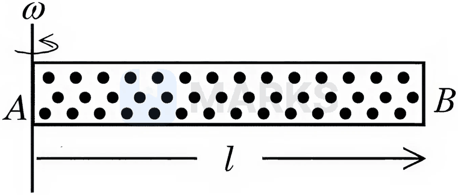

# Kinetic Theory of Gases

> Theory: [../../theory/physics/kinetic-theory.md](../../theory/physics/kinetic-theory.md)

### P-KTG-01 — JEE Main 2024 · 27 Jan Shift 1 · Q9 · MCQ

The average kinetic energy of a monatomic molecule is $0.414$ eV at temperature (Use $k_B=1.38\times10^{-23}\ \text{J mol}^{-1}\text{K}^{-1}$ per molecule):

(1) 3000 K  (2) 3200 K  (3) 1600 K  (4) 1500 K

**Answer: (2)** · key ✔

**Solution.** $\tfrac32k_BT=0.414\ \text{eV}=0.414\times1.6\times10^{-19}$ J, so $T=\dfrac{6.62\times10^{-20}}{1.5\times1.38\times10^{-23}}\approx3200$ K.

### P-KTG-02 — JEE Main 2024 · 29 Jan Shift 1 · Q9 · MCQ

Two vessels $A$ and $B$ have the same size and are at the same temperature. $A$ contains $1$ g of hydrogen and $B$ contains $1$ g of oxygen. $P_A$ and $P_B$ are the pressures of the gases in $A$ and $B$. Then $\dfrac{P_A}{P_B}$ is

(1) 16  (2) 8  (3) 4  (4) 32

**Answer: (1)** · key ✔

**Solution.** At the same $V$ and $T$, $P\propto n$. $n_A=\dfrac1{2}$ (H$_2$, $M=2$) and $n_B=\dfrac1{32}$ (O$_2$, $M=32$). So $\dfrac{P_A}{P_B}=\dfrac{1/2}{1/32}=16$.

### P-KTG-03 — JEE Main 2024 · 29 Jan Shift 2 · Q9 · MCQ

The temperature of a gas having $2.0\times10^{25}$ molecules per cubic metre at $1.38$ atm is (take $1\ \text{atm}\approx10^5$ Pa; $k=1.38\times10^{-23}\ \text{J K}^{-1}$)

(1) 500 K  (2) 200 K  (3) 100 K  (4) 300 K

**Answer: (1)** · key ✔

**Solution.** $P=nkT\Rightarrow T=\dfrac{P}{nk}=\dfrac{1.38\times10^5}{2.0\times10^{25}\times1.38\times10^{-23}}=\dfrac{1.38\times10^5}{276}\approx500$ K.

### P-KTG-04 — JEE Main 2024 · 30 Jan Shift 1 · Q8 · MCQ

At which temperature is the r.m.s. velocity of a hydrogen molecule equal to that of an oxygen molecule at $47^\circ$C?

(1) 80 K  (2) $-73$ K  (3) 4 K  (4) 20 K

**Answer: (4)** · key ✔

**Solution.** $v_{rms}=\sqrt{\dfrac{3RT}M}$. Equal $v_{rms}$: $\dfrac{T_{H_2}}{2}=\dfrac{T_{O_2}}{32}\Rightarrow T_{H_2}=\dfrac{320\times2}{32}=20$ K.

### P-KTG-05 — JEE Main 2024 · 31 Jan Shift 1 · Q11 · MCQ

The parameter that remains the same for molecules of all gases at a given temperature is

(1) kinetic energy  (2) momentum  (3) mass  (4) speed

**Answer: (1)** · key ✔

**Solution.** The average translational kinetic energy per molecule is $\tfrac32k_BT$, which depends only on temperature. Mass, speed ($\sqrt{3k_BT/m}$) and momentum depend on the molecular mass.

### P-KTG-06 — JEE Main 2024 · 31 Jan Shift 2 · Q8 · MCQ

A gas mixture consists of $8$ moles of argon and $6$ moles of oxygen at temperature $T$. Neglecting all vibrational modes, the total internal energy of the system is

(1) $29RT$  (2) $20RT$  (3) $27RT$  (4) $21RT$

**Answer: (3)** · key ✔

**Solution.** Argon (monoatomic): $U=\tfrac32nRT=8\times1.5RT=12RT$. Oxygen (diatomic, $5$ degrees of freedom without vibration): $U=\tfrac52nRT=6\times2.5RT=15RT$. Total $=27RT$.

### P-KTG-07 — JEE Main 2024 · 1 Feb Shift 1 · Q10 · MCQ

Two moles of a monoatomic gas are mixed with six moles of a diatomic gas. The molar specific heat of the mixture at constant volume is

(1) $\tfrac94R$  (2) $\tfrac74R$  (3) $\tfrac32R$  (4) $\tfrac52R$

**Answer: (1)** · key ✔

**Solution.** $C_v=\dfrac{n_1C_{v1}+n_2C_{v2}}{n_1+n_2}=\dfrac{2\left(\tfrac32R\right)+6\left(\tfrac52R\right)}{8}=\dfrac{3R+15R}8=\dfrac94R$.

### P-KTG-08 — JEE Main 2024 · 1 Feb Shift 2 · Q9 · MCQ

If the r.m.s. velocity of hydrogen molecules at a given temperature and pressure is $2\ \text{km s}^{-1}$, the r.m.s. velocity of oxygen at the same conditions is (in $\text{km s}^{-1}$):

(1) 2.0  (2) 0.5  (3) 1.5  (4) 1.0

**Answer: (2)** · key ✔

**Solution.** $v_{rms}=\sqrt{3RT/M}\propto M^{-1/2}$. $M_{\text{O}_2}/M_{\text{H}_2}=16\Rightarrow v_{\text{O}_2}=2/4=0.5$ km/s.

### P-KTG-09 — JEE Main 2024 · 4 Apr Shift 2 · Q9 · MCQ

The translational degrees of freedom ($f_t$) and rotational degrees of freedom ($f_r$) of a $\text{CH}_4$ molecule are:

(1) $f_t=2$, $f_r=2$  (2) $f_t=3$, $f_r=3$  (3) $f_t=3$, $f_r=2$  (4) $f_t=2$, $f_r=3$

**Answer: (2)** · key ✔

**Solution.** Methane is a non-linear polyatomic molecule: $3$ translational and $3$ rotational degrees of freedom (plus vibrational modes at high temperature).

### P-KTG-10 — JEE Main 2024 · 5 Apr Shift 1 · Q12 · MCQ

If the collision frequency of hydrogen molecules in a closed chamber at $27^\circ$C is $Z$, the collision frequency of the same system at $127^\circ$C is:

(1) $\dfrac{\sqrt3}{2}Z$  (2) $\dfrac{2}{\sqrt3}Z$  (3) $\dfrac34Z$  (4) $\dfrac43Z$

**Answer: (2)** · key ✔

**Solution.** In a closed chamber the number density is fixed, so the collision frequency $\propto\bar v\propto\sqrt T$. $\dfrac{Z'}{Z}=\sqrt{\dfrac{400}{300}}=\dfrac{2}{\sqrt3}$.

### P-KTG-11 — JEE Main 2024 · 5 Apr Shift 2 · Q9 · MCQ

If $n$ is the number density and $d$ the diameter of the molecule, the mean free path is:

(1) $\sqrt2n\pi d^2$  (2) $\dfrac1{\sqrt{2n\pi d^2}}$  (3) $\dfrac1{\sqrt2n\pi d^2}$  (4) $\dfrac1{\sqrt2n^2\pi^2d^2}$

**Answer: (3)** · key ✔

**Solution.** $\lambda=\dfrac{1}{\sqrt2\,n\pi d^2}$ (the factor $\sqrt2$ comes from the relative motion of the molecules).

### P-KTG-12 — JEE Main 2024 · 6 Apr Shift 1 · Q9 · MCQ

A sample contains a mixture of helium and oxygen gas. The ratio of the r.m.s. speed of helium to that of oxygen is:

(1) $\dfrac1{32}$  (2) $\dfrac{2\sqrt2}{1}$  (3) $\dfrac1{2\sqrt2}$  (4) $\dfrac14$

**Answer: (2)** · key ✔

**Solution.** $v_{rms}\propto M^{-1/2}$ at the same temperature: $\dfrac{v_{He}}{v_{O_2}}=\sqrt{\dfrac{32}{4}}=\sqrt8=2\sqrt2$.

### P-KTG-13 — JEE Main 2024 · 6 Apr Shift 2 · Q9 · MCQ

The energy of $10$ non-rigid diatomic molecules at temperature $T$ is:

(1) $70k_BT$  (2) $35k_BT$  (3) $\tfrac72RT$  (4) $35RT$

**Answer: (2)** · key ✔

**Solution.** A non-rigid diatomic molecule has $3$ translational, $2$ rotational and $1$ vibrational mode, the last contributing two quadratic terms (kinetic and potential): $f=7$. Energy per molecule $=\tfrac72k_BT$, so $10$ molecules have $35k_BT$.

### P-KTG-14 — JEE Main 2024 · 8 Apr Shift 1 · Q10 · MCQ

A mixture of one mole of a monoatomic gas and one mole of a rigid diatomic gas is kept at room temperature ($27^\circ$C). The ratio of the specific heats at constant volume of the two gases respectively is:

(1) $\tfrac75$  (2) $\tfrac35$  (3) $\tfrac53$  (4) $\tfrac32$

**Answer: (2)** · key ✔

**Solution.** $C_v=\tfrac32R$ (monoatomic) and $\tfrac52R$ (rigid diatomic): ratio $=\dfrac{3/2}{5/2}=\dfrac35$.

### P-KTG-15 — JEE Main 2024 · 8 Apr Shift 2 · Q9 · MCQ

Statement I: The mean free path of gas molecules is inversely proportional to the square of the molecular diameter.
Statement II: The average kinetic energy of gas molecules is directly proportional to the absolute temperature of the gas.

(1) I true, II false  (2) Both false  (3) Both true  (4) I false, II true

**Answer: (3)** · key ✔

**Solution.** $\lambda=\dfrac{1}{\sqrt2\,n\pi d^2}\propto d^{-2}$ (I true). Mean translational KE $=\tfrac32k_BT$ (II true).

### § — JEE Main 2026 · 21 Jan Shift 2 · set Q1 · MCQ

The r.m.s. speed of oxygen molecules at $47^\circ$C is equal to that of hydrogen molecules kept at ______ $^\circ$C. (Mass of oxygen molecule / mass of hydrogen molecule $=32/2$)

(1) -235  (2) -253  (3) -100  (4) -20

**Answer: (2)** · key (compiled)

**Solution.** $v_{rms}=\sqrt{\dfrac{3RT}{M}}$. Equal speeds need $\dfrac{T_{O_2}}{32}=\dfrac{T_{H_2}}{2}$, so $T_{H_2}=\dfrac{320}{16}=20$ K $=-253^\circ$C.

### § — JEE Main 2026 · 28 Jan Shift 2 · set Q2 · MCQ

The mean free path of a molecule of diameter $5\times10^{-10}$ m at a temperature of $41^\circ$C and pressure $1.38\times10^5$ Pa is ______ m. (Given $k_B=1.38\times10^{-23}$ J/K)

(1) $10\sqrt2\times10^{-8}$  (2) $2\sqrt2\times10^{-8}$  (3) $2\sqrt2\times10^{-10}$  (4) $2\times10^{-8}$

**Answer: (2)** · key (compiled)

**Solution.** $\lambda=\dfrac{k_BT}{\sqrt2\,\pi d^2P}=\dfrac{1.38\times10^{-23}\times314}{\sqrt2\,\pi\,(5\times10^{-10})^2\times1.38\times10^5}=2.83\times10^{-8}\ \text{m}=2\sqrt2\times10^{-8}$ m.

### § — JEE Main 2026 · 22 Jan Shift 1 · set Q4 · MCQ

The volume of an ideal gas increases $8$ times and its temperature becomes $\left(\tfrac14\right)^{\text{th}}$ of the initial temperature during a reversible change. If there is no exchange of heat in this process ($\Delta Q=0$), identify the gas from the following options (assuming the gases are ideal):

(1) $\text{O}_2$  (2) $\text{NH}_3$  (3) $\text{CO}_2$  (4) He

**Answer: (4)** · key (compiled)

**Solution.** For a reversible adiabatic change $TV^{\gamma-1}=\text{const}$: $T_iV_i^{\gamma-1}=\dfrac{T_i}{4}(8V_i)^{\gamma-1}\Rightarrow8^{\gamma-1}=4\Rightarrow3(\gamma-1)=2\Rightarrow\gamma=\dfrac53$, i.e. a monatomic gas: He.

### § — JEE Main 2026 · 22 Jan Shift 1 · set Q5 · MCQ

A cylindrical tube $AB$ of length $l$, closed at both ends, contains $1$ mol of an ideal gas of molecular weight $M$. The tube is rotated in a horizontal plane with constant angular velocity $\omega$ about an axis perpendicular to $AB$ and passing through the end $A$, as shown in the figure. If $P_A$ and $P_B$ are the pressures at $A$ and $B$ respectively, then (take the temperature to be the same at all points in the tube):

(1) $P_B=P_A$  (2) $P_B=P_A\exp\!\left(M\omega^2l^2/3RT\right)$  (3) $P_B=P_A\exp\!\left(M\omega^2l^2/RT\right)$  (4) $P_B=P_A\exp\!\left(M\omega^2l^2/2RT\right)$

**Answer: (4)** · key (compiled)

**Solution.** For a gas element of thickness $dx$ at distance $x$ from the axis, the pressure difference supplies the centripetal force: $dP=\rho\omega^2x\,dx$ with $\rho=\dfrac{PM}{RT}$. Then $\dfrac{dP}{P}=\dfrac{M\omega^2}{RT}x\,dx\Rightarrow\ln\dfrac{P_B}{P_A}=\dfrac{M\omega^2l^2}{2RT}$, so $P_B=P_A\,e^{M\omega^2l^2/2RT}$.

### § — JEE Main 2025 · Jan session · KTG set Q2 · MCQ

The ratio of vapour densities of two gases at the same temperature is $\dfrac4{25}$; then the ratio of their r.m.s. velocities will be:

(1) $\dfrac{25}4$  (2) $\dfrac25$  (3) $\dfrac52$  (4) $\dfrac4{25}$

**Answer: (3)** · key (compiled)

**Solution.** Vapour density is proportional to molar mass $M$, and $v_{rms}=\sqrt{\dfrac{3RT}{M}}\propto\dfrac1{\sqrt M}$. So $\dfrac{v_1}{v_2}=\sqrt{\dfrac{M_2}{M_1}}=\sqrt{\dfrac{25}{4}}=\dfrac52$.

### § — JEE Main 2025 · Apr session · KTG set Q1 · MCQ

The mean free path and the average speed of oxygen molecules at 300 K and 1 atm are $3\times10^{-7}$ m and 600 m/s respectively. Find the frequency of its collisions.

(1) $2\times10^{10}$/s  (2) $9\times10^5$/s  (3) $2\times10^9$/s  (4) $5\times10^8$/s

**Answer: (3)** · key (compiled)

**Solution.** Collision frequency $=\dfrac{\text{average speed}}{\text{mean free path}}=\dfrac{600}{3\times10^{-7}}=2\times10^9\ \text{s}^{-1}$.

### § — JEE Main 2025 · Apr session · KTG set Q2 · MCQ

Helium and argon are put in a flask at the same room temperature (300 K). The ratio of the average kinetic energies (per molecule) of helium and argon is: (Given: molar mass of helium $=4$ g/mol, molar mass of argon $=40$ g/mol)

(1) 1 : 10  (2) 10 : 1  (3) 1 : $\sqrt{10}$  (4) 1 : 1

**Answer: (4)** · key (compiled)

**Solution.** The average translational kinetic energy per molecule is $\tfrac32k_BT$, independent of the gas. At the same temperature the ratio is 1 : 1 (the molar masses are a distraction).

### § — JEE Main 2025 · Apr session · KTG set Q3 · Numerical

$\gamma_A$ is the specific heat ratio of a monoatomic gas $A$ having 3 translational degrees of freedom. $\gamma_B$ is the specific heat ratio of a polyatomic gas $B$ having 3 translational and 3 rotational degrees of freedom and 1 vibrational mode. If $\dfrac{\gamma_A}{\gamma_B}=\left(1+\dfrac1n\right)$, then the value of $n$ is ______.

**Answer: 3** · key (compiled)

**Solution.** $\gamma=1+\dfrac2f$. Gas $A$: $f=3$, $\gamma_A=\dfrac53$. Gas $B$: a vibrational mode counts as 2 degrees of freedom (kinetic + potential), so $f=3+3+2=8$ and $\gamma_B=\dfrac54$. $\dfrac{\gamma_A}{\gamma_B}=\dfrac43=1+\dfrac13$, hence $n=3$.

### § — JEE Main 2025 · Apr session · KTG set Q4 · MCQ

Match List-I with List-II.

| List-I | List-II |
|---|---|
| A. Triatomic rigid gas | I. $\dfrac{C_P}{C_V}=\dfrac53$ |
| B. Diatomic non-rigid gas | II. $\dfrac{C_P}{C_V}=\dfrac75$ |
| C. Monoatomic gas | III. $\dfrac{C_P}{C_V}=\dfrac43$ |
| D. Diatomic rigid gas | IV. $\dfrac{C_P}{C_V}=\dfrac97$ |

Choose the correct answer from the options given below:

(1) A-III, B-IV, C-I, D-II  (2) A-III, B-II, C-IV, D-I  (3) A-II, B-IV, C-I, D-III  (4) A-IV, B-II, C-III, D-I

**Answer: (1)** · key (compiled)

**Solution.** $\gamma=1+\dfrac2f$. Triatomic rigid (non-linear): $f=6$, $\gamma=\dfrac43$ (III). Diatomic non-rigid (vibrating): $f=7$, $\gamma=\dfrac97$ (IV). Monoatomic: $f=3$, $\gamma=\dfrac53$ (I). Diatomic rigid: $f=5$, $\gamma=\dfrac75$ (II). So A-III, B-IV, C-I, D-II.

