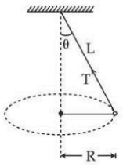
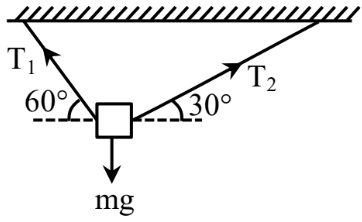

# Laws of Motion & Friction

> Theory: [../../theory/physics/laws-of-motion.md](../../theory/physics/laws-of-motion.md)

### P-LOM-01 · C — JEE Main 2026 · 21 Jan Shift 2 · set Q1 · MCQ

A large drum of radius $R$ is spinning about its axis with angular velocity $\omega$, as shown in the figure. The minimum value of $\omega$ so that a body of mass $M$ remains stuck to the inner wall of the drum, taking the coefficient of friction between the drum surface and the mass $M$ as $\mu$, is:

(1) $\sqrt{\dfrac{\mu g}{R}}$  (2) $\sqrt{\dfrac{g}{2\mu R}}$  (3) $\sqrt{\dfrac{2g}{\mu R}}$  (4) $\sqrt{\dfrac{g}{\mu R}}$

**Answer: (4)** · key (compiled)

**Solution.** In the drum's frame the wall's normal reaction supplies the centripetal force, $N=M\omega^2R$. Friction must balance the weight: $\mu N\ge Mg\Rightarrow\mu M\omega^2R\ge Mg$, so $\omega_{min}=\sqrt{\dfrac{g}{\mu R}}$.

### P-LOM-02 · C — JEE Main 2026 · 28 Jan Shift 2 · set Q2 · MCQ

A small block of mass $m$ slides down from the top of a frictionless inclined surface, while the inclined plane is moving towards the left with constant acceleration $a_0$. The angle between the inclined plane and the ground is $\theta$ and its base length is $L$. Assuming that initially the small block is at the top of the inclined plane, the time it takes to reach the lowest point of the inclined plane is ______.

(1) $\sqrt{\dfrac{2L}{g\sin\theta-a_0\cos\theta}}$  (2) $\sqrt{\dfrac{4L}{g\cos^2\theta-a_0\sin\theta\cos\theta}}$  (3) $\sqrt{\dfrac{2L}{g\sin2\theta-a_0(1+\cos2\theta)}}$  (4) $\sqrt{\dfrac{4L}{g\sin2\theta-a_0(1+\cos2\theta)}}$

**Answer: (4)** · key (compiled)

**Solution.** In the frame of the incline the pseudo force $ma_0$ acts to the right, and its component up the slope is $ma_0\cos\theta$. Along the slope: $a=g\sin\theta-a_0\cos\theta$. The distance along the slope is $\dfrac{L}{\cos\theta}=\tfrac12at^2$, so $t=\sqrt{\dfrac{2L}{\cos\theta\,(g\sin\theta-a_0\cos\theta)}}=\sqrt{\dfrac{4L}{g\sin2\theta-a_0(1+\cos2\theta)}}$.

### P-LOM-03 · C — JEE Main 2026 · 24 Jan Shift 2 · set Q3 · MCQ

A flexible chain of mass $m$ hangs between two fixed points at the same level. The inclination of the chain with the horizontal at the two points of support is $30^\circ$. Considering the equilibrium of each half of the chain, the tension of the chain at the lowest point is ______.

(1) $\dfrac{\sqrt3}{2}mg$  (2) $mg$  (3) $\dfrac12mg$  (4) $\sqrt3\,mg$

**Answer: (1)** · key (compiled)

**Solution.** For one half (weight $\tfrac{mg}{2}$): vertical balance $T_1\sin30^\circ=\tfrac{mg}2\Rightarrow T_1=mg$. Horizontal balance gives the tension at the lowest point $T_0=T_1\cos30^\circ=\dfrac{\sqrt3}{2}mg$.

### P-LOM-04 · C — JEE Main 2026 · 23 Jan Shift 2 · set Q4 · MCQ

A block is sliding down an inclined plane of slope $\theta$ and at an instant $t=0$ the block is given an upward momentum so that it starts moving up the inclined surface with velocity $u$. The distance $S$ travelled by the block before its velocity becomes zero is ______ ($g$ = gravitational acceleration). *(The paper does not mention friction; the key corresponds to a smooth incline.)*

(1) $\dfrac{2u^2}{\cos\theta}$  (2) $\dfrac{u^2}{2g\sin\theta}$  (3) $\dfrac{u^2}{2g\cos\theta}$  (4) $\dfrac{u^2}{\sqrt2\,g\cos\theta}$

**Answer: (2)** · key (compiled)

**Solution.** On a smooth incline the retardation is $g\sin\theta$. From $0=u^2-2g\sin\theta\,S$: $S=\dfrac{u^2}{2g\sin\theta}$.

### P-LOM-05 · C — JEE Main 2026 · 21 Jan Shift 1 · set Q5 · MCQ

A $4$ kg mass moves under the influence of a force $\vec F=(4t^3\hat i-3t\hat j)$ N, where $t$ is the time in seconds. If the mass starts from the origin at $t=0$, the velocity and position after $t=2$ s will be:

(1) $\vec v=4\hat i-\tfrac32\hat j$, $\vec r=6\hat i-\hat j$  (2) $\vec v=3\hat i+\tfrac32\hat j$, $\vec r=6\hat i+\hat j$  (3) $\vec v=4\hat i-\tfrac32\hat j$, $\vec r=\tfrac85\hat i-\hat j$  (4) $\vec v=4\hat i+\tfrac52\hat j$, $\vec r=\tfrac85\hat i+2\hat j$

**Answer: (3)** · key (compiled)

**Solution.** $\vec a=\dfrac{\vec F}{m}=t^3\hat i-\tfrac34t\hat j$. Integrating from rest: $\vec v=\dfrac{t^4}{4}\hat i-\dfrac{3t^2}{8}\hat j$, so at $t=2$: $\vec v=4\hat i-\tfrac32\hat j$. Integrating again: $\vec r=\dfrac{t^5}{20}\hat i-\dfrac{t^3}{8}\hat j$, so at $t=2$: $\vec r=\dfrac85\hat i-\hat j$.

### P-LOM-06 · C — JEE Main 2026 · 28 Jan Shift 1 · set Q6 · MCQ

A particle of mass $m$ falls from rest through a resistive medium having a resistive force $F=-kv$, where $v$ is the velocity of the particle and $k$ is a constant. Which of the following graphs represents the velocity ($v$) versus time ($t$)?

**(1)** 

**(2)** 

**(3)** 

**(4)** 

**Answer: (1)** · key (compiled)

**Solution.** $m\dfrac{dv}{dt}=mg-kv$. At $t=0$ the acceleration is $g$ (maximum); as $v$ grows the resistive force grows and the slope decreases until the terminal velocity $v_t=\dfrac{mg}{k}$ is reached asymptotically. So $v(t)=v_t\left(1-e^{-kt/m}\right)$: a curve from the origin with decreasing slope that flattens, option (1).

### P-LOM-07 · C — JEE Main 2025 · Jan session · LOM set Q1 · MCQ

A massless spring gets elongated by an amount $x_1$ under a tension of 5 N. Its elongation is $x_2$ under a tension of 7 N. For an elongation of $(5x_1-2x_2)$, the tension in the spring will be:

(1) 39 N  (2) 15 N  (3) 11 N  (4) 20 N

**Answer: (3)** · key (compiled)

**Solution.** $T=kx$ is linear, so $T(5x_1-2x_2)=5\cdot5-2\cdot7=11$ N.

### P-LOM-08 · C — JEE Main 2025 · Jan session · LOM set Q2 · Numerical

A string of length $L$ is fixed at one end and carries a mass $M$ at the other end. The mass makes $\left(\dfrac3\pi\right)$ rotations per second about the vertical axis passing through the end of the string, as shown (conical pendulum). The tension in the string is ______ $ML$.

**Answer: 36** · key (compiled)

**Solution.** $\omega=2\pi f=2\pi\cdot\dfrac3\pi=6$ rad/s. The horizontal component of tension supplies the centripetal force: $T\sin\theta=M\omega^2R=M\omega^2L\sin\theta$, so $T=M\omega^2L=36\,ML$.

### P-LOM-09 · C — JEE Main 2025 · Apr session · LOM set Q1 · MCQ

An object of mass 500 g moves along the $x$-axis with speed $v=4\sqrt x$ m/s. The force acting on the object is:

(1) 8 N  (2) 5 N  (3) 6 N  (4) 4 N

**Answer: (4)** · key (compiled)

**Solution.** $a=v\dfrac{dv}{dx}=\dfrac12\dfrac{d(v^2)}{dx}=\dfrac12\dfrac{d(16x)}{dx}=8\ \text{m/s}^2$ (constant). $F=ma=0.5\times8=4$ N.

### P-LOM-10 · C — JEE Main 2025 · Apr session · LOM set Q2 · MCQ

A body of mass 1 kg is suspended with the help of two strings making angles as shown in the figure ($60^\circ$ and $30^\circ$ with the horizontal ceiling). The magnitudes of tensions $T_1$ and $T_2$, respectively, are (in N): (take $g=10$ m/s$^2$)

(1) $5,\ 5\sqrt3$  (2) $5\sqrt3,\ 5$  (3) $5\sqrt3,\ 5\sqrt3$  (4) 5, 5

**Answer: (2)** · key (compiled)

**Solution.** Horizontal balance: $T_1\cos60^\circ=T_2\cos30^\circ\Rightarrow T_1=\sqrt3\,T_2$. Vertical: $T_1\sin60^\circ+T_2\sin30^\circ=10\Rightarrow\dfrac32T_2+\dfrac12T_2=10$, so $T_2=5$ N and $T_1=5\sqrt3$ N.

### P-LOM-11 · C — JEE Main 2025 · Apr session · LOM set Q4 · Numerical

The length of a light string is 1.4 m when the tension on it is 5 N. If the tension increases to 7 N, the length of the string is 1.56 m. The original (unstretched) length of the string is ______ m.

**Answer: 1** · key (compiled)

**Solution.** With $T=k(L-L_0)$: $5=k(1.4-L_0)$ and $7=k(1.56-L_0)$. Subtracting, $2=0.16k\Rightarrow k=12.5$ N/m. Then $1.4-L_0=0.4$, so $L_0=1.0$ m.

### P-LOM-12 · C — JEE Main 2024 · 27 Jan Shift 2 · Q3 · MCQ

Statement I: The limiting force of static friction depends on the area of contact and is independent of the materials.  
Statement II: The limiting force of kinetic friction is independent of the area of contact and depends on the materials.

(1) I correct, II incorrect  (2) I incorrect, II correct  (3) Both incorrect  (4) Both correct

**Answer: (2)** · key ✔

**Solution.** Limiting static friction $f_s=\mu_sN$ depends on the pair of materials (through $\mu_s$) and the normal force, not on the apparent contact area, so I is wrong. Kinetic friction $f_k=\mu_kN$ is likewise area-independent and material-dependent, so II is right.

### P-LOM-13 · C — JEE Main 2024 · 29 Jan Shift 2 · Q3 · MCQ

A stone of mass $900$ g is tied to a string and moved in a vertical circle of radius $1$ m making $10$ rpm. The tension in the string when the stone is at the lowest point is (take $\pi^2=9.8$ and $g=9.8\ \text{m s}^{-2}$)

(1) 97 N  (2) 9.8 N  (3) 8.82 N  (4) 17.8 N

**Answer: (2)** · key ✔

**Solution.** $\omega=\dfrac{2\pi\times10}{60}=\dfrac\pi3$, so $\omega^2=\dfrac{\pi^2}9=\dfrac{9.8}9$. At the lowest point $T-mg=m\omega^2r\Rightarrow T=0.9\left(9.8+\dfrac{9.8}{9}\right)=0.9\times9.8\times\dfrac{10}9=9.8$ N.

### P-LOM-14 · C — JEE Main 2024 · 30 Jan Shift 2 · Q3 · MCQ

Three blocks $A$ ($5$ kg), $B$ ($3$ kg) and $C$ ($2$ kg) are joined in a line by light strings ($T_1$ between $A$ and $B$, $T_2$ between $B$ and $C$) and pulled on a smooth horizontal surface by a force $F=80$ N applied on $C$. The tensions $T_1$ and $T_2$ are respectively

(1) 40 N, 64 N  (2) 60 N, 80 N  (3) 88 N, 96 N  (4) 80 N, 100 N

**Answer: (1)** · key ✔

**Solution.** Common acceleration $a=\dfrac{80}{5+3+2}=8\ \text{m s}^{-2}$. $T_1$ pulls only $A$: $T_1=5\times8=40$ N. $T_2$ pulls $A$ and $B$: $T_2=(5+3)\times8=64$ N.

### P-LOM-15 · C — JEE Main 2024 · 31 Jan Shift 1 · Q5 · MCQ

A doubly inclined plane has inclinations $53^\circ$ (carrying block $M=10$ kg) and $37^\circ$ (carrying block $m$); the blocks are joined by a light string over an ideal pulley at the top. The coefficient of friction between the plane and the blocks is $0.25$. The value of $m$ for which $M$ moves down with an acceleration of $2\ \text{m s}^{-2}$ is ($g=10\ \text{m s}^{-2}$, $\tan37^\circ=\tfrac34$)

(1) 9 kg  (2) 4.5 kg  (3) 6.5 kg  (4) 2.25 kg

**Answer: (2)** · key ✔

**Solution.** For $M$ down the $53^\circ$ slope: $Mg\sin53^\circ-\mu Mg\cos53^\circ-T=Ma\Rightarrow80-15-T=20\Rightarrow T=45$ N. For $m$ up the $37^\circ$ slope: $T-mg\sin37^\circ-\mu mg\cos37^\circ=ma\Rightarrow45=m(6+2+2)=10m\Rightarrow m=4.5$ kg.

