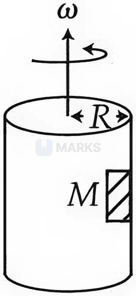
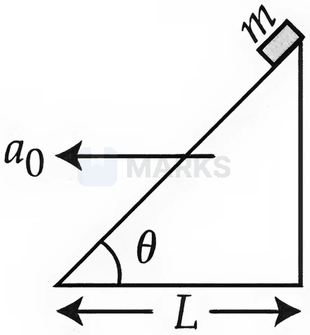
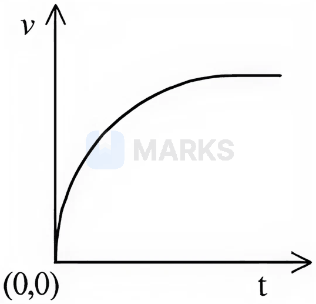
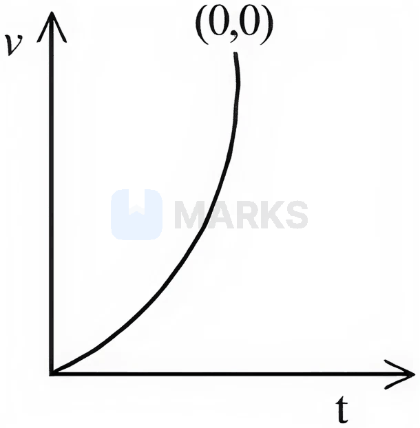
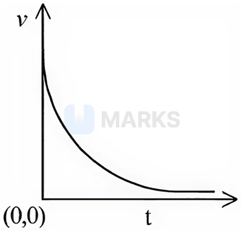
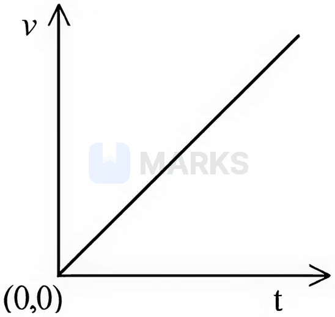

# Laws of Motion & Friction

> Theory: [../../theory/physics/laws-of-motion.md](../../theory/physics/laws-of-motion.md)

### P-LOM-01 — JEE Main 2024 · 27 Jan Shift 1 · Q3 · MCQ

A train moves at $12\ \text{m s}^{-1}$ on rails $1.5$ m apart. To negotiate a curve of radius $400$ m, by what height should the outer rail be raised above the inner rail? (Take $g=10\ \text{m s}^{-2}$)

(1) 6.0 cm  (2) 5.4 cm  (3) 4.8 cm  (4) 4.2 cm

**Answer: (2)** · key ✔

**Solution.** Banking without side thrust: $\tan\theta=\dfrac{v^2}{rg}=\dfrac{144}{400\times10}=0.036$. For small $\theta$, $h=l\tan\theta=1.5\times0.036=0.054$ m $=5.4$ cm.

### P-LOM-02 — JEE Main 2024 · 27 Jan Shift 2 · Q3 · MCQ

Statement I: The limiting force of static friction depends on the area of contact and is independent of the materials.
Statement II: The limiting force of kinetic friction is independent of the area of contact and depends on the materials.

(1) I correct, II incorrect  (2) I incorrect, II correct  (3) Both incorrect  (4) Both correct

**Answer: (2)** · key ✔

**Solution.** Limiting static friction $f_s=\mu_sN$ depends on the pair of materials (through $\mu_s$) and the normal force, not on the apparent contact area, so I is wrong. Kinetic friction $f_k=\mu_kN$ is likewise area-independent and material-dependent, so II is right.

### P-LOM-03 — JEE Main 2024 · 27 Jan Shift 2 · Q4 · MCQ

A ball suspended by a thread swings in a vertical plane so that the magnitudes of its acceleration at the extreme position and at the lowest position are equal. The angle $\theta$ of thread deflection at the extreme position is

(1) $\tan^{-1}\sqrt2$  (2) $2\tan^{-1}\dfrac12$  (3) $\tan^{-1}\dfrac12$  (4) $2\tan^{-1}\dfrac1{\sqrt5}$

**Answer: (2)** · key ✔

**Solution.** At the extreme the speed is zero, so only tangential acceleration acts: $a=g\sin\theta$. At the lowest point the acceleration is centripetal: $a=\dfrac{v^2}{L}=2g(1-\cos\theta)$. Equating: $2\sin\frac\theta2\cos\frac\theta2=4\sin^2\frac\theta2\Rightarrow\tan\frac\theta2=\frac12$, so $\theta=2\tan^{-1}\frac12$.

### P-LOM-04 — JEE Main 2024 · 29 Jan Shift 1 · Q3 · MCQ

The radii of curvature of the paths of two particles of the same mass are in the ratio $3:4$. To have a constant centripetal force, their velocities must be in the ratio

(1) $\sqrt3:2$  (2) $1:\sqrt3$  (3) $\sqrt3:1$  (4) $2:\sqrt3$

**Answer: (1)** · key ✔

**Solution.** $F=\dfrac{mv^2}{r}$ is the same for both, so $v\propto\sqrt r$: $\dfrac{v_1}{v_2}=\sqrt{\dfrac34}=\dfrac{\sqrt3}2$.

### P-LOM-05 — JEE Main 2024 · 29 Jan Shift 2 · Q3 · MCQ

A stone of mass $900$ g is tied to a string and moved in a vertical circle of radius $1$ m making $10$ rpm. The tension in the string when the stone is at the lowest point is (take $\pi^2=9.8$ and $g=9.8\ \text{m s}^{-2}$)

(1) 97 N  (2) 9.8 N  (3) 8.82 N  (4) 17.8 N

**Answer: (2)** · key ✔

**Solution.** $\omega=\dfrac{2\pi\times10}{60}=\dfrac\pi3$, so $\omega^2=\dfrac{\pi^2}9=\dfrac{9.8}9$. At the lowest point $T-mg=m\omega^2r\Rightarrow T=0.9\left(9.8+\dfrac{9.8}{9}\right)=0.9\times9.8\times\dfrac{10}9=9.8$ N.

### P-LOM-06 — JEE Main 2024 · 29 Jan Shift 2 · Q21 · Numerical

A particle moves in a circle of radius $50$ cm so that at any instant the normal and tangential components of its acceleration are equal. If its speed at $t=0$ is $4\ \text{m s}^{-1}$, the time taken to complete the first revolution is $\dfrac1\alpha\left[1-e^{-2\pi}\right]$ s. Find $\alpha$.

**Answer: 8** · key ✔

**Solution.** $a_t=a_n\Rightarrow v\dfrac{dv}{ds}=\dfrac{v^2}{r}\Rightarrow\dfrac{dv}{ds}=\dfrac vr\Rightarrow v=v_0e^{s/r}$. Then $\dfrac{ds}{dt}=v_0e^{s/r}\Rightarrow\int_0^{2\pi r}e^{-s/r}ds=v_0t\Rightarrow r\left(1-e^{-2\pi}\right)=v_0t$. So $t=\dfrac{0.5}{4}\left(1-e^{-2\pi}\right)=\dfrac18\left(1-e^{-2\pi}\right)$ and $\alpha=8$.

### P-LOM-07 — JEE Main 2024 · 30 Jan Shift 2 · Q3 · MCQ

Three blocks $A$ ($5$ kg), $B$ ($3$ kg) and $C$ ($2$ kg) are joined in a line by light strings ($T_1$ between $A$ and $B$, $T_2$ between $B$ and $C$) and pulled on a smooth horizontal surface by a force $F=80$ N applied on $C$. The tensions $T_1$ and $T_2$ are respectively

(1) 40 N, 64 N  (2) 60 N, 80 N  (3) 88 N, 96 N  (4) 80 N, 100 N

**Answer: (1)** · key ✔

**Solution.** Common acceleration $a=\dfrac{80}{5+3+2}=8\ \text{m s}^{-2}$. $T_1$ pulls only $A$: $T_1=5\times8=40$ N. $T_2$ pulls $A$ and $B$: $T_2=(5+3)\times8=64$ N.

### P-LOM-08 — JEE Main 2024 · 30 Jan Shift 2 · Q4 · MCQ

A block of mass $m$ is placed on a surface whose vertical cross-section is $y=\dfrac{x^2}4$. If the coefficient of friction is $0.5$, the maximum height above the ground at which the block can be placed without slipping is

(1) $\tfrac14$ m  (2) $\tfrac12$ m  (3) $\tfrac16$ m  (4) $\tfrac13$ m

**Answer: (1)** · key ✔

**Solution.** The block just fails to slip when $\tan\theta=\mu$, where the slope is $\dfrac{dy}{dx}=\dfrac x2$. So $\dfrac x2=0.5\Rightarrow x=1$ m, and $y=\dfrac{1^2}4=\dfrac14$ m.

### P-LOM-09 — JEE Main 2024 · 31 Jan Shift 1 · Q5 · MCQ

A doubly inclined plane has inclinations $53^\circ$ (carrying block $M=10$ kg) and $37^\circ$ (carrying block $m$); the blocks are joined by a light string over an ideal pulley at the top. The coefficient of friction between the plane and the blocks is $0.25$. The value of $m$ for which $M$ moves down with an acceleration of $2\ \text{m s}^{-2}$ is ($g=10\ \text{m s}^{-2}$, $\tan37^\circ=\tfrac34$)

(1) 9 kg  (2) 4.5 kg  (3) 6.5 kg  (4) 2.25 kg

**Answer: (2)** · key ✔

**Solution.** For $M$ down the $53^\circ$ slope: $Mg\sin53^\circ-\mu Mg\cos53^\circ-T=Ma\Rightarrow80-15-T=20\Rightarrow T=45$ N. For $m$ up the $37^\circ$ slope: $T-mg\sin37^\circ-\mu mg\cos37^\circ=ma\Rightarrow45=m(6+2+2)=10m\Rightarrow m=4.5$ kg.

### P-LOM-10 — JEE Main 2024 · 31 Jan Shift 1 · Q6 · MCQ

A coin is placed on a disc. The coefficient of friction between the coin and the disc is $\mu$. If the distance of the coin from the centre of the disc is $r$, the maximum angular velocity that can be given to the disc so that the coin does not slip away is

(1) $\dfrac{\mu g}r$  (2) $\sqrt{\dfrac r{\mu g}}$  (3) $\sqrt{\dfrac{\mu g}r}$  (4) $\dfrac\mu{\sqrt{rg}}$

**Answer: (3)** · key ✔

**Solution.** Friction provides the centripetal force: $m\omega^2r\le\mu mg\Rightarrow\omega\le\sqrt{\dfrac{\mu g}r}$.

### P-LOM-11 — JEE Main 2024 · 31 Jan Shift 2 · Q3 · MCQ

A light string passing over a smooth light fixed pulley connects two blocks of masses $m_1$ and $m_2$. If the acceleration of the system is $\dfrac g8$, then the ratio of the masses $\dfrac{m_1}{m_2}$ is

(the options were $\tfrac97$ (option 1) and other simple ratios)

**Answer: $\dfrac97$ (option 1)** · key ✔

**Solution.** For an Atwood machine $a=\dfrac{m_1-m_2}{m_1+m_2}g=\dfrac g8\Rightarrow8m_1-8m_2=m_1+m_2\Rightarrow7m_1=9m_2$, so $\dfrac{m_1}{m_2}=\dfrac97$.

### P-LOM-12 — JEE Main 2024 · 31 Jan Shift 2 · Q4 · MCQ

A block of mass $5$ kg is placed on a rough inclined surface ($\mu=0.1$, inclination $30^\circ$). If $F_1$ is the force required to just move the block up the inclined plane and $F_2$ is the force required to just prevent the block from sliding down, then $F_1-F_2$ is ($g=10\ \text{m s}^{-2}$)

(1) $25\sqrt3$ N  (2) $5\sqrt3$ N  (3) $\dfrac{5\sqrt3}2$ N  (4) 10 N

**Answer: (2)** · key ✔

**Solution.** $F_1=mg\sin\theta+\mu mg\cos\theta$ (friction down the slope) and $F_2=mg\sin\theta-\mu mg\cos\theta$ (friction up the slope). $F_1-F_2=2\mu mg\cos\theta=2(0.1)(50)\dfrac{\sqrt3}2=5\sqrt3$ N.

### P-LOM-13 — JEE Main 2024 · 1 Feb Shift 1 · Q6 · MCQ

A ball of mass $0.5$ kg is attached to a string of length $50$ cm. The ball is rotated on a horizontal circular path about its vertical axis. The maximum tension that the string can bear is $400$ N. The maximum possible value of angular velocity of the ball is

(1) 1600 rad s$^{-1}$  (2) 40 rad s$^{-1}$  (3) 1000 rad s$^{-1}$  (4) 20 rad s$^{-1}$

**Answer: (2)** · key ✔

**Solution.** For a (nearly) horizontal circle of radius equal to the string length, $T=m\omega^2r$. $\omega_{\max}=\sqrt{\dfrac{T_{\max}}{mr}}=\sqrt{\dfrac{400}{0.5\times0.5}}=\sqrt{1600}=40$ rad/s.

### P-LOM-14 — JEE Main 2024 · 1 Feb Shift 2 · Q3 · MCQ

A cricket player catches a ball of mass $120$ g moving at $25\ \text{m s}^{-1}$. If the catch takes $0.1$ s, the magnitude of the force exerted by the ball on the hand is (SI):

(1) 24  (2) 12  (3) 25  (4) 30

**Answer: (4)** · key ✔

**Solution.** $F=\dfrac{\Delta p}{\Delta t}=\dfrac{0.12\times25}{0.1}=30$ N.

### P-LOM-15 — JEE Main 2024 · 4 Apr Shift 1 · Q21 · Numerical

Two forces $\vec F_1$ and $\vec F_2$ act on a body. One has magnitude thrice the other and the resultant equals the larger force. The angle between them is $\cos^{-1}(1/n)$. The value of $|n|$ is ______.

**Answer: 6** · key ✔

**Solution.** Let $F_2=F$, $F_1=3F$. The resultant $R=3F$: $9F^2=9F^2+F^2+6F^2\cos\theta\Rightarrow\cos\theta=-\tfrac16$. So $n=-6$ and $|n|=6$.

### P-LOM-16 — JEE Main 2024 · 5 Apr Shift 1 · Q4 · MCQ

A wooden block of mass $5$ kg rests on a soft horizontal floor. When an iron cylinder of mass $25$ kg is placed on top, the floor yields and the block and cylinder go down together with an acceleration of $0.1\ \text{m s}^{-2}$. The action force of the system on the floor is:

(1) 196 N  (2) 291 N  (3) 294 N  (4) 297 N

**Answer: (2)** · key ✔

**Solution.** For the system ($m=30$ kg) moving down: $mg-N=ma\Rightarrow N=m(g-a)=30(9.8-0.1)=291$ N. By Newton's third law the force on the floor is $291$ N. (The key uses $g=9.8\ \text{m s}^{-2}$.)

### P-LOM-17 — JEE Main 2024 · 5 Apr Shift 2 · Q1 · MCQ

A particle moves in the $x$–$y$ plane under a force $\vec F$ such that its linear momentum is $\vec p(t)=\hat i\cos(kt)-\hat j\sin(kt)$, $k$ constant. The angle between $\vec F$ and $\vec p$ is:

(1) $\dfrac\pi4$  (2) $\dfrac\pi6$  (3) $\dfrac\pi2$  (4) $\dfrac\pi3$

**Answer: (3)** · key ✔

**Solution.** $\vec F=\dfrac{d\vec p}{dt}=-k\left(\hat i\sin kt+\hat j\cos kt\right)$. $\vec F\cdot\vec p=-k(\sin kt\cos kt-\cos kt\sin kt)=0$, so the angle is $\pi/2$ (the momentum has constant magnitude, and only its direction rotates).

### P-LOM-18 — JEE Main 2024 · 6 Apr Shift 1 · Q4 · MCQ

A light string passing over a smooth light pulley connects two blocks of masses $m_1$ and $m_2$ ($m_2>m_1$). If the acceleration of the system is $\dfrac{g}{\sqrt2}$, the ratio $\dfrac{m_1}{m_2}$ is:

(1) $\dfrac{\sqrt5-1}{1+\sqrt5}$  (2) $\dfrac{\sqrt2-1}{\sqrt2+1}$  (3) $\dfrac{1+\sqrt5}{\sqrt5-1}$  (4) $\dfrac{\sqrt3+1}{\sqrt2-1}$

**Answer: (2)** · key ✔

**Solution.** Atwood machine: $a=\dfrac{(m_2-m_1)g}{m_1+m_2}=\dfrac{g}{\sqrt2}$, so $\dfrac{1-m_1/m_2}{1+m_1/m_2}=\dfrac1{\sqrt2}$. Solving: $\dfrac{m_1}{m_2}=\dfrac{\sqrt2-1}{\sqrt2+1}$.

### P-LOM-19 — JEE Main 2024 · 6 Apr Shift 2 · Q3 · MCQ

A body of weight $200$ N is suspended from a tree branch through a chain of mass $10$ kg. The branch pulls the chain with a force equal to ($g=10\ \text{m/s}^2$):

(1) 100 N  (2) 200 N  (3) 300 N  (4) 150 N

**Answer: (3)** · key ✔

**Solution.** The body and chain are at rest. The branch supports the weight of the body plus the weight of the chain: $200+10\times10=300$ N.

### P-LOM-20 — JEE Main 2024 · 6 Apr Shift 2 · Q4 · MCQ

A car of $800$ kg is taking a turn on a banked road of radius $300$ m and banking angle $30^\circ$. If the coefficient of static friction is $0.2$, the maximum speed with which the car can negotiate the turn safely is ($g=10$, $\sqrt3=1.73$):

(1) 264 m/s  (2) 51.4 m/s  (3) 70.4 m/s  (4) 102.8 m/s

**Answer: (2)** · key ✔

**Solution.** $v_{max}^2=rg\dfrac{\tan\theta+\mu}{1-\mu\tan\theta}$ with $\tan30^\circ=\dfrac1{1.73}=0.578$: $\dfrac{0.578+0.2}{1-0.1156}=0.880$. $v^2=300\times10\times0.880=2640$, so $v\approx51.4$ m/s.

### P-LOM-21 — JEE Main 2024 · 8 Apr Shift 2 · Q3 · MCQ

An object takes $n$ times the time to slide down a rough $45^\circ$ inclined plane as it takes to slide down an identical perfectly smooth $45^\circ$ inclined plane. The coefficient of kinetic friction between the object and the inclined plane is:

(1) $\dfrac{1}{\sqrt{1-\frac1{n^2}}}$  (2) $\sqrt{1-\dfrac1{n^2}}$  (3) $1-\dfrac1{n^2}$  (4) $\sqrt{1-n^2}$

**Answer: (3)** · key ✔

**Solution.** For a distance $s$ from rest, $t=\sqrt{2s/a}$, so $t\propto a^{-1/2}$. Smooth: $a_1=g\sin45^\circ$; rough: $a_2=g(\sin45^\circ-\mu\cos45^\circ)=g\sin45^\circ(1-\mu)$. $\dfrac{t_2}{t_1}=\sqrt{\dfrac{a_1}{a_2}}=\dfrac1{\sqrt{1-\mu}}=n\Rightarrow\mu=1-\dfrac1{n^2}$.

### § — JEE Main 2026 · 21 Jan Shift 2 · set Q1 · MCQ

A large drum of radius $R$ is spinning about its axis with angular velocity $\omega$, as shown in the figure. The minimum value of $\omega$ so that a body of mass $M$ remains stuck to the inner wall of the drum, taking the coefficient of friction between the drum surface and the mass $M$ as $\mu$, is:

(1) $\sqrt{\dfrac{\mu g}{R}}$  (2) $\sqrt{\dfrac{g}{2\mu R}}$  (3) $\sqrt{\dfrac{2g}{\mu R}}$  (4) $\sqrt{\dfrac{g}{\mu R}}$

**Answer: (4)** · key (compiled)

**Solution.** In the drum's frame the wall's normal reaction supplies the centripetal force, $N=M\omega^2R$. Friction must balance the weight: $\mu N\ge Mg\Rightarrow\mu M\omega^2R\ge Mg$, so $\omega_{min}=\sqrt{\dfrac{g}{\mu R}}$.

### § — JEE Main 2026 · 28 Jan Shift 2 · set Q2 · MCQ

A small block of mass $m$ slides down from the top of a frictionless inclined surface, while the inclined plane is moving towards the left with constant acceleration $a_0$. The angle between the inclined plane and the ground is $\theta$ and its base length is $L$. Assuming that initially the small block is at the top of the inclined plane, the time it takes to reach the lowest point of the inclined plane is ______.

(1) $\sqrt{\dfrac{2L}{g\sin\theta-a_0\cos\theta}}$  (2) $\sqrt{\dfrac{4L}{g\cos^2\theta-a_0\sin\theta\cos\theta}}$  (3) $\sqrt{\dfrac{2L}{g\sin2\theta-a_0(1+\cos2\theta)}}$  (4) $\sqrt{\dfrac{4L}{g\sin2\theta-a_0(1+\cos2\theta)}}$

**Answer: (4)** · key (compiled)

**Solution.** In the frame of the incline the pseudo force $ma_0$ acts to the right, and its component up the slope is $ma_0\cos\theta$. Along the slope: $a=g\sin\theta-a_0\cos\theta$. The distance along the slope is $\dfrac{L}{\cos\theta}=\tfrac12at^2$, so $t=\sqrt{\dfrac{2L}{\cos\theta\,(g\sin\theta-a_0\cos\theta)}}=\sqrt{\dfrac{4L}{g\sin2\theta-a_0(1+\cos2\theta)}}$.

### § — JEE Main 2026 · 24 Jan Shift 2 · set Q3 · MCQ

A flexible chain of mass $m$ hangs between two fixed points at the same level. The inclination of the chain with the horizontal at the two points of support is $30^\circ$. Considering the equilibrium of each half of the chain, the tension of the chain at the lowest point is ______.

(1) $\dfrac{\sqrt3}{2}mg$  (2) $mg$  (3) $\dfrac12mg$  (4) $\sqrt3\,mg$

**Answer: (1)** · key (compiled)

**Solution.** For one half (weight $\tfrac{mg}{2}$): vertical balance $T_1\sin30^\circ=\tfrac{mg}2\Rightarrow T_1=mg$. Horizontal balance gives the tension at the lowest point $T_0=T_1\cos30^\circ=\dfrac{\sqrt3}{2}mg$.

### § — JEE Main 2026 · 23 Jan Shift 2 · set Q4 · MCQ

A block is sliding down an inclined plane of slope $\theta$ and at an instant $t=0$ the block is given an upward momentum so that it starts moving up the inclined surface with velocity $u$. The distance $S$ travelled by the block before its velocity becomes zero is ______ ($g$ = gravitational acceleration). *(The paper does not mention friction; the key corresponds to a smooth incline.)*

(1) $\dfrac{2u^2}{\cos\theta}$  (2) $\dfrac{u^2}{2g\sin\theta}$  (3) $\dfrac{u^2}{2g\cos\theta}$  (4) $\dfrac{u^2}{\sqrt2\,g\cos\theta}$

**Answer: (2)** · key (compiled)

**Solution.** On a smooth incline the retardation is $g\sin\theta$. From $0=u^2-2g\sin\theta\,S$: $S=\dfrac{u^2}{2g\sin\theta}$.

### § — JEE Main 2026 · 21 Jan Shift 1 · set Q5 · MCQ

A $4$ kg mass moves under the influence of a force $\vec F=(4t^3\hat i-3t\hat j)$ N, where $t$ is the time in seconds. If the mass starts from the origin at $t=0$, the velocity and position after $t=2$ s will be:

(1) $\vec v=4\hat i-\tfrac32\hat j$, $\vec r=6\hat i-\hat j$  (2) $\vec v=3\hat i+\tfrac32\hat j$, $\vec r=6\hat i+\hat j$  (3) $\vec v=4\hat i-\tfrac32\hat j$, $\vec r=\tfrac85\hat i-\hat j$  (4) $\vec v=4\hat i+\tfrac52\hat j$, $\vec r=\tfrac85\hat i+2\hat j$

**Answer: (3)** · key (compiled)

**Solution.** $\vec a=\dfrac{\vec F}{m}=t^3\hat i-\tfrac34t\hat j$. Integrating from rest: $\vec v=\dfrac{t^4}{4}\hat i-\dfrac{3t^2}{8}\hat j$, so at $t=2$: $\vec v=4\hat i-\tfrac32\hat j$. Integrating again: $\vec r=\dfrac{t^5}{20}\hat i-\dfrac{t^3}{8}\hat j$, so at $t=2$: $\vec r=\dfrac85\hat i-\hat j$.

### § — JEE Main 2026 · 28 Jan Shift 1 · set Q6 · MCQ

A particle of mass $m$ falls from rest through a resistive medium having a resistive force $F=-kv$, where $v$ is the velocity of the particle and $k$ is a constant. Which of the following graphs represents the velocity ($v$) versus time ($t$)?

**(1)** 

**(2)** 

**(3)** 

**(4)** 

**Answer: (1)** · key (compiled)

**Solution.** $m\dfrac{dv}{dt}=mg-kv$. At $t=0$ the acceleration is $g$ (maximum); as $v$ grows the resistive force grows and the slope decreases until the terminal velocity $v_t=\dfrac{mg}{k}$ is reached asymptotically. So $v(t)=v_t\left(1-e^{-kt/m}\right)$: a curve from the origin with decreasing slope that flattens, option (1).

### § — JEE Main 2026 · 28 Jan Shift 1 · set Q7 · MCQ

A block of mass $5$ kg is moving on an inclined plane that makes an angle of $30^\circ$ with the horizontal. The coefficient of friction between the block and the inclined plane is $\dfrac{\sqrt3}{2}$. The force to be applied on the block so that the block moves down without acceleration is ______ N. ($g=10\ \text{m/s}^2$)

(1) 25  (2) 7.5  (3) 12.5  (4) 15

**Answer: (3)** · key (compiled)

**Solution.** Component of weight down the slope $=5\times10\times\tfrac12=25$ N. Normal force $=50\cos30^\circ=25\sqrt3$ N, so friction $=\mu N=\dfrac{\sqrt3}{2}\times25\sqrt3=37.5$ N (up the slope). For zero acceleration with an extra force $F$ down the slope: $25+F=37.5\Rightarrow F=12.5$ N.

### § — JEE Main 2026 · 24 Jan Shift 1 · set Q8 · MCQ

A spring of force constant $15$ N/m is cut into two pieces. If the ratio of their lengths is $1:3$, the force constant of the smaller piece is ______ N/m.

(1) 60  (2) 15  (3) 20  (4) 45

**Answer: (1)** · key (compiled)

**Solution.** For a given spring $kL=\text{constant}$. The smaller piece is $\tfrac14$ of the total length, so $k_1=4\times15=60$ N/m.

