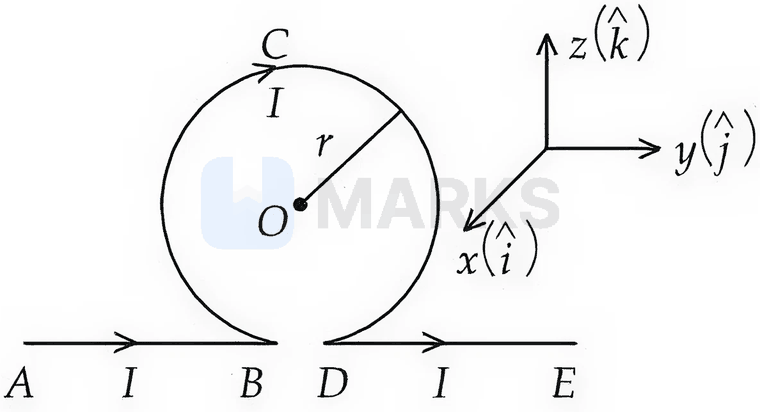
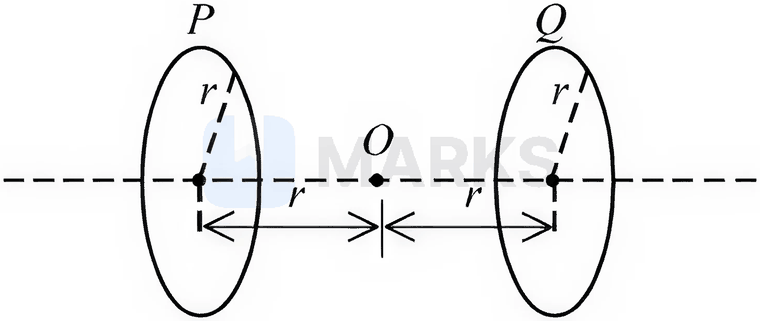
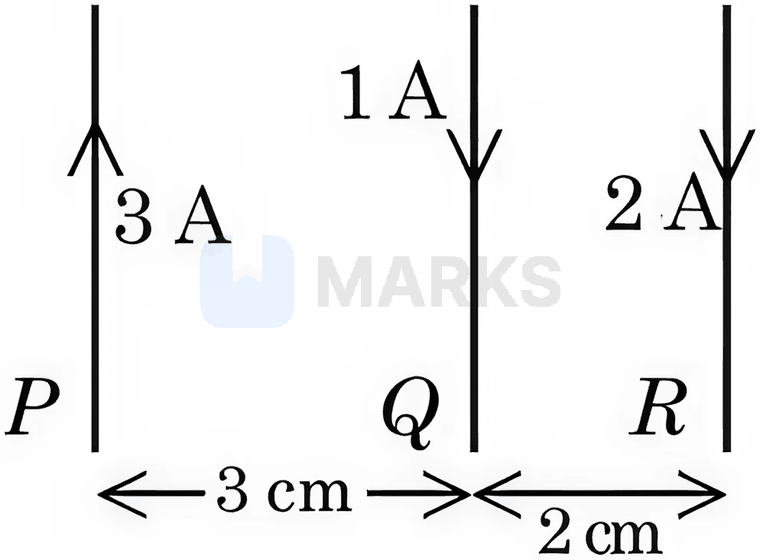
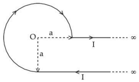
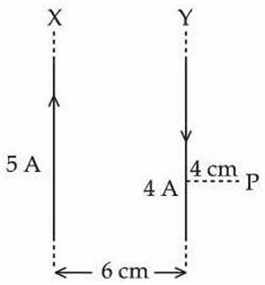
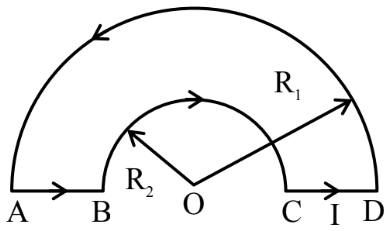
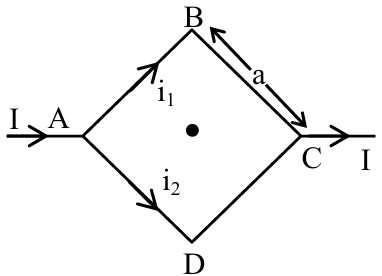
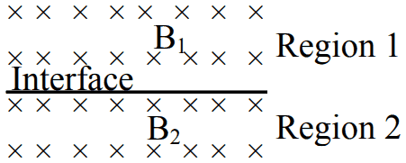

# Magnetic Effects of Current & Magnetism

> Theory: [../../theory/physics/magnetism.md](../../theory/physics/magnetism.md)

### P-MAG-01 — JEE Main 2024 · 27 Jan Shift 1 · Q13 · MCQ

A proton moving with a constant velocity passes through a region of space without any change in its velocity. If $\vec E$ and $\vec B$ represent the electric and magnetic fields, the region may have:
(A) $E=0,\ B=0$  (B) $E=0,\ B\neq0$  (C) $E\neq0,\ B=0$  (D) $E\neq0,\ B\neq0$

(1) (A), (B) and (C) only  (2) (A), (C) and (D) only  (3) (A), (B) and (D) only  (4) (B), (C) and (D) only

**Answer: (3)** · key ✔

**Solution.** Constant velocity needs zero net force $q(\vec E+\vec v\times\vec B)=0$. (A) trivially. (B) works if $\vec v\parallel\vec B$ so $\vec v\times\vec B=0$. (C) fails: $q\vec E\neq0$ with nothing to cancel it. (D) works when $\vec E=-\vec v\times\vec B$ (velocity selector).

### P-MAG-02 — JEE Main 2024 · 29 Jan Shift 1 · Q27 · Numerical

The magnetic potential due to a magnetic dipole at a point on its axis, at a distance of $20$ cm from its centre, is $1.5\times10^{-5}\ \text{T m A}^{-1}$. The magnetic moment of the dipole is ______ A m$^2$. (Given $\dfrac{\mu_0}{4\pi}=10^{-7}\ \text{T m A}^{-1}$)

**Answer: 6** · key ✔

**Solution.** On the axis, $V=\dfrac{\mu_0}{4\pi}\dfrac{M}{r^2}$. So $M=\dfrac{Vr^2}{10^{-7}}=\dfrac{1.5\times10^{-5}\times0.04}{10^{-7}}=6$ A m$^2$.

### P-MAG-03 — JEE Main 2024 · 29 Jan Shift 2 · Q13 · MCQ

Two particles $X$ and $Y$ having equal charges are accelerated through the same potential difference. They then enter normally a region of uniform magnetic field and describe circular paths of radii $R_1$ and $R_2$ respectively. The mass ratio of $X$ and $Y$ is

(1) $\left(\dfrac{R_2}{R_1}\right)^2$  (2) $\left(\dfrac{R_1}{R_2}\right)^2$  (3) $\dfrac{R_1}{R_2}$  (4) $\dfrac{R_2}{R_1}$

**Answer: (2)** · key ✔

**Solution.** $qV=\tfrac12mv^2\Rightarrow v=\sqrt{2qV/m}$ and $r=\dfrac{mv}{qB}=\dfrac1B\sqrt{\dfrac{2mV}{q}}$. So $r^2\propto m$ and $\dfrac{m_X}{m_Y}=\left(\dfrac{R_1}{R_2}\right)^2$.

### P-MAG-04 — JEE Main 2024 · 29 Jan Shift 2 · Q26 · Numerical

A charge of $4.0\ \mu$C moves with velocity $4.0\times10^6\ \text{m s}^{-1}$ along the positive $y$-axis in a magnetic field $\vec B=(2\hat k)$ T. The force acting on the charge is $x\hat i$ N. The value of $x$ is ______.

**Answer: 32** · key ✔

**Solution.** $\vec F=q\,\vec v\times\vec B=4\times10^{-6}\,(4\times10^6\hat j)\times(2\hat k)=32\,(\hat j\times\hat k)=32\hat i$ N. So $x=32$.

### P-MAG-05 — JEE Main 2024 · 30 Jan Shift 1 · Q28 · Numerical

The horizontal component of the earth's magnetic field at a place is $3.5\times10^{-5}$ T. A very long straight conductor carrying a current of $\sqrt2$ A in the direction from south-east to north-west is placed there. The force per unit length experienced by the conductor is ______ $\times10^{-6}\ \text{N m}^{-1}$.

**Answer: 35** · key ✔

**Solution.** $\vec B_H$ points north. The current along north-west makes $45^\circ$ with north, so $\dfrac Fl=IB\sin45^\circ=\sqrt2\times3.5\times10^{-5}\times\dfrac1{\sqrt2}=3.5\times10^{-5}=35\times10^{-6}\ \text{N m}^{-1}$.

### P-MAG-06 — JEE Main 2024 · 30 Jan Shift 2 · Q28 · Numerical

A current of $5$ A flows in a square loop of side $1$ m placed in air. The magnetic field at the centre of the loop is $X\sqrt2\times10^{-7}$ T. The value of $X$ is ______.

**Answer: 40** · key ✔

**Solution.** Each side gives $B_1=\dfrac{\mu_0I}{4\pi d}(\sin45^\circ+\sin45^\circ)$ with $d=0.5$ m: $B_1=10^{-7}\times\dfrac5{0.5}\times\sqrt2=10\sqrt2\times10^{-7}$ T. Four sides: $B=40\sqrt2\times10^{-7}$ T, so $X=40$.

### P-MAG-07 — JEE Main 2024 · 31 Jan Shift 1 · Q27 · Numerical

An electron moves through a uniform magnetic field $\vec B=B_0\hat i+2B_0\hat j$ T. At a particular instant its velocity is $\vec u=3\hat i+5\hat j\ \text{m s}^{-1}$. If the magnetic force on it is $\vec F=5e\hat k$ N, where $e$ is the charge of the electron, then the value of $B_0$ is ______ T.

**Answer: 5** · key ✔

**Solution.** $\vec F=e\,(\vec u\times\vec B)$ with $e$ the (signed) charge. $\vec u\times\vec B=(3\hat i+5\hat j)\times(B_0\hat i+2B_0\hat j)=6B_0\hat k-5B_0\hat k=B_0\hat k$. So $eB_0\hat k=5e\hat k\Rightarrow B_0=5$ T.

### P-MAG-08 — JEE Main 2024 · 31 Jan Shift 2 · Q13 · MCQ

A uniform magnetic field of $2\times10^{-3}$ T acts along the positive $Y$-direction. A rectangular loop of sides $20$ cm and $10$ cm carrying a current of $5$ A lies in the $Y$–$Z$ plane. The current is anticlockwise as seen looking from the negative $X$-axis. The magnitude and direction of the torque is

(1) $2\times10^{-4}$ N m along $+Z$  (2) $2\times10^{-4}$ N m along $-Z$  (3) $2\times10^{-4}$ N m along $+X$  (4) $2\times10^{-4}$ N m along $+Y$

**Answer: (2)** · key ✔

**Solution.** $|\vec m|=IA=5\times(0.2\times0.1)=0.1$ A m$^2$. Anticlockwise as seen from the negative $X$ side means the normal (right-hand rule) points towards that observer, i.e. along $-\hat x$: $\vec m=-0.1\,\hat x$. $\vec\tau=\vec m\times\vec B=-0.1\,\hat x\times(2\times10^{-3}\hat y)=-2\times10^{-4}\,\hat z$ N m.

### P-MAG-09 — JEE Main 2024 · 31 Jan Shift 2 · Q27 · Numerical

Two circular coils $P$ and $Q$ of $100$ turns each have the same radius of $\pi$ cm. The currents in $P$ and $Q$ are $1$ A and $2$ A respectively. $P$ and $Q$ are placed with their planes mutually perpendicular and their centres coinciding. The resultant magnetic field induction at the centre is $\sqrt x$ mT, where $x=$ ______. (Use $\mu_0=4\pi\times10^{-7}\ \text{T m A}^{-1}$)

**Answer: 20** · key ✔

**Solution.** $B=\dfrac{\mu_0NI}{2r}=\dfrac{4\pi\times10^{-7}\times100\times I}{2\pi\times10^{-2}}=2\times10^{-3}I$ T. So $B_P=2$ mT and $B_Q=4$ mT, perpendicular to each other: $B=\sqrt{2^2+4^2}=\sqrt{20}$ mT. Hence $x=20$.

### P-MAG-10 — JEE Main 2024 · 1 Feb Shift 1 · Q27 · Numerical

A regular polygon of $6$ sides is formed by bending a wire of length $4\pi$ m. If an electric current of $4\pi\sqrt3$ A flows through the sides of the polygon, the magnetic field at the centre of the polygon would be $x\times10^{-7}$ T. The value of $x$ is ______.

**Answer: 72** · key ✔

**Solution.** Side $a=\dfrac{4\pi}6=\dfrac{2\pi}3$ m; the distance from the centre to a side is $d=\dfrac{a\sqrt3}2=\dfrac\pi{\sqrt3}$. Each side gives $B_1=\dfrac{\mu_0I}{4\pi d}(2\sin30^\circ)=10^{-7}\dfrac Id$. Six sides: $B=6\times10^{-7}\times\dfrac{4\pi\sqrt3}{\pi/\sqrt3}=6\times10^{-7}\times12=72\times10^{-7}$ T.

### P-MAG-11 — JEE Main 2024 · 1 Feb Shift 2 · Q27 · Numerical

A moving-coil galvanometer has $100$ turns, each of area $2.0\ \text{cm}^2$, in a field of $0.01$ T. A current of $10$ mA gives a deflection of $0.05$ rad. The torsional constant is $x\times10^{-5}$ N m/rad; $x=$ ______.

**Answer: 4** · key ✔

**Solution.** $NIAB=k\phi\Rightarrow k=\dfrac{100\times10^{-2}\times2\times10^{-4}\times10^{-2}}{0.05}=\dfrac{2\times10^{-6}}{0.05}=4\times10^{-5}$ N m/rad.

### P-MAG-12 — JEE Main 2024 · 4 Apr Shift 1 · Q14 · MCQ

An electron is projected with uniform velocity along the axis inside a current-carrying long solenoid. Then:

(1) the electron continues with uniform velocity along the axis  (2) the electron is accelerated along the axis  (3) the electron's path is circular about the axis  (4) the electron experiences a force at $45^\circ$ to the axis and moves in a helix

**Answer: (1)** · key ✔

**Solution.** Inside a long solenoid the field is uniform and parallel to the axis. The electron's velocity is parallel to $\vec B$, so $\vec F=q\vec v\times\vec B=0$ and it keeps moving uniformly.

### P-MAG-13 — JEE Main 2024 · 4 Apr Shift 2 · Q13 · MCQ

The magnetic moment of a bar magnet is $0.5\ \text{A m}^2$. It is suspended in a uniform magnetic field of $8\times10^{-2}$ T. The work done in rotating it from its most stable to its most unstable position is:

(1) $8\times10^{-2}$ J  (2) $4\times10^{-2}$ J  (3) zero  (4) $16\times10^{-2}$ J

**Answer: (1)** · key ✔

**Solution.** $U=-mB\cos\theta$, from $\theta=0$ to $\pi$: $W=2mB=2\times0.5\times8\times10^{-2}=8\times10^{-2}$ J.

### P-MAG-14 — JEE Main 2024 · 5 Apr Shift 1 · Q14 · MCQ

In a co-axial straight cable the central conductor and the outer conductor carry equal currents in opposite directions. The magnetic field is zero:

(1) outside the cable  (2) inside the outer conductor  (3) inside the inner conductor  (4) in between the two conductors

**Answer: (1)** · key ✔

**Solution.** By Ampère's law, a loop outside the cable encloses net current $I-I=0$, so $B=0$ there. Between the conductors the enclosed current is $I$ ($B=\mu_0I/2\pi r$), and inside each conductor a fraction of the current is enclosed.

### P-MAG-15 — JEE Main 2024 · 5 Apr Shift 1 · Q27 · Numerical

A $2$ A current-carrying straight metal wire of resistance $1\ \Omega$, resistivity $2\times10^{-6}\ \Omega\,\text{m}$, cross-section $10\ \text{mm}^2$ and mass $500$ g is suspended horizontally by a uniform magnetic field $\vec B$. $B=$ ______ $\times10^{-1}$ T ($g=10$).

**Answer: 5** · key ✔

**Solution.** Length $l=\dfrac{RA}{\rho}=\dfrac{1\times10\times10^{-6}}{2\times10^{-6}}=5$ m. Balance: $BIl=mg\Rightarrow B=\dfrac{0.5\times10}{2\times5}=0.5$ T $=5\times10^{-1}$ T.

### P-MAG-16 — JEE Main 2024 · 5 Apr Shift 2 · Q27 · Numerical

A solenoid of length $0.5$ m and radius $1$ cm has $N$ turns and carries $5$ A. If the magnetic field inside is $6.28\times10^{-3}$ T, then $N=$ ______.

**Answer: 500** · key ✔

**Solution.** $B=\mu_0nI\Rightarrow n=\dfrac{6.28\times10^{-3}}{4\pi\times10^{-7}\times5}=1000\ \text{turns/m}$. $N=nl=1000\times0.5=500$.

### P-MAG-17 — JEE Main 2024 · 6 Apr Shift 1 · Q13 · MCQ

A current element $\Delta\vec l=\Delta x\,\hat i$ is placed at the origin and carries a large current $I=10$ A. The magnetic field on the $y$-axis at a distance of $0.5$ m from the element, for $\Delta x=1$ cm, is:

(1) $4\times10^{-8}$ T  (2) $10\times10^{-8}$ T  (3) $8\times10^{-8}$ T  (4) $12\times10^{-8}$ T

**Answer: (1)** · key ✔

**Solution.** Biot–Savart: $dB=\dfrac{\mu_0}{4\pi}\dfrac{I\,\Delta x\sin\theta}{r^2}$ with $\theta=90^\circ$: $10^{-7}\times\dfrac{10\times0.01}{0.25}=4\times10^{-8}$ T.

### P-MAG-18 — JEE Main 2024 · 6 Apr Shift 1 · Q27 · Numerical

A circular coil of $200$ turns, area $2.5\times10^{-4}\ \text{m}^2$ each, carrying $100\ \mu\text{A}$, is placed in a uniform field of $1$ T with its dipole moment initially along $\vec B$. The work required to rotate it through $90^\circ$ is ______ $\mu$J.

**Answer: 5** · key ✔

**Solution.** $M=NIA=200\times10^{-4}\times2.5\times10^{-4}=5\times10^{-6}\ \text{A m}^2$. $W=MB(\cos0^\circ-\cos90^\circ)=MB=5\times10^{-6}$ J $=5\ \mu$J.

### P-MAG-19 — JEE Main 2024 · 8 Apr Shift 1 · Q13 · MCQ

Paramagnetic substances: A. align themselves along the direction of the external magnetic field. B. are attracted strongly towards the external magnetic field. C. have susceptibility a little more than zero. D. move from a region of strong magnetic field to weak magnetic field.

(1) A, B, C only  (2) A, B, C, D  (3) A, C only  (4) B, D only

**Answer: (3)** · key ✔

**Solution.** Paramagnets have $0<\chi\ll1$ (C) and their dipoles align with $\vec B$ (A). The attraction is weak, not strong (B false), and they move from weak to strong field (D false).

### P-MAG-20 — JEE Main 2024 · 8 Apr Shift 1 · Q27 · Numerical

An electron with kinetic energy $5$ eV enters a region of uniform magnetic field of $3\ \mu$T perpendicular to its velocity. An electric field $E$ is applied perpendicular to both the velocity and the magnetic field so that the electron moves along the same straight path. $E=$ ______ $\text{N C}^{-1}$. ($m_e=9\times10^{-31}$ kg, $e=1.6\times10^{-19}$ C)

**Answer: 4** · key ✔

**Solution.** No deflection requires $eE=evB$, i.e. $E=vB$. $v=\sqrt{\dfrac{2\times5\times1.6\times10^{-19}}{9\times10^{-31}}}=1.33\times10^6\ \text{m/s}$. $E=1.33\times10^6\times3\times10^{-6}=4\ \text{N C}^{-1}$.

### P-MAG-21 — JEE Main 2024 · 8 Apr Shift 2 · Q13 · MCQ

A long straight wire of radius $a$ carries a steady current $I$ uniformly distributed across its cross-section. The ratio of the magnetic field at $\tfrac a2$ and $2a$ from the axis of the wire is:

(1) 1 : 4  (2) 1 : 1  (3) 3 : 4  (4) 4 : 1

**Answer: (2)** · key ✔

**Solution.** Inside: $B=\dfrac{\mu_0Ir}{2\pi a^2}$, at $r=a/2$: $\dfrac{\mu_0I}{4\pi a}$. Outside: $B=\dfrac{\mu_0I}{2\pi r}$, at $r=2a$: $\dfrac{\mu_0I}{4\pi a}$. Ratio $1:1$.

### P-MAG-22 — JEE Main 2024 · 8 Apr Shift 2 · Q27 · Numerical

The coercivity of a magnet is $5\times10^3\ \text{A/m}$. The current required in a solenoid of length $30$ cm and $150$ turns to demagnetise the magnet placed inside is ______ A.

**Answer: 10** · key ✔

**Solution.** The reverse field needed is $H=nI=\dfrac{N}{l}I=5\times10^3$. $I=\dfrac{5\times10^3\times0.3}{150}=10$ A.

### § — JEE Main 2026 · 21 Jan Shift 2 · Effects set Q1 · MCQ

An infinitely long straight wire carrying current $I$ is bent into a planar shape as shown in the diagram (straight parts $AB$ and $DE$ joined by a circular loop). The radius of the circular part is $r$. The magnetic field at the centre $O$ of the circular loop is:

(1) $-\dfrac{\mu_0}{2\pi}\dfrac Ir(\pi-1)\hat i$  (2) $\dfrac{\mu_0}{2\pi}\dfrac Ir(\pi-1)\hat i$  (3) $-\dfrac{\mu_0}{2\pi}\dfrac Ir(\pi+1)\hat i$  (4) $\dfrac{\mu_0}{2\pi}\dfrac Ir(\pi+1)\hat i$

**Answer: (1)** · key (compiled)

**Solution.** Each of the two semi-infinite straight parts ends at the foot of the perpendicular from $O$ (distance $r$), so each gives $\dfrac{\mu_0I}{4\pi r}$ in $+\hat i$, i.e. $\dfrac{\mu_0I}{2\pi r}\hat i$ together. The circular loop (clockwise as seen from the $+x$ side) gives $\dfrac{\mu_0I}{2r}$ in $-\hat i$. Net $\vec B=\dfrac{\mu_0I}{2\pi r}(1-\pi)\hat i=-\dfrac{\mu_0I}{2\pi r}(\pi-1)\hat i$.

### § — JEE Main 2026 · 28 Jan Shift 2 · Effects set Q2 · MCQ

A long cylindrical conductor with a large cross-section carries an electric current distributed uniformly over its cross-section. The magnetic field due to this current is:
A. maximum at either ends of the conductor and minimum at the midpoint
B. maximum at the axis of the conductor
C. minimum at the surface of the conductor
D. minimum at the axis of the conductor
E. same at all points in the cross-section of the conductor

(1) A, D only  (2) D only  (3) E only  (4) B, C only

**Answer: (2)** · key (compiled)

**Solution.** Inside the conductor Ampère's law gives $B(r)=\dfrac{\mu_0Ir}{2\pi R^2}\propto r$: zero on the axis and increasing to the maximum $\dfrac{\mu_0I}{2\pi R}$ at the surface. It does not depend on position along the length. So only D is true.

### § — JEE Main 2026 · 24 Jan Shift 2 · Effects set Q3 · MCQ

Two identical circular loops $P$ and $Q$, each of radius $r$, lie in parallel planes with a common axis, as shown. The currents through $P$ and $Q$ are $I$ and $4I$ respectively, in the clockwise direction as seen from $O$. The net magnetic field at $O$ (midway, a distance $r$ from each loop's centre) is:

(1) $\dfrac{3\mu_0I}{4\sqrt2\,r}$ towards $Q$  (2) $\dfrac{\mu_0I}{4\sqrt2\,r}$ towards $Q$  (3) $\dfrac{3\mu_0I}{4\sqrt2\,r}$ towards $P$  (4) $\dfrac{\mu_0I}{4\sqrt2\,r}$ towards $P$

**Answer: (1)** · key (compiled)

**Solution.** On the axis at distance $x=r$ from a loop of radius $r$: $B=\dfrac{\mu_0Ir^2}{2(r^2+r^2)^{3/2}}=\dfrac{\mu_0I}{4\sqrt2\,r}$ per unit current. So $B_P=\dfrac{\mu_0I}{4\sqrt2r}$ and $B_Q=\dfrac{4\mu_0I}{4\sqrt2r}$. A clockwise current as seen from $O$ gives, at $O$, a field pointing away from $O$'s side, i.e. towards $P$ for loop $P$ and towards $Q$ for loop $Q$. The net is the difference, $\dfrac{3\mu_0I}{4\sqrt2\,r}$, towards $Q$.

### § — JEE Main 2026 · 23 Jan Shift 2 · Effects set Q4 · MCQ

The current through a conducting loop in the form of an equilateral triangle of side $4\sqrt3$ cm is $2$ A. The magnetic field at its centroid is $\alpha\times10^{-5}$ T. The value of $\alpha$ is ______. (Given $\mu_0=4\pi\times10^{-7}$ SI units)

(1) $2\sqrt3$  (2) $\dfrac{\sqrt3}{2}$  (3) $3\sqrt3$  (4) $\sqrt3$

**Answer: (3)** · key (compiled)

**Solution.** The distance of the centroid from each side is $r=\dfrac{a}{2\sqrt3}=2\times10^{-2}$ m. One side gives $B_1=\dfrac{\mu_0I}{4\pi r}(\sin60^\circ+\sin60^\circ)=\dfrac{10^{-7}\times2}{2\times10^{-2}}\sqrt3=\sqrt3\times10^{-5}$ T. The three sides add in the same direction: $B=3\sqrt3\times10^{-5}$ T, so $\alpha=3\sqrt3$.

### § — JEE Main 2026 · 21 Jan Shift 1 · Effects set Q5 · MCQ

A current-carrying solenoid is placed vertically and a particle of mass $m$ and charge $Q$ is released from rest. The particle moves along the axis of the solenoid. If $g$ is the acceleration due to gravity, the acceleration $a$ of the charged particle will satisfy:

(1) $a>g$  (2) $0<a<g$  (3) $a=0$  (4) $a=g$

**Answer: (4)** · key (compiled)

**Solution.** Inside the solenoid $\vec B$ is uniform and parallel to the axis. The particle's velocity is also along the axis, so $\vec F=Q\vec v\times\vec B=0$. Only gravity acts: $a=g$.

### § — JEE Main 2026 · 28 Jan Shift 1 · Effects set Q6 · MCQ

Three long straight parallel wires $P$, $Q$ and $R$ carry currents as shown in the figure ($P$: $3$ A upward, $Q$: $1$ A downward, $R$: $2$ A downward; $PQ=3$ cm, $QR=2$ cm). The force experienced by a $15$ cm length of wire $Q$ is ______. ($\mu_0=4\pi\times10^{-7}\ \text{T m/A}$)

(1) $6\times10^{-6}$ N towards $P$  (2) $6\times10^{-7}$ N towards $P$  (3) $6\times10^{-7}$ N towards $R$  (4) $6\times10^{-6}$ N towards $R$

**Answer: (4)** · key (compiled)

**Solution.** Force per unit length $\dfrac{\mu_0I_1I_2}{2\pi d}$. From $P$ (opposite currents, repulsion, pushing $Q$ towards $R$): $\dfrac{2\times10^{-7}\times3\times1}{0.03}=2\times10^{-5}$ N/m. From $R$ (parallel currents, attraction towards $R$): $\dfrac{2\times10^{-7}\times1\times2}{0.02}=2\times10^{-5}$ N/m. Total $4\times10^{-5}$ N/m towards $R$, so for $0.15$ m: $6\times10^{-6}$ N towards $R$.

### § — JEE Main 2026 · 28 Jan Shift 1 · Effects set Q7 · MCQ

The magnetic field at the centre of a current-carrying circular loop of radius $R$ is $16\ \mu$T. The magnetic field at a distance $x=\sqrt3R$ on its axis from the centre is ______ $\mu$T.

(1) 4  (2) 2  (3) $2\sqrt2$  (4) 8

**Answer: (2)** · key (compiled)

**Solution.** $B(x)=\dfrac{\mu_0IR^2}{2(R^2+x^2)^{3/2}}$. At $x=\sqrt3R$: $(R^2+3R^2)^{3/2}=8R^3$, so $B(\sqrt3R)=\dfrac{\mu_0I}{16R}$, while $B_{centre}=\dfrac{\mu_0I}{2R}$. The ratio is $\tfrac18$, so $B=\dfrac{16}{8}=2\ \mu$T.

### § — JEE Main 2026 · 24 Jan Shift 1 · Effects set Q8 · Numerical

A short bar magnet placed with its axis at $30^\circ$ to an external field of $800$ gauss experiences a torque of $0.016$ N m. The work done in moving it from the most stable to the most unstable position is $\alpha\times10^{-3}$ J. The value of $\alpha$ is ______.

**Answer: 64** · key (compiled)

**Solution.** $B=800\ \text{G}=0.08$ T. From $\tau=mB\sin\theta$: $0.016=m\times0.08\times0.5\Rightarrow m=0.4\ \text{A m}^2$. Work from $\theta=0^\circ$ to $180^\circ$ is $W=2mB=2\times0.4\times0.08=0.064$ J $=64\times10^{-3}$ J, so $\alpha=64$.

### § — JEE Main 2026 · 23 Jan Shift 1 · Properties set Q1 · MCQ

Given below are two statements: one is labelled as Assertion (A) and the other as Reason (R). Consider a ferromagnetic material.
**Assertion (A):** The individual atoms in a ferromagnetic material possess a magnetic dipole moment and interact with one another in such a way that they spontaneously align themselves, forming domains.
**Reason (R):** At high enough temperature, the domain structure of a ferromagnetic material disintegrates. Thus, magnetisation will disappear at a high enough temperature known as the Curie temperature.

(1) (A) is true but (R) is false  (2) Both (A) and (R) are true but (R) is not the correct explanation of (A)  (3) (A) is false but (R) is true  (4) Both (A) and (R) are true and (R) is the correct explanation of (A)

**Answer: (2)** · key (compiled)

**Solution.** (A) correctly describes domain formation in a ferromagnet (exchange interaction aligns neighbouring atomic moments). (R) is also a true statement: above the Curie temperature thermal agitation destroys the domains and the material becomes paramagnetic. But the destruction of domains at high temperature is not the reason they form spontaneously at low temperature, so (R) does not explain (A).

### § — JEE Main 2025 · Jan session · Mag set Q1 · Numerical

The magnetic field inside a 200-turn solenoid of radius 10 cm is $2.9\times10^{-4}$ tesla. If the solenoid carries a current of 0.29 A, then the length of the solenoid is ______ $\pi$ cm.

**Answer: 8** · key (compiled)

**Solution.** $B=\mu_0nI\Rightarrow n=\dfrac B{\mu_0I}=\dfrac{2.9\times10^{-4}}{4\pi\times10^{-7}\times0.29}=\dfrac{2500}{\pi}$ turns/m. Length $=\dfrac Nn=\dfrac{200\pi}{2500}$ m $=0.08\pi$ m $=8\pi$ cm.

### § — JEE Main 2025 · Jan session · Mag set Q2 · Numerical

A current of 5 A exists in a square loop of side $\dfrac1{\sqrt2}$ m. Then the magnitude of the magnetic field $B$ at the centre of the square loop will be $p\times10^{-6}$ T, where the value of $p$ is ______. [Take $\mu_0=4\pi\times10^{-7}\ \text{T m A}^{-1}$]

**Answer: 8** · key (compiled)

**Solution.** Each side (at perpendicular distance $a/2$ from the centre, subtending $\pm45^\circ$) gives $\dfrac{\mu_0I}{4\pi(a/2)}\left(\sin45^\circ+\sin45^\circ\right)=\dfrac{\sqrt2\,\mu_0I}{2\pi a}$; four sides give $B=\dfrac{2\sqrt2\,\mu_0I}{\pi a}=\dfrac{2\sqrt2\times4\pi\times10^{-7}\times5}{\pi\times\frac1{\sqrt2}}=8\times10^{-6}$ T. So $p=8$.

### § — JEE Main 2025 · Jan session · Mag set Q4 · MCQ

An infinite wire has a circular bend of radius $a$ and carries a current $I$ as shown in the figure. The magnitude of the magnetic field at the origin $O$ of the arc is given by:

(1) $\dfrac{\mu_0}{4\pi}\dfrac Ia\left[\dfrac\pi2+1\right]$  (2) $\dfrac{\mu_0}{4\pi}\dfrac Ia\left[\dfrac{3\pi}2+2\right]$  (3) $\dfrac{\mu_0}{2\pi}\dfrac Ia\left[\dfrac\pi2+2\right]$  (4) $\dfrac{\mu_0}{4\pi}\dfrac Ia\left[\dfrac{3\pi}2+1\right]$

**Answer: (4)** · key (compiled)

**Solution.** The upper straight part lies along a line through $O$ and contributes nothing. The lower straight part is a semi-infinite wire starting at the foot of the perpendicular from $O$ (distance $a$): $B_1=\dfrac{\mu_0I}{4\pi a}$. The arc subtends $270^\circ$ at $O$: $B_2=\dfrac34\cdot\dfrac{\mu_0I}{2a}=\dfrac{\mu_0I}{4\pi a}\cdot\dfrac{3\pi}2$. The current circulates clockwise on the arc and flows leftwards in the lower wire, so both fields point into the page and add: $B=\dfrac{\mu_0I}{4\pi a}\left[\dfrac{3\pi}2+1\right]$.

### § — JEE Main 2025 · Jan session · Mag set Q5 · MCQ

Consider a long straight wire of circular cross-section (radius $a$) carrying a steady current $I$. The current is uniformly distributed across this cross-section. The distances from the centre of the wire's cross-section at which the magnetic field [inside the wire, outside the wire] is half of the maximum possible magnetic field anywhere due to the wire, will be:

(1) $[a/4,\ 3a/2]$  (2) $[a/4,\ 2a]$  (3) $[a/2,\ 2a]$  (4) $[a/2,\ 3a]$

**Answer: (3)** · key (compiled)

**Solution.** Inside ($r<a$): $B=\dfrac{\mu_0Ir}{2\pi a^2}\propto r$. Outside: $B=\dfrac{\mu_0I}{2\pi r}\propto\dfrac1r$. The maximum is at the surface, $B_{max}=\dfrac{\mu_0I}{2\pi a}$. Inside, $B=\dfrac{B_{max}}2$ at $r=\dfrac a2$; outside, $\dfrac{\mu_0I}{2\pi r}=\dfrac12\cdot\dfrac{\mu_0I}{2\pi a}$ gives $r=2a$.

### § — JEE Main 2025 · Jan session · Mag set Q6 · MCQ

An electron projected perpendicular to a uniform magnetic field $B$ moves in a circle. If Bohr's quantization is applicable, then the radius of the electronic orbit in the first excited state is:

(1) $\sqrt{\dfrac h{\pi eB}}$  (2) $\sqrt{\dfrac{2h}{\pi eB}}$  (3) $\sqrt{\dfrac h{2\pi eB}}$  (4) $\sqrt{\dfrac{4h}{\pi eB}}$

**Answer: (1)** · key (compiled)

**Solution.** The magnetic force supplies the centripetal force: $evB=\dfrac{mv^2}r\Rightarrow mv=eBr$. Bohr's quantization $mvr=\dfrac{nh}{2\pi}$ then gives $eBr^2=\dfrac{nh}{2\pi}$, i.e. $r=\sqrt{\dfrac{nh}{2\pi eB}}$. The first excited state is $n=2$: $r=\sqrt{\dfrac h{\pi eB}}$.

### § — JEE Main 2025 · Jan session · Mag set Q7 · Numerical

A proton is moving undeflected in a region of crossed electric and magnetic fields at a constant speed of $2\times10^5\ \text{m s}^{-1}$. When the electric field is switched off, the proton moves along a circular path of radius 2 cm. The magnitude of the electric field is $x\times10^4$ N/C. The value of $x$ is ______. (Take the mass of the proton $=1.6\times10^{-27}$ kg.)

**Answer: 2** · key (compiled)

**Solution.** Undeflected motion needs $qE=qvB$, i.e. $E=vB$. With only $B$ present, $r=\dfrac{mv}{qB}\Rightarrow B=\dfrac{mv}{qr}=\dfrac{1.6\times10^{-27}\times2\times10^5}{1.6\times10^{-19}\times0.02}=0.1$ T. Hence $E=vB=2\times10^5\times0.1=2\times10^4$ N/C and $x=2$.

### § — JEE Main 2025 · Jan session · Mag set Q9 · Numerical

Two long parallel wires $X$ and $Y$, separated by a distance of 6 cm, carry currents of 5 A and 4 A respectively, in opposite directions as shown in the figure. The magnitude of the resultant magnetic field at point $P$ at a distance of 4 cm from wire $Y$ is $x\times10^{-5}$ T. The value of $x$ is ______. Take the permeability of free space as $\mu_0=4\pi\times10^{-7}$ SI units.

**Answer: 1** · key (compiled)

**Solution.** $P$ lies outside the pair, 4 cm from $Y$ and 10 cm from $X$. $B_Y=\dfrac{\mu_0\cdot4}{2\pi(0.04)}=2\times10^{-5}$ T and $B_X=\dfrac{\mu_0\cdot5}{2\pi(0.10)}=1\times10^{-5}$ T. The currents are opposite and $P$ is on the same side of both wires, so the two fields are opposite in direction: $B=2\times10^{-5}-1\times10^{-5}=1\times10^{-5}$ T, i.e. $x=1$.

### § — JEE Main 2025 · Jan session · Mag set Q11 · Numerical

A tightly wound long solenoid carries a current of 1.5 A. An electron is executing uniform circular motion inside the solenoid with a time period of 75 ns. The number of turns per metre in the solenoid is ______. [Take $m_e=9\times10^{-31}$ kg, $|q_e|=1.6\times10^{-19}$ C, $\mu_0=4\pi\times10^{-7}\ \text{N/A}^2$, 1 ns $=10^{-9}$ s]

**Answer: 250** · key (compiled)

**Solution.** Cyclotron period $T=\dfrac{2\pi m}{eB}\Rightarrow B=\dfrac{2\pi m}{eT}=\dfrac{2\pi\times9\times10^{-31}}{1.6\times10^{-19}\times75\times10^{-9}}=4.71\times10^{-4}$ T. Inside a long solenoid $B=\mu_0nI$, so $n=\dfrac{4.71\times10^{-4}}{4\pi\times10^{-7}\times1.5}=250$ turns per metre.

### § — JEE Main 2025 · Apr session · Mag set Q1 · Numerical

A 4.0 cm long straight wire carrying a current of 8 A is placed perpendicular to a uniform magnetic field of strength 0.15 T. The magnetic force on the wire is ______ mN.

**Answer: 48** · key (compiled)

**Solution.** $F=BIL\sin90^\circ=0.15\times8\times0.04=0.048$ N $=48$ mN.

### § — JEE Main 2025 · Apr session · Mag set Q2 · MCQ

Let $B_1$ be the magnitude of the magnetic field at the centre of a circular coil of radius $R$ carrying current $I$. Let $B_2$ be the magnitude of the magnetic field at an axial distance $x$ from the centre. For $x:R=3:4$, $\dfrac{B_2}{B_1}$ is:

(1) 4 : 5  (2) 16 : 25  (3) 64 : 125  (4) 25 : 16

**Answer: (3)** · key (compiled)

**Solution.** $B_1=\dfrac{\mu_0I}{2R}$ and $B_2=\dfrac{\mu_0IR^2}{2(R^2+x^2)^{3/2}}$, so $\dfrac{B_2}{B_1}=\dfrac{R^3}{(R^2+x^2)^{3/2}}=\left(1+\dfrac9{16}\right)^{-3/2}=\left(\dfrac{16}{25}\right)^{3/2}=\dfrac{64}{125}$.

### § — JEE Main 2025 · Apr session · Mag set Q3 · Numerical

A loop $ABCDA$, carrying current $I=12$ A, is placed in a plane and consists of two semi-circular segments of radii $R_1=6\pi$ m and $R_2=4\pi$ m. The magnitude of the resultant magnetic field at the centre $O$ is $k\times10^{-7}$ T. The value of $k$ is ______. (Given $\mu_0=4\pi\times10^{-7}\ \text{T m A}^{-1}$)

**Answer: 1** · key (compiled)

**Solution.** The straight segments $AB$ and $CD$ lie on lines through $O$ and contribute nothing. The two semicircles carry the current in opposite senses about $O$, so $B=\dfrac{\mu_0I}{4R_2}-\dfrac{\mu_0I}{4R_1}=\dfrac{\mu_0I}4\left(\dfrac1{4\pi}-\dfrac1{6\pi}\right)=\dfrac{4\pi\times10^{-7}\times12}4\cdot\dfrac1{12\pi}=1\times10^{-7}$ T. So $k=1$.

### § — JEE Main 2025 · Apr session · Mag set Q8 · MCQ

A magnetic dipole experiences a torque of $80\sqrt3$ N m when placed in a uniform magnetic field in such a way that the dipole moment makes an angle of $60^\circ$ with the magnetic field. The potential energy of the dipole is:

(1) 80 J  (2) $-40\sqrt3$ J  (3) $-60$ J  (4) $-80$ J

**Answer: (4)** · key (compiled)

**Solution.** $\tau=MB\sin60^\circ=80\sqrt3\Rightarrow MB=160$ J. Then $U=-MB\cos60^\circ=-80$ J.

### § — JEE Main 2025 · Apr session · Mag set Q9 · MCQ

The figure shows a current-carrying square loop $ABCD$ of edge length $a$ lying in a plane. If the resistance of the $ABC$ part is $r$ and that of the $ADC$ part is $2r$, then the magnitude of the resultant magnetic field at the centre of the square loop is:

(1) $\dfrac{3\pi\mu_0I}{\sqrt2\,a}$  (2) $\dfrac{\mu_0I}{2\pi a}$  (3) $\dfrac{\sqrt2\,\mu_0I}{3\pi a}$  (4) $\dfrac{2\mu_0I}{3\pi a}$

**Answer: (3)** · key (compiled)

**Solution.** The current divides between the two parallel paths inversely as their resistances: $i_1=\dfrac{2I}3$ through $ABC$ (resistance $r$) and $i_2=\dfrac I3$ through $ADC$ (resistance $2r$). A side of length $a$ carrying $i$ gives at the centre $\dfrac{\mu_0i}{4\pi(a/2)}\cdot2\sin45^\circ=\dfrac{\sqrt2\mu_0i}{2\pi a}$, so each path (two sides) gives $\dfrac{\sqrt2\mu_0i}{\pi a}$, the two paths being in opposite senses about the centre. $B=\dfrac{\sqrt2\mu_0}{\pi a}(i_1-i_2)=\dfrac{\sqrt2\mu_0I}{3\pi a}$.

### § — JEE Main 2025 · Apr session · Mag set Q10 · MCQ

Uniform magnetic fields of different strengths ($B_1$ and $B_2$), both normal to the plane of the paper, exist as shown in the figure. A charged particle of mass $m$ and charge $q$, at the interface at an instant, moves into region 2 with velocity $v$ and returns to the interface. It continues to move into region 1 and finally reaches the interface. What is the displacement of the particle during this movement along the interface? (Consider the velocity of the particle to be normal to the magnetic field and $B_2>B_1$.)

(1) $\dfrac{mv}{qB_1}\left(1-\dfrac{B_2}{B_1}\right)\times2$  (2) $\dfrac{mv}{qB_1}\left(1-\dfrac{B_1}{B_2}\right)$  (3) $\dfrac{mv}{qB_1}\left(1-\dfrac{B_2}{B_1}\right)$  (4) $\dfrac{mv}{qB_1}\left(1-\dfrac{B_1}{B_2}\right)\times2$

**Answer: (4)** · key (compiled)

**Solution.** In region 2 the particle completes a semicircle of radius $r_2=\dfrac{mv}{qB_2}$, shifting along the interface by $2r_2$. In region 1 it completes a semicircle of radius $r_1=\dfrac{mv}{qB_1}$ (larger, since $B_1<B_2$), shifting by $2r_1$ in the opposite direction. Net displacement $=2r_1-2r_2=\dfrac{2mv}{qB_1}\left(1-\dfrac{B_1}{B_2}\right)$.

### § — JEE Main 2025 · Apr session · MagMat set Q2 · MCQ

The relationship between the magnetic susceptibility ($\chi$) and the magnetic permeability ($\mu$) is given by: ($\mu_0$ is the permeability of free space and $\mu_r$ is the relative permeability)

(1) $\chi=\dfrac{\mu}{\mu_0}-1$  (2) $\chi=\dfrac{\mu_r}{\mu_0}+1$  (3) $\chi=\mu_r+1$  (4) $\chi=1-\dfrac{\mu}{\mu_0}$

**Answer: (1)** · key (compiled)

**Solution.** $\mu_r=\dfrac\mu{\mu_0}=1+\chi$, so $\chi=\dfrac\mu{\mu_0}-1$.

### § — JEE Main 2025 · Apr session · MagMat set Q4 · MCQ

The percentage increase in the magnetic field ($B$) when the space within a current-carrying solenoid is filled with magnesium (magnetic susceptibility $\chi_{Mg}=1.2\times10^{-5}$) is:

(1) $\dfrac65\times10^{-3}\%$  (2) $\dfrac56\times10^{-5}\%$  (3) $\dfrac56\times10^{-4}\%$  (4) $\dfrac53\times10^{-5}\%$

**Answer: (1)** · key (compiled)

**Solution.** $B=\mu_0\mu_rnI=\mu_0(1+\chi)nI$, so relative to the empty solenoid $B$ increases by the fraction $\chi$: $\dfrac{\Delta B}B=1.2\times10^{-5}=1.2\times10^{-3}\%=\dfrac65\times10^{-3}\%$.

