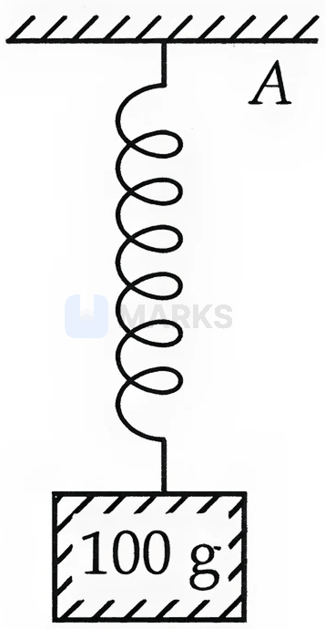
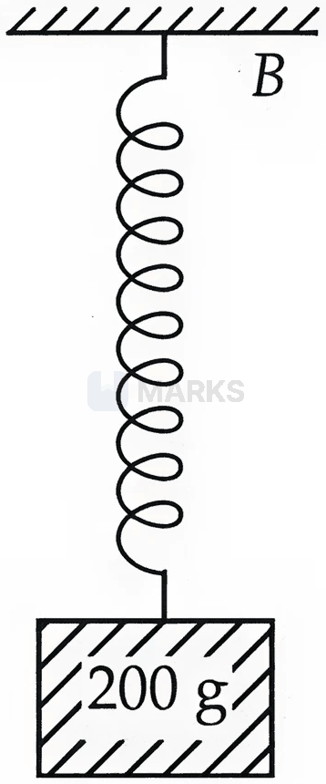
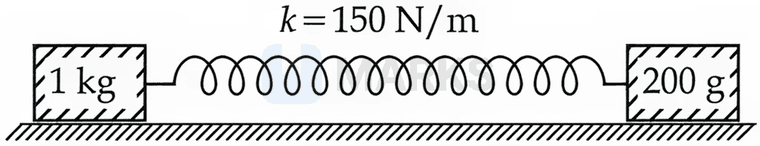
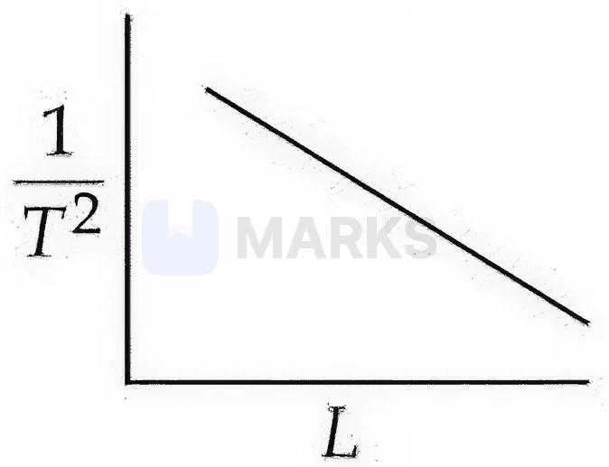
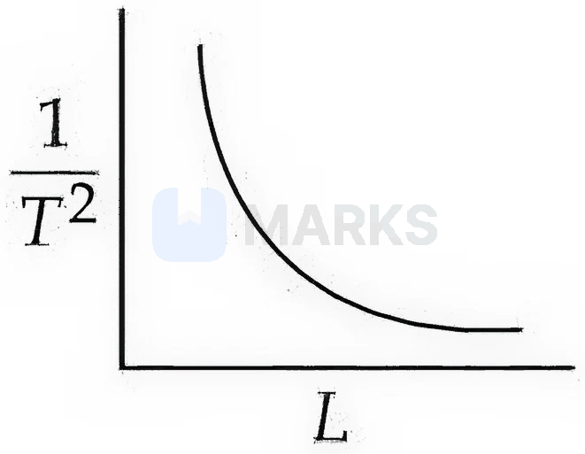
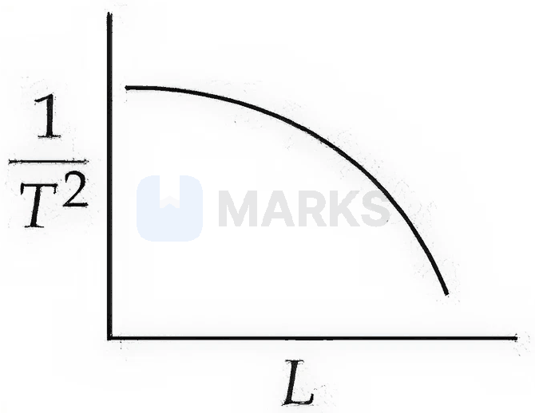
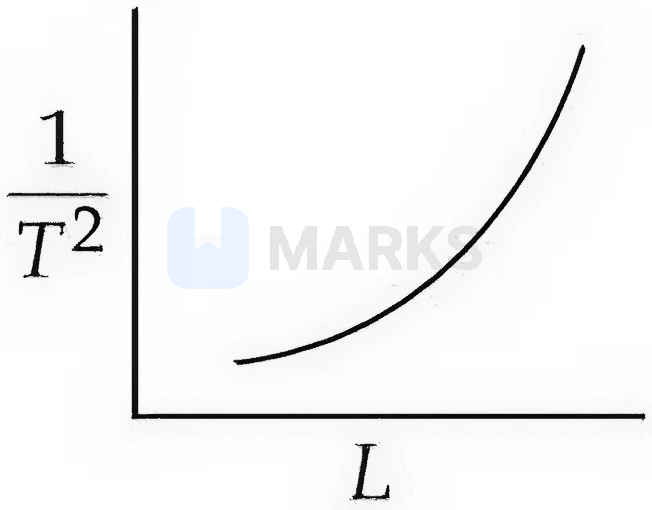

# Oscillations (SHM)

> Theory: [../../theory/physics/oscillations.md](../../theory/physics/oscillations.md)

### P-SHM-01 — JEE Main 2024 · 27 Jan Shift 1 · Q24 · Numerical

A particle executes SHM with amplitude $4$ cm. At the mean position its velocity is $10\ \text{cm s}^{-1}$. The distance of the particle from the mean position when its speed becomes $5\ \text{cm s}^{-1}$ is $\sqrt\alpha$ cm. Find $\alpha$.

**Answer: 12** · key ✔

**Solution.** $v_{\max}=A\omega\Rightarrow\omega=10/4=2.5$ s$^{-1}$. From $v=\omega\sqrt{A^2-x^2}$: $5=2.5\sqrt{16-x^2}\Rightarrow16-x^2=4\Rightarrow x^2=12$, so $\alpha=12$.

### P-SHM-02 — JEE Main 2024 · 29 Jan Shift 1 · Q24 · Numerical

When the displacement of a simple harmonic oscillator is one third of its amplitude, the ratio of total energy to kinetic energy is $\dfrac x8$. Find $x$.

**Answer: 9** · key ✔

**Solution.** $E=\tfrac12m\omega^2A^2$ and $K=\tfrac12m\omega^2(A^2-y^2)$. With $y=A/3$: $\dfrac EK=\dfrac{A^2}{A^2-A^2/9}=\dfrac98$, so $x=9$.

### P-SHM-03 — JEE Main 2024 · 29 Jan Shift 2 · Q24 · Numerical

A simple harmonic oscillator has amplitude $A$ and time period $6\pi$ s. Assuming the oscillation starts from its mean position, the time required to travel from $x=A$ to $x=\dfrac{\sqrt3}2A$ is $\dfrac\pi x$ s, where $x=$ ______.

**Answer: 2** · key ✔

**Solution.** $\omega=\dfrac{2\pi}{6\pi}=\dfrac13$ rad/s and $x=A\sin\omega t$. $x=A$ at $\omega t=\tfrac\pi2\Rightarrow t=\tfrac{3\pi}2$. $x=\tfrac{\sqrt3}2A$ at $\omega t=\tfrac\pi3\Rightarrow t=\pi$. Time between them $=\tfrac{3\pi}2-\pi=\tfrac\pi2$, so $x=2$.

### P-SHM-04 — JEE Main 2024 · 30 Jan Shift 2 · Q24 · Numerical

A simple pendulum is placed at a place whose distance from the earth's surface is equal to the radius of the earth. If the length of the string is $4$ m, the time period of small oscillations will be ______ s. [take $g=\pi^2\ \text{m s}^{-2}$ at the surface]

**Answer: 8** · key ✔

**Solution.** At height $R$: $g'=\dfrac g{(1+1)^2}=\dfrac g4=\dfrac{\pi^2}4$. $T=2\pi\sqrt{\dfrac L{g'}}=2\pi\sqrt{\dfrac{4}{\pi^2/4}}=2\pi\cdot\dfrac4\pi=8$ s.

### P-SHM-05 — JEE Main 2024 · 31 Jan Shift 1 · Q24 · Numerical

A particle performs simple harmonic motion with amplitude $A$. Its speed is increased to three times at an instant when its displacement is $\dfrac{2A}3$. The new amplitude of motion is $\dfrac{nA}3$. The value of $n$ is ______.

**Answer: 7** · key ✔

**Solution.** Before: $v^2=\omega^2\left(A^2-\dfrac{4A^2}9\right)=\dfrac{5}{9}\omega^2A^2$. After: $9v^2=5\omega^2A^2=\omega^2\left(A'^2-\dfrac{4A^2}9\right)$ (same displacement, $\omega$ unchanged). $A'^2=5A^2+\dfrac{4A^2}9=\dfrac{49A^2}9\Rightarrow A'=\dfrac{7A}3$, so $n=7$.

### P-SHM-06 — JEE Main 2024 · 1 Feb Shift 2 · Q24 · Numerical

A mass $m$ suspended from a spring oscillates at frequency $f_1$; with mass $9m$ on the same spring the frequency is $f_2$. The value of $f_1/f_2$ is ______.

**Answer: 3** · key ✔

**Solution.** $f=\dfrac1{2\pi}\sqrt{k/m}\propto m^{-1/2}\Rightarrow\dfrac{f_1}{f_2}=\sqrt{\dfrac{9m}{m}}=3$.

### P-SHM-07 — JEE Main 2024 · 4 Apr Shift 2 · Q10 · MCQ

In simple harmonic motion the total mechanical energy of a block of mass $m$ on a spring $k$ is $E$. If the mass is doubled, the new energy for the same amplitude is:

(1) $E$  (2) $E/\sqrt2$  (3) $2E$  (4) $E\sqrt2$

**Answer: (1)** · key ✔

**Solution.** $E=\tfrac12kA^2$ depends only on the spring constant and the amplitude, not on the mass. (The period changes, but not the energy.)

### P-SHM-08 — JEE Main 2024 · 4 Apr Shift 2 · Q24 · Numerical

The displacement of a particle in SHM is $x=10\sin(\omega t+\tfrac\pi3)$ m. The time period is $3.14$ s. The velocity of the particle at $t=0$ is ______ m/s.

**Answer: 10** · key ✔

**Solution.** $\omega=\dfrac{2\pi}{T}=\dfrac{2\pi}{3.14}=2$ rad/s. $v=\dfrac{dx}{dt}=10\omega\cos(\omega t+\tfrac\pi3)$; at $t=0$: $10\times2\times\cos60^\circ=10$ m/s.

### P-SHM-09 — JEE Main 2024 · 6 Apr Shift 1 · Q24 · Numerical

A particle does simple harmonic motion with amplitude $0.06$ m and time period $3.14$ s. Its maximum velocity is ______ cm/s.

**Answer: 12** · key ✔

**Solution.** $\omega=\dfrac{2\pi}{3.14}=2$ rad/s. $v_{max}=A\omega=0.06\times2=0.12$ m/s $=12$ cm/s.

### P-SHM-10 — JEE Main 2024 · 9 Apr Shift 1 · Q24 · Numerical

The position, velocity and acceleration of a particle in SHM have magnitudes $4$ m, $2\ \text{m s}^{-1}$ and $16\ \text{m s}^{-2}$ at a certain instant. The amplitude of the motion is $\sqrt x$ m, where $x=$ ______.

**Answer: 17** · key ✔

**Solution.** $a=\omega^2x\Rightarrow\omega^2=\dfrac{16}{4}=4$. $v^2=\omega^2(A^2-x^2)\Rightarrow4=4(A^2-16)\Rightarrow A^2=17$. So $A=\sqrt{17}$ and $x=17$.

### P-SHM-11 — JEE Advanced 2025 · Paper 1 · Q1 · MCQ

The centre of a disk of radius $r$ and mass $m$ is attached to a spring of constant $k$ inside a ring of radius $R>r$; the other end of the spring is fixed on the periphery of the ring. Both are in the same vertical plane, the disk rolls without slipping along the inside of the ring, and at equilibrium the disk is at the bottom. For small displacements the period of oscillation of the centre of mass is $T=\dfrac{2\pi}{\omega}$. $\omega=$

(A) $\sqrt{\dfrac23\left(\dfrac g{R-r}+\dfrac km\right)}$  (B) $\sqrt{\dfrac{2g}{3(R-r)}}+\dfrac km$  (C) $\sqrt{\dfrac16\left(\dfrac g{R-r}+\dfrac km\right)}$  (D) $\sqrt{\dfrac14\left(\dfrac g{R-r}+\dfrac km\right)}$

**Answer: (A)** · official key ✔ (re-derived)

**Solution.** Let the centre swing through angle $\theta$ about the ring centre: speed $v=(R-r)\dot\theta$. Rolling without slipping: $\omega_{disk}=\dfrac{v}{r}$. $KE=\tfrac12mv^2+\tfrac12\left(\tfrac12mr^2\right)\dfrac{v^2}{r^2}=\tfrac34mv^2=\tfrac34m(R-r)^2\dot\theta^2$. For small $\theta$: $PE=\tfrac12mg(R-r)\theta^2+\tfrac12k\left[(R-r)\theta\right]^2$. Then $\omega^2=\dfrac{mg(R-r)+k(R-r)^2}{\tfrac32m(R-r)^2}=\dfrac23\left(\dfrac{g}{R-r}+\dfrac km\right)$.

### P-SHM-12 — JEE Main 2023 · 24 Jan Shift 1 · Q25 · Numerical

A block of mass $2$ kg is attached to two identical springs of spring constant $20\ \text{N m}^{-1}$ each, placed on a frictionless surface with the spring ends attached to rigid supports (on either side of the block). The time period of oscillation is $\dfrac\pi{\sqrt X}$ s in SI units. $X=$ ______.

**Answer: 5** · key ✔

**Solution.** Springs on both sides act in parallel, so $k_{eff}=20+20=40\ \text{N m}^{-1}$. $T=2\pi\sqrt{\dfrac{m}{k_{eff}}}=2\pi\sqrt{\dfrac{2}{40}}=\dfrac{2\pi}{\sqrt{20}}=\dfrac{\pi}{\sqrt5}$. So $X=5$.

### § — JEE Main 2026 · 21 Jan Shift 2 · set Q1 · MCQ

The kinetic energy of a simple harmonic oscillator oscillates with an angular frequency of $176$ rad/s. The frequency of this simple harmonic oscillator is ______ Hz. (take $\pi=\tfrac{22}{7}$)

(1) 14  (2) 28  (3) 176  (4) 88

**Answer: (1)** · key (compiled)

**Solution.** The kinetic energy $\propto\cos^2(\omega t+\phi)$ oscillates at twice the SHM angular frequency, so $\omega=\dfrac{176}{2}=88$ rad/s and $f=\dfrac{\omega}{2\pi}=\dfrac{88}{2\times22/7}=14$ Hz.

### § — JEE Main 2026 · 23 Jan Shift 1 · set Q2 · MCQ

Two blocks of masses $100$ g and $200$ g are attached to the ends of springs $A$ and $B$ as shown in the figure. The energy stored in $A$ is $E$. The energy stored in $B$, when the spring constants $k_A$ and $k_B$ of $A$ and $B$ respectively satisfy $4k_A=3k_B$, is:

(1) $\dfrac43E$  (2) $4E$  (3) $3E$  (4) $2E$

**Answer: (3)** · key (compiled)

**Solution.** At equilibrium the extension is $x=\dfrac{mg}{k}$, so the stored energy is $\tfrac12kx^2=\dfrac{(mg)^2}{2k}$. $\dfrac{U_B}{E}=\left(\dfrac{m_B}{m_A}\right)^2\dfrac{k_A}{k_B}=4\times\dfrac34=3$, so $U_B=3E$.

### § — JEE Main 2026 · 23 Jan Shift 1 · set Q3 · MCQ

A simple pendulum of string length $30$ cm performs $20$ oscillations in $10$ s. The length of the string required for the pendulum to perform $40$ oscillations in the same time duration is ______ cm. (Assume the mass of the pendulum remains the same.)

(1) 7.5  (2) 0.75  (3) 120  (4) 15

**Answer: (1)** · key (compiled)

**Solution.** $T_1=\dfrac{10}{20}=0.5$ s and $T_2=\dfrac{10}{40}=0.25$ s. $T\propto\sqrt L$, so $L_2=30\times\left(\dfrac{0.25}{0.5}\right)^2=7.5$ cm.

### § — JEE Main 2026 · 28 Jan Shift 2 · set Q4 · MCQ

The time period of a simple harmonic oscillator is $T=2\pi\sqrt{\dfrac mk}$. The measured value of the mass $m$ of the object is $10$ g with an accuracy of $10$ mg, and the time for $50$ oscillations of the spring is found to be $60$ s using a watch of $2$ s resolution. The percentage error in the determination of the spring constant $k$ is ______ %.

(1) 7.60  (2) 3.35  (3) 3.43  (4) 6.76

**Answer: (4)** · key (compiled)

**Solution.** $k=\dfrac{4\pi^2m}{T^2}$, so $\dfrac{\Delta k}{k}=\dfrac{\Delta m}{m}+2\dfrac{\Delta T}{T}$. $\dfrac{\Delta m}{m}=\dfrac{0.01}{10}=0.001$ and $\dfrac{\Delta T}{T}=\dfrac{\Delta t}{t}=\dfrac{2}{60}$. So $\dfrac{\Delta k}{k}=0.001+\dfrac{2}{30}=0.0677$, i.e. $\approx6.76\%$.

### § — JEE Main 2026 · 28 Jan Shift 2 · set Q5 · MCQ

As shown in the figure, a spring ($k=150$ N/m) is kept in a stretched position with some extension by holding the masses $1$ kg and $0.2$ kg, with a separation more than the spring's natural length, and they are released. Assuming the horizontal surface to be frictionless, the angular frequency (in SI units) of the system is:

(1) 5  (2) 27  (3) 20  (4) 30

**Answer: (4)** · key (compiled)

**Solution.** The two bodies oscillate about their centre of mass; the problem reduces to SHM with the reduced mass $\mu=\dfrac{1\times0.2}{1.2}=\dfrac16$ kg. $\omega=\sqrt{\dfrac k\mu}=\sqrt{150\times6}=30$ rad/s.

### § — JEE Main 2026 · 22 Jan Shift 2 · set Q6 · MCQ

In a simple pendulum experiment $g$ is determined by measuring the time period $T$. Which of the following plots represents the correct relation between the pendulum length $L$ and the time period $T$?

**(1)** 

**(2)** 

**(3)** 

**(4)** 

**Answer: (2)** · key (compiled)

**Solution.** $T=2\pi\sqrt{L/g}\Rightarrow\dfrac1{T^2}=\dfrac{g}{4\pi^2}\cdot\dfrac1L$, which is a rectangular hyperbola: $1/T^2$ falls steeply and then flattens as $L$ increases, without touching the axes. This is graph (2).

### § — JEE Main 2026 · 28 Jan Shift 1 · set Q7 · Numerical

The displacement of a particle executing simple harmonic motion with time period $T$ is expressed as $x(t)=A\sin\omega t$, where $A$ is the amplitude. The maximum value of the potential energy of this oscillator is found at $t=\dfrac{T}{2\beta}$. The value of $\beta$ is ______.

**Answer: 2** · key (compiled)

**Solution.** $U=\tfrac12m\omega^2A^2\sin^2\omega t$ is maximum when $\sin^2\omega t=1$, first at $\omega t=\dfrac\pi2$, i.e. $t=\dfrac T4=\dfrac{T}{2\beta}$, so $\beta=2$.

### § — JEE Main 2026 · 24 Jan Shift 1 · set Q8 · MCQ

A cylindrical block of mass $M$ and area of cross-section $A$ is floating in a liquid of density $\rho$ with its axis vertical. When depressed a little and released, the block starts oscillating. The period of oscillation is ______.

(1) $\pi\sqrt{\dfrac{2M}{\rho Ag}}$  (2) $\pi\sqrt{\dfrac{\rho A}{Mg}}$  (3) $2\pi\sqrt{\dfrac{\rho A}{Mg}}$  (4) $2\pi\sqrt{\dfrac{M}{\rho Ag}}$

**Answer: (4)** · key (compiled)

**Solution.** For a downward displacement $x$ the extra buoyant force is $\rho Agx$ (restoring), so $M\ddot x=-\rho Agx$, $\omega^2=\dfrac{\rho Ag}{M}$ and $T=2\pi\sqrt{\dfrac{M}{\rho Ag}}$.

