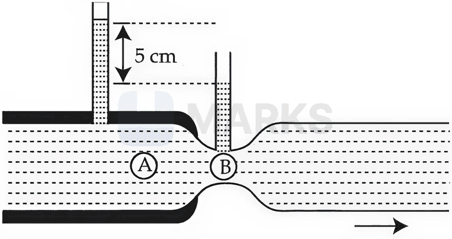
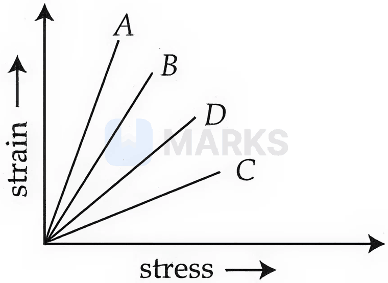

# Elasticity, Fluids, Surface Tension & Viscosity

> Theory: [../../theory/physics/properties-of-matter.md](../../theory/physics/properties-of-matter.md)

### P-POM-01 — JEE Main 2024 · 27 Jan Shift 2 · Q7 · MCQ

Assertion (A): The property of a body by virtue of which it tends to regain its original shape when the external force is removed is elasticity.
Reason (R): The restoring force depends upon the bonded inter-atomic and inter-molecular forces of the solid.

(1) A false, R true  (2) A true, R false  (3) Both true and R explains A  (4) Both true but R does not explain A

**Answer: (3)** · key ✔

**Solution.** A is the definition of elasticity. Deformation changes inter-atomic separations, and the resulting change in bond forces provides the restoring force, so R correctly explains A.

### P-POM-02 — JEE Main 2024 · 27 Jan Shift 2 · Q23 · Numerical

The pressure gauge attached to a closed pipe reads $4.5\times10^4\ \text{N m}^{-2}$. On opening the valve, water flows and the gauge reads $2.0\times10^4\ \text{N m}^{-2}$. The velocity of the water is $\sqrt V\ \text{m s}^{-1}$. The value of $V$ is ______.

**Answer: 50** · key ✔

**Solution.** Bernoulli's principle with no height change: $\Delta P=\tfrac12\rho v^2\Rightarrow v^2=\dfrac{2(4.5-2.0)\times10^4}{1000}=50$. So $V=50$.

### P-POM-03 — JEE Main 2024 · 29 Jan Shift 1 · Q7 · MCQ

Statement I: If a capillary tube is immersed first in cold water and then in hot water, the height of capillary rise will be smaller in hot water.
Statement II: If a capillary tube is immersed first in cold water and then in hot water, the height of capillary rise will be smaller in cold water.

(1) Both true  (2) Both false  (3) I true, II false  (4) I false, II true

**Answer: (3)** · key ✔

**Solution.** Capillary rise $h=\dfrac{2T\cos\theta}{r\rho g}$. Surface tension $T$ decreases as temperature increases, so $h$ is smaller in hot water and larger in cold water. I is true, II is false.

### P-POM-04 — JEE Main 2024 · 29 Jan Shift 1 · Q23 · Numerical

In a test experiment on a model aeroplane in a wind tunnel, the flow speeds on the upper and lower surfaces of the wing are $70\ \text{m s}^{-1}$ and $65\ \text{m s}^{-1}$ respectively. If the wing area is $2\ \text{m}^2$, the lift of the wing is ______ N. (Density of air $=1.2\ \text{kg m}^{-3}$)

**Answer: 810** · key ✔

**Solution.** Bernoulli: the pressure difference is $\Delta P=\tfrac12\rho(v_u^2-v_l^2)=\tfrac12(1.2)(4900-4225)=405$ Pa. Lift $=\Delta P\cdot A=405\times2=810$ N.

### P-POM-05 — JEE Main 2024 · 29 Jan Shift 2 · Q8 · MCQ

A small liquid drop of radius $R$ is divided into $27$ identical liquid drops. If the surface tension is $T$, the work done in the process will be

(1) $8\pi R^2T$  (2) $3\pi R^2T$  (3) $\tfrac18\pi R^2T$  (4) $4\pi R^2T$

**Answer: (1)** · key ✔

**Solution.** Volume conservation: $27\cdot\tfrac43\pi r^3=\tfrac43\pi R^3\Rightarrow r=\tfrac R3$. $W=T\,\Delta A=T\cdot4\pi\left(27r^2-R^2\right)=4\pi T\left(3R^2-R^2\right)=8\pi R^2T$.

### P-POM-06 — JEE Main 2024 · 29 Jan Shift 2 · Q23 · Numerical

Two metallic wires $P$ and $Q$ have the same volume and are made of the same material. Their cross-sectional areas are in the ratio $4:1$. When a force $F_1$ is applied to $P$, an extension $\Delta l$ is produced. The force required to produce the same extension in $Q$ is $F_2$. The value of $\dfrac{F_1}{F_2}$ is ______.

**Answer: 16** · key ✔

**Solution.** Equal volumes give $A_PL_P=A_QL_Q$, so $L_P:L_Q=1:4$. $\Delta l=\dfrac{FL}{AY}\Rightarrow F=\dfrac{\Delta l\,Y A}{L}\propto\dfrac AL$. Hence $\dfrac{F_1}{F_2}=\dfrac{A_P/L_P}{A_Q/L_Q}=\dfrac{4/1}{1/4}=16$.

### P-POM-07 — JEE Main 2024 · 30 Jan Shift 2 · Q23 · Numerical

A big drop is formed by coalescing $1000$ small identical drops of water. If $E_1$ is the total surface energy of the $1000$ small drops and $E_2$ is the surface energy of the single big drop, then $E_1:E_2=x:1$, where $x=$ ______.

**Answer: 10** · key ✔

**Solution.** Volume conservation: $1000r^3=R^3\Rightarrow R=10r$. Surface energy $\propto$ area: $E_1=1000\cdot4\pi r^2T$ and $E_2=4\pi(10r)^2T=100\cdot4\pi r^2T$. Ratio $=\dfrac{1000}{100}=10$.

### P-POM-08 — JEE Main 2024 · 31 Jan Shift 1 · Q23 · Numerical

The depth below the surface of the sea to which a rubber ball must be taken so as to decrease its volume by $0.02\%$ is ______ m. (Density of sea water $=10^3\ \text{kg m}^{-3}$, bulk modulus of rubber $=9\times10^8\ \text{N m}^{-2}$, $g=10\ \text{m s}^{-2}$)

**Answer: 18** · key ✔

**Solution.** $\dfrac{\Delta V}V=\dfrac{\rho gh}B\Rightarrow2\times10^{-4}=\dfrac{10^3\times10\times h}{9\times10^8}\Rightarrow h=\dfrac{2\times10^{-4}\times9\times10^8}{10^4}=18$ m.

### P-POM-09 — JEE Main 2024 · 31 Jan Shift 2 · Q7 · MCQ

A small spherical ball of radius $r$, falling through a viscous medium of negligible density, has terminal velocity $v$. Another ball of the same mass but of radius $2r$, falling through the same viscous medium, will have terminal velocity

(1) $\dfrac v2$  (2) $\dfrac v4$  (3) $4v$  (4) $2v$

**Answer: (1)** · key ✔

**Solution.** With negligible medium density there is no buoyancy, so at terminal velocity $mg=6\pi\eta rv$, i.e. $v=\dfrac{mg}{6\pi\eta r}\propto\dfrac1r$ at fixed mass. Doubling the radius halves the terminal velocity.

### P-POM-10 — JEE Main 2024 · 31 Jan Shift 2 · Q23 · Numerical

Two blocks of mass $2$ kg and $4$ kg are connected by a metal wire going over a smooth pulley. The radius of the wire is $4.0\times10^{-5}$ m and Young's modulus of the metal is $2.0\times10^{11}\ \text{N m}^{-2}$. The longitudinal strain developed in the wire is $\dfrac1{\alpha\pi}$. The value of $\alpha$ is ______. (Use $g=10\ \text{m s}^{-2}$)

**Answer: 12** · key ✔

**Solution.** Tension in the Atwood machine: $T=\dfrac{2m_1m_2g}{m_1+m_2}=\dfrac{2(2)(4)(10)}{6}=\dfrac{80}3$ N. Stress $=\dfrac T{\pi r^2}$, so strain $=\dfrac{T}{\pi r^2Y}=\dfrac{80/3}{\pi(16\times10^{-10})(2\times10^{11})}=\dfrac{80/3}{320\pi}=\dfrac1{12\pi}$. So $\alpha=12$.

### P-POM-11 — JEE Main 2024 · 1 Feb Shift 1 · Q8 · MCQ

With rise in temperature, the Young's modulus of elasticity

(1) changes erratically  (2) decreases  (3) increases  (4) remains unchanged

**Answer: (2)** · key ✔

**Solution.** On heating, the inter-atomic separation increases and the bonds soften, so the material offers less resistance to deformation: $Y$ decreases.

### P-POM-12 — JEE Main 2024 · 1 Feb Shift 1 · Q23 · Numerical

A plane is in level flight at constant speed and each of its two wings has an area of $40\ \text{m}^2$. If the speed of the air is $180\ \text{km h}^{-1}$ over the lower wing surface and $252\ \text{km h}^{-1}$ over the upper wing surface, the mass of the plane is ______ kg. (Take air density $=1\ \text{kg m}^{-3}$ and $g=10\ \text{m s}^{-2}$)

**Answer: 9600** · key ✔

**Solution.** $v_{lower}=50$ m/s and $v_{upper}=70$ m/s. Pressure difference $\Delta P=\tfrac12\rho(v_u^2-v_l^2)=\tfrac12(4900-2500)=1200$ Pa. Total wing area $=80\ \text{m}^2$, so lift $=1200\times80=96000$ N $=mg\Rightarrow m=9600$ kg.

### P-POM-13 — JEE Main 2024 · 1 Feb Shift 2 · Q7 · MCQ

A big drop is formed by coalescing $1000$ small droplets of water. The surface energy will become:

(1) 100 times  (2) 10 times  (3) $\tfrac1{100}$th  (4) $\tfrac1{10}$th

**Answer: (4)** · key ✔

**Solution.** Volume conservation: $R^3=1000r^3\Rightarrow R=10r$. Surface energy $\propto$ area: initial $1000\cdot4\pi r^2$, final $4\pi(10r)^2=100\cdot4\pi r^2$. Ratio $=\tfrac1{10}$ (the difference is released as heat).

### P-POM-14 — JEE Main 2024 · 1 Feb Shift 2 · Q23 · Numerical

One end of a metal wire is fixed to a ceiling and a $2$ kg load hangs from the other end. A similar wire is attached to the bottom of this load and carries a $1$ kg load. The ratio of longitudinal strain of the upper wire to that of the lower wire is ______. ($A=0.005\ \text{cm}^2$, $Y=2\times10^{11}\ \text{N m}^{-2}$, $g=10$)

**Answer: 3** · key ✔

**Solution.** Upper wire tension $=(2+1)g=30$ N; lower wire $=1\cdot g=10$ N. Strain $=\dfrac{F}{AY}$, same $A,Y$, so the ratio is $30/10=3$.

### P-POM-15 — JEE Main 2024 · 4 Apr Shift 1 · Q24 · Numerical

A soap bubble is blown to a diameter of $7$ cm. $36960$ erg of work is done in blowing it further. If the surface tension of the soap solution is $40$ dyne/cm, the new radius is ______ cm. ($\pi=\tfrac{22}7$)

**Answer: 7** · key ✔

**Solution.** A bubble has two surfaces: $W=2T\cdot4\pi\left(r_2^2-r_1^2\right)$. With $r_1=3.5$: $36960=2(40)(4)\dfrac{22}{7}(r_2^2-12.25)\Rightarrow r_2^2-12.25=36.75$, so $r_2^2=49$ and $r_2=7$ cm.

### P-POM-16 — JEE Main 2024 · 4 Apr Shift 2 · Q7 · MCQ

Statement I: The contact angle between a solid and a liquid is a property of the material of the solid and of the liquid.
Statement II: The rise of a liquid in a capillary tube does not depend on the inner radius of the tube.

(1) I true, II false  (2) I false, II true  (3) Both false  (4) Both true

**Answer: (1)** · key ✔

**Solution.** The contact angle depends on the solid–liquid pair. The capillary rise is $h=\dfrac{2T\cos\theta}{r\rho g}$, so it is inversely proportional to the radius: II is false.

### P-POM-17 — JEE Main 2024 · 4 Apr Shift 2 · Q23 · Numerical

Mercury is filled in a tube of radius $2$ cm up to a height of $30$ cm. The force exerted by the mercury on the bottom of the tube is ______ N. (Atmospheric pressure $=10^5\ \text{N m}^{-2}$, $\rho_{Hg}=1.36\times10^4\ \text{kg m}^{-3}$, $g=10$, $\pi=\tfrac{22}7$)

**Answer: 177** · key ✔

**Solution.** Pressure at the bottom $=P_0+\rho gh=10^5+1.36\times10^4\times10\times0.3=1.408\times10^5$ Pa. Area $=\pi(0.02)^2=1.257\times10^{-3}\ \text{m}^2$. $F=1.408\times10^5\times1.257\times10^{-3}\approx177$ N.

### P-POM-18 — JEE Main 2024 · 5 Apr Shift 1 · Q10 · MCQ

Statement I: When a capillary tube is dipped into a liquid, the liquid neither rises nor falls in the capillary. The contact angle may be $0^\circ$.
Statement II: The contact angle between a solid and a liquid is a property of the material of the solid and the liquid as well.

(1) Both false  (2) Both true  (3) I false, II true  (4) I true, II false

**Answer: (3)** · key ✔

**Solution.** No rise or fall means $h\propto\cos\theta=0$, so $\theta=90^\circ$, not $0^\circ$ (a $0^\circ$ angle gives the maximum rise). I is false. II is true: the contact angle depends on the solid–liquid pair.

### P-POM-19 — JEE Main 2024 · 5 Apr Shift 1 · Q23 · Numerical

The density and breaking stress of a wire are $6\times10^4\ \text{kg m}^{-3}$ and $1.2\times10^8\ \text{N m}^{-2}$. The wire is suspended from a rigid support on a planet where $g$ is $\tfrac13$rd of its value on earth ($g=10$ on earth). The maximum length of the wire without breaking is ______ m.

**Answer: 600** · key ✔

**Solution.** The stress at the top is $\rho L g'$, with $g'=10/3$. Setting it equal to the breaking stress: $L=\dfrac{1.2\times10^8}{6\times10^4\times10/3}=\dfrac{1.2\times10^8}{2\times10^5}=600$ m.

### P-POM-20 — JEE Main 2024 · 5 Apr Shift 2 · Q7 · MCQ

Match List I with List II: (A) the restoring force per unit area of an elastic body; (B) two equal and opposite forces parallel to opposite faces; (C) forces perpendicular everywhere to the surface, same per unit area everywhere; (D) two equal and opposite forces perpendicular to opposite faces. (I) bulk modulus; (II) Young's modulus; (III) stress; (IV) shear modulus.

(1) A-IV, B-II, C-III, D-I  (2) A-III, B-IV, C-I, D-II  (3) A-II, B-IV, C-I, D-III  (4) A-III, B-I, C-II, D-IV

**Answer: (2)** · key ✔

**Solution.** Restoring force per unit area is stress (A–III). Tangential forces on opposite faces produce shear, so the modulus is the shear modulus (B–IV). Uniform normal pressure everywhere gives a volume change: bulk modulus (C–I). Equal and opposite normal forces on opposite faces stretch or compress the body: Young's modulus (D–II).

### P-POM-21 — JEE Main 2024 · 6 Apr Shift 1 · Q8 · MCQ

A small ball of mass $m$ and density $\rho$ is dropped into a viscous liquid of density $\rho_0$. After some time the ball falls with constant velocity. The viscous force on the ball is:

(1) $mg(1-\rho\rho_0)$  (2) $mg\left(1+\dfrac{\rho}{\rho_0}\right)$  (3) $mg\left(\dfrac{\rho_0}{\rho}-1\right)$  (4) $mg\left(1-\dfrac{\rho_0}{\rho}\right)$

**Answer: (4)** · key ✔

**Solution.** At terminal velocity: $mg=F_{visc}+F_{buoy}$ with $F_{buoy}=\rho_0Vg=mg\dfrac{\rho_0}{\rho}$. So $F_{visc}=mg\left(1-\dfrac{\rho_0}{\rho}\right)$.

### P-POM-22 — JEE Main 2024 · 6 Apr Shift 2 · Q7 · MCQ

The pressure inside a soap bubble is greater than the pressure outside by an amount (radius $R$, surface tension $S$):

(1) $\dfrac{2S}{R}$  (2) $\dfrac{4R}{S}$  (3) $\dfrac SR$  (4) $\dfrac{4S}{R}$

**Answer: (4)** · key ✔

**Solution.** A soap bubble has two surfaces (inside and outside), so the excess pressure is $\dfrac{4S}{R}$. (A liquid drop, with one surface, has $\dfrac{2S}{R}$.)

### P-POM-23 — JEE Main 2024 · 8 Apr Shift 1 · Q23 · Numerical

A liquid column of height $0.04$ cm balances the excess pressure of a soap bubble of a certain radius. The density of the liquid is $8\times10^3\ \text{kg m}^{-3}$ and the surface tension of the soap solution is $0.28\ \text{N m}^{-1}$. The diameter of the soap bubble is ______ cm. ($g=10$)

**Answer: 7** · key ✔

**Solution.** Excess pressure $\dfrac{4S}{R}=\rho gh=8\times10^3\times10\times4\times10^{-4}=32$ Pa. $R=\dfrac{4\times0.28}{32}=0.035$ m $=3.5$ cm, so the diameter is $7$ cm.

### P-POM-24 — JEE Main 2024 · 8 Apr Shift 2 · Q7 · MCQ

A cube of ice floats partly in water and partly in kerosene oil. The ratio of the volume of ice immersed in water to that in kerosene oil is (specific gravity of kerosene $=0.8$, of ice $=0.9$):

(1) 1 : 1  (2) 5 : 4  (3) 8 : 9  (4) 9 : 10

**Answer: (1)** · key ✔

**Solution.** Let the volumes below the water and kerosene surfaces be $V_w$ and $V_k$ (total $V$). Floating: $V_w(1)+V_k(0.8)=0.9V$ with $V_w+V_k=V$. Then $0.8V+0.2V_w=0.9V\Rightarrow V_w=\tfrac V2$, $V_k=\tfrac V2$. Ratio $1:1$.

### P-POM-25 — JEE Main 2024 · 9 Apr Shift 1 · Q7 · MCQ

A sphere of relative density $\sigma$ and diameter $D$ has a concentric cavity of diameter $d$. The ratio $\dfrac Dd$, if it just floats on water in a tank, is:

(1) $\left(\dfrac{\sigma-2}{\sigma+2}\right)^{1/3}$  (2) $\left(\dfrac{\sigma}{\sigma-1}\right)^{1/3}$  (3) $\left(\dfrac{\sigma-1}{\sigma}\right)^{1/3}$  (4) $\left(\dfrac{\sigma+1}{\sigma-1}\right)^{1/3}$

**Answer: (2)** · key ✔

**Solution.** Just floating means fully submerged, so weight equals buoyancy: $\sigma\left(D^3-d^3\right)=D^3\Rightarrow\dfrac{d^3}{D^3}=\dfrac{\sigma-1}{\sigma}$. Hence $\dfrac Dd=\left(\dfrac{\sigma}{\sigma-1}\right)^{1/3}$.

### P-POM-26 — JEE Main 2024 · 9 Apr Shift 1 · Q23 · Numerical

Two persons pull a wire towards themselves, each exerting a force of $200$ N on the wire. Young's modulus of the material of the wire is $1\times10^{11}\ \text{N m}^{-2}$; the original length of the wire is $2$ m and its area of cross-section is $2\ \text{cm}^2$. The wire will extend by ______ $\mu$m.

**Answer: 20** · key ✔

**Solution.** The tension in the wire is $200$ N (each end is pulled by $200$ N, not $400$ N). $\Delta L=\dfrac{FL}{AY}=\dfrac{200\times2}{2\times10^{-4}\times10^{11}}=2\times10^{-5}$ m $=20\ \mu$m.

### P-POM-27 — JEE Advanced 2025 · Paper 1 · Q8 · Numerical

A person in an elevator weighs an object of mass $50$ kg. The height of the elevator varies as $y=8\left[1+\sin\dfrac{2\pi t}{T}\right]$ m with $T=40\pi$ s ($g=10\ \text{m s}^{-2}$). The maximum variation of the object's observed weight (in N) is ______.

**Answer: 2** · official key ✔ (re-derived)

**Solution.** $a=\ddot y=-8\left(\dfrac{2\pi}T\right)^2\sin\dfrac{2\pi t}T$ with $\dfrac{2\pi}{T}=\dfrac1{20}$, so the acceleration amplitude is $\dfrac8{400}=0.02\ \text{m s}^{-2}$. Observed weight $=m(g+a)$ varies between $m(g-0.02)$ and $m(g+0.02)$: maximum variation $=2\times50\times0.02=2$ N.

### § — JEE Main 2026 · 21 Jan Shift 2 · Fluids set Q1 · MCQ

A spherical body of radius $r$ and density $\sigma$ falls freely through a viscous liquid of density $\rho$ and viscosity $\eta$ and attains a terminal velocity $v_0$. The estimated maximum error in the quantity $\eta$ is: (ignore errors associated with $\sigma$, $\rho$ and $g$)

(1) $\dfrac{2\Delta r}{r}+\dfrac{\Delta v_0}{v_0}$  (2) $\dfrac{2\Delta r}{r}-\dfrac{\Delta v_0}{v_0}$  (3) $2\left[\dfrac{\Delta r}{r}-\dfrac{\Delta v_0}{v_0}\right]$  (4) $2\left[\dfrac{\Delta r}{r}+\dfrac{\Delta v_0}{v_0}\right]$

**Answer: (1)** · key (compiled)

**Solution.** Stokes' law gives $v_0=\dfrac{2r^2(\sigma-\rho)g}{9\eta}$, so $\eta=\dfrac{2r^2(\sigma-\rho)g}{9v_0}\propto\dfrac{r^2}{v_0}$. The maximum fractional error is $\dfrac{\Delta\eta}{\eta}=\dfrac{2\Delta r}{r}+\dfrac{\Delta v_0}{v_0}$.

### § — JEE Main 2026 · 21 Jan Shift 2 · Fluids set Q3 · Numerical

The terminal velocity of a metallic ball of radius $6$ mm in a viscous fluid is $20$ cm/s. The terminal velocity of another ball of the same material and radius $3$ mm in the same fluid will be ______ cm/s.

**Answer: 5** · key (compiled)

**Solution.** $v_t\propto r^2$, so $v_2=20\times\left(\dfrac36\right)^2=5$ cm/s.

### § — JEE Main 2026 · 24 Jan Shift 2 · Fluids set Q4 · MCQ

A cubical block of density $\rho_b=600\ \text{kg/m}^3$ floats in a liquid of density $\rho_e=900\ \text{kg/m}^3$. If the height of the block is $H=8.0$ cm, the height of the submerged part is ______ cm.

(1) 6.3  (2) 4.3  (3) 5.3  (4) 7.3

**Answer: (3)** · key (compiled)

**Solution.** Floating: $\rho_e\,h_s=\rho_bH\Rightarrow h_s=\dfrac{600}{900}\times8.0=5.33\approx5.3$ cm.

### § — JEE Main 2026 · 24 Jan Shift 2 · Fluids set Q5 · Numerical

A soap bubble of surface tension $0.04$ N/m is blown to a diameter of $7$ cm. If $(15000-x)\ \mu$J of work is done in blowing it further to make its diameter $14$ cm, the value of $x$ is ______. ($\pi=22/7$)

**Answer: 11304** · key (compiled)

**Solution.** A soap bubble has two surfaces. $\Delta A=2\times4\pi\left(r_f^2-r_i^2\right)=8\pi(0.07^2-0.035^2)=8\pi\times0.003675$ m$^2$. $W=\sigma\,\Delta A=0.04\times8\times\dfrac{22}{7}\times0.003675=3.696\times10^{-3}$ J $=3696\ \mu$J. So $15000-x=3696\Rightarrow x=11304$.

### § — JEE Main 2026 · 22 Jan Shift 2 · Fluids set Q6 · MCQ

When a part of a straight capillary tube is placed vertically in a liquid, the liquid rises up to a certain height $h$. If the inner radius of the capillary tube, the density of the liquid and the surface tension of the liquid each decrease by $1\%$, the height of the liquid in the tube will change by ______ %.

(1) +1  (2) -3  (3) -1  (4) +3

**Answer: (1)** · key (compiled)

**Solution.** $h=\dfrac{2T\cos\theta}{\rho gr}$. With $T,\rho,r$ all multiplied by $0.99$: $h'=h\cdot\dfrac{0.99}{0.99\times0.99}=\dfrac{h}{0.99}\approx1.0101\,h$, a change of about $+1\%$.

### § — JEE Main 2026 · 22 Jan Shift 1 · Fluids set Q7 · MCQ

Given below are two statements:
**Statement I:** The pressure of a fluid is exerted only on a solid surface in contact, as fluid pressure does not exist everywhere in a still fluid.
**Statement II:** The excess potential energy of the molecules on the surface of a liquid, compared to the interior, results in surface tension.

(1) Statement I is false but Statement II is true  (2) Statement I is true but Statement II is false  (3) Both Statement I and Statement II are false  (4) Both Statement I and Statement II are true

**Answer: (1)** · key (compiled)

**Solution.** I is false: in a fluid at rest pressure exists at every point and acts in all directions (Pascal's law). II is true: surface molecules have extra potential energy compared with interior molecules, which is the origin of surface tension.

### § — JEE Main 2026 · 23 Jan Shift 2 · Fluids set Q8 · MCQ

A small metallic sphere of diameter $2$ mm and density $10.5\ \text{g/cm}^3$ is dropped in glycerine of viscosity $10$ poise and density $1.5\ \text{g/cm}^3$. The terminal velocity attained by the sphere is ______ cm/s. ($\pi=\tfrac{22}{7}$ and $g=10\ \text{m/s}^2$)

(1) 3.0  (2) 1.0  (3) 2.0  (4) 1.5

**Answer: (3)** · key (compiled)

**Solution.** $v_t=\dfrac{2r^2g(\rho_s-\rho_f)}{9\eta}$ with $r=0.1$ cm, $g=1000$ cm/s$^2$, $\rho_s-\rho_f=9$ g/cm$^3$, $\eta=10$ g cm$^{-1}$s$^{-1}$: $v_t=\dfrac{2\times0.01\times1000\times9}{90}=2.0$ cm/s.

### § — JEE Main 2026 · 23 Jan Shift 2 · Fluids set Q9 · MCQ

An air bubble of volume $2.9\ \text{cm}^3$ rises from the bottom of a swimming pool $5$ m deep. At the bottom of the pool the water temperature is $17^\circ$C. The volume of the bubble when it reaches the surface, where the water temperature is $27^\circ$C, is ______ cm$^3$. ($g=10\ \text{m/s}^2$, density of water $=10^3\ \text{kg/m}^3$ and $1$ atm pressure is $10^5$ Pa)

(1) 4.5  (2) 2.0  (3) 4.2  (4) 3.0

**Answer: (1)** · key (compiled)

**Solution.** $P_1=10^5+10^3\times10\times5=1.5\times10^5$ Pa, $T_1=290$ K; $P_2=10^5$ Pa, $T_2=300$ K. $\dfrac{P_1V_1}{T_1}=\dfrac{P_2V_2}{T_2}\Rightarrow V_2=2.9\times1.5\times\dfrac{300}{290}=4.5\ \text{cm}^3$.

### § — JEE Main 2026 · 21 Jan Shift 1 · Fluids set Q10 · MCQ

Water flows through a horizontal tube as shown in the figure. The difference in height between the water columns in the vertical tubes is $5$ cm, and the areas of cross-section at $A$ and $B$ are $6\ \text{cm}^2$ and $3\ \text{cm}^2$ respectively. The rate of flow will be ______ $\text{cm}^3/\text{s}$. (take $g=10\ \text{m/s}^2$)

(1) $\dfrac{200}{\sqrt3}$  (2) $200\sqrt6$  (3) $100\sqrt3$  (4) $200\sqrt3$

**Answer: (4)** · key (compiled)

**Solution.** Continuity: $v_B=2v_A$. Bernoulli: $P_A-P_B=\rho g h=\tfrac12\rho(v_B^2-v_A^2)=\tfrac32\rho v_A^2$, so $v_A=\sqrt{\dfrac{2gh}{3}}=\sqrt{\dfrac{2\times1000\times5}{3}}=\dfrac{100}{\sqrt3}$ cm/s. Rate of flow $Q=A_Av_A=6\times\dfrac{100}{\sqrt3}=200\sqrt3\ \text{cm}^3/\text{s}$.

### § — JEE Main 2026 · 24 Jan Shift 1 · Fluids set Q11 · Numerical

Sixty-four rain drops of radius $1$ mm each, falling down with a terminal velocity of $10$ cm/s, coalesce to form a bigger drop. The terminal velocity of the bigger drop is ______ cm/s.

**Answer: 160** · key (compiled)

**Solution.** Volume is conserved: $R=(64)^{1/3}r=4$ mm. $v_t\propto r^2$, so $v=10\times4^2=160$ cm/s.

### § — JEE Main 2026 · 23 Jan Shift 1 · Solids set Q1 · MCQ

The strain–stress plot for materials $A$, $B$, $C$ and $D$ is shown in the figure. Which material has the largest Young's modulus?

(1) $D$  (2) $B$  (3) $C$  (4) $A$

**Answer: (3)** · key (compiled)

**Solution.** Young's modulus $Y=\dfrac{\text{stress}}{\text{strain}}=\dfrac{1}{\text{slope}}$ of a strain–stress plot. The largest $Y$ belongs to the line with the smallest slope, which is $C$.

### § — JEE Main 2026 · 28 Jan Shift 1 · Solids set Q2 · MCQ

Two wires $A$ and $B$ made of different materials, of lengths $6.0$ cm and $5.4$ cm and areas of cross-section $3.0\times10^{-5}\ \text{m}^2$ and $4.5\times10^{-5}\ \text{m}^2$ respectively, are stretched by the same magnitude under a given load. The ratio of the Young's modulus of $A$ to that of $B$ is $x:3$. The value of $x$ is ______.

(1) 2  (2) 1  (3) 4  (4) 5

**Answer: (4)** · key (compiled)

**Solution.** $Y=\dfrac{FL}{A\,\Delta L}$ with the same $F$ and $\Delta L$: $\dfrac{Y_A}{Y_B}=\dfrac{L_A/A_A}{L_B/A_B}=\dfrac{6.0/3.0}{5.4/4.5}=\dfrac{2}{1.2}=\dfrac53$, so $x=5$.

