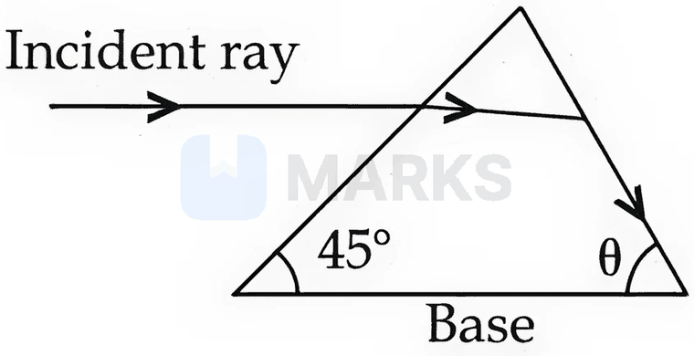
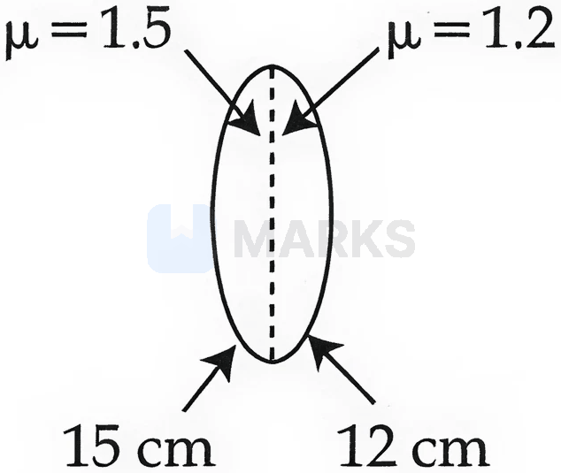

# Ray Optics & Optical Instruments

> Theory: [../../theory/physics/ray-optics.md](../../theory/physics/ray-optics.md)

### P-RAY-01 — JEE Main 2024 · 27 Jan Shift 1 · Q16 · MCQ

If the refractive index of the material of a prism is $\cot\!\left(\dfrac A2\right)$, where $A$ is the angle of the prism, the angle of minimum deviation is

(1) $\pi-2A$  (2) $\dfrac\pi2-2A$  (3) $\pi-A$  (4) $\dfrac\pi2-A$

**Answer: (1)** · key ✔

**Solution.** $\mu=\dfrac{\sin\frac{A+\delta_m}{2}}{\sin\frac A2}=\cot\frac A2\Rightarrow\sin\frac{A+\delta_m}{2}=\cos\frac A2=\sin\!\left(\frac\pi2-\frac A2\right)$. So $\frac{A+\delta_m}{2}=\frac\pi2-\frac A2$, giving $\delta_m=\pi-2A$.

### P-RAY-02 — JEE Main 2024 · 29 Jan Shift 1 · Q16 · MCQ

A convex mirror of radius of curvature $30$ cm forms an image that is half the size of the object. The object distance is

(1) $-45$ cm  (2) $45$ cm  (3) $-15$ cm  (4) $15$ cm

**Answer: (3)** · key ✔

**Solution.** $f=+15$ cm. Magnification $m=-\dfrac vu=+\dfrac12\Rightarrow v=-\dfrac u2$. Mirror formula: $\dfrac1v+\dfrac1u=\dfrac1f\Rightarrow-\dfrac2u+\dfrac1u=-\dfrac1u=\dfrac1{15}\Rightarrow u=-15$ cm.

### P-RAY-03 — JEE Main 2024 · 29 Jan Shift 1 · Q17 · MCQ

A biconvex lens of refractive index $1.5$ has a focal length of $20$ cm in air. Its focal length when immersed in a liquid of refractive index $1.6$ is

(1) $-16$ cm  (2) $-160$ cm  (3) $+160$ cm  (4) $+16$ cm

**Answer: (2)** · key ✔

**Solution.** In air: $\dfrac1{20}=(1.5-1)K\Rightarrow K=\dfrac1{10}$, where $K=\dfrac1{R_1}-\dfrac1{R_2}$. In the liquid: $\dfrac1{f_l}=\left(\dfrac{1.5}{1.6}-1\right)K=-\dfrac{0.1}{1.6}\cdot\dfrac1{10}=-\dfrac1{160}$. So $f_l=-160$ cm (the lens becomes diverging).

### P-RAY-04 — JEE Main 2024 · 29 Jan Shift 2 · Q16 · MCQ

If the distance between an object and its two-times magnified virtual image produced by a curved mirror is $15$ cm, the focal length of the mirror must be

(1) 15 cm  (2) $-12$ cm  (3) $-10$ cm  (4) $\tfrac{10}3$ cm

**Answer: (3)** · key ✔

**Solution.** A magnified virtual image needs a concave mirror. Let $u=-x$; $m=-\dfrac vu=2\Rightarrow v=+2x$ (behind the mirror). Separation $=x+2x=15\Rightarrow x=5$ cm, so $u=-5,\ v=10$. $\dfrac1f=\dfrac1v+\dfrac1u=\dfrac1{10}-\dfrac15=-\dfrac1{10}\Rightarrow f=-10$ cm.

### P-RAY-05 — JEE Main 2024 · 30 Jan Shift 1 · Q29 · Numerical

The distance between an object and its two times magnified real image produced by a convex lens is $45$ cm. The focal length of the lens used is ______ cm.

**Answer: 10** · key ✔

**Solution.** For a real image with $|m|=2$: $v=2u$ (magnitudes). $u+v=3u=45\Rightarrow u=15$ cm, $v=30$ cm. $f=\dfrac{uv}{u+v}=\dfrac{15\times30}{45}=10$ cm.

### P-RAY-06 — JEE Main 2024 · 31 Jan Shift 2 · Q29 · Numerical

Light from a point source in air falls on a convex curved surface of radius $20$ cm and refractive index $1.5$. If the source is located $100$ cm from the convex surface, the image will be formed at ______ cm from the object.

**Answer: 200** · key ✔

**Solution.** Refraction at a spherical surface: $\dfrac{\mu_2}v-\dfrac{\mu_1}u=\dfrac{\mu_2-\mu_1}R$. With $u=-100$, $R=+20$: $\dfrac{1.5}v+\dfrac1{100}=\dfrac{0.5}{20}=0.025\Rightarrow\dfrac{1.5}{v}=0.015\Rightarrow v=100$ cm. The image is $100$ cm beyond the surface, i.e. $100+100=200$ cm from the object.

### P-RAY-07 — JEE Main 2024 · 1 Feb Shift 1 · Q29 · Numerical

The distance between an object and its $3$ times magnified virtual image produced by a convex lens is $20$ cm. The focal length of the lens used is ______ cm.

**Answer: 15** · key ✔

**Solution.** A virtual image lies on the same side as the object, so $|v|-|u|=20$ with $|v|=3|u|$: $u=10$ cm and $v=30$ cm. $\dfrac1f=\dfrac1u-\dfrac1v$ (magnitudes): $\dfrac1{10}-\dfrac1{30}=\dfrac1{15}$, so $f=15$ cm.

### P-RAY-08 — JEE Main 2024 · 4 Apr Shift 1 · Q17 · MCQ

The effective power of a combination of $5$ identical convex lenses kept in contact along the principal axis is $25$ D. The focal length of each lens is:

(1) 20 cm  (2) 50 cm  (3) 500 cm  (4) 25 cm

**Answer: (1)** · key ✔

**Solution.** Powers add for lenses in contact: $5P=25\Rightarrow P=5$ D, so $f=\dfrac{1}{5}\text{ m}=20$ cm.

### P-RAY-09 — JEE Main 2024 · 4 Apr Shift 2 · Q29 · Numerical

A ray is incident on a glass slab of thickness $4\sqrt3$ cm and refractive index $\sqrt2$, at an angle equal to the critical angle for glass–air. The lateral displacement of the ray is ______ cm. ($\sin15^\circ=0.25$)

**Answer: 2** · key ✔

**Solution.** $\sin i_c=\tfrac1{\sqrt2}\Rightarrow i=45^\circ$. Snell: $\sin r=\dfrac{\sin45^\circ}{\sqrt2}=\tfrac12\Rightarrow r=30^\circ$. Lateral shift $d=\dfrac{t\sin(i-r)}{\cos r}=\dfrac{4\sqrt3\times0.25}{\sqrt3/2}=2$ cm.

### P-RAY-10 — JEE Main 2024 · 5 Apr Shift 1 · Q17 · MCQ

Light emerges from a convex lens when a point source is kept at its focus. The shape of the wavefront of the emerging light is:

(1) both spherical and cylindrical  (2) plane  (3) spherical  (4) cylindrical

**Answer: (2)** · key ✔

**Solution.** A source at the focus gives a parallel beam after refraction, and a parallel beam corresponds to a plane wavefront.

### P-RAY-11 — JEE Main 2024 · 5 Apr Shift 2 · Q16 · MCQ

Statement I: When white light passes through a prism, red light bends less than yellow and violet.
Statement II: The refractive indices are different for different wavelengths in a dispersive medium.

(1) I false, II true  (2) I true, II false  (3) Both true  (4) Both false

**Answer: (3)** · key ✔

**Solution.** $\mu$ falls with wavelength (Cauchy): $\mu_{red}<\mu_{yellow}<\mu_{violet}$, so red deviates the least. II is the cause of dispersion. Both true.

### P-RAY-12 — JEE Main 2024 · 6 Apr Shift 1 · Q29 · Numerical

The refractive index of a prism is $\mu=\sqrt3$ and the ratio of the angle of minimum deviation to the angle of the prism is $1$. The angle of the prism is ______ degrees.

**Answer: 60** · key ✔

**Solution.** $\delta_m=A$, so $\mu=\dfrac{\sin\frac{A+\delta_m}{2}}{\sin\frac A2}=\dfrac{\sin A}{\sin\frac A2}=2\cos\dfrac A2=\sqrt3\Rightarrow\dfrac A2=30^\circ$, so $A=60^\circ$.

### P-RAY-13 — JEE Main 2024 · 6 Apr Shift 2 · Q16 · MCQ

For a thin convex lens the radii of curvature are $15$ cm and $30$ cm and the focal length is $20$ cm. The refractive index of the material is:

(1) 1.2  (2) 1.8  (3) 1.5  (4) 1.4

**Answer: (3)** · key ✔

**Solution.** Lens-maker: $\dfrac1f=(\mu-1)\left(\dfrac1{R_1}+\dfrac1{R_2}\right)$ for a biconvex lens: $\dfrac1{20}=(\mu-1)\dfrac{1}{10}\Rightarrow\mu-1=0.5$, so $\mu=1.5$.

### P-RAY-14 — JEE Main 2024 · 8 Apr Shift 1 · Q15 · MCQ

The critical angle of incidence for a pair of optical media is $45^\circ$. The refractive indices of the first and second media are in the ratio:

(1) $1:\sqrt2$  (2) $\sqrt2:1$  (3) $2:1$  (4) $1:2$

**Answer: (2)** · key ✔

**Solution.** Light goes from the denser (first) medium to the rarer (second): $\sin C=\dfrac{n_2}{n_1}=\sin45^\circ=\dfrac1{\sqrt2}$, so $n_1:n_2=\sqrt2:1$.

### § — JEE Main 2026 · 21 Jan Shift 2 · set Q1 · MCQ

As shown in the diagram, when the incident ray is parallel to the base of the prism, the emergent ray grazes along the second surface. If the refractive index of the material of the prism is $\sqrt2$, the angle $\theta$ of the prism is:

(1) $60^\circ$  (2) $45^\circ$  (3) $90^\circ$  (4) $75^\circ$

**Answer: (1)** · key (compiled)

**Solution.** The face meeting the base at $45^\circ$ makes $45^\circ$ with the horizontal ray, so the angle of incidence there is $45^\circ$: $\sin45^\circ=\sqrt2\sin r_1\Rightarrow r_1=30^\circ$. At the second face the ray grazes, so $e=90^\circ$ and $\sqrt2\sin r_2=1\Rightarrow r_2=45^\circ$. The apex angle is $A=r_1+r_2=75^\circ$, so $\theta=180^\circ-75^\circ-45^\circ=60^\circ$.

### § — JEE Main 2026 · 23 Jan Shift 1 · set Q2 · MCQ

A thin prism of angle $5^\circ$ and refractive index $1.72$ is combined with another prism of refractive index $1.9$ to produce dispersion without deviation. The angle of the second prism is:

(1) $6^\circ$  (2) $4.5^\circ$  (3) $4^\circ$  (4) $5^\circ$

**Answer: (3)** · key (compiled)

**Solution.** Zero net deviation requires $(\mu_1-1)A_1=(\mu_2-1)A_2$ (prisms inverted), so $0.72\times5=0.9\,A_2\Rightarrow A_2=4^\circ$.

### § — JEE Main 2026 · 23 Jan Shift 1 · set Q3 · MCQ

Light travels from medium $A$ to medium $B$ separated by a plane interface. If the light undergoes total internal reflection during its travel from $A$ to $B$, and the speeds of light in media $A$ and $B$ are $2.4\times10^8$ m/s and $2.7\times10^8$ m/s respectively, the critical angle is:

(1) $\cos^{-1}\!\left(\dfrac89\right)$  (2) $\sin^{-1}\!\left(\dfrac98\right)$  (3) $\cot^{-1}\!\left(\dfrac{3}{\sqrt{13}}\right)$  (4) $\tan^{-1}\!\left(\dfrac{8}{\sqrt{17}}\right)$

**Answer: (4)** · key (compiled)

**Solution.** $\sin\theta_c=\dfrac{n_B}{n_A}=\dfrac{v_A}{v_B}=\dfrac{2.4}{2.7}=\dfrac89$. With opposite $8$, hypotenuse $9$, adjacent $\sqrt{81-64}=\sqrt{17}$: $\tan\theta_c=\dfrac{8}{\sqrt{17}}$.

### § — JEE Main 2026 · 28 Jan Shift 2 · set Q4 · MCQ

A biconvex lens is formed by joining two thin plano-convex lenses as shown in the figure. The refractive indices and radii of the curved surfaces are given in the figure. When an object is placed on the left side at a distance of $30$ cm from the biconvex lens, the magnification of the image will be:

(1) $-2$  (2) $+2.5$  (3) $-2.5$  (4) $+2$

**Answer: (1)** · key (compiled)

**Solution.** Left half: $\dfrac1{f_1}=(1.5-1)\dfrac1{15}\Rightarrow f_1=30$ cm. Right half: $\dfrac1{f_2}=(1.2-1)\dfrac1{12}\Rightarrow f_2=60$ cm. Combined: $\dfrac1F=\dfrac1{30}+\dfrac1{60}=\dfrac1{20}$, so $F=20$ cm. For $u=-30$ cm: $\dfrac1v=\dfrac1{20}-\dfrac1{30}=\dfrac1{60}\Rightarrow v=60$ cm, so $m=\dfrac vu=-2$.

### § — JEE Main 2026 · 28 Jan Shift 2 · set Q5 · MCQ

For a transparent prism, if the angle of minimum deviation is equal to its refracting angle, the refractive index $n$ of the prism satisfies:

(1) $1<n<2$  (2) $\sqrt2<n<2\sqrt2$  (3) $\sqrt2<n<2$  (4) $n\geqslant2$

**Answer: (3)** · key (compiled)

**Solution.** With $\delta_m=A$: $n=\dfrac{\sin\frac{A+\delta_m}{2}}{\sin\frac A2}=\dfrac{\sin A}{\sin\frac A2}=2\cos\dfrac A2$. For a prism with $0<A<90^\circ$, $\cos\dfrac A2$ lies between $\dfrac1{\sqrt2}$ and $1$, so $\sqrt2<n<2$.

### § — JEE Main 2026 · 24 Jan Shift 2 · set Q6 · MCQ

The distance between an object and its three-times magnified real image is $40$ cm. The focal length of the mirror used is ______ cm.

(1) $-15/2$  (2) $-15$  (3) $-10$  (4) $-20$

**Answer: (2)** · key (compiled)

**Solution.** A real magnified image from a concave mirror lies on the same side as the object and farther away: $|v|=3|u|$ and $|v|-|u|=40\Rightarrow|u|=20$ cm, $|v|=60$ cm. $\dfrac1f=\dfrac1u+\dfrac1v=-\dfrac1{20}-\dfrac1{60}=-\dfrac{1}{15}$, so $f=-15$ cm.

### § — JEE Main 2026 · 24 Jan Shift 2 · set Q7 · MCQ

Five persons $P_1,P_2,P_3,P_4$ and $P_5$ recorded the object distance $u$ and image distance $v$ (in cm) using the same convex lens of power $+5$ D as $(25,96)$, $(30,62)$, $(35,37)$, $(45,35)$ and $(50,32)$ respectively. Identify the correct statement.

(1) Readings recorded by $P_3$ and $P_2$ are incorrect  (2) Readings recorded by $P_4$ and $P_5$ are incorrect  (3) Readings recorded by all persons are correct  (4) Readings recorded by $P_3$ are incorrect

**Answer: (4)** · key (compiled)

**Solution.** $f=\dfrac{100}{5}=20$ cm so $\dfrac1u+\dfrac1v$ should be $0.05\ \text{cm}^{-1}$. $P_1:0.0504$, $P_2:0.0494$, $P_3:0.0556$, $P_4:0.0508$, $P_5:0.0512$. Only $P_3$'s readings deviate appreciably.

### § — JEE Main 2026 · 22 Jan Shift 2 · set Q8 · MCQ

In the parallax method for the determination of the focal length of a concave mirror, the object should always be placed:

(1) between the focus $F$ and the centre of curvature $C$ of the mirror ONLY  (2) between the pole $P$ and the focus $F$ of the concave mirror ONLY  (3) beyond the centre of curvature $C$ of the mirror ONLY  (4) at any point beyond the focus $F$ of the mirror

**Answer: (4)** · key (compiled)

**Solution.** The no-parallax method needs a *real* image that can be aligned with a pin. A concave mirror forms a real image for any object beyond $F$ ($u>f$); between $P$ and $F$ the image is virtual.

### § — JEE Main 2026 · 22 Jan Shift 2 · set Q9 · MCQ

The wavelength of light passing through water is $540$ nm (refractive index $\tfrac43$). The wavelength of the same light passing through a transparent medium of refractive index $\tfrac32$ is ______ nm.

(1) 540  (2) 480  (3) 840  (4) 380

**Answer: (2)** · key (compiled)

**Solution.** Frequency is unchanged, so $\lambda\propto\dfrac1n$. Vacuum wavelength $=540\times\dfrac43=720$ nm; in the new medium $\lambda=\dfrac{720}{3/2}=480$ nm.

### § — JEE Main 2026 · 22 Jan Shift 1 · set Q10 · MCQ

Consider an equilateral prism of refractive index $\sqrt2$. A ray of light is incident on one surface at a certain angle $i$. If the emergent ray grazes along the other surface, the angle of refraction at the incident surface is close to ______.

(1) $20^\circ$  (2) $15^\circ$  (3) $40^\circ$  (4) $30^\circ$

**Answer: (2)** · key (compiled)

**Solution.** Grazing emergence means $e=90^\circ$: $\sqrt2\sin r_2=1\Rightarrow r_2=45^\circ$. With $r_1+r_2=A=60^\circ$: $r_1=15^\circ$.

### § — JEE Main 2026 · 22 Jan Shift 1 · set Q12 · Numerical

A parallel beam of light travelling in air (refractive index $1.0$) is incident on a convex spherical glass surface of radius of curvature $50$ cm. The refractive index of the glass is $1.5$. The rays converge to a point at a distance $x$ cm from the centre of curvature of the spherical surface. The value of $x$ is ______ cm.

**Answer: 100** · key (compiled)

**Solution.** For refraction at a single spherical surface $\dfrac{\mu_2}{v}-\dfrac{\mu_1}{u}=\dfrac{\mu_2-\mu_1}{R}$ with $u=-\infty$: $\dfrac{1.5}{v}=\dfrac{0.5}{50}\Rightarrow v=150$ cm from the pole. The distance from the centre of curvature is $|v-R|=150-50=100$ cm.

### § — JEE Main 2026 · 23 Jan Shift 2 · set Q13 · MCQ

A prism of angle $75^\circ$ and refractive index $\sqrt3$ is coated with a thin film of refractive index $1.5$ only at the back (exit) surface. To have total internal reflection at the back exit surface the incident angle must be ($\sin15^\circ=0.25$ and $\sin25^\circ=0.43$):

(1) $15^\circ$  (2) $>25^\circ$  (3) between $15^\circ$ and $20^\circ$  (4) Both (1) and (3)

**Answer: (4)** · key (compiled)

**Solution.** TIR at the prism–film interface needs $\sqrt3\sin r_2\ge1.5\Rightarrow\sin r_2\ge0.866\Rightarrow r_2\ge60^\circ$, so $r_1=75^\circ-r_2\le15^\circ$. Then $\sin i=\sqrt3\sin r_1\le1.73\times0.25=0.43$, i.e. $i\le25^\circ$. Both $15^\circ$ and a value between $15^\circ$ and $20^\circ$ satisfy this.

### § — JEE Main 2026 · 23 Jan Shift 2 · set Q14 · Numerical

The sizes of the images of an object formed by a thin lens are equal when the object is placed at two different positions, $8$ cm and $24$ cm from the lens. The focal length of the lens is ______ cm.

**Answer: 16** · key (compiled)

**Solution.** $m=\dfrac{f}{f+u}$. Equal magnitudes with one real and one virtual image: $\dfrac{f}{f-8}=-\dfrac{f}{f-24}\Rightarrow f-8=24-f\Rightarrow f=16$ cm.

### § — JEE Main 2026 · 21 Jan Shift 1 · set Q15 · Numerical

A collimated beam of light of diameter $2$ mm is propagating along the $x$-axis. The beam is to be expanded into a collimated beam of diameter $14$ mm using a system of two convex lenses. If the first lens has a focal length of $40$ mm, the focal length of the second lens is ______ mm.

**Answer: 280** · key (compiled)

**Solution.** For a beam expander (two convex lenses with common focus), $\dfrac{d_2}{d_1}=\dfrac{f_2}{f_1}\Rightarrow\dfrac{14}{2}=\dfrac{f_2}{40}\Rightarrow f_2=280$ mm.

### § — JEE Main 2026 · 21 Jan Shift 1 · set Q16 · Numerical

In a microscope the objective has focal length $f_o=2$ cm and the eye-piece has focal length $f_e=4$ cm. The tube length is $32$ cm. The magnification produced by this microscope for normal adjustment is ______.

**Answer: 100** · key (compiled)

**Solution.** $M=\dfrac{L}{f_o}\cdot\dfrac{D}{f_e}=\dfrac{32}{2}\times\dfrac{25}{4}=100$.

### § — JEE Main 2026 · 28 Jan Shift 1 · set Q17 · MCQ

The magnitudes of power of a biconvex lens (refractive index $1.5$) and of a plano-concave lens (refractive index $1.7$) are the same. If the curvature of the plano-concave lens exactly matches that of the back surface of the biconvex lens, the ratio of the radii of curvature of the front and back surfaces of the biconvex lens is ______.

(1) 5 : 12  (2) 12 : 5  (3) 5 : 2  (4) 2 : 5

**Answer: (3)** · key (compiled)

**Solution.** Biconvex: $P_1=0.5\left(\dfrac1{R_1}+\dfrac1{R_2}\right)$. Plano-concave: $|P_2|=\dfrac{0.7}{R_2}$. Equating: $\dfrac{0.5}{R_1}+\dfrac{0.5}{R_2}=\dfrac{0.7}{R_2}\Rightarrow\dfrac{0.5}{R_1}=\dfrac{0.2}{R_2}\Rightarrow\dfrac{R_1}{R_2}=\dfrac52$.

### § — JEE Main 2026 · 28 Jan Shift 1 · set Q18 · Numerical

A convex lens of refractive index $1.5$ and focal length $f=18$ cm is immersed in water (refractive index $\tfrac43$). The difference between the focal lengths of the lens in water and in air is $\alpha\times f$. The value of $\alpha$ is ______.

**Answer: 3** · key (compiled)

**Solution.** In air $\dfrac1{f}=0.5\,k$ with $k=\dfrac1{R_1}-\dfrac1{R_2}$. In water $\dfrac1{f_w}=\left(\dfrac{1.5}{4/3}-1\right)k=\dfrac18k$. So $\dfrac{f_w}{f}=\dfrac{0.5}{1/8}=4\Rightarrow f_w=72$ cm. Difference $=72-18=54=3\times18$, so $\alpha=3$.

### § — JEE Main 2026 · 24 Jan Shift 1 · set Q19 · MCQ

The exit surface of a prism of refractive index $n$ is coated with a material of refractive index $\dfrac n2$. When this prism is set for minimum angle of deviation, it exactly meets the condition of critical angle. The prism angle is ______.

(1) $30^\circ$  (2) $15^\circ$  (3) $45^\circ$  (4) $60^\circ$

**Answer: (4)** · key (compiled)

**Solution.** At the prism–coating interface $\sin\theta_c=\dfrac{n/2}{n}=\dfrac12\Rightarrow\theta_c=30^\circ$. At minimum deviation $r_1=r_2=\dfrac A2$, and $r_2=\theta_c$, so $A=60^\circ$.

### § — JEE Main 2026 · 24 Jan Shift 1 · set Q20 · MCQ

In a microscope of tube length $10$ cm, two convex lenses of focal lengths $2$ cm and $5$ cm are arranged. The total magnification for normal adjustment is $(5)^k$. The value of $k$ is ______.

(1) 3.5  (2) 2  (3) 4  (4) 5

**Answer: (2)** · key (compiled)

**Solution.** $M=\dfrac{L}{f_o}\cdot\dfrac{D}{f_e}=\dfrac{10}{2}\times\dfrac{25}{5}=5\times5=25=5^2$, so $k=2$.

