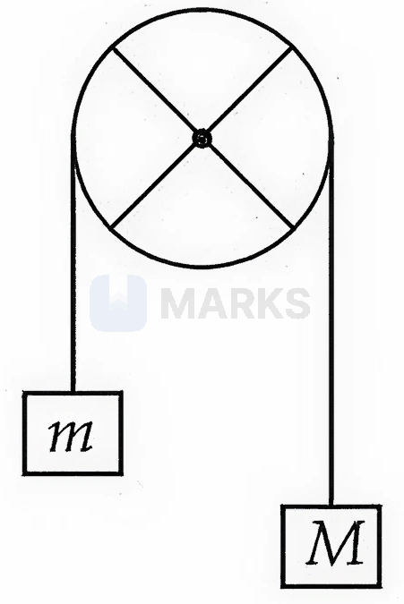
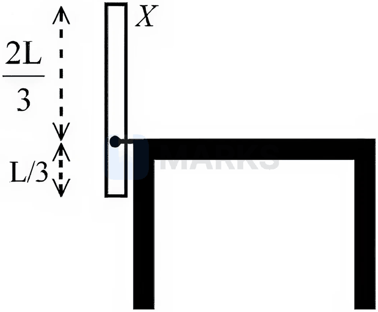
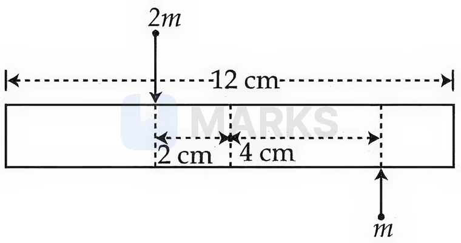
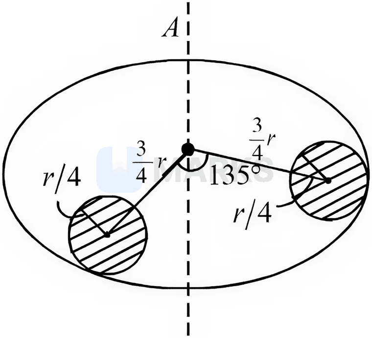
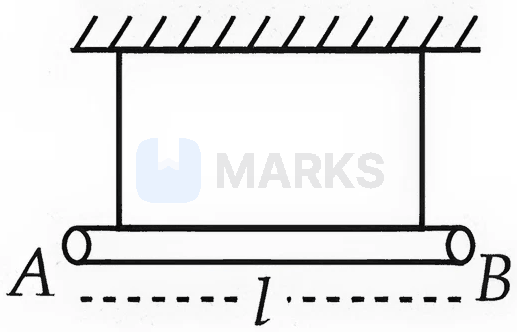
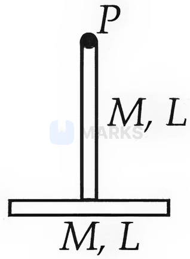
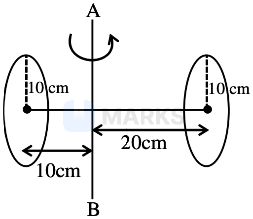

# Rotational Motion

> Theory: [../../theory/physics/rotational-motion.md](../../theory/physics/rotational-motion.md)

### P-ROT-01 — JEE Main 2024 · 27 Jan Shift 1 · Q22 · Numerical

Four particles, each of mass $1$ kg, are placed at the four corners of a square of side $2$ m. The moment of inertia of the system about an axis perpendicular to its plane and passing through one of its vertices is ______ kg m$^2$.

**Answer: 16** · key ✔

**Solution.** Distances from that vertex: $0,\,2,\,2,\,2\sqrt2$. $I=\sum mr^2=1(0+4+4+8)=16$ kg m$^2$.

### P-ROT-02 — JEE Main 2024 · 29 Jan Shift 1 · Q22 · Numerical

A solid cylinder rolls down, without slipping, an inclined plane of inclination $60^\circ$. Its acceleration during rolling down is $\dfrac{x}{\sqrt3}\ \text{m s}^{-2}$. Find $x$. (Use $g=10\ \text{m s}^{-2}$)

**Answer: 10** · key ✔

**Solution.** For rolling without slipping, $a=\dfrac{g\sin\theta}{1+I/(MR^2)}$. For a solid cylinder $I=\tfrac12MR^2$, so $a=\tfrac23g\sin60^\circ=\tfrac23\cdot10\cdot\dfrac{\sqrt3}2=\dfrac{10}{\sqrt3}$. Hence $x=10$.

### P-ROT-03 — JEE Main 2024 · 29 Jan Shift 2 · Q22 · Numerical

A body of mass $5$ kg moves with a uniform speed $3\sqrt2\ \text{m s}^{-1}$ in the $X$–$Y$ plane along the line $y=x+4$. The angular momentum of the particle about the origin is ______ kg m$^2$ s$^{-1}$.

**Answer: 60** · key ✔

**Solution.** $|\vec L|=mvd$, where $d$ is the perpendicular distance of the line $x-y+4=0$ from the origin: $d=\dfrac4{\sqrt2}=2\sqrt2$. $L=5\times3\sqrt2\times2\sqrt2=60$.

### P-ROT-04 — JEE Main 2024 · 30 Jan Shift 1 · Q2 · MCQ

A particle of mass $m$ is projected with velocity $u$ at an angle of $30^\circ$ with the horizontal. The magnitude of the angular momentum of the projectile about the point of projection when the particle is at its maximum height $h$ is

(1) $\dfrac{\sqrt3}{16}\dfrac{mu^3}{g}$  (2) $\dfrac{\sqrt3}{2}\dfrac{mu^2}{g}$  (3) $\dfrac{mu^3}{\sqrt2\,g}$  (4) zero

**Answer: (1)** · key ✔

**Solution.** At maximum height the velocity is horizontal: $v=u\cos30^\circ=\dfrac{\sqrt3}2u$, and the height is $h=\dfrac{u^2\sin^230^\circ}{2g}=\dfrac{u^2}{8g}$. $L=mvh=m\cdot\dfrac{\sqrt3}2u\cdot\dfrac{u^2}{8g}=\dfrac{\sqrt3}{16}\dfrac{mu^3}g$.

### P-ROT-05 — JEE Main 2024 · 30 Jan Shift 1 · Q22 · Numerical

A disc of mass $5$ kg and radius $2$ m rotates with angular velocity $10\ \text{rad s}^{-1}$ about an axis perpendicular to its plane. An identical disc is placed gently over it along the same axis. The energy dissipated so that both discs continue to rotate together without slipping is ______ J.

**Answer: 250** · key ✔

**Solution.** $I=\tfrac12MR^2=\tfrac12(5)(4)=10$ kg m$^2$. Angular momentum is conserved: $10(10)=20\omega'\Rightarrow\omega'=5$ rad/s. $K_i=\tfrac12(10)(100)=500$ J and $K_f=\tfrac12(20)(25)=250$ J. Energy dissipated $=250$ J.

### P-ROT-06 — JEE Main 2024 · 30 Jan Shift 2 · Q22 · Numerical

Two discs of moment of inertia $I_1=4\ \text{kg m}^2$ and $I_2=2\ \text{kg m}^2$ about their central axes (normal to their planes), rotating with angular speeds $10\ \text{rad s}^{-1}$ and $4\ \text{rad s}^{-1}$ respectively, are brought into contact face to face with their axes of rotation coincident. The loss in kinetic energy of the system in the process is ______ J.

**Answer: 24** · key ✔

**Solution.** Conservation of angular momentum: $\omega'=\dfrac{4(10)+2(4)}{4+2}=8$ rad/s. Loss $=\dfrac12\dfrac{I_1I_2}{I_1+I_2}(\omega_1-\omega_2)^2=\dfrac12\cdot\dfrac{8}{6}\cdot36=24$ J.

### P-ROT-07 — JEE Main 2024 · 31 Jan Shift 1 · Q22 · Numerical

A solid circular disc of mass $50$ kg rolls along a horizontal floor so that its centre of mass has a speed of $0.4\ \text{m s}^{-1}$. The absolute value of work done on the disc to stop it is ______ J.

**Answer: 6** · key ✔

**Solution.** By the work–energy theorem the work needed equals the total kinetic energy: $K=\tfrac12mv^2\left(1+\dfrac{I}{mR^2}\right)=\tfrac12(50)(0.16)\left(1+\tfrac12\right)=4\times1.5=6$ J.

### P-ROT-08 — JEE Main 2024 · 31 Jan Shift 2 · Q21 · Numerical

Two identical spheres each of mass $2$ kg and radius $50$ cm are fixed at the ends of a light rod so that the separation between the centres is $150$ cm. The moment of inertia of the system about an axis perpendicular to the rod and passing through its middle point is $\dfrac x{20}$ kg m$^2$, where $x$ is ______.

**Answer: 53** · key ✔

**Solution.** For each solid sphere $I=\tfrac25mr^2+md^2$ with $d=0.75$ m: $\tfrac25(2)(0.25)+2(0.5625)=0.2+1.125=1.325$ kg m$^2$. Two spheres: $2.65=\dfrac{53}{20}$, so $x=53$.

### P-ROT-09 — JEE Main 2024 · 31 Jan Shift 2 · Q22 · Numerical

A body of mass $m$ is projected with speed $u$ at an angle of $45^\circ$ with the ground. The angular momentum of the body about the point of projection, at the highest point, is $\dfrac{\sqrt2\,mu^3}{Xg}$. The value of $X$ is ______.

**Answer: 8** · key ✔

**Solution.** At the highest point $v=u\cos45^\circ=\dfrac u{\sqrt2}$ (horizontal) and $h=\dfrac{u^2\sin^245^\circ}{2g}=\dfrac{u^2}{4g}$. $L=mvh=m\cdot\dfrac u{\sqrt2}\cdot\dfrac{u^2}{4g}=\dfrac{mu^3}{4\sqrt2g}=\dfrac{\sqrt2mu^3}{8g}$. So $X=8$.

### P-ROT-10 — JEE Main 2024 · 1 Feb Shift 2 · Q22 · Numerical

A uniform rod AB of mass $2$ kg and length $30$ cm lies at rest on a smooth horizontal surface. An impulse of $0.2$ N s is applied at end B (perpendicular to the rod). The time taken by the rod to turn through a right angle is $\dfrac\pi x$ s; $x=$ ______.

**Answer: 4** · key ✔

**Solution.** Angular impulse about the centre: $J\cdot\dfrac L2=I\omega$ with $I=\dfrac{ML^2}{12}=\dfrac{2(0.09)}{12}=0.015$. $\omega=\dfrac{0.2\times0.15}{0.015}=2$ rad/s. Time for $\pi/2$: $t=\dfrac{\pi/2}{2}=\dfrac\pi4$ s, so $x=4$.

### P-ROT-11 — JEE Main 2024 · 4 Apr Shift 1 · Q22 · Numerical

A solid sphere and a hollow cylinder roll up, without slipping, the same inclined plane with the same initial speed $v$. They reach maximum heights $h_1$ and $h_2$. The ratio $h_1:h_2$ is $\dfrac n{10}$. The value of $n$ is ______.

**Answer: 7** · key ✔

**Solution.** Energy: $\tfrac12mv^2\left(1+\dfrac{k^2}{R^2}\right)=mgh$, so $h=\dfrac{v^2}{2g}\left(1+\dfrac{k^2}{R^2}\right)$. Sphere: $1+\tfrac25=\tfrac75$; hollow cylinder: $1+1=2$. $\dfrac{h_1}{h_2}=\dfrac{7/5}{2}=\dfrac7{10}$, so $n=7$.

### P-ROT-12 — JEE Main 2024 · 5 Apr Shift 2 · Q22 · Numerical

A hollow sphere rolls on a plane surface about its axis of symmetry. The ratio of its rotational kinetic energy to its total kinetic energy is $\dfrac x5$. The value of $x$ is ______.

**Answer: 2** · key ✔

**Solution.** For a hollow sphere $I=\tfrac23MR^2$. $\dfrac{KE_{rot}}{KE_{tot}}=\dfrac{k^2/R^2}{1+k^2/R^2}=\dfrac{2/3}{5/3}=\dfrac25$. So $x=2$.

### P-ROT-13 — JEE Main 2024 · 6 Apr Shift 1 · Q22 · Numerical

If the radius of the earth is reduced to three-fourths of its present value without change in its mass, the duration of a day will be ______ hours $30$ minutes.

**Answer: 13** · key ✔

**Solution.** No external torque, so $L=I\omega$ is conserved. $I\propto R^2$ (taking the earth as a uniform sphere), so $T\propto R^2$: $T'=24\times\dfrac9{16}=13.5$ h $=13$ h $30$ min.

### P-ROT-14 — JEE Main 2024 · 6 Apr Shift 2 · Q22 · Numerical

Three balls of masses $2$ kg, $4$ kg and $6$ kg are placed at the centres of the edges of an equilateral triangle of side $2$ m. The moment of inertia of the system about an axis through the centroid, perpendicular to the plane of the triangle, is ______ $\text{kg m}^2$.

**Answer: 4** · key ✔

**Solution.** The distance from the centroid to each edge midpoint is the inradius $=\dfrac{a}{2\sqrt3}=\dfrac1{\sqrt3}$ m. $I=\sum mr^2=(2+4+6)\times\dfrac13=4\ \text{kg m}^2$.

### P-ROT-15 — JEE Main 2024 · 8 Apr Shift 2 · Q4 · MCQ

A thin circular disc of mass $M$ and radius $R$ rotates in a horizontal plane about its axis with angular velocity $\omega$. Another disc of the same dimensions but mass $M/2$ is placed gently on the first disc co-axially. The new angular velocity of the system is:

(1) $\tfrac32\omega$  (2) $\tfrac54\omega$  (3) $\tfrac23\omega$  (4) $\tfrac45\omega$

**Answer: (3)** · key ✔

**Solution.** No external torque, so $L$ is conserved. $I_1=\tfrac12MR^2$, $I_2=\tfrac12\cdot\tfrac M2R^2=\tfrac14MR^2$. $\omega'=\dfrac{I_1\omega}{I_1+I_2}=\dfrac{\frac12}{\frac34}\omega=\dfrac23\omega$.

### P-ROT-16 — JEE Main 2024 · 8 Apr Shift 2 · Q22 · Numerical

A circular table rotates with angular velocity $\omega$ rad/s about its axis. There is a smooth groove along a radial direction. A steel ball is placed gently in the groove at a distance of $1$ m from the axis. All surfaces are smooth. If the radius of the table is $3$ m, the radial velocity of the ball with respect to the table when it leaves the table is $x\sqrt2\,\omega$ m/s, where $x=$ ______.

**Answer: 2** · key ✔

**Solution.** In the rotating frame the ball feels the centrifugal force $m\omega^2r$ (the groove supplies the normal force). Then $v\dfrac{dv}{dr}=\omega^2r\Rightarrow v^2=\omega^2(r^2-r_0^2)$. At $r=3$: $v^2=\omega^2(9-1)=8\omega^2$, so $v=2\sqrt2\,\omega$ and $x=2$.

### P-ROT-17 — JEE Main 2024 · 9 Apr Shift 1 · Q22 · Numerical

A string is wrapped around the rim of a wheel of moment of inertia $0.40\ \text{kg m}^2$ and radius $10$ cm. The wheel is free to rotate about its axis and is initially at rest. The string is pulled by a force of $40$ N. The angular velocity of the wheel after $10$ s is $x$ rad/s. $x=$ ______.

**Answer: 100** · key ✔

**Solution.** Torque $\tau=Fr=40\times0.1=4\ \text{N m}$. $\alpha=\dfrac\tau I=\dfrac{4}{0.4}=10\ \text{rad/s}^2$. $\omega=\alpha t=10\times10=100$ rad/s.

### § — JEE Main 2026 · 21 Jan Shift 2 · set Q1 · MCQ

The pulley shown in the figure is made using a thin rim and two rods of length equal to the diameter of the rim. The rim and each rod have a mass $M$. Two blocks of masses $M$ and $m$ are attached to the two ends of a light string passing over the pulley, which is hinged to rotate freely in a vertical plane about its centre. The magnitude of the acceleration of the blocks is ______ (assume no slipping of the string on the pulley).

(1) $\dfrac{(M-m)g}{\left(\frac{13}{6}\right)M+m}$  (2) $\dfrac{(M-m)g}{\left(\frac83\right)M+m}$  (3) $\dfrac{(M-m)g}{2M+m}$  (4) $\dfrac{(M-m)g}{M+m}$

**Answer: (2)** · key (compiled)

**Solution.** Moment of inertia of the pulley: rim $MR^2$ plus two rods (each of length $2R$) $2\times\dfrac{M(2R)^2}{12}=\dfrac{2MR^2}{3}$, so $I=\dfrac{5}{3}MR^2$. For the blocks and pulley, $(M-m)g=\left(M+m+\dfrac{I}{R^2}\right)a=\left(\dfrac83M+m\right)a$, so $a=\dfrac{(M-m)g}{\frac83M+m}$.

### § — JEE Main 2026 · 21 Jan Shift 2 · set Q2 · MCQ

Two cars $A$ and $B$, each of mass $10^3$ kg, are moving on parallel tracks separated by a distance of $10$ m, in the same direction with speeds $72$ km/h and $36$ km/h respectively. The magnitude of the angular momentum of car $A$ with respect to car $B$ is ______ J s.

(1) $2\times10^5$  (2) $10^5$  (3) $3.6\times10^5$  (4) $3\times10^5$

**Answer: (2)** · key (compiled)

**Solution.** Relative speed $=20-10=10$ m/s (in the same direction). Angular momentum about $B$ $=m\,v_{rel}\,d=10^3\times10\times10=10^5$ J s.

### § — JEE Main 2026 · 23 Jan Shift 1 · set Q3 · MCQ

Two small balls of masses $m$ and $2m$ are attached to the two ends of a rigid rod of length $d$ and negligible mass. If the angular momentum of this system about an axis ($A$) through its centre of mass and perpendicular to the rod is $L$, the angular velocity of the system about $A$ is:

(1) $\dfrac{2L}{5md^2}$  (2) $\dfrac43\dfrac{L}{md^2}$  (3) $\dfrac32\dfrac{L}{md^2}$  (4) $\dfrac{2L}{md^2}$

**Answer: (3)** · key (compiled)

**Solution.** The centre of mass is at $\tfrac{2d}{3}$ from $m$ and $\tfrac d3$ from $2m$. $I_{cm}=m\left(\tfrac{2d}{3}\right)^2+2m\left(\tfrac d3\right)^2=\dfrac{4md^2}{9}+\dfrac{2md^2}{9}=\dfrac{2md^2}{3}$. So $\omega=\dfrac{L}{I}=\dfrac{3L}{2md^2}$.

### § — JEE Main 2026 · 23 Jan Shift 1 · set Q4 · MCQ

The moment of inertia of a square loop made of four uniform solid cylinders, each of radius $R$ and length $L$ ($R<L$), about an axis passing through the mid-points of opposite sides is: (take the mass of the entire loop as $M$)

(1) $\dfrac34MR^2+\dfrac{7}{12}ML^2$  (2) $\dfrac38MR^2+\dfrac16ML^2$  (3) $\dfrac34MR^2+\dfrac16ML^2$  (4) $\dfrac38MR^2+\dfrac{7}{12}ML^2$

**Answer: (2)** · key (compiled)

**Solution.** Each cylinder has mass $M/4$. The two cylinders perpendicular to the axis (axis through their midpoints): each $\tfrac M4\left(\tfrac{R^2}{4}+\tfrac{L^2}{12}\right)$. The two parallel to the axis at distance $\tfrac L2$: each $\tfrac M4\left(\tfrac{R^2}{2}+\tfrac{L^2}{4}\right)$. Total $=\tfrac M2\left(\tfrac{R^2}{4}+\tfrac{L^2}{12}\right)+\tfrac M2\left(\tfrac{R^2}{2}+\tfrac{L^2}{4}\right)=\tfrac38MR^2+\tfrac16ML^2$.

### § — JEE Main 2026 · 28 Jan Shift 2 · set Q5 · MCQ

When the position vector $\vec r=x\hat i+y\hat j+z\hat k$ changes sign as $\vec r\to-\vec r$, which one of the following vectors will not flip under the sign change?

(1) Angular momentum  (2) Velocity  (3) Acceleration  (4) Linear momentum

**Answer: (1)** · key (compiled)

**Solution.** Velocity $\vec v=\dfrac{d\vec r}{dt}$, acceleration and linear momentum $m\vec v$ are polar vectors and reverse sign. Angular momentum $\vec L=\vec r\times\vec p$ is an axial vector: $(-\vec r)\times(-\vec p)=\vec r\times\vec p$, so it does not flip.

### § — JEE Main 2026 · 28 Jan Shift 2 · set Q6 · Numerical

A flywheel of mass $3$ kg and radius $5$ m is free to rotate about a horizontal axis. A string of negligible mass is wound around the wheel, and its loose end is connected to a $3$ kg mass. The mass is kept at rest initially and then released. The kinetic energy of the wheel when the mass descends by $3$ m is ______ J. ($g=10\ \text{m/s}^2$)

**Answer: 30** · key (compiled)

**Solution.** Treat the wheel as a disc, $I=\tfrac12MR^2$, with $\omega=v/R$. Energy conservation: $mgh=\tfrac12mv^2+\tfrac12I\omega^2=\tfrac12mv^2+\tfrac14Mv^2$, i.e. $90=\tfrac32v^2+\tfrac34v^2=\tfrac94v^2\Rightarrow v^2=40$. Kinetic energy of the wheel $=\tfrac14Mv^2=\tfrac14\times3\times40=30$ J.

### § — JEE Main 2026 · 24 Jan Shift 2 · set Q7 · MCQ

A thin uniform rod $X$ of mass $M$ and length $L$ is pivoted at a height $\left(\dfrac L3\right)$ as shown in the figure. The rod is allowed to fall from a vertical position and lie horizontally on the table. The angular velocity of the rod when it hits the table top is ______ ($g$ = gravitational acceleration).

(1) $\dfrac{3}{\sqrt2}\sqrt{\dfrac gL}$  (2) $\dfrac{1}{\sqrt2}\sqrt{\dfrac gL}$  (3) $\sqrt{\dfrac32\dfrac gL}$  (4) $\sqrt{\dfrac{3g}{L}}$

**Answer: (4)** · key (compiled)

**Solution.** The pivot is $\tfrac L3$ from the lower end, so the centre of mass is $\tfrac L2-\tfrac L3=\tfrac L6$ from the pivot and falls through $\tfrac L6$. $I_{pivot}=\dfrac{ML^2}{12}+M\left(\dfrac L6\right)^2=\dfrac{ML^2}{9}$. Energy: $Mg\dfrac L6=\tfrac12\dfrac{ML^2}{9}\omega^2\Rightarrow\omega^2=\dfrac{3g}{L}$, so $\omega=\sqrt{\dfrac{3g}{L}}$.

### § — JEE Main 2026 · 24 Jan Shift 2 · set Q8 · Numerical

A uniform solid cylinder of length $L$ and radius $R$ has moment of inertia $I_1$ about its axis. A small coaxial cylinder of length $L/2$ and radius $R/3$ carved out of this cylinder has moment of inertia $I_2$ about its axis. The ratio $I_1/I_2$ is ______.

**Answer: 162** · key (compiled)

**Solution.** With density $\rho$: $I_1=\tfrac12(\rho\pi R^2L)R^2=\tfrac12\rho\pi R^4L$. The carved cylinder has mass $\rho\pi\dfrac{R^2}{9}\dfrac L2$ and $I_2=\tfrac12\left(\rho\pi\dfrac{R^2L}{18}\right)\dfrac{R^2}{9}=\dfrac{\rho\pi R^4L}{324}$. Hence $\dfrac{I_1}{I_2}=\dfrac{1/2}{1/324}=162$.

### § — JEE Main 2026 · 22 Jan Shift 2 · set Q9 · MCQ

A uniform bar of length $12$ cm and mass $20m$ lies on a smooth horizontal table. Two point masses $m$ and $2m$ are moving in opposite directions with the same speed $v$ in the same plane as the bar, as shown in the figure. These masses strike the bar simultaneously and get stuck to it. After the collision the entire system rotates with angular frequency $\omega$. The ratio of $v$ and $\omega$ (in cm) is:

(1) 66  (2) 33  (3) 32  (4) $2\sqrt{88}$

**Answer: (2)** · key (compiled)

**Solution.** Take the bar's centre as origin: $2m$ strikes $2$ cm on one side and $m$ strikes $4$ cm on the other, moving in opposite directions, so the system's centre of mass stays at the centre ($2m\cdot2=m\cdot4$). Angular momentum about it: $L=m v(4)+2m v(2)=8mv$ (cm units). $I=\dfrac{20m(12)^2}{12}+m(4)^2+2m(2)^2=240m+16m+8m=264m$. $\omega=\dfrac{L}{I}=\dfrac{8mv}{264m}=\dfrac{v}{33}$, so $\dfrac v\omega=33$ cm.

### § — JEE Main 2026 · 22 Jan Shift 2 · set Q10 · Numerical

Two masses $m$ and $2m$ are connected by a light string going over a pulley (disc) of mass $30m$ and radius $r=0.1$ m. The pulley is mounted in a vertical plane and is free to rotate about its axis. The $2m$ mass is released from rest and its speed when it has descended through a height of $3.6$ m is ______ m/s. (Assume the string does not slip and $g=10\ \text{m/s}^2$)

**Answer: 2** · key (compiled)

**Solution.** Loss of PE $=(2m-m)gh=mgh$. Gain of KE $=\tfrac12(3m)v^2+\tfrac12\left(\tfrac12\cdot30m\,r^2\right)\dfrac{v^2}{r^2}=\tfrac32mv^2+\tfrac{15}{2}mv^2=9mv^2$. So $v^2=\dfrac{gh}{9}=\dfrac{10\times3.6}{9}=4$ and $v=2$ m/s.

### § — JEE Main 2026 · 22 Jan Shift 1 · set Q11 · MCQ

A solid sphere of mass $5$ kg and radius $10$ cm is kept in contact with another solid sphere of mass $10$ kg and radius $20$ cm. The moment of inertia of this pair of spheres about the tangent passing through the point of contact is ______ $\text{kg m}^2$.

(1) 0.72  (2) 0.36  (3) 0.18  (4) 0.63

**Answer: (4)** · key (compiled)

**Solution.** About a tangent each sphere has $I=\tfrac25mr^2+mr^2=\tfrac75mr^2$. Sphere 1: $\tfrac75\times5\times0.1^2=0.07$. Sphere 2: $\tfrac75\times10\times0.2^2=0.56$. Total $=0.63\ \text{kg m}^2$.

### § — JEE Main 2026 · 22 Jan Shift 1 · set Q12 · Numerical

A circular disc has radius $R_1$ and thickness $T_1$. Another circular disc of the same material has radius $R_2$ and thickness $T_2$. If the moments of inertia of both discs are the same and $\dfrac{R_1}{R_2}=2$, then $\dfrac{T_1}{T_2}=\dfrac1\alpha$. The value of $\alpha$ is ______.

**Answer: 16** · key (compiled)

**Solution.** For a disc of density $\rho$: $I=\tfrac12(\rho\pi R^2T)R^2=\tfrac12\rho\pi R^4T$. Equal $I$ gives $R_1^4T_1=R_2^4T_2$, so $\dfrac{T_1}{T_2}=\left(\dfrac{R_2}{R_1}\right)^4=\dfrac1{16}$ and $\alpha=16$.

### § — JEE Main 2026 · 23 Jan Shift 2 · set Q13 · Numerical

A uniform circular disc of mass $M$ kg and radius $r$ m is shown in the figure; the shaded regions (two circular holes of radius $r/4$, centres at $\tfrac34r$ from the centre) are cut out from the disc. The moment of inertia of the remainder about the axis $A$ of the disc (through the centre, perpendicular to its plane) is $\dfrac{x}{256}Mr^2$. The value of $x$ is ______.

**Answer: 109** · key (compiled)

**Solution.** Full disc: $\tfrac12Mr^2=\tfrac{128}{256}Mr^2$. Each hole has mass $\dfrac{M}{16}$ (area ratio $\tfrac1{16}$) and about axis $A$: $\tfrac12m\left(\tfrac r4\right)^2+m\left(\tfrac{3r}4\right)^2=\dfrac{M}{16}\left(\dfrac{r^2}{32}+\dfrac{9r^2}{16}\right)=\dfrac{19}{512}Mr^2$. Two holes remove $\dfrac{19}{256}Mr^2$. Remainder $=\dfrac{128-19}{256}Mr^2=\dfrac{109}{256}Mr^2$, so $x=109$.

### § — JEE Main 2026 · 21 Jan Shift 1 · set Q14 · MCQ

A uniform rod of mass $m$ and length $l$ is suspended by two identical inextensible light strings as shown in the figure. The tension in one string immediately after the other string is cut is ______ ($g$ = acceleration due to gravity).

(1) $mg/4$  (2) $mg/2$  (3) $mg/3$  (4) $mg$

**Answer: (1)** · key (compiled)

**Solution.** After the string at $B$ is cut the rod rotates about $A$: $\tau=mg\dfrac l2$, $I_A=\dfrac{ml^2}{3}$, so $\alpha=\dfrac{3g}{2l}$. The centre of mass accelerates down with $a_{cm}=\alpha\dfrac l2=\dfrac{3g}{4}$. $mg-T=ma_{cm}\Rightarrow T=\dfrac{mg}{4}$.

### § — JEE Main 2026 · 21 Jan Shift 1 · set Q15 · Numerical

Two identical thin rods of mass $M$ kg and length $L$ m are connected as shown in the figure (a vertical rod from $P$ to the middle of a horizontal rod). The moment of inertia of the combined rod system about an axis passing through the point $P$ and perpendicular to the plane of the rods is $\dfrac{x}{12}ML^2\ \text{kg m}^2$. The value of $x$ is ______.

**Answer: 17** · key (compiled)

**Solution.** Vertical rod about its end $P$: $\dfrac{ML^2}{3}$. Horizontal rod (its centre is $L$ from $P$): $\dfrac{ML^2}{12}+ML^2=\dfrac{13ML^2}{12}$. Total $=\dfrac{4+13}{12}ML^2=\dfrac{17}{12}ML^2$, so $x=17$.

### § — JEE Main 2026 · 28 Jan Shift 1 · set Q16 · MCQ

Two circular discs of radius $10$ cm each are joined at their centres by a rod of length $30$ cm and mass $600$ g, as shown in the figure. If the mass of each disc is $600$ g and the torque applied between the two discs is $43\times10^5$ dyne cm, the angular acceleration of the discs about the given axis $AB$ is ______ $\text{rad/s}^2$.

(1) 11  (2) 22  (3) 100  (4) 27

**Answer: (1)** · key (compiled)

**Solution.** Axis $AB$ is perpendicular to the rod, $10$ cm from the left disc's centre and $20$ cm from the right disc's, and lies in the planes of the discs' diameters. Rod: $\dfrac{600(30)^2}{12}+600(5)^2=60000$ g cm$^2$. Left disc: $\tfrac14(600)(10)^2+600(10)^2=75000$. Right disc: $\tfrac14(600)(10)^2+600(20)^2=255000$. Total $I=390000=39\times10^4$ g cm$^2$. $\alpha=\dfrac{\tau}{I}=\dfrac{43\times10^5}{39\times10^4}\approx11\ \text{rad/s}^2$.

### § — JEE Main 2026 · 28 Jan Shift 1 · set Q17 · Numerical

A solid sphere of radius $10$ cm is rotating about an axis at a distance of $15$ cm from its centre. The radius of gyration about this axis is $\sqrt n$ cm. The value of $n$ is ______.

**Answer: 265** · key (compiled)

**Solution.** $k^2=k_{cm}^2+d^2$ with $k_{cm}^2=\dfrac25R^2=40$ cm$^2$ and $d=15$ cm: $k^2=40+225=265$, so $n=265$.

### § — JEE Main 2026 · 24 Jan Shift 1 · set Q18 · MCQ

Two masses of $400$ g and $350$ g are suspended from the ends of a light string passing over a heavy pulley of radius $2$ cm. When released from rest the heavier mass is observed to fall $81$ cm in $9$ s. The rotational inertia of the pulley is ______ $\text{kg m}^2$. ($g=9.8\ \text{m/s}^2$)

(1) $4.75\times10^{-3}$  (2) $9.5\times10^{-3}$  (3) $1.86\times10^{-2}$  (4) $8.3\times10^{-3}$

**Answer: (2)** · key (compiled)

**Solution.** $a=\dfrac{2s}{t^2}=\dfrac{2\times0.81}{81}=0.02\ \text{m/s}^2$. For the masses and pulley: $(m_1-m_2)g-(m_1+m_2)a=\dfrac{Ia}{R^2}$, i.e. $0.05\times9.8-0.75\times0.02=50\,I\Rightarrow0.475=50I\Rightarrow I=9.5\times10^{-3}\ \text{kg m}^2$.

