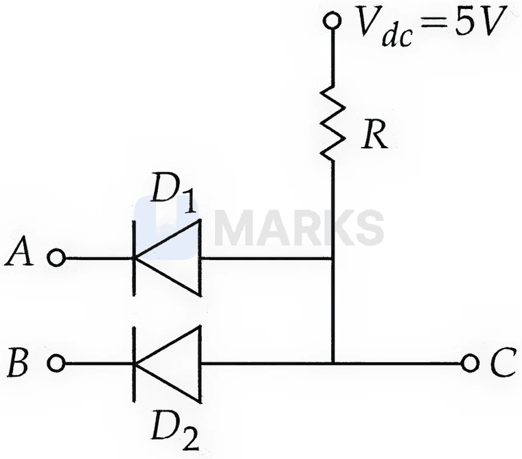
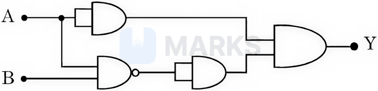
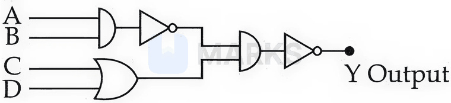
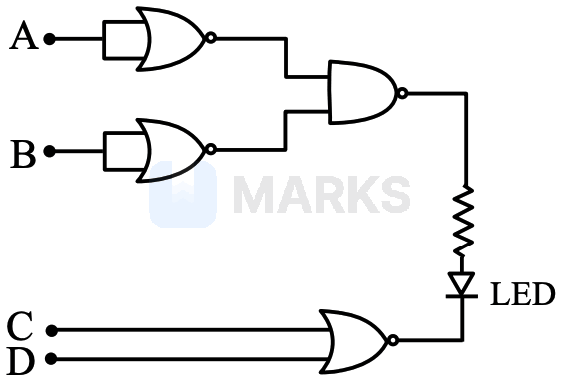
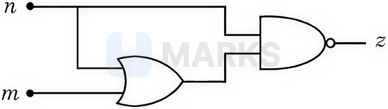
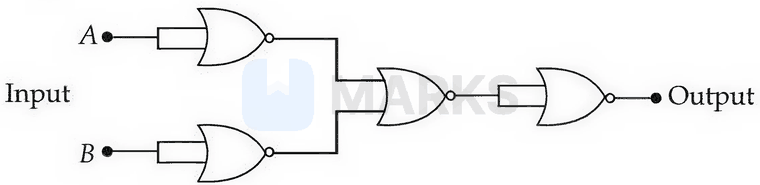
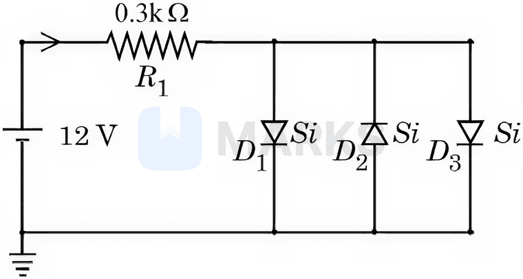
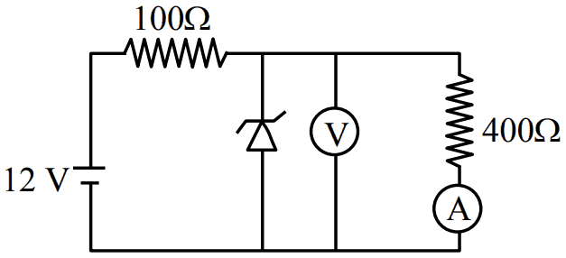
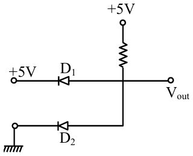

# Semiconductors & Electronic Devices

> Theory: [../../theory/physics/semiconductors.md](../../theory/physics/semiconductors.md)

### P-SEM-01 · C — JEE Main 2026 · 28 Jan Shift 2 · set Q2 · MCQ

Two $p$–$n$ junction diodes $D_1$ and $D_2$ are connected as shown in the figure. $A$ and $B$ are input signals and $C$ is the output. The given circuit will function as a ______.

(1) NOR gate  (2) NAND gate  (3) OR gate  (4) AND gate

**Answer: (4)** · key (compiled)

**Solution.** The cathodes of $D_1,D_2$ are at the inputs and their anodes are joined to the output $C$, which is pulled up to $5$ V through $R$. If either input is $0$ the corresponding diode is forward biased and pulls $C$ down to about $0$ V. Only when $A=B=1$ are both diodes off, no current flows through $R$ and $C$ stays at $5$ V (logic 1). So $C=A\cdot B$: an AND gate.

### P-SEM-02 · C — JEE Main 2026 · 24 Jan Shift 2 · set Q3 · MCQ

Identify the correct truth table of the given logic circuit.

Outputs $Y$ for $(A,B)=(0,0),(0,1),(1,0),(1,1)$ in that order:

(1) $1,0,1,0$  (2) $1,1,1,0$  (3) $0,1,1,0$  (4) $0,0,1,0$

**Answer: (4)** · key (compiled)

**Solution.** The top path passes $A$ unchanged (a gate with both inputs tied), the lower path is $\overline{A\cdot B}$ (NAND followed by a tied-input buffer), and the final AND gate combines them: $Y=A\cdot\overline{A\cdot B}=A(\bar A+\bar B)=A\bar B$. This is $1$ only for $A=1,B=0$, i.e. $0,0,1,0$.

### P-SEM-03 · C — JEE Main 2026 · 22 Jan Shift 2 · set Q4 · MCQ

The correct truth table for the given input data of the following logic circuit is:

Outputs $Y$ for $(A,B,C,D)=(1,1,0,1),(0,0,1,1),(1,0,1,0),(1,1,1,1)$ in that order:

(1) $0,0,1,1$  (2) $0,1,1,1$  (3) $1,0,0,1$  (4) $1,0,1,0$

**Answer: (3)** · key (compiled)

**Solution.** $A,B$ go to an AND gate followed by NOT, $C,D$ to an OR gate, these two outputs go to an AND gate followed by NOT. So $Y=\overline{\overline{AB}\cdot(C+D)}=AB+\overline{C+D}$. Evaluating: $(1,1,0,1)\to1$; $(0,0,1,1)\to0$; $(1,0,1,0)\to0$; $(1,1,1,1)\to1$. Output column $1,0,0,1$.

### P-SEM-04 · C — JEE Main 2026 · 22 Jan Shift 1 · set Q5 · MCQ

Find the correct combination of $A,B,C$ and $D$ inputs which can cause the LED to glow.

(1) 1101  (2) 0011  (3) 1000  (4) 0100

**Answer: (1)** · key (compiled)

**Solution.** The LED glows when it is forward biased: its $p$-side (the output of the upper NAND gate) must be high and its $n$-side (the output of the NOR gate on $C,D$) must be low. The upper NAND receives $\bar A$ and $\bar B$ (tied-input NOR gates act as NOT), so $Y_1=\overline{\bar A\bar B}=A+B$. The lower gate gives $Y_2=\overline{C+D}$. Need $Y_1=1$ and $Y_2=0$, i.e. $A+B=1$ and $C+D=1$. Only $1101$ satisfies both.

### P-SEM-05 · C — JEE Main 2026 · 23 Jan Shift 2 · set Q6 · MCQ

For the given logic gate circuit, which of the following is the correct truth table?

Outputs $z$ for $(n,m)=(0,0),(0,1),(1,1),(1,0)$ in that order:

(1) $0,1,0,1$  (2) $1,0,1,0$  (3) $1,0,0,0$  (4) $1,1,0,0$

**Answer: (4)** · key (compiled)

**Solution.** An OR gate gives $y=n+m$, and a NAND gate takes $n$ and $y$: $z=\overline{n\cdot(n+m)}=\overline{n}$ (absorption: $n(n+m)=n$). So $z=1,1,0,0$ for the four rows.

### P-SEM-06 · C — JEE Main 2026 · 21 Jan Shift 1 · set Q7 · MCQ

The given circuit works as:

(1) AND gate  (2) NAND gate  (3) NOR gate  (4) OR gate

**Answer: (2)** · key (compiled)

**Solution.** A NOR gate with both inputs tied acts as a NOT gate. The first two NOR gates give $\bar A$ and $\bar B$; the third NOR gate gives $\overline{\bar A+\bar B}=A\cdot B$; the last (tied-input) NOR inverts it: $Y=\overline{A\cdot B}$. This is a NAND gate.

### P-SEM-07 · C — JEE Main 2026 · 28 Jan Shift 1 · set Q8 · MCQ

Assuming a voltage drop of $0.7$ V across a silicon diode in forward bias, the current through the diode $D_1$ in the circuit is ______ mA. (Assume all diodes in the circuit are identical.)

(1) 17.6  (2) 18.8  (3) 11.7  (4) 20.15

**Answer: (2)** · key (compiled)

**Solution.** $D_2$ is reverse biased, so $D_1$ and $D_3$ conduct in parallel, each dropping $0.7$ V. Current through the $0.3\ \text{k}\Omega$ resistor $I=\dfrac{12-0.7}{300}=37.7$ mA, shared equally by $D_1$ and $D_3$: $I_1=18.8$ mA.

### P-SEM-08 · C — JEE Main 2026 · 24 Jan Shift 1 · set Q9 · Numerical

A voltage regulating circuit consisting of a Zener diode with breakdown voltage $10$ V and maximum power dissipation $0.4$ W is operated from a $15$ V source. The approximate value of the protective (series) resistance in this circuit is ______ $\Omega$.

**Answer: 125** · key (compiled)

**Solution.** Maximum Zener current $I_{Z,max}=\dfrac{P_{max}}{V_Z}=\dfrac{0.4}{10}=0.04$ A. The series resistor must drop $15-10=5$ V at that current: $R_s=\dfrac{5}{0.04}=125\ \Omega$.

### P-SEM-09 · C — JEE Main 2025 · Apr session · Semi set Q1 · MCQ

Consider an n-type semiconductor in which $n_e$ and $n_h$ are the numbers of electrons and holes respectively.

(A) Holes are minority carriers.  
(B) The dopant is a pentavalent atom.  
(C) $n_en_h\ne n_i^2$ (where $n_i$ is the number of electrons or holes in the semiconductor when it is intrinsic).  
(D) $n_en_h\ge n_i^2$.  
(E) The holes are not generated due to the donors.

Choose the correct answer:

(1) (A), (C), (D) only  (2) (A), (C), (E) only  (3) (A), (B), (E) only  (4) (A), (B), (C) only

**Answer: (3)** · key (compiled)

**Solution.** In an n-type semiconductor the dopant is pentavalent (B), electrons are the majority and holes the minority carriers (A), and the donors supply electrons only, so holes are not generated by them (E). The mass-action law $n_en_h=n_i^2$ still holds at thermal equilibrium, so (C) and (D) are false.

### P-SEM-10 · C — JEE Main 2025 · Apr session · Semi set Q2 · MCQ

A zener diode with 5 V zener voltage is used to regulate an unregulated dc voltage input of 25 V. For a 400 $\Omega$ resistor connected in series, the zener current is found to be 4 times the load current. The load current ($I_L$) and the load resistance ($R_L$) are:

(1) $I_L=20$ mA; $R_L=250\ \Omega$  (2) $I_L=10$ A; $R_L=0.5\ \Omega$  (3) $I_L=0.02$ mA; $R_L=250\ \Omega$  (4) $I_L=10$ mA; $R_L=500\ \Omega$

**Answer: (4)** · key (compiled)

**Solution.** Current through the series resistor $=\dfrac{25-5}{400}=50$ mA $=I_Z+I_L=4I_L+I_L$, so $I_L=10$ mA and $R_L=\dfrac5{10\times10^{-3}}=500\ \Omega$.

### P-SEM-11 · C — JEE Main 2025 · Apr session · Semi set Q3 · MCQ

In the following circuit, the reading of the ammeter will be (take the Zener breakdown voltage $=4$ V):

(1) 24 mA  (2) 80 mA  (3) 10 mA  (4) 60 mA

**Answer: (3)** · key (compiled)

**Solution.** The zener (in breakdown) holds 4 V across itself and the parallel 400 $\Omega$ branch containing the ammeter. Ammeter current $=\dfrac4{400}=10$ mA. (The 100 $\Omega$ series resistor carries $\dfrac{12-4}{100}=80$ mA, of which 70 mA goes through the zener.)

### P-SEM-12 · C — JEE Main 2025 · Apr session · Semi set Q4 · MCQ

The output voltage in the following circuit is (consider the ideal diode case):

(1) 10 V  (2) 0 V  (3) +5 V  (4) $-5$ V

**Answer: (2)** · key (compiled)

**Solution.** The junction is fed from +5 V through the resistor. Diode $D_2$ is forward biased towards ground, so the output node is clamped at 0 V. $D_1$ then has 0 V on its anode side and +5 V on the other terminal, so it is reverse biased and carries no current. $V_{out}=0$ V.

### P-SEM-13 · C — JEE Main 2024 · 1 Feb Shift 2 · Q20 · MCQ

The conductivity of a photodiode changes only if the wavelength of incident light is less than $660$ nm. The band gap is $\dfrac X8$ eV. $X$ is: ($h=6.6\times10^{-34}$ J s, $e=1.6\times10^{-19}$ C)

(1) 15  (2) 11  (3) 13  (4) 21

**Answer: (1)** · key ✔

**Solution.** $E_g=\dfrac{hc}{\lambda}=\dfrac{6.6\times10^{-34}\times3\times10^8}{660\times10^{-9}}=3\times10^{-19}$ J $=\dfrac{3}{1.6}=\dfrac{15}{8}$ eV. So $X=15$.

### P-SEM-14 · C — JEE Main 2024 · 6 Apr Shift 2 · Q19 · MCQ

The energy needed to create a hole in a p-type semiconductor is $6$ eV (acceptor-level related). The maximum wavelength of light that can create a hole is ($hc=1242$ eV nm):

(1) 414 nm  (2) 103.5 nm  (3) 207 nm  (4) 407 nm

**Answer: (3)** · key ✔

**Solution.** $\lambda_{max}=\dfrac{hc}{E}=\dfrac{1242}{6}=207$ nm.

### P-SEM-15 · C — JEE Main 2023 · 24 Jan Shift 1 · Q19 · MCQ

Assertion A: Photodiodes are preferably operated in reverse bias condition for light intensity measurement.  
Reason R: The current in the forward bias is more than the current in the reverse bias for a $p$–$n$ junction diode.

(1) A false, R true  (2) Both true, R is NOT the correct explanation of A  (3) A true, R false  (4) Both true, R is the correct explanation of A

**Answer: (2)** · key ✔

**Solution.** In reverse bias the dark current is tiny, so the small photo-generated current (proportional to light intensity) is a large fractional change and is easily measured: A is true. R is also a true statement about a $p$–$n$ junction, but it does not explain A (the explanation is the small reverse dark current, not the size of the forward current).

