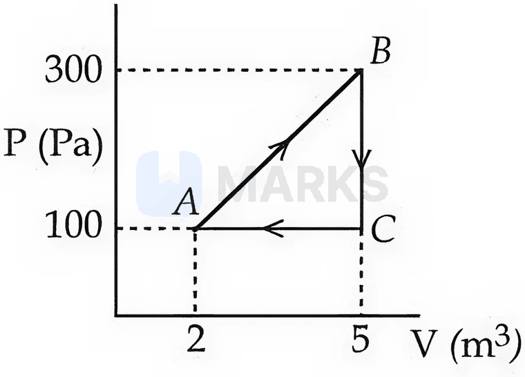
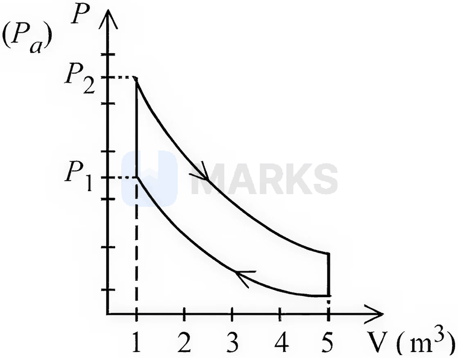
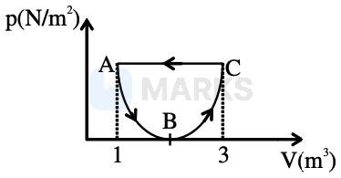
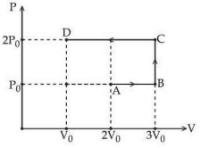
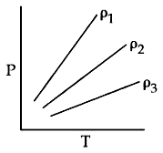
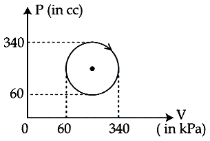
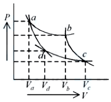
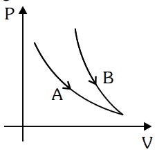
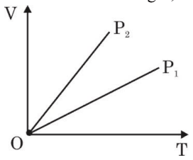

# Thermodynamics

> Theory: [../../theory/physics/thermodynamics.md](../../theory/physics/thermodynamics.md)

### P-THD-01 · A — JEE Main 2026 · 21 Jan Shift 2 · set Q1 · Numerical

A diatomic gas ($\gamma=1.4$) does $100$ J of work when it is expanded isobarically. The heat given to the gas is ______ J.

**Answer: 350** · key (compiled)

**Solution.** For an isobaric process $W=nR\Delta T=100$ J. For a diatomic gas $C_V=\tfrac52R$, so $\Delta U=\tfrac52nR\Delta T=250$ J. Then $Q=\Delta U+W=250+100=350$ J.

### P-THD-02 · A — JEE Main 2026 · 28 Jan Shift 2 · set Q2 · Numerical

A thermodynamic system is taken through the cyclic process $ABCA$ as shown in the figure. The total work done by the system during the cycle $ABCA$ is ______ J.

**Answer: 300** · key (compiled)

**Solution.** The cycle is a right triangle with $V$ from $2$ to $5$ m$^3$ and $P$ from $100$ to $300$ Pa, traversed clockwise (positive work). $W=\text{area}=\tfrac12\times(5-2)\times(300-100)=300$ J.

### P-THD-03 · A — JEE Main 2026 · 24 Jan Shift 2 · set Q3 · MCQ

$10$ moles of an ideal gas undergo the process shown in the figure. The heat involved in the process from $P_1$ to $P_2$ is $\alpha$ joule ($P_1=21.7$ Pa, $P_2=30$ Pa, $C_V=21\ \text{J/K mol}$, $R=8.3\ \text{J/mol K}$). The value of $\alpha$ is ______.

(1) 21  (2) 15  (3) 28  (4) 24

**Answer: (1)** · key (compiled)

**Solution.** The step from $P_1$ to $P_2$ is at constant volume ($V=1\ \text{m}^3$), so $W=0$ and $Q=\Delta U=nC_V\Delta T$. With $nR\Delta T=V\Delta P=1\times(30-21.7)=8.3$ J, $\Delta T=\dfrac{8.3}{10\times8.3}=0.1$ K. So $Q=10\times21\times0.1=21$ J.

### P-THD-04 · A — JEE Main 2026 · 22 Jan Shift 2 · set Q5 · Numerical

An insulated cylinder of volume $60\ \text{cm}^3$ is filled with a gas at $27^\circ$C and $2$ atmospheric pressure. The gas is then compressed to a final volume of $20\ \text{cm}^3$ while the temperature is allowed to rise to $77^\circ$C. The final pressure is ______ atmospheric pressure.

**Answer: 7** · key (compiled)

**Solution.** $\dfrac{P_1V_1}{T_1}=\dfrac{P_2V_2}{T_2}\Rightarrow P_2=2\times\dfrac{60}{20}\times\dfrac{350}{300}=7$ atm.

### P-THD-05 · A — JEE Main 2026 · 23 Jan Shift 2 · set Q6 · MCQ

One mole of an ideal diatomic gas expands from volume $V$ to $2V$ isothermally at a temperature of $27^\circ$C and does $W$ joule of work. If the gas undergoes the same magnitude of expansion adiabatically from $27^\circ$C, doing the same amount of work $W$, its final temperature will be (close to) ______ $^\circ$C. ($\log_e2=0.693$)

(1) -30  (2) -189  (3) -117  (4) -56

**Answer: (4)** · key (compiled)

**Solution.** Isothermal work $W=RT\ln2=R(300)(0.693)$. Adiabatic work $W=C_V(T_i-T_f)=\tfrac52R(300-T_f)$. Equating: $300-T_f=\dfrac{300\times0.693}{2.5}=83.2\Rightarrow T_f=216.8$ K $=-56^\circ$C.

### P-THD-06 · A — JEE Main 2026 · 23 Jan Shift 2 · set Q7 · MCQ

The internal energy of a monatomic gas is $3nRT$. One mole of helium is kept in a cylinder of internal cross-section $17\ \text{cm}^2$ fitted with a light movable frictionless piston. The gas is heated slowly by supplying $126$ J of heat. If the temperature rises by $4^\circ$C, the piston will move ______ cm. (atmospheric pressure $=10^5$ Pa)

(1) 1.45  (2) 15.5  (3) 1.55  (4) 14.5

**Answer: (2)** · key (compiled)

**Solution.** With the paper's $U=3nRT$: $\Delta U=3\times1\times8.314\times4=99.8$ J. The work done at constant pressure $W=Q-\Delta U=126-99.8=26.2$ J $=P\,A\,d=10^5\times17\times10^{-4}\,d$, so $d=\dfrac{26.2}{170}=0.154$ m $\approx15.5$ cm.

### P-THD-07 · A — JEE Main 2026 · 21 Jan Shift 1 · set Q8 · Numerical

$10$ moles of oxygen are heated at constant volume from $30^\circ$C to $40^\circ$C. The change in the internal energy of the gas is ______ cal. (The molar specific heat of oxygen at constant pressure $C_P=7\ \text{cal/mol}^\circ\text{C}$ and $R=2\ \text{cal/mol}^\circ\text{C}$.)

**Answer: 500** · key (compiled)

**Solution.** $C_V=C_P-R=5$ cal/mol$^\circ$C, so $\Delta U=nC_V\Delta T=10\times5\times10=500$ cal.

### P-THD-08 · A — JEE Main 2026 · 28 Jan Shift 1 · set Q9 · MCQ

In the following $p$–$V$ diagram the equation of state along the curved path is $(V-2)^2=4ap$, where $a$ is a constant. The total work done in the closed path is:

(1) $+\dfrac{1}{3a}$  (2) $-\dfrac{1}{3a}$  (3) $\dfrac{1}{2a}$  (4) $-\dfrac1a$

**Answer: (2)** · key (compiled)

**Solution.** Along the curve $A\to B\to C$ ($V$ from $1$ to $3$): $W=\int_1^3\dfrac{(V-2)^2}{4a}dV=\dfrac1{4a}\cdot\dfrac23=\dfrac1{6a}$. Along the straight line $C\to A$ at $p=\dfrac1{4a}$ (the curve's end value): $W=\dfrac1{4a}(1-3)=-\dfrac1{2a}$. Total $=\dfrac1{6a}-\dfrac1{2a}=-\dfrac1{3a}$.

### P-THD-09 · A — JEE Main 2026 · 24 Jan Shift 1 · set Q10 · MCQ

The densities of water at $4^\circ$C and $20^\circ$C are $1000\ \text{kg/m}^3$ and $998\ \text{kg/m}^3$ respectively. The increase in internal energy of $4$ kg of water when it is heated from $4^\circ$C to $20^\circ$C is ______ J. (specific heat capacity of water $=4200\ \text{J kg}^{-1}\,^\circ\text{C}^{-1}$ and $1$ atmospheric pressure $=10^5$ Pa)

(1) 234699.2  (2) 315826.2  (3) 258700.8  (4) 268799.2

**Answer: (4)** · key (compiled)

**Solution.** Heat absorbed $Q=mc\Delta T=4\times4200\times16=268800$ J. Volume change $\Delta V=\dfrac{4}{998}-\dfrac{4}{1000}\approx8\times10^{-6}\ \text{m}^3$, so the expansion work against the atmosphere is $W=P\Delta V\approx0.8$ J. $\Delta U=Q-W=268799.2$ J.

### P-THD-10 · A — JEE Main 2025 · Jan session · Thermo set Q2 · MCQ

An ideal gas goes from an initial state to a final state. During the process, the pressure of the gas increases linearly with temperature (a straight line through the origin of the $P$–$T$ graph).

A. The work done by the gas during the process is zero.  
B. The heat added to the gas is different from the change in its internal energy.  
C. The volume of the gas is increased.  
D. The internal energy of the gas is increased.  
E. The process is isochoric (constant volume process).

Choose the correct answer from the options given below:

(1) E only  (2) A, B, C, D only  (3) A, D, E only  (4) A, C only

**Answer: (3)** · key (compiled)

**Solution.** $P\propto T$ gives $V=\dfrac{nRT}{P}=$ constant: the process is isochoric (E true). Hence $W=P\Delta V=0$ (A true), $Q=\Delta U$ so B is false, the volume does not change (C false), and since $T$ rises $\Delta U>0$ (D true). Correct: A, D, E only.

### P-THD-11 · A — JEE Main 2025 · Jan session · Thermo set Q4 · Numerical

A container of fixed volume contains a gas at $27^\circ$C. To double the pressure of the gas, the temperature of the gas should be raised to ______ $^\circ$C.

**Answer: 327** · key (compiled)

**Solution.** At constant volume $P\propto T$ (kelvin). $T_2=2\times300=600$ K $=327^\circ$C.

### P-THD-12 · A — JEE Main 2025 · Jan session · Thermo set Q5 · MCQ

For a diatomic gas, if $\gamma_1=\dfrac{C_p}{C_v}$ for rigid molecules and $\gamma_2=\dfrac{C_p}{C_v}$ for another diatomic gas whose molecules also have vibrational modes, then which one of the following options is correct? ($C_p$ and $C_v$ are the specific heats of the gas at constant pressure and volume.)

(1) $\gamma_2=\gamma_1$  (2) $2\gamma_2=\gamma_1$  (3) $\gamma_2<\gamma_1$  (4) $\gamma_2>\gamma_1$

**Answer: (3)** · key (compiled)

**Solution.** $\gamma=1+\dfrac2f$. Rigid diatomic: $f=5$, $\gamma_1=\dfrac75$. A vibrational mode adds 2 degrees of freedom (kinetic + potential), so $f=7$ and $\gamma_2=\dfrac97<\dfrac75$. Hence $\gamma_2<\gamma_1$.

### P-THD-13 · A — JEE Main 2025 · Jan session · Thermo set Q6 · MCQ

Using the given $P$–$V$ diagram, the work done by an ideal gas along the path $ABCD$ is:

(1) $3P_0V_0$  (2) $-4P_0V_0$  (3) $-3P_0V_0$  (4) $4P_0V_0$

**Answer: (3)** · key (compiled)

**Solution.** Work is the signed area under the path. $A\to B$ (isobaric expansion at $P_0$ from $2V_0$ to $3V_0$): $+P_0V_0$. $B\to C$ (isochoric): $0$. $C\to D$ (isobaric compression at $2P_0$ from $3V_0$ to $V_0$): $-2P_0\cdot2V_0=-4P_0V_0$. Total $=P_0V_0-4P_0V_0=-3P_0V_0$.

### P-THD-14 · B — JEE Main 2025 · Jan session · Thermo set Q7 · Numerical

The temperature of 1 mole of an ideal monoatomic gas is increased by $50^\circ$C at constant pressure. The total heat added and the change in internal energy are $E_1$ and $E_2$ respectively. If $\dfrac{E_1}{E_2}=\dfrac x9$, then the value of $x$ is ______.

**Answer: 15** · key (compiled)

**Solution.** $E_1=C_p\Delta T=\tfrac52R\,\Delta T$ and $E_2=C_v\Delta T=\tfrac32R\,\Delta T$, so $\dfrac{E_1}{E_2}=\dfrac53=\dfrac{15}{9}$ and $x=15$.

### P-THD-15 · B — JEE Main 2025 · Apr session · Thermo set Q1 · MCQ

Match List-I with List-II.

| List-I | List-II |
|---|---|
| (A) Isobaric | (I) $\Delta Q=\Delta W$ |
| (B) Isochoric | (II) $\Delta Q=\Delta U$ |
| (C) Adiabatic | (III) $\Delta Q=$ zero |
| (D) Isothermal | (IV) $\Delta Q=\Delta U+P\Delta V$ |

($\Delta Q$ = heat supplied, $\Delta W$ = work done by the system, $\Delta U$ = change in internal energy, $P$ = pressure of the system, $\Delta V$ = change in volume of the system.)

Choose the correct answer from the options given below:

(1) (A)-(IV), (B)-(III), (C)-(II), (D)-(I)  (2) (A)-(IV), (B)-(I), (C)-(III), (D)-(II)  (3) (A)-(IV), (B)-(II), (C)-(III), (D)-(I)  (4) (A)-(II), (B)-(IV), (C)-(III), (D)-(I)

**Answer: (3)** · key (compiled)

**Solution.** First law: $\Delta Q=\Delta U+\Delta W$. Isobaric: $\Delta W=P\Delta V$, so $\Delta Q=\Delta U+P\Delta V$ (IV). Isochoric: $\Delta W=0$, so $\Delta Q=\Delta U$ (II). Adiabatic: $\Delta Q=0$ (III). Isothermal (ideal gas): $\Delta U=0$, so $\Delta Q=\Delta W$ (I). So A-IV, B-II, C-III, D-I.

### P-THD-16 · B — JEE Main 2025 · Apr session · Thermo set Q2 · MCQ

There are two vessels filled with an ideal gas, where the volume of one is double the volume of the other. The large vessel contains the gas at 8 kPa and 1000 K while the smaller vessel contains the gas at 7 kPa and 500 K. If the vessels are connected to each other by a thin tube allowing the gas to flow, and the temperature of both vessels is maintained at 600 K, then at steady state the pressure in the vessels will be (in kPa):

(1) 4.4  (2) 6  (3) 24  (4) 18

**Answer: (2)** · key (compiled)

**Solution.** The total number of moles is conserved: $\dfrac{8\cdot2V}{R\,(1000)}+\dfrac{7\cdot V}{R\,(500)}=\dfrac{P'\cdot3V}{R\,(600)}$, i.e. $0.016+0.014=\dfrac{P'}{200}$, so $P'=6$ kPa.

### P-THD-17 · B — JEE Main 2025 · Apr session · Thermo set Q3 · Numerical

The internal energy of air in a room of size $4\ \text{m}\times4\ \text{m}\times3\ \text{m}$ at 1 atmospheric pressure will be ______ $\times10^6$ J. (Consider air as diatomic molecules.)

**Answer: 12** · key (compiled)

**Solution.** For a diatomic gas $U=\dfrac52nRT=\dfrac52PV=\dfrac52\times1.01\times10^5\ \text{Pa}\times48\ \text{m}^3\approx1.2\times10^7$ J $=12\times10^6$ J.

### P-THD-18 · B — JEE Main 2025 · Apr session · Thermo set Q6 · MCQ

Identify the characteristics of an adiabatic process in a monoatomic gas.

(A) Internal energy is constant.  
(B) Work done in the process is equal to the change in internal energy.  
(C) The product of temperature and volume is a constant.  
(D) The product of pressure and volume is a constant.  
(E) The work done to change the temperature from $T_1$ to $T_2$ is proportional to $(T_2-T_1)$.

Choose the correct answer from the options given below:

(1) (A), (C), (D) only  (2) (A), (C), (E) only  (3) (B), (E) only  (4) (B), (D) only

**Answer: (3)** · key (compiled)

**Solution.** Adiabatic means $Q=0$, so $W=-\Delta U$: the work equals the change in internal energy in magnitude (B true) and $U$ is not constant (A false). For a monoatomic gas $TV^{2/3}$ and $PV^{5/3}$ are constant, so (C) and (D) are false. $|W|=|\Delta U|=nC_v|T_2-T_1|$ is proportional to $(T_2-T_1)$ (E true). Correct: (B), (E) only.

### P-THD-19 · B — JEE Main 2024 · 27 Jan Shift 1 · Q8 · MCQ

$0.08$ kg of air is heated at constant volume through $5^\circ$C. The specific heat of air at constant volume is $0.17$ kcal kg$^{-1}$ $^\circ$C$^{-1}$ and $1\ \text{J}=4.18\ \text{cal}$ (i.e. $4.18$ J per cal). The change in its internal energy is approximately

(1) 318 J  (2) 298 J  (3) 284 J  (4) 142 J

**Answer: (3)** · key ✔

**Solution.** At constant volume $\Delta U=mC_v\Delta T=0.08\times0.17\times5=0.068$ kcal $=68$ cal $=68\times4.18\approx284$ J.

### P-THD-20 · B — JEE Main 2024 · 27 Jan Shift 2 · Q8 · MCQ

During an adiabatic process, the pressure of a gas is found to be proportional to the cube of its absolute temperature. The ratio $C_p/C_v$ for the gas is

(1) $\tfrac53$  (2) $\tfrac32$  (3) $\tfrac75$  (4) $\tfrac97$

**Answer: (2)** · key ✔

**Solution.** For an adiabatic process $P^{1-\gamma}T^{\gamma}=\text{const}\Rightarrow P\propto T^{\gamma/(\gamma-1)}$. Given $P\propto T^3$: $\dfrac\gamma{\gamma-1}=3\Rightarrow\gamma=\dfrac32$.

### P-THD-21 · B — JEE Main 2024 · 29 Jan Shift 2 · Q10 · MCQ

$N$ moles of a polyatomic gas ($f=6$) must be mixed with two moles of a monoatomic gas so that the mixture behaves as a diatomic gas. The value of $N$ is

(1) 6  (2) 3  (3) 4  (4) 2

**Answer: (3)** · key ✔

**Solution.** Molar $C_v=\tfrac f2R$: polyatomic $3R$, monoatomic $\tfrac32R$, diatomic $\tfrac52R$. Mixing: $\dfrac{N(3)+2\left(\tfrac32\right)}{N+2}=\tfrac52\Rightarrow3N+3=2.5N+5\Rightarrow N=4$.

### P-THD-22 · B — JEE Main 2024 · 30 Jan Shift 2 · Q9 · MCQ

If three moles of a monoatomic gas ($\gamma=\tfrac53$) are mixed with two moles of a diatomic gas ($\gamma=\tfrac75$), the value of the adiabatic exponent $\gamma$ for the mixture is

(1) 1.75  (2) 1.40  (3) 1.52  (4) 1.35

**Answer: (3)** · key ✔

**Solution.** $C_v$: monoatomic $\tfrac32R$, diatomic $\tfrac52R$. $C_{v,mix}=\dfrac{3(1.5R)+2(2.5R)}5=1.9R$ and $C_{p,mix}=C_v+R=2.9R$. $\gamma=\dfrac{2.9}{1.9}=1.526\approx1.52$.

### P-THD-23 · B — JEE Main 2024 · 1 Feb Shift 1 · Q9 · MCQ

The pressure and volume of an ideal gas are related as $PV^{3/2}=K$ (constant). The work done when the gas is taken from state $A(P_1,V_1,T_1)$ to state $B(P_2,V_2,T_2)$ is

(1) $2(P_1V_1-P_2V_2)$  (2) $2(P_2V_2-P_1V_1)$  (3) $2\left(\sqrt{P_1}V_1-\sqrt{P_2}V_2\right)$  (4) $2\left(P_2\sqrt{V_2}-P_1\sqrt{V_1}\right)$

**Answer: (1)** · key ✔

**Solution.** For $PV^n=$ const, $W=\dfrac{P_1V_1-P_2V_2}{n-1}$. With $n=\tfrac32$: $W=\dfrac{P_1V_1-P_2V_2}{1/2}=2(P_1V_1-P_2V_2)$.

### P-THD-24 · B — JEE Main 2024 · 1 Feb Shift 2 · Q8 · MCQ

A diatomic gas ($\gamma=1.4$) does $200$ J of work when expanded isobarically. The heat given to the gas is:

(1) 850 J  (2) 800 J  (3) 600 J  (4) 700 J

**Answer: (4)** · key ✔

**Solution.** Isobaric: $W=nR\Delta T$, $Q=nC_p\Delta T=\dfrac{\gamma}{\gamma-1}W=\dfrac{1.4}{0.4}\times200=700$ J.

### P-THD-25 · C — JEE Main 2024 · 4 Apr Shift 2 · Q8 · MCQ

A sample of gas ($\mu=1$ mol, $\gamma=3/2$) at temperature $T$ is expanded adiabatically to double its volume. The work done by the gas is:

(1) $RT[1-2\sqrt2]$  (2) $RT[\sqrt2-2]$  (3) $RT[2-\sqrt2]$  (4) $RT[2\sqrt2-1]$

**Answer: (3)** · key ✔

**Solution.** $TV^{\gamma-1}=$ const: $T_2=T\left(\tfrac12\right)^{1/2}=\dfrac T{\sqrt2}$. $W=\dfrac{R(T_1-T_2)}{\gamma-1}=2R\left(T-\dfrac T{\sqrt2}\right)=RT(2-\sqrt2)$.

### P-THD-26 · C — JEE Main 2024 · 5 Apr Shift 2 · Q8 · MCQ

During an adiabatic process the pressure of a gas is found to be proportional to the cube of its absolute temperature. The ratio $C_P/C_V$ for the gas is:

(1) $\dfrac53$  (2) $\dfrac97$  (3) $\dfrac32$  (4) $\dfrac75$

**Answer: (3)** · key ✔

**Solution.** For an adiabatic process $P^{1-\gamma}T^{\gamma}=$ const, i.e. $P\propto T^{\gamma/(\gamma-1)}$. Setting $\dfrac{\gamma}{\gamma-1}=3$ gives $\gamma=\dfrac32$.

### P-THD-27 · C — JEE Main 2024 · 04 Apr Shift 1 · Fig set Q1 · MCQ

The P–T diagram of an ideal gas having three different densities $\rho_1$, $\rho_2$, $\rho_3$ (in three different cases) is shown in the figure (three straight lines through the origin, $\rho_1$ the steepest). Which of the following is correct?

(1) $\rho_1>\rho_2$  (2) $\rho_2<\rho_3$  (3) $\rho_1=\rho_2=\rho_3$  (4) $\rho_1<\rho_2$

**Answer: (1)** · key (compiled)

**Solution.** $PV=nRT\Rightarrow P=\dfrac{\rho RT}M$, so on a $P$–$T$ graph the slope is proportional to the density. The steeper the line, the denser the gas: $\rho_1>\rho_2>\rho_3$. Statement (1) is true (and (2) is false).

### P-THD-28 · C — JEE Main 2024 · 05 Apr Shift 1 · Fig set Q3 · MCQ

The heat absorbed by a system in going through the given cyclic process (a circle on the $P$–$V$ diagram, drawn between 60 and 340 on both axes, $V$ in cc and $P$ in kPa) is:

(1) 19.6 J  (2) 61.6 J  (3) 616 J  (4) 431.2 J

**Answer: (2)** · key (compiled)

**Solution.** For a complete cycle $\Delta U=0$, so $Q=W=$ area enclosed. The circle has radius $\dfrac{340-60}2=140$ cc along $V$ and 140 kPa along $P$: area $=\pi(140\times10^{-6}\ \text{m}^3)(140\times10^3\ \text{Pa})=\pi\times19.6=61.6$ J.

### P-THD-29 · C — JEE Main 2024 · 08 Apr Shift 1 · Fig set Q5 · MCQ

Two different adiabatic paths for the same gas intersect two isothermal curves as shown in the $P$–$V$ diagram (adiabats $a\to d$ and $b\to c$ between the isotherms $T_1$ and $T_2$). The relation between the ratio $\dfrac{V_a}{V_d}$ and the ratio $\dfrac{V_b}{V_c}$ is:

(1) $\dfrac{V_a}{V_d}\ne\dfrac{V_b}{V_c}$  (2) $\dfrac{V_a}{V_d}=\dfrac{V_b}{V_c}$  (3) $\dfrac{V_a}{V_d}=\left(\dfrac{V_b}{V_c}\right)^{-1}$  (4) $\dfrac{V_a}{V_d}=\left(\dfrac{V_b}{V_c}\right)^2$

**Answer: (2)** · key (compiled)

**Solution.** Along an adiabat $TV^{\gamma-1}=$ const. With $T_a=T_b=T_1$ and $T_d=T_c=T_2$: $T_1V_a^{\gamma-1}=T_2V_d^{\gamma-1}$ and $T_1V_b^{\gamma-1}=T_2V_c^{\gamma-1}$. Hence $\left(\dfrac{V_a}{V_d}\right)^{\gamma-1}=\left(\dfrac{V_b}{V_c}\right)^{\gamma-1}$, so the ratios are equal.

### P-THD-30 · C — JEE Main 2024 · 30 Jan Shift 2 · Fig set Q6 · MCQ

Choose the correct statement for processes A and B shown in the figure (two curves on a $P$–$V$ diagram starting from the same point; B is steeper than A).

(1) $PV^\gamma=k$ for process B and $PV=k$ for process A.  (2) $PV=k$ for process B and A.  (3) $\dfrac{T^\gamma}{P^{\gamma-1}}=k$ for process A and $PV=k$ for process B.  (4) None of these

**Answer: (1)** · key (compiled)

**Solution.** From a common point the adiabatic curve ($PV^\gamma=k$) falls more steeply than the isothermal curve ($PV=k$), because $\gamma>1$. B is steeper, so B is adiabatic and A is isothermal.

### P-THD-31 · C — JEE Main 2024 · 31 Jan Shift 1 · Fig set Q7 · MCQ

The given figure represents two isobaric processes for the same mass of an ideal gas ($V$–$T$ straight lines through the origin, labelled $P_1$ and $P_2$, with the $P_2$ line steeper). Then:

(1) $P_2\ge P_1$  (2) $P_2>P_1$  (3) $P_1=P_2$  (4) $P_1>P_2$

**Answer: (4)** · key (compiled)

**Solution.** $V=\dfrac{nR}PT$, so the slope of a $V$–$T$ line is $\propto\dfrac1P$. The line labelled $P_2$ is steeper, so $P_2$ is the smaller pressure: $P_1>P_2$.

### P-THD-32 · C — JEE Main 2023 · 24 Jan Shift 1 · Q7 · MCQ

$1$ g of a liquid is converted to vapour at $3\times10^5$ Pa pressure. If $10\%$ of the heat supplied is used for increasing the volume by $1600\ \text{cm}^3$ during this phase change, the increase in internal energy in the process will be:

(1) 4320 J  (2) 432000 J  (3) 4800 J  (4) $4.32\times10^8$ J

**Answer: (1)** · key ✔

**Solution.** Work done by the vapour $W=P\Delta V=3\times10^5\times1600\times10^{-6}=480$ J, which is $10\%$ of $Q$. So $Q=4800$ J and $\Delta U=Q-W=4800-480=4320$ J.

