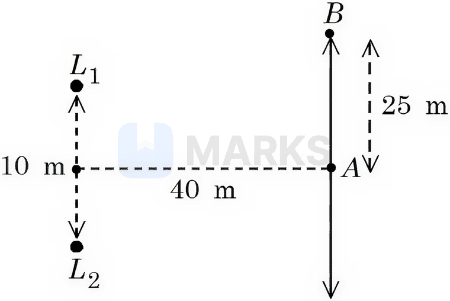

# Waves & Sound

> Theory: [../../theory/physics/waves-sound.md](../../theory/physics/waves-sound.md)

### P-WAV-01 · A — JEE Main 2026 · 28 Jan Shift 2 · set Q1 · MCQ

The speed of a longitudinal wave in a metallic bar is $400$ m/s. If the density and Young's modulus of the bar material are increased by $0.5\%$ and $1\%$ respectively, the speed of the wave changes approximately to ______ m/s.

(1) 398  (2) 401  (3) 399  (4) 402

**Answer: (2)** · key (compiled)

**Solution.** $v=\sqrt{Y/\rho}$, so $\dfrac{\Delta v}{v}\approx\tfrac12(1\%-0.5\%)=0.25\%$. $v'=400\times1.0025\approx401$ m/s.

### P-WAV-02 · A — JEE Main 2026 · 24 Jan Shift 2 · set Q3 · MCQ

A point source is kept at the centre of a spherically enclosed detector. If the volume of the detector is increased by $8$ times, the intensity will:

(1) increase by 64 times  (2) increase by 8 times  (3) decrease by 4 times  (4) decrease by 8 times

**Answer: (3)** · key (compiled)

**Solution.** Volume $\propto r^3$, so $r_{new}=2r_{old}$. Intensity $I=\dfrac{P}{4\pi r^2}$ falls by a factor $4$.

### P-WAV-03 · A — JEE Main 2026 · 22 Jan Shift 2 · set Q5 · MCQ

In an open organ pipe, $\nu_3$ and $\nu_6$ are the $3^{rd}$ and $6^{th}$ harmonic frequencies respectively. If $\nu_6-\nu_3=2200$ Hz, the length of the pipe is ______ mm. (Take the velocity of sound in air as $330$ m/s.)

(1) 275  (2) 250  (3) 225  (4) 200

**Answer: (3)** · key (compiled)

**Solution.** $\nu_n=\dfrac{nv}{2L}$, so $\nu_6-\nu_3=3\cdot\dfrac{330}{2L}=2200\Rightarrow L=\dfrac{990}{4400}=0.225$ m $=225$ mm.

### P-WAV-04 · A — JEE Main 2026 · 22 Jan Shift 1 · set Q6 · Numerical

Two loudspeakers ($L_1$ and $L_2$) are placed $10$ m apart, as shown in the figure. Both are fed with an audio signal of the same frequency and constant volume. A voice recorder, initially at point $A$ equidistant from both loudspeakers, is moved by $25$ m along the line $AB$ while monitoring the audio signal. The measured signal undergoes $10$ cycles of minima and maxima during the movement. The frequency of the input signal is ______ Hz. (Speed of sound in air is $324$ m/s and $\sqrt5=2.23$)

**Answer: 600** · key (compiled)

**Solution.** At $B$ (25 m from $A$): distance to $L_1$ is $\sqrt{40^2+20^2}=20\sqrt5=44.6$ m and to $L_2$ is $\sqrt{40^2+30^2}=50$ m, a path difference $\Delta x=5.4$ m. Ten cycles means $\Delta x=10\lambda\Rightarrow\lambda=0.54$ m, so $f=\dfrac{324}{0.54}=600$ Hz.

### P-WAV-05 · A — JEE Main 2026 · 23 Jan Shift 2 · set Q7 · Numerical

The velocity of sound in air is doubled when the temperature is raised from $0^\circ$C to $\alpha^\circ$C. The value of $\alpha$ is ______.

**Answer: 819** · key (compiled)

**Solution.** $v\propto\sqrt T$, so doubling $v$ needs $T_2=4T_1=4\times273.15=1092.6$ K, i.e. $\alpha=1092.6-273.15\approx819$.

### P-WAV-06 · A — JEE Main 2026 · 21 Jan Shift 1 · set Q8 · MCQ

Two strings $A$ and $B$ of linear densities $\mu_A=2\times10^{-4}$ kg/m and $\mu_B=4\times10^{-4}$ kg/m and lengths $L_A=2.5$ m and $L_B=1.5$ m respectively are joined. The free ends of $A$ and $B$ are tied to two rigid supports $C$ and $D$ respectively, creating a tension of $500$ N in the wire. Two identical pulses, sent from the $C$ and $D$ ends, take times $t_1$ and $t_2$ respectively to reach the joint. The ratio $t_1/t_2$ is:

(1) 1.90  (2) 1.67  (3) 1.08  (4) 1.18

**Answer: (4)** · key (compiled)

**Solution.** Wave speed $v=\sqrt{T/\mu}$, so $t=L\sqrt{\mu/T}$. $\dfrac{t_1}{t_2}=\dfrac{L_A}{L_B}\sqrt{\dfrac{\mu_A}{\mu_B}}=\dfrac{2.5}{1.5}\times\dfrac{1}{\sqrt2}=1.18$.

### P-WAV-07 · A — JEE Main 2025 · Jan session · Waves set Q1 · MCQ

The equation of a transverse wave travelling along a string is $y(x,t)=4.0\sin\left[20\times10^{-3}x+600t\right]$ mm, where $x$ is in mm and $t$ is in seconds. The velocity of the wave is:

(1) $-60$ m/s  (2) $-30$ m/s  (3) $+30$ m/s  (4) $+60$ m/s

**Answer: (2)** · key (compiled)

**Solution.** Here $k=20\times10^{-3}\ \text{mm}^{-1}$ and $\omega=600\ \text{s}^{-1}$, so $|v|=\dfrac\omega k=\dfrac{600}{0.02}=3\times10^4\ \text{mm/s}=30$ m/s. The argument is $kx+\omega t$, so the wave travels in the negative $x$-direction: $v=-30$ m/s.

### P-WAV-08 · B — JEE Advanced 2025 · Paper 1 · Q7 · Multiple correct

Strings $S_1,S_2,S_3$ with linear mass densities $\mu,4\mu,16\mu$ are joined at $P$ ($S_1$–$S_2$) and $Q$ ($S_2$–$S_3$); the far end of $S_3$ is at a wall. A generator at the free end of $S_1$ sends $y=y_0\cos(\omega t-kx)$. Which are correct?

(A) The wave reflected from $P$ is $y=\alpha_1y_0\cos(\omega t+kx+\pi)$  (B) The wave transmitted through $P$ is $y=\alpha_2y_0\cos(\omega t-kx)$  (C) The wave reflected from $Q$ is $y=\alpha_3y_0\cos(\omega t-kx+\pi)$  (D) The wave transmitted through $Q$ is $y=\alpha_4y_0\cos(\omega t-4kx)$

**Answer: (A), (D)** · official key ✔ (re-derived)

**Solution.** Wave speed $v=\sqrt{T/\mu}$, so $v_2=v_1/2$ and $v_3=v_1/4$; at fixed $\omega$, $k=\omega/v$ becomes $k,2k,4k$ in the three strings. At $P$ the wave goes from a light to a heavy string: the reflected wave is inverted ($\pi$ phase change) and travels backward, $\cos(\omega t+kx+\pi)$ (A true). The transmitted wave has no phase change and wave number $2k$: $\cos(\omega t-2kx)$, so (B) is false. At $Q$ (also light to heavy) the reflected wave travels backward in $S_2$ with wave number $2k$, so (C), with $-kx$, is false. The wave transmitted into $S_3$ has wave number $4k$ (D true).

### P-WAV-09 · B — JEE Main 2025 · Jan session · Waves set Q2 · MCQ

A closed organ tube and an open organ tube are filled by two different gases having the same bulk modulus but different densities $\rho_1$ and $\rho_2$ respectively. The frequency of the 9th harmonic of the closed tube is identical to that of the 4th harmonic of the open tube. If the length of the closed tube is 10 cm and the density ratio of the gases is $\rho_1:\rho_2=1:16$, then the length of the open tube is:

(1) $\dfrac{15}7$ cm  (2) $\dfrac{20}7$ cm  (3) $\dfrac{15}9$ cm  (4) $\dfrac{20}9$ cm

**Answer: (4)** · key (compiled)

**Solution.** Speed of sound $v=\sqrt{B/\rho}$, so $\dfrac{v_1}{v_2}=\sqrt{\dfrac{\rho_2}{\rho_1}}=4$. Closed tube, 9th harmonic: $f=\dfrac{9v_1}{4L_1}$. Open tube, 4th harmonic: $f=\dfrac{4v_2}{2L_2}$. Equating, $L_2=\dfrac{2v_2\cdot4L_1}{9v_1}=\dfrac{8\times10}{9\times4}=\dfrac{20}9$ cm.

### P-WAV-10 · B — JEE Main 2025 · Apr session · Waves set Q2 · MCQ

Two strings with circular cross-section and made of the same material are stretched to have the same amount of tension. A transverse wave is then made to pass through both strings. The velocity of the wave in the first string, having radius of cross-section $R$, is $v_1$, and that in the other string, having radius of cross-section $R/2$, is $v_2$. Then $\dfrac{v_2}{v_1}=$

(1) $\sqrt2$  (2) 2  (3) 8  (4) 4

**Answer: (2)** · key (compiled)

**Solution.** $v=\sqrt{T/\mu}$ with $\mu=\rho\pi r^2$. For the same tension and material, $v\propto\dfrac1r$. Hence $\dfrac{v_2}{v_1}=\dfrac{R}{R/2}=2$.

### P-WAV-11 · B — JEE Main 2025 · Apr session · Waves set Q3 · MCQ

A sinusoidal wave of wavelength 7.5 cm travels a distance of 1.2 cm along the $x$-direction in 0.3 s. The crest $P$ is at $x=0$ at $t=0$ s and the maximum displacement of the wave is 2 cm. Which equation correctly represents this wave?

(1) $y=2\cos(0.83x-3.35t)$ cm  (2) $y=2\sin(0.83x-3.5t)$ cm  (3) $y=2\cos(3.35x-0.83t)$ cm  (4) $y=2\cos(0.13x-0.5t)$ cm

**Answer: (1)** · key (compiled)

**Solution.** Wave speed $v=\dfrac{1.2}{0.3}=4$ cm/s. $k=\dfrac{2\pi}\lambda=\dfrac{2\pi}{7.5}=0.84\approx0.83\ \text{cm}^{-1}$ and $\omega=kv=0.84\times4\approx3.35\ \text{s}^{-1}$. A crest at $x=0$, $t=0$ means $y=A\cos(kx-\omega t)$ for a wave travelling in $+x$. So $y=2\cos(0.83x-3.35t)$ cm.

### P-WAV-12 · B — JEE Main 2025 · Apr session · Waves set Q4 · MCQ

The displacement of a wave is expressed as $x(t)=5\cos\left(628t+\dfrac\pi2\right)$ m. The wavelength of the wave when its velocity is 300 m/s is:

(1) 5 m  (2) 3 m  (3) 0.5 m  (4) 0.33 m

**Answer: (2)** · key (compiled)

**Solution.** $\omega=628\ \text{s}^{-1}\Rightarrow f=\dfrac{628}{2\pi}=100$ Hz. $\lambda=\dfrac vf=\dfrac{300}{100}=3$ m.

### P-WAV-13 · B — JEE Main 2024 · 27 Jan Shift 2 · Q24 · Numerical

A closed organ pipe $150$ cm long gives $7$ beats per second with an open organ pipe of length $350$ cm, both vibrating in the fundamental mode. The velocity of sound is ______ m s$^{-1}$.

**Answer: 294** · key ✔

**Solution.** Closed: $f_c=\dfrac v{4L}=\dfrac v{6}$ ($L=1.5$ m). Open: $f_o=\dfrac v{2L}=\dfrac v7$ ($L=3.5$ m). Beat frequency $v\left(\dfrac16-\dfrac17\right)=\dfrac v{42}=7\Rightarrow v=294$ m/s.

### P-WAV-14 · C — JEE Main 2024 · 30 Jan Shift 1 · Q24 · Numerical

In a closed organ pipe, the frequency of the fundamental note is $30$ Hz. Water is poured into the pipe so that the fundamental frequency increases to $110$ Hz. If the organ pipe has a cross-sectional area of $2\ \text{cm}^2$, the mass of water poured into the tube is ______ g. (Speed of sound in air $=330\ \text{m s}^{-1}$; take the density of water $1$ g cm$^{-3}$)

**Answer: 400** · key ✔

**Solution.** Closed pipe: $f=\dfrac v{4L}$. Initially $L_1=\dfrac{330}{4\times30}=2.75$ m; finally $L_2=\dfrac{330}{4\times110}=0.75$ m. Height of water $=2.75-0.75=2$ m $=200$ cm. Volume $=200\times2=400\ \text{cm}^3$, i.e. $400$ g.

### P-WAV-15 · C — JEE Main 2024 · 31 Jan Shift 1 · Q12 · MCQ

The fundamental frequency of a closed organ pipe is equal to the first overtone frequency of an open organ pipe. If the length of the open pipe is $60$ cm, the length of the closed pipe will be

(1) 60 cm  (2) 45 cm  (3) 30 cm  (4) 15 cm

**Answer: (4)** · key ✔

**Solution.** Open pipe first overtone (second harmonic): $f=\dfrac vL=\dfrac v{0.6}$. Closed pipe fundamental: $f=\dfrac v{4L_c}$. Equating: $4L_c=0.6\Rightarrow L_c=0.15$ m $=15$ cm.

### P-WAV-16 · C — JEE Main 2024 · 31 Jan Shift 2 · Q9 · MCQ

The speed of sound in oxygen at S.T.P. will be approximately (given $R=8.3\ \text{J K}^{-1}\text{mol}^{-1}$, $\gamma=1.4$)

(1) 310 m s$^{-1}$  (2) 333 m s$^{-1}$  (3) 341 m s$^{-1}$  (4) 325 m s$^{-1}$

**Answer: (1)** · key ✔

**Solution.** $v=\sqrt{\dfrac{\gamma RT}M}=\sqrt{\dfrac{1.4\times8.3\times273}{32\times10^{-3}}}\approx\sqrt{9.9\times10^4}\approx315\ \text{m s}^{-1}$, closest to $310\ \text{m s}^{-1}$.

