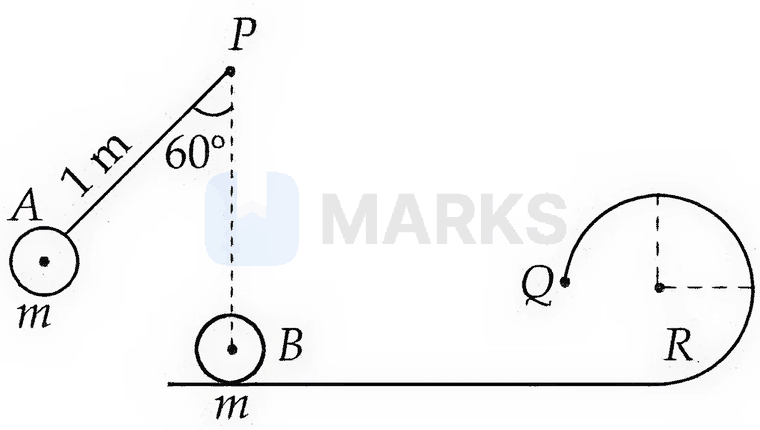
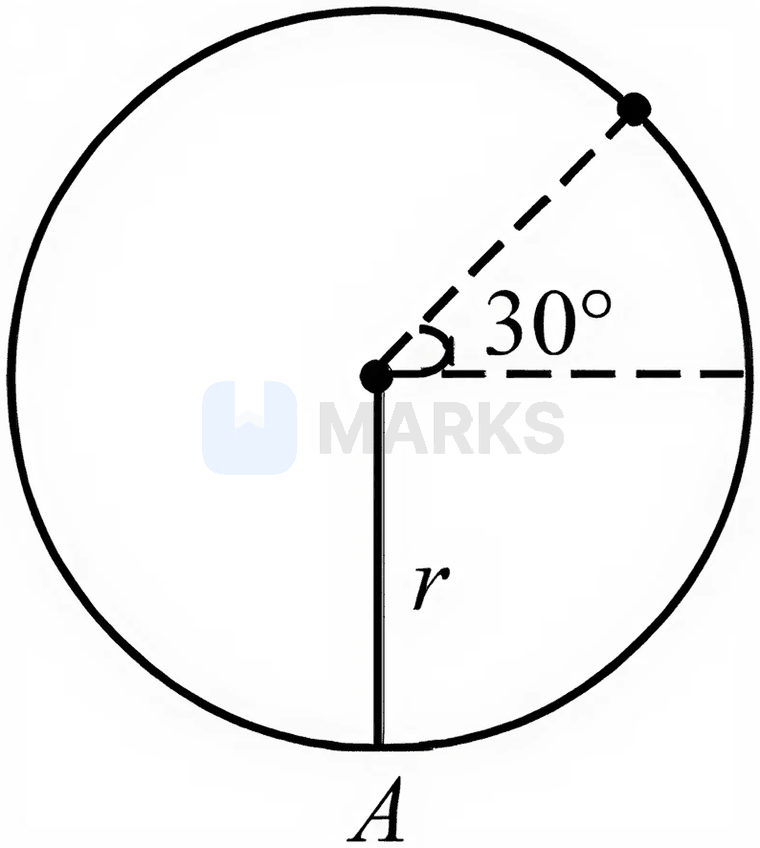
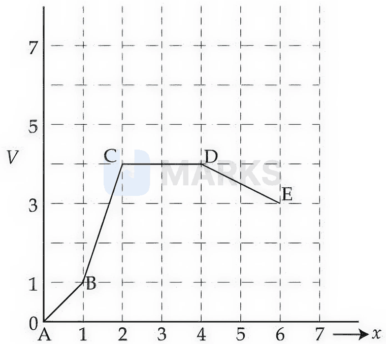

# Work, Energy & Power

> Theory: [../../theory/physics/work-energy-power.md](../../theory/physics/work-energy-power.md)

### P-WEP-01 — JEE Main 2024 · 27 Jan Shift 1 · Q4 · MCQ

Two bodies of masses $4$ g and $25$ g are moving with equal kinetic energies. The ratio of the magnitudes of their linear momenta is

(1) 3 : 5  (2) 5 : 4  (3) 2 : 5  (4) 4 : 5

**Answer: (3)** · key ✔

**Solution.** $p=\sqrt{2mK}$, so at equal $K$: $\dfrac{p_1}{p_2}=\sqrt{\dfrac{m_1}{m_2}}=\sqrt{\dfrac{4}{25}}=\dfrac25$.

### P-WEP-02 — JEE Main 2024 · 29 Jan Shift 1 · Q5 · MCQ

The potential energy function of a particle in a region of space is $U=(2x^2+3y^3+2z)$ J, where $x,y,z$ are in metres. The magnitude of the $x$-component of the force (in N) acting on the particle at $P(1,2,3)$ m is

(1) 2  (2) 6  (3) 4  (4) 8

**Answer: (3)** · key ✔

**Solution.** $F_x=-\dfrac{\partial U}{\partial x}=-4x$. At $x=1$: $F_x=-4$ N, so the magnitude is $4$ N.

### P-WEP-03 — JEE Main 2024 · 29 Jan Shift 2 · Q4 · MCQ

The bob of a pendulum is released from a horizontal position. The length of the pendulum is $10$ m. If it dissipates $10\%$ of its initial energy against air resistance, the speed with which the bob arrives at the lowest point is (use $g=10\ \text{m s}^{-2}$)

(1) $6\sqrt5\ \text{m s}^{-1}$  (2) $5\sqrt6\ \text{m s}^{-1}$  (3) $5\sqrt5\ \text{m s}^{-1}$  (4) $2\sqrt5\ \text{m s}^{-1}$

**Answer: (1)** · key ✔

**Solution.** The bob loses height $L$ so the initial energy is $mgL$; $90\%$ of it becomes kinetic: $\tfrac12mv^2=0.9\,mgL\Rightarrow v^2=1.8\times10\times10=180\Rightarrow v=6\sqrt5$ m/s.

### P-WEP-04 — JEE Main 2024 · 30 Jan Shift 2 · Q5 · MCQ

A block of mass $1$ kg is pushed up a surface inclined at $60^\circ$ to the horizontal by a force of $10$ N parallel to the incline. The coefficient of friction is $0.1$. When the block is pushed up by $10$ m along the incline, the work done against the frictional force is ($g=10\ \text{m s}^{-2}$)

(1) $5\sqrt3$ J  (2) 5 J  (3) $5\times10^3$ J

**Answer: (2)** · key ✔

**Solution.** Friction $f=\mu N=\mu mg\cos60^\circ=0.1\times1\times10\times\tfrac12=0.5$ N. Work against friction $=f\,d=0.5\times10=5$ J.

### P-WEP-05 — JEE Main 2024 · 31 Jan Shift 2 · Q5 · MCQ

A body of mass $2$ kg begins to move under the action of a time-dependent force $\vec F=(6t\,\hat i+6t^2\hat j)$ N. The power developed by the force at time $t$ is

(1) $6t^4+9t^5$ W  (2) $3t^3+6t^5$ W  (3) $9t^5+6t^3$ W  (4) $9t^3+6t^5$ W

**Answer: (4)** · key ✔

**Solution.** $\vec a=\dfrac{\vec F}m=(3t\,\hat i+3t^2\hat j)$, and from rest $\vec v=\left(\tfrac32t^2\hat i+t^3\hat j\right)$. $P=\vec F\cdot\vec v=6t\cdot\tfrac32t^2+6t^2\cdot t^3=9t^3+6t^5$ W.

### P-WEP-06 — JEE Main 2024 · 1 Feb Shift 2 · Q5 · MCQ

A disc of radius $R$ and mass $M$ rolls horizontally without slipping at speed $v$ and then moves up a **smooth** inclined surface. The maximum height it reaches is:

(1) $\dfrac{v^2}{g}$  (2) $\dfrac34\dfrac{v^2}{g}$  (3) $\dfrac12\dfrac{v^2}{g}$  (4) $\dfrac23\dfrac{v^2}{g}$

**Answer: (3)** · key ✔

**Solution.** On a smooth incline there is no friction, so no torque acts and the disc's angular velocity stays constant; its rotational KE ($\tfrac14Mv^2$) is not converted. Only translational KE: $\tfrac12Mv^2=Mgh\Rightarrow h=\dfrac{v^2}{2g}$. (On a rough incline the answer would be $3v^2/4g$.)

### P-WEP-07 — JEE Main 2024 · 4 Apr Shift 1 · Q6 · MCQ

A rubber ball falls from height $h$ and rebounds to height $h/2$. The percentage loss of the initial total energy and the velocity of the ball just before it strikes the ground are respectively:

(1) $50\%,\ \sqrt{2gh}$  (2) $50\%,\ \sqrt{gh}$  (3) $40\%,\ \sqrt{2gh}$  (4) $50\%,\ \sqrt{gh/2}$

**Answer: (1)** · key ✔

**Solution.** Energy at height $h$ is $mgh$, at rebound height $mgh/2$: $50\%$ lost. Speed on impact: $v=\sqrt{2gh}$.

### P-WEP-08 — JEE Main 2024 · 5 Apr Shift 1 · Q5 · MCQ

A body of mass $50$ kg is lifted to a height of $20$ m from the ground in two ways: (Case 1) pulled straight up; (Case 2) along a $30^\circ$ ramp. The ratio of the work done against gravity in the two cases is:

(1) $\sqrt3:2$  (2) $1:2$  (3) $2:1$  (4) $1:1$

**Answer: (4)** · key ✔

**Solution.** Gravity is conservative, so the work done against it depends only on the vertical height gained, $mgh$, and not on the path. The ratio is $1:1$.

### P-WEP-09 — JEE Main 2024 · 5 Apr Shift 2 · Q5 · MCQ

A body moves unidirectionally under a constant power source. Its displacement in time $t$ is proportional to:

(1) $t$  (2) $t^{3/2}$  (3) $t^2$  (4) $t^{2/3}$

**Answer: (2)** · key ✔

**Solution.** $P=Fv=mv\dfrac{dv}{dt}$ gives $\tfrac12mv^2=Pt$, so $v\propto t^{1/2}$. Then $x=\int v\,dt\propto t^{3/2}$.

### P-WEP-10 — JEE Main 2024 · 6 Apr Shift 1 · Q5 · MCQ

A bullet of mass $50$ g is fired with a speed of $100$ m/s into plywood and emerges with $40$ m/s. The percentage loss of kinetic energy is:

(1) 84%  (2) 16%  (3) 32%  (4) 44%

**Answer: (1)** · key ✔

**Solution.** $KE\propto v^2$. Final/initial $=\left(\dfrac{40}{100}\right)^2=0.16$, so $84\%$ is lost.

### P-WEP-11 — JEE Main 2024 · 6 Apr Shift 1 · Q6 · MCQ

Four particles A, B, C, D of masses $\tfrac m2,\ m,\ 2m,\ 4m$ have the same momentum. The particle with maximum kinetic energy is:

(1) B  (2) A  (3) D  (4) C

**Answer: (2)** · key ✔

**Solution.** $KE=\dfrac{p^2}{2m}$. At equal $p$, the lightest particle has the largest KE: particle A (mass $m/2$).

### P-WEP-12 — JEE Main 2024 · 6 Apr Shift 2 · Q5 · MCQ

When the kinetic energy of a body becomes $36$ times its original value, the percentage increase in the momentum of the body will be:

(1) 6%  (2) 600%  (3) 60%  (4) 500%

**Answer: (4)** · key ✔

**Solution.** $p=\sqrt{2mK}\propto\sqrt K$. $p'/p=\sqrt{36}=6$, so the momentum increases by $(6-1)\times100=500\%$.

### P-WEP-13 — JEE Main 2024 · 8 Apr Shift 1 · Q5 · MCQ

Three bodies A, B and C have equal kinetic energies and masses $400$ g, $1.2$ kg and $1.6$ kg respectively. The ratio of their linear momenta is:

(1) $\sqrt2:\sqrt3:1$  (2) $1:\sqrt3:2$  (3) $1:\sqrt3:\sqrt2$  (4) $\sqrt3:\sqrt2:1$

**Answer: (2)** · key ✔

**Solution.** $p=\sqrt{2mK}\propto\sqrt m$. $\sqrt{0.4}:\sqrt{1.2}:\sqrt{1.6}=1:\sqrt3:2$.

### P-WEP-14 — JEE Main 2024 · 9 Apr Shift 1 · Q4 · MCQ

A particle of mass $m$ moves on a straight line with its velocity increasing with distance according to $v=\alpha\sqrt x$, where $\alpha$ is a constant. The total work done by all the forces applied on the particle during its displacement from $x=0$ to $x=d$ will be:

(1) $\dfrac{m}{2\alpha^2d}$  (2) $\dfrac{md}{2\alpha^2}$  (3) $2m\alpha^2d$  (4) $\dfrac{m\alpha^2d}{2}$

**Answer: (4)** · key ✔

**Solution.** Work–energy theorem: $W=\tfrac12mv^2\big|_{x=d}-0=\tfrac12m\alpha^2d$.

### § — JEE Main 2026 · 21 Jan Shift 2 · set Q1 · MCQ

A body of mass $2$ kg is moving along the $x$-direction such that its displacement as a function of time is $x(t)=\alpha t^2+\beta t+\gamma$ m, where $\alpha=1\ \text{m/s}^2$, $\beta=1$ m/s and $\gamma=1$ m. The work done on the body during the time interval $t=2$ s to $t=3$ s is ______ J.

(1) 12  (2) 49  (3) 42  (4) 24

**Answer: (4)** · key (compiled)

**Solution.** $v=\dfrac{dx}{dt}=2t+1$: $v(2)=5$ m/s, $v(3)=7$ m/s. By the work–energy theorem $W=\tfrac12m(v_f^2-v_i^2)=\tfrac12\times2\times(49-25)=24$ J.

### § — JEE Main 2026 · 23 Jan Shift 1 · set Q2 · MCQ

A small bob $A$ of mass $m$ is attached to a massless rigid rod of length $1$ m pivoted at point $P$ and kept at an angle of $60^\circ$ with the vertical, as shown in the figure. At a distance of $1$ m below point $P$, an identical bob $B$ is kept at rest on a smooth horizontal surface that extends to a circular track of radius $R$. If bob $B$ just manages to complete the circular path of radius $R$ up to the point $Q$ after being hit elastically by bob $A$, then the radius $R$ is ______ m.

(1) $\dfrac15$  (2) $\dfrac{2-\sqrt3}{5}$  (3) $\dfrac35$  (4) $\dfrac{2+\sqrt3}{5}$

**Answer: (1)** · key (compiled)

**Solution.** $A$ falls through $h=1-\cos60^\circ=0.5$ m, so $v_A=\sqrt{2gh}=\sqrt{10}$ m/s. In an elastic collision between equal masses the velocities are exchanged: $v_B=\sqrt{10}$ m/s. To just complete the circle $v_B^2=5gR\Rightarrow10=50R\Rightarrow R=\dfrac15$ m.

### § — JEE Main 2026 · 24 Jan Shift 2 · set Q3 · MCQ

In vertical circular motion of a particle on a thread of length $r$, if the tension in the thread is zero at an angle of $30^\circ$ (above the horizontal) as shown in the figure, the velocity at the bottom point $A$ of the circular path is ($g$ = gravitational acceleration):

(1) $\sqrt{\dfrac72gr}$  (2) $\sqrt{5gr}$  (3) $\sqrt{4gr}$  (4) $\sqrt{\dfrac52gr}$

**Answer: (1)** · key (compiled)

**Solution.** The thread makes $60^\circ$ with the upward vertical at that point. With $T=0$: $mg\cos60^\circ=\dfrac{mV^2}{r}\Rightarrow V^2=\dfrac{gr}{2}$. Energy conservation from the bottom: $\tfrac12mu^2=mg(r+r\cos60^\circ)+\tfrac12mV^2\Rightarrow u^2=3gr+\dfrac{gr}{2}=\dfrac{7gr}{2}$.

### § — JEE Main 2026 · 22 Jan Shift 2 · set Q4 · MCQ

Given below are two statements:
**Statement I:** An object moves from position $\vec r_1$ to position $\vec r_2$ under a conservative force field $\vec F$. The work done by the force is $W=-\int_{\vec r_1}^{\vec r_2}\vec F\cdot d\vec r$.
**Statement II:** Any object moving from one location to another can follow an infinite number of paths. Therefore, the amount of work done by the object changes with the path it follows for a conservative force.

(1) Both Statement I and Statement II are false  (2) Statement I is false but Statement II is true  (3) Statement I is true but Statement II is false  (4) Both Statement I and Statement II are true

**Answer: (1)** · key (compiled)

**Solution.** The work done by the force is $W=+\int\vec F\cdot d\vec r$; the expression with a minus sign is the change in potential energy, so Statement I is false. For a conservative force the work depends only on the end points, not on the path, so Statement II is false.

### § — JEE Main 2026 · 21 Jan Shift 1 · set Q6 · MCQ

The potential energy $V$ versus distance $x$ is given by the graph. Rank the various regions according to the magnitude of the force $F$ acting on a particle, from high to low.

(1) $F_{CD}>F_{AB}>F_{BC}>F_{DE}$  (2) $F_{CD}>F_{DE}>F_{AB}>F_{BC}$  (3) $F_{BC}>F_{CD}>F_{DE}>F_{AB}$  (4) $F_{BC}>F_{AB}>F_{DE}>F_{CD}$

**Answer: (4)** · key (compiled)

**Solution.** $|F|=\left|\dfrac{dV}{dx}\right|$ = magnitude of the slope. From the graph A(1,0), B(1.5,1), C(2,4), D(4,4), E(6,3): $|F_{AB}|=2$, $|F_{BC}|=6$, $|F_{CD}|=0$, $|F_{DE}|=\tfrac12$. Ranking: $F_{BC}>F_{AB}>F_{DE}>F_{CD}$.

